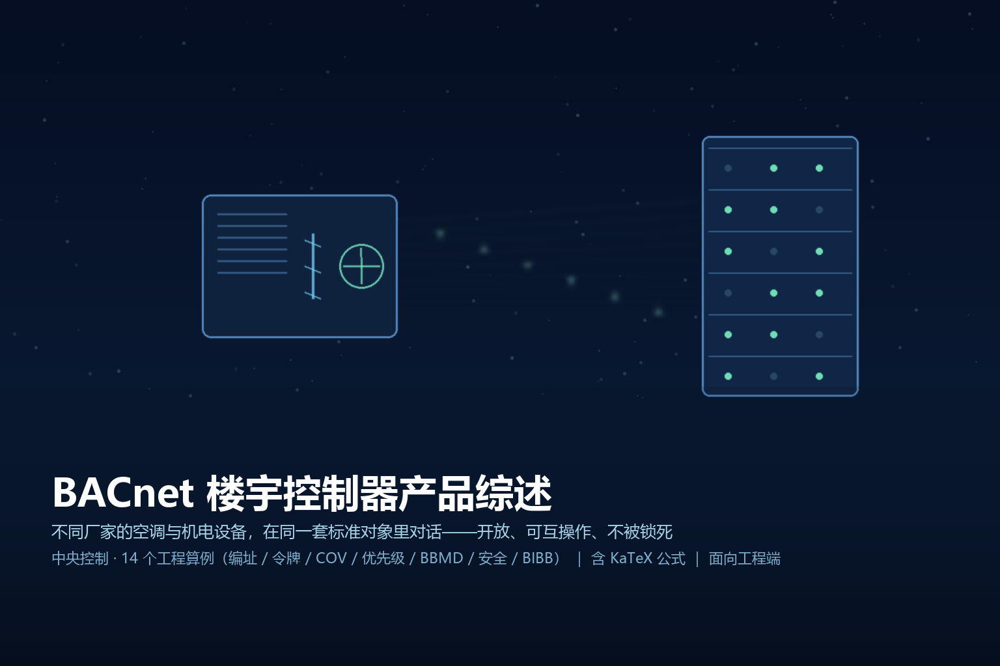
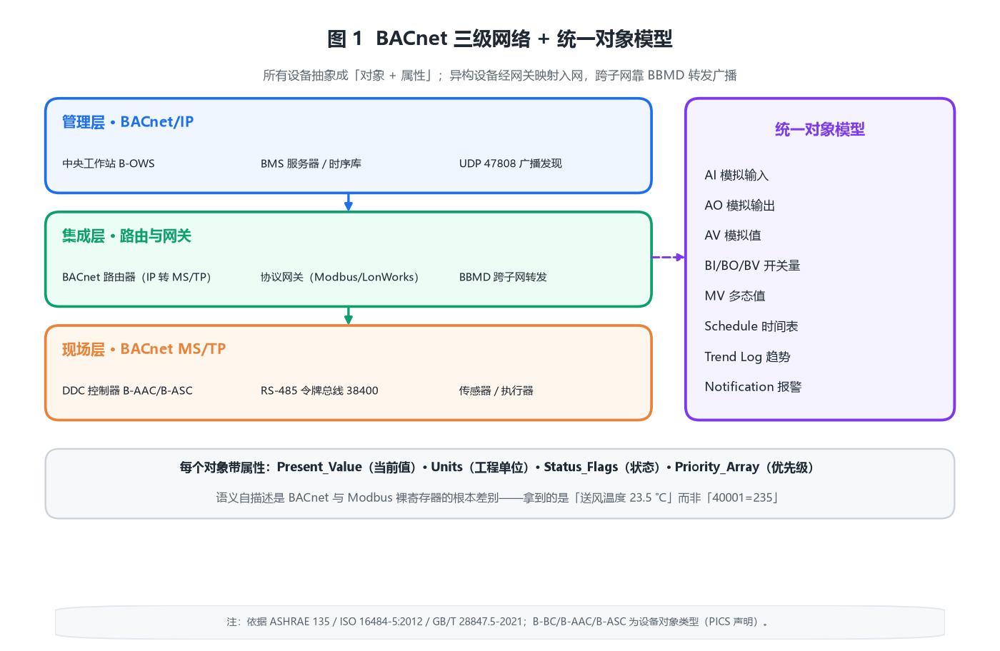
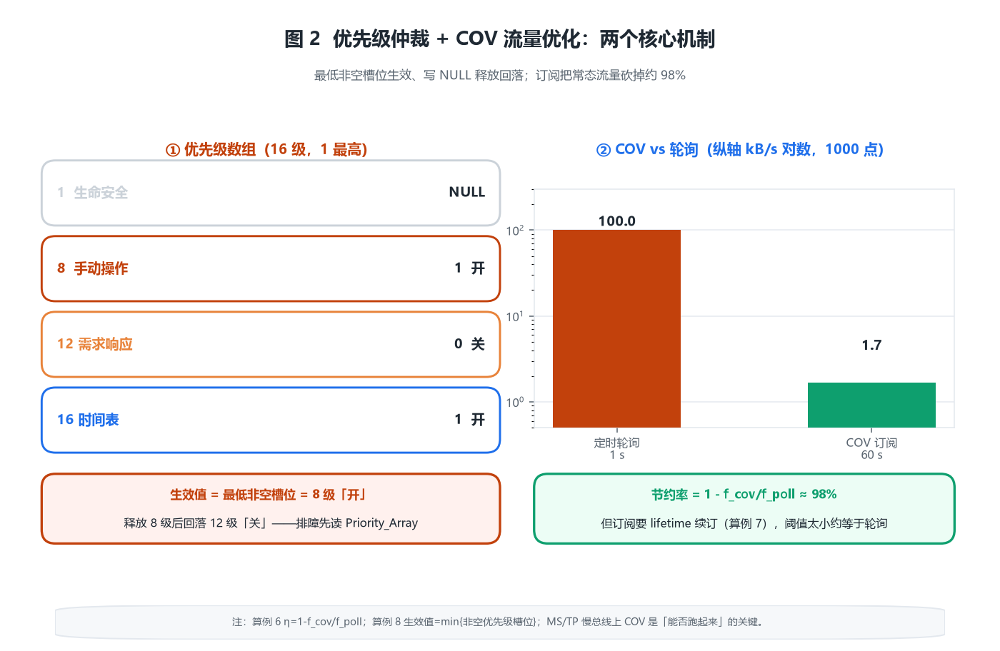
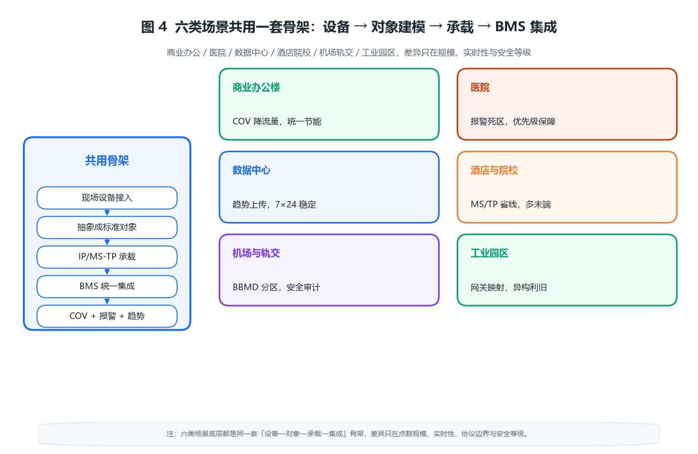

> 
> *概念图：一层楼的空调机组、灯光、电表与水泵被抽象成标准 BACnet 对象，挂在 IP 骨干网与 RS-485 现场总线上，跨平台工作站读的是同一套「对象 + 属性」，而不是各家私有寄存器。示意图。*

# BACnet 楼宇控制器产品综述

## · 面向工程端

---

## 〇 一句话定位

BACnet 楼宇控制器（工程上常称「BACnet DDC 控制器」「楼控控制器」「楼宇自控控制器」「BACnet 现场控制器」）是**遵循楼宇自控领域国际互操作标准（ASHRAE 135 / ISO 16484-5 / GB/T 28847.5）的控制器，它把空调机组、新风机、冷热源、照明、电梯、电表等不同厂商的机电设备，抽象成统一的标准对象（AI/AO/AV/BI/BO/BV/MV 等）与标准服务（读属性、写属性、订阅 COV、设备发现等），让它们能在同一个平台里对话**。它一端接现场的传感器与执行器（温度、湿度、压差、风阀、水阀、变频器），另一端用 BACnet/IP 上以太网、用 BACnet MS/TP 走 RS-485 现场总线，把设备接入楼控系统（BMS）或楼宇自动化平台。**它买的不是「一个能控制的盒子」，而是「不同厂家的设备能互相听懂、且长期不被单一厂商锁死」的互操作能力**——对象建模的规范性、BIBB/PICS 的覆盖度、优先级仲裁的正确性、令牌总线的实时性、跨子网发现、COV 流量优化与安全隔离，决定了这套楼控是真的省事、节能、可扩展，还是在制造「点不动、扫不到、连不上、换不了」的烂尾系统。

> 本系列 control 类已写的《PLC 可编程逻辑控制器》管的是**工业现场的逻辑控制**（顺序、联锁、运动），走的是 Modbus/Profibus 那套寄存器视角；《KNX 智能楼宇控制器》管的是**照明、窗帘、地暖的末端场景控制**，走的是 KNX 总线；本篇 BACnet 管的是**暖通空调与机电设备的跨厂商互操作**——对象是「带语义的设备点」，不是裸寄存器，也不是灯控面板。一句话区分：**PLC 管「机器怎么动」，KNX 管「灯和帘怎么调」，BACnet 管「不同厂家的空调机电怎么在同一张图里对话」**。

> **反直觉点一：两个都贴着「支持 BACnet」标签的设备，不保证能互操作。** BACnet 定义了庞大的对象与服务「菜单」，每个产品只实现其中一个子集。「支持 BACnet」往往只意味着协议栈能跑通、能回 Who-Is；真正决定能不能对接的是双方 **PICS（协议实现一致性声明）里 BIBB（互操作构建块）列表的交集**，以及有没有 **BTL（BACnet 测试实验室）认证**。招标只写「支持 BACnet」，验收时才发现上位机要的 COV 订阅现场控制器根本不支持，只能退回轮询——**四个字的信息量约等于零**（算例 14）。

> **反直觉点二：「点不动」多半不是控制器坏了，是被高优先级写卡住。** BACnet 的命令型对象有 16 级优先级数组（Priority Array），1 级最高（手动生命安全）、16 级最低。任意一个系统写了某级却忘了写 NULL 释放，那个值就一直压着，时间表怎么改都不动。「先读 Priority_Array，再怀疑控制器」是楼控排障的黄金顺序——**90% 的「点不动」是被遗忘的高优先级命令，而不是硬件故障**（算例 8、9）。

> **反直觉点三：传统 BACnet/IP 没有认证、没有加密。** UDP 47808 端口（0xBAC0）在一个 VLAN 里，任意一台设备都能 WriteProperty 改任意点——「开放」在协议层等于「不设防」。工程上靠网络隔离（楼控专用 VLAN、不连外网、远程访问走硬化网关）兜底；新建 IP 项目则应评估 **BACnet/SC（Secure Connect）**——TLS 加密 + X.509 双向证书，代价是约 60% 的报文开销（算例 13）。

> **反直觉点四：COV 不是「越多越好」，它是拿状态管理换流量。** 订阅 COV（Change of Value）能把轮询流量砍掉 98%（算例 6），但订阅要带 lifetime 并定期续订、阈值要调到「既不过报也不漏报」、订阅太多反而制造续订风暴。**轮询简单可靠，COV 省流量但复杂度高**——在慢速 MS/TP 总线上 COV 是「能不能跑起来」的关键，在高速 IP 骨干网上则要权衡是否值得这份复杂度（算例 7）。

**锚定数字**（均有公开标准或稳定来源可查）：**ASHRAE 135**（1995 首发 ANSI/ASHRAE 135-1995，由 SSPC 135 委员会持续维护）／ **ISO 16484-5**（2003 成为 ISO 正式标准，现行 ISO 16484-5:2012）／ **GB/T 28847.5-2021**《建筑自动化和控制系统 第 5 部分：数据通信协议》（2021 年第 3 号国家标准公告发布，TC426 归口、住建部主管，非等效采用 ISO 16484-5:2012）／ **GB 50314-2015**《智能建筑设计标准》／ **GB 50348-2018**《安全防范工程技术标准》／ **GB/T 22239-2019**《网络安全等级保护基本要求》／ **BTL 认证、BIBB、PICS、B-BC/B-AAC/B-ASC 设备对象**（BACnet International / ASHRAE 135.1 一致性测试）／ **BACnet/IP（UDP 47808=0xBAC0）、BACnet MS/TP（RS-485，9600~115200 bps）、BACnet/SC（TLS + WebSocket）**。厂商性能口径（点数容量、扫描周期、并发订阅数）均为**厂商公布、未独立复现，须按统一测法现场验收**。所有工程量均为**工程基准 / 演示估算**，以设备实测与现行有效版本原文为准。

---

## 一、产品设计方案

### 1.1 系统组成：三级网络 + 四类角色 + 一套对象模型

一套 BACnet 楼控在工程上由三级网络、四类设备角色构成，核心是「所有设备用同一套对象模型说话」：

- **管理层（BACnet/IP 以太网）**：中央工作站、服务器、网关接在 IP 骨干网上，用 BACnet/IP（UDP 47808）广播发现设备、读属性、收 COV 与报警；跨子网靠 BBMD（BACnet 广播管理设备）转发广播。
- **骨干/集成层（路由器与网关）**：BACnet 路由器把 IP 网与 MS/TP 现场总线连起来；协议网关把 Modbus 电表、LonWorks 设备、厂商私有协议设备映射成 BACnet 对象——**网关是「异构设备入网」的关键，也是点数映射最容易出错的地方**（算例 2、14）。
- **现场层（BACnet MS/TP 总线）**：DDC 控制器挂在 RS-485 双绞线上，用令牌传递（Master-Slave/Token-Passing）轮流发帧，接传感器与执行器——一条干线典型 32 节点、38400 bps（算例 3、5）。
- **设备角色对象**：B-BC（楼宇控制器，功能最全）、B-AAC（先进应用控制器，如 AHU/冷站）、B-ASC（专用控制器，如末端风机盘管）、B-OWS（操作员工作站）。招标时指定设备对象类型，比写「支持 BACnet」有效得多（算例 14）。

### 1.2 三种部署形态

| 形态 | 做法 | 适用 | 工程取舍 |
|------|------|------|----------|
| 全 BACnet 原生 | 控制器、工作站、网关全用 BACnet 对象与服务 | 新建大型公建、医院、数据中心 | 互操作最好、无协议转换损耗；设备单价高、需专业组态 |
| BACnet/IP 骨干 + MS/TP 现场 | IP 网上层、RS-485 现场总线、路由器相接（主流） | 商业办公、酒店、院校 | 布线省、生态成熟；现场段受令牌周期与波特率约束（算例 3、4） |
| 混合网关集成 | 以 BACnet 为上位统一协议，Modbus/LonWorks/私有协议经网关映射接入 | 改造项目、利旧既有设备 | 保护投资、对接灵活；点数映射与命名规范是主要工作量（算例 2） |

工程上先分清是**新建还是改造**：新建尽量全原生、把对象命名与实例号规划做在前面（算例 1）；改造则用网关把老设备「翻译」成 BACnet 对象，但要为映射表与命名冲突预留工期（4.3、第七章）。

### 1.3 一次「读温度并启风机」的六个动作

```
① 发现：工作站广播 Who-Is，目标设备回 I-Am（报出设备实例号与网络地址）
② 建模：设备内每个点是一个对象（如送风温度=AI:3），带 Present_Value/Units/Status_Flags 属性
③ 读取：ReadProperty 读单点，或 ReadPropertyMultiple 一帧读多点（后者省令牌轮次，算例 4）
④ 订阅：对变化点用 SubscribeCOV 订阅，值变化超阈值才推送，替代高频轮询（算例 6）
⑤ 写入：WriteProperty 写风阀开度 AO:5，带优先级（如优先级 8 手动），可被高优先级抢占（算例 8）
⑥ 释放：操作完写 NULL 释放该优先级，让控制权回落时间表——这一步最常被漏（算例 9）
```

### 1.4 系统架构图


*图 1：BACnet 三级网络——IP 管理层（工作站/BBMD）、路由集成层、MS/TP 现场层（DDC 控制器接传感器与执行器）；所有设备统一抽象为「对象 + 属性」，异构设备经网关映射入网。*

---

## 二、核心参数与选型

### 2.1 关键参数清单（工程基准）

下表为招标文件常见技术要求与工程基准（厂商口径已标注，未独立复现），具体以厂家 datasheet、PICS、实测与现行标准原文为准：

| 参数 | 典型区间 / 要求 | 选型含义 |
|------|----------------|----------|
| 标准符合 | ASHRAE 135 / ISO 16484-5 / GB/T 28847.5-2021 | 以现行版本为准，要求提供 PICS + BTL 认证 |
| 数据链路 | BACnet/IP（UDP 47808）、MS/TP（RS-485）、BACnet/SC（TLS） | 骨干用 IP、现场用 MS/TP、新项目评估 SC（算例 13） |
| 设备对象类型 | B-BC / B-AAC / B-ASC / B-OWS | 按层级指定，比「支持 BACnet」有效（算例 14） |
| 设备实例号 | 0~4,194,302（22 bit），4,194,303 保留通配 | 全网唯一，规划编码防重复（算例 1） |
| MS/TP 波特率 | 必支持 9600 与 38400；可选 19200/57600/76800/115200 | 工程默认 38400，大点数读用高波特率（算例 4） |
| MS/TP 节点 | 主站 MAC 0~127；标准负载 32 节点/段、1/4 负载可达 128 | 一条干线控制在 32 节点/900 m 内（算例 5） |
| 优先级数组 | 16 级，1 最高、16 最低；写 NULL 释放 | 火警占 1/2 级，操作完必须释放（算例 8、9） |
| COV 订阅 | 带 COV Increment 阈值与 lifetime 续订 | 省流量但需状态管理（算例 6、7） |
| 点数容量 | B-AAC 典型 30~200 点（厂商口径） | 一台 AHU 约 20~35 点，按对象清单核算（算例 2） |
| 一致性 | BIBB 覆盖度、PICS 声明、BTL 认证 | 招标逐项核对，木桶效应看交集（算例 14） |
| 安全 | 传统 BACnet 无认证，靠 VLAN 隔离；新项目 BACnet/SC | 楼控网独立、不连外网、远程走硬化网关（算例 13） |
| 趋势与报警 | Trend Log 采样周期、Notification Class 死区/延时 | 存储容量与报警风暴要预算（算例 11、12） |

### 2.2 十四个原创工程算例

下面每一条都是编址、建模、定实时性、算流量、配优先级、做跨网段、过安全时要真算的账，标号贯穿正文。参数按「工程基准 / 演示估算 / 厂商口径」给出，以设备实测为准。

**【算例 1】设备实例号 22 bit 编码规划——它不是瓶颈，重复才是灾难**

BACnet 设备实例号是 22 bit，范围 $0\sim4{,}194{,}302$，共 $2^{22}=4{,}194{,}304$ 个号，其中 4,194,303（0x3FFFFF）保留作通配「未知/所有设备」：

$$N_{\max}=2^{22}=4{,}194{,}304$$

工程上按「建筑群—楼层—设备」分段编码，取 8 bit 建筑群 + 6 bit 楼层 + 8 bit 设备 = 22 bit：单栋楼可编 $2^6\times2^8=64\times256=16{,}384$ 台，256 栋楼才满编。**容量极其宽裕，真正的风险是重复**——第二个承包商常把设备留厂默认值（如 1001），两个设备用同一实例号回 I-Am，上位机就会出现「一台设备点值乱跳、数据串到另一台」的怪现象。**结论：实例号不是技术问题，是管理问题——开工前发一张全局编号表，进场先扫重号**（算例 14、第七章）。

**【算例 2】一台空调机组的点数核算——对象建模落到一个个 AI/AO/BI/BO**

以一台典型空调机组（AHU）为例，按 BACnet 对象类型列点表：

| 对象类型 | 含义 | 典型点数 | 举例 |
|----------|------|----------|------|
| AI | 模拟输入（传感器） | 8 | 送/回/新风温度、湿度、CO₂、风压压差、滤网压差 |
| AO | 模拟输出（执行器） | 4 | 风阀、冷热阀、加湿阀开度、风机变频给定 |
| BI | 二进制输入（状态） | 5 | 风机运行/故障、滤网堵塞、手自动、低温报警 |
| BO | 二进制输出（控制） | 3 | 风机启停、加热启停、报警输出 |
| 合计 | — | **20** | 加内部 AV/BV 与 Device 对象，一台控制器约 25~35 点 |

一栋 20 层的楼，每层 2 台 AHU = 40 台，按 25 点/台 → $40\times25=1{,}000$ 点。一台 B-AAC 控制器容量约 30~200 点（厂商口径），本项目按一机一控制器配置，40 台 AHU 对应 40 台控制器。**结论：点数核算是选型第一步——先把对象清单列全（含内部 AV/BV），再定控制器型号，别按「大概几十点」拍脑袋**（4.3、案例一）。

> 
> *图 2：左——16 级优先级数组仲裁（最低非空槽位生效，写 NULL 释放后回落）；右——COV 订阅与定时轮询的流量对比，订阅把常态流量砍掉约 98%。*

**【算例 3】MS/TP 令牌环一轮时间——现场总线的「实时性」由它决定**

MS/TP 是令牌总线：只有拿到令牌的主站才能发帧，主站按 MAC 地址顺序轮流传递。一轮（所有主站各发一帧）时间近似：

$$T_{\mathrm{rot}}=N\left(t_{\mathrm{turn}}+t_{\mathrm{frame}}\right)+t_{\mathrm{token}}$$

取主站数 $N=32$，turnaround 时间 $t_{\mathrm{turn}}\approx4\ \mathrm{ms}$（38400 bps 下约 15 字符时间），帧长 64 字节、38400 bps 下一帧 $t_{\mathrm{frame}}=64\times10/38400\approx16.7\ \mathrm{ms}$，则：

$$T_{\mathrm{rot}}=32\times(4+16.7)\approx662\ \mathrm{ms}\approx0.66\ \mathrm{s}$$

**这就是 MS/TP 现场段的「轮询周期下限」——一条告警从发生到上位机看到，最坏要等约一轮 0.66 s**。想更快只有三条路：减节点、提波特率、或用 COV 让设备主动推。`Max_Master` 要设成实际最高主站地址：若实际最高 MAC=32 却设成默认 127，主站会空轮询 95 个不存在的地址，白白拉长令牌环（算例 5）。

**【算例 4】波特率 vs 帧传输时间——为什么默认要用 38400**

一帧长 $L=256$ 字节（ReadPropertyMultiple 一次读多点的返回帧），UART 每字节 10 bit（1 起始 + 8 数据 + 1 停止）：

$$t_{\mathrm{frame}}=\frac{L\times10}{R}$$

| 波特率 | 一帧传输时间 | 相对 9600 |
|--------|--------------|-----------|
| 9600 bps | $256\times10/9600=267$ ms | 1× |
| 38400 bps | $256\times10/38400=66.7$ ms | 4× 快 |
| 115200 bps | $256\times10/115200=22.2$ ms | 12× 快 |

标准强制要求 MS/TP 设备支持 9600 与 38400，工程默认多用 38400。**结论：大点数读一定要「高波特率 + ReadPropertyMultiple」组合——单点单帧轮询会把令牌环拖垮**：同样 100 个点，逐点轮询要 100 帧、100 次令牌轮转，多帧读可能几帧就够（算例 3、6）。

**【算例 5】RS-485 段长、节点数与终端电阻——「多拉几根线多挂几个」是翻车源头**

MS/TP 物理层是 RS-485 双绞线，工程基准（折减值，以线缆与收发器规格为准）：

- **段长**：9600 bps 理论最大 1200 m，38400 bps 建议 ≤ 900 m（波特率越高、衰减与反射越严重）；
- **节点**：标准单位负载收发器 32 节点/段，1/4 单位负载可到 128 节点；
- **终端电阻**：只在总线两端各接 1 个 120 Ω，中间节点绝不接（接了阻抗失配、信号反射）；
- **偏置电阻**（bias）：只在总线一处（通常在路由器端）加装，保证空闲时 A/B 线电平确定。

一台 IP 路由器带 3 条 MS/TP 干线，按标准负载 $3\times32=96$ 台现场控制器。**结论：一条 38400 bps 干线最好控制在 32 节点 / 900 m 内，超了就分段加路由器**——为了省一台路由器而把段拉到 40 节点、1500 m，换来的是 sporadic 丢帧与半夜的故障电话。

**【算例 6】COV 订阅 vs 定时轮询——省下 98% 流量的核心手段 ★**

一个温度点：定时轮询周期 1 s，每帧（请求+响应）约 100 字节 → 流量 100 B/s。改用 COV：温度平均每 60 s 才变化超过阈值一次，每次 notification 约 100 字节 → 流量 $100/60=1.67$ B/s。帧大小相同时节约率：

$$\eta=1-\frac{f_{\mathrm{cov}}}{f_{\mathrm{poll}}}=1-\frac{1/60}{1}=98.3\%$$

放大到 1000 个点：轮询 $1000\times100=100\ \mathrm{kB/s}=800\ \mathrm{kbps}$——对 38400 bps 的 MS/TP 总线是灭顶之灾；COV 只需 $1000\times1.67=1.67\ \mathrm{kB/s}=13.4\ \mathrm{kbps}$，总线轻松承载。**结论：在慢速现场总线上，COV 是「系统能不能跑起来」的关键，不是锦上添花**——但前提是阈值（COV Increment）设得合理，阈值太小约等于轮询，太大则漏报（算例 7）。

**【算例 7】COV lifetime 续订流量——省流量是要付状态管理成本的**

SubscribeCOV 订阅带 lifetime（如 300 s），客户端必须在 lifetime 内续订，否则服务器认为订阅失效、停止推送。1000 个订阅点，每 150 s（半个 lifetime）续订一次、每次约 80 字节：

$$r_{\mathrm{renew}}=\frac{1000}{150}=6.7\ \mathrm{frame/s}\quad\Rightarrow\quad C_{\mathrm{renew}}=6.7\times80=533\ \mathrm{B/s}\approx4.3\ \mathrm{kbps}$$

若 lifetime 设成 60 s（每 30 s 续订）→ 续订率飙到 33 帧/s = 2.7 kB/s，反而在制造流量。**结论：lifetime 一般设为轮询周期的 2~3 倍（300~900 s），续订安排在过期前 1/2；COV 的「省」是以客户端维护订阅状态为代价的**——客户端重启后若不重新订阅，设备不会主动推，表现为「装完正常、重启后没数据」。

**【算例 8】优先级数组 16 级仲裁——「点不动」的真相 ★**

一个送风机 BO 对象，Present_Value 被多个来源写：

| 优先级 | 来源 | 写入值 |
|--------|------|--------|
| 1 | 手动生命安全 | NULL |
| 8 | 手动操作员 | 1（开） |
| 12 | 节能系统（需求响应） | 0（关） |
| 16 | 时间表 | 1（开） |

生效值取「优先级号最小的非空槽位」：

$$v_{\mathrm{active}}=v_{\arg\min\{\,p\,|\,v_p\neq \mathrm{NULL}\,\}}=v_8=1\ (\mathrm{ON})$$

操作员写 NULL 释放优先级 8 → 回落优先级 12 = 0（关）；节能系统也释放 → 回落优先级 16 = 1（开）；全部 NULL → 用 Relinquish_Default。标准定义 1=手动生命安全、2=自动生命安全、5=关键设备控制、6=最小开/关、8=手动操作员。**结论：火警/生命安全占 1、2 级永远压过其它；排障第一步是读 Priority_Array 看哪一级卡着，不是拆控制器**（算例 9）。

**【算例 9】优先级残留遗忘的稳态卡点数——验收必查的隐藏缺陷**

一个项目 200 个可控点，调试/检修/节能临时写平均每周每点 0.5 次，写后忘记 relinquish 的概率 5%。若遗留命令平均要等季度巡检（约 45 天窗口）才发现清除，稳态遗留点数：

$$L\approx N\cdot r\cdot p\cdot\frac{45}{7}=200\times0.5\times0.05\times6.4\approx32\ \mathrm{pts}$$

**200 个点里约 32 个（16%）可能长期被残留命令卡着**——这是 BACnet 项目最典型的隐藏缺陷：系统上线时一切正常，几个月后陆续冒出「某台风机不按时间表启停」。**结论：投运前必须跑一遍 Priority_Array 巡检脚本，把所有非默认槽位清零；运维规程要写明「谁写谁释放」**（算例 8、第八章 SLA）。

**【算例 10】BBMD 广播跨子网放大——园区越大越要收窄发现范围**

BACnet 发现依赖广播，而 IP 路由器不转发广播。每个子网放 1 台 BBMD，各自的广播分发表（BDT）列出其它 BBMD。一个 Who-Is 广播：本地投递 1 次 + 转发到其余 $M-1$ 个 BBMD，每个子网收到 $M$ 份，全园区广播帧数：

$$N_{\mathrm{bc}}=M\times M=M^2$$

园区 $M=4$ 个子网 → $4^2=16$ 份；$M=10$ → 100 份，广播流量按子网数**平方**增长。BDT 上限 128 项，即单 BBMD 理论管理 128 个子网。笔记本作 Foreign Device 注册 TTL=600 s，须每 <600 s 刷新注册。**结论：BBMD 解决跨子网发现，但广播按 $M^2$ 放大——大园区要用带实例区间限制的 Who-Is 收窄范围，或转向无广播的 BACnet/SC**（算例 13）。

**【算例 11】趋势日志存储容量——别指望存在控制器里**

一个 Trend Log 点每 5 min 记一条，一年记录数：

$$n_{\mathrm{rec}}=\frac{86400}{5\times60}\times365=288\times365=105{,}120\ \mathrm{rec/yr}$$

每条 16 字节（时间戳 + 值 + 状态 + 开销）→ 单点 $105{,}120\times16\approx1.68\ \mathrm{MB/yr}$；500 个趋势点 → $500\times1.68=840\ \mathrm{MB/yr}$。采样间隔改 1 min 则 5 倍 = 4.2 GB/年。控制器本地 Flash 常为几十到几百 MB，只能存短期缓冲：

$$C=n_{\mathrm{pt}}\cdot\frac{86400}{T_{\mathrm{sample}}}\cdot365\cdot s$$

**结论：趋势日志本地只留缓冲，长期归档必须上传上位机/时序库——否则几个月写满 Flash，控制器直接故障**（案例二、第八章）。

**【算例 12】报警风暴与死区抑制——真正的故障不能被误报淹没**

一栋楼 1000 个可报警模拟点，冷冻站故障触发 5% 连锁报警 = 50 条，每条 notification 约 200 字节 → 10 kB/s 突发，30 s 内 300 kB。若其中 30 条是测量抖动引起的误报，给 Notification Class 配死区（温度 0.5 ℃）+ 报警延时（持续超限 10 s 才报），抑制 80% 误报：

$$r_{\mathrm{eff}}=r_{\mathrm{raw}}\left(1-\eta_{\mathrm{sup}}\right)=50\times(1-0.8\times0.6)\approx26\ \mathrm{alarms}$$

（其中 0.6 为误报占比、0.8 为抑制率），突发流量降到约一半。**结论：没有死区与延时的报警系统会被「报警风暴」淹没，真故障反而被埋掉——Notification Class 的优先级、死区、延时参数是验收重点**（案例一）。

**【算例 13】BACnet/SC 加密开销 vs 无认证风险——开放等于不设防**

传统 BACnet/IP 走 UDP 47808、无认证无加密。一个 VLAN 内 50 台设备，任意一台（或私自接入者）都能 WriteProperty 改任意点：

$$\mathrm{AttackSurface}=N_{\mathrm{dev}}=50\ \mathrm{devices}$$

BACnet/SC 用 TLS + WebSocket + X.509 双向证书、hub-and-spoke 拓扑。一条 write APDU 明文 60 字节，加 TLS 记录头、MAC、padding 约 +35 字节 → 95 字节，开销：

$$\eta_{\mathrm{tls}}=\frac{95-60}{60}\approx58\%$$

一次 TLS 握手 5~7 个往返，冷启动 100~300 ms。**结论：传统 BACnet 的「开放」在协议层等于「不设防」，只能靠 VLAN 隔离兜底；BACnet/SC 用约 60% 报文开销换认证与加密，是新建 IP 项目的推荐方向**（第四章、第七章）。

**【算例 14】BIBB / PICS 互操作覆盖率——「支持 BACnet」四个字的信息量 ★**

招标要求 15 项 BIBB（如 DS-RP-B 读属性、DS-WP-B 写属性、DS-COV-B 订阅、DM-DDB-B 设备发现、AE-N-I-B 报警通知等）。厂商 A 的 PICS 声明覆盖 11 项：

$$\mathrm{Coverage}=\frac{11}{15}=73.3\%$$

缺口 4 项中包含 DS-COV-B——意味着它不支持 COV 订阅，上位机的订阅功能对它就失效，只能退回轮询。厂商 B 覆盖 15/15 但报价高 20%。互操作遵循**木桶效应**：系统整体能力 = 各方 BIBB 的**交集**，任一方缺项，对应功能就在那一对设备间失效。**结论：验收必须逐项核对 PICS 的 BIBB 列表 + 查 BTL 认证，把缺口写进技术协议——「支持 BACnet」不等于「能和你对接」**（反直觉点一、第七章）。

---

## 三、技术原理

### 3.1 对象建模：把设备拆成带语义的「对象 + 属性」

BACnet 的核心不是「传数据」，而是「传带语义的数据」。每台设备是一个 Device 对象，内含若干标准对象：模拟输入 AI（传感器）、模拟输出 AO（执行器）、模拟值 AV（设定值）、二进制输入/输出/值 BI/BO/BV（开关量）、多态值 MV（多档状态），以及 Schedule（时间表）、Trend Log（趋势）、Notification Class（报警类）等。每个对象有 Present_Value、Object_Name、Description、Units、Status_Flags、Out_Of_Service 等属性。**对象类型 + 工程单位 + 属性语义**让上位机拿到「送风温度 23.5 ℃」而不是「寄存器 40001 = 235」——这是 BACnet 与 Modbus 的根本差别。对象实例号要按编码规划全局唯一（算例 1、2）。

### 3.2 服务与交互：读、写、订阅、发现四类动词

对象是名词，服务是动词：**ReadProperty / ReadPropertyMultiple**（读一到多个属性，后者省令牌轮次）、**WriteProperty**（写属性，带优先级）、**SubscribeCOV / COVNotification**（订阅变化并按阈值推送，算例 6）、**Who-Is / I-Am 与 Who-Has / I-Have**（设备与对象发现）、**ConfirmedEventNotification / GetEventInformation**（报警事件）、**DeviceCommunicationControl / ReinitializeDevice / TimeSynchronization**（设备管理）。订阅的 lifetime 与续订是状态化交互，客户端重启后要重建订阅（算例 7）。

### 3.3 数据链路：IP / MS/TP / SC 三层分工

同一套对象与服务跑在多种数据链路上：**BACnet/IP** 把 APDU 封装进 UDP（默认端口 47808=0xBAC0），跨子网靠 BBMD 转发广播（算例 10）；**BACnet MS/TP** 在 RS-485 上用令牌传递实现多主通信，波特率与节点数受物理层约束（算例 3、4、5）；**BACnet/SC** 用 TLS 加密的 WebSocket 连接 hub，X.509 双向认证、无广播域，适合跨 IT 网络的安全部署（算例 13）。BACnet 还有以太网、PTP 等链路，工程中最常见是「IP 骨干 + MS/TP 现场」。

### 3.4 优先级数组与命令仲裁：多写者共享一个点的确定性机制

命令型对象（AO/BO/AV/BV 的 Present_Value）内部是 16 槽优先级数组，1 级最高、16 级最低。多个系统各写自己那一级，对象永远服从最低编号的非空槽位；写 NULL 释放该槽，控制权回落次高；全空则用 Relinquish_Default。这套机制让「火警强开风机」「手动override」「节能关停」「时间表常态控制」能安全共享一个点而不需要仲裁程序——**但前提是每个写者都记得释放**（算例 8、9）。写后应同时读回 Priority_Array 与 Present_Value 核对，这是调试规范。

### 3.5 一致性与互操作：BIBB、PICS、BTL 三件套

BACnet 用 **BIBB（互操作构建块）**描述「设备能扮演什么角色、执行什么服务」（如 DS-RP-B=读属性服务端、DS-COV-U=COV 客户端）；每个厂商用 **PICS** 声明自己实现了哪些 BIBB 与对象类型；**BTL（BACnet 测试实验室）认证**由独立实验室按 ASHRAE 135.1 一致性测试验证。工程选型要看的不是 logo，而是三件套：**PICS 逐项对照需求、BTL 认证查有效性、设备对象类型（B-BC/B-AAC/B-ASC）匹配层级**（算例 14）。

---

## 四、产品功能与差异化

### 4.1 三种形态功能矩阵

| 能力 | 全 BACnet 原生 | IP 骨干 + MS/TP 现场 | 混合网关集成 |
|------|---------------|---------------------|-------------|
| 互操作性 | 最优（同一对象模型） | 良好（原生分层） | 取决于映射质量 |
| 现场布线 | 需 IP 到现场 | RS-485 省线（主流） | 复用既有线缆 |
| 实时性 | 高（IP 毫秒级） | 受令牌周期约束（算例 3） | 受网关转发影响 |
| 改造利旧 | 差（推倒重来） | 中 | 优（翻译老设备） |
| 适用 | 新建大型公建 | 商业/酒店/院校（主流） | 改造项目 |

### 4.2 边界：和相邻控制系统的分工

- **vs PLC**（本系列 plc-controller）：PLC 面向工业逻辑与运动控制，扫描周期毫秒级、强实时，协议多是 Modbus/Profibus；BACnet 面向楼宇机电的互操作，实时性要求宽松（秒级），强在跨厂商语义互通。产线上的联锁用 PLC，楼里的空调群控用 BACnet。
- **vs KNX**（本系列 knx-controller）：KNX 是照明/窗帘/地暖的末端场景总线，面向面板与传感器、以功能块组态；BACnet 面向 AHU/冷站等机电设备、以对象建模。二者常共存，经网关互通。
- **vs Modbus 网关**：Modbus 暴露裸寄存器、无自描述，靠点表约定；BACnet 对象自带语义与单位。网关把 Modbus 电表映射成 BACnet 对象时，要逐点写清寄存器、数据类型、缩放与工程单位——**这是异构集成的主要工作量**（算例 2）。

### 4.3 网关集成的价值与代价

改造项目里，既有电表、冷水机组、电梯往往只提供 Modbus 或私有协议。BACnet 网关把它们「翻译」成标准对象，保护投资、统一上位接口。代价是**映射表**：每个点要定义源寄存器/功能码、数据类型与字节序、缩放系数、目标 BACnet 对象类型与实例、工程单位——一个 500 点的改造项目，映射表就是 500 行需要逐行核对的配置。**「网关接入」不等于「即插即用」，命名规范与点表核对必须写进合同交付物**（案例二）。

### 4.4 可靠性与安全设计四件事

① **网络隔离**：楼控网独立 VLAN、不连外网、远程访问走硬化网关或 VPN（算例 13）；② **编号管理**：设备实例号全局规划、进场扫重号（算例 1）；③ **写入规程**：谁写谁释放、写后读回 Priority_Array（算例 8、9）；④ **一致性验收**：PICS 逐项核对 + BTL 认证 + 现场互操作测试（算例 14）。新建 IP 项目再叠加 BACnet/SC 与证书管理。

---

## 五、应用场景


*图 4：六类场景共用「设备→对象建模→IP/MS/TP 承载→BMS 集成」骨架，差异只在点数规模、实时性要求、协议边界与安全等级。*

### 5.1 商业办公楼

痛点：多厂商空调、照明、电表各成体系，无法统一监控与节能。方案：BACnet/IP 骨干 + MS/TP 现场，各厂商设备统一建模，COV 订阅降流量（算例 6）。价值：一套平台看全楼、按能耗分区优化，换厂商不用推翻上位系统（案例一）。

### 5.2 医院

痛点：手术室、ICU 的温湿度与压差要求严格，报警必须可靠、不能误报淹没。方案：B-AAC 控制器 + Notification Class 死区/延时（算例 12）+ 优先级保障关键区域（算例 8）。价值：关键区域环境稳定、报真警、可追溯（案例一）。

### 5.3 数据中心

痛点：精密空调与冷站要求 7×24 稳定、趋势数据长期留存用于容量与能效分析。方案：BACnet/IP + 趋势日志上传时序库（算例 11）+ 冗余网络。价值：能耗可分析、故障可回溯、扩容有数据支撑（案例二）。

### 5.4 酒店与院校

痛点：客房/宿舍末端数量巨大、布线成本高。方案：MS/TP 现场总线（算例 5）+ 高波特率多帧读（算例 4）+ 1/4 负载收发器扩节点。价值：一根双绞线串起几十台末端，大幅省线（案例二）。

### 5.5 机场与轨道交通

痛点：跨子网、跨建筑，设备发现困难，广播风暴风险高。方案：BBMD 分区 + 收窄 Who-Is 范围（算例 10），或 BACnet/SC 无广播架构（算例 13）。价值：跨区统一管理、广播可控、安全可审计。

### 5.6 工业与园区综合

痛点：楼控（BACnet）、产线（Modbus/PLC）、安防各成孤岛。方案：BACnet 作上位统一协议，网关映射异构设备（算例 2、4.3）。价值：一张图看全园区、利旧既有投资、统一运维（案例三）。

---

## 六、实际案例（需求→方案→核算→价值）

### 案例一：新建 20 层医院门诊楼——全 BACnet 原生 + 报警死区 + 优先级保障

**需求**：某三甲医院门诊楼，20 层，空调机组、新风机、照明、电表来自 3 个厂商，要求统一平台上监控、手术室与 ICU 温湿度严格、报警不误报不漏报，且后续换设备不能被单一厂商锁定。

**方案**：BACnet/IP 骨干 + MS/TP 现场 + B-AAC/B-ASC 控制器，全设备统一对象建模，关键区域报警配死区与延时，全局实例号编码规划。

**配置核算**：
- 点数：40 台 AHU × 25 点 ≈ 1,000 点（算例 2），另加照明与电表约 800 点，合计约 1,800 点；
- 编号：按「建筑群—楼层—设备」8+6+8 编码，单栋容量 16,384 台，余量充足（算例 1）；
- 流量：1,800 点若轮询（1 s）约 180 kB/s，改 COV 阈值 0.5 ℃ 后常态约 3 kB/s，降约 98%（算例 6）；
- 报警：手术室温度死区 0.5 ℃ + 延时 10 s，误报抑制约 80%，报警风暴不复现（算例 12）；
- 一致性：招标要求 15 项 BIBB，中选厂商 PICS 覆盖 15/15 且有 BTL 认证（算例 14）。

**交付价值**：一套平台看全楼、三厂商设备互操作、换设备不需推翻上位系统，关键区域环境达标、报警可信。**关键决策是「把互操作写进合同（PICS + BTL），而不是信 logo」**。

### 案例二：数据中心改造——网关利旧 + 趋势上传 + MS/TP 分段

**需求**：某地市数据中心改造，既有精密空调、电表、冷水机组多为 Modbus 或私有协议，要求接入统一 BACnet 平台、保留既有投资、趋势数据留存 1 年用于能效分析，施工不能断网。

**方案**：BACnet/IP 上位 + 协议网关映射老设备 + MS/TP 分段接末端，趋势日志上传时序库。

**配置核算**：
- 映射：500 点 Modbus→BACnet，逐点定义寄存器/类型/缩放/单位/对象实例，映射表 500 行（算例 2、4.3）；
- 现场段：一条 38400 bps 干线控 32 节点/900 m，超出分 3 段加路由器（算例 3、5）；
- 趋势：500 个趋势点 × 1.68 MB/年 ≈ 840 MB/年，本地只留 7 天缓冲，长期上传时序库（算例 11）；
- 令牌：32 主站一轮约 0.66 s，改造后实测告警到上位机 <1 s，满足运维要求（算例 3）。

**交付价值**：保护既有设备投资、统一监控界面、趋势数据可分析、扩容有依据。**这里的取舍是「用映射表的工作量换掉整楼设备的更换成本」**——改造项目的性价比核心。

### 案例三：园区多子网集成——BBMD 分区 + BACnet/SC 安全试点

**需求**：某科技园区 10 个子网分布多栋楼，楼控设备跨子网发现困难，且园网与办公网互通、存在未授权写入风险，要求统一管理并消除安全隐患。

**方案**：每子网 1 台 BBMD 分区转发广播、Who-Is 带实例区间收窄；新建区域试点 BACnet/SC（TLS + 证书）替代传统 BACnet/IP。

**配置核算**：
- 广播：10 子网 BBMD 广播按 $M^2=100$ 份放大，收窄 Who-Is 范围后降到约 1/5（算例 10）；
- 安全：传统 BACnet/IP 一个 VLAN 内 50 台任意可写，改 SC 后证书双向认证、攻击面收敛（算例 13）；
- 开销：SC 报文 +58% 开销，园区网带宽充裕、可接受（算例 13）；
- 编号：全网重新规划实例号并扫重号，消除 2 处出厂默认值冲突（算例 1）。

**交付价值**：跨子网统一发现、广播可控、未授权写入被阻断。**这个案例证明「开放协议的安全性靠架构补」——传统 BACnet 的短板要用 VLAN 隔离或 BACnet/SC 主动治理**。

---

## 七、市场背景与竞争格局

BACnet 是楼宇自控领域最广泛使用的开放协议：1987 年 ASHRAE 发起标准化、1995 年成为 ANSI/ASHRAE 135、2003 年成为 ISO 16484-5，中国对应 GB/T 28847.5-2021。它的设计初衷就是打破厂商专有网关、实现 HVAC 设备的互操作，如今已从空调扩展到照明、门禁、电表、电梯等全楼宇机电。三类玩家同台：

- **国际楼控大厂**：控制器、工作站、BMS 平台全栈，BACnet 生态成熟、BTL 认证齐全，强在大型公建与医院（案例一）。
- **国产楼控与自动化厂商**：性价比高、本地化服务强、信创适配好，在中型项目与改造市场快速渗透（案例二）。
- **网关与集成商**：不造控制器，专做异构协议映射与系统集成，是改造项目与多厂商环境的关键角色（案例三）。

**竞争焦点已从「支持不支持 BACnet」转向四点**：①**互操作深度**（BIBB 覆盖、BTL 认证、对象语义一致性，算例 14）；②**安全能力**（BACnet/SC 支持、证书管理、网络隔离方案，算例 13）；③**开放与利旧**（网关映射质量、点表规范性，算例 2）；④**工程效率**（COV/多帧读降流量、令牌周期优化，算例 3、6）。**选型要问的不是「支持 BACnet 吗」，而是「PICS 覆盖哪些 BIBB、有没有 BTL 认证、跨厂商实测能不能对上」**。

---

## 八、商业模式与趋势

**预算结构**（工程估算）：控制器（DDC/B-AAC/B-ASC）约 35~45% / 工作站与软件平台 15~20% / 传感器与执行器 15~20% / 网关与集成映射 10~15% / 布线与施工 10~15% / 运维 5%。点数规模与互操作深度是成本大头，网关映射工作量是改造项目的主要变量（算例 2）。

**SLA 要点**：现场段告警到上位机 <1 s（算例 3）；COV 订阅可用率与续订成功率（算例 7）；投运前 Priority_Array 非默认槽位清零（算例 9）；趋势数据按 1 年在线 + 长期归档（算例 11）；报警死区/延时参数逐点会签（算例 12）；BIBB 覆盖与 BTL 认证写进合同（算例 14）。

**趋势**：① **BACnet/SC 普及**——TLS + 双向证书成为新建 IP 项目的安全标配；② **开放互操作深化**——BIBB 覆盖度与 BTL 认证成为招标硬指标；③ **IT/OT 融合**——楼控网与 IT 网在安全隔离前提下互通，边缘网关与时序库成标配；④ **国产化与信创**——国产控制器与平台在中大型项目加速替代。

---

## 附录

### 附录 A：核算清单速查

| 核算项 | 公式 | 示例 |
|--------|------|------|
| 实例号容量 | $N=2^{22}$ | 4,194,304 个（末号保留通配） |
| 单点数核算 | AI+AO+BI+BO+内部点 | 一台 AHU ≈ 25~35 点 |
| 令牌一轮 | $T=N(t_{\mathrm{turn}}+t_{\mathrm{frame}})$ | 32 站 @38400 ≈ 0.66 s |
| 帧传输时间 | $t=L\times10/R$ | 256 B @38400 ≈ 66.7 ms |
| RS-485 段 | 32 节点 / ≤900 m @38400 | 两端 120 Ω 终端 |
| COV 节约率 | $\eta=1-f_{\mathrm{cov}}/f_{\mathrm{poll}}$ | 60 s vs 1 s ≈ 98% |
| 续订流量 | $r=N_{\mathrm{sub}}/t_{\mathrm{renew}}$ | 1000 点/150 s ≈ 4.3 kbps |
| 优先级生效 | $\min\{p\mid v_p\neq\mathrm{NULL}\}$ | 8 级开压过 16 级关 |
| 残留卡点 | $L=N\cdot r\cdot p\cdot W/7$ | 200 点约 32 个遗留 |
| BBMD 广播放大 | $N_{\mathrm{bc}}=M^2$ | 10 子网 → 100 份 |
| 趋势容量 | $C=n\cdot\frac{86400}{T}\cdot365\cdot s$ | 500 点 @5min ≈ 840 MB/年 |
| SC 加密开销 | $\eta=(L_{\mathrm{tls}}-L)/L$ | 60→95 B ≈ 58% |
| BIBB 覆盖率 | 覆盖数/要求数 | 11/15 ≈ 73% |

### 附录 B：术语表

- **BACnet**：Building Automation and Control Networks，楼宇自动化控制网络协议，ASHRAE 135 / ISO 16484-5 / GB/T 28847.5。
- **对象（Object）**：BACnet 把设备点抽象成带属性与语义的数据集合，如 AI/AO/AV/BI/BO/BV/MV、Schedule、Trend Log。
- **属性（Property）**：对象的字段，如 Present_Value（当前值）、Units（工程单位）、Status_Flags（状态标志）。
- **BIBB**：BACnet 互操作构建块，描述设备能扮演的角色与执行的服务，是互操作能力的基本单位。
- **PICS**：协议实现一致性声明，厂商声明自己支持的 BIBB、对象与服务，选型核对依据。
- **BTL**：BACnet 测试实验室，按 ASHRAE 135.1 做一致性测试并发布认证产品列表。
- **优先级数组（Priority Array）**：命令型对象的 16 槽仲裁机制，1 级最高、写 NULL 释放。
- **COV**：Change of Value，值变化超阈值才推送的订阅机制，替代高频轮询（SubscribeCOV + COVNotification）。
- **MS/TP**：Master-Slave/Token-Passing，BACnet 在 RS-485 上的令牌总线数据链路。
- **BBMD**：BACnet 广播管理设备，跨 IP 子网转发 Bacnet 广播；BDT 为其广播分发表。
- **BACnet/SC**：Secure Connect，用 TLS + WebSocket + X.509 证书的安全数据链路。
- **设备实例号**：Device 对象的 22 bit 全网唯一编号（0~4,194,302）。

### 附录 C：标准索引

| 标准 | 名称 / 用途 |
|------|------------|
| ASHRAE 135 | BACnet 楼宇自控数据通信协议（1985 首发 1995 定版，SSPC 135 维护） |
| ISO 16484-5 | 楼宇自动化与控制系统 数据通信协议（BACnet 国际标准，现行为 2012 版） |
| GB/T 28847.5-2021 | 建筑自动化和控制系统 第 5 部分：数据通信协议（非等效采用 ISO 16484-5:2012） |
| ASHRAE 135.1 | BACnet 一致性测试方法（BTL 认证依据） |
| GB 50314-2015 | 智能建筑设计标准 |
| GB 50348-2018 | 安全防范工程技术标准 |
| GB/T 22239-2019 | 网络安全等级保护基本要求（等保 2.0） |
| BACnet International / BTL | BIBB、PICS、设备对象类型（B-BC/B-AAC/B-ASC/B-OWS）与认证 |

> 说明：本篇所有点数、时段、流量、容量、开销数字均为**工程基准 / 演示估算 / 厂商公开口径**，不同厂商、固件与测试条件下差异较大，落地前须以设备实测、PICS 声明与统一测法验收为准。涉及标准与合规要求的，以现行有效版本原文为准。
