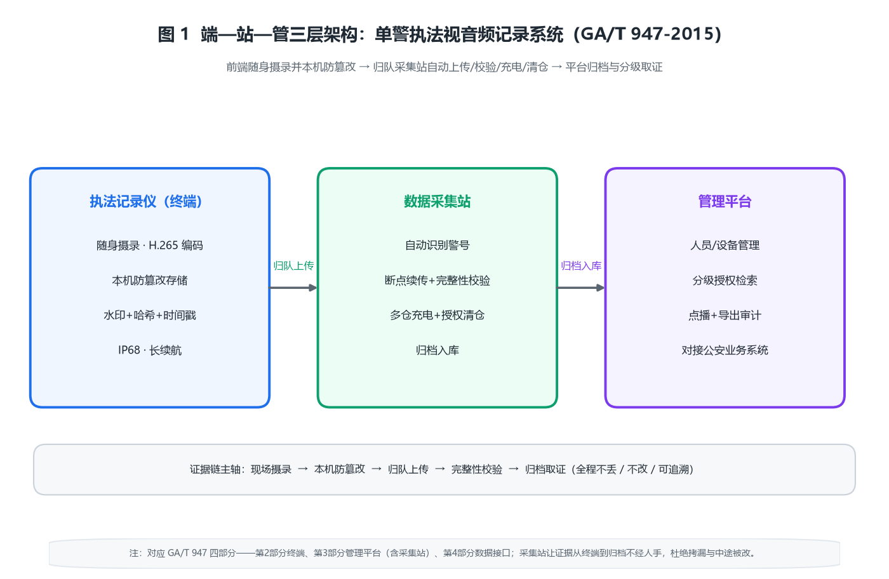
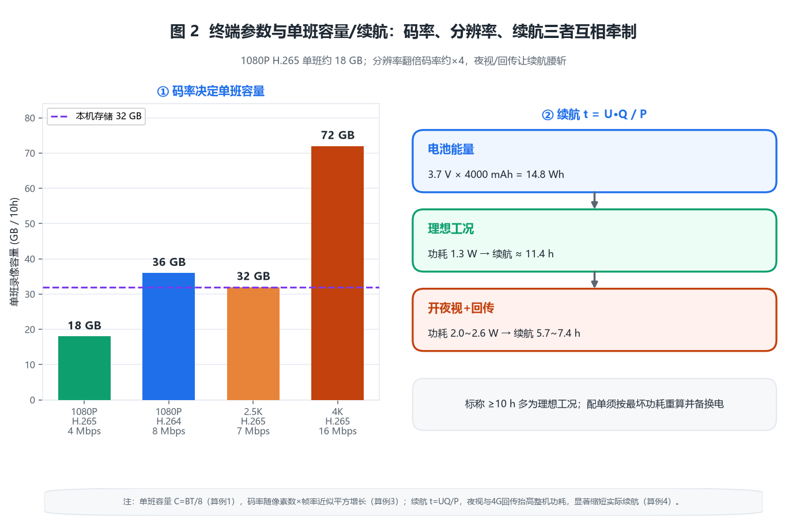
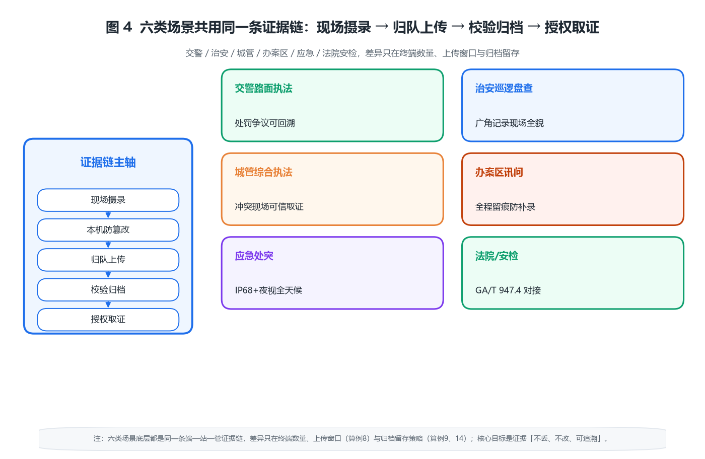

> 
> *概念图：执法记录仪在胸前安静地录下现场，归队后插进采集站，视频自动上传、校验、充电、归档——从镜头到证据柜，全程不丢、不改、可追溯。示意图。*

# 执法记录仪与采集站产品综述

## · 面向工程端

---

## 〇 一句话定位

执法记录仪与采集站（工程上合称「单警执法视音频记录系统」，遵循 GA/T 947-2015）是**由民警随身佩戴的视音频记录终端 + 归队后自动完成上传、校验、充电、归档的数据采集站 + 后台管理平台三件套构成，用于把执法现场「当时怎么说的、怎么做的」固定成不可篡改、可追溯的证据**。它一端在胸前持续摄录并本机防篡改存储，另一端通过采集站把数据自动收进平台归档。**它买的是「从现场采集到归档取证全程不丢、不改、能追溯」的证据闭环能力**——单班容量、续航、防护、防篡改强度、上传窗口、归档留存，决定了记录仪能不能扛一个班次、数据能不能站得住法律证据的门槛。

> 本系列已写的《网络摄像机（IPC）》《视频存储服务器》《视频监控管理平台（VMS）》讲的是**固定安防监控这条线**——镜头装在墙上、7×24 连续录、目的是事后追溯与态势感知。**本篇只讲移动执法这条线**：终端随身、电池供电、按需摄录、目的是固定证据链。两者看似都是「摄像头+存储」，但从供电方式、防篡改要求到遵循标准（GA/T 947 而非 GB/T 28181 体系）都完全不同。核心差别只有一句：**监控追求「覆盖得广」，执法记录追求「证据站得住」**。

---

## 一、产品设计方案

### 1.1 系统组成：端—站—管三件套

一套单警执法视音频记录系统在工程上由「终端、采集站、管理平台」三层构成，对应 GA/T 947 的不同分册：

- **执法记录仪（终端，GA/T 947.2）**：随身佩戴的一体机，集成摄像、拾音、编码、本机存储、电池、显示屏与按键。核心是「录得清、存得住、改不了」——视场角、分辨率、续航、防护、防篡改是本机的五个硬指标（算例 1~7）。
- **数据采集站（GA/T 947.3 归口）**：归队后民警把记录仪插入仓位，自动完成身份识别、数据上传、完整性校验、充电、清仓（授权后）与入库归档。核心是「不用人工拷、不落地篡改、归档即入库」（算例 8~12）。
- **管理平台（GA/T 947.3）**：执法数据采集设备与后台管理服务器，提供人员/设备管理、权限分级、检索取证、视频点播、统计审计、与公安业务系统对接（GA/T 947.4 数据接口）。核心是「谁能看、谁能导、全程留痕」。

### 1.2 三种部署形态

| 形态 | 做法 | 适用 | 工程取舍 |
|------|------|------|----------|
| 单机 USB 采集 | 记录仪经 USB 接 PC，用客户端软件上传 | 小单位、零星取证、临时采买 | 零新增硬件，但依赖人工操作、易漏传、无自动充电归档 |
| 多仓采集站 | 20~60 位一体机柜，插上即自动上传+充电 | 派出所、交警中队（几十台规模） | 无人值守、闭环强；仓位与并发上传带宽需匹配编制（算例 8、11） |
| 集中采集中心 | 多台采集站汇入平台 + 集中归档存储 | 区县/地级市全警覆盖 | 统一归档、分级授权、可扩展；需对接平台与归档存储（算例 9、14） |

工程上先定「多少台终端、单班录多久、归队上传窗口多长」：几十台规模上一台多仓采集站即可；几百台以上要做「分队部署采集站 + 集中归档」两级，否则汇聚与归档会撞容量墙（案例一、三）。

### 1.3 数据闭环的五个动作

```
① 现场摄录：记录仪按需摄录（活动/重点标记/预录），本机 H.265 编码 + 水印
② 本机防篡改：文件只读 + 逐片哈希(SHA-256) + 字符叠加(编号/时间/定位)
③ 归队上传：插入采集站 → 自动识别警号 → 断点续传 → 完整性校验
④ 充电清仓：校验通过后充电，经授权清空本机（未校验不清理，防丢证）
⑤ 归档取证：入库按人员/时间/案件归档，分级授权检索、点播、导出留痕
```

GA/T 947.4-2015 规定了软硬件接口、协议、数据格式与公安业务系统接口（引用 GA/T 1183-2014 数据交换格式、GA/T 543 系列公安数据元），保证不同厂商的端、站、管能对接——这是「能不能进公安系统」的准入线。

### 1.4 系统架构图


*图 1：端—站—管三层——前端执法记录仪（摄录+防篡改本机存储）→ 采集站（自动上传+校验+充电+清仓）→ 管理平台（归档+分级授权+取证+审计），遵循 GA/T 947.1~.4-2015 四部分。*

---

## 二、核心参数与选型

### 2.1 关键参数清单（工程基准）

下表参数为招标文件常见技术要求与工程基准（均有检测报告可查证），具体以厂家 datasheet 与公安部检测报告为准：

| 参数 | 典型区间 / 要求 | 选型含义 |
|------|----------------|----------|
| 视频分辨率 | 1920×1080 起步，2560×1440/4K 高端 | 决定取证清晰度与码率（算例 1、3） |
| 编码格式 | H.265 为主（GA/T 947.2 及招标普遍要求） | 同画质省一半码率，直接影响容量与续航（算例 3） |
| 水平视场角 | ≥110°，高端 ≥125° | 广角覆盖现场，换取边缘畸变（算例 6、7） |
| 几何失真 | ≤10% | 畸变过大影响边缘人脸/车牌辨认 |
| 连续摄录 | ≥10 h（高端 11~16 h） | 必须覆盖一个完整班次（算例 4） |
| 本机存储 | ≥32 GB（不可更换内置） | 决定单班能录多久（算例 1、2） |
| 防护等级 | ≥IP68（水深 1 m/2 h） | 雨雪、浸水、沙尘环境不失效 |
| 抗跌落 | 2 m 六面各 ≥5 次，数据不丢 | 执勤意外跌落不丢证 |
| 外形/质量 | ≤90×60×35 mm、≤200 g | 佩戴舒适性，影响执法意愿 |
| 夜视 | 红外 3 m 覆盖 ≥70% 画面 | 夜间取证（算例 4 的功耗代价） |
| 接口 | USB Type-C（数据+充电） | 对接采集站；USB 3.0 影响上传（算例 10） |
| 防篡改 | 文件只读 + 水印 + 哈希 + 时间戳 | 证据能否站住法律门槛（3.1、算例 12、13） |
| 定位/授时 | 北斗/GPS + 字符叠加 | 时间地点上屏，增强证据链（算例 13） |
| 开机时间 | ≤5 s | 突发执法抓得住第一时间 |

### 2.2 十四个原创工程算例

下面每一条都是配终端、算容量、定续航、选采集站、做归档时要真算的账，标号贯穿正文。参数按「工程基准 / 演示估算」给出，具体以设备实测与检测报告为准。

**【算例 1】单班录像容量：一个班次要占多少存储**

按 H.265 主码率 $B=4\ \mathrm{Mbps}$、一个班次 $T=10\ \mathrm{h}=36000\ \mathrm{s}$，单班录像量：

$$C_{\mathrm{shift}}=\frac{B\,T}{8}=\frac{4\times10^{6}\times36000}{8}=1.8\times10^{10}\ \mathrm{B}=18\ \mathrm{GB}$$

若按 1080P/30fps 的 H.264（码率约 $8\ \mathrm{Mbps}$），单班翻倍到约 $36\ \mathrm{GB}$。
结论：**H.265 把单班容量从 36 GB 压到 18 GB**，这是它成为刚需的第一个理由——32 GB 本机存储，用 H.264 连一个班都录不满。

**【算例 2】本机存储能录几天**

32 GB 本机存储，按单班 $18\ \mathrm{GB}$（算例 1），理论可录：

$$D_{\mathrm{raw}}=\frac{32}{18}\approx1.8\ \mathrm{shift}$$

考虑系统分区、索引与「不能录满」的余量（按 85% 可用）：

$$D_{\mathrm{eff}}=\frac{32\times0.85}{18}\approx1.5\ \mathrm{shift}$$

结论：**本机存储是「覆盖一个班次 + 少量余量」的设计，不是用来长期留存的**——每天必须回队上传清仓，这是采集站存在的根本原因。所谓「存 10 小时」的标称，指的是连续摄录时长，不是免维护留存天数。

**【算例 3】码率与分辨率：分辨率翻倍，码率不止翻倍**

H.264/H.265 的码率近似正比于像素数 $N_{\mathrm{px}}$ 与帧率 $f$（同量化质量下）：

$$B\ \propto\ N_{\mathrm{px}}\cdot f = W_{\mathrm{px}}H_{\mathrm{px}}f$$

从 $1920\times1080$ 升到 $2560\times1440$，像素数比为 $\dfrac{2560\times1440}{1920\times1080}=1.78$，码率约 $4\mapsto7.1\ \mathrm{Mbps}$；升到 4K（$3840\times2160$）像素数比约 4，码率约 $4\mapsto16\ \mathrm{Mbps}$。
结论：**分辨率翻倍（边长×2），码率约×4**（算例 1 的容量、算例 4 的续航全部跟着恶化）——选 4K 之前先算清本机存储与续航还够不够一个班。

> 
> *图 2：终端参数与单班容量/续航——H.265 把 1080P 单班容量压到约 18 GB；码率随分辨率近似平方增长，续航随功耗线性缩短，三者互相牵制。*

**【算例 4】续航：电池能量除以整机功耗**

连续摄录时间由电池能量 $E$ 与整机平均功耗 $P$ 决定：

$$t=\frac{E}{P}=\frac{U\,Q}{P}$$

典型内置锂电 $3.7\ \mathrm{V}$、$4000\ \mathrm{mAh}$，能量 $E=3.7\times4=14.8\ \mathrm{Wh}$；若摄录+编码+屏幕关闭状态整机功耗 $P\approx1.3\ \mathrm{W}$：

$$t=\frac{14.8}{1.3}\approx11.4\ \mathrm{h}$$

开夜视（红外补光约 $+0.5\ \mathrm{W}$）或持续 4G 回传（$+0.8\ \mathrm{W}$）时 $P$ 升到 $2.0\sim2.6\ \mathrm{W}$，续航掉到 $5.7\sim7.4\ \mathrm{h}$——**撑不过一个班**。
结论：**「标称 ≥10 h」通常指关屏、关夜视、不回传的理想工况**；工程配单必须按「夜间开夜视 + 必要回传」的最坏功耗重算，并预留备用电池或中途换电策略。

**【算例 5】电池循环寿命：每天一充能用几年**

锂电循环寿命 $N_{\mathrm{cyc}}$ 约 500~800 次（容量衰减到 80%）。每天一充一放：

$$Y_{\mathrm{life}}=\frac{N_{\mathrm{cyc}}}{365}=\frac{500}{365}\approx1.4\ \mathrm{yr}$$

结论：**高频使用的记录仪，电池是 1~2 年就要更换的耗材**——选型要看电池是否可换、换电成本与停机窗口；采购预算不能只算整机，要算全生命周期的电池更换。

**【算例 6】视场角与取证覆盖宽度**

水平视场角 $\theta$、拍摄距离 $d$ 决定的画面覆盖宽度：

$$W=2\,d\tan\frac{\theta}{2}$$

取 $\theta=120°$、$d=3\ \mathrm{m}$，$W=2\times3\times\tan60°\approx10.4\ \mathrm{m}$；$\theta=110°$ 时约 $8.8\ \mathrm{m}$。
结论：**广角让一台记录仪一次覆盖整条车道或多人的现场**，这是它优于普通相机视角的关键；但广角越宽，边缘拉伸越严重（算例 7）。

**【算例 7】畸变与边缘辨认：广角换来的代价**

几何失真 $\le10\%$ 是硬指标。以 DORI 辨认距离作类比：像素密度 $\rho$（px/m）随覆盖宽度增大而下降，$\rho=N_{\mathrm{px}}/W$。1080P（1920 px）在 $\theta=120°$、$d=3\ \mathrm{m}$ 处：

$$\rho=\frac{1920}{10.4}\approx185\ \mathrm{px/m}$$

En62676-4 的「辨认（identify）」约需 250 px/m → 该距离只够「识别（recognize，125 px/m）」，不够辨认人脸。
结论：**想看得广，就牺牲了边缘辨认距离**——执法取证的正确姿势是「广角记录全貌 + 关键目标靠近拍」，靠边缘畸变区去认人脸在法律上站不住。

**【算例 8】采集站并发上传：一批终端回队要多久**

一个中队 $N=30$ 台记录仪同时回队，每台单班 $18\ \mathrm{GB}$，采集站千兆网口有效吞吐 $\eta_{\mathrm{net}}\approx0.9$ 即 $B_{\mathrm{net}}\approx900\ \mathrm{Mbps}\approx112.5\ \mathrm{MB/s}$。全部上传：

$$t_{\mathrm{upl}}=\frac{N\,C_{\mathrm{shift}}}{B_{\mathrm{net}}}=\frac{30\times18\ \mathrm{GB}}{112.5\ \mathrm{MB/s}}=\frac{540\times1024}{112.5}\approx4915\ \mathrm{s}\approx1.4\ \mathrm{h}$$

结论：**30 台同时回传需要 1~1.5 小时**——这解释了为什么采集站要「分仓错峰 + 多口并发」，以及为什么交警中队要在交班前后预留上传窗口；仓位数与网口吞吐必须按编制匹配。

**【算例 9】采集站/平台归档存储容量**

一个中队 30 台，每台每天 $18\ \mathrm{GB}$，归档留存 $D_{\mathrm{ret}}=90$ 天：

$$C_{\mathrm{arch}}=N\,C_{\mathrm{shift}}\,D_{\mathrm{ret}}=30\times18\times90=48600\ \mathrm{GB}\approx47.4\ \mathrm{TiB}$$

按 RAID6（12 盘利用率 $(12-2)/12=83.3\%$）需裸容量 $47.4/0.833\approx57\ \mathrm{TiB}$，约 5 块 12 TB 盘起（含热备更多）。一个区县若 10 个中队，归档量约 $474\ \mathrm{TiB}$ 量级。
结论：**采集站只是入口，真正的容量压力在平台归档**——中队级可以本地盘，区县级以上必须集中存储 + 分层（算例 14）。

**【算例 10】上传链路瓶颈：接口决定回队效率**

记录仪 USB 接口理论速率：USB 2.0 约 $480\ \mathrm{Mbps}$（实测 $30\sim40\ \mathrm{MB/s}$）、USB 3.0 约 $5\ \mathrm{Gbps}$（实测 $300\sim500\ \mathrm{MB/s}$）。单台 $18\ \mathrm{GB}$ 上传：USB 2.0 约 $18\times1024/35\approx527\ \mathrm{s}\approx8.8\ \mathrm{min}$，USB 3.0 约 $18\times1024/400\approx46\ \mathrm{s}$。
结论：**采集站仓位若只给 USB 2.0，单台上行就要近 10 分钟**，30 台串行远超算例 8 的窗口；USB 3.0 + 多口并发是采集站选型的硬指标。同时注意网口才是汇聚瓶颈（算例 8）。

**【算例 11】满仓充电的功率与散热**

采集站 $N=30$ 个仓位同时充电，每仓 $\eta$ 效率下输出 $5\ \mathrm{V}\times2\ \mathrm{A}=10\ \mathrm{W}$，充电效率 $\eta_{\mathrm{ch}}\approx0.85$，则每仓输入约 $11.8\ \mathrm{W}$：

$$P_{\mathrm{total}}=\frac{N\,U I}{\eta_{\mathrm{ch}}}=\frac{30\times10}{0.85}\approx353\ \mathrm{W}$$

加上采集站主机、屏幕与线损，整机约 $400\ \mathrm{W}$。这些功率最终几乎全部变成热量（电池充电损耗 + 适配器损耗）。
结论：**满仓充电的采集站是一台 400 W 级「电暖器」**——机柜必须留散热风道，值班室配电回路要按 $0.5\ \mathrm{kW}/$站预留，否则夏季满仓会过热降速。

**【算例 12】完整性校验：上传之后还要算哈希**

采集站对每段上传视频做 SHA-256 校验。校验吞吐 $v_{\mathrm{hash}}\approx400\ \mathrm{MB/s}$（软件实现，工程基准），一个中队 30 台共 $540\ \mathrm{GB}$：

$$t_{\mathrm{hash}}=\frac{C_{\Sigma}}{v_{\mathrm{hash}}}=\frac{540\times1024}{400}\approx1382\ \mathrm{s}\approx23\ \mathrm{min}$$

结论：**上传完不等于归档完**——还要 20 分钟级校验才能确认数据完整、写入哈希链（3.1）；校验应与上传流水线并行，而非串行等待，否则归队到可取证的总时延会翻倍。

**【算例 13】时间同步与证据有效性**

记录仪 RTC 日漂移按 $\pm20\ \mathrm{ppm}$，一天累积误差：

$$\Delta t=86400\times20\times10^{-6}\approx1.7\ \mathrm{s/day}$$

一周不校时误差可达 $\approx12\ \mathrm{s}$。而多警协同、案件串并时，时间错位会直接削弱证据链。采集站上传时用平台时间（北斗/GPS 授时）打可信时间戳并叠加到画面字符上，把误差收敛到秒级以内。GA/T 947.2 要求字符叠加产品编号与时间，GA/T 947.4 规定数据格式。
结论：**时间戳不是可有可无的水印，是证据链的时间锚点**——每天上传即校时，是把漂移锁在可接受范围的最简单工程手段。

**【算例 14】归档留存与容量分层**

区县级归档按「热（近 30 天，在线）/ 温（30~90 天，低速盘）/ 冷（90 天以上，归档）」分层。以某区县 $474\ \mathrm{TiB}$ 总量（算例 9 的 10 中队），按热 15%/温 35%/冷 50%、参考单价 SSD ¥1/GB、HDD ¥0.15/GB、归档 ¥0.03/GB（工程估算），折算成本约 9.8 万元：

$$C_{\mathrm{cost}}\approx474\times1024\times(0.15\times1+0.35\times0.15+0.50\times0.03)\approx9.8\times10^{4}\ \mathrm{CNY}$$

配合防篡改哈希链（每段 video 的 SHA-256 摘要链式串联，改任一帧都会破坏后续哈希），冷数据即使离线归档也能验真。
结论：**分层把「全在线」的存储成本压下一个量级**，哈希链让「冷数据也可信」——这是大规模归档既省钱又不丢证据效力的关键（呼应本系列《视频存储服务器》的分层思想，但这里多了一条「证据可信」约束）。

### 2.3 选型速查

先定「分辨率 + 编码 → 单班码率」反推本机容量与续航（算例 1、3、4），再定「台数 × 班次 × 上传窗口 → 采集站仓位、网口与充电功率」（算例 8、10、11），最后定「台数 × 留存天数 → 归档容量与分层 + 防篡改校验」（算例 9、12、14）。三步走完，端—站—管的规模就定了。

---

## 三、技术原理

### 3.1 防篡改四层：从「能录」到「证据站得住」

执法记录仪与普通摄像头的根本区别在防篡改，工程上靠四层叠加：

1. **文件只读**：本机存储的视频文件设为只读属性，普通手段无法删除或覆盖；异常重启后已保存数据不丢（GA/T 947.2 要求）。
2. **数字水印**：编码视频流叠加水印（产品编号、时间，可选警号/定位），画面被翻拍、裁剪仍可溯源——招标普遍要求「防篡改、防非法复制的认证措施」。
3. **哈希校验**：每段视频生成 SHA-256 摘要，上传后采集站重算比对；进一步把摘要链式串联成哈希链，改任一帧都会破坏后续所有摘要（算例 12、14）。
4. **可信时间/定位**：北斗/GPS 授时 + 字符叠加，给证据打上「何时、何地」的时间地点锚点（算例 13）。

四层里缺任何一层，证据链都有可被质疑的缺口——**防篡改不是单一功能，是一套组合拳**。

### 3.2 视场角与畸变的取舍

广角镜头（≥110°）让一台记录仪覆盖整条车道（算例 6），但边缘几何失真 ≤10% 的约束意味着：视场越宽，边缘辨认能力越弱（算例 7）。工程上的平衡是「主摄广角记录全貌，关键目标靠近到 $3\sim5\ \mathrm{m}$ 内拍」，而不是指望广角边缘去认人脸。

### 3.3 编码与码率：H.265 为何是刚需

同一画质下 H.265 比 H.264 省约一半码率（算例 1、3）。这对随身电池供电的设备是双重红利：容量需求减半 → 本机存储够用一个班；码率减半 → 编码功耗与上传量同步下降 → 续航变长。因此 GA/T 947.2 与近年招标普遍把「至少支持 H.265」写进硬性条款。

### 3.4 采集站闭环：数据不落地人工

采集站把「上传—校验—充电—清仓—归档」做成全自动流水线：民警插上即走，系统按警号自动归属、断点续传、校验入库，通过后才允许清仓（防止未确认就删本机数据）。GA/T 947.3 规定了执法数据采集设备与管理服务器的技术要求，GA/T 947.4 规定接口与数据格式——**目标是让证据从终端到归档全程不经人手，杜绝「拷漏、拷错、中途被改」**。

---

## 四、产品功能与差异化

### 4.1 核心功能清单

- **摄录与取证**：一键摄录/重点标记、预录 ≥10 s（触发前画面也留住）、移动侦测、防抖、开机 ≤5 s。
- **成像与夜视**：1080P~4K、宽动态 ≥70 dB、红外夜视 3 m 覆盖 ≥70%、几何失真 ≤10%。
- **防篡改**：文件只读 + 数字水印 + SHA-256 哈希链 + 可信时间戳/北斗定位（3.1）。
- **状态提示**：声/光/振动提示、电量/存储/时间显示、摄录红灯/录音黄灯/开机绿灯。
- **采集站**：自动识别、断点续传、完整性校验、多仓充电、授权清仓、自动归档入库。
- **管理平台**：人员/设备管理、分级授权检索、视频点播、导出审计留痕、GA/T 947.4 对接公安业务系统。
- **可靠环境**：IP68、2 m 六面跌落数据不丢、宽温工作（-30 ℃ 可工作）。

### 4.2 差异化：执法记录仪 vs 固定 IPC

| 维度 | 执法记录仪 + 采集站 | 固定网络摄像机（IPC） |
|------|--------------------|----------------------|
| 供电 | 内置电池，按班次续航 | PoE/DC 持续供电 |
| 移动性 | 随身佩戴，跟着人走 | 固定安装，覆盖点位 |
| 摄录方式 | 按需摄录 + 预录 + 重点标记 | 7×24 连续录 / 事件触发 |
| 存储 | 本机防篡改 → 采集站归档 | SD 本地 / NVR / 云存储 |
| 防篡改 | 四层防篡改 + 哈希链 + 时间戳（法律证据） | 通常无强防篡改（追溯用途） |
| 遵循标准 | GA/T 947.1~.4-2015 | GB/T 28181 / GB 35114 体系 |
| 核心目的 | 固定证据链、规范执法行为 | 安防监控、态势感知、事后追溯 |

结论：**两者的 competence 完全不重叠**——IPC 解决「看得广、录得全」，执法记录仪解决「证据真、链条全」。一个中队的监控摄像头再密，也替代不了民警胸前那台会算哈希的记录仪。

### 4.3 合规锚点：GA/T 947-2015 四部分

**GA/T 947-2015《单警执法视音频记录系统》**（2015-07-10 发布 / 2015-12-01 实施，代替 GA/T 947-2011）是全系统的核心标准，分四部分：

- **第 1 部分：基本要求**（GA/T 947.1-2015）——总体要求。
- **第 2 部分：执法记录仪**（GA/T 947.2-2015）——术语定义、分类分级与产品编码、技术要求、试验方法、检验规则；规定外形尺寸、质量、外壳防护、视场角、视音频性能等（32 页）。
- **第 3 部分：管理平台**（GA/T 947.3-2015）——平台组成、**执法数据采集设备（即采集站）技术要求**、管理服务器技术要求与试验方法（公安部一所、特种警用装备质检中心起草）。
- **第 4 部分：数据接口**（GA/T 947.4-2015）——软硬件接口、协议、数据格式及与公安业务系统接口，引用 GA/T 1183-2014、GA/T 543 系列公安数据元。

配套：**GB/T 4208-2017**（外壳防护 IP 等级，IP68 依据）、**GB 35114-2017**（如需加密存储，SM2/SM3/SM4）、**GB/T 28181-2022**（与视频专网平台对接时）、**GB 50348-2018**（安全防范工程）。注意：**「留存 30/90 天」「具体码率数值」是地方管理要求与工程估算，不是 GA/T 947 的统一定值**。

---

## 五、应用场景（痛点→方案→价值）

| 场景 | 痛点 | 方案 | 价值 |
|------|------|------|------|
| 交警路面执法 | 处罚争议「说不清」 | 全程摄录 + 水印 + 时间戳 | 执法过程可回溯，减少纠纷 |
| 治安巡逻盘查 | 现场情况复杂、难还原 | 广角记录 + 重点标记 | 现场全貌与关键目标兼顾 |
| 城管综合执法 | 冲突现场取证难 | 防篡改本机存储 + 自动归档 | 证据可信、保护双方 |
| 办案区/讯问 | 流程要全程留痕 | 记录仪 + 采集站闭环 | 全程可查、防补录篡改 |
| 应急处突 | 突发、环境恶劣 | IP68 + 长续航 + 夜视 | 全天候不断录 |
| 法院/安检 | 需与业务系统对接 | GA/T 947.4 接口对接 | 证据直接入业务系统 |

---

## 六、实际案例与设计方案

### 案例一：某地级市公安局交警支队（300 台终端 + 集中采集）

**需求**：300 台执法记录仪配发到各交警大队，单班 ≥10 h 摄录，归队后 2 h 内完成上传归档，录像留存 90 天。
**方案设计**：1080P H.265（4 Mbps）、32 GB 本机、IP68、≥110° 视场角终端；按大队部署 8 台 30 位采集站（约 240 仓位，覆盖 300 台分批回队）；RAID6 归档存储 + 管理平台。
**配置核算**：单班容量 $4\times10^{6}\times36000/8=18\ \mathrm{GB}$（算例 1）；每站 30 台并发上传约 1.4 h（算例 8），分两大批错峰可在 2 h 窗口内完成；满仓充电约 400 W/站需预留散热与配电（算例 11）；支队级 90 天归档 $300\times18\times90\approx473\ \mathrm{TiB}$，需 RAID6 裸容量约 $568\ \mathrm{TiB}$（算例 9）。
**交付价值**：证据统一归档、分级授权取证，归队即上传充电不用人工管理，单班容量与上传窗口经核算留有 15%~30% 余量。

### 案例二：某区公安分局办案区（全流程留痕 + 防篡改）

**需求**：办案区执法全程留痕，录像不可篡改、可追溯，不同角色分级授权查看/导出。
**方案设计**：记录仪开启水印 + 字符叠加（编号/时间/北斗定位），每段生成 SHA-256 哈希链；采集站校验通过后入库；管理平台配置三级授权（办案员查看、法制员审核、督察审计），导出即留审计日志。
**配置核算**：校验 23 min/中队级数据量（算例 12）与上传流水线并行，归队到可取证总时延控制在 1.5 h 内；RTC 每日 ±1.7 s 漂移靠上传时平台授时收敛（算例 13）；哈希链保证任一帧被改即校验失败（3.1）。
**交付价值**：证据链满足「谁录的、何时何地、有没有被改」三问，法制审核有据可查，督察全程审计。

### 案例三：某区县公安局全覆盖（集中采集中心 + 分层归档）

**需求**：全县 10 个中队、约 1000 台终端，统一归档 90 天以上，控制存储成本。
**方案设计**：各中队部署多仓采集站，汇聚到县局集中采集中心 + 归档存储；按热(15%)/温(35%)/冷(50%) 分层，冷数据配哈希链离线归档。
**配置核算**：全县 90 天归档约 $474\ \mathrm{TiB}$（算例 9 的 10 倍），分层后存储成本约 9.8 万元级（算例 14），比全在线节省约一个量级；冷数据靠哈希链保持可验真。
**交付价值**：既控制了一次性存储投入，又保证了大规模归档的证据效力——证明「分层省钱」与「证据可信」可以同时成立。

> 
> *图 4：六类场景共用的证据链——现场摄录 → 归队上传 → 校验归档 → 授权取证，底层是同一条端—站—管闭环，差异只在终端数量、上传窗口与归档留存策略。*

---

## 七、市场背景与竞争格局

执法记录仪是安防行业一个「政策驱动」的细分市场——GA/T 947-2015 与各地公安机关配备规范的落地，让它从「选配」变成「单警标配」。产业链为「芯片/图像传感器（CMOS）→ 终端整机（警用装备厂商）→ 采集站/管理平台 → 系统集成与公安业务对接」。竞争焦点已从「拼像素」转向：**防篡改可信度（哈希链/可信时间戳/区块链存证）、轻量化长续航、与公安平台的深度对接、以及合规（GA/T 947 检测报告 + 加密）**。头部警用装备厂商占据公安招标主导，招标普遍要求公安部检测报告；部分厂商开始叠加 4G 实时回传与边缘 AI（人脸/车牌）能力，把「事后取证」往「事中感知」延伸。

---

## 八、商业模式与趋势

- **硬件 + 平台授权**：终端按台计价，采集站按仓位/台，管理平台按终端数或点位授权。
- **整体方案交付**：端 + 站 + 管 + 归档 + 对接，按公安局/区县整体招标，含安装培训。
- **服务化**：少数地区试点「设备租赁 + 云平台存储」按月付费，免自建归档机房。
- **趋势**：① 4G/5G 实时回传，指挥中心看得见一线；② 边缘 AI（人脸/车牌/行为）上终端；③ 可信时间戳 + 区块链存证，证据效力再加固；④ 轻量化（<150 g）与长续航（>12 h）持续演进；⑤ 防篡改从「文件保护」走向「全链路可信」。

---

## 附录

### A. 核算清单（14 笔账速查）

| # | 算例 | 核心公式 | 工程结论 |
|---|------|----------|----------|
| 1 | 单班容量 | $C=BT/8$ | 1080P H.265 单班约 18 GB |
| 2 | 存储天数 | $D=C_{\mathrm{sto}}/C_{\mathrm{day}}$ | 32 GB 仅够约 1.5 班，必须每天上传 |
| 3 | 码率-分辨率 | $B\propto N_{\mathrm{px}}f$ | 分辨率翻倍码率约×4 |
| 4 | 续航 | $t=E/P=UQ/P$ | 标称 10 h 是理想工况，夜视/回传会腰斩 |
| 5 | 电池寿命 | $Y=N_{\mathrm{cyc}}/365$ | 每天一充约 1~2 年更换 |
| 6 | 视场覆盖 | $W=2d\tan(\theta/2)$ | 120° 在 3 m 覆盖约 10.4 m |
| 7 | 边缘辨认 | $\rho=N_{\mathrm{px}}/W$ | 广角换覆盖，牺牲边缘辨认距离 |
| 8 | 并发上传 | $t=N C/B_{\mathrm{net}}$ | 30 台并发约 1.4 h，需错峰多口 |
| 9 | 归档容量 | $C=N C_{\mathrm{shift}} D_{\mathrm{ret}}$ | 中队 90 天约 47 TiB |
| 10 | 接口瓶颈 | 实测 USB 2.0/3.0 | USB 2.0 单台近 9 min，选 USB 3.0 |
| 11 | 充电功率 | $P=NUI/\eta$ | 30 仓约 400 W，需散热配电 |
| 12 | 校验时延 | $t=C/v_{\mathrm{hash}}$ | 540 GB 校验约 23 min，与上传并行 |
| 13 | 时间漂移 | $\Delta t=t_{\mathrm{day}}\times\mathrm{ppm}$ | ±20 ppm 日漂约 1.7 s，上传即校时 |
| 14 | 分层归档 | 热/温/冷 + 哈希链 | 分层省一个量级，冷数据仍可验真 |

### B. 术语表

- **执法记录仪**：民警随身佩戴、摄录执法过程并防篡改本机存储的一体机（GA/T 947.2）。
- **采集站 / 执法数据采集设备**：归队后自动上传、校验、充电、清仓、归档的设备（GA/T 947.3）。
- **GA/T 947-2015**：《单警执法视音频记录系统》，分基本要求/执法记录仪/管理平台/数据接口四部分。
- **防篡改 / 哈希链**：文件只读 + 水印 + SHA-256 摘要链式串联，改动任一帧即校验失败。
- **数字水印**：叠加在视频流中的产品编号/时间等信息，翻拍裁剪仍可溯源。
- **DORI**：侦测/观察/识别/辨认四级像素密度基准（EN 62676-4），用于估算辨认距离。
- **证据链**：从采集、存储、上传、归档到取证的全程「不丢、不改、可追溯」。
- **字符叠加**：把编号、时间、定位叠加到画面，是 GA/T 947.2 的强制要求。

### C. 标准与规范索引（工程可查）

| 标准 | 内容要点 |
|------|----------|
| GA/T 947.1-2015 | 单警执法视音频记录系统 第 1 部分：基本要求（2015-12-01 实施） |
| GA/T 947.2-2015 | 第 2 部分：执法记录仪——分类分级、技术要求、试验方法、检验规则（32 页） |
| GA/T 947.3-2015 | 第 3 部分：管理平台——含执法数据采集设备（采集站）与管理服务器技术要求 |
| GA/T 947.4-2015 | 第 4 部分：数据接口——接口/协议/数据格式/公安业务系统对接 |
| GB/T 4208-2017 | 外壳防护等级（IP 代码），IP68 依据 |
| GB 35114-2017 | 联网信息安全技术要求，A/B/C 三级；加密用 SM2/SM3/SM4 |
| GB/T 28181-2022 | 公共安全视频监控联网系统传输/交换/控制技术要求（平台对接时） |
| GB 50348-2018 | 安全防范工程技术标准 |
| EN 62676-4:2014 | 视频监控 DORI 像素密度基准（本篇辨认距离类比） |

*说明：本文参数多为「工程基准 / 演示估算」，用于说明容量、续航、带宽与归档的计算方法；GA/T 947 相关条款以正式文本为准，具体产品指标以厂家 datasheet 与公安部检测报告为准。*
