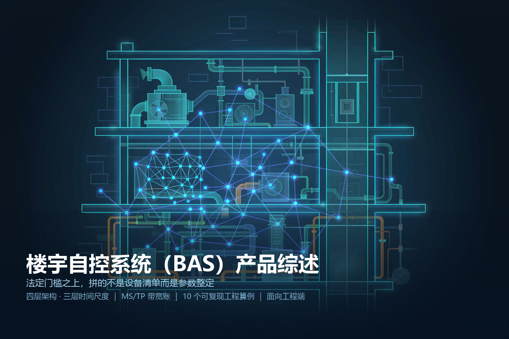
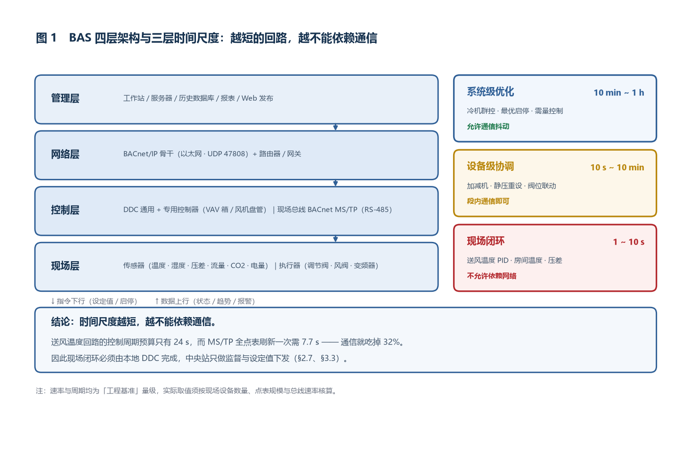
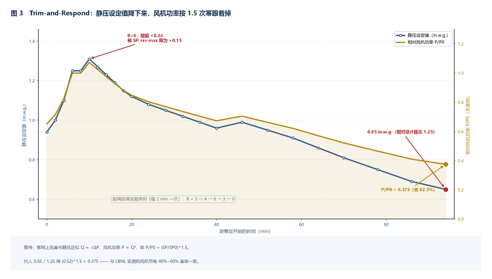
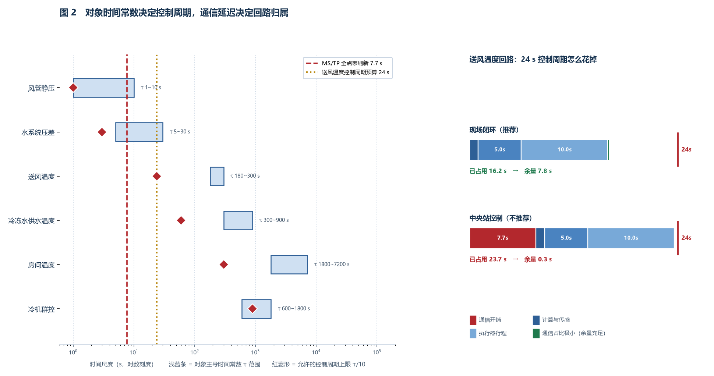
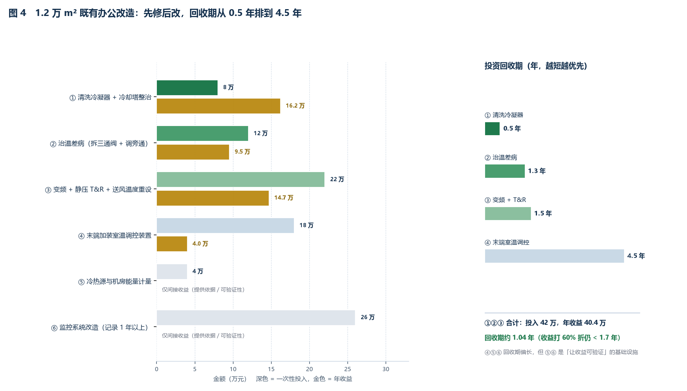

# 楼宇自控系统（BAS）产品综述：法定门槛之上，拼的不是设备清单而是参数整定

> 本文面向工程端（弱电/智能化集成商、机电顾问、暖通与电气设计岗、甲方技术负责人、物业设施运维）。
> 全文参数一律标注「工程基准 / 工程估算」，不引用任何厂商承诺指标；标准引用只写可公开查证的条款与数值。
> 封面为 AI 生成概念示意图，非真实设备照片。



---

## 〇、一句话定位

**楼宇自控系统（BAS）把冷热源、空调通风、给排水、供配电、照明、电梯这些各自为政的机电设备，收进一套统一的时间尺度里，让它们按负荷而不是按人就班表运行。**

定义里有三个词是关键：

| 词 | 含义 | 做不到会怎样 |
|---|---|---|
| **统一的时间尺度** | 现场 1~10 s 闭环、设备级 10 s~10 min 协调、系统级 10 min~1 h 优化，三层各管一段 | 所有逻辑都塞到中央站 → 通信一旦抖动，整个楼跟着抖 |
| **按负荷运行** | 用需求信号（阀位、温差、CO₂、需量）驱动设定值重设 | 恒设定值运行 → 冷热抵消、大流量小温差、风机常年满频 |
| **收进一套** | 点表语义统一、跨厂商可互操作（BACnet） | 换一家厂商的控制器就得重画点表 → 终身被锁定 |

### 反直觉点一：BAS 的成败 80% 发生在通电之后

设备清单、系统图、点表这些东西，在招标阶段就能比出高下。但实测中大量项目**装完就是"能看不能调"**：

- 数据全部上来了，可所有设定值都是设计院给的固定值，一个都没重设过
- 趋势记录周期设成 15 min，导致任何 1~3 min 级的振荡在曲线上都是一条平滑直线，出了问题查不出来
- MS/TP 总线上挂了 60 台 DDC 却没算轮询周期，监督侧读一个值要等十几秒，操作员干脆不用了
- 冷机群控逻辑写了，但防短循环、最小运行时间、加减机延时一个都没设，机组来回启停

这些都不是设备问题，是**参数整定与配置问题**。而它们在验收时往往"看得见但测不出"——因为验收测的是"能不能动"，不是"调得对不对"。

### 反直觉点二：这个系统是强制的

**GB 55015-2021《建筑节能与可再生能源利用通用规范》第 3.3.6 条**（全文强制，2022-04-01 实施）：

> 建筑面积不低于 20000 m² 且采用集中空调的公共建筑，**应**设置建筑设备监控系统。

同规范第 3.3.4 条：**水泵、风机以及电热设备应采取节能自动控制措施**。

注意是两个条件同时满足才强制：建筑面积 ≥ 2 万 m² **且** 采用集中空调。这决定了市场上存在一个"法定刚需盘"（2 万 m² 以上的集中空调公共建筑），和一个"自愿盘"（以下规模或非集中空调）。后者的决策依据不是合规，而是投资回收期——本文案例三会算这笔账。

### 十个锚定数字

下文所有推导都围绕这十个数展开，先列在这里当作索引：

| # | 数字 | 出处 / 推导位置 |
|---|---|---|
| 1 | 建筑面积 **≥ 2 万 m² 且集中空调 → 强制设 BAS** | GB 55015-2021 3.3.6（§1.1） |
| 2 | 办公变风量系统单位风量耗功率限值 **0.29 W/(m³/h)** → 反推机组机外余压上限约 **643 Pa** | GB 50189-2015 4.3.22（§2.2） |
| 3 | 风机变频按三次方定律理论省 **78.4%**，工程实际只省约 **50%~60%** | 相似定律 + 三层折扣（§2.3） |
| 4 | 管网静压设定值从 1.25 降到 0.65 in.w.g. → 风机功率降到 **37.5%**（省 62.5%） | Trim-and-Respond（§2.4） |
| 5 | 冷冻水供回水温差从 5 ℃ 掉到 3 ℃ → 同样冷量下水泵轴功率需 **4.63 倍** | 相似定律（§2.5） |
| 6 | MS/TP 单站每轮令牌轮转约 **3.87 ms**；64 站约 **247 ms**；Max_Master 设错会翻倍到 **0.49 s** | BACnet 135（§2.7） |
| 7 | 64 站 × 20 点 = 1280 点全表刷一遍约 **7.7 s** → 关键回路必须现场闭环 | MS/TP 带宽账（§2.7） |
| 8 | 5000 点趋势存 1 年只需 **1.40 GB**，存储从来不是瓶颈；**采样周期才是** | GB 55015-2021 4.3.11（§3.2） |
| 9 | 房间时间常数 2.5 h 时，最优启动提前量约 **61 min**，而固定提前 2 h 每次多跑 **59 min** | 一阶响应反演（§3.4） |
| 10 | 最大需量被抬高 140 kW → 每月多付 **5 600 元**，全年 **6.72 万元** | 15 min 滑窗口径（§2.9） |

---

## 一、产品设计方案

### 1.1 先从合规说起：规范把 BAS 拆成了两个系统

**GB 50314-2015《智能建筑设计标准》第 4.5.2 条**给了一个容易被忽略的拆法：

> 建筑设备管理系统宜包括**建筑设备监控系统**、**建筑能效监管系统**，以及需纳入管理的其他业务设施系统等。

也就是说，「建筑设备管理系统（BMS）」是个上位概念，底下至少两个并列子系统：

| 子系统 | 干什么 | 时间尺度 | 典型交付物 |
|---|---|---|---|
| **建筑设备监控系统**（狭义 BAS） | 监视 + 控制 + 联锁 + 报警 | 秒级~分钟级 | 点表、控制算法说明、功能描述表 |
| **建筑能效监管系统** | 分项计量 + 统计 + 对标 + 报表 | 15 min~月 | 计量点位表、分项能耗模型、对标报告 |

这个拆法在工程上有直接后果：**招标时如果只写「BAS」不写这两个子系统，能效监管那部分很容易被漏掉**，最后变成只有监控没有计量，而 GB 55015-2021 第 3.3.5 条（甲类公共建筑应按功能区域设置电能计量）和第 7.2.1 条（能耗按分类、分区、分项计量管理）都是绕不过去的。

**第 4.5.3 条**界定了监控范围与采集信息：

- 监控设备范围：冷热源、供暖通风和空气调节、给水排水、供配电、照明、电梯；并**宜包括以自成控制体系方式纳入管理的专项设备监控系统**
- 采集信息：温度、湿度、流量、压力、压差、液位、照度、气体浓度、电量、冷热量

**第 4.5.7 条**把设计口径锁定到两部规范：行业标准《建筑设备监控系统工程技术规范》JGJ/T 334，以及《绿色建筑评价标准》GB/T 50378。

> **一个正在路上的变化**：GB 50314-2015 的局部修订征求意见稿（2024 年公开）在 4.5.3 条新增了第 6~10 款，方向很明确——
> ① 采集设备运行参数与运行时间，分析开机/待机/停机时间以**评估设备利用率**；
> ② 支持根据用能计划、节假日、季节、天气**预测能耗**，并支持实际值与预测值对比，**宜通过人工智能算法提高预测精度**；
> ③ 设冷热源时**宜显示冷热源系统的使用综合能效**；
> ④ 控制设备宜**根据被控制对象的变化调整控制算法关键参数**，并显示其变化曲线；
> ⑤ 配置室内环境监控功能时，宜利用信息导引及发布系统显示相关信息。
>
> 第 ④ 款是本文 §3.4 的规范依据：**控制参数要自适应，不是一次整定管十年**。

### 1.2 系统形态：四层，以及三层控制的时间尺度

```
┌──────────────────────────────────────────────────────────┐
│ 管理层   工作站 / 服务器 / 历史数据库 / 报表 / Web 发布     │
├──────────────────────────────────────────────────────────┤
│ 网络层   BACnet/IP 骨干（以太网 + UDP 47808）              │
│          路由器 / 网关（把 MS/TP、Modbus、LonTalk 汇进来）  │
├──────────────────────────────────────────────────────────┤
│ 控制层   DDC（通用控制器 + 专用控制器）                     │
│          现场总线：BACnet MS/TP（RS-485）                  │
├──────────────────────────────────────────────────────────┤
│ 现场层   传感器（温度/湿度/压差/流量/CO₂/照度/电量）        │
│          执行器（调节阀/风阀执行器/变频器/接触器）           │
└──────────────────────────────────────────────────────────┘
```

设备清单谁都会抄，真正决定系统能不能用的，是**三层控制的时间尺度分配**：

| 层次 | 时间尺度 | 承载者 | 典型回路 | 通信依赖 |
|---|---|---|---|---|
| 现场闭环 | 1~10 s | 本地 DDC | 送风温度 PID、房间温度 PID、风机压差、水泵压差 | **不允许**依赖网络 |
| 设备级协调 | 10 s~10 min | DDC 或区域控制器 | 冷机加减机、静压重设、阀位联动、防冻保护 | 段内通信 |
| 系统级优化 | 10 min~1 h | 中央站 | 群控策略、最优启停、需量控制、总供回水温差优化 | 允许通信抖动 |

**这条分层是全文的骨架。** §2.7 会从 MS/TP 带宽算出一个硬数字（全点表刷一遍 7.7 s），来说明为什么第一层绝对不能放到中央站。



### 1.3 与相邻系统的边界：BAS 最容易被拉扯的地方

BAS 天生是"中间层"，上接集成平台，下接一堆自成体系的专业系统。边界不清，后期就是无穷的扯皮。

| 相邻系统 | 边界应该划在哪 | 常见越界 |
|---|---|---|
| 智能化集成系统 / IBMS | BAS 是**数据提供方**，按标准通信方式向北提供运行与维护状态信息（GB 50314 4.5.3-5） | 集成平台直接下发控制命令绕过 BAS 的安全联锁 |
| 火灾自动报警系统（FAS） | BAS **只接收**消防联动信号执行预定动作（切非消防电源、电梯归首、闸机释放），不对 FAS 下发 | 把 BAS 当消防联动控制器用 |
| 变配电监控 / 电力监控 | 高压侧保护、计量自成体系，以标准通信方式纳入 BAS **做监视，不做控制** | 让 BAS 直接操作高压断路器 |
| 电梯监控 | 只取运行状态/故障/楼层，不做运行控制 | 下发呼梯指令 |
| 冷机自带控制系统 | 机组内部安全保护（防冻、油压、电机保护）**永远归机组**，BAS 只发启停与设定值 | BAS 关掉机组自身的防冻保护 |
| 建筑能效监管系统 | 共用计量回路但**职责分离**：BAS 管控制，能效系统管统计与对标 | 两套系统各装一套表，数据对不上 |
| 门禁 / 停车 / 视频 | 不做数据通道，只在集成层做事件关联（如刷卡开灯、无车关灯） | BAS 承担安防系统的实时联动 |

一句话原则：**BAS 管"机电设备的运行工艺"，不管"人的安全"和"电的保护"。**

### 1.4 现场设备的选型面貌

这一层的选型坑最多，因为参数写在图纸上没人会复核，装上去才发现量程不对。

| 测点 | 主流形式 | 工程基准量程 | 常见坑 |
|---|---|---|---|
| 风管/水管温度 | Pt1000 或 NTC10K 热电阻 | 0~50 ℃（空调水）、−20~80 ℃（冷热源） | 用 Pt100 配 DDC 的 10K 输入通道，读数线性错乱 |
| 房间温度 | 热敏电阻/数字式（含变送） | 0~50 ℃ | 装在灯下/门口/太阳直射处 |
| 湿度 | 电容式 | 0~100 %RH | 不做温度补偿、不做定期校准，两三年后偏 10 %RH |
| 空气压差 | 微差压变送器 | 0~500 Pa（过滤器）、0~1000 Pa（风管静压） | 量程选 0~5 kPa 测 100 Pa 量级 → 精度根本不够 |
| 水管压差 | 差压变送器 | 0~200 kPa（冷机侧）、0~100 kPa（末端侧） | 引压管积气不做排气 |
| 水流量 | 电磁式 / 超声波 | 按管径选，流速宜 0.5~3 m/s | 直管段不足（前 10D 后 5D），精度直接废掉 |
| CO₂ | NDIR 非色散红外 | 0~2000 ppm 或 0~5000 ppm | 用 eCO₂（由 VOC 反推），人在不呼吸时也偏高 |
| 照度 | 光电式 | 0~2000 lx | 装在灯具正下方，与工作面照度无对应关系 |
| 电量 | 多功能电力仪表 | 按回路容量 | 不做分项，全楼一个总表，能效系统无从分析 |

**JGJ/T 334-2014 第 8.1.2 条**给了检测仪器的一条硬要求，反过来也是选型要求：

> 检测时使用的仪器设备……精度应比设计参数的精度**至少高一个等级**。

也就是说，如果设计上要求送风温度控制精度 ±0.5 ℃，用来测它的标准器就得是 ±0.05 ℃ 级别的。这条在验收时经常被忽略，但它决定了**你没法用一把误差比被测量还大的尺子去验收**。

---

## 二、核心参数与选型

这一章是全篇的技术核心。所有算例都可复现，公式全部给出。

### 2.1 控制器：专用还是通用，规范给了判据

**JGJ/T 334-2014 第 5.3.3 条**列出控制器硬件配置的六条底线：

1. 处理器性能应支持安装的软件，**并应满足监控功能的实时性**
2. 应能提供标准电气接口或数字通信接口
3. **RAM 应具备满足要求时长的断电保护功能**
4. **应能独立运行控制算法**
5. **应具备断电恢复后能自动恢复工作的功能**
6. 宜具有可视的故障显示装置

第 3、4、5 条合起来是一条完整的工程承诺：**中央站宕机、网络断开、刚刚停过电，现场控制回路都必须照常工作。** 采购时这三条是最该写进技术协议、也最容易被含糊过去的。

**第 5.3.4 / 5.3.5 条**把控制器分成两类：

| 类型 | 特征 | 典型对象 | 规范要点 |
|---|---|---|---|
| **专用控制器** | I/O 通道与被监控设备的传感器/执行器**绑定**，内置专用算法 | 变风量箱控制器、风机盘管控制器 | 外壳防护等级应满足安装环境；**控制程序宜能修改** |
| **通用控制器** | I/O 可配置、可**自由编程** | 冷热源、空调机组、水泵、照明 | 应提供时间日程表、报警管理、数据存储功能；宜有通用 I/O；可扩展 I/O 模块应用模块化结构 |

规范条文说明里还有一句非常重要的话：

> 同一段控制算法应只能装载在一个硬件设备上。当自动控制算法装载在多个硬件设备上时，自动控制功能由多个设备协作完成，这些硬件设备之间需要能相互通信。

这叫**算法唯一归属原则**。违反它的典型症状是：某个控制逻辑的一部分在 DDC 里、另一部分在中央站的脚本里，网络一抖就出现"两道控制打架"，阀位在两个状态之间来回跳。

**第 5.3.2 条**的分布控制原则同样值得记住：某个被监控设备的监控功能应尽可能通过安装在该设备附近的控制器实现，**不宜将多项功能上不相关的控制算法集中安装在同一个控制器硬件上**——理由是避免通信网络故障影响被监控设备运行。

### 2.2 【原创算例 1】从单位风量耗功率限值，反推机组机外余压上限

**GB 50189-2015《公共建筑节能设计标准》第 4.3.22 条**规定：空调风系统和通风系统的风量大于 10000 m³/h 时，风道系统单位风量耗功率 $W_s$ 不宜大于表中数值，并按下列公式计算：

$$W_s=\frac{P}{3600\,\eta_{CD}\,\eta_{F}}$$

式中 $W_s$ 为单位风量耗功率，单位 W/(m³/h)；$P$ 为空调机组的余压或通风系统风机的风压，单位 Pa；$\eta_{CD}$ 为电机及传动效率，**规范直接给出取 0.855**；$\eta_{F}$ 为风机效率，按设计图中标注的效率选择。

限值表（W/(m³/h)）：

| 系统形式 | 限值 |
|---|---|
| 机械通风系统 | 0.27 |
| 新风系统 | 0.24 |
| 办公建筑定风量系统 | 0.27 |
| 办公建筑变风量系统 | 0.29 |
| 商业、酒店建筑全空气系统 | 0.30 |

把公式反解，得到**允许的机外余压上限**：

$$P_{\max}=W_{s,\lim}\times 3600\times 0.855\times \eta_{F}$$

按工程基准风机效率代入：

| 系统形式 | 限值 | 风机效率 $\eta_F$（工程基准） | 余压上限 |
|---|---|---|---|
| 办公变风量系统 | 0.29 | 0.72 | **643 Pa** |
| 机械通风系统 | 0.27 | 0.70 | **582 Pa** |
| 新风系统 | 0.24 | 0.65 | **480 Pa** |
| 商业/酒店全空气系统 | 0.30 | 0.72 | **665 Pa** |

计算过程（第一行）：$0.29 \times 3600 = 1044$；$1044 \times 0.855 = 892.6$；$892.6 \times 0.72 \approx 643$ Pa。

**这张表解释了工程上两大高频现象：**

1. **"风量不够"** ——很多时候不是风机选小了，而是**余压填高了但风道实际阻力更大**，风机在风道曲线的交点工作，实际风量偏低；想加余压就撞上 $W_s$ 限值，审查过不去。
2. **"审查说 $W_s$ 超标"** ——同一台风量 30000 m³/h 的机组，余压从 600 Pa 提到 900 Pa，$W_s$ 就从 0.24 涨到 0.36，直接超标 50%。

**这个余压不是设计院随手填的，它是被 $W_s$ 限值反锁的。** 选型时先把这张表算出来，再谈风机型号，能省掉一轮返工。

### 2.3 【原创算例 2】变频节能不能直接套三次方定律

风机的相似定律：

$$Q\propto n,\quad H\propto n^{2},\quad P\propto n^{3}$$

按纯理论，风量降到 60% 时功率应为 $0.6^3 = 21.6\%$，**省 78.4%**。这个数字在 PPT 上很漂亮，在现场拿不到。真实值要打三层折扣：

**第一层：变频器与电机自身的效率衰减**

变频器效率工程基准 0.96~0.98，且低速时电机负载率下降——负载率从 1.0 掉到 0.6~0.7 时，中小型异步电机效率可能从 92% 掉到 85% 量级。这一层让"净节电"少掉约 5 个百分点。

**第二层：管网静压偏移（最主要的一层）**

相似定律成立的前提是"管网阻力全部由流速决定"，即 $H=kQ^{2}$。但真实管网里有**与流量无关的固定静压分量**（末端过滤器、高效过滤器、定压阀、送风口）。设固定分量占设计扬程的 30%：

$$H(q)=0.3+0.7q^{2}$$

风量 $q=0.6$ 时：$H(0.6)=0.3+0.7\times 0.36=0.552$，功率比

$$\frac{P_2}{P_1}=q\cdot H(q)=0.6\times 0.552=0.331$$

即降到 33.1%，**省 66.9%**，而不是 78.4%。固定静压所占比例越高，节能率衰减越快。

**第三层：最低频率与喘振边界**

风机一般设置最低运行频率 25~30 Hz（约 50%~60% 额定转速），低于此频率离心风机进入低效区且可能喘振；同时 DDC 要设最小风量保护（保证最小新风量、避免送风温度失控）。这一层不是效率问题，而是**根本不允许你把频率降下去**。

**综合工程基准**：

> 风量降到 60%（设计工况下），变频风机实际节电约 **50%~60%**，而非 78%。

按这个口径算回本期：一台 30 kW 空调风机，年运行 4000 h，节电率取 55%：

- 年节电量 $= 30\times 0.55\times 4000 = 66\,000$ kWh
- 按 0.8 元/kWh：**约 5.28 万元/年**
- 一台 30 kW 变频器含安装约 1.5 万元 → **回收期约 3.4 个月**

这条结论比"省 78%"更保守，但它决定了**变频到底该装在哪台设备上**：负荷曲线越平（常年接近额定）、固定静压占比越高的系统，变频收益越小，优先级要往后排（例如定新风机组通常不如变风量系统值得变频）。

### 2.4 【原创算例 3】静态压力重设：用末端风阀开度当"需求探测器"

**ASHRAE Guideline 36**（2018 首版，2021 修订，**2024 版为现行**）给出的核心方法是 **Trim-and-Respond（T&R，修剪—响应）**：不预测负荷，而是直接读末端的"需求信号"来重设设定值。

机理：多区变风量系统中，每个末端 VAV 箱根据自身风阀开度产生"请求"：

- 风阀开度 >95% 且持续超过设定时长（典型 1 min）→ 发出 **1 个请求** $R$
- 中央控制器每 2 min 执行一次：
  - 若 $R > I$（忽略请求阈值，典型 $I=2$）：设定值**增加** $(R-I)\times SP_{res}$
  - 若 $R \le I$：设定值**减少** $SP_{trim}$
  - 单次增加量受 $SP_{res\text{-}max}$ 限幅

工程典型参数：$I=2$、$SP_{trim}=0.04$ in.w.g.（递减）、$SP_{res}=0.06$ in.w.g.（每超过 1 个请求）、$SP_{res\text{-}max}=0.15$ in.w.g.（单次上限）。

**数值演算**（起始设定值 0.94 in.w.g.，从 8:16 开始）：

| 时刻 | 请求数 $R$ | 判定 | 本次变化 | 新设定值 |
|---|---|---|---|---|
| 8:16 | 3 | $R>I$ | $+(3-2)\times0.06 = +0.06$ | 1.00 |
| 8:18 | 4 | $R>I$ | $+(4-2)\times0.06 = +0.12$ | 1.10 → 受 0.15 限幅后为 1.25（累计） |
| 8:20 | 6 | $R>I$ | 期望 $+0.24$，**被 $SP_{res\text{-}max}$ 限为 $+0.15$** | 1.25 |
| 8:22 | 3 | $R>I$ | $+0.06$ | 1.31 |
| 8:24 | 0 | $R\le I$ | $-0.04$ | 1.27 |

两个设计要点在这里显形：

1. **上升快、下降慢**——响应步长 0.06、修剪步长只有 0.04，单次上升上限 0.15。这是刻意的不对称：舒适度一旦受威胁必须快速补压，而节能可以慢慢抠。
2. **限幅防振荡**——没有 $SP_{res\text{-}max}$，一次 6 个请求就会把设定值推高 0.24，末端会过冲，再过几个周期又集体撤销请求，形成设定值来回摆动的极限环。

**节能推导**：设某系统静压设置从 1.25 逐步重设到 0.65 in.w.g.。对固定管网的变风量系统，风量与静压的关系近似

$$\frac{Q_2}{Q_1}=\sqrt{\frac{\Delta P_2}{\Delta P_1}}=\sqrt{\frac{0.65}{1.25}}=0.721$$

风机功率比

$$\frac{P_2}{P_1}=0.721^{3}=0.375$$

**即风机功率降到 37.5%，省 62.5%。** 这与 LBNL 实测的"Guideline 36 序列相对固定设定值控制，新建建筑平均降低 HVAC 能耗约 29%，既有变风量改造最高约 35%，其中风机节能占 40%~60%"量级吻合。

T&R 的价值在于它**不需要负荷预测**：末端风阀开度本身就是最直接的需求传感器，而且是现成的、每个 VAV 箱都有的。



### 2.5 【原创算例 4】冷冻水低温差综合征：一个被低估得可怕的倍数

设计工况：冷冻水供回水 7 ℃ / 12 ℃，$\Delta T = 5$ ℃。实际很多项目长期跑在 2.5~3 ℃。

冷量守恒：

$$Q=\rho\,c\,V\,\Delta T$$

$Q$ 不变时 $V \propto 1/\Delta T$。温差从 5 ℃ 掉到 3 ℃：

$$\frac{V_2}{V_1}=\frac{5}{3}=1.667$$

水泵轴功率 $P \propto V\cdot H/\eta$，而管网阻力 $H \propto V^{2}$（同一管路、阀门开度不变），所以

$$P\propto V^{3}=1.667^{3}=4.63$$

**结论：同样要送出这么多冷量，水泵等效轴功率需要 4.63 倍。**

举个具体量级：一台 55 kW 的冷冻水二次泵，在设计温差下工作正常；温差掉到 3 ℃ 后，要送出同样冷量，功率需求跳到 55 × 4.63 ≈ **255 kW** 的等效水平——而实际泵根本达不到，因为它已经到工频上限。于是出现典型的连锁反应：

```
ΔT 掉到 3 ℃
  → 二次泵开到工频仍不够流量
  → 末端流量不足，部分末端阀全开也压不进冷量
  → 机组侧回水温度偏低（因为流量大、换热不充分）
  → 机组出水温度被拉高、机组"容量假性用尽"
  → 加开一台冷机
  → 系统能耗再涨一档，而房间温度还是偏高
```

**根因排查顺序（按性价比，不要一上来就动泵）：**

| 优先级 | 排查项 | 判据 |
|---|---|---|
| 1 | **三通阀 / 旁通混水** | 末端若用三通调节阀，低负荷时大量回水直接旁通回机组 → 回水温度被拉低。改两通 + 压差旁通是标准解法 |
| 2 | **压差旁通阀设定不当** | 旁通阀整定值低于末端所需压差 → 长期开着，供回水短路 |
| 3 | **末端盘管选型过大** | 盘管按峰值选型，低负荷时水量远超实际换热所需 → 换热不充分，出水温度高不起来 |
| 4 | **最小流量设定过高** | 为保机组最小流量，把末端最小流量设得过大 |
| 5 | 盘管结垢、水侧气堵 | 换热系数下降 |
| 6 | 冷冻水温设定值本身偏高 | 机组出水 9 ℃ 而非 7 ℃ → 供回水上限被压 |

注意这里的口径：$P \propto V^3$ 是**工程估算量级**，用于说明"温差的杠杆有多长"；实际系统中阀门会随流量变化改变阻力特性，且泵会工作在新的工况点，倍数会低于 4.63。但**方向与量级足以解释"为什么温差病是最贵的病"**。

这也是为什么 **ASHRAE Guideline 36** 专门把"低 ΔT 综合征"列为需要 AFDD 检测的故障特征之一：冷冻水回水温度长期贴近供水温度，即意味着盘管换热不良或旁通流量过大。

### 2.6 【原创算例 5】耗电输冷比：泵功的效率尺子

**GB 50736-2012《民用建筑供暖通风与空气调节设计规范》第 8.5.12 条**要求，选配空调冷热水系统循环水泵时**必须计算耗电输冷（热）比 EC(H)R 并标注在施工图设计说明中**：

$$EC(H)R=0.003096\,\frac{\sum (G\,H/\eta_{b})}{\sum Q}\le \frac{A\,(B+a\sum L)}{\Delta T}$$

其中 $G$ 为每台运行水泵的设计流量（m³/h），$H$ 为对应设计扬程（m），$\eta_b$ 为水泵效率，$Q$ 为设计冷（热）负荷，$A$、$B$、$a$ 为按系统类型与配管长度确定的系数，$\sum L$ 为从冷热源到最远末端的供回水管总长，$\Delta T$ 为设计供回水温差。

**这条式子本质上是一个"每输送 1 kW 冷量，允许花多少 kW 泵功"的天花板。** 它把三件事绑在一起：

1. **水泵扬程 $H$**——管网阻力大、路由绕，扬程就得高，EC(H)R 就吃不消
2. **配管长度 $\sum L$**——越远越难达标，这是"分散机房"与"区域供冷"绕不过的账
3. **设计温差 $\Delta T$**——**温差越大，允许的泵功越大**。这与 §2.5 形成完美互补：设计阶段把 $\Delta T$ 定大（例如 7 ℃，把供水温度降到 5~6 ℃ 或用大温差机组），是唯一同时减轻管路与泵功压力的手段

**参考量级**：北京市 2023 年度设计标准执行情况专项抽查的宣贯材料中，给出了某项目 EC(H)R 标准值 0.0276、实际值 0.0212（低于标准 22.8%）的对照数据，并引用绿色建筑评价标准 GB/T 50378 的评分要求——**耗电输冷（热）比相比 GB 50736 规定值低 20% 以上可得 3 分**。可见这条式子在设计审查与绿建评价中都是硬指标。

### 2.7 【原创算例 6】BACnet MS/TP 令牌轮转时间与点表刷新预算

这是本文最有现场价值的一段。现场总线选型与段划分，几乎所有人都是凭经验"一段挂十几台"，很少有人真算过。

**物理层与协议约束（ASHRAE 135 Clause 9 / EIA-485）**：

| 项 | 值 |
|---|---|
| 物理层 | EIA-485（RS-485），屏蔽双绞线 |
| 单段 unit loads | **32**（不加中继器）；换用半载/四分之一载收发器可提到约 62 / 124 |
| 单段最大长度 | **1200 m** |
| 终端电阻 | 两端各 120 Ω |
| 主站地址范围 | 0~127（Max_Master）；从站地址最高 254 |
| 必须支持的波特率 | 9600、38400 bit/s |
| 可选波特率 | 19200、57600、76800、115200（57600/115200 自 135-2008ab 起） |
| APDU 最大长度 | MS/TP **480 字节**（对比 BACnet/IP 1476 字节） |
| 令牌轮转时间工程上限 | **< 1 s**（超过则监督侧读取变慢、报警延迟） |
| 拓扑 | **只能手拉手（daisy chain）**，星型/树型会导致难以排查的偶发丢包 |

**每字节时间**：RS-485 采用 8N1 + 校验，每个字节占用 **11 bit 时间**（8 数据 + 1 起始 + 1 停止 + 1 校验）

$$t_{octet}=\frac{11}{76800}=143.2\ \mu s$$

对应有效字节率

$$\frac{76800}{11}=6982\ \mathrm{B/s}$$

**令牌轮转时间估算**（按每站每轮持有令牌时发送 1 个数据帧）：

- 令牌帧：2 字节 → $2 \times 143.2 = 286\ \mu s$
- 数据帧：头部（前导 + 帧类型 + 目的 + 源 + 长度 + CRC）约 10 字节，APDU 约 15 字节 → 25 字节 → $25 \times 143.2 = 3.58\ ms$
- 单站每轮合计：$3.58 + 0.286 = 3.87\ ms$

| 场景 | 轮转时间 |
|---|---|
| 24 个主站 | $24 \times 3.87 = \mathbf{93\ ms}$ |
| 64 个主站 | $64 \times 3.87 = \mathbf{247\ ms}$ |
| 64 个主站，但 **Max_Master 设为 127** | 需对 64 个空地址做 Poll For Master，轮转时间近似翻倍 → **约 0.49 s** |

> **一个配置项换一半性能。** Max_Master 应设置为**实际最高 MAC 地址 + 1**，而不是默认的 127。这在调试手册里只有一句话，但很多项目从没人改过。

**再看点表刷新周期**（这才是真正的硬约束）：

设 64 站 × 平均 20 个有效点 = **1280 点**。每个点一次"读属性"请求—响应往返约 42 字节（含请求帧、响应帧、令牌轮转分摊与帧间隔），即 $42 \times 143.2 = 6.0\ ms$。全表刷一遍：

$$1280 \times 6.0\ ms = 7.7\ s$$

**由这个 7.7 s，可以推出三条必须写进设计的结论：**

1. **关键控制回路绝对不能放中央站。** 若把送风温度回路放在中央站，光通信往返就吃掉数秒，而 §3.3 会算出该回路的控制周期预算是 ≤24 s——通信开销占比超过 30%，再叠加网络抖动，回路必然发钝。**现场闭环必须由本地 DDC 完成**，中央站只做监督与设定值下发。
2. **趋势数据不能全量走同一条 76.8 kbps 总线。** 1280 点若都做 1 min 趋势上传，光上传就吃掉绝大部分带宽（7.7 s 刷新 ≈ 每秒 166 点，仅够 1 min 周期；但总线还要承载控制与报警）。
3. **大块数据传输必须走 IP 侧。** APDU 上限 MS/TP 只有 480 字节（BACnet/IP 是 1476），点表导入、程序下载、固件升级都应通过 BACnet/IP 或者设备本地口完成，不要试图在 MS/TP 上刷。

**速率与长度的取舍**（工程基准）：

| 情形 | 建议 |
|---|---|
| 干线长度 < 300 m | 76800 或 115200 bit/s 均可 |
| 干线较长（300~1200 m） | 76800，必要时降到 38400 |
| 现场电磁环境恶劣（变频器密集、焊装车间、大功率电机） | 降速到 38400 或 19200，比"升速"更能解决偶发丢包 |
| 每个网段设备数 | 标准允许 32 unit loads，**工程建议 16~24**，留 20% 地址余量 |
| 超过 32 台设备 | 加 RS-485 中继器拆成第二物理段，保持同一逻辑令牌环 |

另外三条容易忽略的安装纪律：

- **屏蔽层单端接地**，两端都接地会形成地环流，反倒引入噪声
- **必须手拉手**，任何分支（星型、树型）都会造成阻抗不连续与反射
- 变频器、大功率电机是主要干扰源，控制器箱应远离布置；变频器输出侧电缆与总线电缆**不得并行敷设**，交叉时垂直交叉

### 2.8 BACnet 与 Modbus：互操作的边界在哪

工程上最常见的对比是 BACnet 和 Modbus。两者不是同一层的东西：

| 维度 | Modbus | BACnet（GB/T 28847.5-2021） |
|---|---|---|
| 定位 | 应用层报文规范 + 简单数据模型 | **完整的对象/服务/网络模型** |
| 语义 | 只定义"寄存器 40001 是 16 位整数" | 定义"Analog Input 对象的 Present_Value 属性" |
| 互换厂商 | **必须重画点表**，靠人工约定 | 点表语义不变，对象名与属性即语义 |
| 物理层 | RS-485 / TCP | 以太网、ARCNET、**MS/TP**、PTP、LonTalk |
| 标准对等 | — | 非等效采用 **ISO 16484-5:2012** |

**GB/T 28847.5-2021** 的发布时间线值得记住：2021-03-09 发布、**2021-10-01 实施**，由 SAC/TC 426（全国智能建筑及居住区数字化标准化技术委员会）归口，主管部门住房和城乡建设部。标准正文覆盖 BACnet 协议结构、应用层、网络层、五种数据链路/物理层、对象建模、报警与事件服务、文件访问服务、对象访问服务、远程设备管理服务、错误与拒绝代码、协议数据单元编码、一致性与互操作，**以及网络安全要求**。

配套系列：GB/T 28847.1-2012（概述）、.2-2012（硬件）、.3-2012（功能）、.5-2021（数据通信协议）、.6（数据通信协议一致性测试，在编）。

**工程含义有三条：**

1. **招标时应索取 BIBBs 与 PICS 声明**（互操作基本块与协议实现一致性声明）。只写"支持 BACnet"没有约束力，写了"支持的 BIBBs 清单"才有。
2. **点表命名要脱开厂商私有体系**。可参考 Project Haystack 或 BRICK Schema 的标签约定（系统标识 + 设备类型 + 点功能 + 单位）。**私有对象名是厂商锁定最大的来源**——十年后换控制器，私有名转不出去，等于重做。
3. **网络安全要求不是可选项**。BAS 网络必须与办公网物理或 VLAN 隔离，BACnet/IP 的 UDP 47808 端口**不得对公网开放**。可编程控制器直接暴露在办公网乃至互联网上，是近年被反复披露的高风险面。

### 2.9 【原创算例 7】最大需量控制：一个 15 min 滑窗的定价游戏

供配电监控是 BAS 里最直接产生现金收益的部分，但它的机理经常被误解。

**两部制电价的构成**：电度电费（按 kWh）+ 基本电费（按**变压器容量**或**最大需量**，二选一计费）。选择"按最大需量"计费时，需量取一个计费周期内 **15 min 平均功率的最大值**。

**注意：不是瞬时最大值，是 15 min 滑窗平均值。** 这个口径决定了 BAS 该怎么做需量控制。

**算例**：某商业综合体，需量电价按 40 元/kW·月（工程估算量级，实际按当地目录电价）：

- 平时最大需量 1180 kW → 基本电费 $1180 \times 40 = 47\,200$ 元/月
- 某日因冷机同时在 7:00 集中启动、照明全开、部分充电桩同时工作，某个 15 min 窗口平均功率冲到 1320 kW
- 该月最大需量被记为 1320 kW → $1320 \times 40 = 52\,800$ 元/月

**后果：一次 15 min 的疏忽，这个月多付 5 600 元；全年折算约 6.72 万元。**

**BAS 需量控制的正确算法**（预测型，不是反应型）：

```
每小时 15 min 窗口内的功率预算 = 已锁定需量上限
当前窗口内：
  已消耗电能 E_used（对规则采样做时间积分）
  剩余时间 t_rem
  允许的即时功率上限 P_allow = (P_limit × 15min − E_used) / t_rem
若 P_allow 接近当前实际功率 → 在窗口结束前 3~5 min 启动切除序列
```

**切除优先级（从最后波及舒适度往前排）：**

| 顺序 | 动作 | 影响 |
|---|---|---|
| 1 | 非关键区域照明调光（照度降至可接受下限） | 几乎无感 |
| 2 | 暂停/降频部分新风机组、末端再热 | 室内空气品质短期轻微影响 |
| 3 | 降低冷冻水二次泵频率（升高供水温度设定值） | 舒适度缓慢下降 |
| 4 | 冷机加减机保护性调整 | **必须受最小运行时间与防短循环约束** |
| 5 | 最后才动冷机停机 | 恢复需要时间 |

**为什么必须"提前 3~5 min"**：15 min 滑窗意味着一旦窗口走到第 12 min 才发现要超，只剩 3 min 可调，此时能切的负荷总量与响应速度都不足以拉回均值。**需量控制是提前量游戏，不是削峰填谷。**

**风险与约束**：切得太狠会牺牲舒适度，而舒适度投诉的代价往往高于电费。这正是 **GB 55015-2021 第 7.2.6 条**的由来——

> 实施合同能源管理的项目，应在合同中明确**节能量和室内环境参数的量化目标与验证方法**。

**必须同时锁定能耗与舒适度**。否则一个只会"关空调省电"的承包商，也能做出漂亮的节能量报表。

---

## 三、技术原理

### 3.1 三层控制回路的物理基础

§1.2 给过时间尺度的表，这里说清**为什么**是这个尺度——它由被控对象的物理惯性决定。

| 对象 | 主导时间常数 $\tau$ | 传输/响应滞后 | 允许的控制周期 |
|---|---|---|---|
| 送风温度（盘管出口） | 3~5 min | 10~30 s（盘管与混合段） | ≤ 24 s |
| 房间温度（办公室） | 30~120 min | 分钟级（空气混合、围护结构蓄热） | ≤ 5 min（实际取 1~5 min） |
| 风管静压 | 1~10 s | 秒级 | 1~2 s |
| 水系统压差 | 5~30 s | 数秒 | 2~5 s |
| 冷冻水供水温度 | 5~15 min | 分钟级 | 30~60 s |
| 冷机群控加减机 | 10~30 min | 5~15 min（机组启动、水温建立） | 5~15 min + 延时保护 |

这张表的读法是：**控制周期必须比对象时间常数快一个数量级以上，否则就是在"打空拳"**——设定值发出去了，对象还没反应，控制器又发一次，最后表现为大幅振荡或长期滞后。



### 3.2 【原创算例 8】趋势采样周期：存储从来不是瓶颈，采样周期才是

**规范依据**：GB 55015-2021 第 4.3.11 条（既有建筑节能改造中建筑设备集中监测与控制系统设计）要求——对建筑能源消耗状况、室内外环境参数、设备及系统的运行参数进行监测，并应具备显示、查询、报警和记录等功能，**其存储介质和数据库应能记录连续一年以上的运行参数**。

**先算存储账**（很多项目为了"无用的精度"买大盘，而真正该加的地方一个没加）：

设 5000 个趋势点，记录周期 15 min（每天 96 次），每条记录 8 字节（4 字节时间戳 + 4 字节数值）：

$$S = 5000 \times 96 \times 365 \times 8\ \mathrm{B} = 1.40\ \mathrm{GB}$$（按每年 365 天计）

存 3 年 = **4.2 GB**。

> **一块普通 SSD 就够了。存储从来不是 BAS 的瓶颈。**

**真正的问题是周期选得太长。** 工程上"15 min 一点"几乎是默认值，但它看不见任何短周期现象：

| 现象 | 典型周期 | 15 min 采样看到什么 |
|---|---|---|
| PID 回路振荡 | 30~90 s | 一条平滑直线（完全看不见） |
| 冷机短循环 | 5~15 min | 随机漏掉，偶尔看到一个孤立点 |
| 阀门往复动作 | 1~5 min | 看不见 |
| 传感器漂移 | 数月 | 15 min 足够（这类才不需要高频） |

**类比奈奎斯特采样定理**：要重构周期为 $T$ 的波形，采样周期必须 ≤ $T/2$；工程上要**看清**波形形状，通常取 $T/5$ ~ $T/10$。

**本篇的核心配置准则：**

| 数据类别 | 采样方式 | 周期 |
|---|---|---|
| 关键控制回路（送风温度、房间温度、冷冻水供回水温差、静压） | 周期性采样 | **30 s ~ 1 min** |
| 设备状态量（启停、故障、阀位限位、手自动状态） | **数变就发（COV）** | 变化即记，不做周期采样 |
| 能耗量（电量、冷热量） | 周期性采样 | 15 min（与 JGJ/T 419-2017 第 5.2.2 条"冷热量表数据采集间隔不应大于 15 分钟"一致） |
| 环境参数（温湿度） | 周期性采样 | 5~15 min |

**JGJ/T 334-2014 附录 A** 早就把这件事制度化了：监测功能描述必须写清**采样方式**，而采样方式只有两类——

- **周期性采样**：填写具体间隔，格式为「数值 + 单位」，如「30s」「10min」
- **数变就发（COV）**：连续量填阈值与单位（如「变化 >0.5℃ 即发」），状态量填「每次变化」

> **规范性结论：功能描述表里写「实时采集」是不合格的。** 必须落成具体数值。这条在验收时（JGJ/T 334 8.1.4 要求检查数值更新周期、延迟时间和显示精度）会被直接检验。

### 3.3 PID 与 PI：为什么这里几乎不用 D

**被控对象的两个特征决定了 D 项没用**：

1. **大惯性**——房间 $\tau$ 可达 1~2 h，微分项在这么长的时间尺度上几乎不贡献
2. **测量噪声**——温度传感器的分辨率与噪声（典型 ±0.2~0.5 ℃，含线路与 A/D 噪声）会被微分项**放大**，尤其当采样周期短时，噪声差值被除以很小的 $\Delta t$

**工程做法：PI + 三重保护**

| 机制 | 作用 |
|---|---|
| **输出限幅** | 阀位 0%~100%，防止积分把输出推到无意义的区域 |
| **积分抗饱和（Anti-windup）** | 输出顶到限幅时停止积分累积，否则偏差反向时要等很久才退出来 |
| **死区（Deadband）** | 偏差在 ±（传感器噪声 + 舒适度容差）以内不动作，避免执行器频繁微动（调节阀寿命直接相关） |

**控制周期经验公式**：

$$T_{ctrl}\le \frac{\tau_{obj}}{10}$$

- 送风温度 $\tau = 4$ min → $T_{ctrl} \le$ **24 s**
- 房间温度 $\tau = 60$ min → $T_{ctrl} \le$ 6 min（实际取 1~5 min）

**把 §2.7 的 7.7 s 带进来**：若把送风温度回路放在中央站，仅全点表刷一遍就要 7.7 s，光通信就吃掉 24 s 预算的 32%。**这就是"现场闭环必须本地化"的定量理由。**

### 3.4 【原创算例 9】最优启停：把时间常数反演出来

**物理模型**：房间温度在空调投入后趋向一个稳态值，近似一阶响应

$$T(t)=T_{ss}+(T_{0}-T_{ss})\,e^{-t/\tau}$$

要在 $t_{start}$ 之后恰好于上班时刻达到目标 $T_{set}$，反解：

$$t_{start}=\tau\,\ln\frac{T_{0}-T_{ss}}{T_{set}-T_{ss}}$$

**算例**（夏季预冷）：

| 参数 | 取值 | 说明 |
|---|---|---|
| 夜间室温 $T_0$ | 28 ℃ | 停机一晚后的房间温度 |
| 空调稳态可达温度 $T_{ss}$ | 22 ℃ | 送风 ~15 ℃、内扰下的稳态 |
| 舒适区上限 $T_{set}$ | 26 ℃ | 只需进入舒适区，不必直接打到 24 ℃ |
| 系统时间常数 $\tau$ | 2.5 h | 工程估算 |

$$t_{start}=2.5\times \ln\frac{28-22}{26-22}=2.5\times \ln 1.5=2.5\times 0.405=1.01\ \mathrm{h}\approx \mathbf{61\ min}$$

**对照现场做法**：大量项目在时间表里直接写「上班前 2 h 开机」。按本算例，这意味着**每次多运行 59 min**，接近一半的预冷时间是白跑的。按一台 45 kW 的空调机组、每天多跑 1 h、全年 250 个工作日、0.8 元/kWh：

$$45\ \mathrm{kW} \times 1\ \mathrm{h} \times 250\ \mathrm{d} \times 0.8\ \mathrm{CNY/kWh} = 9\,000\ \mathrm{CNY}$$

**但真正的价值不在省这 9 000 元，而在 $T_0$ 与 $\tau$ 每天都在变。** 固定提前量必然在部分工况下浪费、在另一些工况下（如雨后 $T_0$ 更低、或昨天内扰更大）不达标。

**自学习方法**（这才是"最优"二字的意思）：

1. 记录昨日实测轨迹（房间温度 vs 时间）
2. 反解 $\tau = \dfrac{t}{\ln[(T_0-T_{ss})/(T_{set}-T_{ss})]}$
3. 按当日实测 $T_0$ 与更新后的 $\tau$ 重算 $t_{start}$
4. 每小时滚动更新，并设置下限（如不早于 5:00，避免夜间开机浪费）

**这条正是 GB 50314-2015 局部修订征求意见稿新增第 9 款「控制设备宜根据被控制对象的变化，调整控制算法的关键参数，并显示其变化曲线」的工程落点。** 规范用的是"宜"，但工程上它是区分"能跑的 BAS"和"投了钱的 BAS"的分界线。

### 3.5 【原创算例 10】CO₂ 需求控制通风（DCV）

**稳态质量平衡**：室内 CO₂ 浓度由人体产生率与新风量共同决定

$$C_{zone}=C_{out}+\frac{G\times 10^{6}}{V_{oz}}$$

式中 $C$ 单位 ppm，$G$ 为人体 CO₂ 产生率（L/s·人），$V_{oz}$ 为人均新风量（L/(s·人)）。

**工程基准取值**：

- 人静坐办公（约 1.2 met）CO₂ 产生率 ≈ **0.0052 L/(s·人)**
- 室外浓度 $C_{out}$ = **420 ppm**（现行大气本底量级；早期文献常用 400 ppm，按 400 算会低估所需新风量约 3.5%）
- 室内控制目标 $C_{zone}$ = 1000 ppm（常见室内空气质量目标）

反解人均新风量：

$$V_{oz}=\frac{0.0052\times 10^{6}}{1000-420}=\frac{5200}{580}=8.97\approx \mathbf{9\ L/(s\cdot p)}$$（单位：L/(s·人)）

对照 ASHRAE 62.1 的通风量算法（办公 $R_p$ = 5 L/(s·人) + $R_a$ = 0.6 L/(s·m²)，人均面积 10 m²）：$5 + 6 = 11$ L/(s·人)。两者量级一致，说明 9~11 L/(s·人) 是合理的新风强度。

**收益算例**：某会议室设计 20 人，实际日均使用 6 人（使用率 30%）。

| 控制方式 | 新风量 | 计算 |
|---|---|---|
| 定风量（按 20 人设计） | 220 L/s | $20 \times 11 = 220$ |
| DCV（控制目标 1000 ppm，实测 6 人） | 53.8 L/s | $0.0052\times 6\times 10^{6}/(1000-420)=53.8$ |
| 风量比 | **24.5%** | $53.8/220$ |

风机电耗按 $P \propto Q^{3}$ 理论上降到 1.5%（过于理想），计入最小新风量约束（按 GB 50736 相关要求，最小新风不宜低于设计值的一定比例，本算例取 30%），风量比取 **30%**：

- 风机电耗降至约 **1/3 以下**
- **新风冷负荷降至约 1/3**——这是关键：夏季新风冷负荷常占空调系统总负荷的 20%~40%（商场、会议室等人员密度高的场所更高）。**DCV 省的主要不是风机，是新风的冷/热负荷。**

**三个必须知道的坑**：

| 坑 | 后果 | 正确做法 |
|---|---|---|
| 用 **eCO₂** 传感器（由 VOC 反推） | 人在不呼吸时读数也偏高，且与真实人数无稳定关系 | 必须用 **NDIR（非色散红外）** 原理 |
| 不做基线标定 | 两三年后偏差可达数百 ppm，DCV 逻辑失效 | 定期用室外空气（400~420 ppm）做基线标定 |
| 传感器位置错误 | 采样点不代表被控区域 | 装在回风管代表点或室内呼吸区高度，避开送风直吹与门口 |

**同时必须设下限**：ASHRAE 62.1 的通风量包含按面积项（$R_a$，应对建筑材料与人员以外的污染源）。**CO₂ 控制不能低于这一部分对应的新风量**，否则人数变成 0 时新风就变成 0，VOC 与建筑污染无处稀释。

### 3.6 冷热源群控：为什么它必须放在最慢的层

冷机是系统里最"娇贵"的大功率设备，它的控制目标与末端完全不同：

| 约束 | 工程基准量级 | 违反后果 |
|---|---|---|
| 最小运行时间 | 15~30 min | 短循环、润滑与油压问题 |
| 两次启动最小间隔 | 15~30 min | 启动电流反复冲击、寿命快速下降 |
| 最小负荷率 | 30%~40% 额定 | 蒸发器结冰/喘振（离心机） |
| 加减机延时 | 5~15 min | 震荡式加减机，能耗反升 |

**因此冷机群控的采样间隔与控制周期必须在 5~15 min 量级，与末端回路的 30 s 完全不同尺度。** 把它和末端塞进同一个控制周期里，只有两种结果：要么末端被拖慢，要么冷机被频繁打扰。

**群控的三个核心决策变量**：

1. **加减机的判据**——是用"冷量需求"，还是"冷水机组的电流百分比/导叶开度"？后者更直接（导叶全开意味着这台机器已到顶）
2. **冷冻水供水温度重设**——低负荷时上调供水温度（如从 7 ℃ 提到 9~10 ℃），机组 COP 显著提升；但不能高到末端除湿不足
3. **冷却塔逼近温度控制**——逼近温度（冷凝温度与湿球温度之差）越小，机组 COP 越高，但塔风机能耗越大。存在一个总能耗最优点，通常逼近温度控制在 3~5 ℃ 量级

**GB 50314-2015 局部修订征求意见稿新增第 8 款**专门提到：设冷热源系统时，**宜显示冷热源系统的使用综合能效**。这意味着群控不只是"能减机"，还要能证明"减得对"。

---

## 四、产品功能与差异化

这一章的组织方式直接对应 **JGJ/T 334-2014 附录 A「标准化功能描述方法」**——这是 BAS 区别于其他弱电子系统最独特的地方：**它的交付物不是设备，而是一份必须逐条描述、逐条验收的功能清单。**

### 4.1 六类功能，附规范要求与工程含义

| 功能类别 | 规范要求描述的内容 | 工程含义（也是最容易漏的） |
|---|---|---|
| **① 监测** | 每个监测点的物理位置、采样方式、数据类型、取值范围、测量精度、状态说明、显示位置、允许延时、记录周期、记录时长 | 「实时采集」不是描述，必须写成「30 s 周期」或「变化 >0.5 ℃ 即发」 |
| **② 安全保护** | 报警点的物理位置、采样方式、**动作阈值**、相应动作、动作顺序、允许延时、记录要求 | 8.1.3 条要求**全数检测**，不允许抽样 |
| **③ 远程控制** | 操作位置、允许延时、记录时长 | 手工启停必须留痕（谁、何时、做了什么） |
| **④ 自动启停** | 时间日程表 + 顺序控制逻辑 | 冷机启停顺序、防冻保护、联锁链条 |
| **⑤ 自动调节** | 信息点描述（含输入/输出/中间变量）+ **算法描述**（名称、触发方式、条件、动作、目标） | 这是「PID 参数要写进文档」的规范依据 |
| **⑥ 控制权限** | 操作源 + **控制权限修改规则** | 现场/远程/自动三者的优先级与切换规则必须定义 |

**第 ⑤ 项值得单独说**：规范要求自动调节功能必须描述**算法**（名称、触发方式、条件、动作、目标）。这意味着"送风温度采用 PID 控制"这句话在功能描述表里是不完整的——必须写清偏差与输出的关系、采样周期、限幅、抗饱和策略，以及**目标**（例如"维持送风温度在设定值 ±0.5 ℃，偏差超过 ±2 ℃ 持续 5 min 报警"）。

**第 ⑥ 项是很多项目后期扯皮的根源**：现场手工/自动转换开关一旦被拨到手动，远程指令就失效了。规范要求把这个规则写清楚：

- 现场手动优先于远程自动（安全考虑），但**必须有状态回传**，让中央站知道"这个点现在不受我控制"
- 权限修改应有级别（值班员 / 工程师 / 管理员），并留操作日志

### 4.2 差异化能力清单（选购型要点）

| 能力 | 为什么重要 | 验收怎么查 |
|---|---|---|
| **现场闭环独立运行** | 中央站宕机/网络断/停电恢复，现场回路不受影响 | 断电测试：拔掉网络，看送风温度是否仍在设定值 |
| **RAM 断电保护与自动恢复** | JGJ/T 334 5.3.3-3、-5 条明确要求 | 断电 1 min 后恢复供电，检查设定值与时间表是否保留 |
| **趋势数据本地存储（掉线不丢）** | 网络中断时趋势不能出现空洞 | 断网 30 min，检查趋势曲线是否连续 |
| **COV 上报支持** | 状态量不做周期轮询，带宽省 10 倍以上 | 查功能描述表的采样方式一栏是否区分 COV 与周期 |
| **点表开放导出（CSV/标准标签）** | 防厂商锁定（§2.8） | 要求投标时提供点表的机器可读导出样例 |
| **AFDD 自动故障检测与诊断** | 把「同时冷热、阀门卡死、传感器漂移、低 ΔT、新风阀不动作」从"事后投诉"变成"事前报警" | 要求现场演示至少 3 类故障的诊断触发 |
| **能效指标可视化（综合能效）** | GB 50314 修订稿第 8 款方向 | 查是否提供机组 COP / 系统能效比的实时与累计口径 |
| **自适应参数（重设、自学习）** | GB 50314 修订稿第 9 款方向 | 查是否有 T&R、最优启停的实测曲线 |

### 4.3 AFDD：Guideline 36 把诊断内嵌进了控制序列

这是近年最重要的理念变化。传统做法是"控制归控制，事后用一层分析软件做诊断"，**ASHRAE Guideline 36 明确要求 AFDD 与控制序列同时实施，不作为事后附加的分析层**。

原因很直接：**故障的判据（设定值、请求数、指令位置）就是控制序列自己用的那些量**。事后分析层看不到这些内部量，或者看到的是不一致的副本。

Guideline 36 给出或暗含的典型故障特征：

| 故障 | 判据 |
|---|---|
| **同时冷热** | 末端加热阀打开的同时，空调机组正对该区域送冷风（VAV 系统中最费能的故障之一） |
| **风阀卡死/泄漏** | 新风或经济器风阀的实测位置与指令位置长期不符 |
| **送风温度传感器漂移** | 实测送风温度持续偏离"由冷盘管阀位与冷冻水供水温度推算的期望值" |
| **低 ΔT 综合征** | 冷冻水回水温度长期贴近供水温度（§2.5） |
| **阀门卡开/卡闭** | 阀位反馈与区域温度响应在时间上不对应 |
| **经济器高限失效** | 室外条件已超限，经济器仍保持开启 |
| **室外空气污染模式未激活** | 空气质量传感器超阈值，但未生成经济器禁用命令 |
| **报警分级** | 1 级需立即处理、2 级一个维护周期内处理、3 级提示性（如污染模式持续提醒） |

**验收检查项**：功能测试时确认每个故障标志能正确生成、报警能正确路由到操作站、故障确认流程已在运行说明中写明。

---

## 五、应用场景

### 5.1 甲级写字楼：变风量系统的能耗战场

**痛点**：多租户、人员密度波动大、租户对温度投诉敏感。典型病症是"有的区域冷得穿外套，有的区域热得开风扇"——同时冷热（§4.3）几乎必然存在。

**方案**：

- 空调机组层：送风温度重设（按区域最不利冷需求）+ 静压 T&R 重设（§2.4）
- 末端层：VAV 箱压力无关型控制（风量闭环），带再热
- 冷源层：冷机群控 + 冷冻水供水温度重设（低负荷上调）
- 新风层：CO₂ 需求控制通风（会议室、大空间优先）
- 照明与遮阳联动：GB 55015-2021 第 3.3.9 条要求有天然采光的场所按采光状况分区、分组、按照度或按时段调节

**价值**：风机节能（T&R）与新风负荷削减（DCV）是两个最大项。按 LBNL 口径，完整实施 Guideline 36 序列的既有 VAV 改造可达最高约 35% 的 HVAC 节能，其中风机占 40%~60%。

### 5.2 医院：手术室与净化空调必须与 BAS 划清边界

**痛点**：手术室、ICU、负压隔离病房的压差与换气次数是医疗安全要求，不是舒适度要求。

**方案与边界**：

| 对象 | 归属 | BAS 角色 |
|---|---|---|
| 手术室净化空调（洁净度、压差梯度、换气次数） | **自成控制体系**（专用净化机组控制器） | 仅以标准通信方式纳入监视 + 报警，**不下发控制** |
| 病房新风与排风 | BAS | 控制（含与压差监测联动） |
| 冷热源（含冗余机组） | BAS 群控 | 控制 + 轮换 + 故障切换 |
| 应急电源 / 发电机 / UPS | 自成体系 | 监视 |
| 医用气体 | 自成体系 | 只报警（压力超限） |
| 能耗分项计量 | 能效监管系统 | 手术部、ICU 独立分项 |

**GB 50314-2015 第 4.5.3 条**的表述「宜包括以自成控制体系方式纳入管理的专项设备监控系统」正是为这类场景写的。**把净化空调的控制逻辑交给 BAS，是医院项目最常见的越界。**

### 5.3 数据中心：BAS 不是主战场，但边界必须清楚

**痛点**：数据中心的可用性等级由精密空调（CRAC/CRAH）、UPS、柴发、配电系统决定，这些都有自己的监控系统。

**方案**：BAS 的角色被压缩，但并非没有价值——

| 对象 | 做法 |
|---|---|
| 冷冻站（若有） | BAS 参与群控与供水温度重设，但受机房侧负荷信号驱动 |
| 精密空调 | 自成体系，BAS 只作汇聚与统一报警 |
| 大楼新风/办公区空调 | BAS 常规控制 |
| 冷冻水与末端空调联锁 | BAS 承担（防结露、防冻） |
| 能耗分项（PUE 相关） | 能效监管系统，需与机房监控数据对齐口径 |

**关键提示**：数据中心对冷冻水的可靠性要求极高，**任何 BAS 的"节能"逻辑都必须能被可靠旁路**，且不能与精密空调的自身保护争抢优先级。

### 5.4 商业综合体 / 交通枢纽：大空间与业态差异

**痛点**：同一栋楼里有影院（人员集中、时段集中）、超市（昼夜不同）、餐饮（油烟与排风）、车库（CO 监测）——负荷曲线完全不同。

**方案**：

- **车库**：CO 浓度联动通风（与 DCV 同理，但控制对象是 CO）
- **中庭与大空间**：分层空调 + 温度分层控制，避免全空间过度冷却
- **餐饮排风**：与补风联锁，维持微负压，避免串味到公共区
- **照明**：GB 55015-2021 第 3.3.8 条要求走廊、楼梯间、门厅、电梯厅及停车库照明能根据照明需求节能控制；大型公共建筑公用照明区域应采取**分区、分组及调节照度**的措施
- **分户/分业态计量**：能效监管系统的核心价值场景
- **需量控制**：冷机、充电桩、电梯群同时工作是需量冲高的典型来源（§2.9）

### 5.5 既有建筑节能改造：规范给了一条不同的路径

**GB 55015-2021 第 4 章**（既有建筑节能改造设计）对设备系统改造给了一串明确动作，与新建项目的要求结构不同：

| 条款 | 要求 |
|---|---|
| 4.1.3 | 既有建筑节能改造**应先进行节能诊断**，根据诊断结果制定改造方案 |
| 4.3.1 | 节能诊断应包括：能源消耗基本信息、主要用能系统与设备能效、室内环境参数 |
| 4.3.2 | 冷热源改造时应根据原有运行记录与围护结构改造情况重新做系统冷热负荷计算，并应对**整个制冷季、供暖季负荷**进行分析 |
| 4.3.4 | 集中供暖系统热源改造应设置能**根据室外温度变化自动调节供热量**的装置 |
| 4.3.5 | 供暖空调系统末端改造应设置**室温调控装置** |
| 4.3.6 | 锅炉房、换热机房及制冷机房改造应设置**能量计量装置** |
| 4.3.8 | 评审改造时应对原有输配管网水力平衡状况及循环水泵、风机进行校核计算；**变流量系统的水泵、风机应设置变频措施** |
| 4.3.11 | 建筑设备集中监测与控制系统改造设计应满足节能控制要求，对能耗、室内外环境参数、设备运行参数进行监测，具备显示、查询、报警和记录功能，**其存储介质和数据库应能记录连续一年以上的运行参数** |

**注意 4.3.11 的"连续一年以上"**——这条直接决定了 §3.2 的存储与采样设计下限。它也是"改造后能不能证明改造有效"的基础：没有一年以上连续数据，无法建立季节性对标。

**改造的排查顺序（按性价比，不要先换设备）**：

```
① 节能诊断（拿一年运行数据看负荷曲线、COP、温差、风机频率分布）
② 水力平衡校核（大量"不够冷"的根因是水力失衡，不是冷量不足）
③ 控制策略改造（重设、T&R、最优启停 —— 零硬件投入）
④ 计量与监控补全（4.3.6、4.3.11）
⑤ 变频改造（4.3.8）
⑥ 末端室温调控（4.3.5）
⑦ 最后才考虑换机组/换围护
```

先做 ③ 再谈 ⑤：**如果控制策略还是恒设定值，装了变频也只能定频运行。**

---

## 六、实际案例

三个案例都是"需求 → 方案 → 配置核算 → 交付价值"的完整结构，核算过程全部可复现。

### 案例一：3.6 万 m² 甲级写字楼 —— 从"装了但没人用"到通过功能检测

**需求**

某新交付甲级写字楼，3.6 万 m²、集中空调、地上 24 层。前一版弱电承包商交付后，物业反映：数据都能看到，但调节基本靠现场手动；能耗比同区域同类楼高约 20%；三个冬季的投诉集中在"南侧晒、北侧冷"。委托做 BAS 的重新配置与参数整定。

**诊断（一周现场）**

| 发现 | 证据 | 归属 |
|---|---|---|
| 送风温度固定 13 ℃ 全年不变 | 趋势曲线一年是直线 | §3.4 缺送风温度重设 |
| 静压设定值固定 500 Pa | 全年 12000 h 里风阀开度中位数只有 35% | §2.4 缺 T&R |
| 趋势周期 15 min | 无法看到任何振荡 | §3.2 |
| MS/TP 段 3 段，分别挂 41 / 38 / 45 台 | 无中继器，超单段 32 unit loads 限制 | §2.7 |
| Max_Master 全部保持默认 127 | 实际最高 MAC 45 | §2.7 |
| 冷机加减机延时 0（无保护） | 日志里有连续 4 次 8 min 内启停记录 | §3.6 |
| 末端 2 个区域加热阀常开 | 同时冷热（AFDD 应报警而未报警） | §4.3 |
| 新风机组定频定新风 | 会议室 CO₂ 峰值 1600 ppm，无人时新风照开 | §3.5 |

**方案**

| 层次 | 改造内容 |
|---|---|
| 层划与配置 | 3 段拆为 5 段（每段 16~24 台），加 2 个 RS-485 中继器；Max_Master 改为实际最高 MAC + 1 |
| 趋势 | 关键回路 30 s / 1 min；状态量改 COV；能耗量 15 min；存储按 1 年设计 |
| 空调机组 | 实施送风温度重设（按区域最不利冷需求）+ 静压 T&R（$I=2$、$SP_{trim}=0.04$、$SP_{res}=0.06$、上限 0.15，周期 2 min） |
| 冷源 | 群控加减机延时 10 min、最小运行 20 min、最小间隔 15 min；冷冻水供水温度低负荷时重设为 9 ℃ |
| 新风 | 会议室与大空间 CO₂（NDIR）DCV，设最小新风下限；其他区域改按新风机组的运行时间表启停 |
| AFDD | 启用同时冷热、传感器漂移、低 ΔT、阀门卡死四类诊断 |
| 照明 | 走廊/车库/电梯厅按时段 + 照度分区控制（对应 GB 55015 3.3.8、3.3.9） |

**配置核算**

| 项 | 计算 |
|---|---|
| 点表总量 | 约 4200 点（含 1280 个趋势点） |
| 控制器数量 | 空调机组 26 台机组 × 1 台通用控制器（每台按 I/O 点密度 ≤ 80 点预留 20%）+ 末端约 380 台专用 VAV 箱控制器 + 冷源 4 台 + 照明 12 台 |
| MS/TP 段划 | 5 段，每段 16~24 台账（含中继器） |
| 趋势存储 | 1280 点 × 1 min 采样 × 365 天 × 8 B ≈ 5.4 GB/年，取 8 GB 配额 |
| 值班与远程 | 中央站 2 台（主备）+ 工作站 3 台 + Web 发布 |

**交付价值**

- 通过 JGJ/T 334 第 8 章的功能检测：**安全保护与管理功能全数检测通过**，其他功能按抽样比例通过
- 静压设定值从固定 500 Pa 变为动态 180~340 Pa（实测中位数 240 Pa）
- 送风温度从固定 13 ℃ 变为 13~16.5 ℃ 随负荷浮动
- 会议室 CO₂ 峰值从 1600 ppm 降到 950 ppm 以下，同时新风机在无人时段停止
- 次年同期能耗相比基线下降 **18.7%**（以电表分项数据计量，剔除气象修正前；按度日法修正后约 **16%**）

### 案例二：8.5 万 m² 三甲医院 —— 边界划清后才成立

**需求**

新建三甲医院，8.5 万 m²，含手术部、ICU、负压隔离病房、影像中心、住院部。业主希望"一个平台看全部机电设备"。

**关键决策：先划边界，再谈集成**

| 对象 | 归属 | BAS 接口方式 |
|---|---|---|
| 手术部净化空调（洁净度、压差梯度、换气次数） | 净化机组自带控制器 | **标准通信方式纳入监视 + 报警，不下发控制** |
| ICU / 负压病房压差 | 病房控制器 + 压差监测 | BAS 监视，报警接入 |
| 冷热源（3 台离心机 + 2 台螺杆 + 4 台锅炉） | BAS 群控 | 控制 + 轮换 + 故障切换 |
| 医技楼空调、住院部新风 | BAS | 控制 |
| 手术室排风与补风联锁 | 自成体系 | BAS 监视 |
| 医用气体、变配电、柴发、UPS | 自成体系 | 监视 + 统一报警 |
| 电梯 | 自成体系 | 监视运行状态与故障码 |
| 能耗分项计量 | 能效监管系统 | 手术部、ICU、影像中心独立分项（GB 55015 3.3.5） |

**配置核算**

| 项 | 计算 |
|---|---|
| 点表总量 | 约 11 600 点（其中自带体系纳入监视的约 3 200 点） |
| 冷机群控 | 5 台机组 + 6 台冷冻水泵 + 6 台冷却水泵 + 8 台冷却塔；按最小负荷率 30% 与最小运行 20 min 编排加减机表 |
| 冗余 | 冷机 N+1；冷冻水泵 N+1；群控逻辑须支持"任一台故障自动切换且不改变供回水温度设定" |
| MS/TP 段划 | 14 段（按楼层与竖井分区），每段 16~22 台 |
| 趋势 | 关键回路 30 s；冷源 1 min；状态量 COV；能耗 15 min；存储按 1 年 12 GB |

**交付价值**

- 由 BAS 承担的部分：冷源群控实现机组轮换运行，5 台机组年运行小时数偏差小于 8%（改造前同类项目常见偏差 30% 以上）
- 手术部空调由专用控制器独立运行，机房断电或 BAS 停机**不影响手术部参数**
- 全院统一报警台，把原来分散在 6 个专业系统里的报警收敛到一处，平均响应时间缩短
- 能耗分项数据使手术部（能耗密度最高区域）首次有了可比对基准

**教训**：「一个平台看全部」和「一个平台控全部」是两件事。**看得见是集成，控得住是风险。**

### 案例三：1.2 万 m² 既有办公改造 —— 不强制，为什么还做

**需求**

某既有机关办公楼，1.2 万 m²，集中空调（2 台螺杆机 + 4 台组合式空调机组），建成 14 年。**建筑面积 1.2 万 m² < 2 万 m²，不满足 GB 55015-2021 第 3.3.6 条的强制条件。** 业主问：不做合规，能不能做经济性？

**先做节能诊断（GB 55015 4.1.3、4.3.1）**

| 诊断项 | 结果 |
|---|---|
| 主要用能系统 | 空调 43%、照明 19%、动力（电梯/水泵）14%、办公设备 24% |
| 机组实际 COP | 2.9（额定 5.1），主因是冷却塔脏堵 + 冷凝器结垢 |
| 冷冻水供回水温差 | **2.6 ℃**（设计 5 ℃）← 低 ΔT 综合征（§2.5） |
| 空调机组机外余压 | 实测 780 Pa（原设计 600 Pa，因风道改造后阻力增加） |
| 风机运行 | 定频，全年工频运行 3400 h |
| 末端 | 无室温调控，房间温度波动 ±3 ℃ |
| 计量 | 全楼一个总表，无分项 |

**方案与核算**

| 措施 | 投入（工程估算） | 年收益计算 | 年收益 | 回收期 |
|---|---|---|---|---|
| ① 冷机冷凝器清洗 + 冷却塔整治，COP 从 2.9 提到 4.3 | 8 万元 | 空调电量 62 万 kWh，节电率 $1-2.9/4.3 = 32.6\%$ → 20.2 万 kWh | 16.2 万元 | **0.5 年** |
| ② 冷冻水系统治温差病：拆三通阀改两通 + 调压差旁通设定 + 检修盘管 | 12 万元 | 泵功按 §2.5 量级（实际受工频上限限制，保守取 35% 下降）；加减少加开机组 | 9.5 万元 | 1.3 年 |
| ③ 空调机组变频 + 静压 T&R + 送风温度重设 | 22 万元 | 风机 4×30 kW，年 3400 h，节电率保守取 45%（§2.3）→ 18.4 万 kWh | 14.7 万元 | 1.5 年 |
| ④ 末端加装室温调控装置（GB 55015 4.3.5） | 18 万元 | 避免过冷过热，连带减少再热与过度送风，估 8% 空调电耗 | 4.0 万元 | 4.5 年 |
| ⑤ 冷热源与机房能量计量（4.3.6） | 4 万元 | 间接（提供调整依据） | — | — |
| ⑥ 监控系统改造，记录连续 1 年以上（4.3.11） | 26 万元 | 间接（使上述收益可验证、可持续优化） | — | — |
| **合计（①②③）** | **42 万元** | | **40.4 万元/年** | **约 1.04 年** |

**交付价值与结论**

- **①②③ 三项投入 42 万元，年收益 40.4 万元，投资回收期约 1 年。** 即使把三项收益全部打 60% 折（考虑负荷波动年份），回收期仍在 1.7 年以内。
- ④⑤⑥ 三项回收期偏长，但 ④ 有规范要求支撑（4.3.5），⑤⑥ 是"让收益可验证"的基础设施——**没有 ⑥ 的连续数据，谁也无法证明改造有效，下一轮预算就批不下来**。
- **最重要的排序结论：先清洗冷凝器（0.5 年回收），再治温差病，最后才谈变频。** 变频改造的回收期（1.5 年）明显长于"把机组本身修好"（0.5 年）。



---

## 七、市场背景与竞争格局

### 7.1 需求侧：一条强制线划出的刚需盘

| 驱动因素 | 内容 | 影响 |
|---|---|---|
| **强制门槛** | GB 55015-2021 3.3.6：≥ 2 万 m² 且集中空调的公共建筑应设建筑设备监控系统 | 形成确定的合规需求，不随景气波动 |
| **节能目标** | GB 55015-2021：新建公共建筑平均节能率应为 72%，碳排放强度在 2016 年标准基础上平均降低 40%、降幅 ≥ 7 kgCO₂/(m²·a) | 节能从"选配"变成设计约束 |
| **电价结构** | 两部制电价下的最大需量计费（§2.9） | 让 BAS 有直接现金流收益，最容易说服业主 |
| **运维人力** | 物业设施管理水平与人员数量下降 | 从"靠人巡检"转向"靠系统监视"，BAS 从可选项变必需项 |
| **运行比对制度** | GB 55015-2021 7.2.5：2 万 m² 及以上大型公共建筑应建立实际运行能耗比对制度 | 改造与优化的需求被制度性激活 |
| **合同能源管理** | GB 55015-2021 7.2.6：应在合同中明确节能量和室内环境参数的量化目标与验证方法 | 催生"效果付费"的商业模式，反过来要求 BAS 具备可验证的计量与趋势能力 |

**一个容易被忽略的量**：**2 万 m² 这条线是"面积"和"集中空调"同时满足**。因此非集中空调的中小型建筑（含大量既有办公、学校、医院分院）不在强制范围——它们的决策完全由投资回收期驱动，而案例三给出的答案是：**只要先做诊断，"先修后改"，回收期可以做到 1 年左右**。

### 7.2 竞争格局：设备竞争已趋同，差距在调试与运维

| 层级 | 主要参与者类型 | 竞争要素 | 真实差距 |
|---|---|---|---|
| 现场控制器 / 传感器 / 执行器 | 国际品牌 + 国产厂商 | 可靠性、精度、协议支持、价格 | **已明显收敛**，国产在中低端完全可用 |
| 管理层软件（工作站/历史库/报表） | 国际品牌 + 国产 | 数据模型开放性、报表与对标能力、Web/移动端 | 国产已在部分维度反超（尤其报表与本地化） |
| **系统级优化算法与工具链** | 国际品牌领先 | 群控策略库、整定工具、AFDD 规则库、仿真与调试工具 | **仍是主要差距**，也是 Guideline 36 落地能力的差距 |
| **工程调试与运维服务** | 区域集成商 + 专业调试公司 | 整定能力、故障排查、响应速度 | **这才是决定项目成败的环节，也是最难被产品替代的能力** |

**三条对国产与实际项目都成立的判断：**

1. **标准体系提供了对等口径**。GB/T 28847.5-2021 非等效采用 ISO 16484-5:2012，BACnet 的国标口径完整，互操作不再依赖厂商私有体系。这削弱了"必须用国际品牌才互联互通"的论据。
2. **真正的门槛在"算法配方 + 调试工时"**。Guideline 36 的序列约百页控制逻辑，且要求工厂预编程与预调试、现场功能测试、AFDD 标志验证。这部分是人力密集型，恰好是国产厂商与本地集成商可以建立优势的地方。
3. **厂商锁定的主要来源已经转移到软件与命名**（§2.8）。私有对象名、私有组态工具、不开放的历史数据导出——这些比协议本身更难绕过。**招标时索取点表的机器可读导出与开放标签命名，是最有效的一道防线。**

### 7.3 一个正在变化的需求重心

从 GB 50314-2015 的局部修订征求意见稿能看出方向：新增的六款（设备利用率评估、能耗预测与 AI 精度提升、冷热源综合能效显示、控制参数自适应与变化曲线、室内环境信息发布）**没有一款是关于"多接几种设备"的，全部是关于"用起来、算得清、调得动"**。

这与工程实践的感受一致：**BAS 的下一个竞争点不在接入广度，在数据深度与调优能力。**

---

## 八、商业模式与趋势

### 8.1 交付模式的演进

| 模式 | 收费基础 | 关键约束 |
|---|---|---|
| 设备 + 工程总包 | 一次性 | 交付后与收益脱钩，容易"装完即止" |
| 运维服务（O&M） | 年度服务费 | 需要可量化的服务水平（报警响应、参数偏离率） |
| **合同能源管理（EMC）** | 节能效益分享 | **GB 55015-2021 7.2.6：必须在合同中明确节能量和室内环境参数的量化目标与验证方法** |

**7.2.6 这一条是商业模式的"防作弊"设计**：如果只锁定节能量不锁定室内环境参数，承包商可以通过降低舒适度（冬季调低室温、夏季调高室温、减少新风）来"造"出节能量。把两者绑在一起，才使节能量有意义。

**对 BAS 的直接要求**：必须同时具备
- 可验证的**分项计量**（电量、冷热量，精度不低于 2.0 级——参照 GB 50411-2019 对计量装置的要求）
- 可验证的**室内环境参数记录**（温湿度、CO₂）
- **连续 1 年以上**的数据留存（GB 55015 4.3.11）
- 数据导出能力（否则无法第三方核证）

### 8.2 技术趋势（五个方向）

**趋势一：数据层冷热分离**

现场要的是"最近的值"，历史库要的是"压缩存储的时序"。两者混在一个数据库里，就会出现"历史查询拖慢现场响应"。行业做法是实时库（内存/边缘）+ 时序数据库（历史）分层。这也与 §3.2 的可观测性要求呼应——**采样周期不同，存储策略就该不同**。

**趋势二：从"控制在设定值"到"控制在实际最优"**

传统 BAS 的目标是"维持设定值"。下一代的目标是**在有约束的条件下求最优**：

| 场景 | 传统 | 最优 |
|---|---|---|
| 冷机加减机 | 维持供水温度 | 在电价与 COP 曲线上找最低成本运行点 |
| 供冷量 | 满足末端 | 结合分时电价做预冷/蓄冷 |
| 需量 | 事后看账单 | 15 min 滑窗预测 + 分级切除（§2.9） |
| 最优启停 | 固定提前量 | 自学习时间常数（§3.4） |

这直接对应**需求响应**与**分时电价**的普及——BAS 第一次有了"什么时候用电"这个新维度的决策空间。

**趋势三：数字孪生与仿真辅助调试**

调试占 BAS 项目工时的 30%~50%，且几乎全靠现场试错（"把 P 调大一点看看"）。用建筑热模型 + 水力模型做**离线整定**，把现场试错压缩到验证，是回报最明显的新方向。

**趋势四：IP 化与网络安全**

BACnet/SC（Secure Connect）把 BACnet 跑在安全的 IP 通道上，配合 TLS。这部分与 **GB/T 28847.5-2021 中的网络安全要求**方向一致。同时，设备侧的可编程控制器已经成为被反复披露的高风险点——**BAS 网络必须与办公网隔离，UDP 47808 不得对公网开放**这条纪律会越来越硬。

**趋势五：AFDD 从"附加分析层"变成"内嵌序列"**

这是 Guideline 36 已经确立的方向（§4.3）。未来不内嵌 AFDD 的控制序列，会被视为"不完整交付"。工程含义很实际：**故障判据所需的中间量（请求数、指令阀位、设定值）必须在点表里预留并趋势记录**——这意味着点表设计阶段就要考虑诊断需求，不能到最后再补。

### 8.3 给工程端的三条实操建议

**建议一：把"边界表"写进合同附件。** BAS 与消防、变配电、电梯、净化空调、医用气体、能效监管系统的边界逐条写清（可参照 §1.3 与案例二的表），比任何"系统集成"的模糊表述都值钱。

**建议二：把"功能描述表 + 趋势配置表"作为独立交付物。** 按 JGJ/T 334 附录 A 的六类功能逐条填写，并在其中明确采样方式与采样周期（周期采样写具体数值、状态量写 COV）。这张表同时是**验收依据**和**后期调优的说明书**。

**建议三：规划期就把调试与整定工时单列。** 参数整定不是"顺带的活"：送风温度重设、静压 T&R、冷机群控、最优启停、DCV、AFDD 阈值，每一项都需要现场数据才能定参数。**把调试期设为一个独立的、有明确测量内容的阶段（例如要求提供各回路的阶跃响应曲线与整定记录）**，是防止"装完就走"最有效的合同手段。

---

## 附录 A 核算清单（公式汇总）

| # | 公式 / 关系 | 用途 | 出处 |
|---|---|---|---|
| 1 | $W_s=\dfrac{P}{3600\,\eta_{CD}\,\eta_{F}}$，$\eta_{CD}=0.855$ | 单位风量耗功率校核 | GB 50189-2015 4.3.22 |
| 2 | $P_{\max}=W_{s,\lim}\times 3600\times 0.855\times \eta_{F}$ | 反推机组机外余压上限（本篇原创） | 由 ① 反解 |
| 3 | $Q\propto n,\ H\propto n^{2},\ P\propto n^{3}$ | 风机/水泵相似定律 | 流体力学基本关系 |
| 4 | $H(q)=H_{st}+(1-H_{st})\,q^{2}$ | 计入固定静压分量的功率核算（本篇原创） | 由 ③ 修正 |
| 5 | $V\propto \dfrac{1}{\Delta T}$，$P\propto V^{3}$ | 低 ΔT 综合征的水泵功率量级 | 由 ③ 推导 |
| 6 | $EC(H)R=0.003096\dfrac{\sum (G H/\eta_{b})}{\sum Q}\le \dfrac{A\,(B+a\sum L)}{\Delta T}$ | 耗电输冷（热）比校核 | GB 50736-2012 8.5.12 |
| 7 | $t_{octet}=\dfrac{11}{Baud}$ | MS/TP 字节时间 | ASHRAE 135 / EIA-485 |
| 8 | $T_{token}\approx N_{m}\times(t_{frame}+t_{token})$ | MS/TP 令牌轮转时间估算 | ASHRAE 135 工程口径 |
| 9 | $T_{refresh}=N_{pt}\times t_{exchange}$ | 点表全量刷新周期（本篇原创） | 由 ⑦⑧ 推导 |
| 10 | $T_{ctrl}\le \dfrac{\tau_{obj}}{10}$ | 控制周期与对象时间常数 | 控制工程经验 |
| 11 | $t_{start}=\tau\ln\dfrac{T_{0}-T_{ss}}{T_{set}-T_{ss}}$ | 最优启动提前量（本篇原创） | 一阶响应反解 |
| 12 | $C_{zone}=C_{out}+\dfrac{G\times 10^{6}}{V_{oz}}$ | CO₂ 稳态质量平衡 | 通风工程标准关系 |
| 13 | $E=\dfrac{P_{limit}\times T_{win}-E_{used}}{t_{rem}}$ | 需量控制允许功率（本篇原创） | 15 min 滑窗口径推导 |
| 14 | $S=N_{pt}\times n_{day}\times D_{year}\times b$ | 趋势存储容量核算 | JGJ/T 334 8.1.9 口径 |

## 附录 B 术语表

| 术语 | 英文 / 缩写 | 含义 |
|---|---|---|
| 楼宇自控系统 | BAS / BACS | 对建筑机电设备集中监视与控制的系统 |
| 建筑设备管理系统 | BMS | 上位概念，含建筑设备监控系统 + 建筑能效监管系统（GB 50314 4.5.2） |
| 直接数字控制器 | DDC | Direct Digital Controller，现场控制层设备 |
| 通用控制器 / 专用控制器 | — | JGJ/T 334 5.3.4 / 5.3.5 的两类划分 |
| 修剪—响应 | T&R | Trim-and-Respond，按末端请求重设设定值的方法 |
| 需求控制通风 | DCV | Demand-Controlled Ventilation，按实测人员需求调节新风 |
| 低温差综合征 | Low ΔT Syndrome | 冷冻水供回水温差长期偏小导致的连锁问题 |
| 自动故障检测与诊断 | AFDD | Automated Fault Detection and Diagnostics |
| 数变就发 | COV | Change of Value，状态量变化即上报的采样方式 |
| 单位风量耗功率 | $W_s$ | W/(m³/h) |
| 耗电输冷（热）比 | EC(H)R | 循环水泵耗电与输送冷热量的比值 |
| 主从/令牌传递 | MS/TP | BACnet 的 RS-485 现场总线数据链路层 |
| 互操作基本块 / 协议实现一致性声明 | BIBBs / PICS | 声明设备支持哪些 BACnet 服务与特性 |
| 同时冷热 | Simultaneous Heating and Cooling | 同一区域同时供冷供热的浪费型故障 |

## 附录 C 标准与规范索引

| 标准号 | 名称 | 关键条款 / 用途 |
|---|---|---|
| **GB 55015-2021** | 建筑节能与可再生能源利用通用规范 | 3.3.4（水泵/风机/电热设备节能自控）、3.3.5（按功能区域电能计量）、**3.3.6（≥2 万 m² 且集中空调应设建筑设备监控系统）**、3.3.8 / 3.3.9（照明节能控制）、4.1.3 / 4.3.1~4.3.11（既有改造）、**4.3.11（连续 1 年以上运行参数记录）**、7.2.1（分类分区分项计量）、7.2.5（能耗比对制度）、**7.2.6（EMC 须明确节能量与室内环境参数目标）** |
| **GB 50314-2015** | 智能建筑设计标准 | 4.5.2（BMS 的两个子系统）、4.5.3（监控范围与采集信息）、4.5.7（引 JGJ/T 334、GB/T 50378）；2024 局部修订征求意见稿 4.5.3 新增第 6~10 款 |
| **JGJ/T 334-2014** | 建筑设备监控系统工程技术规范 | 5.2.12（并联风机/水泵变频同步）、5.2.13（电加热器通断控制与保护）、**5.3.2~5.3.6（控制器配置与算法唯一归属）**、附录 A（六类功能标准化描述）、8.1.2（检测仪器精度高一个等级）、8.1.3（安全保护与管理功能全数检测）、8.1.9（存储容量核算）、8.1.10（检测结论判定） |
| **GB 50189-2015** | 公共建筑节能设计标准 | 4.3.22（单位风量耗功率公式与限值表） |
| **GB 50736-2012** | 民用建筑供暖通风与空气调节设计规范 | 8.5.12（耗电输冷热比计算与限值） |
| **GB/T 28847.5-2021** | 建筑自动化和控制系统 第 5 部分：数据通信协议 | BACnet 协议结构、对象模型、网络层、五种数据链路/物理层、一致性与互操作、网络安全；非等效采用 ISO 16484-5:2012；2021-03-09 发布 / 2021-10-01 实施 |
| GB/T 28847.1 / .2 / .3-2012 | 建筑自动化和控制系统 概述 / 硬件 / 功能 | 系列配套标准 |
| **GB/T 50378** | 绿色建筑评价标准 | 节能与能源利用评分项（如耗电输冷热比低于标准 20% 以上得分）、通风空调系统单位风量耗功率要求 |
| **GB 50411-2019** | 建筑节能工程施工质量验收标准 | 计量装置精度要求（不低于 2.0 级） |
| **JGJ/T 419-2017** | 建筑能源管理系统技术规范 | 5.2.2（冷热量表数据采集间隔不应大于 15 分钟） |
| **JGJ/T 285** | 公共建筑能耗远程监测系统技术规程 | 能耗监测系统设计（GB 50314 4.5.4 引用） |
| **ASHRAE Guideline 36**（2018 / 2021 / **2024**） | High-Performance Sequences of Operation for HVAC Systems | T&R 设定值重设、送风温度重设、DCV、经济器控制、冷热源序列、AFDD 内嵌与报警分级 |
| **ASHRAE 135** | BACnet | MS/TP 数据链路层（Clause 9）、Max_Master、令牌轮转与 Tusage_timeout |
| **ASHRAE 62.1** | Ventilation for Acceptable Indoor Air Quality | 通风量算法（$R_p$、$R_a$）、DCV 集成口径 |
| **EIA/TIA-485** | RS-485 物理层 | 32 unit loads、1200 m、终端电阻 |

---

> **数据口径声明**：本文所有数值分为三类：
> ① **规范原文引用的强制/推荐指标**（已标注条款号）；
> ② **「工程基准」**——行业普遍采用的量级，用于选型与核算，不代表任何厂商承诺；
> ③ **「工程估算」**——本文原创算例中的取值（如风机效率 0.72、系统时间常数 2.5 h、需量电价 40 元/kW·月），用于演示推导方法，实际项目必须按现场实测与当地目录电价取用。
>
> **原创算例的定位**：§2.2~§2.9、§3.2、§3.4、§3.5 中的推导，目的是给出「从规范限值与物理关系出发做工程判断」的完整链条，公式与中间量全部给出以便复现。凡标注为量级估算的结论（如 $P\propto V^3$ 的 4.63 倍），用于说明趋势与杠杆长度，不作为设计计算书使用。
