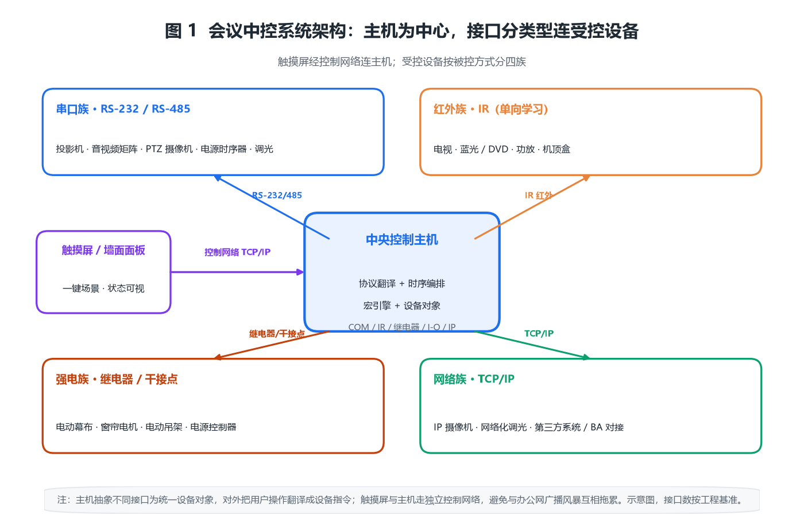
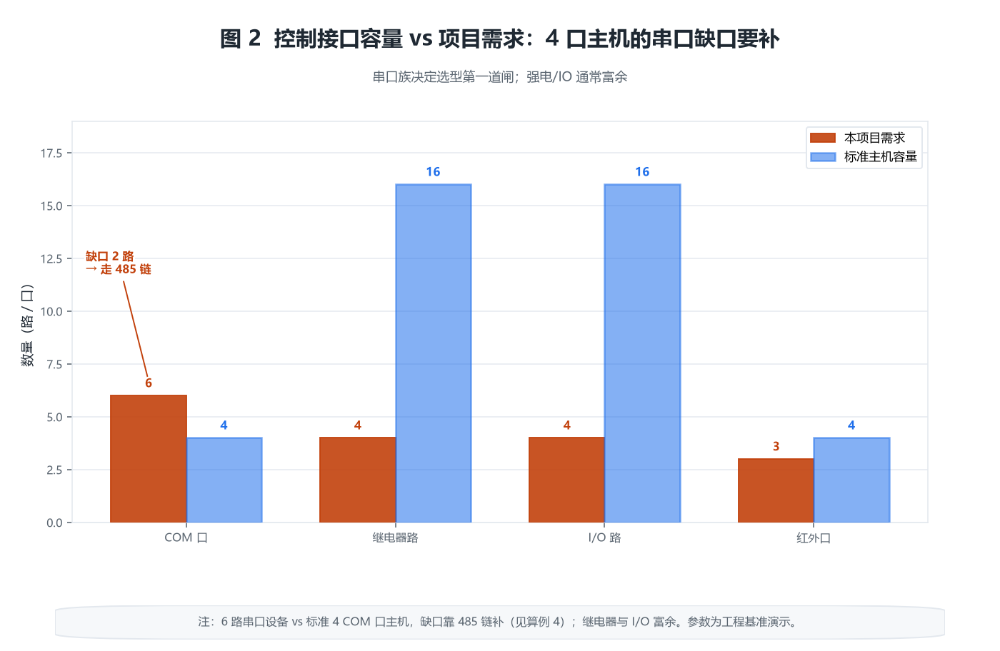
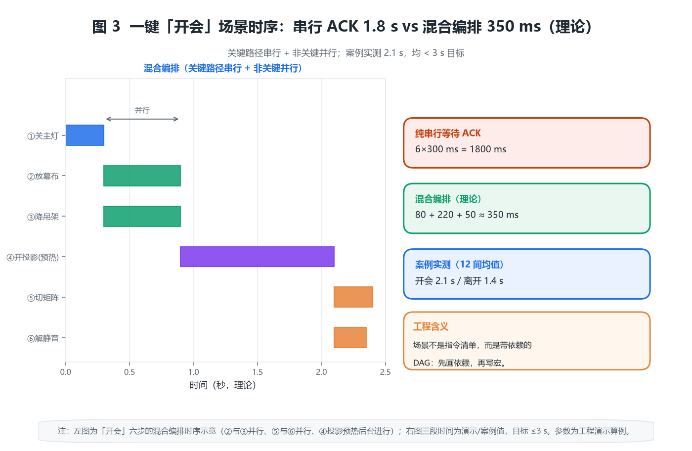
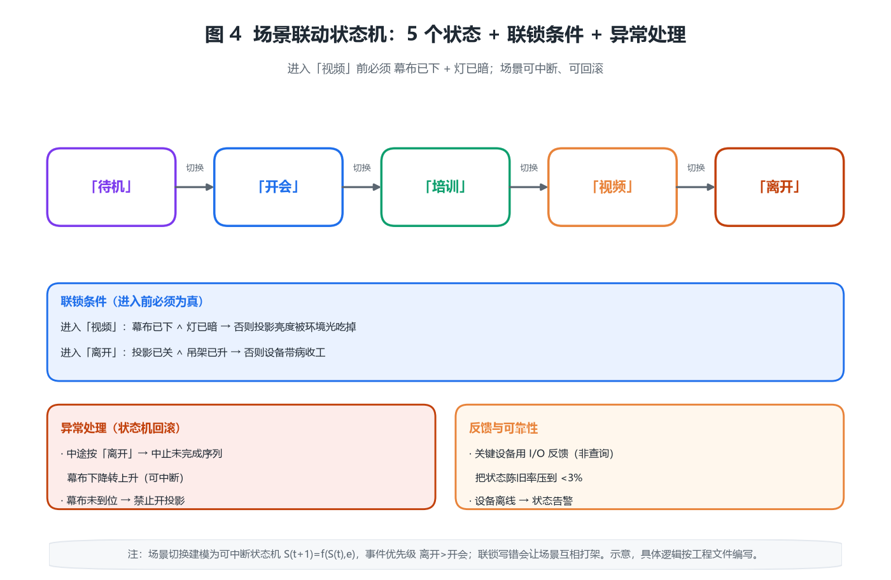

# 会议中控系统产品综述：把十几个遥控器的逻辑，收进一块主机的时序里

## 〇、一句话定位

会议中控系统（Central Control System for meeting rooms）把会议室里的投影机、音视频矩阵、灯光、窗帘、电动幕布、电动吊架、音量、空调、摄像机等十几种原本各拿一个遥控器的设备，集中到一块「中央控制主机」上，再通过墙装触摸屏、桌面面板或平板一键切换「开会 / 培训 / 视频 / 休息 / 离开」等场景。它的本质不是「多了一个遥控器」，而是**用确定的时序与联锁，替代人肉对设备开关顺序的记忆**——顺序错了，投影机会在幕布没放下时报错，电动吊架会在投影没关时往上顶，矩阵会在投影还没预热完时把黑场送给观众。

从工程角度看，中控是弱电系统里少见的「软硬强耦合」产品：硬件是接口密度的比拼（串口、红外、继电器、I/O、网络），软件是场景逻辑的比拼（宏引擎、状态机、联锁、异常回滚）。同一块主机，工程文件写得好就是「一键丝滑」，写得差就是「按了没反应、按了打架」。所以它既考验选型，更考验实施。

> **反直觉点一：中控最难的不是「能不能控」，而是「先控谁、后控谁」。** 一台投影机的开机预热要二十几秒，幕布下降要几秒，矩阵切源要一两百毫秒，三者的先后顺序写错，体验会从「科技感」直接掉到「设备打架」。会写宏的人很多，会把依赖关系画成有向无环图再落成时序的人很少。
>
> **反直觉点二：串口数量比「能控多少设备」更致命。** 一台投影仪独占一个 RS-232，音视频矩阵独占一个，PTZ 摄像机各占一个，12 台串行设备只有 4 个 COM 口，就得靠串口分配器或 485 链补，而 485 链一挂多节点，延迟与轮询冲突随之而来。选型时先数串口族设备，再挑主机，顺序反了就要返工。
>
> **反直觉点三：红外「学习」不是录下来就行。** 环境光、码长、38 kHz 载波的频率漂移，会让学习码在真实遥控器面前集体失效；学习码是「波形快照」，不是「协议解析」，换电池、换角度、换批次都可能失准。这就是为什么关键设备不该依赖红外。
>
> **反直觉点四：继电器触点容量决定你能不能「带电控强电」。** 投影幕布电机的启动电流往往是额定的数倍，触点选小了，不会立刻坏，而是在第 100 次吸合时熔焊、粘死——那是最难排查的一类故障。

十个锚定数字：典型主机 COM 口 4~16 个；RS-232 常用波特率 9600 / 19200 / 38400 bps；一键场景切换目标 ≤3 s；红外载波 38 kHz；继电器触点 10 A / 250 V（阻性）；PoE 802.3af 15.4 W、802.3at 30 W；触摸屏主流 7" / 10"；视频矩阵切换 100~200 ms；宏队列深度工程基准 ≥2；红外学习容量 16 MB FLASH 起步。

---

## 一、产品设计方案

### 1.1 系统形态：中央主机 + 控制网络 + 触摸屏 + 受控设备

中控的物理骨架是一块放进弱电间或机柜的**中央控制主机**，它一侧通过多种接口（串口、红外、继电器、I/O、网络）连到受控设备，另一侧通过 TCP/IP 或 RS-485 连到分布在门口、桌面的**触摸屏 / 面板**。用户只和触摸屏打交道，所有设备联动逻辑都写在主机的工程文件里。

图 1 把这种「主机为中心、接口分类型」的拓扑画清楚：受控设备按被控方式自然分成四族——串口族（投影、矩阵、摄像机，走 RS-232/485）、红外族（电视、蓝光、功放，走 IR）、强电族（幕布、窗帘、吊架、电源，走继电器/干接点）、网络族（IP 摄像机、网络化调光、第三方系统，走 TCP/IP）。触摸屏与主机之间通常走独立的控制网络，避免和办公网广播风暴互相拖累。

部署形态上，中控大致分三类：**机柜式主机**（接口最全、可扩展卡，适合报告厅与核心会议室）、**嵌入式面板主机**（主机与触摸屏一体，适合小会议室与快装）、**软件中控**（跑在通用 PC/服务器上，靠网络网关接设备，适合园区级集控）。三者不是替代关系，而是一套系统里按房间重要性分层使用：核心会议室用机柜式保可靠，普通会议室用面板式控成本，调度中心用软件中控做总控。

### 1.2 控制接口的面貌

中控之所以要「多接口」，是因为会议室设备从来不统一协议。把五类接口的工程特性掰开看：

- **RS-232**：点对点、全双工、距离短（≤15 m 工程基准），电平 ±3~±15 V，抗干扰一般。好处是几乎每台投影、矩阵、专业显示器都保留一个 232 调试口，是「最通用的后门」。
- **RS-485**：半双工、差分传输、可挂多节点（工程上 32 节点常见）、距离长（≤1200 m 理论）。适合调光模块、电源时序器、传感器这类「数量多、变化慢」的设备，代价是要靠地址轮询区分节点。
- **IR（红外）**：家电类设备的低成本通道，单向、无反馈，靠「学习」原遥控器码。载波通常 38 kHz，学习本质是记录高低电平持续时间。
- **继电器 / 干接点**：控强电的最后一级——幕布、窗帘、吊架、电源时序器都靠它。本质是「用弱电触点去吸合强电回路」，分常开（NO）、常闭（NC）、转换（CO）三种触点形式。
- **I/O（数字输入）**：做**反馈**。检测幕布上/下限位、门磁、电流辅助触点，让主机知道「动作真的完成了」，而不是「我发了指令就假设它完成了」。
- **TCP/IP**：网络化中控与 IP 受控设备（网络摄像机、PoE 设备、第三方系统）的通道，也是集中管控的底座。

### 1.3 与相邻系统的边界（三处最容易拉扯）

1. **与音视频矩阵**：矩阵本身也能「切源」，但「切到哪路 + 顺手关灯 + 放幕布」这种跨设备联动只有中控能编排。边界是——矩阵管「信号路由」，中控管「场景编排」。二者通过 232 或网络指令握手，中控发「切 HDMI2」，矩阵回报「已切换」。
2. **与楼宇自控（BAS）**：灯光、空调既归 BAS 也归中控。工程上常见做法是 BA 管「常态运行」，中控管「会议态覆盖」，通过 Modbus/BACnet 或干接点交接，避免两套系统抢同一个回路。最忌讳的是两边都写「关灯」，结果场景一触发，BA 又把灯打开。
3. **与会议系统（话筒 / 摄像跟踪）**：摄像机预置位 + 话筒 ID 联动，需要中控把「谁在发言」翻译成「摄像机转到几号预置位」，靠 VISCA 或 Pelco 协议。这里中控是「翻译官」，真正的发言逻辑在会议主机里。

### 1.4 一个常被忽视的合规前提：消防强切

GB 50314-2015《智能建筑设计标准》4.7 对智能化总控室、机房有明确要求（独立工作区、不贴邻变配电室与电梯机房、防水降噪抗震等）；而会议室的中控在火灾时**必须让位于消防**——背景音乐/会议扩声要能被强制切到消防广播（GB 50526 / 现行 GB/T 50526-2021 要求紧急广播最高优先级、10 s 内播放），电动窗帘/幕布在火警时应能自动开启以利疏散。这部分逻辑不能写死在中控里「忘了就不管」，而应有**独立的强切继电器或干接点**，断电/火警即动作。规范的底线是：中控可以坏，消防强切不能坏。

### 1.5 中控的「灵魂」在工程文件，不在硬件

中控真正值钱的不是那块主机，而是里面的**工程文件**——场景宏、设备指令库、GUI 页面、联锁条件全在里面。工程文件一旦误改，可能让一整层会议室的灯全亮或全灭，而且现场往往「看不出是软件问题」。所以成熟项目会把工程文件纳入版本管理：每次改宏前导出备份，改完做一次全场景回归（开会 / 培训 / 视频 / 离开各跑一遍），保留可回滚的上一版；核心会议室甚至要求「改前先在备用主机上验证，再同步到主控」。这也解释了为什么这个行业的利润在「编程与运维」而不在「卖盒子」——设备会老、逻辑会改，没有人持续维护的工程文件，迟早变成一颗定时炸弹。

---

## 二、核心参数与选型

### 2.0 选型速查表

| 维度 | 工程基准值 | 说明 |
|---|---|---|
| COM 口数 | 4 / 8 / 16 | 每串口族设备约占 1 口 |
| 红外口 | 1~4 路（可扩展） | 每红外族设备共享或分路 |
| 继电器路数 | 8 / 16 / 32 | 控幕布/窗帘/电源/吊架 |
| I/O 路数 | 8~16 | 限位/门磁/反馈 |
| 网络 | 1~2 × 10/100M | 连触摸屏与 IP 设备 |
| FLASH | 16 MB 起 | 存红外码与工程文件 |
| 供电 | PoE / 外置 12V / 24V | 见算例 6 |
| 触摸屏 | 7" / 10" 墙装 | GUI 工程见算例 7 |
| 宏队列深度 | ≥2 | 场景可中断的前提 |
| 工作温度 | 0~50 ℃（弱电间） | 机柜内需留散热 |

### 2.1 【原创算例 1】串口预算：4 口主机带 6 个串口设备

一间标准中型会议室的串口族设备通常是：投影机 1（RS-232）、音视频矩阵 1（RS-232）、PTZ 摄像机 2（VISCA over 232/485）、电源时序器 1（232）、调光模块 1（485）——合计 6 路串行。若主机只有 4 个 COM 口：

$$N_{\mathrm{com}} \ge n_{\mathrm{RS232}} + n_{\mathrm{RS485\_chains}}$$

4 口带 6 路 → 至少 2 条 485 链（把调光、电源或两台摄像机并到同一条 485 总线上）。代价是 485 链变成轮询，单设备响应要加上轮询等待（见算例 4）。若强行用「一个 232 口接串口分配器带多台设备」，则每次只能有一台设备被「接通」，切换靠继电器切换 232 的 TX/RX，反而更慢、更不可靠。**结论：串口数是选型的第一道闸，先数清串口族设备再选主机，别等接线时才发现不够。**

### 2.2 【原创算例 2】场景切换时序账：串行 ACK vs 混合编排

「开会」场景的经典六步：①关主灯 → ②放电动幕布 → ③降电动吊架 → ④开投影机（预热 20 s，可后台）→ ⑤矩阵切到笔记本 → ⑥话筒解除静音。

若主机**串行等待每台 ACK**：$t_{\mathrm{tx}}≈80\ \mathrm{ms}$（组包下发）、$t_{\mathrm{resp}}≈200\ \mathrm{ms}$（设备响应）、$t_{\mathrm{ov}}≈20\ \mathrm{ms}$（流程开销）：

$$T_{\mathrm{seq}}=\sum_{i=1}^{M}(t_{\mathrm{tx},i}+t_{\mathrm{resp},i}+t_{\mathrm{ov},i})\approx 6\times 300\ \mathrm{ms}=1.8\ \mathrm{s}$$

若**一口气并行广播**全部指令再等最慢一台确认：$80\ \mathrm{ms}$（总下发）+ $220\ \mathrm{ms}$（最慢确认）+ $50\ \mathrm{ms}$（守护）= $350\ \mathrm{ms}$。但纯并行有雷区——幕布未到位就开投影会烧屏/报错。工程上用**关键路径串行 + 非关键并行**：

$$T_{\mathrm{hybrid}}=\max(T_{\mathrm{crit}})+\sum t_{\mathrm{tx,par}}+t_{\mathrm{guard}}$$

即「关灯 →（放幕布 ∥ 降吊架）→ 幕布到位 → 开投影 → 切矩阵 ∥ 解除静音」，实测落在一键目标 ≤3 s 内。这条账的价值在于：**场景不是指令清单，而是带依赖的 DAG**（有向无环图），写宏时先把依赖画出来，再决定哪些能并行。

### 2.3 【原创算例 3】红外码存储容量：30 KB 的「容量」vs 无限的「维护」

红外族 8 台设备，每台平均 30 个功能码，每码平均 128 字节（NEC/RC5 变长）：

$$C_{\mathrm{IR}}\ge\sum_{j}m_j L_j=8\times 30\times 128\ \mathrm{B}=30720\ \mathrm{B}\approx 30\ \mathrm{KB}$$

对比主机内置 16 MB FLASH，占比 0.18%，**容量从来不是瓶颈**。真正的成本是「一一对应学习」——每换一批设备、每换一个遥控器就要重学，且学习码对安装角度、电池电量敏感。红外学习还有个隐性坑：一个 IR 口如果用一个「红外发射头」覆盖多台设备，码会互相串扰；正确做法是每台设备一个贴片发射头，分路发射。所以红外适合「家电类、不常变」的设备；频繁变更或关键设备（投影开关机）优先走串口。

### 2.4 【原创算例 4】RS-485 总线轮询周期：16 节点 115 ms 一圈

一条 485 链挂 16 个调光/电源节点，波特率 19200 bps，每帧 8 字节，帧结构 1 起始 + 8 数据 + 1 停止 = 10 bit：

$$T_{\mathrm{poll}}=N\left(\frac{8\times b_{\mathrm{frame}}}{B}+t_{\mathrm{turn}}\right)=16\times\left(\frac{8\times 10}{19200}+0.003\right)\approx 16\times 7.2\ \mathrm{ms}\approx 115\ \mathrm{ms}$$

其中 $t_{\mathrm{turn}}\approx 3\ \mathrm{ms}$ 是 485 半双工换向（收发切换）与帧间隔开销。即 115 ms 就能把 16 个节点状态刷新一遍，放到 500 ms 刷新周期绰绰有余。但若这条链同时承载灯光反馈、电源状态、第三方传感器，帧长变长、节点增多，就要重算——**485 链的总延迟是节点数 × 单帧时间的线性函数**，超了就会出现「按了灯不亮、要等下一轮轮询」的卡顿感。经验阈值：单链节点 ≤32、刷新周期 ≥200 ms 时体验良好。

### 2.5 【原创算例 5】继电器触点容量账：启动电流把余量吃掉

电动投影幕布电机 220 V，额定运行电流约 0.4 A，**启动电流约 1.2 A（≈3 倍）**。触点额定 10 A / 250 V 阻性 → 单台余量充足。但感性负载要降额：继电器触点标称阻性，带感性负载通常按 1/2~1/3 使用，10 A 感性可用约 3~5 A。若一个继电器回路串了 4 台幕布：

$$I_{\mathrm{contact}}\ge k_{\mathrm{derate}}^{-1}\times\sum I_{\mathrm{inrush}},\quad k_{\mathrm{derate}}\approx 1/3\Rightarrow 4\times 1.2=4.8\ \mathrm{A}$$

4.8 A 已逼近 1/3 降额线（临界），应分两路或选 16 A 触点。**工程含义：继电器选型看的是「启动电流 + 感性降额」，不是运行电流**。此外，带电机/线圈的感性负载应在触点两端并联 RC 吸收或续流二极管，否则断开的瞬间拉弧会加速触点烧蚀。

### 2.6 【原创算例 6】PoE 供电预算：线损让末端少了 1.3 W

中控主机 + 10" 触摸屏走 PoE（802.3at，PSE 端口 30 W，100 m 处实际输出 25.5 W）。Cat5e 100 m 环路电阻约 4.7 Ω，按 48 V 输入侧电流 $I=25.5/48≈0.53\ \mathrm{A}$：

$$P_{\mathrm{loss}}=I^{2}R_{\mathrm{loop}}=0.53^{2}\times 4.7\approx 1.32\ \mathrm{W},\quad P_{\mathrm{avail}}\approx 25.5-1.32\approx 24.2\ \mathrm{W}$$

主机 12 W + 屏 8 W = 20 W < 24.2 W，余量 OK。若链路超 100 m（如跨层到弱电间），线损按 $R=\rho L/A\times 2$ 线性上升，末端可能不够。结论是**PoE 中控的供电半径要先算线损，别只看端口标称**；线径从 Cat5e 换 Cat6 可降低环路电阻，但更有效的办法是把主机就近取电、只让触摸屏走 PoE。

### 2.7 【原创算例 7】触摸屏 GUI 加载延迟：背景图压到 1 MB 以内

GUI 20 页，每页平均 12 控件，背景图 1920×1080 PNG 约 600 KB。单页加载：

$$T_{\mathrm{page}}\approx\frac{S_{\mathrm{bg}}}{B_{\mathrm{link}}}+n_{\mathrm{wgt}}t_{\mathrm{wgt}}+t_{\mathrm{dec}}$$

600 KB / 100 Mbps 理论 ≈ 48 ms，叠加 TCP 窗口与解码实际 150~300 ms，控件渲染约 20 ms，整页切换 <350 ms。但若背景图误用 BMP/未压缩 3 MB，加载时间翻 5 倍，用户会明显感到「点一下卡一下」。**工程建议：背景图压到 ≤1 MB，或改用矢量/纯色渐变底**；控件图标用 PNG-8 而非 24 位真彩，能再省一半体积。

### 2.8 【原创算例 8】视频矩阵切换延迟：200 ms 的「瞬时」

中控下发「切 HDMI2」：串口组包下发 80 ms + 矩阵执行切换（含信号重新锁定/黑场）120 ms：

$$T_{\mathrm{sw}}=t_{\mathrm{cmd}}+t_{\mathrm{switch}}\approx 80+120=200\ \mathrm{ms}$$

用户感知几乎瞬时。但 4K / SDI 矩阵切换黑场可达 200~500 ms，高端场景要配无缝切换器（frame synchronizer）消除黑场。这条账提醒：**「切源」是两段时间之和，中控只负责第一段，第二段由矩阵硬件决定**。若客户抱怨「切源有黑屏」，先量矩阵的切换指标，别让中控背锅。

### 2.9 【原创算例 9】宏并发：连按两个场景键怎么办

用户在 1 s 内连按「开会」和「离开」。若宏队列深度只有 2，第二个宏会覆盖或排队，导致幕布下降中途又上升、投影刚开又关。正确做法是把场景切换建模成**可中断的状态机**：

$$S_{t+1}=f(S_t,e)$$

事件优先级 $p(e)$ 上，离开 > 开会：按下「离开」应立即中止未完成的「开会」序列（中断幕布下降转上升），而不是等它跑完。队列深度 $D\ge 2$ 只是底线，关键是每个场景宏带「可中断」标志与回滚动作——比如「开会」的每一步都要有对应的「撤销」动作，否则中途打断会留下半吊子状态（灯关了、幕布放了一半、投影没开）。

### 2.10 【原创算例 10】状态回读可靠性：查询式会「卡在 last-known」

投影机状态有两种拿法：查询式（RS-232 发 `POW?`，等 100 ms 回 `ON`）与反馈式（用 I/O 检测继电器辅助触点 / 电流检测）。查询式下若设备离线，状态卡在最后一次已知值，随设备数上升，出现「幽灵在线」的概率：

$$P_{\mathrm{stale}}=1-(1-p_{\mathrm{drop}})^{N}$$

当单设备掉线概率 $p_{\mathrm{drop}}=0.02$、设备数 $N=12$ 时，$P_{\mathrm{stale}}≈1-0.98^{12}≈21.6\%$——每五次操作就有一次状态不可信。工程中**关键设备（投影、幕布位置）用反馈式，普通设备用查询式**，在成本与可靠性间取平衡。反馈式的额外好处是能抓到「指令发了但设备没动」的真实故障，而不是自欺欺人地显示「已开」。

### 2.11 【原创算例 11】集中控制的心跳与带宽：9.6 kbps 很小，但别放错地方

园区级集控里，30 间会议室的心跳与状态上报：每 5 s 一条 200 B 的状态包：

$$B_{\mathrm{hb}}=\frac{N\cdot s}{T}=\frac{30\times 200}{5}=1200\ \mathrm{B/s}\approx 9.6\ \mathrm{kbps}$$

带宽几乎可以忽略。真正吃带宽的是「视频预览、远程桌面、固件包分发」——这些才是要单独规划 VLAN、限制带宽的部分。心跳的真正意义不在带宽，而在**超时判定**：若 $T_{\mathrm{timeout}}=3\times T_{\mathrm{hb}}=15\ \mathrm{s}$ 内收不到心跳，就判房间离线。超时设太短会误报（网络抖动），设太长会让故障发现滞后，工程上取 3~5 个心跳周期较稳。

### 2.12 【原创算例 12】关键会议室的双机热备：5 秒切换值不值

核心会议室（如董事会、指挥中心）一旦中控死机，全场瘫痪。双机热备的切换时间：

$$T_{\mathrm{failover}}=t_{\mathrm{detect}}+t_{\mathrm{switch}}\approx 3+2=5\ \mathrm{s}$$

即从主控失联到备控接管约 5 s。这个数字要结合场景看：如果是「正在开会、突然能控的屏黑了 5 秒」，体验很差；如果是「会前自检发现主控故障、备控顶上」，5 s 完全可以接受。所以热备的价值不在于「无感」，而在于「不中断会议进程」——这需要主备之间同步工程文件与设备状态，否则备控接管后状态是错的。

### 2.13 协议选型对照

| 协议 | 类型 | 适用 | 取舍 |
|---|---|---|---|
| Crestron / AMX / Savant | 私有闭环 | 高端单品牌工程 | 生态完整但锁定 |
| KNX | 开放总线 | 灯光/窗帘/BA 交接 | 与 BAS 天然融合 |
| Modbus / BACnet | 开放 | 与 BA/第三方对接 | 通用但需点表 |
| 原生 RS-232/IR | 设备级 | 单体设备直控 | 无反馈、要学习 |
| VISCA / Pelco | 设备级 | PTZ 摄像机预置位 | 协议简单、生态成熟 |

---

## 三、技术原理

### 3.1 集中控制的总线拓扑与寻址

中控本质是一台「协议翻译 + 时序编排」的嵌入式控制器。它对内把不同接口抽象成统一设备对象（每个对象有地址、指令集、状态机），对外把用户操作翻译成某设备的某条指令。485 链上的节点靠地址寻址（如 `01`~`FF`），主机轮询或广播下发，节点应答或执行。寻址冲突是现场最常见的坑：两条 485 链上都有地址 `01` 的调光模块，主机就会「张冠李戴」，所以工程上要给每条链分配不重叠的地址段。

### 3.2 红外学习的物理基础

红外遥控靠 38 kHz 载波调制二进制码。学习时中控用宽采样窗口记录「高/低电平持续时间」，还原成原始波形。难点在载波频率漂移（不同品牌 36~40 kHz）与码长差异：学习码是「波形快照」，不是「协议解析」，所以换电池、换角度都会让快照失准。更麻烦的是「长码」设备（如某些空调遥控，一帧几百位），学习时若采样窗口不够宽，尾部会被截断，表现为「按了只执行一半功能」。**这就是为什么关键设备不该依赖红外**，而应优先用串口或网络。

### 3.3 继电器与干接点的机电原理

继电器是用小电流控制大电流的电磁开关；干接点是不带电压的纯触点（常开/常闭），用于「我动作了没」的反馈或跨系统交接。两者的寿命由吸合次数与触点电流决定，带感性负载要加续流二极管/RC 吸收，否则拉弧会缩短寿命（呼应算例 5）。工程上还有一个细节：**继电器线圈本身也是感性负载**，多路继电器同时动作时，线圈反电动势会干扰主机电源，必要时在线圈两端并续流二极管。

### 3.4 场景状态机：时序 + 联锁

场景切换不是脚本流水，而是带联锁的状态机：进入「视频」场景前必须确认「幕布已下 + 灯已暗」，否则投影亮度被环境光吃掉；进入「离开」场景前必须确认「投影已关 + 吊架已升」，否则设备带病收工。联锁条件写错了，场景之间会互相打架。状态机的好处是「可验证」——每个状态、每个事件、每个转移都能画出来，比一堆 if-else 脚本更容易在施工前发现逻辑漏洞。

### 3.5 与 IP 化的趋势

传统中控是「一台主机管一间房」，网络化中控把控制信令走 IP，主机可管一栋楼甚至一个园区的所有会议室，远程排障、固件统一升级、使用率统计都成为可能。代价是控制网络要与办公网做好隔离（广播风暴、VLAN、ACL），别让一次全网广播把几十间会议室的灯全点亮。IP 化还带来一个新问题：**时钟同步**——多间会议室的场景日志要能对齐时间轴做联合排障，就需要 NTP 统一授时。

---

## 四、产品功能与差异化

### 4.1 六类核心功能

1. **场景一键切换**：把多设备联动固化成一键，支持场景内嵌套子场景。
2. **设备集中管理**：所有串口/红外/继电器统一纳管，设备台账、在线状态可视。
3. **反馈与监控**：I/O 回读 + 设备在线状态，异常告警与日志回溯。
4. **权限与日程**：不同人员不同权限，按日程自动切换场景（如每天 8:30 自动「待机」）。
5. **远程维护**：网络化后远程排障、日志回溯、固件批量升级。
6. **第三方集成**：与 BA、会议系统、视听矩阵、消防对接。

### 4.2 差异化能力清单

- **宏引擎强弱**：能否写带条件/中断/循环的复杂联动，是低端遥控盒与专业中控的分水岭。
- **接口密度与扩展**：COM 口数、能否加串口/红外扩展卡，决定能不能「一台管一间」。
- **GUI 工程体验**：触摸屏编程是否可视化、是否支持矢量背景、是否支持多语言。
- **生态开放度**：私有闭环 vs 开放协议，决定后期被锁定程度与二次开发成本。
- **冗余与热备**：核心会议室是否支持双机热备（切换时间见算例 12）。
- **可维护性**：工程文件能否导出备份、能否版本回滚，是运维友好度的关键。

### 4.3 从单会议室到园区级集控

单房间中控解决「一键好用」；园区级集控解决「几十间房统一运维」——设备台账、故障集中告警、使用率报表、固件批量升级，是把会议中控从「单点工具」升级为「设施管理资产」的关键一步。集控平台的价值不在「能远程开关灯」，而在「把散落各房间的设备健康、使用率、能耗汇成一张可运营的报表」。

---

## 五、应用场景

- **5.1 普通会议室**：痛点是一屋子遥控器、会前手忙脚乱；方案是一键「开会/离开」，关灯放幕切源；价值是每场会省 5 分钟准备，体验统一。
- **5.2 报告厅**：痛点是强电回路多、舞台机械复杂、消防要求高；方案是强电继电 + 舞台机械 + 独立消防强切；价值是设备联锁不打架、验收一次过。
- **5.3 多功能厅**：痛点是场景多（会议/演出/培训/宴会）、切换频繁；方案是状态机 + 可中断宏；价值是场景切换不残留半吊子状态。
- **5.4 远程视频会议室**：痛点是摄像机要跟着发言人转；方案是中控接管摄像机预置位 + 话筒 ID 跟踪联动；价值是「谁说话镜头给谁」。
- **5.5 指挥中心**：痛点是多屏拼接 + 信号调度 + 7×24 不能停；方案是双机热备 + 反馈式回读；价值是高可靠、可远程运维。

---

## 六、实际案例

### 案例一：12 间中型会议室（串口预算 + 场景时序）

**需求**：集团楼层 12 间 20 人会议室，统一「开会/离开」一键，预算可控。
**方案**：每间选 8 COM 口主机（投影 1 + 矩阵 1 + 摄像机 2 + 电源 1 + 调光 1 + 备用 2），红外控电视/功放，继电器控幕布/窗帘。
**配置核算**：按算例 1，8 口刚好覆盖 6 串口设备 + 2 备用；按算例 2 混合编排，「开会」实测 2.1 s、「离开」1.4 s，均 <3 s 目标；按算例 10，投影用反馈式回读，状态可信。
**交付价值**：原来每场会前 5 分钟「找遥控器 + 调设备」，现在一键 2 秒，12 间日均省约 40 分钟准备时间；运维从「打电话问怎么开」变成「看板看状态」。

### 案例二：500 人报告厅（强电继电 + 舞台机械 + 消防强切）

**需求**：报告厅要管投影、舞台吊架、电动幕、面光、消防广播强切。
**方案**：16 继电器主机分两路控幕布/吊架（呼应算例 5 降额），独立强切干接点接消防，舞台机械走 485 链。
**配置核算**：算例 5 校核——4 台幕布电机分两路、每路触点选 16 A 感性可用 ≈5.3 A > 4.8 A 启动，余量安全；算例 4 校核——舞台机械 12 节点 485 链轮询约 86 ms，满足 200 ms 刷新；消防强切独立于中控逻辑，断电即动作。
**交付价值**：消防验收一次通过，场景切换不再出现「吊架顶投影」的设备冲突；演出/会议模式切换由 10 分钟人工降到 1 分钟。

### 案例三：集团总部 30 间集控（网络化 + 远程排障）

**需求**：总部 30 间会议室分散三栋楼，IT 人力有限，要远程看状态、批量升级。
**方案**：网络化中控，控制网独立 VLAN，中心平台纳管 30 间，状态看板 + 日志。
**配置核算**：按算例 10，关键设备（投影/幕布）反馈式回读，把 $P_{\mathrm{stale}}$ 从查询式的 21.6% 降到反馈式的 <3%；按算例 11，30 间心跳仅 9.6 kbps，可忽略，真正要限的是视频预览；控制网与办公网 ACL 隔离，避免广播风暴。
**交付价值**：故障平均响应从「人到现场」降到「远程 5 分钟定位」，季度设备可用率 99.2%；固件批量升级从「逐间上门」变成「平台一键下发」。

---

## 七、市场背景与竞争格局

会议中控最早由 Crestron、AMX 等欧美品牌定义「专业中控」品类，主打高端单品牌闭环生态，编程服务是其利润核心；国内厂商以高性价比 + 开放协议切入院企市场，在中端会议室与政企项目上份额可观。近年两条主线：一是 **IP 化**（从单房到园区集控），二是 **与会议系统/视听融合**（中控不再孤立，而是和矩阵、话筒、摄像机打包成「整体视听解决方案」）。低端市场则被「无线遥控盒 + 投屏器」部分替代——它们能解决「投屏」，但解决不了强电继电、多设备联锁、消防交接，所以真正涉及工程的会议室，专业中控仍不可替代。

竞争的关键不在硬件接口数量，而在**工程能力**：同样的主机，谁能把场景逻辑写得稳、把异常处理想得全、把运维做得轻，谁就能拿下项目。这也是为什么这个行业「卖硬件不赚钱，卖编程与运维才赚钱」。

## 八、商业模式与趋势

商业模式从「卖硬件盒子」走向「盒子 + 编程服务 + 运维订阅」：编程（把场景逻辑写进主机）是利润高地，且高度依赖实施经验，难以标准化；运维订阅（远程纳管、固件、报表）是可持续收入，也是客户粘性的来源。趋势上，**中控正被卷入「空间数字化」**——会议室的用率、能耗、设备健康都成为可量化资产，中控从「设备开关」进化为「空间运营入口」。未来两三年，能提供「设备 + 平台 + 数据」一体化方案的厂商，会比只卖盒子的厂商更有议价权。

---

## 附录 A 核算清单（公式汇总）

- 串口预算：$N_{\mathrm{com}}\ge n_{\mathrm{RS232}}+n_{\mathrm{RS485\_chains}}$
- 串行场景：$T_{\mathrm{seq}}=\sum(t_{\mathrm{tx}}+t_{\mathrm{resp}}+t_{\mathrm{ov}})$
- 混合场景：$T_{\mathrm{hybrid}}=\max(T_{\mathrm{crit}})+\sum t_{\mathrm{tx,par}}+t_{\mathrm{guard}}$
- 红外容量：$C_{\mathrm{IR}}\ge\sum m_j L_j$
- 485 轮询：$T_{\mathrm{poll}}=N(8 b_{\mathrm{frame}}/B+t_{\mathrm{turn}})$
- 继电器：$I_{\mathrm{contact}}\ge k_{\mathrm{derate}}^{-1}\sum I_{\mathrm{inrush}}$
- PoE 线损：$P_{\mathrm{loss}}=I^{2}R_{\mathrm{loop}},\ P_{\mathrm{avail}}=P_{\mathrm{PSE}}-P_{\mathrm{loss}}$
- 屏加载：$T_{\mathrm{page}}\approx S_{\mathrm{bg}}/B_{\mathrm{link}}+n_{\mathrm{wgt}}t_{\mathrm{wgt}}+t_{\mathrm{dec}}$
- 矩阵切换：$T_{\mathrm{sw}}=t_{\mathrm{cmd}}+t_{\mathrm{switch}}$
- 状态陈旧：$P_{\mathrm{stale}}=1-(1-p_{\mathrm{drop}})^{N}$
- 心跳带宽：$B_{\mathrm{hb}}=N s/T$
- 热备切换：$T_{\mathrm{failover}}=t_{\mathrm{detect}}+t_{\mathrm{switch}}$

## 附录 B 术语表

- **中控主机**：集中控制核心，跑工程文件与宏引擎的嵌入式控制器。
- **场景（Scene）**：一组预设的多设备联动状态，一键触发。
- **宏（Macro）**：可带条件/中断/循环的联动指令序列。
- **干接点**：不带电压的纯开关触点，用于反馈或跨系统交接。
- **VISCA**：索尼定义的摄像机控制协议，常用于 PTZ 预置位联动。
- **强切**：火灾时强制把背景/会议广播切到消防广播、强制开窗帘。
- **DAG**：有向无环图，用于表达场景内各动作的依赖关系。

## 附录 C 标准与规范索引

- GB 50314-2015《智能建筑设计标准》4.4.12 会议系统（含会议设施集中控制）
- GB 50348-2018《安全防范工程技术标准》
- GB/T 50526-2021《公共广播系统工程技术标准》（替代 GB 50526-2010）
- GB 50371-2006《厅堂扩声系统设计规范》
- GB 50799《电子会议系统工程设计规范》
- GB 50464《视频显示系统工程技术规范》
- GB 50635《会议电视会场系统工程设计规范》
- GB 50311-2016《综合布线系统工程设计规范》
- GB 50174-2017《数据中心设计规范》
- GB 50339-2013《智能建筑工程质量验收规范》

> 注：文中参数为工程基准或演示估算，具体选型须按设备说明书、现场负载与最新版标准核算；标准条款以现行有效版本为准。
