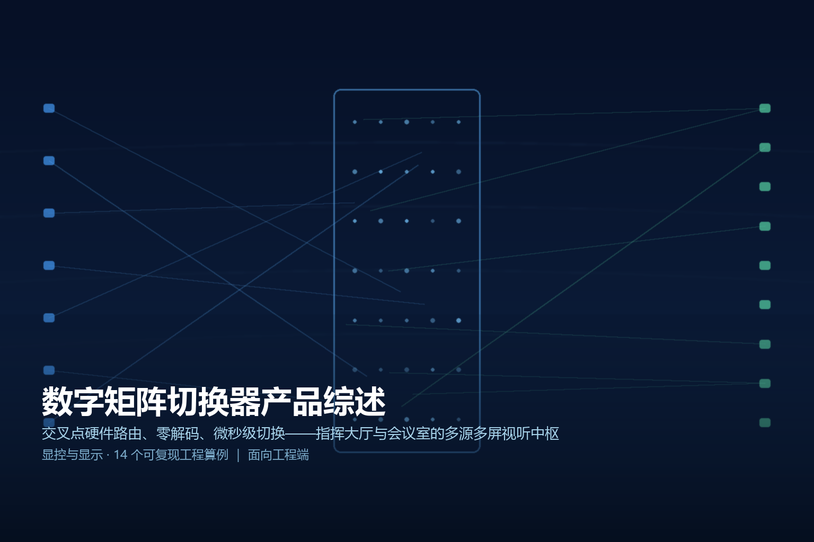
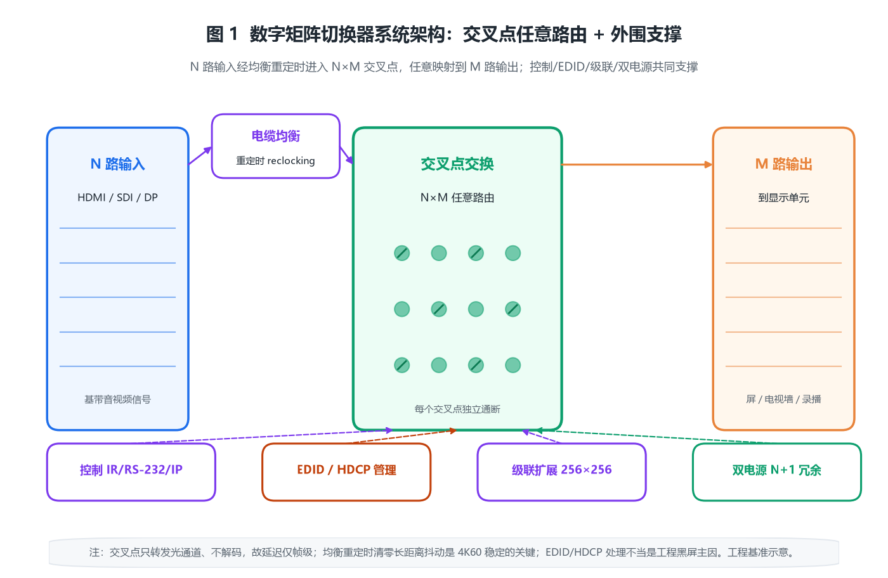
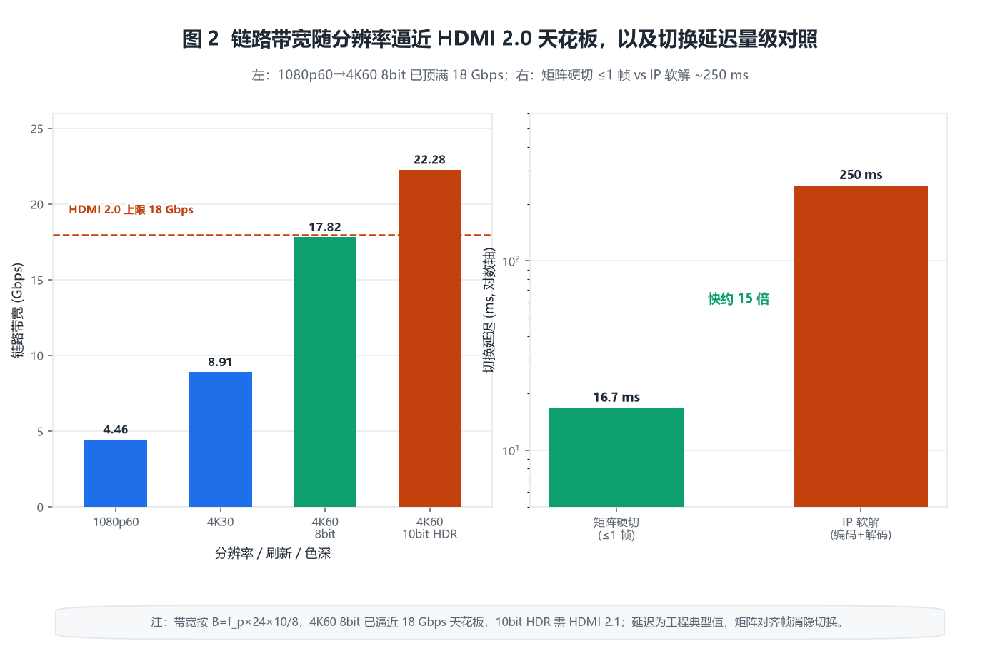
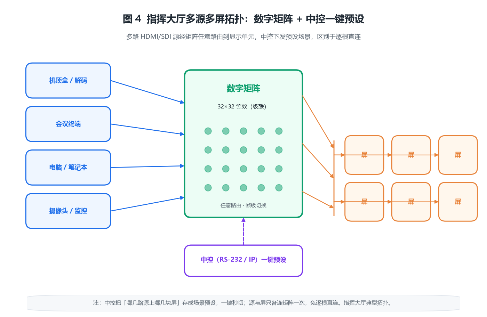

> 
> *概念图：数字矩阵切换器在指挥大厅把多路 HDMI 源任意路由到多块屏幕的应用示意*

# 数字矩阵切换器产品综述

## · 面向工程端

---

## 〇 一句话定位

数字矩阵切换器是一台纯硬件的交叉点路由交换设备：它把 N 路 HDMI / DVI / SDI 等基带音视频信号，任意、独立地切换到 M 路输出，任意一路输入可以同时送到任意多路输出，切换发生在交叉点芯片内部，不解码、不压缩、不重新编码，因此端到端延迟只有一帧量级（十毫秒级），天然适合指挥大厅、会议室、广电与安防里「多源、多屏、要瞬时切换」的场合。

> 简单说，视频解码器是把压缩码流变回画面，而数字矩阵是把已经成形的画面在硬件里「搬通道」——它不管画面里是什么内容，只负责把第几路输入接到第几路屏。正因为不碰编码，它几乎没有延迟，也几乎不会因为算力瓶颈掉帧。

---

## 一、产品设计方案

### 1.1 数字矩阵与「解码器 / 分配器 / 拼接器」的本质区别

同一块控制室里常出现四种长得像、本质完全不同的设备，混用会把延迟和成本都搞错：

| 设备 | 干什么 | 是否解码 | 典型延迟 | 一句话 |
|------|--------|----------|----------|--------|
| 数字矩阵切换器 | N 路输入任意切到 M 路输出 | 否 | ≤1 帧（~17 ms） | 硬件路由，零解码 |
| 视频解码器 | 把 H.264/H.265 码流解出画面 | 是 | 200~750 ms | 算力解码，有延迟 |
| 分配器（Splitter） | 1 路输入复制成多路 | 否 | <1 ms | 只能 1 对多，不能任意切换 |
| 拼接处理器 | 1 路 4K 拆成多屏子区 | 是 | 10~40 ms | 缩放拼接，不做任意路由 |

> 关键判断：当你的输入已经是 HDMI、DP、SDI 这类「现成画面」，而且要「哪路投哪屏」随时变，就用矩阵；当输入还压在 RTSP/码流里，才需要解码器打头阵。很多工程把两者串起来：解码器先把码流变 HDMI，再交给矩阵做调度。

### 1.2 系统架构：交叉点交换是核心

数字矩阵的内部只有一条主线——「交叉点（Crosspoint）」。N 路输入排成行、M 路输出排成列，每个行列交叉处是一个电子开关，闭合就把那一路输入接通到那一路输出。所有开关可以独立通断，于是「一路输入到全部输出」「多路输入到不同输出」都能同时成立。

*图 1：N 输入 × M 输出交叉点交换——输入经均衡/重定时后进入交叉点芯片，任意映射到 M 路输出；外环由控制（IR/RS-232/IP）、EDID/HDCP 管理、级联扩展与双电源冗余共同支撑*

围绕交叉点，一台完整矩阵通常还包含五个外围子系统：

- **输入均衡与重定时（Reclocking）**： HDMI / SDI 长距离传输会衰减抖动，进芯片前先做电缆均衡与重定时，把信号复原再交换。
- **控制子系统**：接收 IR 遥控、RS-232、TCP/IP（Web / Telnet / API）指令，决定当下每个交叉点闭合到哪一格。
- **EDID / HDCP 管理**：向信源「伪装」成某个显示器的能力（EDID 缓存），并完成 HDCP 内容保护握手，否则会黑屏或降分辨率。
- **级联扩展**：单机端口数有限，多台级联（多级 Clos 结构）拼出更大 N×M。
- **冗余电源**：关键岗位用双电源 N+1，单电源故障不黑屏。

### 1.3 矩阵的分类维度

按信号类型分：**HDMI 矩阵**（消费与会议最普遍）、**DVI 矩阵**（早期工程屏）、**SDI 矩阵**（广电、长距离同轴）、**混合矩阵**（同一机箱混插 HDMI/SDI/DP/VGA 板卡，最灵活）。按规模分：4×4、8×8、16×16 是桌面/会议室主流，32×32、64×64 以上进指挥大厅。按控制分：面板按键、IR、RS-232、IP、中控联动。

---

## 二、核心参数与选型

### 2.1 带宽与分辨率：看懂 TMDS 与 FRL

矩阵能跑多高分辨率，本质受「单链路带宽」约束。HDMI 1.4/2.0 用 TMDS 编码（8b/10b），HDMI 2.1 改用 FRL。一条链路的数据速率可粗略写成：

$$
B = f_p \times 24 \times \frac{10}{8}
$$

（按 8 bit/色、RGB 4:4:4 计）

其中 $f_p$ 为像素时钟（MHz），$B$ 单位为 Mbps。

**【原创算例 1】常见分辨率的链路带宽。**
- 1080p60（148.5 MHz）：$B=148.5\times24\times1.25=4455\ \mathrm{Mbps}\approx4.46\ \mathrm{Gbps}$
- 4K30（297 MHz）：$B=297\times30=8910\ \mathrm{Mbps}\approx8.91\ \mathrm{Gbps}$
- 4K60 8 bit（594 MHz）：$B=594\times30=17820\ \mathrm{Mbps}\approx17.82\ \mathrm{Gbps}$
- 4K60 10 bit HDR（594 MHz，30 bit/像素）：$B=594\times30\times\frac{10}{8}=22275\ \mathrm{Mbps}\approx22.28\ \mathrm{Gbps}$

HDMI 2.0 上限约 18 Gbps，意味着 **4K60 8 bit 已逼近天花板（余量仅 1%）**，而 4K60 10 bit HDR 直接溢出，必须靠 4:2:2 降色度或上 HDMI 2.1（FRL 最高 48 Gbps）。选型时别只看「支持 4K」，要问清是 4K30 还是 4K60、几 bit、什么色度——差一档，链路预算差一倍多。

**【原创算例 2】切换延迟：硬件路由 vs 软件解码。**
交叉点开关建立时间 <1 µs，工程上切换对齐到帧消隐，最坏延迟就是 1 个帧周期：

$$
t_{\mathrm{switch}}\approx \frac{1}{f_{\mathrm{refresh}}}=\frac{1}{60}\approx 16.7\ \mathrm{ms}
$$

而 IP 编解码链路（解码+编码+网络抖动）典型 250 ms。矩阵相对快：

$$
\frac{250}{16.7}\approx 15\times
$$

这就是指挥大厅「一键切屏不能有卡顿」只能用矩阵、不能用软件软解的根本原因。

*图 2：左——像素时钟驱动的链路带宽（HDMI 2.0 18 Gbps 天花板，4K60 8bit 已顶满）；右——矩阵硬切换（≤1 帧）与 IP 软解（~250 ms）延迟量级对比*

### 2.2 交叉点规模与布线简化

**【原创算例 3】直连 vs 矩阵的布线节省。**
若不用矩阵，把 N 路源每路都拉一根线到 M 块屏，需要：

$$
W_{\mathrm{direct}}=N\times M
$$

而矩阵只需把源接到输入、屏接到输出，共 $N+M$ 根：

$$
W_{\mathrm{matrix}}=N+M
$$

取 $N=M=16$：直连需 256 根，矩阵只需 32 根，**省 224 根（约 87.5%）**。即便 8×8，也由 64 根降到 16 根（省 75%）。这不是省线材钱，而是省掉机房里成百上千个接头带来的故障点与维护噩梦。

**【原创算例 4】级联扩展的等效规模。**
单机最大常卡在 16×16。要更大，用二级 Clos 级联：第一级 n 台 n×n 做输入扩展、第二级 n 台 n×n 做输出扩展，等效得到 $n^2\times n^2$。取 $n=16$ 用 32 台 16×16，得到 **256×256 等效矩阵**，而延迟只叠加到 2 帧（约 33 ms），仍远小于软解。公式上，k 级 n×n 二级级联等效端口数：

$$
P_{\mathrm{eq}}=n^2
$$

### 2.3 EDID、HDCP 与「黑屏」陷阱

**【原创算例 5】EDID 协商决定黑屏与否。**
显示器用 128 字节 EDID 告诉信源自己支持什么分辨率/时序。矩阵若向信源「谎报」成一块不支持 4K 的显示器，信源就只发 1080p，投到 4K 屏上要么黑屏要么被拉伸。正确做法：把目标显示器的真实 EDID **缓存烧录**到矩阵对应输入口。配置错，是工程黑屏的头号原因。

**【原创算例 6】HDCP 握手延迟。**
带版权保护的内容（机顶盒、蓝光、部分摄像头）需走 HDCP 2.3 鉴权：证书交换 + 位置验证 + 会话密钥，约：

$$
t_{\mathrm{hdcp}}\approx 100\sim200\ \mathrm{ms}
$$

每切换一次带 HDCP 的链路就要重新握手一次，所以「切到加密源」会看到 0.1~0.7 s 的黑屏间隔——这是协议固有，不是设备故障。

### 2.4 传输距离与均衡/延长

**【原创算例 7】铜缆有效距离与光纤延长。**
HDMI 2.0 铜缆在 4K60 下高频衰减大，有效直连仅 5~7 m；加信号均衡/中继可延长到 15~20 m；改用光纤（光电转换）可拉到 100 m 以上。线缆衰减约按 $-0.5\sim-1\ \mathrm{dB/m}$（@6 GHz 量级）累积，超过接收端灵敏度就必须重定时。长距离布线优先选「矩阵 + 光纤延长」而非硬拉铜缆。

### 2.5 音视频分离与控制

**【原创算例 8】音频解嵌独立路由。**
HDMI 内嵌音频可按 IEC 60958（S/PDIF）解出到独立接口。立体声 48 kHz×16 bit×2 通道：

$$
R_{\mathrm{audio}}=48000\times16\times2=1.536\ \mathrm{Mbps}
$$

指挥中心常把「画面投屏、声音走独立功放」分开路由，靠矩阵的解嵌输出即可，不必再加外部分离器。

**【原创算例 9】控制指令时延。**
RS-232 @9600 8N1 发一条 ~16 字节切换指令，传输耗时：

$$
t_{\mathrm{rs232}}=\frac{16\times10}{9600}\approx 16.7\ \mathrm{ms}
$$

矩阵内部处理 <5 ms，整条指令往返约 20 ms 级；IP 控制 TCP 往返 5~20 ms。对比红外遥控动辄数十毫秒且需视距——中控联动一律走 RS-232/IP 才稳。

### 2.6 功耗与冗余

**【原创算例 10】整机功耗与散热。**
16×16 有源矩阵（交叉点芯片 + 每口均衡 + 控制板）典型功耗 40~60 W。按每瓦热阻估算，被动散热约可压住 30 W，超出需加小型静音风扇。配电按峰值 ×1.2 余量即可，远小于大屏类设备。

**【原创算例 11】双电源可用度。**
关键岗位用双电源并联（N+1）。单电源 MTBF 10 万小时、MTTR 4 小时，可用度：

$$
A_1=\frac{100000}{100000+4}\approx 0.99996
$$

双电源并联年停机时间降为单电源的平方量级（分钟级而非小时级），对 7×24 指挥大厅是性价比极高的保险。

### 2.7 时钟抖动与重定时

**【原创算例 12】抖动预算与误码。**
TMDS 链路抖动预算约占 1 个单位间隔（UI）的 0.2~0.3。长距离多跳会累积抖动，超过接收端容限就误码、闪屏。矩阵每个输入口的「重定时」就是把抖动清零再转发，所以**多级级联时，每级的重定时比级联级数更影响稳定性**。

### 2.8 拼接与子区

**【原创算例 13】2×2 拼接的带宽。**
把 4 路 1920×1080（每路约 1.58 Gbps@60Hz）拼成一面 3840×2160 墙，相当于输出 4K，矩阵需能对各路独立缩放定位；若改为「4 块屏各显一路源的子区」，则无需缩放，带宽按 4 路独立计，对矩阵要求更低。选型时先分清是「真拼接（缩放合成）」还是「多屏独立（各显各的）」。

---

## 三、技术原理

### 3.1 交叉点芯片如何工作

交叉点本质是 N×M 的模拟/数字开关阵列，任意 (i, j) 闭合即把第 i 输入连到第 j 输出。它不解析像素内容，只转发光通道，所以延迟几乎为零、且不依赖算力。规模越大，芯片引脚与通道数平方增长，这就是大矩阵贵在交换芯片的原因。

### 3.2 为何必须重定时

高速串行信号每走一米都累积抖动与衰减。没有重定时的「直连延长」超过几米就闪；矩阵在交换前对每个输入做电缆均衡 + CDR（时钟数据恢复）重定时，把信号「重新洗成干净时钟域」再交换输出，这是它能在 4K60 长距离稳定工作的底层原理。

### 3.3 EDID/HDCP 的本质

EDID 是显示器给信源的「能力说明书」，矩阵缓存它等于「替显示器先跟信源谈好格式」；HDCP 是内容方的「防拷贝锁」，矩阵必须内置密钥并实时握手。两者都靠矩阵固件正确处理——处理错，画面要么不来，要么降规格。

### 3.4 级联的拓扑约束

二级 Clos 级联虽能拼大，但每多一级就多一帧延迟、多一份故障面。工程上以「够用的一级规模优先」，必须超大才级联，且级联链路优先走光纤重定时，避免抖动跨级累积。

---

## 四、产品功能与差异化

- **任意路由**：一路入多路出、多路入多路出自由组合，是矩阵区别于分配器的根本。
- **瞬时切换**：硬切换 ≤1 帧，无解码卡顿，适合指挥与直播。
- **EDID 管理**：每输入口可独立缓存/模拟 EDID，避免黑屏。
- **多种控制**：面板、IR、RS-232、IP（Web/API/Telnet）齐全，便于中控联动。
- **音视频分离**：内嵌音频可解嵌到独立输出，画面与声音分别调度。
- **级联扩展**：多台拼出超大 N×M，覆盖大型指挥厅。
- **冗余电源**：双电源 N+1，关键岗位不掉电。
- **混合矩阵**：同一机箱混插不同信号板卡，应对异构源。

**【原创算例 14】端口余量设计。** 规划 24 路源、32 块屏时，按 16×16 模块：输入取 2 台（32 入，余 8）、输出取 2 台（32 出，刚好满），二级级联得 32×32 等效。余量按 $\times1.3$ 预留，避免上线再加机箱。

---

## 五、应用场景（痛点→方案→价值）

- **指挥大厅（痛点：几十路信号、几十块屏、要秒切）→ 方案：大矩阵 + 中控预设 → 价值：一键切屏零卡顿。**
- **会议室（痛点：笔记本/摄像头/无线多源、多屏/录播）→ 方案：8×8 或 16×16 HDMI 矩阵 → 价值：即插即投，不用换线。**
- **广电导播（痛点：多机位 SDI、要干净切换）→ 方案：SDI 矩阵 + 重定时 → 价值：帧级干净切换、长距离不闪。**
- **安防监控墙（痛点：大量解码器 HDMI 输出要灵活上墙）→ 方案：矩阵接解码器输出 → 价值：任意画面随时上指定屏。**

*图 4：典型指挥大厅——多路 HDMI/SDI 源经数字矩阵任意路由到多块显示单元，经中控一键预设切换（区别于逐根直连）*

---

## 六、实际案例与设计方案

### 案例一：区县应急指挥大厅 24 入 32 出

**需求**：24 路信号源（摄像头、电脑、会议终端）投到 32 块拼接单元，要求一键场景切换、7×24 运行。
**方案设计**：选用 2 级 16×16 HDMI 矩阵级联得 32×32 等效（输入余 8 路）；中控走 RS-232 预设 8 个场景；双电源 N+1；输入口缓存各源真实 EDID。
**配置核算**：按【原创算例 3/14】，直连需 24×32=768 根线，矩阵仅 24+32=56 根，省 712 根；按【原创算例 11】双电源把年停机压到分钟级。
**交付价值**：运维只需维护一台机箱，场景切换 <1 帧无黑屏，三年无因路由故障的事故。

### 案例二：企业 16 间会议室 16×16 共享

**需求**：16 间会议室本地 HDMI 源 + 4 路远程视频，要能「把任意源投到任意房间的屏」。
**方案设计**：核心机房放 1 台 16×16 混合矩阵（HDMI + SDI 板卡），房间本地源经短铜缆、跨楼层源经光纤延长接入；IP 控制集中管理。
**配置核算**：按【原创算例 7】，跨楼层走光纤延长（>50 m）避免铜缆衰减闪屏；按【原创算例 9】IP 控制往返 <20 ms，配合中控即可秒级响应。
**交付价值**：打破房间物理壁垒，任意会议内容一键共享，布线从「每房一团乱麻」变成「机房一台矩阵」。

### 案例三：县级广电 8 路 SDI 导播

**需求**：8 路摄像机 SDI 信号，导播台要干净切换、长距离不闪。
**方案设计**：8×8 SDI 矩阵（带每口重定时），机房到演播室最长 80 m 走同轴 + 均衡；音频按【原创算例 8】解嵌到调音台。
**配置核算**：按【原创算例 12】，每口重定时清零抖动，80 m 同轴稳定；切换延迟按【原创算例 2】≤1 帧，直播无拖影。
**交付价值**：帧级干净切换、长距稳定，导播不再为闪屏提心吊胆。

---

## 七、市场背景与竞争格局

数字矩阵是 AV 矩阵里**最成熟、毛利最薄**的品类：HDMI 矩阵芯片方案高度标准化，4×4~16×16 已是红海，国产厂商（快捷、小鸟、淳中、迈拓等）与海外（Extron、Crestron、Kramer）同台。竞争焦点从「能不能切」转向「切得稳不稳（重定时/EDID/HDCP）、控得灵不灵（IP 中控）、扩得大不大（级联/混合）」。高价值在混合矩阵、超大端口、广电级 SDI 与带拼接的场景方案，纯小矩阵已沦为价格战。

---

## 八、商业模式与趋势

- **设备销售 + 系统集成**：矩阵厂多兼做中控与工程，毛利来自方案与售后。
- **按场景打包**：指挥大厅、会议室、广电三套方案模板化，降低定制成本。
- **趋势一：IP 化融合**：AV over IP（10G 以太网传未压缩/轻压缩视频）正在侵蚀传统矩阵，大场景趋向「分布式矩阵」，但延迟与时钟同步仍是硬门槛。
- **趋势二：混合与智能**：同一机箱混插多信号、内置 EDID/HDCP 自动学习，降低工程黑屏率。
- **趋势三：8K 与 HDMI 2.1**：FRL 48 Gbps 把 8K60 拉进矩阵，新一代芯片换血在即。

---

## 附录

### A. 核算清单（14 个原创算例索引）

1. 常见分辨率链路带宽（$B=f_p\times24\times10/8$）
2. 切换延迟硬切 vs 软解（≈15 倍）
3. 直连 vs 矩阵布线节省（16×16 省 87.5%）
4. 级联等效规模（$P_{\mathrm{eq}}=n^2$）
5. EDID 协商决定黑屏（128 字节能力块）
6. HDCP 2.3 握手延迟（100~200 ms）
7. 铜缆距离与光纤延长（4K60 铜缆 5~7 m）
8. 音频解嵌独立路由（1.536 Mbps 立体声）
9. 控制指令时延（RS-232 ~16.7 ms）
10. 整机功耗与散热（40~60 W）
11. 双电源可用度（年停机分钟级）
12. 抖动预算与重定时（UI 的 0.2~0.3）
13. 2×2 拼接带宽（4×1.58 Gbps）
14. 端口余量设计（×1.3 预留）

### B. 关键术语

- **交叉点（Crosspoint）**：N×M 电子开关阵列，矩阵的核心。
- **EDID**：显示器向信源声明能力的 128 字节数据块。
- **HDCP**：高清内容数字版权保护握手协议。
- **重定时（Reclocking）**：清零抖动、重建干净时钟域的再生技术。
- **混合矩阵**：同机箱混插多种信号板卡的矩阵。

### C. 标准索引（现行可查）

- HDMI 2.1 规范（Forum，FRL 最高 48 Gbps）
- HDCP 2.3 规范（DTCP 组织）
- IEC 60958 / IEC 61937（数字音频接口 S/PDIF、AES3）
- SMPTE 259M / 292M / 424M（SDI 串行数字接口）
- GB 4943.1-2011《信息技术设备 安全 第 1 部分》
- GB/T 9254.1-2021《信息技术设备 无线电骚扰限值和测量方法》

> 注：文中参数为工程基准/演示估算，具体指标以厂商规格书与现场勘测为准；涉及电气安全须由具备资质单位出图与施工。
