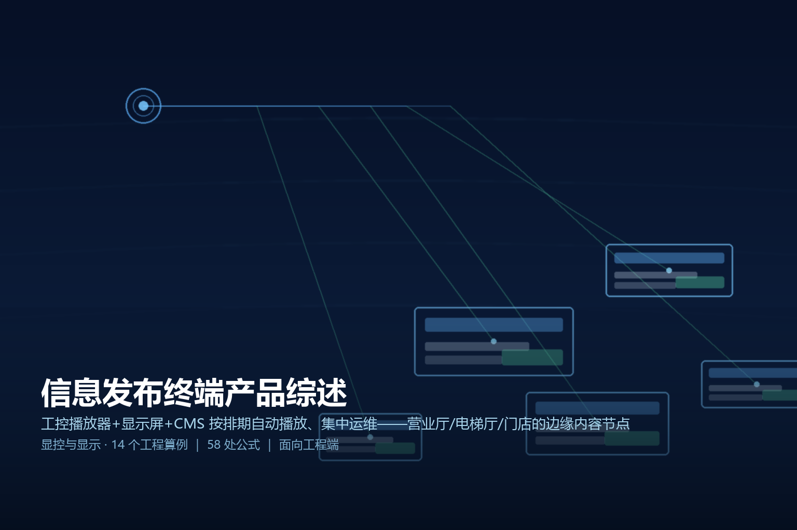
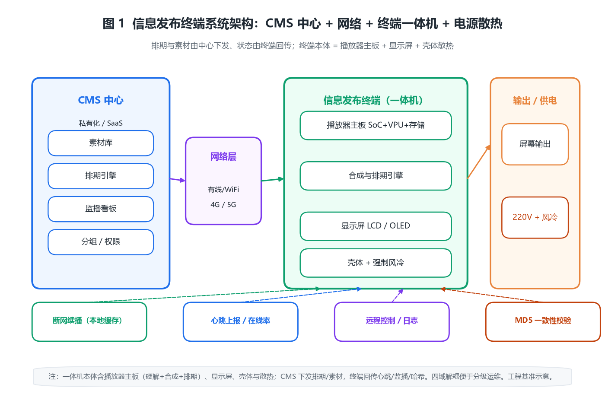

> 
> *概念图：信息发布终端在营业厅、电梯厅与门店把排期内容推送到屏幕的应用示意*

# 信息发布终端产品综述

## · 面向工程端

---

## 〇 一句话定位

信息发布终端是「工控播放器 + 显示屏 + 信息发布系统（CMS）」的集成形态：一台嵌入式设备按云端下发的排期，把图文 / 视频 / 网页自动播放到屏幕上，并通过心跳、监播、远程控制让成百上千台终端可集中运维。它广泛用于营业厅、电梯厅、门店、医院与交通枢纽的「固定位置、循环播放、统一管控」场景，本质上是一台把内容运营从「人工换海报」升级为「后台一键编排」的边缘节点。

> 简单说，它与家用电视 / 广告屏的区别不在「能放视频」，而在「能听指挥」——能否按时间窗精确切换、断网也能续播、坏了一块屏运维能在后台看见。买屏只是硬件，买的是一套可管理的发布网络。

---

## 一、产品设计方案

### 1.1 信息发布系统的三层结构

一套完整的信息发布系统由「中心、网络、终端」三层构成，终端只是最末端的执行者：

- **中心层（CMS 服务端）**：素材库、节目（playlist）、排期（schedule）、终端分组、监播看板、权限与日志。可以私有化部署，也可以是 SaaS。
- **网络层**：有线局域网 / Wi-Fi / 4G·5G，承发布期推送、心跳上报、在线状态轮询；内容大文件走 CDN 边缘缓存，控制信令走轻量长连接。
- **终端层（本篇主角）**：播放器 + 显示屏 + 结构壳体的整機，负责拉取排期、解码渲染、按时间窗切换、断网续播、状态回传。

### 1.2 终端本体的两种形态

| 形态 | 构成 | 适用 | 工程取舍 |
|------|------|------|----------|
| 一体机（广告机） | 播放器主板 + LCD/OLED 面板 + 钣金壳 + 电源/散热集成 | 营业厅、电梯厅、门店 | 即插即用、外观统一，但坏了要整机换 |
| 分体式（播放盒 + 屏） | 独立播放器（SoC/Android/Windows） + 任意显示设备 | 拼接墙、已有屏利旧 | 灵活、可单点升级播放器，布线较散 |

工程上先定「显示尺度」再定「播放器算力」：55 英寸以下一体机足够；拼接墙、LED 模组需要播放盒 + 视频控制器协同。

### 1.3 软件栈：从引导到上屏

```
Bootloader → 系统(Android/Linux/Windows) → 播放引擎(硬解 H.265/H.264/VP9)
           → 合成层(模板/分屏/天气/时钟/字幕叠加) → 排期引擎(时间窗切换)
           → 管控 Agent(心跳/监播/远程控制/日志)
```

关键工程点：**硬解必须走专用解码器而非 CPU 软解**——4K60 软解会拖垮整个系统并烧 CPU 温度；合成层与排期引擎要解耦，保证「换节目不黑屏、换排期不重启」。

### 1.4 系统架构图


*图 1：信息发布终端「一体机本体 + CMS 云端 + 网络 + 电源散热」四域架构，排期与素材由中心下发、状态由终端回传。*

---

## 二、核心参数与选型

### 2.1 关键参数清单（工程基准）

| 参数 | 典型区间 | 选型含义 |
|------|----------|----------|
| 分辨率 | 1920×1080 / 3840×2160 | 决定单屏信息密度与素材制作标准 |
| 亮度 | 室内 300–700 cd/m²；靠窗 800–1500；半户外 ≥2000 | 直接决定「看得见」与否 |
| SoC 算力 | 四核 A55/A76 + 专用 VPU | 决定能否稳解 4K60 并叠加图层 |
| 存储 | 16/32/64 GB eMMC 或 TF | 循环缓存素材的落盘容量 |
| 网络 | 千兆 RJ45 / Wi-Fi 5 / 4G | 决定日更带宽与布点灵活度 |
| 功耗 | 一体机 80–300 W；小屏 ≤25 W | 决定供电方式与电费 |
| 防护 | IP20（室内）/ IP43–IP65（半户外） | 决定能否上门口、电梯口 |
| 散热 | 自然对流 / 强制风冷 | 密闭壳体温升是否越界 |

### 2.2 十四个原创工程算例

下面每一条都是落地时要真算的账，标号贯穿正文，便于复核。

**【算例 1】本地循环缓存容量**
单条 4K 宣传片码率 $R=20\ \mathrm{Mbps}$，时长 $T=60\ \mathrm{s}$，每日轮播 $N=24$ 次，循环缓存保留 $D=7$ 天：
$$C_{\mathrm{GB}} = \frac{R \cdot T \cdot N \cdot D}{8000}
= \frac{20 \times 60 \times 24 \times 7}{8000} \approx 25.2\ \mathrm{GB}$$
结论：选 32 GB eMMC 是临界值，若素材加长或保留 14 天直接爆盘——**循环缓存要先按最差档算**，别用「平均日更量」估。

**【算例 2】中心下发带宽**
单终端日更素材 $S=2\ \mathrm{GB}$，终端数 $N=200$，集中在 $t_{win}=2\ \mathrm{h}=7200\ \mathrm{s}$ 窗口推送：
$$B(\mathrm{Mbps}) = \frac{N \cdot S(\mathrm{GB}) \cdot 8000}{t_{win}(\mathrm{s})}
= \frac{200 \times 2 \times 8000}{7200} \approx 444\ \mathrm{Mbps}$$
结论：中心出口需 ≥1 Gbps 且走 CDN 边缘，否则晚高峰更新会拖到次日；**终端数每翻 10 倍，中心带宽线性翻 10 倍**。

**【算例 3】亮度 vs 环境照度的可读对比度**
屏幕在环境光下要可读，最小屏亮需盖过环境反射。取反射系数 $\rho\approx0.05$、可读对比度 $C_r\ge5$：
$$L_{\min} = C_r \cdot \frac{E_{amb}\cdot\rho}{\pi}$$
三种场景：室内暗厅 $E_{amb}=300\ \mathrm{lux}\Rightarrow L_{\min}\approx24\ \mathrm{cd/m^2}$；靠窗营业厅 $E_{amb}=1500\Rightarrow L_{\min}\approx119$；半户外 $E_{amb}=5000\Rightarrow L_{\min}\approx398\ \mathrm{cd/m^2}$。
结论：**室内 300 cd/m² 的屏一旦摆到窗边就不达标**，靠窗/半户外必须选 800/2000 以上亮度档。

**【算例 4】视距与像素间距（文字可读下界）**
字符高度 $h_{px}$ 像素、像素间距 $p$（mm），人眼分辨极限取 $\theta_{\min}\approx0.3^\circ=0.00524\ \mathrm{rad}$：
$$D_{\min} = \frac{h_{px} \cdot p}{2 \cdot \tan(\theta_{\min})}$$
55 英寸 4K 面板 $p\approx0.315\ \mathrm{mm}$，标题字高 24 px：$D_{\min}=24\times0.315/(2\times0.00524)\approx721\ \mathrm{mm}\approx0.72\ \mathrm{m}$；若要求舒适阅读（$\theta=1^\circ$）则拉远到约 2.2 m。结论：**一体机贴墙装时，最近观看者距屏 ≥0.7 m 才能看清 24 px 标题**，字号设计要按最远视距反推。

**【算例 5】日耗电与电费**
55 英寸一体机峰值 $P_{peak}=250\ \mathrm{W}$，日亮屏 $h_{on}=18\ \mathrm{h}$：
$$E_{day} = \frac{P_{peak} \cdot h_{on}}{1000} = \frac{250 \times 18}{1000} = 4.5\ \mathrm{kWh}$$
按 ¥0.8/kWh：单台日电费 ¥3.6、年 ¥1314；百台年电费 13 万。结论：**功耗是长期持有成本主线**，选高亮档要同步算电费。

**【算例 6】密闭壳体自然温升（散热临界）**
壳内净功耗 $P=250\ \mathrm{W}$，有效散热面积 $A=0.5\ \mathrm{m^2}$，自然对流系数 $h\approx5\ \mathrm{W/(m^2\cdot K)}$：
$$\Delta T = \frac{P}{h \cdot A} = \frac{250}{5 \times 0.5} = 100^\circ\mathrm{C}$$
环境 25℃ 则内部 125℃——直接烧毁。改强制风冷 $h\approx25$：$\Delta T=20^\circ\mathrm{C}$，内部 45℃ 安全。结论：**密闭广告机不配风扇几乎必过热**，温升公式要先算再定散热方案。

**【算例 7】时钟漂移与多屏同步**
晶振偏差 $\pm2\ \mathrm{ppm}$，一天 $t=86400\ \mathrm{s}$：
$$\Delta t = \mathrm{ppm} \cdot t = 2\times10^{-6}\times86400 \approx 0.17\ \mathrm{s}$$
单台无所谓，但拼接墙多台各自漂移，一天累积差 0.17 s 就「画面不同步」。结论：**多屏同步必须 NTP/PTP 校准，同步周期 ≤1 h** 才能把相对漂移压到帧级。

**【算例 8】心跳与在线率监测带宽**
心跳周期 $t_{hb}=30\ \mathrm{s}$，单包 $1\ \mathrm{KB}$，$N=200$ 终端：
$$\mathrm{Traffic} = \frac{N \cdot 1\ \mathrm{KB}}{t_{hb}} = \frac{200}{30}\ \mathrm{KB/s}\approx6.7\ \mathrm{KB/s}\approx53\ \mathrm{kbps}$$
结论：心跳流量可忽略，瓶颈永远在「内容大文件」而非「信令」；**离线判定阈值设 3~5 个心跳周期（90~150 s）** 既能容瞬断又不误报。

**【算例 9】并发渲染内存带宽**
4K60 解码原始带宽 $3840\times2160\times60\times1.5\ \mathrm{byte}\approx747\ \mathrm{MB/s}$，叠加天气/时钟图层合成约 $0.3\ \mathrm{GB/s}$，合计 ≥1.0 GB/s；留 50% 余量需 SoC 内存带宽 ≥1.5 GB/s。结论：**选片时要看 VPU+内存带宽双指标，只盯 CPU 核数会踩坑**。

**【算例 10】排期时间窗切分**
营业厅播放窗：营业 $9{:}00\!-\!18{:}00$（9 h）放业务指引，闭店 $18{:}00\!-\!9{:}00$（15 h）放品牌片。一天内容占比：营业 $9/24=37.5\%$、品牌 $62.5\%$。结论：**排期本质是把 24 h 切成时间窗，每个窗绑定一套 playlist**，闭店时段别浪费在业务指引上。

**【算例 11】内容加密开销（金融/政务场景）**
敏感素材 AES-256 加密下发，SoC 解密吞吐约 $200\ \mathrm{MB/s} \gg$ 日更 $2\ \mathrm{GB}/86400\ \mathrm{s}\approx23\ \mathrm{KB/s}$；明文存储改密文约多占 3% 元数据。结论：**加密对播放实时性无感，但能挡住「拔卡拷走素材」**，政务/金融营业厅建议默认开启。

**【算例 12】多终端一致性校验**
100 台同节目，每台对本地素材算 MD5 心跳上送，中心比对，检测延迟满足 $\Delta t_{detect} \le t_{hb} = 30\ \mathrm{s}$：
任一台被篡改/下载损坏，30 s 内中心标红。结论：**一致性靠「哈希回传 + 中心比对」而非「信任终端」**，是批量运维的兜底。

**【算例 13】PoE 供电可行性**
802.3bt 单口供电上限 $90\ \mathrm{W}$（PD 侧约 71.3 W）。55 英寸一体机 250 W ≫ 71.3 W，**PoE 仅适用于 ≤21.9 W 的小屏（≤32 英寸低功耗）**。结论：**大屏一体机必须本地 220 V 供电并配漏电保护，PoE 不是万能供电**。

**【算例 14】印刷替代的回收期（ROI）**
单门店月省印刷海报/易拉宝 ¥800，年省 ¥9600；终端+三年 CMS 授权约 ¥3000。回收期（月）
$$P_{payback} = \frac{3000}{9600/12} \approx 3.75$$
即不到 4 个月回本。结论：**门店电子促销屏 ROI 往往 <4 个月**，回收之后每月纯省；连锁越多摊薄越明显。

---

## 三、技术原理

### 3.1 推/拉/混合三种内容分发

- **Push（中心主动下发）**：CMS 发现新素材/排期，主动推给终端。优点即时、可控；缺点中心要维护下发状态机。
- **Pull（终端定时拉取）**：终端按心跳周期问「我有最新吗」，有则下载。优点终端自治、断网自愈好；缺点更新有延迟（≤心跳周期）。
- **混合（工程主流）**：排期/指令用 Push 保即时，大素材用 Pull 错峰下载，**关键指令不丢、大文件不堵**。

### 3.2 渲染管线：解码→合成→输出

```
码流(H.265) → VPU 硬解(YUV) → 缩放/拼接 → 合成层(模板/分屏/字幕)
           → 帧缓冲 → 显示时序控制器(TCON) → 上屏
```
要点：① 全程走 VPU+GPU，CPU 只做调度；② 分屏/多图层靠合成层（compositor）一次性合，避免多次重解码；③ 输出帧率与屏刷新锁相，避免撕裂。

### 3.3 多屏同步：时间对齐而非像素对齐

拼接墙「多屏同帧」靠**统一时钟基准**：NTP（毫秒级，够大多数场景）或 PTP（亚毫秒，广电级）。中心给每条素材打统一播放时间戳，各终端按本地校准时钟在「同一时刻」切到同一帧（见算例 7）。**GenLock 是另一种硬件级方案**，把多台显示锁到同一同步信号，成本更高。

### 3.4 断网续播与容错

终端本地必须缓存当前 + 下一套节目。**断网时照常按本地排期播放，恢复后静默补拉差异**，用户无感。容错三件事：① 本地缓存双备份（当前 + 待播）；② 播放器崩溃自重启（看门狗）；③ 媒体损坏时回退到默认垫播片，绝不黑屏。

### 3.5 亮度/色彩管理

靠窗点位配**环境光传感器**，按照度自动调背光（见算例 3 的亮度档）；多台同型号屏做出厂/现场色温校准，避免「左边暖右边冷」。色温校准用标准灰阶图 + 校色仪，工程上每批次抽校即可。

---

## 四、产品功能与差异化

### 4.1 核心功能清单

- **分屏与模板**：一块屏切 2/3/4 区，分别放视频、滚动字幕、天气、时钟、二维码。
- **排期引擎**：按日/周/节假日时间窗绑定 playlist，支持紧急插播（最高优先级覆盖）。
- **交互扩展**：触摸查询（营业厅导览）、扫码取券（门店）、NFC/RFID 联动。
- **数据采集（可选）**：客流统计、人脸属性（需合规授权）、热度图，反哺内容运营。
- **集中监播**：在线率、播放日志、截图回传、远程重启/换片。

### 4.2 差异化：工控稳定 vs 商用电视

| 维度 | 信息发布终端（工控） | 改装电视 + 盒子 |
|------|----------------------|----------------|
| 7×24 运行 | 设计目标，宽温器件 | 易过热宕机 |
| 断网续播 | 内置，本地缓存 | 多无，断网黑屏 |
| 远程管控 | 标准 Agent + 监播 | 基本无 |
| 安全 | 可加密/锁 ADB | 易被乱装 App |
| 生命周期 | 3–5 年供货保障 | 消费级随时停产 |

结论：**买终端不是买屏，是买「三年后还能统一管控」的能力**。营业厅/政务场景别用消费电视凑数。

---

## 五、应用场景（痛点→方案→价值）

**① 银行营业厅**
- 痛点：业务指引靠人工发单、排队信息不透明、网点无法统一话术。
- 方案：叫号联动屏 + 业务导览分屏 + 总部分组统一下发（算例 2/12 保证一致）。
- 价值：减纸质、降大堂经理负担、品牌统一。

**② 电梯厅 / 楼宇**
- 痛点：通知靠贴纸、租户广告难管理。
- 方案：壁挂一体机按时段切「物业通知 / 租户广告」（算例 10 时间窗）。
- 价值：物业增收广告位、通知零人工。

**③ 连锁门店**
- 痛点：促销换海报慢、总部无法管控门店画面。
- 方案：电子促销屏 + 日更排期（算例 14 ROI <4 月）+ PoE 小屏利旧（算例 13）。
- 价值：促销分钟级上线、总部强管控。

**④ 医院 / 交通枢纽**
- 痛点：导诊/车次信息必须准时准确、大屏拼接。
- 方案：拼接墙多屏同步（算例 7）+ 数据接口直连排班系统。
- 价值：信息零延误、疏散指引可靠。

---

## 六、实际案例与设计方案

### 案例一：某城商行 50 网点统一发布

- **需求**：50 个营业厅统一业务指引 + 叫号联动，素材总部日更，运维要能看见每台在线。
- **方案设计**：
  - 中心：私有化 CMS，出口 1 Gbps（算例 2：50 终端 ×2 GB /2h ≈111 Mbps，留 9 倍余量）；
  - 终端：55 英寸一体机 32 GB 存储（算例 1：7 天循环 25.2 GB 临界，升级 64 GB 留余量）；
  - 管控：30 s 心跳 + MD5 回传（算例 8/12），离线 >150 s 标红派单。
- **配置核算**：存储 64 GB、亮度选 700 cd/m²（靠窗厅，算例 3）、强制风冷（算例 6）。
- **交付价值**：纸质物料下降 80%，网点画面一致率从「不可知」提升到 100% 可监。

### 案例二：连锁便利店 800 店日更促销

- **需求**：800 家门店每日早 8 点前换当日促销，多数点位无有线网。
- **方案设计**：
  - 终端分两档：收银台小屏用 PoE（≤21.9 W，算例 13）；主促销位用 220 V 一体机；
  - 网络：无线的店走 4G，中心带宽 $800\times2\ \mathrm{GB}/7200\ \mathrm{s}\approx1.78\ \mathrm{Gbps}$，上 CDN 边缘分摊；
  - 排期：闭店时段（算例 10）预拉次日素材，早 8 点本地切播，零依赖开门瞬间的网络。
- **配置核算**：断电续播 + 看门狗（3.4 节），单店年省印刷 ¥9600（算例 14）。
- **交付价值**：促销上线从「店长贴海报」变为「总部一键」，800 店 8 点前 100% 同步。

### 案例三：交通枢纽拼接墙信息发布

- **需求**：候车厅 3×3 LCD 拼接墙，车次/安检通知必须多屏同帧、靠窗高亮。
- **方案设计**：
  - 播放盒 + 视频控制器，NTP 同步周期 30 min（算例 7 把日漂移压到帧级）；
  - 屏亮度 1000 cd/m²（半户外照度，算例 3）+ 自动感光调光；
  - 数据接口直连班次系统，到发信息实时上屏。
- **配置核算**：拼接缝 ≤3.5 mm、色温现场抽校（3.5 节）。
- **交付价值**：信息零延误、多屏不同步投诉归零。

---

## 七、市场背景与竞争格局

信息发布终端的产业链分三层：**面板/OEM（京东方、TCL 华星、视源、康佳等）→ 整机/方案商（视达、星际、利亚德、洲明、长虹等）→ CMS 软件（私有化或 SaaS）**。竞争焦点从「谁能造屏」转向「谁能管好屏」：

- **硬件同质化**：面板与 SoC 供应链公开，裸机价差小，利润向软件与运维转移。
- **CMS 是护城河**：分组、监播、权限、API 对接（叫号、班次、ERP）决定能不能进政企大单。
- **云化趋势**：从卖盒子到卖「屏幕即服务」，按屏/年订阅，降低中小客户门槛。
- **AI 内容生成**：模板 + 文案自动生成节目，降低门店运营人力，是近期差异化热点。

---

## 八、商业模式与趋势

- **硬件 + 软件订阅 + 运维**：一次性硬件毛利薄，三年 CMS 授权 + 上门运维是持续收入（案例一/二均含授权）。
- **数据增值**：合规前提下的客流/热区数据反哺品牌方，形成二次变现。
- **趋势一：交互化**：触摸/扫码/身份联动让「广播屏」变「服务终端」。
- **趋势二：轻量化管控**：小程序监播、AI 自动排期，把运维门槛降到店长也能用。
- **趋势三：合规收紧**：人脸识别/客流采集须明示授权与数据本地化，选型时把合规当硬指标。

---

## 附录

### A. 核算清单（14 笔账速查）

| 编号 | 算例 | 核心公式 | 关键结论 |
|------|------|----------|----------|
| 1 | 循环缓存 | $C=R\cdot T\cdot N\cdot D/8000$ | 32 GB 是 7 天临界 |
| 2 | 下发带宽 | $B=N\cdot S\cdot8000/t_{win}$ | 中心需 ≥1 Gbps |
| 3 | 可读亮度 | $L_{\min}=C_r E_{amb}\rho/\pi$ | 靠窗需 800+ |
| 4 | 视距下限 | $D_{\min}=h_{px}p/(2\tan\theta_{\min})$ | 最近 ≥0.7 m |
| 5 | 日耗电 | $E_{day}=P_{peak}h_{on}/1000$ | 百台年电 13 万 |
| 6 | 壳体温升 | $\Delta T=P/(hA)$ | 不配风扇必过热 |
| 7 | 时钟漂移 | $\Delta t=\mathrm{ppm}\cdot t$ | 同步 ≤1 h |
| 8 | 心跳带宽 | $N\cdot1\mathrm{KB}/t_{hb}$ | 可忽略 |
| 9 | 渲染带宽 | 4K60≈0.75 GB/s+合成 | SoC≥1.5 GB/s |
| 10 | 排期窗 | 24 h 切时间窗 | 闭店别放业务指引 |
| 11 | 加密开销 | AES 吞吐≫日更 | 政务默认开 |
| 12 | 一致性 | MD5 回传≤30 s | 哈希兜底 |
| 13 | PoE 可行 | ≤71.3 W | 大屏必 220 V |
| 14 | 回收期 | 3000/(9600/12) | <4 月 |

### B. 术语表

- **CMS**：Content Management System，内容管理系统，本篇指信息发布服务端。
- **Playlist**：节目单，一组按序/分屏播放的素材集合。
- **Schedule**：排期，把 playlist 绑定到时间窗的规则。
- **VPU**：Video Processing Unit，专用视频解码硬件。
- **NTP/PTP**：网络时间协议 / 精确时间协议，用于多屏时钟对齐。
- **PoE**：Power over Ethernet，通过网线供电（802.3af/at/bt）。

### C. 标准与规范索引（工程可查）

- **GB 4943.1-2011** 信息技术设备安全（终端电气安全基线）
- **GB/T 9254.1-2021** 信息技术设备无线电骚扰限值（EMC）
- **GB 4208-2017（IP 代码）** 外壳防护等级（半户外选 IP43+）
- **GB 50348-2018** 安全防范工程技术标准（营业厅/场馆信息发布常涉安防）
- **GB/T 28181** 视频监控联网（与信息发布同平台的视频源对接参考）
- **SJ/T 11141-2017 / SJ/T 11281-2017** LED 显示屏通用规范（若用 LED 模组）
- **GB/T 20299.3** 建筑及居住区数字化（公共信息显示相关）

> 注：本篇参数为工程基准/演示估算，落地以厂家规格书与现场勘测为准；涉及人脸/客流采集须遵守个人信息保护相关法规。
