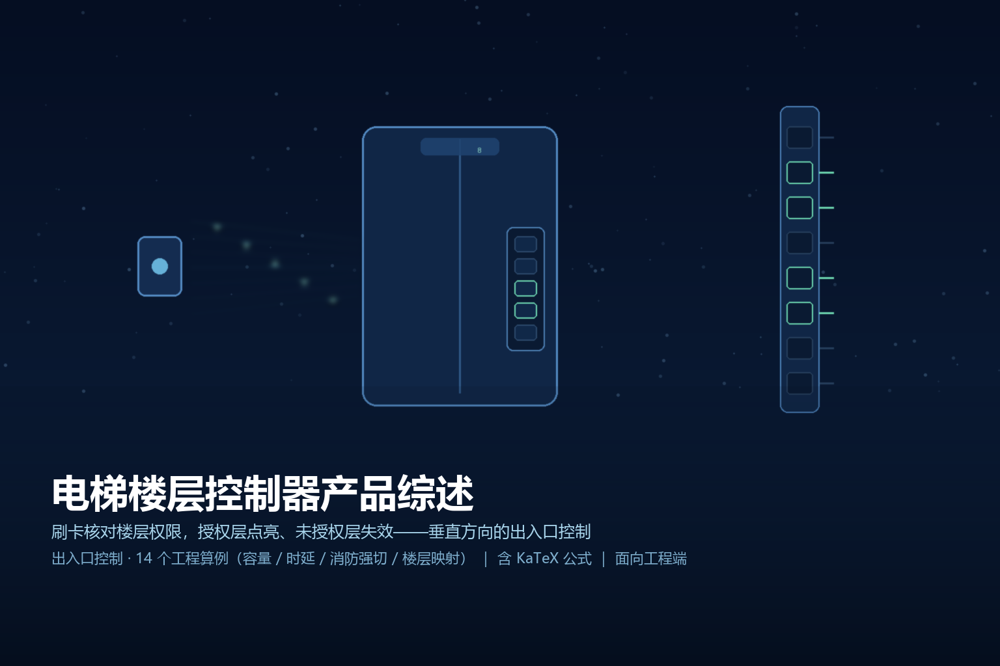
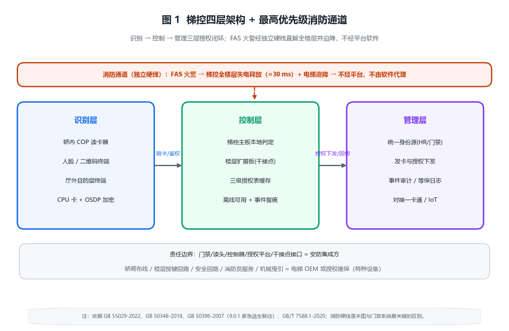
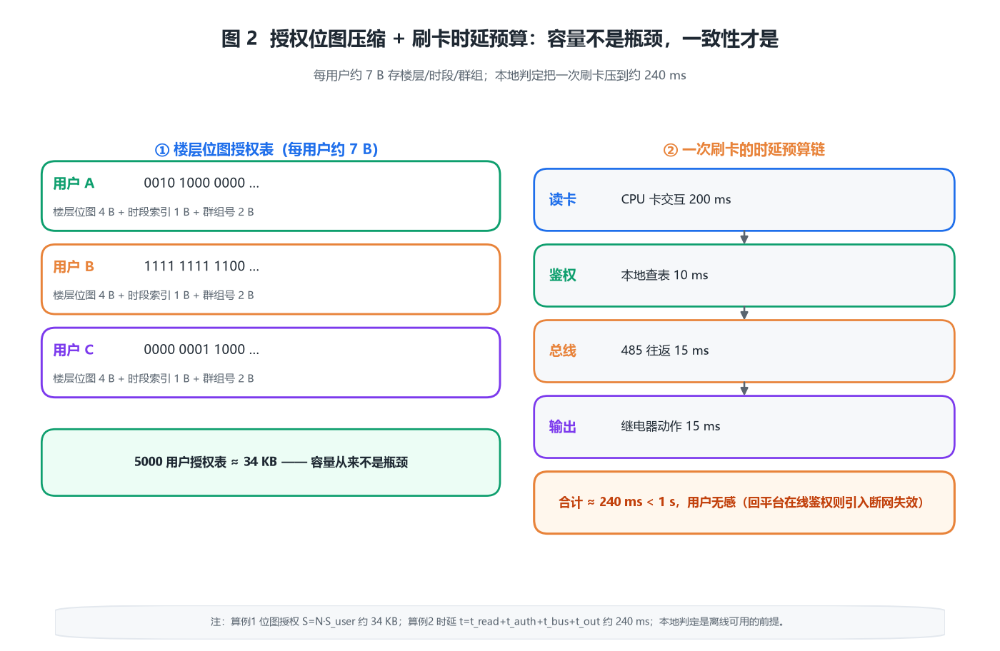
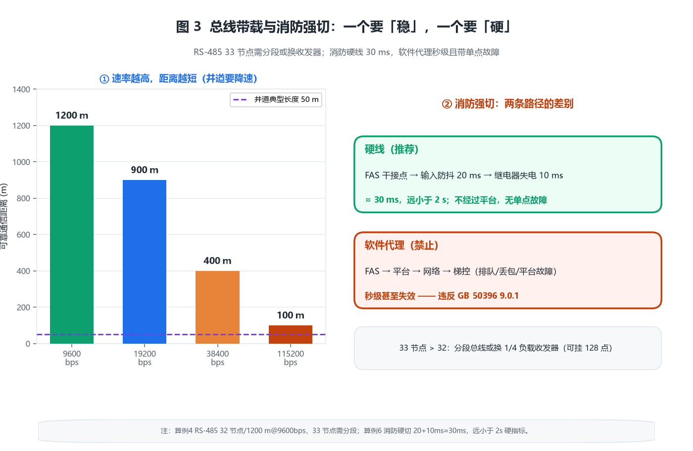
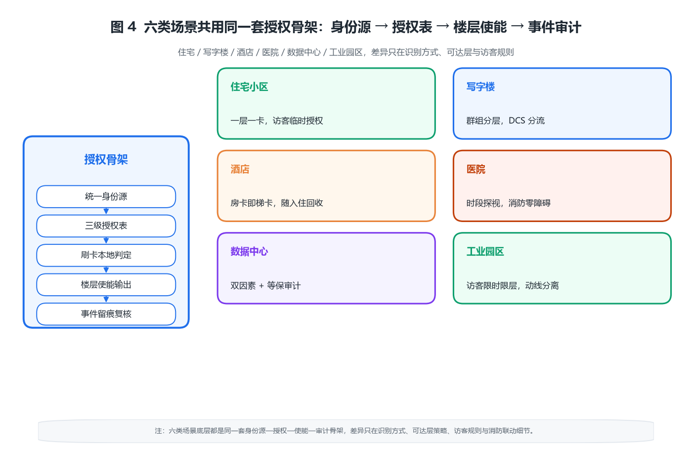

> 
> *概念图：乘客在轿厢刷卡，梯控板核对楼层权限后点亮授权按键，未授权楼层按键失效——垂直方向的出入口控制。示意图。*

# 电梯楼层控制器产品综述

## · 面向工程端

---

## 〇 一句话定位

电梯楼层控制器（工程上简称「梯控」，属于出入口控制系统在垂直交通上的延伸）是**在电梯轿厢操作箱（COP）或厅外呼梯处读取凭证、按权限开放指定楼层按键、把人员的活动范围约束到授权楼层区间的控制器**。它一端接读卡/人脸/二维码等识别设备，另一端以干接点或总线方式串入电梯的楼层按键/呼梯回路，中间按「楼层 × 时段 × 群组」三级授权表判定谁能去哪层。**它买的是「垂直方向管得住、又不挡逃生」的权限能力**——楼层位图容量、刷卡时延、消防强切、断网离线、楼层映射偏移，决定了这套系统是真的管住了，还是只是「装了个刷卡器」。

> 本系列已写的《出入口控制系统（门禁）》《人脸识别终端》管的是**水平方向的门**——人穿过一道门，开或不开。《电梯五方对讲系统》管的是**井道里的应急喊话**——被困时能不能呼救、属特种设备年检的强制项。**本篇只讲垂直方向的楼层权限**：同一套身份源，把「谁能进哪道门」延伸到「谁能按哪层」。三者共用发卡与身份平台，但执行部件、合规逻辑、责任边界完全不同。一句话区分：**门禁管「进不进得来」，对讲管「喊不喊得出」，梯控管「上不上得去」**。

> **反直觉点一：梯控不是安全回路的一部分，别碰电梯侧。** 轿厢布线、楼层按键回路、安全回路、消防员服务、机械与曳引部分属**特种设备范畴**，必须由电梯 OEM 或授权维保单位实施；安防集成方只做「读头 + 控制器 + 授权平台 + 干接点接口」。写进合同的责任边界不清，轻则年检不过，重则出事故担责（本篇所有算例均按此边界）。

> **反直觉点二：火警时梯控必须「主动放手」，而且不能靠软件。** GB 50396-2007 第 9.0.1 条规定疏散口必须与火灾报警系统联动，火警时人员不使用钥匙即可迅速通过；工程常见硬指标是「收到消防信号 2 s 内全楼层释放」。这条路径必须走**硬线干接点**，不能经过平台与网络——平台一卡，就从「管得住」变成「困住人」。

> **反直觉点三：真正难的不是协议，是楼层映射表。** 地下层（B1/B2）、跳号层（无 4 层）、夹层、双面开门（同层前后门两路）会让「授权 8 层」错落到别的继电器位上。调试八成时间在逐层实测映射表，协议反而最简单。

**锚定数字**（均有公开来源可查）：**GB 55029-2022**（强制性工程建设规范）／ **GB 50348-2018**（出入口控制、联动、试运行 ≥30 d、$K_j \ge 0.8$）／ **GB 50396-2007**（3.0.1 引用 GA/T 394；9.0.1 紧急逃生联动；6.3.7 疏散口联动）／ **GA/T 394-2002**《出入口控制系统技术要求》／ **GB/T 7588.1-2020**《电梯制造与安装安全规范》（消防返回、消防员服务）／ **GB 50016**《建筑设计防火规范》与 **GB 50116**《火灾自动报警系统设计规范》（消防联动）／ **GB 51348-2019**《民用建筑电气设计标准》／ **GB/T 22239**（等保日志与访问控制）／ **OSDP v2 Secure Channel**（读头链路加密）。参数均为**工程基准 / 演示估算**，以设备实测与现行有效版本原文为准。

---

## 一、产品设计方案

### 1.1 系统组成：识别层—控制层—管理层 + 一条最高优先级消防通道

一套梯控在工程上由四层构成，其中消防通道必须单列——它的优先级高于任何凭证权限：

- **识别层**：轿厢 COP 读卡器 / 人脸终端 / 二维码模块，或厅外目的层终端（DCS）。支持 IC 卡、CPU 卡、二维码、人脸、蓝牙、手机 NFC 中的至少两种互为备份，是招标常见「★号条款」。
- **控制层**：梯控主板 + 楼层扩展板（干接点继电器输出）+ 总线，按「楼层 × 时段 × 群组」三级授权表本地判定，断网时按已下发权限继续验证。
- **管理层**：统一身份平台（HR / 门禁 / 访客同源）+ 发卡与授权下发 + 事件记录与审计，对接一卡通、停车、楼宇 IoT。
- **消防通道（单列）**：FAS 火警信号经**独立硬线 / 隔离接口**直接进电梯控制柜与梯控释放回路，解除全部楼层授权并触发迫降；不经平台、不由软件代理。

### 1.2 三种部署形态

| 形态 | 做法 | 适用 | 工程取舍 |
|------|------|------|----------|
| 轿内 COP 刷卡（传统） | 每层按键回路串一路干接点，刷卡后仅授权层按键有效 | 住宅、老旧梯改造 | 不随轿厢线路大改但需 OEM 配合；N 层 N 路继电器（算例 3） |
| 厅外呼梯刷卡 | 厅侧读卡后才允许登记呼梯，进梯后按层 | 写字楼、机房 | 与门禁联动强；无身份者进不了梯厅呼梯 |
| 目的层派梯 DCS | 厅外终端输入目的层，平台/OEM 判定权限并分配梯 | 高端写字楼、酒店 | 体验最好；接口是 OEM 专有，逐梯调试（算例 12、14） |

工程上先分清这台电梯是**传统呼梯**还是**目的层派梯**：DCS 普及后，「轿厢里装读卡器按楼层」的老做法在厅外就选好层的场景里直接失效——权限判定点从轿内搬到了厅外（算例 14）。

### 1.3 授权闭环的五个动作

```
① 发卡授权：统一身份源下发「用户—可达楼层位图—时段—群组」到控制器
② 刷卡鉴权：读头识读凭证 → 控制器本地查授权表 → 判定该层/该请求是否可达
③ 输出使能：授权层干接点闭合/按键点亮，或 DCS 允许登记目的层
④ 事件留痕：每次乘梯与每次拒绝均记录（卡号/时间/层/结果），可按等保要求审计
⑤ 复核回收：离职/调岗即时注销，每季度导出「人员—楼层权限」复核表，消防联动每半年实测
```

### 1.4 系统架构图


*图 1：识别—控制—管理四层 + 最高优先级消防通道。读头/目的层终端→梯控主板与楼层扩展板→干接点串入电梯 COP/呼梯回路；FAS 火警经独立硬线直解全部楼层授权并迫降，不经软件平台。责任边界：虚线右侧电梯侧由 OEM 实施。*

---

## 二、核心参数与选型

### 2.1 关键参数清单（工程基准）

下表为招标文件常见技术要求与工程基准（均有公开方案/检测口径可查），具体以厂家 datasheet、电梯 OEM 接口文档与现行标准原文为准：

| 参数 | 典型区间 / 要求 | 选型含义 |
|------|----------------|----------|
| 识别方式 | IC 卡 / CPU 卡 / 二维码 / 人脸 / 蓝牙 / NFC，至少两种 | 互为备份，防单一方式失效（算例 11） |
| 授权层级 | 楼层权限 + 时间段权限 + 群组权限三层 | 决定能否按时段/部门批量下发（算例 1、8） |
| 通讯协议 | RS-485 / TCP/IP / CAN / Modbus 至少两种，开放 API/SDK | 后期能否接平台的命门；锁定协议二次改造代价高 |
| 消防联动 | 火警 ≤2 s 全楼层释放，硬线强切不可被软件关闭 | 合规红线，GB 50396 9.0.1（算例 6） |
| 离线运行 | 断网/断电按已下发权限本地验证，恢复后自动同步 | 断网即失效的纯云方案不适用（算例 2、7） |
| 楼层输出 | 每层一路干接点，8/16 路扩展板级联 | N 层需 $\lceil N/8\rceil$ 块板（算例 3） |
| 总线带载 | RS-485 32 节点 / 1200 m @ 9600 bps | 超 32 点需分段或 1/4 负载收发器（算例 4） |
| 权限生效 | 变更下发 ≤5 min 到全部终端 | 靠轮询周期与并发下发（算例 8） |
| 防复制 | CPU 卡 AES-128、读头 OSDP v2 加密 | 与「防尾随」是两回事（算例 11） |
| 存储 | 楼层位图 + 时段索引 + 群组号，黑名单批量导入 | 容量通常不是瓶颈（算例 1、14） |
| 试运行 | ≥30 d、技术验收 $K_j \ge 0.8$ | GB 50348-2018 验收口径 |
| 防护/供电 | 轿内设备防拆、宽压输入 + 后备电池 | 井道环境，随行电缆压降要算（算例 5） |

### 2.2 十四个原创工程算例

下面每一条都是定容量、算时延、配总线、做消防联动、排楼层映射时要真算的账，标号贯穿正文。参数按「工程基准 / 演示估算」给出，以设备实测为准。

**【算例 1】楼层授权矩阵的位图容量**

一个用户的可达楼层集合用位图存：每层 1 bit，32 层梯用一个 32 位字（4 B）即可；加上时段索引 1 B、群组号 2 B，单用户 ≈ 7 B。

$$S_{\mathrm{user}}=4+1+2=7\ \mathrm{B}$$

$N=5000$ 用户时授权表容量：

$$S_{\mathrm{total}}=N\,S_{\mathrm{user}}=5000\times7=35000\ \mathrm{B}\approx34\ \mathrm{KB}$$

对照「每层一条记录」（平均 5 层、记录头约 16 B）需约 400 KB，位图压缩约十余倍。结论：**楼层授权容量从来不是瓶颈，真正的风险是「下发一致性」**——平台改了、某台梯控没收到，才是事故（算例 8）。

**【算例 2】刷卡到按键点亮的响应时延预算**

一次完整链路 t = 读卡 + 鉴权 + 总线 + 输出：

$$t=t_{\mathrm{read}}+t_{\mathrm{auth}}+t_{\mathrm{bus}}+t_{\mathrm{out}}$$

CPU 卡一次读卡交互取 $200\ \mathrm{ms}$，本地查表鉴权 $10\ \mathrm{ms}$，485 一帧 16 B @9600bps 约 $13\ \mathrm{ms}$（往返取 $15\ \mathrm{ms}$），干接点继电器动作 $15\ \mathrm{ms}$：

$$t\approx200+10+15+15=240\ \mathrm{ms}<1\ \mathrm{s}$$

用户无感。若改成每次刷卡都回平台在线鉴权（纯云门禁），叠加 RTT 与排队，断网即失效——这正是「本地判定 + 离线可用」的价值所在。

> 
> *图 2：左——楼层位图授权表把「用户 × 楼层 × 时段 × 群组」压成每用户 7 B；右——一次刷卡的时延预算链，本地判定把响应压到 240 ms 级，回平台鉴权则引入网络依赖。*

**【算例 3】楼层继电器路与扩展板级联**

每层一路使能干接点，$N$ 层需 $N$ 路，按 8 路一块扩展板：

$$n_{\mathrm{board}}=\left\lceil\frac{N}{8}\right\rceil$$

32 层梯 → 4 块；若含地下 2 层（B1/B2）共 34 物理层 → 5 块；再留 20% 余量与扩展 → 6 块。
单路继电器 24 V 线圈吸合电流取 $60\ \mathrm{mA}$，一块 8 路板满负载：

$$I_{\mathrm{board}}=8\times0.06=0.48\ \mathrm{A}$$

这是算例 5 供电压降的负载起点。结论：**板数是「物理层数」决定的，不是「显示层号」——漏算地下层与双门层就会少配**。

**【算例 4】RS-485 总线节点与速率—距离积**

标准 RS-485 为 32 个节点（1 单位负载），可靠距离约 1200 m @ 9600 bps。一台 32 层梯 + 1 主控 = 33 节点 $>32$：

$$n_{\mathrm{node}}=32+1=33>32$$

需分两段总线，或换 1/4 单位负载收发器（可挂 128 点）一段搞定。
速率—距离积是硬约束：9600 bps 可跑 1200 m，115200 bps 通常只剩约 100 m。井道长距离必须降速——所幸算例 2 里一帧仅 13 ms，降速后时延预算仍够。结论：**别为「跑得快」在井道里上高速率，稳比快重要**。

**【算例 5】随行电缆供电压降**

控制器/读头由 24 V 经随行电缆供电，铜线 $\rho\approx0.0175\ \Omega\cdot\mathrm{mm^2/m}$，线径 $S=0.75\ \mathrm{mm^2}$，单程 50 m（往返 $L=100\ \mathrm{m}$）：

$$R=\frac{\rho L}{S}=\frac{0.0175\times100}{0.75}\approx2.33\ \Omega$$

一块板满负载 $I=0.48\ \mathrm{A}$（算例 3）时压降：

$$\Delta U=I R=0.48\times2.33\approx1.12\ \mathrm{V}$$

24 V 送到端侧约 22.9 V，余量充足。若线径缩到 $0.5\ \mathrm{mm^2}$ 且电流翻倍，$\Delta U$ 升至约 3.4 V，逼近读头欠压阈值。结论：**随行电缆别省线径，压降是「平方级」吃亏（线径↓、负载↑双向恶化）**。

**【算例 6】消防强切：2 s 内全楼层释放**

招标硬指标：火警信号到达后 $\le2\ \mathrm{s}$ 解除全部楼层授权（全层可达，便于消防员作业与疏散）。
硬线通路：FAS 干接点闭合 → 梯控输入检测（防抖 $20\ \mathrm{ms}$）→ 全部楼层继电器失电释放（$10\ \mathrm{ms}$）：

$$t_{\mathrm{fire}}=20+10\approx30\ \mathrm{ms}\ll2\ \mathrm{s}$$

余量巨大。但若走「FAS → 平台 → 网络 → 梯控」软件代理，平台排队或网络丢包会把时延拖到秒级甚至彻底失效。结论：**消防联动必须硬线，这正是 GB 50396 9.0.1「不使用钥匙即可迅速通过」的工程落法**（算例 6 与算例 7 的离线策略共同保证「任何情况下不困人」）。

> 
> *图 3：左——RS-485 总线的节点数与速率—距离取舍（33 节点需分段或换收发器）；右——消防强切的两条路径对比：硬线 30 ms、软件代理秒级且带单点故障。*

**【算例 7】断网/断电离线续航**

断网后本地按已下发权限验证（算例 2），断电后靠后备电池撑一个班次。取 12 V / 7 Ah 电池，整机静态功耗（主控 + 读头 + 继电器静态）约 $P=6\ \mathrm{W}$：

$$t=\frac{U Q}{P}=\frac{12\times7}{6}=14\ \mathrm{h}$$

覆盖一个班次。继电器频繁吸合时 $P$ 上升，续航按比例缩短。还需约定「离线超过 $N$ 小时降级为仅公共层」——防止长期离线期间本应回收的权限一直生效。结论：**离线能力 = 电池续航 × 降级策略，缺一不可**。

**【算例 8】权限变更生效时延与「幽灵权限」窗口**

离职/调岗后要求变更 $\le5\ \mathrm{min}$ 下发到全部 $M=200$ 台梯控。单台下发一帧约 200 B，局域网并发推送总数据量：

$$S=M\times200=200\times200=4.0\times10^{4}\ \mathrm{B}=40\ \mathrm{KB}$$

百兆口毫秒级；真正瓶颈是终端轮询确认周期（取 60 s），最坏 $60\ \mathrm{s}+$ 处理 $<5\ \mathrm{min}$，达标。
但若只在门禁系统删人、梯控独立发卡（无统一身份源），就留下「门禁进不来、电梯还能上楼」的**幽灵权限**——这正是每季度复核表要抓的。结论：**权限一致性靠「同源 + 下发确认 + 定期复核」三件事，不是靠发卡快**。

**【算例 9】访客临时权限的时钟漂移**

访客卡限时段 $[t_1,t_2]$ + 楼层白名单（如仅 8 层会客区），到期本地自动失效。低成本晶振 RTC 日漂取 $\delta=2\ \mathrm{s/day}$，30 天未校时累计漂移：

$$\Delta t=30\times2=60\ \mathrm{s}$$

若权限边界设在 18:00，最坏提前/延后约 1 min 失效——对访客无感，但说明**临时权限依赖本地时钟准确性**，离线越久漂得越多（呼应算例 7 的降级策略）。结论：平台须定期 NTP 校时，把漂移收敛到秒级。

**【算例 10】楼层映射偏移——最易漏配的坑**

建筑显示层号与物理继电器编号并非一一对应：地下 B2/B1、跳号（无 4 层）、夹层、双面开门（同层前后门两路）。授权「8 层」必须落到正确的继电器位。
映射表条目数 = 物理层数 × 门数：34 物理层、其中 2 层双开门，共约 36 条：

$$n_{\mathrm{map}}=34+2=36$$

漏配一处偏移，授权 8 层却开到 7 层或对面门——**必须逐层实测，不能照建筑图纸编号直接填**。结论：梯控调试八成时间在映射表实测，这是最容易出安全事故、也最容易被低估的工作量。

**【算例 11】CPU 卡防复制与密钥空间**

MIFARE Classic（M1）已被破解、复制成本极低；CPU 卡（DESFire EV2/EV3）用 AES-128，密钥空间：

$$N_{\mathrm{key}}=2^{128}\approx3.4\times10^{38}$$

即使每秒试 $10^9$ 次，穷举耗时约 $3.4\times10^{29}\ \mathrm{s}$，远超宇宙年龄量级——复制不可行。
要注意：**「防复制」靠 CPU 卡加密，「防尾随」靠闸机/称重，是两回事**，梯控本身不防尾随，别混为一谈。结论：读头到控制器再加 OSDP v2 Secure Channel 链路加密，防中间人；卡片选型别在 M1 上省钱。

**【算例 12】并发刷卡吞吐 vs 电梯运力瓶颈**

早高峰 5 min 内 100 人乘梯，即 20 人/min。单读头响应 ≈ 240 ms（算例 2），理论上限：

$$r_{\max}=\frac{1}{0.24}\approx4.2\ \mathrm{s^{-1}}\approx250\ \mathrm{min^{-1}}$$

远大于 20 人/min——**读卡不是瓶颈**。真正瓶颈是电梯运力：单梯 5 层停靠一个来回约 2 min、载客约 10 人 → 约 5 人/min/梯；100 人需 20 梯·min，配 4 梯跑 5 min 刚好。结论：**梯控「扩容」不是加读头，是加电梯运力或上目的层群控（DCS）**。

**【算例 13】系统可用度与故障降级**

取 MTBF = 50000 h，含到场修复 MTTR = 4 h（15 min 响应 + 2 h 到场 + 检修）：

$$A=\frac{\mathrm{MTBF}}{\mathrm{MTBF}+\mathrm{MTTR}}=\frac{50000}{50004}\approx99.992\%$$

年停机约 $8760\times(1-A)\approx0.7\ \mathrm{h}$。
但「可用」要先约定故障语义：梯控故障时是**全楼层开放**（便利优先、不困人）还是**仅公共层**（管控优先）——这是设计阶段必须和消防、物业签字的口径。结论：SLA 建议「影响乘梯故障 15 min 响应 / 2 h 到场、控制器备件率 ≥5%」，并把降级语义写进验收。

**【算例 14】目的层派梯 DCS 下的授权判定量**

传统 COP 刷卡：每层一个读点，$N$ 层 $N$ 个输出；授权 = 用户 × 可达层位图（算例 1）。
DCS 目的派梯：厅外终端输入目的层，控制器判定该层是否可达、不可达则拒绝登记。判定请求频率 = 乘梯人次（取 20/min），单次鉴权约 $10\ \mathrm{ms}$，控制器占空比：

$$D=\frac{20}{60}\times0.01\approx0.3\%$$

控制器绰绰有余。但 DCS 接口是 OEM 专有（Otis / KONE / Schindler / TK 各不同），授权层偏移与前后门配置仍要逐层实测（算例 10）。结论：**技术判定不是瓶颈，OEM 接口授权与联合调试才是——这也是预算占比 20~30% 的那一项**。

---

## 三、技术原理

### 3.1 授权判定的三级模型

一次「能不能去某层」的判定是三层与关系：

$$G_{\mathrm{pass}}=F_{\mathrm{floor}}\ \wedge\ T_{\mathrm{time}}\ \wedge\ R_{\mathrm{group}}$$

楼层位图 $F$ 决定「哪些层」，时段索引 $T$ 决定「什么时候」，群组号 $R$ 决定「哪类人」。三者全过才输出使能。这样「临时访客仅工作日 8~18 点到 8 层」就能用一条记录表达，而不用为每个访客单独配一套规则。

### 3.2 干接点输出与失效安全

传统梯控的输出是**继电器干接点串入楼层按键回路**：节点闭合 = 该层按键可用。选型要区分常开（NO）/ 常闭（NC）与「失电时状态」——消防强切要求全层释放（算例 6），本质是让所有节点回到「可用」态，因此释放逻辑要设计成失电即全开（Fail-Safe 方向），而不是依赖控制器主动发「开」命令。

### 3.3 离线本地判定与同步

控制器缓存一份完整授权表（算例 1 的 34 KB 级），刷卡时本地查表，不依赖平台在线（算例 2）。恢复联网后把事件记录回传、把新授权增量下发。离线超过阈值降级为仅公共层（算例 7），避免「该收的权限收不回」。

### 3.4 读头链路加密与卡片安全

卡片侧用 CPU 卡 AES-128（算例 11），读头到控制器走 OSDP v2 Secure Channel，防止复制卡与链路中间人。等保场景按 GB/T 22239 保留访问与操作日志、分级授权。

### 3.5 消防硬联动的独立性

FAS 干接点直接进电梯控制柜与梯控释放回路，物理上绕过平台与软件（算例 6）。半年实测一次并留书面记录，是 SLA 的硬要求。GB/T 7588.1-2020 的消防返回与消防员服务属电梯侧，由 OEM 保证，安防集成方不介入。

---

## 四、产品功能与差异化

### 4.1 功能矩阵

| 功能 | 传统 COP 刷卡 | 厅外呼梯刷卡 | 目的层 DCS |
|------|:---:|:---:|:---:|
| 楼层权限 | ✅ | ✅ | ✅ |
| 时段/群组权限 | ✅ | ✅ | ✅ |
| 访客临时层 | ✅ | ✅ | ✅ |
| 防尾随 | ❌（需闸机配合） | 可配合 | 可配合 |
| 乘梯体验 | 进梯再刷卡 | 先刷卡再呼梯 | 厅外选层直接分配 |
| OEM 接口依赖 | 低 | 低 | 高（专有） |
| 老梯改造适配 | 较好 | 较好 | 较差 |

### 4.2 与相邻系统的边界

- **vs 门禁（access-control）**：门禁管水平门，梯控管垂直层；共用身份源与发卡，但执行部件与联动逻辑不同。
- **vs 电梯五方对讲（elevator-intercom）**：对讲是应急救援通信、特种设备年检强制项（TSG T7001），梯控是权限管理、安防项；一个保命、一个管权限。
- **vs 楼宇 BA / 中控**：BA 管电梯运行状态监测，梯控管人员访问权限，二者通过平台对接而非互相替代。

### 4.3 平台集成与「开放协议」的代价

招标要写明「提供标准 Modbus 寄存器表或 RESTful API 文档」——协议封闭的梯控，三年后想接楼宇 IoT 平台会被原厂锁死，二次改造代价高（搜索资料中的真实案例：多花 18 万）。**协议开放条款是采购阶段最容易被忽略、后期最贵的一项**。

### 4.4 可靠性设计要点

本地离线判定（算例 2、7）+ 消防硬线（算例 6）+ 下发确认与复核（算例 8）+ 降级语义签字（算例 13），四件事做齐，系统才谈得上「管得住又不挡逃生」。

---

## 五、应用场景


*图 4：六类场景共用同一套「身份源 → 授权表 → 楼层使能 → 事件审计」骨架，差异只在识别方式、可达层策略、访客规则与消防联动细节。*

### 5.1 住宅小区

痛点：外来人员随意乘梯上楼、住户不愿门禁卡与梯控两张卡。方案：门禁/梯控同源发卡、一层一卡仅达自家层，访客由住户临时授权。价值：管住垂直通道又不增加携带负担（算例 1、9）。

### 5.2 写字楼 / 商业综合体

痛点：租户楼层混杂、离职人员仍能上原公司楼层、早高峰排队。方案：群组权限按租户划分、目的层 DCS 分流、消防全层释放。价值：权限随人事变动自动收敛，高峰运力提升（算例 8、12、14）。

### 5.3 酒店

痛点：住客应只达客房层与公共层，服务员有保洁层权限。方案：房卡即梯控卡、按时段授予客房层、清洁组独立群组。价值：一张房卡通门禁与电梯，权限随入住/退房自动生效回收（算例 1、3）。

### 5.4 医院

痛点：病区需限制探视时段、医护与后勤分区、消防绝不困人。方案：时段权限区分探视/医护、群组区分科室、消防硬线最高优先级。价值：垂直动线可控，紧急疏散零障碍（算例 6、9）。

### 5.5 数据中心 / 机房

痛点：核心机房层严格限权、需全程审计。方案：CPU 卡 + 人脸双因素、拒绝事件全记录、等保日志留存。价值：可追溯、可审计，防复制（算例 11、13）。

### 5.6 工业园区 / 厂房

痛点：货梯与人梯混用、访客与承包商临时通行。方案：身份源区分员工/访客/承包商、临时权限限时限层、消防联动实测。价值：人员与货物动分离、临时权限自动过期（算例 7、9、12）。

---

## 六、实际案例与设计方案

### 案例一：32 层写字楼的门禁—梯控同源改造

**需求**：租户分层办公，要求离职即失去门禁与对应楼层权限，早高峰不排队，火警全层释放。
**方案**：统一 HR 身份源 + CPU 卡，门禁与梯控共用发卡；轿内 COP 刷卡，每层一路干接点，32 层 + 地下 2 层共 34 物理层；消防硬线接 FAS。
**配置核算**：
- 楼层扩展板 $n=\lceil34/8\rceil=5$ 块，留 20% 余量配 6 块（算例 3）。
- 5000 用户授权表 ≈ 34 KB，控制器容量无忧；权限下发 $M$ 台中单台 200 B、轮询 60 s 内生效（算例 1、8）。
- RS-485 挂 33 节点 > 32 → 分两段总线（算例 4）。
- 随行电缆 0.75 mm²、100 m 往返，压降约 1.1 V（算例 5）。
- 消防硬切响应约 30 ms ≪ 2 s（算例 6）。
**交付价值**：离职权限 5 min 内全域生效、每季度复核表自动生成、年检因消防联动实测记录齐全一次通过。

### 案例二：老旧住宅梯控改造的「映射表」翻车与纠偏

**需求**：某 18 层老楼加装梯控，楼栋无 4 层、含地下 1 层、3 层为双面开门。
**方案**：施工方照图纸编号直接填映射表，验收时住户刷 8 层卡却停 7 层、3 层开到对面门。
**配置核算**：
- 物理层 = 18（含地下 1、无 4 层需核对）× 门数，双门层额外一路 → 映射条目按算例 10 逐层实测，最终 $n_{\mathrm{map}}$ 按实测重算（示例 36 条）。
- 重新逐层点对点验证，把「显示层号 → 物理继电器位」一一标定，重下授权表。
**交付价值**：**映射表必须逐层实测、不能照图纸抄**——这是本案例花的最大一笔学费；纠偏后误层投诉归零。对应搜索资料中「楼层偏移与前后门配置极易漏配」的明确警示。

### 案例三：高端写字楼目的层派梯（DCS）的接口分工

**需求**：4 梯群控、厅外选层、访客限层，要求体验与管控兼顾。
**方案**：厅外目的层终端 + OEM 的 DCS 接口（本例为某品牌专有协议），安防方做身份与授权判定、OEM 做派梯算法与安全回路；消防信号独立硬线。
**配置核算**：
- 鉴权请求 20/min、单次 10 ms，控制器占空比约 0.3%，判定不是瓶颈（算例 14）。
- 运力才是瓶颈：4 梯约 20 人/min，覆盖早高峰 100 人/5 min（算例 12）。
- OEM 接口授权与联合调试占预算约 20~30%，是本项目第二大成本项。
**交付价值**：合同写清「电梯侧改动由 OEM 实施」的责任边界，避免年检风险；权限随 HR 变动自动收敛，消防联动半年实测留档。

---

## 七、市场背景与竞争格局

梯控是出入口控制（门禁）在垂直交通上的自然延伸，市场随「一卡通」与智慧楼宇普及而增长。玩家分三类：

1. **门禁/一卡通厂商**：优势是身份源与发卡体系、平台对接成熟；梯控作为门禁扩展板切入，水平方向强、垂直方向靠与 OEM 配合。
2. **电梯 OEM 及附属**：掌握 DCS 接口与安全回路，目的层派梯体验好、接口封闭；在高端项目占主导，但二次集成受限。
3. **专业梯控厂商**：老梯改造适配能力强、协议相对开放；短板是平台生态与品牌背书。

竞争焦点从「能不能刷卡上楼」转向三件事：**协议开放度**（能否接楼宇 IoT）、**OEM 协作能力**（DCS 时代的关键）、**消防与责任边界的合规落地**。搜索资料中的真实教训——协议封闭导致三年后二次改造多花 18 万——说明采购阶段的技术规格书比单价更重要。

**强条变化要注意**：GB 55029-2022《安全防范工程通用规范》作为强制性工程建设规范，对出入口控制有硬性要求；老招标模板若仍停留在 GB 50348-2018 口径，照抄会与现行强条对不上，评标可能被废。写标书前先核对现行有效版本。

---

## 八、商业模式与趋势

**预算结构**（公开方案示例区间，以现场勘察与工程量清单为准）：控制器/读卡器/梯控扩展板约 35~45%；电梯 OEM 接口授权与联合调试约 20~30%；布线施工约 15~20%；访客与身份平台对接约 10~15%；联动测试、文档与首年运维约 5~10%。**不编造总价**。

**SLA 口径**：影响乘梯的故障 15 min 响应、2 h 到场；控制器备件率 ≥5%；权限变更生效 ≤5 min；每季度导出「在职人员—楼层权限」复核表；消防联动每半年实测一次并留书面记录。

**趋势**：
- **识别多模化**：从单一 IC 卡走向 CPU 卡 + 人脸 + 手机 NFC + 二维码互为备份。
- **目的层派梯普及**：权限判定点从轿内搬到厅外，安防与 OEM 的接口协作成为核心能力。
- **平台同源化**：门禁、梯控、访客、停车统一身份源，「幽灵权限」靠同源与复核根治。
- **合规强制化**：GB 55029-2022 强条 + 等保 + 消防联动实测，把「装了就算」推向「验得过才算」。

---

## 附录

### 附录 A 核算清单（速查）

| 算例 | 核算式 | 示例结果 |
|------|--------|----------|
| 1 授权容量 | $S=N\,S_{\mathrm{user}}$ | 5000 用户 ≈ 34 KB |
| 2 刷卡时延 | $t=t_r+t_a+t_b+t_o$ | ≈ 240 ms |
| 3 扩展板数 | $n=\lceil N/8\rceil$ | 34 层 → 5（配 6）块 |
| 4 总线节点 | $n=32+1$ | 33 > 32，分段 |
| 5 压降 | $\Delta U=IR,\ R=\rho L/S$ | ≈ 1.1 V |
| 6 消防强切 | 硬线 20+10 ms | ≈ 30 ms ≪ 2 s |
| 7 离线续航 | $t=UQ/P$ | 12V/7Ah @6W ≈ 14 h |
| 8 权限生效 | 轮询 60 s + 处理 | < 5 min |
| 9 时钟漂移 | $\Delta t=30\delta$ | 60 s / 月 |
| 10 映射条目 | 物理层 × 门数 | 36 条（实测） |
| 11 密钥空间 | $2^{128}$ | ≈ $3.4\times10^{38}$ |
| 12 并发上限 | $r=1/t$ | 250 人/min > 20 |
| 13 可用度 | $A=\mathrm{MTBF}/(\mathrm{MTBF}+\mathrm{MTTR})$ | ≈ 99.992% |
| 14 DCS 占空比 | $D=(20/60)\times0.01$ | ≈ 0.3% |

### 附录 B 术语表

| 术语 | 含义 |
|------|------|
| COP | Car Operating Panel，轿厢操作箱，楼层按键所在面板 |
| DCS | Destination Control System，目的层派梯系统，厅外选层后分配电梯 |
| 干接点 | 无源开关量输出，串入按键/呼梯回路实现使能 |
| 位图授权 | 每层 1 bit 表示可达与否，压缩楼层权限存储 |
| Fail-Safe | 失电即回到安全态；消防释放设计为失电全开 |
| OSDP v2 | 读头—控制器间的加密通信协议，Secure Channel 防中间人 |
| 幽灵权限 | 门禁已删、梯控未删导致的残留访问权限 |
| 映射表 | 显示层号到物理继电器位的对应表，须逐层实测 |

### 附录 C 标准索引

| 标准 | 作用 |
|------|------|
| GB 55029-2022《安全防范工程通用规范》 | 强制性工程建设规范，出入口控制硬要求 |
| GB 50348-2018《安全防范工程技术标准》 | 出入口控制、联动、试运行 ≥30 d、$K_j\ge0.8$ |
| GB 50396-2007《出入口控制系统工程设计规范》 | 3.0.1 引用 GA/T 394；9.0.1 紧急逃生联动；6.3.7 疏散口联动 |
| GA/T 394-2002《出入口控制系统技术要求》 | 出入口控制系统技术要求 |
| GB/T 7588.1-2020《电梯制造与安装安全规范》 | 消防返回、消防员服务（电梯侧，OEM 实施） |
| GB 50016《建筑设计防火规范》/ GB 50116《火灾自动报警系统设计规范》 | 消防联动（以现行有效版本为准） |
| GB 51348-2019《民用建筑电气设计标准》 | 电气与弱电设计 |
| GB/T 22239《网络安全等级保护基本要求》 | 日志与访问控制（按定级） |
| OSDP v2 Secure Channel | 读头链路加密（公开标准） |
| TSG T7001-2023 | 电梯监督检验（电梯侧安全部件，本篇不介入） |

> 说明：本文参数均为工程基准与演示估算，用于说明选型与核算方法，不构成具体产品指标承诺；标准引用以现行有效版本原文为准。电梯侧安全回路、门锁、检修与消防员服务属特种设备范畴，须由电梯 OEM 或授权单位确认实施。
