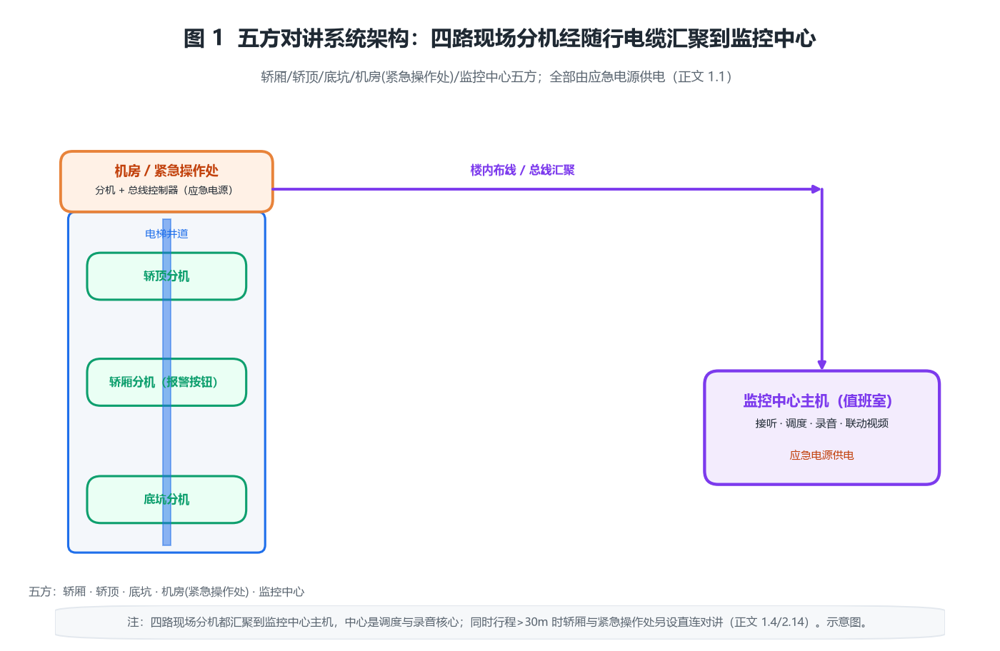

# 电梯五方对讲系统产品综述：用一条应急电源供电的总线，把轿厢、轿顶、底坑、机房与监控中心连成被困者的保命通道

## 〇、一句话定位

电梯五方对讲系统的本质，不是「几部对讲机连成网」，而是**电梯应急救援的法定保底通信部件**——它让轿厢内的被困乘客、轿顶与底坑的检修人员、机房（紧急操作处）的救援人员、以及监控中心（值班室）的管理员这五方，随时能双向喊话。它之所以被单列成一个产品品类，是因为**它是特种设备检验机构逐项查的强制项**，信号断续、无人应答都会被开《电梯检验意见通知书》（TSG T7001-2023 A1.2.3.11）。

从工程角度看，五方对讲与「楼宇访客对讲」「内部电话」最大的不同是：**它的供电必须是应急电源，且要经得起井道里变频器、曳引机的电磁轰炸**。一座电梯再豪华，只要轿厢里的报警按钮按下去「嘟」一声却没人接，这台电梯就过不了年检——选五方对讲时该算的是「总线能挂几台分机、24 V 供电压降够不够、断电后还能喊多久」，而不是「功能多花哨」。

> **反直觉点一：它不是「可选增值功能」，而是「不带就违法运行」的安全部件。** 国家把乘客电梯设置紧急报警装置作为合格使用的硬指标：GB/T 7588.1-2020 第 5.12.3 条引用 GB/T 24475 要求「应有一个双向对讲系统与救援服务持续联系」；TSG T7001-2023 把这一条写进监督/定期检验附件 A，检验机构现场测试对讲畅通与否，不通就判定不合格。所以它在采购清单里是「强制项」而非「选配项」。

> **反直觉点二：市电断电时它必须还能喊话，这是硬要求。** GB/T 24475-2009 规定报警装置的供电应为「紧急电源」（4.1.4 条），也就是断电困人那一刻，对讲系统要由蓄电池/UPS 撑着继续工作。很多低价方案把对讲接到普通照明回路，一断电就哑火——这恰恰踩了合规红线。

> **反直觉点三：总线型不是「落后」，往往是井道里最稳的选择。** 行业里常见总线型（RS-485/CAN 二总线）和 IP 网络型两种。总线型用一条随行电缆把五方串起来，抗干扰、省线、跑得远；IP 型好接入楼宇网和视频监控联动，但井道内网线要面对变频器 dV/dt 共模噪声和竖井引雷，防雷与屏蔽才是真坑。不是越「IP」越好。

> **反直觉点四：高层电梯「五方」还不够，法律强制加一对。** GB/T 7588.1-2020 5.12.3.2 与 TSG T7001-2023 都规定：当电梯行程大于 30 m，或轿厢内与紧急操作处之间无法直接对话时，**还要在轿厢内和紧急操作处之间增设一套应急电源供电的对讲**。也就是说 100 m 高层的轿顶、底坑维修人员，必须能独立和机房喊话，不能只靠「轿厢与监控中心」一条链路。

十个锚定数字：检验依据 **TSG T7001-2023**（A1.2.3.11）；安全规范 **GB/T 7588.1-2020**（5.12.3）；远程报警系统 **GB/T 24475-2009**；报警触发装置安装高度 **轿厢地板上方 850~1200 mm**；自动测试频率 **至少每 3 天 1 次**、失败 **1 h 内图形符号交替闪烁**；语音带宽 **300~3400 Hz**（G.711 64 kbps）；强制增设行程阈值 **30 m**；总线终端匹配电阻 **120 Ω**；随行电缆供电 **24 V（应急电源）**；防护等级 **IP20（中心/机房）/ IP65（现场分机）**。

---

## 一、产品设计方案

### 1.1 系统形态：五方到底哪五方，谁和谁说话

「五方」指的是五个通话终端：**轿厢分机**（乘客被困时按的报警按钮 + 扬声器 + 麦克风）、**轿顶分机**（检修人员用）、**底坑分机**（坑底维修用）、**机房/紧急操作处分机**（救援操作处）、**监控中心主机**（值班室，接听并调度救援）。它们的逻辑关系是「星形汇聚」：四路现场分机都连到监控中心主机，中心是调度与录音的核心；同时轿厢与紧急操作处之间按 30 m 规则另设直连对讲。

图 1 画出了这种「随行电缆总线 + 中心主机」的架构：轿厢、轿顶、底坑分机经随行电缆挂到机房侧的总线控制器，机房分机与总线控制器同柜，再经楼内布线汇聚到监控中心主机。关键是**所有分机由应急电源统一供电**——市电掉电，这套链路仍要通。

按接入形态，五方对讲大致分三类：

- **总线型（二/四总线）**：所有分机挂一条 RS-485/CAN 总线，地址编址、轮询通话。优点是省线、抗干扰、距离远、成本可控；缺点是一台中心主机并发接听通道有限。
- **IP 网络型**：轿厢分机经屏蔽网线/光纤接入局域网，中心用软件调度。优点是易与视频监控联动、易跨楼栋组网、录音存储灵活；缺点是井道电磁环境恶劣，网线防雷与屏蔽是工程重点。
- **无线/GSM 备用型**：轿厢内加装无线模块，作为总线/IP 主链路的备份（老旧电梯加装、无布线条件时常用）。优点是免布线；缺点是信号覆盖与资费，只能作备份不能作唯一链路。

三类不是替代关系：总线型做「可靠保底」，IP 型做「智能联动」，无线做「无布线兜底」。

### 1.2 拓扑约束：总线型 vs IP 型，井道里谁更稳

选型时真正要权衡的是「井道环境」和「管理需求」两条：

- **总线型**：随行电缆里一对双绞线跑全部分机，信号是差分传输（RS-485），本身抗共模干扰；一条总线理论能挂数十台分机，跨几百米也稳。缺点是音频多为模拟/专有编码，跨楼栋要加中继，录音与联动要另配硬件。
- **IP 型**：轿厢侧用网线到中心，音频数字化（G.711/G.722），天然能进楼宇网络和 NVR 联动——报警自动弹对应摄像机画面。但井道是电梯变频器、曳引机、抱闸的电磁「重灾区」，网线如果不屏蔽、不单端接地、不做防雷，轻则通话杂音，重则网卡被雷击打坏。

工程上：**住宅、老旧加装、单栋楼**优先总线型（省钱、耐造）；**新建综合体、跨楼栋集群管理、要联动视频监控**再上 IP 型（但随行电缆必须用屏蔽双绞线，进出井道处加防雷与隔离）。

### 1.3 与相邻系统的边界（三处最容易拉扯）

1. **与楼宇访客对讲（Intercom-system）边界**：五方对讲是「特种设备强制的应急救援通信」，楼宇对讲是「访客身份确认与住户通话」。二者可在监控中心共用一块屏幕，但**供电、总线、合规要求必须各自独立**——不能把电梯报警接到访客对讲分机上就算数。
2. **与电梯视频监控边界**：报警触发应联动弹出对应摄像机，但**视频永远替代不了双向语音**。TSG T7001 查的是「能双向对讲」，不是「能看见」。
3. **与应急照明/一体机边界**：很多厂把报警按钮、扬声器、照明做成一体机省线，但报警按钮高度（850~1200 mm）、应急电源、联动逻辑仍须各自满足 GB/T 24475，不能因为「集成」就降标。

### 1.4 一个常被忽视的合规前提：标准主体

五方对讲的法规根基有三层：**TSG T7001-2023**《电梯监督检验和定期检验规则》附件 A A1.2.3.11 是检验判据（轿厢应急电源双向对讲、30 m 增设、消防员电梯附加要求）；**GB/T 7588.1-2020**《电梯制造与安装安全规范 第 1 部分》5.12.3 是制造安装的安全要求，并明确「应符合 GB/T 24475 的远程报警系统」；**GB/T 24475-2009**《电梯远程报警系统》是产品技术细节（触发装置高度、自动测试、应急电源、识别）。施工验收层面还有 **GB 50310《电梯工程施工质量验收规范》**及现行《电梯安装验收规范》第 5.8 条「管理机构应随时有效响应报警、报警装置由应急电源供电」。**GB/T 10058-2009**《电梯技术条件》作补充引用。

> 划重点：检验机构查的是「轿厢内应急电源供电的双向对讲 + 与救援服务持续联系 + 行程 >30 m 增设」三件事，任何一项不达标都判不合格，与品牌、价格无关。

### 1.5 系统的「灵魂」在编址与布线，不在盒子

和 PLC、KNX 一样，五方对讲真正值钱的是**那套地址规划与随行电缆布线**：哪部电梯、哪个终端对应哪个地址，报警时中心能不能立刻知道「是哪台、在哪层」。一台主机硬件只是「能跑总线的盒子」，它「该接哪台电梯、该弹哪路画面」全写在工程配置里。布线一旦乱（随行电缆和动力线缠一起、屏蔽层两端都接地形成地环），表现为「通话有杂音、偶尔掉线」——极易误判成设备故障。成熟做法：随行电缆内对讲线与动力线分开捆扎、屏蔽层单端接地、每部电梯地址登记表纳入竣工资料。

---

## 二、核心参数与选型

### 2.0 选型速查表

| 维度 | 工程基准值 | 说明 |
|---|---|---|
| 检验依据 | TSG T7001-2023 A1.2.3.11 | 强制，不通过判不合格 |
| 安全规范 | GB/T 7588.1-2020 5.12.3 | 引用 GB/T 24475 |
| 远程报警系统 | GB/T 24475-2009 | 触发装置高度 850~1200 mm |
| 报警按钮高度 | 轿厢地板上方 850~1200 mm | GB/T 24475 4.2.3 |
| 自动测试 | 至少每 3 天 1 次 | 失败 1 h 内符号交替闪烁 |
| 语音带宽 | 300~3400 Hz（G.711 64 kbps） | 电话语音标准 |
| 强制增设 | 行程 >30 m 或不可直对话 | 轿厢与紧急操作处 |
| 总线匹配 | 120 Ω 终端电阻 | 防反射/啸叫 |
| 供电 | 24 V（应急电源） | 断电仍工作 |
| 防护等级 | IP20（中心）/ IP65（现场） | 分机多在井道/底坑 |
| 总线驱动 | RS-485 32 单元负载 | 主控占 1，余 31 |
| 工作温度 | -10~55 ℃ | 井道夏季偏热 |

### 2.1 【原创算例 1】总线负载账：一条 RS-485 到底能挂几台分机

RS-485 标准规定一条总线的最大驱动能力为 **32 个「单元负载」（Unit Load, UL）**。每个标准分机约占用 1 UL，中心主机（主控）占 1 UL，因此单条总线理论最多挂 31 台分机：

$$N_{\max}=32-N_{\mathrm{master}}=31$$

一个五方系统只占 5 个节点（含轿厢/轿顶/底坑/机房/中心逻辑），单梯富余极大。但一栋楼若有 20 部电梯都并联到同一中心总线，总节点 100 远超 31，必须**加中继分段或用多总线**。工程上再留 20% 余量，单总线按 25 台规划更稳妥。这就是「单梯随便挂、整楼要算总账」的实际含义。

### 2.2 【原创算例 2】终端电阻匹配账：120 Ω 不匹配为什么「啸叫」

RS-485 双绞线的特征阻抗约 120 Ω。总线**两端**各并一个 120 Ω 终端电阻，让负载阻抗等于特征阻抗，信号到达末端被完全吸收，反射系数：

$$\Gamma=\frac{Z_L-Z_0}{Z_L+Z_0}$$

匹配时 $Z_L=Z_0$，$\Gamma=0$，无反射。若省掉终端电阻或只接一端，$Z_L\to\infty$（开路），末端反射系数 $\Gamma=+1$，信号原路反弹回来与后续位叠加，轻则数据误码、重则通话中出现刺耳啸叫。信号在线上往返一次的延迟 $\tau=\sqrt{LC}\cdot l$（$L,C$ 为单位长电感/电容，$l$ 为线长），该延迟必须小于一个码元的持续时间，否则前后位相互串扰。经验法则：**总线两端必接 120 Ω，中间节点一律不接**。

### 2.3 【原创算例 3】随行电缆 24 V 供电压降账：线径怎么选

五方分机多由总线控制器经随行电缆供 24 V（应急电源）。电流走的是「去 + 回」双程，回路电阻要算 $2l$。末端电压：

$$U_{\mathrm{end}}=U_0-I\cdot R_{\mathrm{loop}},\qquad R_{\mathrm{loop}}=\rho\,\frac{2l}{S}$$

铜电阻率 $\rho\approx0.0175\ \Omega\cdot\mathrm{mm}^2/\mathrm{m}$。算例：5 台分机总电流 $I=0.5\ \mathrm{A}$，随行电缆长 $l=120\ \mathrm{m}$，用 $0.5\ \mathrm{mm}^2$ 铜线：$R_{\mathrm{loop}}=0.0175\times2\times120/0.5\approx8.4\ \Omega$，压降 $IR=4.2\ \mathrm{V}$，末端 $24-4.2=19.8\ \mathrm{V}$，仍在 18~28 V 工作窗内；若线径降到 $0.3\ \mathrm{mm}^2$，$R_{\mathrm{loop}}\approx14\ \Omega$，压降 $7\ \mathrm{V}$，末端仅 17 V 已临界——**高层电梯随行电缆对讲线别用太细**。

### 2.4 【原创算例 4】语音带宽与采样账：为什么一路通话是 64 kbps

电话语音只取 300~3400 Hz 的窄带。按奈奎斯特采样定理，采样率取 8 kHz；每样本 8 bit PCM 编码（ITU-T G.711），单路码率：

$$R_{\mathrm{voice}}=f_s\times n_{\mathrm{bit}}=8000\times8=64\ \mathrm{kbps}$$

算例：IP 型中心若支撑 20 部电梯全并发通话，带宽需求 $20\times64=1280\ \mathrm{kbps}\approx1.28\ \mathrm{Mbps}$，百兆网绰绰有余；但总线型是模拟/专有编码，不受此限。这条账的意义在于：**IP 型别只看「能连网」，要核中心并发路数与上联带宽**。

### 2.5 【原创算例 5】噪声环境下信噪比账：机房 75 dB(A) 还能听懂吗

电梯机房、轿顶环境噪声常达 70~80 dB(A)。语音可懂度要求信噪比 $\mathrm{SNR}\ge10\sim15\ \mathrm{dB}$（工程基准）。也就是说，扬声器到达人耳的语音声压级须比环境噪声高 10~15 dB。若机房噪声 75 dB(A)，轿顶分机扬声器声压级至少要做到 85~90 dB(A) 才压得住。两个声源叠加按能量相加：

$$L_{\mathrm{tot}}=10\log_{10}\!\left(10^{L_1/10}+10^{L_2/10}\right)$$

噪声环境下「把喇叭开更大」不是唯一解——降噪麦克风、指向性号角、关闭背景音乐（GB/T 24475 要求额外声源不妨碍语音通信）同样关键。

### 2.6 【原创算例 6】扬声器声压级与距离账：分机装哪才够响

轿厢/机房分机多用号角扬声器，近似点声源自由场衰减（距离每翻倍，声压级降 6 dB）：

$$L_p(r)=L_W-20\log_{10}(r)-11$$

$L_W$ 为声功率级。算例：选 $L_W=95\ \mathrm{dB}$ 的号角，1 m 处 $L_p\approx84\ \mathrm{dB}$，3 m 处 $L_p\approx74.5\ \mathrm{dB}$。轿厢内乘客离分机约 1.5 m，所需 ≥75 dB → $L_W\ge95\ \mathrm{dB}$ 的号角刚好够；若用普通小喇叭（$L_W\approx85\ \mathrm{dB}$），3 m 处只剩 64.5 dB，噪声大时根本听不清。

### 2.7 【原创算例 7】应急电源续航账：断电后还能喊多久

GB/T 24475 要求报警装置由应急电源供电。设备用电池容量 $C$（Ah），系统平均电流 $I_{\mathrm{avg}}$（待机为主、偶尔通话），续航：

$$t=\frac{C}{I_{\mathrm{avg}}}$$

算例：7 Ah 铅酸/锂电，待机 20 mA、通话峰值 200 mA（含功放），按「待机为主」估平均 50 mA，则待机续航 $7/0.05=140\ \mathrm{h}$。若要求断电后持续通话 30 min（0.5 h）：$0.2\times0.5=0.1\ \mathrm{Ah}$，7 Ah 可支撑约 70 次 30 min 通话——**续航瓶颈不在电池容量，在「值守是否有人应答」**。规范要求的是「应急电源能撑住待机与通话」，具体时长随产品，选型时按全楼断电、救援到达前（一般 ≥1 h）仍能通话来核。

### 2.8 【原创算例 8】总线分支与反射账：星型接法为什么是作死

RS-485 要菊花链（daisy-chain），严禁星型。从主干分出去的短支线（stub）若太长，其电长度超过信号上升时间对应的波长，就会像没端接的「小天线」产生反射：

$$l_{\mathrm{stub}}<\frac{v\cdot t_r}{10}$$

$v$ 为信号在缆中速率（约 $2\times10^8\ \mathrm{m/s}$），$t_r$ 为上升时间（RS-485 收发器约 10~100 ns）。算例：$t_r=50\ \mathrm{ns}$，允许支线 $l_{\mathrm{stub}}<1\ \mathrm{m}$。意味着轿顶、底坑分机要从主干就近 T 接且支线 ≤1 m，**绝不能从中心拉几根线各自星型放射**——否则整条总线间歇性掉线，且极难排查。

### 2.9 【原创算例 9】编址容量账：一栋楼能管多少部电梯

系统给每个终端分配地址，用 $b$ 位地址空间可编 $2^b$ 台。常见 8 位地址：

$$N_{\mathrm{addr}}=2^8=256$$

即单中心逻辑上可管理 256 个终端/电梯。但**中心主机的并发接听通道有限**（如 4 路同时通话），256 部里若同时有多部报警，其他要排队或走录音。工程含义：编址空间不是「能同时通话数」，选型时要单独核「并发接听路数 + 录音策略」。

### 2.10 【原创算例 10】防雷与过压保护账：井道竖井是引雷通道

高层建筑井道是引雷与地电位反击的高风险路径，随行电缆感应雷、机房接地电位差都会串进对讲总线。防护按「两级」：一级气体放电管（GDT）泄放大电流，二级 TVS 管钳位残压。后级芯片耐受 $V_{\mathrm{tol}}$，TVS 钳位电压 $V_{\mathrm{clamp}}$ 须留余量：

$$\Delta V=V_{\mathrm{tol}}-V_{\mathrm{clamp}}>0$$

工程基准参考 IEC 61000-4-5 浪涌抗扰度（差模 1 kV / 共模 2 kV，4 级），总线入口应做到「过压时钳到芯片安全值以下」。很多现场故障是「一次雷雨天，整栋楼分机集体离线」——根因就是省了 TVS/GDT。

### 2.11 【原创算例 11】布线隔离账：随行电缆与动力线平行多远才安全

对讲总线与曳引机、变频器动力线平行敷设，会通过电容/电感耦合串入噪声，变频器 dV/dt 还会产生共模干扰。要求对讲线与动力线间距 $\ge200\sim300\ \mathrm{mm}$，或穿金属管、用屏蔽双绞线并单端接地。耦合电压近似随间距反比、随频率升高而加剧。串行干扰抑制量（工程估算）：

$$A_{\mathrm{crosstalk}}\approx20\log_{10}\!\left(\frac{d}{r}\right)+K_{\mathrm{shield}}$$

$d$ 为间距、$r$ 为线径、$K_{\mathrm{shield}}$ 为屏蔽层附加衰减（约 20~40 dB）。**随行电缆里把对讲线与动力线分开捆、屏蔽层只在中心一端接地**，能把可闻杂音从「听不清」降到「干净」。

### 2.12 【原创算例 12】响应链路延迟账：按钮到有人应答差在哪

按下报警到「链路通」的纯设备延迟很小：总线型信令几十 ms、IP 型走网络 ≤100 ms。但 TSG T7001 要求的「与救援服务持续联系」靠的是**值守**而非设备——按钮亮了没人摘机，设备再快也白搭。自动测试（每 3 天 ≥1 次）正是在查「链路 + 值守」两端：测试失败 1 h 内符号交替闪烁，倒逼管理方修。工程上把报警联动到值班室声光 + 手机推送，是把「设备延迟」变成「响应延迟」可控的关键。

### 2.13 【原创算例 13】中心录音存储账：N 部电梯留多少空间

合规建议报警/通话录音留存备查。G.711 一路 64 kbps ≈ 8 KB/s ≈ 28.8 MB/h。若 20 部电梯全量录制 30 天：

$$S=R_{\mathrm{voice}}\times T=28.8\ \mathrm{MB/h}\times24\times30\approx20.7\ \mathrm{GB}$$

实际不必全量：只录「报警时段」或循环覆盖（如保留最近 7 天），1~2 GB 足够。**别让存储成为 IP 型中心的隐性成本**——选型时要把录音策略写进配置。

### 2.14 【原创算例 14】行程 >30 m 增设账：高层电梯为什么要多一对对讲

GB/T 7588.1-2020 5.12.3.2 与 TSG T7001-2023 强制：当电梯行程大于 30 m，或轿厢内与紧急操作处无法直接对话时，**轿厢内和紧急操作处之间还要设一套应急电源供电的对讲**。行程判定为：

$$H>30\ \mathrm{m}$$

（$H$ 为电梯行程；「无法直接对话」（隔声/隔层可视不可听）为等效触发条件。）

算例：一栋 100 m 高层，轿顶/底坑检修人员若只能经「轿厢与监控中心与机房」转接，一旦监控中心无人就断链。增设「轿厢与机房」直连对讲后，救援操作处能直接喊话，且不依赖中心值守。这条账提醒：**高层项目别漏配这一对，否则检验直接判不合格**。

---

## 三、技术原理

### 3.1 双向对讲怎么实现的：半双工与全双工

总线型多用**半双工**（同一时刻一方说、一方听，靠 RTS/CTS 或协议切换），省线、抗反馈啸叫；IP/数字型可做**全双工**（双方同时说，靠回声消除）。电梯场景半双工足够，且天然避免「麦克风串扬声器」的自激。核心是「按键触发 → 总线仲裁 → 中心摘机建立通路」的状态机。

### 3.2 编址与轮询：中心怎么知道「是哪台电梯」

每部电梯、每个终端有唯一地址。中心按协议轮询或事件触发（报警优先打断轮询）收集状态。报警时，分机主动发「地址 + 报警」帧，中心据地址查配置表弹出「X 栋 Y 号梯 Z 层」并联动摄像机。**地址表错一位，救援就跑错楼**——所以竣工必须留地址对照表。

### 3.3 应急电源切换：市电掉电瞬间不断线

系统常态由市电经整流供电，同时给备用电池浮充；市电掉电，由电池经 DC-DC 无缝续供。关键是切换时间远小于通话断续容忍（毫秒级），乘客感觉不到。GB/T 24475 的「应急电源」指的就是这一段——检验时会断市电测通话。

### 3.4 抗干扰原理：差分传输与屏蔽接地

RS-485 用 A/B 双线差分，共模噪声在接收端相减抵消；IP 型靠屏蔽双绞线 + 网络隔离变压器斩断地环。两条铁律：**屏蔽层单端接地**（两端接地反而造地环）、**总线两端 120 Ω 终端**。前者防共模、后者防反射，缺一不可。

### 3.5 自动测试原理：每 3 天自查一次链路

GB/T 24475 要求报警装置能自动模拟报警输入、用与真实报警相同的连接方式建立链路，频率与业主协商但**至少每 3 天 1 次**。失败后 1 h 内黄色/绿色图形符号交替闪烁（1 s 灭、1 s 亮）通知管理方。这是把「平时没人测、出事才发现坏」变成「自动巡检、坏了立刻显形」。

---

## 四、产品功能与差异化

### 4.1 基础功能矩阵：哪些必须有，哪些加分

| 功能 | 强制/加分 | 说明 |
|---|---|---|
| 五方双向通话 | 强制 | TSG T7001 核心项 |
| 应急电源供电 | 强制 | GB/T 24475 4.1.4 |
| 报警按钮高度 850~1200 mm | 强制 | 易识别易触及 |
| 自动测试 ≥3 天/次 | 强制 | 失败闪烁提示 |
| 录音与追溯 | 加分 | 责任界定、复盘 |
| 视频联动弹窗 | 加分 | 报警自动出画面 |
| 手机/微信推送 | 加分 | 无人值守也能应答 |
| 多楼栋组网 | 加分 | 物业集中管理 |

### 4.2 总线型 vs IP 型功能取舍

总线型强在「皮实、省线、断网不失联」；IP 型强在「联动、存储、跨网」。真正差异在**失效模式**：总线型中心坏全楼哑，IP 型依赖楼内网。成熟方案是「总线型保底 + IP 型联动 + 无线备份」三保险。

### 4.3 与监控中心集成：报警怎么「看得见」

报警触发不仅响铃，还应联动：① 弹窗显示电梯位置/状态；② 自动调出对应摄像机；③ 自动录音；④ 推送值班手机。集成度越高，越能把「设备延迟」压缩成「响应延迟」。

### 4.4 可靠性设计：哪些是真功夫

看四点：应急电源切换速度、总线终端与屏蔽工艺、防雷两级防护、自动测试自检。低价方案常在后三项偷工，平时正常、一出事（断电/雷雨/高层）就掉链子——恰恰是检验最盯的地方。

---

## 五、应用场景

### 5.1 住宅/老旧小区加装（痛点→方案→价值）

**痛点**：老旧加装梯报警终端常接某住户家，主人不在就无人应答，检验不合格。**方案**：总线型五方对讲 + 监控中心主机放物业/门卫，另接手机推送，避免「终端在家庭」的断点。**价值**：检验必过、救援 24 h 可达，杜绝「按了没人理」。

### 5.2 高层商业/综合体（痛点→方案→价值）

**痛点**：行程 >30 m 须增设轿厢与机房对讲，且要联动视频监控。**方案**：IP 型 + 30 m 增设对讲 + 报警弹窗联动 NVR。**价值**：救援操作处直连喊话不依赖中心值守，画面同步，处置更快。

### 5.3 地铁/医院等公共建筑（痛点→方案→价值）

**痛点**：人流量大、困人后果重，需可追溯。**方案**：总线型保底 + 全程录音 + 多级推送（值班→维保→监管）。**价值**：录音留痕界定责任，分级推送缩短响应。

### 5.4 单栋厂房/货梯（痛点→方案→价值）

**痛点**：货梯常被忽略对讲，检验易漏。**方案**：最小总线型五方套件，重点核应急电源与终端电阻。**价值**：低成本合规，避免被开《检验意见通知书》。

---

## 六、实际案例与设计方案

### 案例一：32 层住宅三部梯的总线型五方对讲（含 30 m 增设）

**需求**：3 部 90 m 高层住宅梯，物业无专职监控，求检验必过且成本低。**方案设计**：总线型主机放门卫室，3 部梯各挂一组五方分机（轿厢/轿顶/底坑/机房），因行程 90 m > 30 m，每部梯轿厢与机房间另设直连对讲；随行电缆用屏蔽双绞线，总线两端接 120 Ω，屏蔽层中心单端接地；主机接 7 Ah 应急电池，并加 GSM 无线备份。**配置核算**：单总线 3 梯共 15 节点（含逻辑）<31，无需中继；随行电缆 90 m 用 0.5 mm² 核算末端 19.8 V 达标（算例 3）；应急电池待机 140 h 远超救援到达时间（算例 7）。**交付价值**：材料与人工可控，检验三关（应急电源/双向对讲/30 m 增设）一次过。

### 案例二：商业综合体 12 部梯的 IP 型联动方案

**需求**：12 部梯跨 3 栋楼，要报警弹画面、集中录音、手机推送。**方案设计**：IP 型分机经屏蔽网线汇聚到中心软件，报警自动调 NVR 对应通道、写入 30 天录音（实际循环 7 天）；中心并发接听路数核为 8 路（算例 9）。**配置核算**：12 部全并发带宽 $12\times64\approx0.77\ \mathrm{Mbps}$，上联百兆余量充足（算例 4）；录音循环 7 天约 4.8 GB（算例 13）；井道网线两端加防雷隔离（算例 10）。**交付价值**：救援从「等中心摘机」变成「画面自动弹出 + 手机推送」，平均响应从分钟级降到秒级。

### 案例三：老旧工厂货梯的低价合规改造

**需求**：1 部 15 m 货梯，原对讲接普通照明回路，断电哑火被检验判不合格。**方案设计**：换成总线型，供电改接独立 24 V 应急电源（UPS）；补接 120 Ω 终端、重做屏蔽接地；因 15 m <30 m 不需增设。**配置核算**：线长 15 m、0.5 mm²，压降可忽略（算例 3）；整机成本千元级。**交付价值**：用最小改动消除了「断电失联」这一唯一不合格项，当日复检通过。

---

## 七、市场背景与竞争格局

五方对讲是特种设备强制配套，需求由**新增电梯 + 在用电梯维保/加装/改造**双轮驱动。新增市场随房地产周期波动，但存量电梯（全国在用电梯已超千万台）的定期检验、老旧小区加装、既有对讲升级，提供了稳定的替换与改造需求。格局上：专业电梯对讲厂（深耕总线型、与整梯厂配套）、安防/楼宇对讲厂（向 IP 型与联动延伸）、以及整梯厂自带对讲模块三类玩家并存。总线型因皮实便宜仍是主力，IP 型靠联动与集中管理在新建综合体渗透。对工程商而言，选型不追品牌溢价，盯「合规三关 + 皮实工艺」最稳。

---

## 八、商业模式与趋势

商业模式以「硬件销售 + 维保服务」为主：整梯厂集采、工程商项目制、维保公司续保。趋势有三：① **IP 化与联网化**，报警从「独立对讲」走向「与视频、门禁、BA 一体的建筑安全平台」；② **无人值守化**，自动测试 + 手机推送让「终端在家庭」式断点消失；③ **标准化与自检强化**，GB/T 24475 的自动测试、识别、应急电源要求会进一步压实，倒逼低端方案出清。对从业者，掌握「合规条款 + 总线/供电/防雷工艺」比追新概念更值钱。

---

## 附录

### 附录 A：14 个原创算例速查表

| 编号 | 主题 | 关键公式/结论 |
|---|---|---|
| 1 | 总线负载 | 单总线 32 UL，主控占 1，余 31 |
| 2 | 终端匹配 | $\Gamma=(Z_L-Z_0)/(Z_L+Z_0)$，匹配 $\Gamma=0$ |
| 3 | 24 V 压降 | $U_{\mathrm{end}}=U_0-I\rho 2l/S$ |
| 4 | 语音码率 | $R=8000\times8=64\ \mathrm{kbps}$ |
| 5 | 信噪比 | 语音须高于噪声 10~15 dB |
| 6 | 声压衰减 | $L_p=L_W-20\log_{10}r-11$ |
| 7 | 应急续航 | $t=C/I_{\mathrm{avg}}$ |
| 8 | 分支反射 | $l_{\mathrm{stub}}<v t_r/10$（约 <1 m） |
| 9 | 编址容量 | $2^8=256$ 终端 |
| 10 | 防雷钳位 | $\Delta V=V_{\mathrm{tol}}-V_{\mathrm{clamp}}$ |
| 11 | 布线隔离 | 间距 ≥200~300 mm + 屏蔽单端接地 |
| 12 | 响应延迟 | 设备 ms 级，瓶颈在值守 |
| 13 | 录音存储 | 64 kbps ≈ 28.8 MB/h |
| 14 | 30 m 增设 | $H>30\ \mathrm{m}$ 强制轿厢与操作处对讲 |

### 附录 B：术语表

- **五方对讲**：轿厢、轿顶、底坑、机房（紧急操作处）、监控中心五方双向通话系统。
- **RS-485**：差分串行总线标准，抗共模干扰，单总线 ≤32 单元负载。
- **单元负载（UL）**：RS-485 总线驱动能力的计量单位，标准收发器为 1 UL。
- **终端电阻**：并联在总线两端、等于特征阻抗（120 Ω）的电阻，消除信号反射。
- **应急电源**：断电后仍能给报警装置供电的电池/UPS（GB/T 24475 4.1.4）。
- **G.711**：ITU-T 语音 PCM 编码，8 kHz/8 bit，64 kbps。
- **自动测试**：报警装置定期自检链路，GB/T 24475 要求至少每 3 天 1 次。

### 附录 C：标准索引

- TSG T7001-2023《电梯监督检验和定期检验规则》附件 A A1.2.3.11（检验判据）
- GB/T 7588.1-2020《电梯制造与安装安全规范 第 1 部分》5.12.3（制造安装安全要求）
- GB/T 24475-2009《电梯远程报警系统》（触发装置高度、自动测试、应急电源）
- GB 50310《电梯工程施工质量验收规范》/ 现行《电梯安装验收规范》第 5.8 条
- GB/T 10058-2009《电梯技术条件》
- IEC 61000-4-5（浪涌抗扰度，防雷参考）
- ITU-T G.711（语音编码）

### 附录 D：故障速查表

| 现象 | 最可能原因 | 排查 |
|---|---|---|
| 通话有杂音/断续 | 屏蔽层两端接地、与动力线平行 | 单端接地、加大间距 |
| 间歇性掉线 | 总线星型分支过长、缺终端电阻 | 改菊花链、补 120 Ω |
| 断电失联 | 接普通照明回路、无应急电源 | 改接独立 UPS |
| 雷雨天集体离线 | 缺 TVS/GDT 防雷 | 加两级防护 |
| 报警无人应答 | 终端在家庭/中心无人值守 | 改物业主机 + 手机推送 |
| 高层检验不合格 | 漏配 30 m 增设对讲 | 补轿厢与机房直连 |
