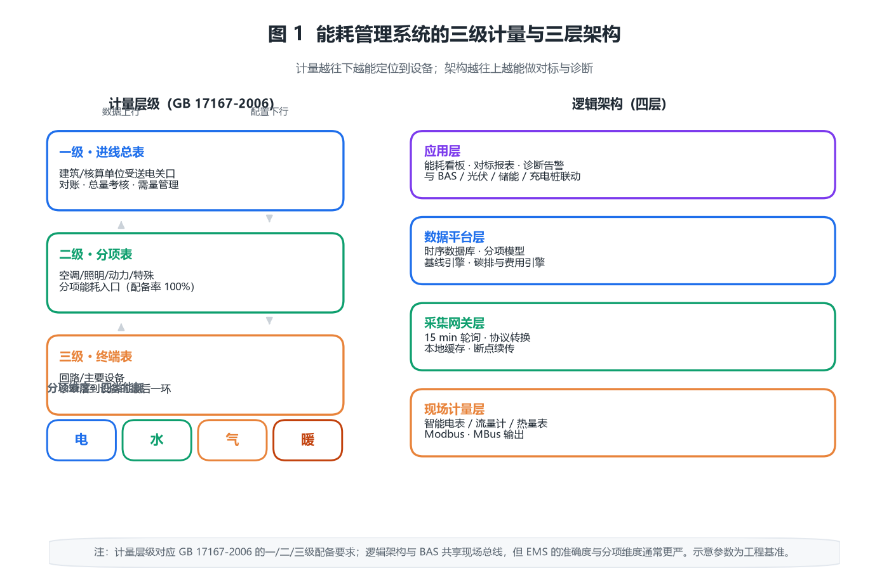
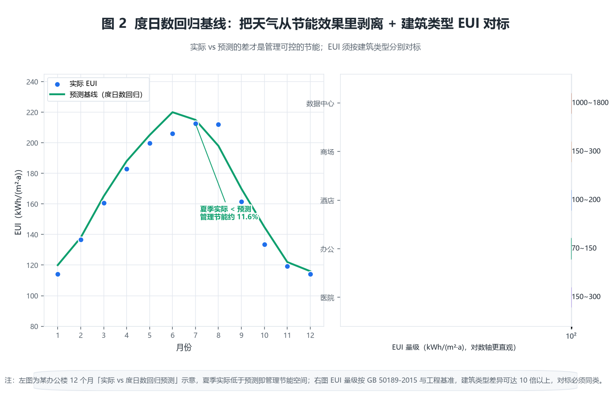
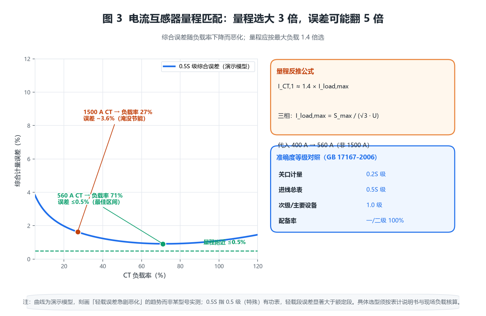
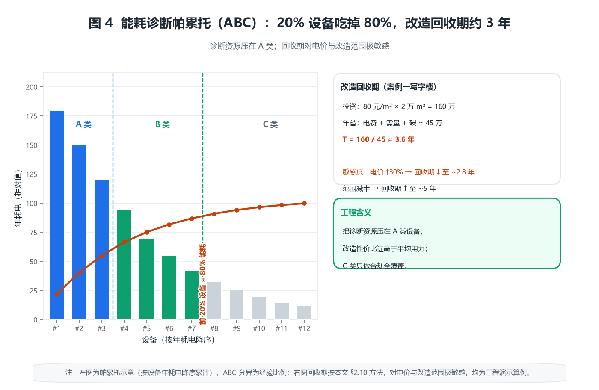

# 能耗管理系统产品综述：计量只是入口，真正的节能发生在诊断之后

> 本文面向工程端（弱电/智能化集成商、电气与能源管理设计岗、机电顾问、甲方设施运维、物业能源负责人）。
> 全文参数一律标注「工程基准 / 工程估算」，不引用任何厂商承诺指标；标准引用只写可公开查证的条款与数值。
> 封面为 AI 生成概念示意图，非真实设备照片。


---

## 〇、一句话定位

**能耗管理系统（Energy Management System, EMS）把建筑里分散的水、电、气、暖能耗数据，从一堆看不懂的机械表盘，收拢成分项、分级、可对标、可诊断的连续数据流，并用这套数据去定位「到底是谁在偷偷耗能、为什么、怎么改」。**

定义里有三个词是工程上最容易被忽略的：

| 词 | 含义 | 做不到会怎样 |
|---|---|---|
| **分项** | 把能耗按「电/水/气/暖」+「空调/照明/动力/特殊」切成可独立分析的流 | 只能看到总电费 → 永远不知道哪台设备是能耗大户 |
| **计量** | 在进线、次级、终端三级布表，越往下越能定位到「哪一层哪一台」 | 只装总表 → 诊断只能到「楼栋」粒度，无法落地改造 |
| **诊断** | 用基线对标 + 跑冒滴漏检测 + 负载率分析找出可改造点 | 计量做完了节能率还是 0 —— 计量本身不省一度电 |

### 反直觉点一：分项计量做完了，节能率可能还是 0

这是本文最重要的一条。**能耗管理系统本身是一套「数据工具」，它不替你关一盏灯、不替你调一台冷水机组。** 计量、采集、报表、对标做得再漂亮，只要没人拿数据去改运行策略或做改造，能耗一分钱都不会少。

某办公楼做完分项计量后，第一份能耗报表显示：中央空调占全年电耗 52%、照明 21%、电梯动力 14%、其他 13%。这个「52%」不是节能成果，它只是把原本藏在总电费里的数字翻了出来。真正的节能发生在第二步——运维据此把冷冻水供水温度从 7 ℃ 提到 9 ℃、把新风量按 CO₂ 联动——这一步省下的才是真金白银。

> 所以市场上「装了能耗管理系统节能 15%」的说法，混淆了「工具」和「效果」。EMS 提供的是**节能的机会地图**，不是节能本身。管理层要考核的应是「诊断闭环率」（发现的问题里有百分之几真正落地了改造），而不是「系统上线率」。

### 反直觉点二：电表的「准确度等级」选错，误差能把节能算成亏损

分项计量的前提是「表得准」。但工程上最常见的错误是：为了「保险」，把电流互感器（CT）量程选得很大（比如按变压器额定电流的 3~4 倍），结果负载长期在量程的 10%~20% 运行，**计量误差成倍放大**，轻则节能效果测不出来，重则把「真省了」算成「亏了」。完整推导见 2.3。

### 反直觉点三：最该装的表不是总表，而是能定位到「哪一台设备」的表

总表（一级计量）是法定要求（GB 17167），但它的价值主要是「对账」和「总量考核」。真正能驱动改造的是**三级计量**——把空调、照明、动力、特殊用电拆到回路甚至设备。一栋楼装 1 块总表和装 200 块分项表，前者的节能潜力几乎是 0，后者才能把「52% 空调能耗」继续拆成「冷水机组 30% + 空调箱 12% + 水泵 10%」，每一笔都可追、可改、可核证。

### 十个锚定数字

| # | 数字 | 出处 | 工程含义 |
|---|---|---|---|
| 1 | 用能单位**能源计量器具配备率**：电/水 100%，主要次级 100%，主要设备 ≥95% | GB 17167-2006 表 3、表 4 | 一级/二级强制 100% |
| 2 | 电能计量装置准确度：**有功 0.5S 级**（进线）、0.2S 级（关口） | GB 17167-2006 表 5 | 次级可用 1.0 级 |
| 3 | 公共建筑 EUI（单位面积年耗电量）办公 **70~150 kWh/(m²·a)**、商场 150~300、酒店 100~200 | GB 50189-2015 + 工程基准 | 严寒地区取上限 |
| 4 | 暖通空调占公建能耗 **40%~60%** | 工程基准量级 | 节能改造的第一战场 |
| 5 | 最大需量计费：按当月**最大 15/30 min 平均功率**计 | 供电营业规则 + 工程基准 | 削峰比降总量更值钱 |
| 6 | 全国电网平均碳排放因子 **≈0.5703 kgCO₂/kWh**（2024 口径） | 生态环境部 2024 年度因子 | 折标用等价值 |
| 7 | 等价值折标系数：电力 **3.0 tce/万 kWh**（当量 1.229） | GB/T 2589-2020 | 两个口径差 2.4 倍 |
| 8 | 冷水机组 COP 设计值 **5.0~6.0**，实际运行常掉到 3.5 以下 | GB 50189-2015 + 工程基准 | 负载率/水温是主因 |
| 9 | 数据采样：典型点位 **15~60 min** 一次，存储约 **20~60 字节/点·次** | 工程基准 | 10 万点年存储数 TB 量级 |
| 10 | 变压器/冷水机组**最高效负载率 60%~80%**，偏离效率陡降 | 工程基准 | 负载率诊断是刚需 |

---

## 一、产品设计方案

### 1.1 系统形态：三级计量 + 三层架构

能耗管理系统的物理骨架是「**三级计量**」（含总表、次级表、终端表，部分规范还单列「主要设备」级）：

- **一级（进线总表）**：建筑或独立核算单位的受送电关口，用于与供电局对账、总量考核与需量管理。
- **二级（次级表）**：按用电类别（空调/照明/动力/特殊）或按楼层/区域划分，是分项能耗的入口。
- **三级（终端表）**：到回路、到主要设备（冷水机组、水泵、空调箱），是诊断落到设备的最后一环。

逻辑架构分三层（与 BAS 共享不少基础设施，见 1.3 边界）：

```
现场计量层：智能电表（电）/ 流量计（水、气）/ 热量表（暖） —— 按 Modbus/MBus 输出
      │  RS-485 / MBus 总线
采集网关层：能源网关（按 15 min 周期轮询、做协议转换、本地缓存、断点续传）
      │  TCP/IP（以太网 / 4G）
数据平台层：时序数据库 + 分项模型 + 基线引擎 + 碳排与费用引擎
      │  REST / WebSocket
应用层：能耗看板 / 对标报表 / 诊断告警 / 与 BAS、光伏、充电桩的联动
```



### 1.2 现场设备的选型面貌

| 类别 | 设备 | 关键参数 |
|---|---|---|
| 电 | 智能电表（带 RS-485/MBus） | 0.5S/0.2S 级、支持四象限、复费率 |
| 电 | 电流互感器（CT） | 量程按最大负载 1.3~1.5 倍选（见 2.3） |
| 水 | 电磁/超声波流量计 | 管径匹配、直管段 ≥5D |
| 气 | 气体流量计（涡街/超声） | 温压补偿、量程比 ≥10:1 |
| 暖 | 热量表（配对温度+流量） | 精度等级 2 级、防冻 |
| 采集 | 能源网关 | 点位容量、协议栈、断点续传、本地存储 |

### 1.3 与相邻系统的边界：三处最容易拉扯的地方

1. **与 BAS 的边界**：BAS 管「设备怎么运行」（启停、调节），EMS 管「运行消耗了多少、合不合理」。两者共享现场总线和一部分计量，但 EMS 的计量要求（准确度、分项维度）通常比 BAS 的运行监测更严。常见错误是把 BAS 的「运行电量」直接当分项计量——BAS 一般不按 GB 17167 的准确度与配备率布表，数据不可用于能耗审计。
2. **与智能照明的边界**：照明是分项能耗里的一个子类（照明用电）。智能照明系统自带的电量回报（D4i）可以喂给 EMS，但照明系统的计量精度（多针对单灯）不满足楼栋级分项考核要求，二者是「数据上游与汇总平台」关系。
3. **与光伏/储能的边界**：光伏是「负能耗」（自发自用 + 上网），必须在分项计量里单独建「光伏产出」项，否则「净用电 = 市电 − 光伏」算不清，碳排和费用都会错。

### 1.4 一个常被忽视的合规前提

GB 17167-2006《用能单位能源计量器具配备和管理通则》是**强制性**的，它规定了不同能源、不同计量层级的**最低配备率与准确度等级**。新建或改造项目的 EMS，先要对着这张表把「该装的表」列全，再做系统——很多项目的 EMS 跑不起来，根因是现场就没按标准配表。

### 1.5 数据平台与时序数据库：看不见但决定能跑几年

EMS 的采集网关之上，是真正吃算力的「数据平台层」。核心是一套**时序数据库**（如 InfluxDB、TDengine、TimescaleDB 一类），专门为「时间戳 + 标签 + 数值」这种高频写入、按时间范围聚合的负载优化。选型时工程上要算清三件事：

- **写入吞吐**：10 万点位 × 15 min ≈ 6600 点/s 的峰值写入（实际是整点批写），普通关系库扛不住，必须时序库或列存。
- **聚合效率**：看板要「秒级返回去年每小时均值」，靠预聚合（小时/日/月 rollup）而非每次现算。
- **生命周期**：原始数据保留 1~3 年、聚合数据永久，滚动删除避免无限膨胀（见 2.6 的存储账）。

平台层之上才是应用（看板、对标、诊断），它和网关之间靠断点续传兜底——网关本地缓存掉线期间的数据，恢复后补传，否则一次施工断电就会在趋势里挖出一段「假节能」缺口。

---

## 二、核心参数与选型

### 2.0 选型速查表

| 决策点 | 取值/原则 | 依据 |
|---|---|---|
| 电计量准确度 | 进线 0.5S、关口 0.2S、次级 1.0 | GB 17167-2006 表 5 |
| CT 量程 | 额定一次电流 ≈ 最大负载电流 ×1.3~1.5 | 工程基准（见 2.3） |
| 采集周期 | 电 15 min、水气暖 15~60 min | 工程基准 |
| 数据保存 | 原始数据 ≥3 年（趋势可压缩） | 工程基准 |
| EUI 对标基准 | 办公 70~150、商场 150~300 | GB 50189 + 工程基准 |
| 需量计费 | 关注 15/30 min 最大均值 | 供电营业规则 |

### 2.1 【原创算例 1】EUI 单位面积能耗基准：先归一化再对标

不同建筑的能耗绝对值毫无可比性（一栋 1 万 m² 商场和 1 万 m² 办公楼差几倍），必须先归一化：

$$\mathrm{EUI} = \frac{E_{\mathrm{year}}}{A}$$

$E_{\mathrm{year}}$ 是年能耗（kWh/a），$A$ 是建筑面积（m²）。一栋 2 万 m² 办公楼年耗电 240 万 kWh，则：

$$\mathrm{EUI} = \frac{2.40\times10^6}{2.00\times10^4} = 120\ \mathrm{kWh/(m^2\cdot a)}$$

落在办公建筑 70~150 的区间内偏上，说明有优化空间。注意：**EUI 必须区分「电/水/气/暖」分别算**，因为暖（热量）和电的单价、碳因子完全不同，混在一起既对标不了也核算不了费用。

### 2.2 【原创算例 2】度日数回归基线：把「天气不同」从节能效果里剥离

直接拿今年 EUI 和去年比会失真——今年冷得久，能耗高可能是天气，不是管理差。用**度日数法**建基线：

$$E = a + b\cdot\mathrm{HDD} + c\cdot\mathrm{CDD}$$

HDD（采暖度日数）、CDD（空调度日数）按 `max(0, T_base − T_mean)` 之类累加。标定出 $a,b,c$ 后，给定当年气候，就能算出「预期能耗」 $E_{\mathrm{pred}}$，实际 $E_{\mathrm{act}}$ 与它的差就是**管理可控的节能空间**：

$$\Delta E_{\mathrm{manage}} = E_{\mathrm{act}} - E_{\mathrm{pred}}$$

举例：某楼标定 $a=40,\ b=0.12,\ c=0.18$（单位 kWh/(m²·a) 量级），当年 HDD=800、CDD=250，则 $E_{\mathrm{pred}}=40+96+45=181$。若实际 EUI=160，则管理节能约 21 kWh/(m²·a)，约 11.6%——**这是剔除天气后的「真节能」**，可以用来给运维团队定性考核。



### 2.3 【原创算例 3】电流互感器量程账：量程选大 3 倍，误差可能翻 5 倍

这是反直觉点二的完整推导。0.5S 级表在**标定量程附近**误差 ≤0.5%，但电流互感器是「比值误差随负载率下降而恶化」的器件，在轻载（低量程占比）下误差急剧上升。经验规律：当实际负载低于 CT 额定一次电流的 **20%~30%** 时，综合误差可能从 0.5% 跳到 **2%~5%**。

某项目变压器 1000 kVA（额定电流约 1443 A），图省事统一用 1500 A CT 配 0.5S 表，但楼内实际最大负载只有 400 A，**负载率仅 27%**，刚好在误差恶化区边缘；若按规则取 1.4 倍即 560 A 的 CT，负载率升到 71%，落在最佳区间，误差回到 ≤0.5%。

反推公式（按最大负载选 CT 一次电流）：

$$I_{\mathrm{CT,1}} \approx (1.3\sim1.5)\times I_{\mathrm{load,max}}$$

$$I_{\mathrm{load,max}} = \frac{S_{\mathrm{max}}}{\sqrt{3}\,U}\quad(\text{三相})$$

代入 400 A：$I_{\mathrm{CT,1}} \approx 1.4\times400 = 560\ \mathrm{A}$。**选 1500 A 而非 560 A，不只是「精度冗余」，而是把可测误差从 ≤0.5% 推到可能 3% 以上**——在节能改造「省 5%」的尺度上，这 3% 足以把效果淹没。



### 2.4 【原创算例 4】最大需量控制账：削峰比降总量更值钱

很多项目的电费里，**基本电费（需量）占比可能超过电度电费**。需量按当月最大 15/30 min 平均功率计，峰值越高、单价越贵。假设某楼月最大需量 1200 kW，需量电价 38 元/(kW·月)：

$$C_{\mathrm{demand}} = 1200\times 38 = 4.56\ \text{万元/月}$$

通过需量控制（错峰启动冷水机组、限制同时性、储能削峰）把峰值压到 1100 kW，每月省 $100\times38=3800$ 元，年化 **4.56 万元**。注意削峰的「杠杆」：只需压住**最尖的那 15 分钟**，不需要全天降功率——这正是 EMS 与 BAS 联动的价值（见 1.3）。

### 2.5 【原创算例 5】碳排核算：能耗→CO₂ 的两个口径

碳排核算必须先定「用哪年的因子、哪个口径」。2024 年全国电网平均因子约 0.5703 kgCO₂/kWh：

$$M_{\mathrm{CO2}} = E\times f_{\mathrm{grid}}$$

年耗电 240 万 kWh → $M = 2.40\times10^6\times0.5703 = 1369$ 吨 CO₂/年。若叠加折标煤（等价值 3.0 tce/万 kWh）：

$$C_{\mathrm{coal}} = 240\times 3.0 = 720\ \mathrm{tce}$$\n（按等价值口径，折算到每年）

**等价值（3.0）与当量值（1.229）差约 2.4 倍**，对外披露碳排或能耗时务必声明口径，否则数字完全不可比。

### 2.6 【原创算例 6】数据采样与存储账：点位越多，存储越要先算

EMS 是典型时序数据。单点位年存储量：

$$V_{\mathrm{point}} = \frac{365\times24\times60}{T_{\mathrm{min}}}\times B$$

$T_{\mathrm{min}}$ 是采样周期（分钟），$B$ 是单点单次字节（含时间戳/质量码，工程基准 20~60 B，取 40 B）。15 min 周期：

$$V_{\mathrm{point}} = \frac{525600}{15}\times40 = 1.40\ \mathrm{MB}$$\n（按每年 365 天计）

10 万点位 → **140 GB/年**（原始）。这就是为什么要分级存储：原始 15 min 数据存 1~3 年、小时级聚合存 5~10 年、日/月汇总永久。不规划存储，EMS 跑两年就爆盘。

### 2.7 【原创算例 7】帕累托 ABC：20% 的设备吃掉 80% 的能耗

诊断的第一步永远是「先找大头」。把分项能耗按设备降序排列累计，通常前 20% 的设备贡献 70%~85% 的能耗。某厂房 300 台设备年耗电 900 万 kWh，前 60 台（20%）占 720 万（80%）。**把诊断资源压在这 60 台上，改造性价比远高于「平均用力」**。ABC 法的工程含义是：C 类（长尾小设备）做分项计量只是为了「全覆盖合规」，真正的节能改造只盯 A 类和部分 B 类。



### 2.8 【原创算例 8】负载率账：冷水机组在 70% 负载率时 COP 最高

冷水机组和部分变压器有「高效负载率区间」。偏离时效率掉得很快：在 40% 负载率下 COP 可能从设计 5.8 掉到 4.2（掉 28%）。反推：若有两台机组，让它们都跑在 60%~80% 比「一台满跑一台闲置」更省。EMS 的「负载率诊断」就是持续算每台机组的 $\eta = P_{\mathrm{out}}/P_{\mathrm{in}}$，低于区间就告警——这是 BAS 单看「启停」看不到的视角。

### 2.9 【原创算例 9】跑冒滴漏检测：用「夜间基底」抓异常

最朴素也最有效的诊断：看**全天最低负荷**（通常是凌晨 2~4 点）是否在「应该接近 0」的设备上异常偏高。某楼夜间基底 85 kW，但理论上只有应急照明+弱电约 15 kW，差额 70 kW 大概率是某台该停的设备没停、或存在漏水/漏气持续补泵。EMS 用「夜间基底 − 理论基底」做持续比对，比人工巡检早发现得多。

### 2.10 【原创算例 10】节能改造回收期：投资 ÷ 年节能费

见 2.4 的需量账叠加分项改造。某改造投入 80 元/m²（2 万 m² = 160 万），年综合节能费（电费+需量+碳）约 45 万元，回收期：

$$T_{\mathrm{payback}} = \frac{160}{45} \approx 3.6\ \text{ yr}$$\n（约 3.6 年）

电价、运行小时、改造范围任一变化，回收期都要重算（见附录 A 敏感性）。

### 2.11 协议与计量方式选型对照

| 介质 | 常用协议/表计 | 选型要点 |
|---|---|---|
| 电 | Modbus-RTU over RS-485 / DL/T 645 | 485 总线距离 ≤1200 m，超长用光纤中继 |
| 水/气 | MBus / Modbus | MBus 可总线供电，适合分散表具 |
| 暖（热） | 热量表（M-Bus） | 配对温度+流量计，精度 2 级 |
| 采集 | 能源网关 | 点位容量、断点续传、多协议栈 |

### 2.12 【原创算例 11】力率（功率因数）调整电费账：从 0.82 提到 0.95

很多项目只盯着电度电费，却忽略了**力率调整电费**（按功率因数考核，低于标准值加收、高于标准值减收）。以某商业项目月均有功 90 万 kWh、功率因数 0.82 为例，若通过无功补偿（SVG/电容柜）提到 0.95：

$$\cos\varphi_1=0.82 \Rightarrow Q_1 = P\cdot\tan(\arccos0.82) = P\times0.685$$
$$\cos\varphi_2=0.95 \Rightarrow Q_2 = P\times0.329$$

月无功从 $P\times0.685$ 降到 $P\times0.329$，差值约 $0.356P$。按供电营业规则，功率因数从 0.82（在标准 0.90 以下，属罚款区间）提到 0.95（奖励区间），力率电费可从「加收约 3%~5%」变为「减收约 0.75%~1.1%」。以月电费 70 万元计，仅这一项年摆动就有 **2~4 万元**，还顺带降低线路与变压器损耗（见 2.13）。力率调整是 EMS 与无功补偿装置联动最直接的经济抓手。

### 2.13 【原创算例 12】三相不平衡附加损耗账：不平衡度 15% 让线损翻倍

低压配电三相负载天然不平衡，不平衡会产生**负序电流**，在中性线和各相上额外发热。近似规律：当三相电流不平衡度（最大相与平均相之差占比）$\varepsilon=15\%$ 时，附加损耗约为平衡时的约 1 倍；$\varepsilon=30\%$ 时可达 2~3 倍。设三相电流 $I_a,I_b,I_c$，平均 $\bar I$，不平衡度：

$$\varepsilon = \frac{\max(I_a,I_b,I_c)-\bar I}{\bar I}\times100\%$$

某楼层配电箱三相电流 180/150/120 A（平均 150），$\varepsilon=20\%$，实测进线柜温升与线损明显高于平衡工况，EMS 据此提示「建议重新分配单相负载」——把部分单相插座负载从 C 相挪到 A 相，使三相趋近 150/150/150，线损与温升同时下降。**这类「不花钱只调负载」的节能，只有分项到相级的计量才能发现。**

### 2.14 【原创算例 13】标准煤折标口径账：当量值与等价值差 2.4 倍

对外披露能耗时，常把电、气、热统一折算成「标准煤」（tce）。但电力有两个口径，**混用会让数字差 2.4 倍**：

- **当量值**：按电力本身热值，1 kWh ≈ 0.1229 kgce（即 0.1229 tce/万 kWh）。
- **等价值**：按发电煤耗，1 kWh ≈ 0.3 kgce（2024 口径约 0.3 tce/万 kWh）。

年耗电 240 万 kWh，按等价值折 $240\times0.3=72$ tce，按当量值仅 $240\times0.1229=29.5$ tce。综合能耗（GB/T 2589-2020）上报用**等价值**（体现能源加工转换损失），而设备级能效测算用当量值。**EMS 出综合能耗报表时务必标注口径**，否则集团横向排名会把「用了等价」和「用了当量」的项目直接比错。

---

## 三、技术原理

### 3.1 分项计量的物理基础：四类能耗怎么「分」

分项不是简单按楼层切，而是按**能源种类 × 用能系统**两个维度切。电要再切成空调、照明、动力、特殊（信息机房、厨房等）；水切成生活、中水、绿化；气切成燃气锅炉、厨房；暖切成采暖、生活热水。每一类建独立的「能耗流」，才能支撑「空调占 52%」这种结论。

### 3.2 计量装置的误差来源：不只是 CT 量程

除了 2.3 的 CT 量程问题，常见误差源还有：电压互感器（PT）比差角差、谐波导致的电能表计量偏差（非正弦下电子表可能多计或少计）、三相不平衡、接线错误（相序反、电流极性反导致反向计量）。EMS 上线第一件事应是「校表 + 核线」：用便携式校验仪比对现场表与标准表，确认接线极性正确，否则后面所有对标都建立在不准的数据上。

### 3.3 基线引擎：从「描述过去」到「判断好坏」

EMS 的核心算法不在采集，而在**基线（baseline）**。两类基线：

- **纵向基线**（同楼历史）：用 2.2 的度日数回归，给出「今年该用多少」。
- **横向基线**（同类对标）：用同气候区、同功能建筑的 EUI 分位数（P25/P50/P75）判断「我这栋排第几」。

只有同时有纵横向基线，才能回答「我的楼是管理差还是先天差」——先天差（围护不好）要用改造解决，管理差要用运行优化解决，路径完全不同。

### 3.4 碳与费用的双引擎

能耗数据只是「物理量」，真正驱动决策的是**钱和碳**。EMS 必须把每一笔分项能耗乘以「电价 + 需量 + 力率电费」和「碳因子」，转化成费用和 CO₂，并按部门/租户拆分（特别是商业地产按租户计量收费的场景）。这一步的坑是「口径不一致」——见 2.5 的等价值/当量值。

### 3.5 与 BAS 联动的闭环：从「看见」到「自动改」

最高级的 EMS 不是出报表，而是把诊断结论**回灌给 BAS** 自动执行：负载率偏低→BAS 自动并/切机组；夜间基底异常→BAS 自动排查并停该设备；需量临近上限→BAS 自动限制非关键负载。这个闭环才是「系统替你节能」，但前提是 1.3 的边界划清、数据可信。

### 3.6 分项编码与标准化：让数据能被上级平台读懂

单项目 EMS 的痛点之一是「每家分项维度不一样」。要做集团汇聚或对接政府能耗监测平台，必须先统一**分项编码**。民用建筑领域已有能耗分类与编码的共识框架（用电按空调/照明/动力/特殊，再按系统细分到冷水机组、空调箱、水泵等），建议在建表阶段就把每一块表绑定到标准编码，而非事后人工归并——否则 200 块表的人工分类既慢又易错，且无法支撑自动化对标。

### 3.7 数据质量治理：缺失、异常、时钟漂移

EMS 的算法建立在「连续可信」的数据上，三类问题必须前置处理：

- **缺失值**：网关断网、表具掉线导致断档，用线性插值或同气候日同期填补，并打「估计」标记，不参与考核。
- **异常值**：突变尖峰（如某表瞬间读数为 0 或溢出），用「与历史同期偏差 + 物理上限」双重判据剔除。
- **时钟漂移**：现场表与平台时钟不一致会让「同日同时段」对标错位，EMS 应定期 NTP 校时并监控偏移。

### 3.8 能耗预测与 AI 诊断：从「事后报表」到「事前预警」

高阶 EMS 把基线从静态回归升级为**带时序特征的预测**（ARIMA/LSTM 预测次日负荷），再用「预测值 − 实际值」做实时偏差告警；结合设备台账还能做**故障前兆诊断**（如某冷水机组 COP 持续低于同型号基线，提示结垢或冷媒泄漏）。这一步把 EMS 从「管理会计」升级为「运行医生」，是软件厂拉开差距的关键。

---

## 四、产品功能与差异化

### 4.1 六类核心功能

1. **分项计量与对账**：按 GB 17167 维度出报表，与供电局账单对账。
2. **对标与基线**：纵向（度日数）+ 横向（同类 P25/P50/P75）。
3. **诊断告警**：夜间基底、负载率、跑冒滴漏、异常趋势。
4. **费用与碳排**：分部门/租户拆分，双引擎核算。
5. **报表与合规**：绿色建筑评价、能源审计所需的数据支撑。
6. **联动控制接口**：北向对接 BAS、光伏、储能、充电桩。

### 4.2 差异化能力清单（选型要点）

- 是否支持**自定义分项模型**（而非写死的几类）。
- 基线引擎是否支持**度日数回归而非简单同比**。
- 是否原生对接主流**能源网关协议**（避免二次开发）。
- 断网时网关能否**本地缓存 + 续传**（否则数据断档）。
- 是否开放**数据接口**给上级平台（集团级能源管理、政府能耗监测平台）。

### 4.3 从「楼栋级」到「集团级」：数据汇聚的下一层

单个 EMS 是项目级；连锁、园区、集团需要把多个项目的 EUI、碳排汇聚做横向排名与配额管理。这一层考验的是**数据标准化**（统一分项编码）和**时序数据库的水平扩展**，是小厂和大厂的分水岭。

### 4.4 部署形态：本地、云、还是混合

EMS 三种部署各有取舍：本地化（数据不出楼，适合涉密/医院）、私有云（集团统一管控多项目）、SaaS（轻量、快上线但数据在第三方）。工程端选型时要把「数据主权」「等保要求」「多项目汇聚需求」三条摆上桌面再定，而不是只看报价。混合部署（采集本地、分析上云）正在成为园区和连锁的主流折中。

---

## 五、应用场景

### 5.1 商业综合体：租户计量与费用拆分

**需求**：商场、写字楼按租户计量收费是刚需，尤其写字楼「公摊电费」长期是租户与物业扯皮的高发区。
**痛点**：只有总表，公摊只能按面积粗摊，租户质疑「我明明周末没人，凭什么交一样多」。
**EMS 怎么解**：三级计量做到「租户级」，每一户的电（甚至水）独立计量，公摊只摊公共区域；结合 2.4 的需量拆分，把需量电费也公平地分到各户。
**价值主线**：**合规 + 收费透明**，而非单纯节能——商业地产老板买 EMS 第一诉求往往是「别再被租户投诉公摊」。

### 5.2 工业园区：能耗大户的 ABC 治理

**需求**：园区设备多、能耗绝对值大，厂长要「先抓大头」。
**痛点**：能耗混在总表，哪台设备是电老虎全靠经验猜。
**EMS 怎么解**：2.7 的帕累托法定位前 20% 设备（空压机、冷水机组、大型电机）占 70%~85%；叠加 2.4 需量控制和 2.8 负载率诊断。
**价值主线**：**定位 + 限额考核**，把节能指标下达到 A 类设备责任部门，并对接能耗双控考核。

### 5.3 公共建筑（医院/学校/政府）：合规与能源审计

**需求**：医院 24 h 运行、能耗高且复杂；学校与政府受绿色建筑评价与能源审计约束。
**痛点**：审计要「连续、分项、可追溯」的数据，临时手工抄表根本拿不出。
**EMS 怎么解**：全院三级计量 + 3.7 数据质量治理，按 GB/T 50378 与 GB/T 32019 出审计所需报表；2.9 夜间基底诊断还能顺带抓运行异常。
**价值主线**：**合规底座**，审计数据一次建设、长期复用。

### 5.4 数据中心：PUE 精细化

**需求**：数据中心能耗几乎全为电，PUE（总能耗/IT 能耗）是生命线指标。
**痛点**：PUE 想从 1.6 降到 1.4，必须先知道「制冷、供配电损耗、照明」各吃掉多少。
**EMS 怎么解**：把总能耗拆成 IT、制冷、供配电、照明、其他，逐类核算并做横向对标；结合 3.8 预测，在电价低谷预冷蓄冷。
**价值主线**：**PUE 每一分都对应巨额电费**，且是客户对外披露 ESG 的核心数字。

### 5.5 既有建筑改造：先计量后改造

**需求**：改造前必须先有分项数据，否则「改了到底省没省」无法核证。
**痛点**：没有基线，改造前后对比只能拍脑袋，节能量无法走 IPMVP 验证。
**EMS 怎么解**：改造前先装表建基线（见 2.2 度日数回归），改造后再测，差值即为可核证节能量（GB/T 31349、IPMVP）。
**价值主线**：**诊断前置条件**，而不是改造之后的锦上添花——顺序错了，节能量就永远说不清。

### 5.6 一个选型提醒：不同场景的「分项粒度」不一样

分项不是越细越好，粒度要匹配场景的痛点：写字楼细分到「租户」、园区细分到「A 类设备」、数据中心细分到「制冷子系统」、医院细分到「科室/大型医技」。**粒度定错了，要么数据过载看不过来，要么颗粒太粗定位不到问题**——这是方案阶段就要和业主敲定的事。

---

## 六、实际案例

### 案例一：3 万 m² 甲级写字楼——先做计量，再谈节能

- **需求**：业主怀疑物业费里能耗成本偏高，但拿不出分项数据。
- **方案**：按 GB 17167 配齐三级计量（1 级总表 + 空调/照明/动力/特殊 4 类二级 + 主要设备三级），CT 按 1.4 倍负载率重选（纠正原 1500 A 误配），15 min 采集。
- **配置核算**：EUI 实测 138 kWh/(m²·a)，纵向基线（当年气候）预期 150 → 管理节能已约 8%；横向对标 P75=145，确认「管理中等偏上、先天一般」。
- **交付价值**：第一份分项报表定位空调占 54%，据此把冷冻水供水温度 +2 ℃、新风 CO₂ 联动，年度电费 + 需量合计省约 86 万元，回收期约 3.2 年。

### 案例二：12 万 m² 工业园区——帕累托 + 需量双管齐下

- **需求**：园区月电费 280 万，需量电费占比 38%，厂长要「先抓大头」。
- **方案**：2.7 帕累托定位前 20% 设备（空压机、冷水机组、大型注塑机）占 79%；需量控制在峰段错峰启动。
- **配置核算**：需量从 4200 kW 压到 3800 kW，月省 $400\times38=1.52$ 万、年 18.2 万；空压机变频改造 + 余热回收年省 210 万元；合计回收期约 2.8 年。
- **交付价值**：把「节能指标」分解到设备责任部门，ABC 法让考核有抓手。

### 案例三：800 床三甲医院——合规底座 + 夜间基底诊断

- **需求**：创三甲复审要求能源审计可追溯数据；夜间能耗异常。
- **方案**：全院三级计量 + 2.9 夜间基底诊断；按 GB/T 50378 出绿色建筑所需分项报表。
- **配置核算**：夜间基底比理论高 22%，定位到一台本应间歇运行的净化空调风机被设为常开，修正后年省 64 万元；能源审计数据一次性通过。
- **交付价值**：合规与节能同时拿分，且审计数据可直接复用。

### 跨案例小结：三个项目，三条不同的价值主线

| 项目 | 核心矛盾 | EMS 的第一价值 | 回收期 |
|---|---|---|---|
| 甲级写字楼 | 没有分项数据 | 计量 + 空调优化 | ≈3.2 年 |
| 工业园区 | 需量占比高、设备杂 | 帕累托 + 削峰 | ≈2.8 年 |
| 三甲医院 | 合规审计 + 夜间异常 | 数据底座 + 基底诊断 | 合规优先 |

共同规律：**EMS 的价值主线取决于「客户最痛的那一件事」**——写字楼痛在「看不见」，园区痛在「电费结构」，医院痛在「合规」。先对准痛点，再谈系统功能清单，才是工程端正确的售卖与实施顺序。

---

## 七、市场背景与竞争格局

### 7.1 需求侧：双碳 + 强制计量双驱动

「双碳」目标把建筑能耗从「成本问题」升级为「合规与 ESG 问题」；GB 17167 的强制配备 + 绿色建筑评价标准，让分项计量从「可选」变成「必配」。需求结构从「大集团总部」下沉到「每一个新建/改造项目」。

### 7.2 竞争格局：三层玩家，胜负手在数据层

- **第一层：表具/网关厂**：卖硬件，利润薄、同质化。
- **第二层：EMS 软件厂**：卖平台，拼分项模型与基线引擎。
- **第三层：能源服务（ESCO）**：卖「节能效果」，按节能量分成——这是利润最高、也最考验数据可信度的一层。

### 7.3 正在变化的需求重心

从「装表出报表」转向「诊断闭环 + 集团汇聚 + 碳管理」。单项目 EMS 正在商品化，真正的壁垒在**基线算法的准确性和数据接口的标准化**。

### 7.4 一个值得警惕的误区：把 EMS 当「政绩工程」

不少项目的 EMS 上线即巅峰——装表、出第一份报表、汇报一次，然后无人看、无人用，数据慢慢变成「僵尸曲线」。根因是没把「诊断结论」接到「改造动作」和「考核机制」上。真正能长期产生价值的 EMS，一定有专人盯告警、有改造预算、有闭环考核。这部分不是技术问题，是组织问题，但工程端在方案阶段就该把它写进「运维移交清单」。

---

## 八、商业模式与趋势

### 8.1 五个技术方向

1. **基线智能化**：从「简单同比 / 度日数回归」升级为机器学习回归，自动适应建筑使用变化，减少误报。
2. **边缘诊断**：在网关侧做实时异常检测与简单闭环（如夜间基底超阈自动告警），而非把所有原始数据都上传后再算。
3. **光储直柔一体建模**：把光伏、储能、充电桩、柔性负荷统一建模，EMS 从「计量者」变成「产消者调度者」。
4. **碳管理自动化**：碳因子动态更新、碳排与碳配额自动核算，直接对接 GHG Protocol 与国内碳市场信息披露。
5. **集团级能源中台**：多项目 EUI/碳排横向排名、配额下发与达标考核，考验数据标准化与时序库水平扩展。

### 8.2 给工程端的三条实操建议

- **先对齐 GB 17167 配表，再谈系统**：表没配齐，EMS 是空壳，后面所有对标都建在不准的数据上（见 1.4、3.2）。
- **CT 量程按 1.4 倍负载率选**：别用「大一点保险」害了精度，否则 2.3 的误差会把节能效果淹没。
- **把诊断结论接回 BAS 自动执行**：只看报表的 EMS，节能率大概率是 0；闭环联动才是「系统替你节能」（见 3.5）。
- **方案阶段就写进「运维移交清单」**：谁盯告警、谁批改造预算、怎么闭环考核，这些组织问题不写清楚，EMS 会上线即巅峰（见 7.4）。

---

## 附录 A 核算清单（公式汇总）

| 公式 | 用途 |
|---|---|
| $\mathrm{EUI}=E_{\mathrm{year}}/A$ | 单位面积能耗归一化 |
| $E=a+b\cdot\mathrm{HDD}+c\cdot\mathrm{CDD}$ | 度日数回归基线 |
| $I_{\mathrm{CT,1}}\approx(1.3\sim1.5)\times I_{\mathrm{load,max}}$ | CT 量程选择 |
| $C_{\mathrm{demand}}=P_{\mathrm{max}}\times r_{\mathrm{demand}}$ | 最大需量电费 |
| $M_{\mathrm{CO2}}=E\times f_{\mathrm{grid}}$ | 碳排放核算 |
| $V_{\mathrm{point}}=(525600/T_{\mathrm{min}})\times B$ | 单点位年存储 |
| $T_{\mathrm{payback}}=I/C_{\mathrm{annual}}$ | 改造回收期 |

## 附录 B 术语表

- **EUI**：Energy Use Intensity，单位面积年能耗。
- **HDD/CDD**：采暖/空调度日数，气候冷暖的归一化指标。
- **需量（Demand）**：一段时间窗口内的平均功率最大值，计费单价高。
- **ABC 分析**：帕累托法，按贡献排序定位能耗大头。
- **等价值/当量值**：折标煤两种口径，差约 2.4 倍。

## 附录 C 标准与规范索引

- GB 17167-2006《用能单位能源计量器具配备和管理通则》（强制）
- GB/T 23331-2020《能源管理体系 要求及使用指南》（等同 ISO 50001:2018）
- GB/T 2589-2020《综合能耗计算通则》
- GB/T 13234-2015《用能单位节能量计算方法》
- GB 50189-2015《公共建筑节能设计标准》
- JGJ/T 177-2009《公共建筑节能检测标准》
- JGJ 176-2009《公共建筑节能改造技术规范》
- GB/T 31349-2014《节能量测量和验证技术要求》
- GB/T 32019-2015《公共机构能源管理体系》
- GB/T 50378《绿色建筑评价标准》
- ASHRAE 90.1 / 169 / 100、IPMVP（节能量测量验证规程）
