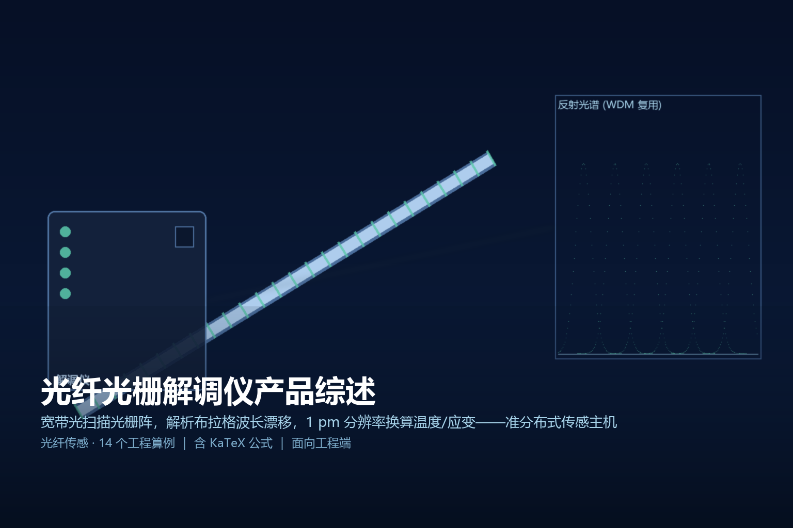
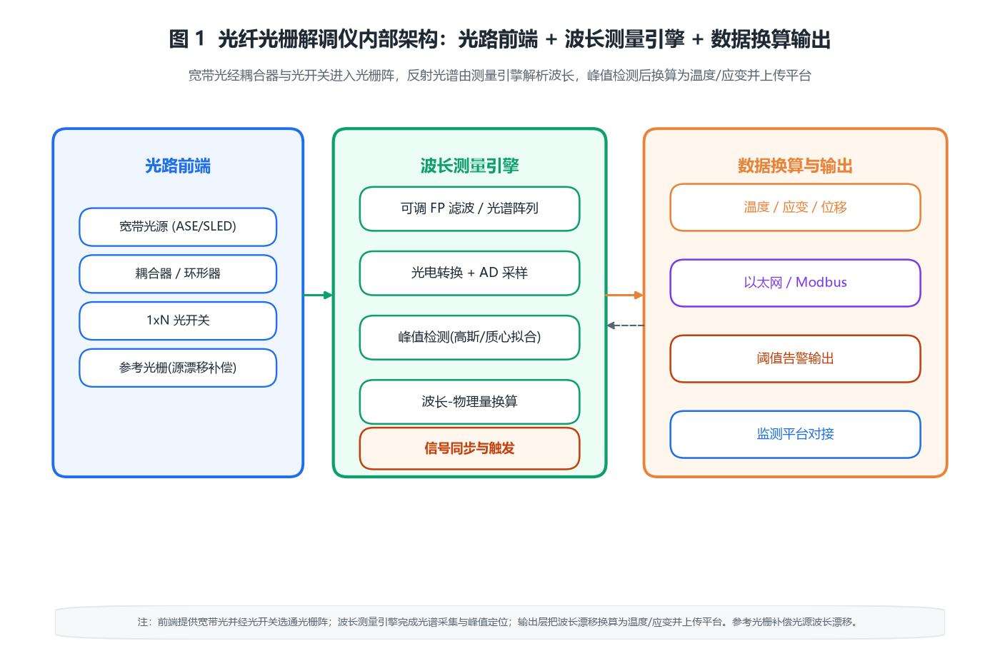

> 
> *概念图：光纤光栅解调仪向光栅阵列发出宽带光并解析各光栅反射波长，1 pm 级分辨率把波长漂移换算为温度与应变——准分布式传感的采集主机。示意图。*

# 光纤光栅解调仪产品综述

## · 面向工程端

---

## 〇 一句话定位

光纤光栅解调仪是 FBG 传感网络的「采集与解算主机」：它向一根串接了几十个光栅测点的光纤发出宽带光，接收每个光栅反射回来的中心波长，再把波长漂移实时换算成温度、应变、位移等物理量并上传平台。**它买的是「把一串无源光栅变成一串高精度准数字测点」的读取能力**——解调精度、通道数、采样率与复用容量，决定了一整套管网/结构监测系统的密度、刷新与长期稳定性。

> 简单说，它与本系列已写的「光纤光栅传感器」是上下游：传感器负责把物理量编进波长、沿光纤无源布设；解调仪负责把波长读出来、算出来、传上去。前者是「感官」，后者是「神经中枢」。本文只讲这台主机怎么选、怎么配、怎么验收。

---

## 一、产品设计方案

### 1.1 内部系统组成

一台解调仪在工程上由「光路前端、波长测量引擎、数据换算输出」三块构成：

- **光路前端**：宽带光源（ASE 或 SLED，覆盖 C 波段约 40 nm）、耦合器/环形器、1×N 光开关（轮询多纤）、以及一只封装在机内的**参考光栅**（用于补偿光源自身波长漂移）。
- **波长测量引擎**：把反射光谱变成数字量的核心——可调法布里-珀罗（FP）滤波器扫描、或 InGaAs 线阵光谱仪、或马赫-曾德尔干涉仪；前端配光电转换与 AD 采样，再跑峰值检测算法。
- **数据换算输出**：对峰值波长做温度/应变标定与交叉补偿，经以太网/Modbus 输出，对接结构健康监测平台并触发阈值告警。

### 1.2 两种产品形态

| 形态 | 做法 | 适用 | 工程取舍 |
|------|------|------|----------|
| 静态型 | 扫描速率 1–50 Hz，主打高精度与多通道 | 桥梁/隧道/管道的准静态监测 | 精度高、通道多、成本低 |
| 动态型 | 采样率可达 kHz，配并行探测 | 振动、冲击、声发射监测 | 速率高但通道数与点数受限 |

工程上先定「测什么动态、要多密」再定形态：应变蠕变、温度趋势选静态型；结构振动、地震波选动态型。通道数常见 4/8/16/32，每通道经光开关再扩展数十个测点。

### 1.3 信号解算链路

```
宽带光源发光 → 耦合器/环形器 → 光开关选通光纤 → 光栅阵反射
        → 波长测量引擎(光谱采集 + AD) → 峰值检测(高斯/质心拟合)
        → 波长-物理量标定(含温度补偿) → 以太网/Modbus → 监测平台
```

关键工程点：**必须有峰值检测算法与参考光栅双重保障**——峰值拟合决定你能读到多细的波长（算例 6），参考光栅决定长时间无人值守时源漂不会被误读成真实应变（算例 9），两者缺一就会出现「数据漂亮但其实是光源在飘」的假象。

### 1.4 系统架构图


*图 1：解调仪内部三块——光路前端（宽带光源 + 耦合器 + 光开关 + 参考光栅）、波长测量引擎（光谱采集 + 峰值检测 + 换算）、数据输出（物理量 + 以太网/Modbus + 平台）。*

---

## 二、核心参数与选型

### 2.1 关键参数清单（工程基准）

| 参数 | 典型区间 | 选型含义 |
|------|----------|----------|
| 波长范围 | 1510–1590 nm（C 波段） | 决定单纤可复用窗口宽度 |
| 波长分辨率 | 0.5–2 pm | 直接决定应变/温度检测下限 |
| 波长重复性 | ±1–5 pm | 长期稳定性与标定周期依据 |
| 通道数 | 4 / 8 / 16 / 32 | 可并接的光纤数 |
| 每通道测点数 | 20–80（经光开关） | 单纤复用容量 |
| 采样率 | 1 Hz – 5 kHz | 静态监测 vs 动态振动 |
| 最大传输距离 | 10–30 km（单段） | 远端测点布设半径 |
| 接口 | 以太网 / Modbus / 4–20 mA | 平台对接与硬联动 |
| 供电 | DC 12–24 V / PoE | 远端取电方式 |
| 防护等级 | IP50–IP65 | 机架式 vs 现场型 |

### 2.2 十四个原创工程算例

下面每一条都是落地时要真算的账，标号贯穿正文，便于复核。

**【算例 1】布拉格波长-应变换算**
布拉格条件 $\lambda_B=2 n_{\mathrm{eff}}\Lambda$，外界应变使光栅周期与有效折射率变化，波长漂移近似：
$$\frac{\Delta\lambda_B}{\lambda_B}\approx(1-p_e)\,\varepsilon,\quad \Delta\lambda_B=K_{\varepsilon}\,\varepsilon$$
在 1550 nm 处应变灵敏度 $K_{\varepsilon}\approx1.2\ \mathrm{pm/\mu\varepsilon}$。取 $\varepsilon=1000\ \mathrm{\mu\varepsilon}$：
$$\Delta\lambda_B=1.2\times10^3\times10^{-3}=1.2\ \mathrm{nm}$$
结论：**1000 微应变对应波长漂移约 1.2 nm**，解调仪必须分辨到 pm 级才能读出微应变。

**【算例 2】温度交叉敏感**
同波长处温度灵敏度 $K_T\approx10.4\ \mathrm{pm/^{\circ}C}$。取 $\Delta T=50\ ^{\circ}\mathrm{C}$：
$$\Delta\lambda_B=10.4\times50\times10^{-3}=0.52\ \mathrm{nm}$$
与应变换算合并看交叉项：温度等价于应变的系数为 $10.4/1.2\approx8.7\ \mathrm{\mu\varepsilon/^{\circ}C}$。结论：**1 摄氏度约等于 8.7 微应变当量**，纯应变测量必须配同点温度光栅做补偿，否则温度一变就成假应变。

**【算例 3】分辨率与检测下限**
波长分辨率 1 pm 时：
$$\Delta\varepsilon_{\min}=\frac{1\ \mathrm{pm}}{1.2\ \mathrm{pm/\mu\varepsilon}}\approx0.83\ \mathrm{\mu\varepsilon},\quad \Delta T_{\min}=\frac{1}{10.4}\approx0.096\ ^{\circ}\mathrm{C}$$
结论：**1 pm 分辨率对应应变下限约 0.83 微应变、温度下限约 0.1 摄氏度**；要分辨 1 微应变，波长分辨率须 ≤1.2 pm。

**【算例 4】单纤波长分复用容量**
C 波段可用窗约 40 nm（1510–1590），相邻光栅中心波长需留 ≥1.0 nm 保护带以免峰重叠：
$$N_{\max}\approx\frac{40\ \mathrm{nm}}{1.0\ \mathrm{nm}}\approx40$$
结论：**单根光纤靠不同中心波长可串接约 40 个测点**；挤到 0.5 nm 间距虽可到 80，但峰重叠风险陡增，工程上取 40 更稳妥。

**【算例 5】光开关轮询的有效采样率**
1×16 光开关、每路 4 个测点，共 64 点；每点 20 ms 稳定 + 5 ms 测量 = 25 ms：
$$T_{\mathrm{cycle}}=64\times25\ \mathrm{ms}=1600\ \mathrm{ms}=1.6\ \mathrm{s}$$
单点有效采样率：
$$f_{\mathrm{eff}}=\frac{1}{1.6\ \mathrm{s}}\approx0.62\ \mathrm{Hz}$$
结论：**串行轮询使单点采样率仅约 0.62 Hz**——静态监测足够，动态振动必须减点数或改并行探测（算例 12）。

**【算例 6】峰值检测定位精度**
高斯峰半高宽 $\mathrm{FWHM}=0.25\ \mathrm{nm}$，采样间隔 0.02 nm/像素，跨峰采样点数：
$$N_{\mathrm{pts}}\approx\frac{0.25}{0.02}\approx12.5$$
工程上峰值中心估计精度近似：
$$\sigma_c\approx\frac{\mathrm{FWHM}}{2.355\cdot \mathrm{SNR}\cdot\sqrt{N_{\mathrm{pts}}}}$$
取信噪比 $\mathrm{SNR}=100$（40 dB）、$\sqrt{N_{\mathrm{pts}}}\approx3.5$：
$$\sigma_c\approx\frac{0.25}{2.355\times100\times3.5}\approx0.0003\ \mathrm{nm}=0.3\ \mathrm{pm}$$
结论：**信噪比 40 dB 以上时峰值定位可达亚 pm 级**，1 pm 分辨率要求 SNR≥约 30 dB 且跨峰 ≥10 个采样点。

**【算例 7】动态范围与 ADC**
12 位 AD 量化范围达 72 dB，远超光功率 20 dB（100:1）的动态范围：
$$20\ \mathrm{dB}=10\log_{10}\!\left(\frac{P_{\max}}{P_{\min}}\right)\Rightarrow \frac{P_{\max}}{P_{\min}}=100$$
结论：**12 位 AD 轻易覆盖 20 dB 反射率变化（1%–90% 反射峰）**，瓶颈在探测器噪声而非量化，选型不必追求更高位 AD。

**【算例 8】解调吞吐（拟合负载）**
16 通道、每通道 40 峰、50 Hz 采样：
$$N_{\mathrm{fit}}=16\times40\times50=32000$$（拟合/秒）
每峰高斯拟合约数百浮点运算，总算力约 10 MFLOP/s，现代 DSP 轻松胜任。结论：**软件峰值拟合不是瓶颈，瓶颈在光谱采集硬件速率**。

**【算例 9】参考光栅源漂移补偿**
宽带光源波长漂移约 0.1 nm/h。机内参考光栅波长固定，实时扣除漂移后残差：
$$\Delta\lambda_{\mathrm{res}}\le0.2\ \mathrm{pm}$$
若不用参考光栅，8 小时无人值守漂移：
$$0.1\ \mathrm{nm/h}\times8\ \mathrm{h}=0.8\ \mathrm{nm}\approx667\ \mathrm{\mu\varepsilon}$$
结论：**参考光栅把源漂从 0.1 nm/h 压到 ≤0.2 pm 残差**，否则 8 小时就攒出近 700 微应变的假数据。

**【算例 10】链路衰减与最大距离**
光纤在 1550 nm 衰减约 0.2 dB/km，10 km 仅：
$$L=0.2\times10=2\ \mathrm{dB}$$
结论：**10 km 传感光纤仅 2 dB 衰减，远距传输不是问题**；实际单段限制来自多 FC/APC 接头累积插入损耗（每接头约 0.3 dB）与 OTDR 式定位需求，通常控在 10–30 km。

**【算例 11】复用容量（通道×传感）**
16 通道、每纤 40 点：
$$N_{\mathrm{total}}=16\times40=640$$（测点/台）
结论：**一台主机覆盖约 640 个测点**，相比每点拉一根电缆的电学方案，省线、省端口、抗电磁干扰优势显著。

**【算例 12】单帧解调时延**
16 通道、每通道扫描 2 ms：
$$T_{\mathrm{frame}}=16\times2\ \mathrm{ms}=32\ \mathrm{ms}$$
动态模式要求每通道 <1 ms 才能跟住振动，则须减到 ≤4 通道或改并行探测。结论：**静态 32 ms 帧延迟可接受；动态应用须减通道或并行**。

**【算例 13】功耗与供电**
整机功耗约 15 W。PoE（802.3af）上限 15.4 W：
$$15\ \mathrm{W}<15.4\ \mathrm{W}$$
余量几乎为零，无主动散热空间。结论：**15 W 紧贴 PoE 上限，宜用 DC 24 V 独立供电**以保证散热与可靠性。

**【算例 14】系统可用度与漂移预算**
波长重复性 ±1 pm，假设 MTBF=5 万小时、MTTR=4 h：
$$A=\frac{50000}{50000+4}\approx0.99992$$
结论：**可用度约 99.992%**，靠年度标定 + 季度清洁维持 ±1 pm 精度，现场型加 IP65 与防雷。

---

## 三、技术原理

### 3.1 布拉格波长怎么被测出来

解调仪不测「光强」而测「波长」。宽带光打进光栅阵，每个光栅只在自己的布拉格波长处反射一窄峰；测量引擎把整段反射光谱数字化，再对每个峰做高斯/质心拟合得到中心波长（算例 6）。波长比光强稳定得多——不受光源功率波动、光纤弯曲损耗影响，这正是 FBG「准数字」抗干扰的根本。

### 3.2 怎么从波长得到物理量

波长漂移同时受应变与温度影响（算例 1、2），解调仪必须做**双参量解耦**：在同一位置布置温度光栅与应变光栅，或用一个光栅配合已知温度点，把温度分量减掉，剩下才是真实应变。标定环节要给出每只光栅的 $K_{\varepsilon}$、$K_T$ 与零点波长，写入配置表——标定不准，后面算得再细也是偏的。

### 3.3 波长测量的三种技术路线

- **可调 FP 滤波扫描**：用压电陶瓷调谐滤波器逐波长扫描，分辨率高（±1 pm）、线性好，但扫描速率受限，适合静态高精度。
- **InGaAs 线阵光谱仪**：一次曝光得全谱，并行、通道多，但像元非线性与暗噪声使重复性略逊，适合多通道密度优先。
- **马赫-曾德尔干涉**：干涉细分可达亚 pm，但测量范围窄（几十 nm），需配合粗测，适合动态超高精度。

### 3.4 复用与轮询的取舍

单纤靠波长分复用（算例 4）串几十点，再用光开关把多纤并一台主机（算例 11）——这是「高密度 + 省端口」的标配。代价是串行轮询拉低单点采样率（算例 5、12）：静态结构监测不在乎，动态振动就必须在通道数、点数、速率间做减法。

---

## 四、产品功能与差异化

### 4.1 核心功能清单

- **高精度波长读取**：pm 级分辨率，解算温度/应变/位移。
- **大规模复用**：单台数百至上千测点，无源光纤免供电。
- **温度-应变解耦**：同点温度光栅补偿交叉敏感。
- **源漂自补偿**：参考光栅保证长时间无人值守精度。
- **平台对接**：以太网/Modbus 上传，阈值告警与视频联动。
- **远距传输**：单段 10–30 km，适合管网、长桥、隧道。

### 4.2 差异化：解调仪 vs 电学采集

| 维度 | FBG 解调仪 | 电学应变/温度传感器 |
|------|-----------|-------------------|
| 测点布线 | 一串测点一根光纤 | 每点一根电缆 |
| 供电 | 全程无源 | 每点需供电或电池 |
| 抗电磁 | 天然免疫 | 需屏蔽 |
| 防爆 | 本安（光信号） | 需本安设计 |
| 长期稳定 | 参考光栅自补偿 | 易受漂移 |
| 成本 | 主机贵、测点便宜 | 测点贵、布线贵 |

结论：**要高密度、要远距、要防爆抗电磁，FBG 主机几乎是唯一划算的方案**；单点低频、近距离场景，电学方案更直接。

---

## 五、应用场景（痛点→方案→价值）

**① 桥梁/大坝结构健康监测**
- 痛点：测点多、跨度大、要求长期稳定。
- 方案：一台 16 通道主机覆盖数百测点（算例 11），参考光栅保精度（算例 9）。
- 价值：一根光纤串起整桥应变温度，省线省维护。

**② 电力电缆/开关柜测温**
- 痛点：强电磁、高压、不允许电火花。
- 方案：无源光栅贴接头，本安光信号回传。
- 价值：防爆抗电磁，热点温度实时上送平台。

**③ 长输管道/隧道监测**
- 痛点：距离长、环境恶劣、人工巡检难。
- 方案：单段 10–30 km 光纤（算例 10），应变+温度双参量。
- 价值：沿线连续感知，变形与第三方破坏早预警。

**④ 大型设备振动监测**
- 痛点：动态信号要求高刷新。
- 方案：动态型 + 减通道并行探测（算例 12）。
- 价值：kHz 级捕捉异常振动，提前发现机械故障。

---

## 六、实际案例与设计方案

### 案例一：某跨江大桥结构监测

- **需求**：主跨应变 + 温度，约 500 测点，长期稳定。
- **方案设计**：16 通道主机（算例 11，640 点容量充足），每纤 40 点串接，参考光栅保精度（算例 9），静态型 10 Hz 采样。
- **配置核算**：单段光纤控在 12 km 内（算例 10），DC 24 V 供电（算例 13），IP65 机柜 + 防雷。
- **交付价值**：一根光纤覆盖整跨，年度标定维持 ±1 pm，蠕变与温度趋势一目了然。

### 案例二：变电站电缆接头测温

- **需求**：数十个接头测温，强电磁、防爆。
- **方案设计**：4 通道静态主机 + 温度光栅贴接头，本安光信号。
- **配置核算**：无源光栅免供电，以太网接入既有辅控平台（GB/T 28181 联动）。
- **交付价值**：防爆抗电磁，热点超温即时告警，替代人工红外巡检。

### 案例三：长输管线第三方破坏预警

- **需求**：30 km 管线沿线应变感知，早预警。
- **方案设计**：动态型主机 + 减通道并行（算例 12），应变+温度双参量解耦（算例 2）。
- **配置核算**：多段光纤接力，每段 ≤20 km（算例 10），光开关并入主机。
- **交付价值**：沿线连续监测，开挖/沉降/异常振动分级告警，降低打孔盗油与施工破坏风险。

---

## 七、市场背景与竞争格局

光纤光栅解调仪产业链：**光源与光学器件（ASE/SLED、InGaAs、FP 滤波器）→ 解调整机（传感厂家：武汉理工、基康、加拿大 FISO、美国 Micron Optics 等）→ 行业集成（桥梁/电力/石化）**。竞争焦点：

- **波长分辨率与重复性**是门槛：pm 级精度依赖光学器件一致性与峰值算法，是核心硬件能力。
- **复用容量与采样率**是护城河：通道数、点数、动态速率的 trade-off 体现系统设计功力。
- **行业方案化**成标配：纯仪器厂向「解调 + 标定 + 平台」一体方案演进，绑定桥梁/电力/石化场景。
- **国产化加速**：光源与探测器国产供应链成熟，整机成本持续下探，渗透率上升。

---

## 八、商业模式与趋势

- **按通道与点数计价 + 平台授权**：主机按通道、软件按套，工程毛利在标定服务与集成。
- **一体方案溢价**：「解调 + 标定 + 平台」打包比单卖仪器溢价明显。
- **趋势一：动态化**：kHz 采样与并行探测把应用从静态结构扩到振动/声发射。
- **趋势二：智能化**：内置 AI 对波形异常自诊断，自动剔除松动/断纤测点。
- **趋势三：标准化联动**：告警输出全面走标准协议（Modbus/GB 28181），降低集成成本。

---

## 附录

### A. 核算清单（14 笔账速查）

| 编号 | 算例 | 核心公式 | 关键结论 |
|------|------|----------|----------|
| 1 | 波长-应变 | $\Delta\lambda_B=K_{\varepsilon}\varepsilon,\ K_{\varepsilon}\approx1.2\ \mathrm{pm/\mu\varepsilon}$ | 1000 微应变→1.2 nm |
| 2 | 温度交叉 | $K_T\approx10.4\ \mathrm{pm/^{\circ}C}$ | 1 摄氏度≡8.7 微应变 |
| 3 | 分辨率 | $\Delta\varepsilon_{\min}\approx0.83\ \mathrm{\mu\varepsilon}$ | 1 pm→0.83 微应变 |
| 4 | 单纤复用 | $N_{\max}\approx40\ \mathrm{nm}/1\ \mathrm{nm}$ | 约 40 点/纤 |
| 5 | 轮询速率 | $f_{\mathrm{eff}}=1/(64\times25\ \mathrm{ms})$ | 0.62 Hz |
| 6 | 峰值精度 | $\sigma_c\approx\mathrm{FWHM}/(2.355\cdot\mathrm{SNR}\cdot\sqrt{N})$ | 0.3 pm@40 dB |
| 7 | 动态范围 | $20\ \mathrm{dB}=100:1$ | 12 位 AD 足够 |
| 8 | 解调吞吐 | $16\times40\times50$ | 3.2 万拟合/秒 |
| 9 | 源漂补偿 | $\Delta\lambda_{\mathrm{res}}\le0.2\ \mathrm{pm}$ | 8 h 免 0.8 nm 漂移 |
| 10 | 链路衰减 | $0.2\ \mathrm{dB/km}\times10$ | 10 km→2 dB |
| 11 | 复用容量 | $16\times40$ | 640 点/台 |
| 12 | 单帧时延 | $16\times2\ \mathrm{ms}$ | 32 ms |
| 13 | 功耗供电 | $15\ \mathrm{W}<15.4\ \mathrm{W}$ | 宜 DC 24 V |
| 14 | 可用度 | $A=50000/50004$ | 99.992% |

### B. 术语表

- **FBG**：光纤布拉格光栅，周期性折射率调制，反射特定中心波长。
- **布拉格波长**：$\lambda_B=2 n_{\mathrm{eff}}\Lambda$，光栅反射的中心波长。
- **波长分辨率**：解调仪能分辨的最小波长变化（pm 级）。
- **WDM**：波分复用，靠不同中心波长在同一光纤串接多测点。
- **参考光栅**：机内固定波长光栅，用于补偿光源自身漂移。
- **交叉敏感**：温度与应变同时引起波长漂移，需解耦。

### C. 标准与规范索引（工程可查）

- **IEC 61757** 光纤传感器（通用技术要求，术语与试验）
- **GB/T 15972** 光纤试验方法（光学特性测试）
- **GB/T 7665-2005** 传感器通用术语
- **GB 50982-2014** 建筑结构监测技术规范（结构健康监测）
- **GB 4208-2017** 外壳防护等级（IP 代码，现场型选 IP65）
- **GB/T 17626** 电磁兼容试验（抗扰度）
- **GB 50343-2012** 建筑物电子信息系统防雷技术规范（接地 ≤4 Ω）
- **GB/T 28181** 视频监控联网（解调仪告警联动平台）

> 注：本篇参数为工程基准/演示估算，落地以厂家规格书与现场标定为准；实际应变/温度灵敏度随光栅封装与粘贴工艺变化，设计应留 ≥30% 余量，并按年度标定维护精度。
