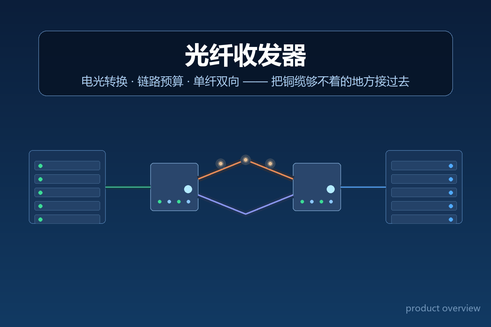
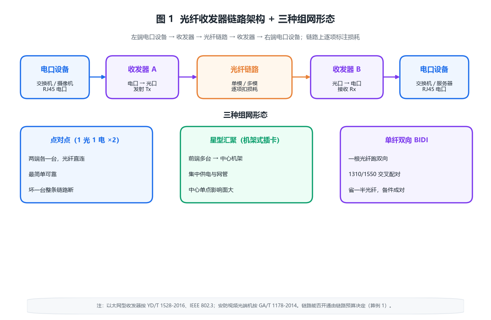
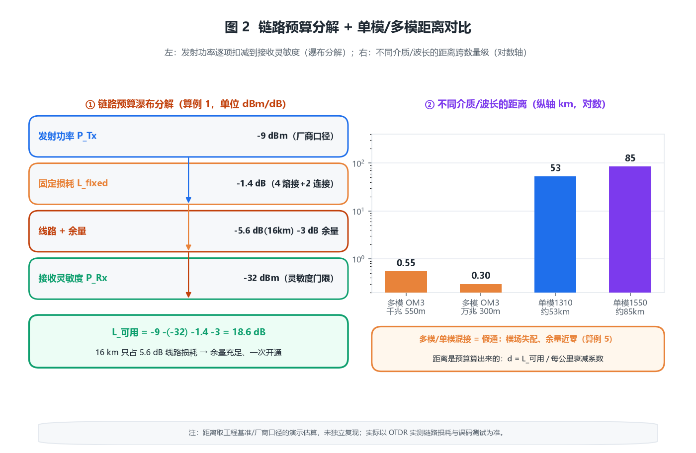
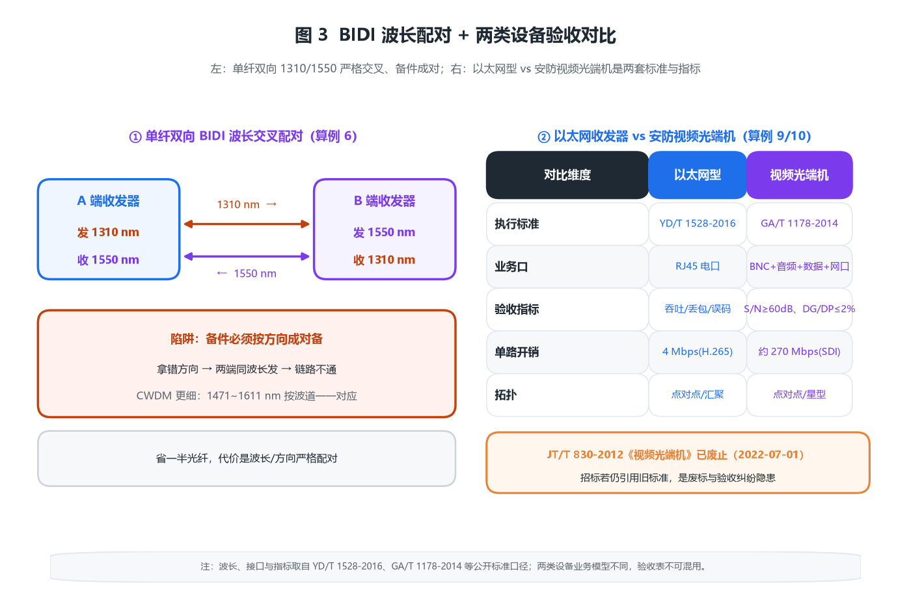
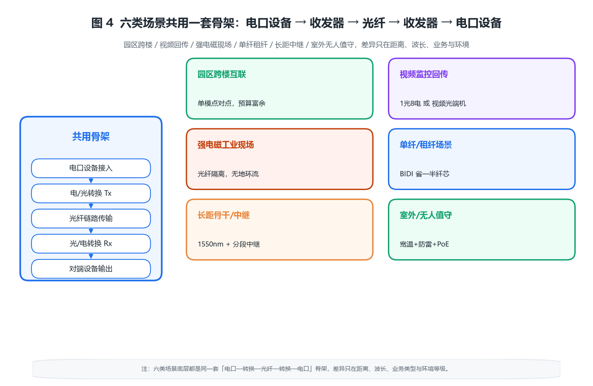

> 
> *概念图：一对光纤收发器把两端铜缆网口接到单模光纤上，发光与收光方向用不同颜色的光带区分，链路上标注发射功率、光纤衰减、熔接损耗与接收灵敏度的逐项核算。示意图。*

# 光纤收发器产品综述

## · 面向工程端

---

## 〇 一句话定位

光纤收发器（工程上常称「光纤收发器」「光电转换器」「光端机」「视频光端机」「fiber media converter」「单纤双向收发器」）是**在电信号与光信号之间做媒介转换的设备：它一端用 RJ45 电口接交换机、摄像机、PLC 与服务器，另一端用光口把双绞线受限的百米距离延伸到数公里乃至上百公里的光纤链路，把「铜缆够不着的距离」「强电磁环境里通不了的电口」「不同介质之间接不上的网口」用一对小盒子接起来**。它不路由、不交换（多数机型），只是在 OSI 物理层/数据链路层做透明的信号搬运——**它买的不是「一个能把网线变光纤的转接头」，而是「在预算算得清、波长配得对、余量留得够的前提下，链路开通即用、长期不误码」的确定性**。链路预算决定能不能通、单模还是多模决定传多远、波长配对决定单纤双向能不能成、发射功率与接收灵敏度决定余量够不够扛住温度升高与光纤老化。

> 本篇与 network 分类的《工业以太网交换机》明确分工：交换机管「数据怎么转发、断链怎么自愈」，本篇管「铜缆怎么变成光纤、这段光纤链路怎么算得通」。同系列《网络摄像机（IPC）》取像、《视频存储服务器》存储、《分布式坐席节点》交互，都不碰媒介转换这一层。一句话区分：**交换机管「网怎么组」，收发器管「网线够不着的地方怎么接过去」**。

> **反直觉点一：「标称 20 km」不是在任何光纤上都能跑 20 km，它是链路预算算出来的上限。** 发射光功率减去接收灵敏度得到可用预算，再逐项扣掉光纤衰减、熔接点、活动连接器，最后留 3~5 dB 老化余量。同一台机器用多模光纤可能只跑 550 m，用 G.652 单模在 1310 nm 跑 20 km、换 1550 nm 能到 40~80 km。**招标写「传输距离 ≥20 km」而不同时写波长、光纤类型、熔接点数量与余量要求，等于什么都没约束**（算例 1、2、3）。

> **反直觉点二：「多模接单模，短距离好像也通」是典型的假通。** 多模模块（850 nm VCSEL）接进单模光纤，或反过来，短距可能点亮链路，但模场直径不匹配带来巨大耦合损耗、余量几乎为零，温度一漂、熔接点一老化就误码甚至断链。**光纤类型、波长、连接器型号（FC/SC/LC）必须与两端模块和现场已敷光缆一致，短距能通不等于链路合格**（算例 5）。

> **反直觉点三：单纤双向（BIDI）收发器的备件必须成对备，只备一只等于没备。** BIDI 用波分复用在一根光纤上跑双向：一端 1310 nm 发、1550 nm 收，另一端必须 1550 nm 发、1310 nm 收，波长严格交叉配对。现场断了一端，仓里那只如果波长方向不对，装上去就是不亮。**「一只通用备件」在 BIDI 世界里不存在**（算例 6）。

> **反直觉点四：以太网光纤收发器 ≠ 安防视频光端机，两套标准、两套指标，别混着验收。** 以太网型看吞吐量、丢包率、时延，按 **YD/T 1528-2016《光纤收发器技术要求》/ YD/T 1464-2017《光纤收发器测试方法》** 与 IEEE 802.3；安防视频光端机看视频信噪比、微分增益 DG、微分相位 DP，按 **GA/T 1178-2014《安全防范系统光端机技术要求》**（原交通行业 JT/T 830-2012《视频光端机》已于 2022-07-01 废止，招标文件若还引用它就是过期依据）。**一个传以太网包，一个传复合视频/音频/数据，名字都带「光端机」，验收表却不能共用**（算例 9、10）。

**锚定数字**（均有公开标准或稳定来源可查）：**YD/T 1528-2016《光纤收发器技术要求》**（现行，代替 YD/T 1528-2006）／ **YD/T 1464-2017《光纤收发器测试方法》**（现行，代替 2006 版）／ **GA/T 1178-2014《安全防范系统光端机技术要求》**（2014-08-12 实施，中心波长 850/1310/1550 nm ±30 nm、CWDM 1471~1611 nm ±6.5 nm、视频信噪比 ≥60 dB 加权、DG ≤2%、DP ≤2°、幅频 ±2 dB@5.8 MHz）／ **JT/T 830-2012《视频光端机》**（2022-07-01 废止，勿作现行依据）／ **IEEE 802.3 系列**（100BASE-FX/1000BASE-SX/LX/10GBASE，以太网型物理层）／ **ITU-T G.652 / G.655**（单模光纤，G.652 在 1310 nm 衰减约 0.35 dB/km、1550 nm 约 0.22 dB/km）／ **GB/T 15972 系列**（光纤试验方法规范）／ **GB 7247.1**（激光产品安全，光口不可直视）／ **GB/T 17626 系列**（ESD、浪涌、EFT、辐射抗扰度）／ **GB/T 4208**（IP 防护等级）／ 工程参数（发射功率、接收灵敏度、熔接/连接器损耗、余量）为**工程基准 / 演示估算，厂商口径均未独立复现，须以现场 OTDR 与误码测试验收**。

---

## 一、产品设计方案

### 1.1 系统组成：一对转换端 + 一条光纤链路 + 两类业务口

一套光纤收发器链路在工程上由三部分构成，核心是「两端转换透明、中间链路算得清」：

- **两个转换端（收发器本体）**：一端把电口信号调制成光信号发出（Tx），另一端把光信号解调回电口（Rx）；成对使用，多数机型收发身份由光纤方向决定而非固定主从。按形态分**桌面型（1 光 1 电，即插即用）**、**机架式（16 槽/19 英寸集中插卡，可网管）**、**导轨工业型（宽温、冗余电源、IP40）**。
- **一条光纤链路**：单模（G.652/G.655，1310/1550 nm，长距）或多模（OM2/OM3/OM4，850 nm，短距）；纤芯数决定能否用单纤双向；连接器 FC/SC/LC 决定现场跳线匹配。
- **两类业务口**：以太网型是 RJ45 电口（10/100/1000BASE-T）——接交换机、摄像机、服务器；视频光端机是 BNC 复合视频口 + RS-485/232 数据口 + 音频口 + 以太网口——接模拟摄像机、云台、对讲（算例 9、10）。

### 1.2 四种典型组网形态

| 形态 | 做法 | 适用 | 工程取舍 |
|------|------|------|----------|
| 点对点（1 光 1 电 ×2） | 两端各一台，光纤直连 | 两栋楼之间、摄像机回监控中心 | 最简单可靠；坏一台整条链路断，无冗余（算例 1） |
| 星型汇聚（机架式集中） | 前端多台远端机 → 中心机架式插卡 | 园区多监控点回中心 | 集中供电/网管、密度高；中心单点故障影响面大 |
| 单纤双向 BIDI | 一根光纤跑双向（1310/1550 交叉） | 光纤芯数紧张、租纤场景 | 省一半光纤；波长必须成对、备件成对（算例 6） |
| 链型/中继级联 | 超出单段距离时加光中继再生 | 超 80~120 km 长距 | 逐段核算预算；多级误码累积、时延叠加（算例 3、11） |

工程上先算「这段链路预算够不够」，再定「用单模还是多模、单纤还是双纤」，最后才选形态。**不是先看机身标多少公里，而是先把实际光缆长度、熔接点、连接器、余量逐项对账**（算例 1~3）。

### 1.3 一次「摄像机信号过光纤」的六个动作

```
① 电口接入：摄像机经 RJ45 进收发器电口，10/100/1000 自适应或强制速率
② 介质转换：PHY 把电信号解调成比特流，光模块把比特流调制成光脉冲（Tx）
③ 光口发送：按 850/1310/1550 nm 波长、既定发射功率注入光纤（算例 1、2）
④ 光纤传输：衰减去 0.22~0.35 dB/km，每个熔接点/连接器再扣损耗（算例 3）
⑤ 光口接收：对端光模块把光信号还原成电信号，要求入射功率高于灵敏度+余量（算例 1、4）
⑥ 电口输出：解调解码后从 RJ45 送出，透明转发、不改变 MAC/IP（算例 7、11）
```

### 1.4 系统架构图


*图 1：光纤收发器链路架构——左端电口设备经收发器转成光信号，光纤链路上标注发射功率、光纤衰减、熔接/连接器损耗与接收灵敏度；右下角对比点对点、星型汇聚与单纤双向三种形态。*

---

## 二、核心参数与选型

### 2.1 关键参数清单（工程基准）

下表为招标文件常见技术要求与工程基准（厂商口径已标注，未独立复现），具体以厂家 datasheet、现行标准原文与现场 OTDR/误码测试为准：

| 参数 | 典型区间 / 要求 | 选型含义 |
|------|----------------|----------|
| 执行标准 | 以太网型 YD/T 1528-2016 + YD/T 1464-2017 + IEEE 802.3；安防光端机 GA/T 1178-2014 | 按业务类型选对标准，别拿视频光端机的 S/N 指标验收以太网型（算例 9、10） |
| 光纤类型 | 单模 G.652/G.655（1310/1550 nm）；多模 OM3/OM4（850 nm） | 长距单模、园区短距多模；类型必须两端一致（算例 2、5） |
| 发射光功率 | 多模 -20~-14 dBm；单模 1310 nm -9~-3 dBm、1550 nm 0~5 dBm（厂商口径） | 与接收灵敏度之差 = 可用预算（算例 1） |
| 接收灵敏度 | 多模 ≤-24 dBm；单模 ≤-32 dBm（高性能 -36 dBm） | 灵敏度越高（数值越负），预算越充裕（算例 1） |
| 光纤衰减 | G.652：1310 nm 约 0.35 dB/km、1550 nm 约 0.22 dB/km | 直接决定每公里扣多少（算例 2） |
| 连接损耗 | 熔接点 0.02~0.1 dB/点；活动连接器 0.3~0.5 dB/个 | 逐项累加，常被忽略（算例 3） |
| 系统余量 | 工程建议 ≥3 dB（严苛/长距 3~5 dB） | 覆盖老化、温漂、维修重接（算例 4） |
| 传输距离 | 多模 550 m~2 km；单模 1310 nm 20~40 km、1550 nm 40~120 km | 距离是预算算出来的，不是标称写出来的（算例 1、2） |
| 端口配置 | 1 光 1 电 / 1 光 4 电 / 1 光 8 电；10/100/1000BASE-T 自适应 | 多电口要核算汇聚带宽，不是端口越多越好（算例 7、8） |
| 波长/接口 | 双纤 1310/1550 nm；单纤 BIDI 1310↔1550 交叉；CWDM 1471~1611 nm；FC/SC/LC | BIDI 波长严格配对、备件成对（算例 6） |
| 时延 | 光纤传播约 5 μs/km（单程）；收发器透明转发 ns 级 | 长距时延主要来自光纤本身（算例 11） |
| 环境 | 商用级 0~50 ℃；工业级 -40~85 ℃；IP30/40 或机架式 | 温度影响发射功率 1~2 dB，高温吃余量（算例 4） |
| 供电 | 5 VDC/12 VDC 适配器、机架集中供电、PoE 受电型 | PoE 型要算受电功率与线损（算例 12） |
| 防护 | 防雷（GB/T 17626.5 浪涌）、ESD（GB/T 17626.2）、接地电阻 | 室外型必配防雷器与接地（算例 13） |

### 2.2 十四个原创工程算例

下面每一条都是定距离、算预算、选波长、配端口、做验收时要真算的账，标号贯穿正文。参数按「工程基准 / 演示估算 / 厂商口径」给出，以现场实测为准。

**【算例 1】链路预算——「能不能通」的唯一硬公式**

光功率预算的核心是「发出去的功率，扣掉一路的损耗，必须仍高于接收机能识别的最小值，且留有余量」：

$$L_{\mathrm{avail}} = P_{\mathrm{Tx}} - P_{\mathrm{Rx}} - L_{\mathrm{fixed}} - M$$

取单模 1310 nm 典型值（厂商口径）：发射 $P_{\mathrm{Tx}}=-9\ \mathrm{dBm}$，接收灵敏度 $P_{\mathrm{Rx}}=-32\ \mathrm{dBm}$，固定损耗 $L_{\mathrm{fixed}}=1.4\ \mathrm{dB}$（4 个熔接点各 0.1 + 2 个连接器各 0.5，算例 3），系统余量 $M=3\ \mathrm{dB}$：

$$L_{\mathrm{avail}} = (-9)-(-32)-1.4-3 = 18.6\ \mathrm{dB}$$

按 G.652 在 1310 nm 衰减 0.35 dB/km，最大距离：

$$d_{\max}=\frac{18.6}{0.35}\approx53\ \mathrm{km}$$

**结论：功率预算给出的物理上限是约 53 km，但厂商会按色散、带宽与产品分档标成 20/40 km——标称值比功率上限保守是正常的，反过来若连标称距离都覆盖不了预算就是虚标。** 验收要拿实际发光功率、实际链路损耗对账，不能只看机壳上印的「20 km」（算例 2、3）。

> 
> *图 2：左——链路预算瀑布图（发射功率逐项扣减到接收灵敏度，余量可视化）；右——1310/1550 nm 单模与多模的距离对比（纵轴 km）。*

**【算例 2】单模双窗口——1550 nm 为什么能传更远**

同一根 G.652 单模光纤，两个低损耗窗口的衰减系数不同：1310 nm 约 0.35 dB/km，1550 nm 约 0.22 dB/km。沿用算例 1 的可用预算 18.6 dB（不含线路本身）：

$$d_{1310}=\frac{18.6}{0.35}\approx53\ \mathrm{km},\qquad d_{1550}=\frac{18.6}{0.22}\approx85\ \mathrm{km}$$

40 km 链路两窗口对比：1310 nm 线路衰减 $40\times0.35=14$ dB，1550 nm 仅 $40\times0.22=8.8$ dB，差 5.2 dB。**结论：40 km 以上优先 1550 nm（或加光放大），但 1550 nm 在 G.652 上色散较大（约 17 ps/(nm·km)），10 G 以上速率要评估色散补偿或改用 G.655**（算例 1、11）。

**【算例 3】熔接点与连接器——被忽略的固定损耗会吃掉余量**

一条 20 km 单模链路（1310 nm）逐项累加：

| 项目 | 数量 | 单项损耗 | 小计 |
|------|------|----------|------|
| 光纤本身 | 20 km | 0.35 dB/km | 7.0 dB |
| 熔接点 | 4 个 | 0.1 dB/点 | 0.4 dB |
| 活动连接器 | 2 个 | 0.5 dB/个 | 1.0 dB |
| 设备光口耦合 | 2 端 | 已计入发射/灵敏度 | 0 dB |
| **合计线路损耗** | | | **8.4 dB** |

若中间加一个 1:2 光分路器（典型插损约 3.5 dB），总损耗升至 11.9 dB，余量从 3 dB 被压到接近零。**结论：熔接与连接损耗单项很小、累加很可观，链路设计要逐段用 OTDR 实测，不能只算「距离 × 衰减系数」**（算例 1、4）。

**【算例 4】温度漂移——常温够用，夏天可能不够**

激光器发射功率随温度变化，工业级器件在 -40~70 ℃ 区间光功率可能漂移 1~2 dB（厂商口径）。假设常温 25 ℃ 实测链路余量 6 dB，到了夏季无空调机柜 60 ℃：发射功率下降约 1 dB、光纤与连接器衰减略升，余量可能只剩 4 dB；若当初按 3 dB 余量设计，此时已逼近 1 dB 甚至为负，误码率骤升。**工程做法**：① 按最热工况的发射功率下限与衰减上限算预算；② 工业型选 -40~85 ℃ 并留 3~5 dB 余量；③ 长距链路预留光功率监测告警。**结论：「常温测通」不等于「全年通」，余量要覆盖温漂与老化**（算例 1、13）。

**【算例 5】多模 vs 单模——为什么园区 550 m 多模最经济**

多模光纤因模式色散限制带宽距离积：OM3 在 850 nm 的有效模式带宽约 2000 MHz·km，千兆以太网（1000BASE-SX）在 OM3 上标准距离 550 m、万兆（10GBASE-SR）约 300 m；单模无模式色散，1310 nm 轻松 20 km。成本上多模用 VCSEL 光源、模块便宜，单模用 DFB 激光器、模块贵但距离长。**关键陷阱**：多模模块接单模光纤（或反过来），因纤芯直径 50 μm vs 9 μm 的模场失配，耦合损耗可达十几 dB，短距「假通」但余量为零。**结论：550 m 内园区/车间用多模省钱，跨楼/园区/长距用单模；光纤类型、模块波长、连接器必须与现场光缆一致**（算例 2）。

**【算例 6】单纤双向 BIDI 的波长配对——备件为什么必须成双**

BIDI 在一根光纤上用两个波长跑双向，两端波长严格交叉：

| 端 | 发射波长 | 接收波长 |
|----|----------|----------|
| A 端 | 1310 nm | 1550 nm |
| B 端 | 1550 nm | 1310 nm |

若 A 端坏，必须换「1310 发/1550 收」的同类模块，拿 B 端型号（1550 发/1310 收）换上去两端都在 1310 nm 发、1550 nm 收，无法对通。CWDM 更极端：1471/1491/…/1611 nm 共 8 个波长，每端占一个固定波道（GA/T 1178-2014 给出 ±6.5 nm 容差），备件要按波道一一对应。**结论：BIDI/CWDM 是「成对/成波道」的器件，采购与备件清单必须按方向、按波道写清楚**（算例 2）。

**【算例 7】包转发率——1 光 4 电能不能满端口线速**

以太网口按 64 B 最小包算线速（含 8 B 前导码 + 12 B 帧间隙）：

$$pps=\frac{10^9}{8\times(64+8+12)}\approx1.488\ \mathrm{Mpps}\ (\mathrm{1G}),\quad 0.1488\ \mathrm{Mpps}\ (\mathrm{100M})$$

1 光 4 电千兆机型，若 4 个电口同时跑满小包进、经 1 个光口出，需求 $4\times1.488=5.95$ Mpps，远超单光口 1.488 Mpps——必然拥塞丢包。实际监控场景单路 4 Mbps，4 电口合计 16 Mbps，离百兆都远，不触发瓶颈。**结论：多电口机型要看内部交换容量与转发能力，按实际业务流量核，不被「端口数」迷惑**（算例 8）。

**【算例 8】汇聚带宽核算——几光几电配得过来吗**

视频监控场景：8 路 4 MP 摄像机（H.265，4 Mbps/路）接 1 光 8 电百兆收发器，前端电口合计：

$$B=8\times4=32\ \mathrm{Mbps}\ll100\ \mathrm{Mbps}$$

百兆光口上联富余。若换成 8 路 4K（约 16 Mbps/路）：$8\times16=128$ Mbps > 100 Mbps，百兆光口拥塞，需千兆光口。**结论：先算「各电口业务速率之和」再选光口速率，留 1.3 倍峰值余量；端口数是接口数量，不是带宽保证**（算例 7）。

**【算例 9】视频光端机的复合业务——为什么以太网收发器替代不了它**

GA/T 1178-2014 定义的安防光端机在一根光纤上复用多类接口：复合视频（BNC，输出幅度 $(1\pm0.2)$ V/75 Ω）、音频、RS-485 数据（云台控制）、以太网。一路未压缩 PAL 数字视频（720×576×25 fps、4:2:2、8 bit）的裸码率：

$$R=720\times576\times25\times2\times8\approx166\ \mathrm{Mbps}$$

标准 SD-SDI 带消隐约 270 Mbps/路，8 路未压缩就要 2.16 Gbps——远超百兆/千兆以太网光口，这正是专用视频光端机用分时/压缩复用而非以太网透明桥的原因。**结论：传模拟视频/云台/音频要选符合 GA/T 1178-2014 的视频光端机，不是拿以太网收发器加转换器能凑合的**（算例 10）。

**【算例 10】视频指标 vs 以太网指标——两套验收表**

GA/T 1178-2014 对视频通道的要求：信噪比 ≥60 dB（加权）、微分增益 DG ≤2%、微分相位 DP ≤2°、幅频 ±2 dB（5.8 MHz 带宽内）。按理想 ADC 的信噪比公式 $SNR=6.02N+1.76$ dB 反推所需量化位数：

$$N=\frac{60-1.76}{6.02}\approx9.7\ \Rightarrow\ \geq 10\ \mathrm{bit}$$

而以太网型收发器的验收指标是吞吐量、丢包率、时延、误码率（YD/T 1464-2017），**没有 S/N、DG、DP 这些项**。把视频光端机的「60 dB 信噪比」写进以太网收发器招标，或反过来拿「千兆线速」要求视频光端机，都是指标错配。**结论：先分清业务类型是「以太网包」还是「复合视频」，再套对应标准的验收表**（算例 9）。

> 
> *图 3：左——单纤双向 BIDI 波长交叉配对（A/B 端 1310↔1550 交叉，备件成对）；右——两类设备的业务口与指标对比（以太网收发器 vs 安防视频光端机）。*

**【算例 11】传播时延——光比电快多少，长距链路延迟从哪来**

光在石英光纤中速度 $v=c/n$，$n\approx1.468$，单程每公里时延：

$$t_k=\frac{n}{c}=\frac{1.468}{3\times10^8}\ \mathrm{s/km}\approx4.9\ \mu\mathrm{s/km}$$

20 km 单程约 98 μs，100 km 约 490 μs。收发器本身是透明桥接，处理时延 ns~μs 级，可忽略；**长距链路的时延几乎全部来自光在光纤里的传播**。视频光端机若做压缩，编解码会引入几十~几百 ms 时延，那是编码不是光纤。**结论：光纤收发器本身不是延迟瓶颈，实时业务要盯的是压缩编码与光纤距离**（算例 2）。

**【算例 12】PoE 受电型收发器——功率预算与线损**

野外摄像机 + 收发器由 PoE 供电：光模块约 1 W、主控约 2 W、摄像机约 8 W，合计 11 W。802.3af 受电端保证功率约 12.95 W，11 W 够用但若加云台/加热就超限，需 802.3at（受电端约 25.5 W）。100 m Cat5e 供电线损（演示估算）：$I\approx P/V=11/48\approx0.23$ A，环路电阻约 12 Ω，$\Delta U=IR\approx2.8$ V，受电端电压仍在 44 V 门限以上。**结论：PoE 型要按「受电端功率 ≤ 标准保证功率」选型，长距离大功率留线损余量**（算例 4）。

**【算例 13】防雷与接地——室外链路的隐形杀手**

GB/T 17626.5 浪涌抗扰度对室外信号口典型要求 10/700 μs 波形若干 kV，电源口 1.2/50 μs 组合波。光口本身是绝缘的、不怕感应雷，但**电口 RJ45 与电源口是引入雷击浪涌的路径**，雷击附近落地时沿线缆耦合进设备，轻则打坏电口 PHY、重则整机烧毁。工程做法：室外型选带防雷器的机型，电源与信号口都装 SPD，设备接地电阻一般要求 <4 Ω（按当地规范）。**结论：室内点对点可不特别考虑防雷，室外/长线必须做 SPD + 接地，光口安全不等于整机安全**（算例 4）。

**【算例 14】误码率验收——「跑一小时没误码」够不够**

以太网型按 YD/T 1464-2017 测误码率，工程常要求 BER ≤10⁻¹²。要在 1 Gbps 速率上以 95% 置信度验证 10⁻¹²，需观测约 $3\times10^{12}$ bit：

$$t=\frac{3\times10^{12}\ \mathrm{bit}}{10^9\ \mathrm{bit/s}}=3000\ \mathrm{s}\approx50\ \mathrm{min}$$

**结论：短时 ping 不丢包不能证明长期误码达标；长距/临界链路要挂表跑够时长，并在高温工况下复测**（算例 4、11）。

---

## 三、技术原理

### 3.1 介质转换：物理层透明桥接

以太网收发器工作在 OSI 第一/二层：电口 PHY 完成 10/100/1000BASE-T 的编码与解码，光模块（SFP/1×9 光收发一体模块）完成电/光转换——把电信号调制成光脉冲注入光纤，接收端把光信号还原成电信号。多数机型是**透明传输**：不改 MAC 地址、不拆 IP 包、不做交换决策，因此时延极低、配置为零。这决定了它的两个特点：① 两端速率必须一致（或靠自协商对齐），速率不匹配会导致链路起不来；② 它不提供隔离与路由，全网段的广播、环路依然会透传，需要靠上游交换机做 VLAN/生成树治理。

### 3.2 单模与多模：纤芯直径决定距离

**多模光纤**纤芯 50 μm（OM3/OM4），允许多条模式的光同时传播，不同模式走不同路径、到达时间不同（模式色散），限制了带宽距离积；配 850 nm VCSEL 光源，适合 550 m~2 km 的园区/车间。**单模光纤**纤芯约 9 μm，只传基模，无模式色散，配 1310/1550 nm 激光器，距离可达数十至上百公里。两者模场直径差异巨大，**混接会带来严重耦合损耗，是「假通」的根源**（算例 2、5）。

### 3.3 单纤双向与波分复用：一根光纤当两根用

单纤双向（BIDI）靠小型波分复用器（WDM）：A 端激光器发 1310 nm、收 1550 nm，B 端反过来，两个波长在同一根光纤上互不干扰。CWDM 把波长扩展到 1471~1611 nm 的多个波道，一根光纤可承载多路独立业务（GA/T 1178-2014 给出 CWDM 中心波长与 ±6.5 nm 容差）。价值在光纤芯数紧张或租纤场景省一半纤芯；代价是波长/方向严格配对，备件与运维复杂度上升（算例 6）。

### 3.4 视频光端机的复用原理：一根光纤传多类信号

安防视频光端机（GA/T 1178-2014）在一根光纤上对多路复合业务做复用：视频信号数字化后按时分/频分方式复用，音频与 RS-485/232 数据占用低速率通道，以太网口走独立通道。拓扑分点对点与星型（多点发射汇聚到中心接收，标准定义了两类拓扑术语）。它与以太网收发器的根本差异在于**业务模型不同**：一个要保证视频幅频特性、信噪比、DG/DP（算例 10），一个要保证包吞吐、时延、误码（算例 7、14）。

### 3.5 激光安全与光口规范

光口是不可见激光，GB 7247.1 对激光产品分级与安全提出要求——**严禁用肉眼直视光口或光纤端面**。工程操作规范：未接光纤时给光口戴防尘帽、用光功率计而非肉眼判断是否有光、熔接与清洁端面按规程操作。光口连接器 FC（螺纹）/SC（卡扣）/LC（小方头）必须与跳线一致，强行混接会损坏端面、引入损耗（算例 3）。

---

## 四、产品功能与差异化

| 功能维度 | 桌面非网管型 | 机架集中网管型 | 工业宽温型 |
|----------|------------|--------------|-----------|
| 端口 | 1 光 1 电为主 | 16 槽插卡，1 光 N 电混插 | 1 光 1/2/4 电，导轨安装 |
| 距离 | 多模 550 m / 单模 20 km | 按模块 20~120 km | 同左，长距可选 1550 nm |
| 网管 | 无（即插即用） | SNMP/Web，链路状态、告警、端口管理 | 部分支持，状态 LED |
| 供电 | 外置适配器 5/12 VDC | 机架集中冗余电源 | 宽压 DC / 冗余 / PoE 受电 |
| 环境 | 商用 0~50 ℃ | 机房 0~40 ℃ | -40~85 ℃，IP40，防雷 |
| 适用 | 单条链路、临时开通 | 监控中心多方向汇聚 | 室外机柜、产线、隧道 |

**差异化落点**：① 链路预算的真实余量（发射功率、灵敏度、是否留 3~5 dB，而非只标距离）；② 波长/接口配置的完整性与备件可配套（BIDI/CWDM 成对，算例 6）；③ 业务类型适配（以太网型 vs 符合 GA/T 1178 的视频光端机，算例 9、10）；④ 环境硬化（宽温、防雷、冗余电源，算例 4、13）；⑤ 网管与运维能力（机架型集中监控、链路告警）。选型按「业务类型 × 距离与波长 × 环境等级 × 运维要求」四维打分，不为用不上的波道或网管买单。

---

## 五、应用场景


*图 4：六类场景共用一套骨架——电口设备 → 收发器 → 光纤链路 → 收发器 → 电口设备，差异只在距离、波长、业务类型与环境等级。*

| 场景 | 痛点 | 方案 | 价值 |
|------|------|------|------|
| 园区跨楼互联 | 铜缆超 100 m 衰减大、易受雷击 | 单模 1310 nm 点对点，20 km 链路预算 | 突破百米、光纤隔离雷电（算例 1、13） |
| 视频监控回传 | 摄像机远、数量多、中心端口紧张 | 1 光 8 电 + 机架汇聚 或 GA/T 1178 视频光端机 | 省钱省端口，复合业务一线回传（算例 8、9） |
| 强电磁工业现场 | 变频/电焊干扰、地环流 | 光纤介质转换天然抗电磁隔离 | 无电气连接、无地环路（算例 5） |
| 单纤/租纤场景 | 光纤芯数不够、租纤按芯收费 | BIDI 单纤双向 1310↔1550 | 省一半纤芯，备件成对（算例 6） |
| 长距骨干/中继 | 单段超 80 km、预算不足 | 1550 nm + 光放大/中继分段 | 逐段核算预算，时延可控（算例 2、3、11） |
| 室外/无人值守 | 宽温、雷击、供电困难 | 工业宽温型 + 防雷 SPD + PoE 受电 | 全年可用、防雷接地、远距供电（算例 4、12、13） |

---

## 六、实际案例与设计方案

### 案例一：园区两栋楼千兆互联的链路预算核算

**需求**：某园区两栋办公楼相距 16 km，需把两栋楼的接入交换机以千兆互联，现场已敷设 G.652 单模光纤，含 4 个熔接点与 2 个活动连接器，机房温度夏季约 40 ℃。要求链路全年可用、留足余量。

**方案**：选千兆单模收发器（1310 nm、SFP 模块，发射 -8 dBm、接收灵敏度 -32 dBm，厂商口径），双纤点对点；按最热工况核算预算。

**配置核算**：固定损耗 $4\times0.1+2\times0.5=1.4$ dB，线路 $16\times0.35=5.6$ dB，合计 7.0 dB；可用预算 $(-8)-(-32)-1.4-3=19.6$ dB，线路只占 5.6 dB（算例 1、3），余量充足；40 ℃ 温度漂移约 1 dB，仍有约 2 dB 以上净余量（算例 4）。16 km 单程时延约 $16\times4.9\approx78$ μs（算例 11）。

**交付价值**：一次开通即稳定，未出现温漂误码；预留波分与 1550 nm 升级空间，后续带宽扩容不必重敷光缆。

### 案例二：高速路口 16 路视频光端机回传

**需求**：某高速路段 16 路模拟摄像机（含云台 RS-485 控制与音频），需回传 3 km 外收费站机房，现场电磁环境复杂（车辆、变频器），要求图像信噪比与云台控制可靠。

**方案**：选符合 GA/T 1178-2014 的数字视频光端机（16 路视频 + 数据 + 音频 + 以太网复合），单模 1310 nm 点对点；光纤传输天然隔离电气干扰（算例 5）。

**配置核算**：3 km 线路衰减 $3\times0.35\approx1.05$ dB，远在预算内（算例 1、2）；视频指标按 GA/T 1178-2014 验收——信噪比 ≥60 dB（加权）、DG ≤2%、DP ≤2°、幅频 ±2 dB@5.8 MHz（算例 10），云台 RS-485 误码率满足要求；机架式接收端集中供电与状态指示（标准 5.x 要求面板状态灯）。

**交付价值**：图像无干扰、云台控制零误码；光纤链路抗雷击与电磁干扰，路口强电环境多年零链路故障。注：招标依据只写 GA/T 1178-2014，不引用已废止的 JT/T 830-2012。

### 案例三：单纤 BIDI 解决光纤芯数不足

**需求**：某厂区到配电房只剩 1 芯空闲光纤，需在两端各传 1 路千兆以太网（监控 + 采集），不能新敷光缆，且日后故障要能快速更换。

**方案**：选千兆单纤双向（BIDI）收发器一对——A 端 1310 nm 发/1550 nm 收、B 端 1550 nm 发/1310 nm 收；备件按方向成对采购、贴方向标签。

**配置核算**：距离 8 km，1310/1550 nm 单模线路衰减约 $8\times0.22\approx1.76$ dB（1550 nm 窗口）（算例 2）；预算远超需求（算例 1）。备件策略：A 端备件与 B 端备件分别标注方向，杜绝「拿错备件装上去不亮」（算例 6）；光口 LC 与现场跳线一致，避免耦合损耗（算例 3、5）。

**交付价值**：1 芯光纤跑双向千兆，省下一芯与敷缆成本；备件方向管理清晰，故障更换十分钟恢复。

---

## 七、市场背景与竞争格局

光纤收发器是「光进铜退」与网络延长场景的基础器件，市场成熟、参与者众多：一类是光通信/通信设备厂商（华为、中兴、烽火等的中高端光模块与机架系统）；一类是专注光电转换的厂商（NETLINK、TP-LINK、D-Link、水星等通用网络设备商，及大量深圳/广州的安防光端机厂商）；还有大量 OEM/白牌产品。格局关键词是「**标准符合 + 链路预算真实 + 业务适配 + 环境硬化**」：

- **两类市场分化**：以太网收发器（YD/T 1528 体系，走量、价格透明、白牌竞争激烈）与安防视频光端机（GA/T 1178 体系，重复合业务与视频指标，项目型销售）。招标文件常见错误是把两类标准混引。
- **价格与余量的取舍**：低价机型常在发射功率、接收灵敏度、余量上「刚好够用」，常温短距能通、高温长距就误码；工程选型要盯 datasheet 上的 dBm 数字而不是只比标称公里数（算例 1、4）。
- **标准更新要跟上**：YD/T 1528 已从 2006 版更新到 2016 版，JT/T 830-2012 已废止，招标文件若引用旧标准会成为废标或验收纠纷的隐患。

**对工程方的含义**：先按业务类型（以太网包 / 复合视频）圈定品类，再核标准版本、链路预算与环境等级；用 OTDR 与误码实测验收，不被「XX 公里」的标称带偏（算例 1、14）。

---

## 八、商业模式与趋势

**商业模式**：桌面型以硬件销售为主、价格透明走量；机架集中型与工业型靠网管能力、密度与环境硬化取溢价；视频光端机走安防项目型销售，绑定工程集成商。增值点在光模块配套、备件方案、现场链路勘测与验收服务。

**趋势**：① 单纤双向与 CWDM/DWDM 在光纤资源紧张场景渗透，波道化管理成为运维要求（算例 6）；② 100G/400G 相干光模块与硅光技术从骨干下沉，传统 1×9 模块向小型可插拔（SFP/QSFP）演进；③ 工业级宽温、防雷、PoE 受电一体化，适应室外与无人值守（算例 4、12、13）；④ 网管与状态监测下沉到桌面型，链路预算与光功率可远程告警；⑤ 国产光芯片与模块自主可控推进，供应链安全性提升。**对工程端的启示**：今天选的收发器要留光模块可替换、波道可升级的余地，并写清标准版本与余量要求，避免日后扩容被封闭生态或临界预算卡住。

---

## 附录 A 核算清单速查

| 核算项 | 公式 / 判据 | 对应算例 |
|--------|------------|----------|
| 链路预算 | $L_{\mathrm{avail}}=P_{\mathrm{Tx}}-P_{\mathrm{Rx}}-L_{\mathrm{fixed}}-M$，需 ≥ 线路损耗 | 1 |
| 单模距离 | $d=L_{\mathrm{avail}}/\alpha$；1310 nm 0.35、1550 nm 0.22 dB/km | 2 |
| 线路损耗 | 距离 × 衰减 + 熔接点 × 0.1 + 连接器 × 0.5（OTDR 实测） | 3 |
| 系统余量 | 最热工况算，留 3~5 dB 覆盖温漂与老化 | 4 |
| 多模/单模 | OM3 千兆 550 m、万兆 300 m；单模 20~120 km；类型必须一致 | 5 |
| BIDI 波长 | A 1310 发/1550 收 ↔ B 1550 发/1310 收，备件成对 | 6 |
| 包转发线速 | 千兆 1.488、百兆 0.1488 Mpps（64 B 小包） | 7 |
| 汇聚带宽 | 各电口业务速率之和 × 1.3 峰值系数 < 光口速率 | 8 |
| 视频裸码率 | 720×576×25×2×8≈166 Mbps/路（SDI 约 270 Mbps） | 9 |
| 视频量化 | $N=(SNR-1.76)/6.02$，60 dB 需 ≥10 bit | 10 |
| 传播时延 | 约 4.9 μs/km（单程）；长距时延主要在光纤 | 11 |
| PoE 受电 | 受电功率 ≤ 标准保证功率（af 约 12.95 W / at 约 25.5 W） | 12 |
| 防雷接地 | 室外型配 SPD，接地电阻一般 <4 Ω | 13 |
| 误码验收 | BER ≤10⁻¹² 需挂表足够时长（1 Gbps 约 50 min） | 14 |

## 附录 B 术语表

| 术语 | 含义 |
|------|------|
| Tx / Rx | 发射 / 接收 |
| dBm | 光功率单位（以 1 mW 为 0 dBm） |
| 发射功率 / 接收灵敏度 | 光模块发出光强 / 能正确识别的最小入射光强 |
| 链路预算 | 发射功率 - 灵敏度 - 固定损耗 - 余量，可用的链路衰减额度 |
| 系统余量 | 为老化、温漂、维修预留的功率裕度（工程建议 ≥3 dB） |
| 单模 / 多模 | 纤芯约 9 μm（长距）/ 50 μm（短距，OM3/OM4） |
| G.652 / G.655 | 常规单模光纤 / 非零色散位移单模光纤（ITU-T） |
| BIDI / CWDM | 单纤双向（波分交叉配对）/ 粗波分复用（1471~1611 nm） |
| SFP / 1×9 | 小型可插拔光模块 / 固定式光收发一体模块 |
| OTDR | 光时域反射仪，逐段测量光纤衰减与接续损耗 |
| 视频光端机 | 在一根光纤上复用视频/音频/数据/以太网的设备（GA/T 1178） |
| DG / DP | 微分增益 / 微分相位（视频通道失真指标） |
| SPD | 浪涌保护器（防雷器） |

## 附录 C 标准索引

| 标准 | 名称 / 作用 |
|------|------------|
| YD/T 1528-2016 | 光纤收发器技术要求（现行，代替 2006 版） |
| YD/T 1464-2017 | 光纤收发器测试方法（现行，代替 2006 版） |
| GA/T 1178-2014 | 安全防范系统光端机技术要求（视频/音频/数据/以太网复合，2014-08-12 实施） |
| JT/T 830-2012 | 视频光端机（交通行业，**已废止**，2022-07-01，勿作现行依据） |
| IEEE 802.3 系列 | 以太网物理层（100BASE-FX / 1000BASE-SX/LX / 10GBASE 等） |
| ITU-T G.652 / G.655 | 常规单模 / 非零色散位移单模光纤 |
| GB/T 15972 系列 | 光纤试验方法规范 |
| GB 7247.1 | 激光产品的安全（光口不可直视） |
| GB/T 17626 系列 | 电磁兼容试验（ESD / 浪涌 / EFT / 辐射抗扰度） |
| GB/T 4208 | 外壳防护等级（IP 代码） |
| GB/T 15211-2013 | 安全防范报警设备环境适应性要求和试验方法（GA/T 1178 引用） |
| GB 16796-2009 | 安全防范报警设备安全要求和试验方法（GA/T 1178 引用） |
