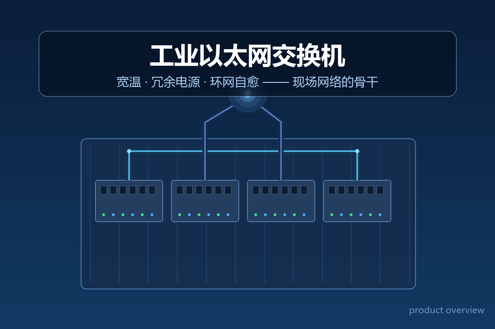
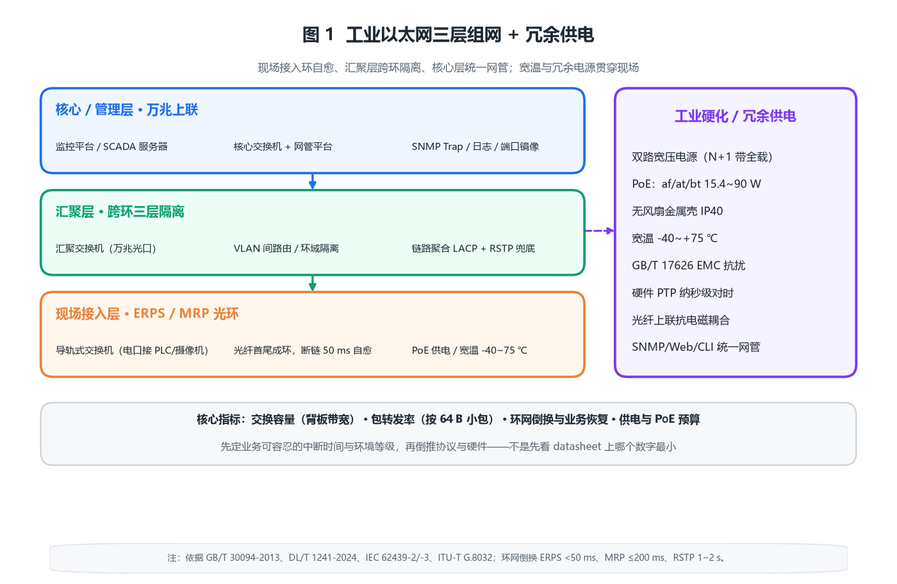
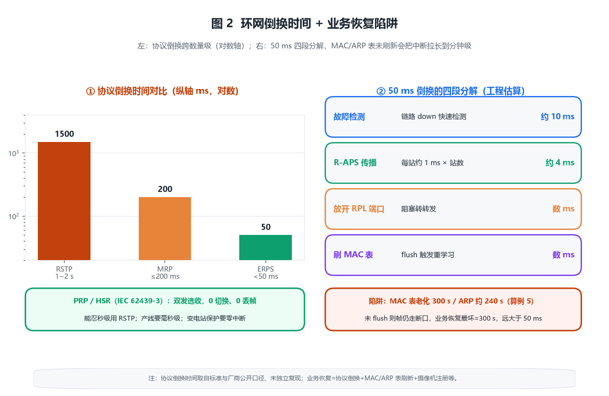
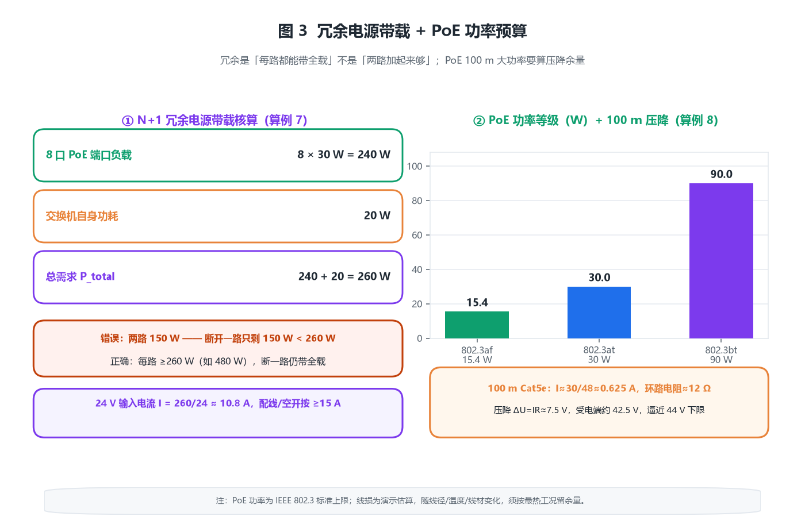
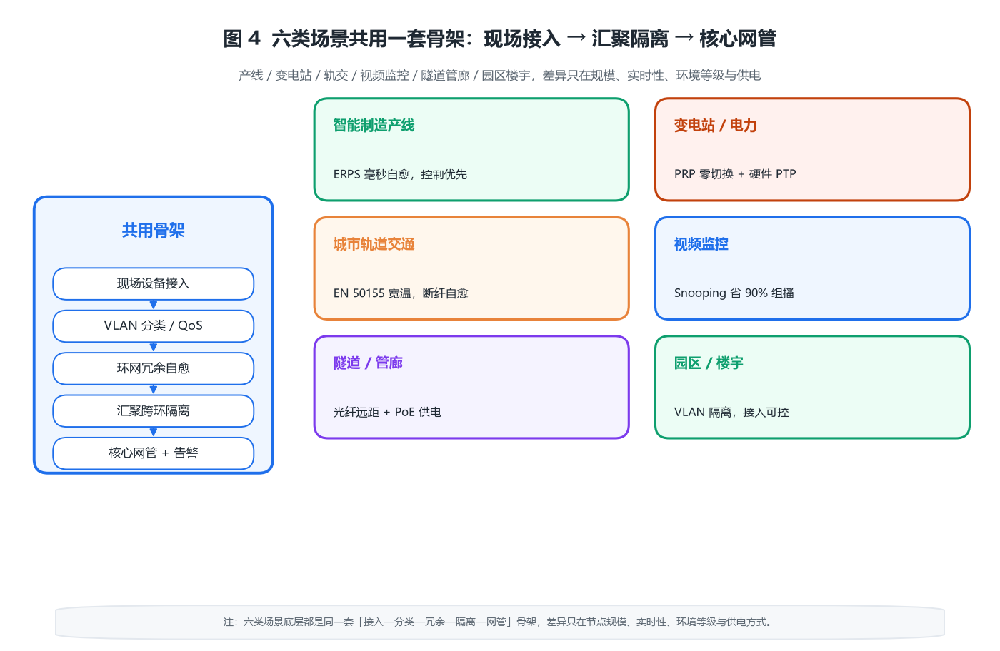

> 
> *概念图：一排 DIN 导轨式工业交换机在机柜里组成光纤环网，向下接摄像机、PLC 与仪表，向上经万兆光口汇聚到核心；环形链路上一点断开，数据自动绕行另一条路径。示意图。*

# 工业以太网交换机产品综述

## · 面向工程端

---

## 〇 一句话定位

工业以太网交换机（工程上常称「工业交换机」「工业级以太网交换机」「industrial Ethernet switch」「导轨式交换机」「网管型工业交换机」）是**为现场机柜、变电站、产线、轨交、隧道等严苛环境设计的以太网交换机：它用宽温无风扇硬件、冗余电源、IP40 金属外壳与强 EMC 抗扰度扛住现场的物理与电磁环境，用 RSTP / MRP / ERPS（G.8032）/ PRP / HSR 等冗余协议在链路断开时快速自愈，用 VLAN / QoS / IGMP Snooping / 端口隔离把视频、控制、办公流量分门别类地送到位**。它一端用百兆/千兆电口接摄像机、PLC、传感器与执行器，另一端用千兆/万兆光口上联汇聚，把分散在现场的设备连成一张「断一处不瘫痪」的网络。**它买的不是「一个更多网口的盒子」，而是「在强电磁、宽温、无人值守的现场，网络断了能自己爬起来、且关键流量不被挤掉」的确定性**——交换容量与包转发率决定能不能线速、环网协议与转发表刷新决定断链后多久恢复、电源与 PoE 预算决定带载能不能扛满、EMC 与温度设计决定它在夏天闷热机柜里会不会悄悄降频甚至死机。

> 本系列 network 类首篇。与已写的《网络摄像机（IPC）》管的是**前端取像**、《视频存储服务器》管的是**后端集中存储**、《分布式坐席节点》管的是**桌面交互层**不同：本篇只写**承载这一切的「网络骨干本体」**——数据怎么被转发、断链怎么自愈、带宽怎么算、供电怎么配。一句话区分：**IPC 管「图像从哪来」，存储服务器管「录像存哪去」，交换机管「这些数据靠什么通道、断了还能不能通」**。

> **反直觉点一：「支持 ERPS / MRP」的标签，不等于两台交换机能组同一个环。** RSTP 是 IEEE 开放标准、跨厂商好但收敛慢（1~2 秒）；MRP（IEC 62439-2）绑定 PROFINET / 自动化阵营；ERPS（ITU-T G.8032）才是运营商级开放标准，跨品牌可组环；而 Turbo Ring / SW-Ring / DT-Ring / HiperRing 都是各家私有协议。**私有环与标准环混在一个二层里没做 VLAN/路由隔离，两边的环路检测会互相打架、来回开断端口反而制造环路**（算例 4、5）。招标写「支持环网」四个字的信息量约等于零，要写清协议标准、节点数上限、跨品牌互通与倒换测法。

> **反直觉点二：50 ms 是「协议倒换时间」，不是「业务恢复时间」。** ERPS 的 R-APS 报文做到 50 ms 内放开阻塞端口，但交换机 MAC 地址表默认老化 300 秒——倒换后若不主动 flush，帧仍往断掉的旧端口发，业务中断可能从 50 ms 劣化到分钟级；网关侧 ARP 表（约 240 秒）同理，摄像机重新注册、TCP 会话重连也要额外时间。**验收要盯「业务恢复」而不是 datasheet 上的「协议倒换」**（算例 5）。

> **反直觉点三：宽温、冗余电源、MTBF「5 万小时」多半是纸面参数。** MTBF 通常是 25 ℃ 环境下的理论计算值，按近似的 10 ℃ 法则，75 ℃ 相对 25 ℃ 失效率可放大约 32 倍；「-40~75 ℃」能通过测试，不代表夏季无空调机柜里核心芯片不出现局部热点、不触发降频。PTP 时钟精度同理——软件时间戳在满载时受 CPU 调度抖动会从微秒级退化到毫秒级，电力保护里是致命的。**要问的是「满载线速下、额定温度上限时的实测指标」**（算例 12、13）。

> **反直觉点四：「线速转发」要看小包，背板带宽能信、吞吐量难测。** 交换容量（背板带宽）按「端口数 × 速率 × 2」算得出、厂商也愿意标；但包转发率要按 64 字节最小包算——千兆口线速是 1.488 Mpps、万兆口 14.88 Mpps。用大包（1500 B）测出来的「线速」一遇 64 B 小包（控制报文、心跳、报警）就丢包。**24 口千兆要有 35.71 Mpps、24 千兆+4 万兆要有约 95 Mpps 包转发率，才可称全端口小包线速**（算例 2、3）。

**锚定数字**（均有公开标准或稳定来源可查）：**GB/T 30094-2013**《工业以太网交换机技术规范》（现行国家标准，含安全功能表、风暴抑制最小粒度 64 kb/s、802.1X / SSH / SNMPv3 要求）／ **DL/T 1241-2024**《电力工业以太网交换机技术规范》（2024-05-24 发布、2024-11-24 实施，代替 DL/T 1241-2013，SAC/TC 82 归口、国家能源局主管，适用于变电站、发电厂、控制中心、开闭所的二层交换机）／ **IEC 62439-2（MRP）**、**IEC 62439-3（PRP / HSR 零切换）**／ **ITU-T G.8032（ERPS，v2 支持多环互联与子环）**／ **IEEE 802.1D-2004 / 802.1w（RSTP）、802.1Q（VLAN）、802.1p（QoS）、802.1X、802.3ad（LACP）、802.3af/at/bt（PoE）**／ **IEEE 1588v2（PTP 精确时钟）**／ **IEC 61850-3 与 IEEE 1613**（变电站通信设备的环境与 EMC 要求）／ **EN 50155:2021**（轨道交通车载电子设备，-40~+70 ℃，配合 EN 50121 / EN 45545）／ **GB/T 17626 系列**（静电放电、电快速瞬变脉冲群、浪涌、工频磁场等 EMC 抗扰度试验）／ 典型工程参数（宽温 -40~+75 ℃ 或 -40~+85 ℃、IP40 金属外壳、9.6~60 VDC 或 85~264 VAC 宽压输入、双/三路冗余电源、DIN 导轨/机架/壁挂、无风扇散热）均来自厂商公开口径，**厂商性能口径均未独立复现，须按统一测法现场验收**。所有工程量为**工程基准 / 演示估算**，以设备实测与现行有效版本原文为准。

---

## 一、产品设计方案

### 1.1 系统组成：三层网络 + 四类角色 + 一套冗余机制

一套工业以太网组网在工程上由三层网络、四类设备角色构成，核心是「现场接入可靠、汇聚冗余、核心可管」：

- **现场接入层（百兆/千兆电口 + 光口环网）**：工业交换机挂在机柜里，用 RJ45 电口接摄像机、PLC、传感器、仪表，用 SFP 光口把相邻交换机串成 ERPS / MRP 环——**一根光纤断了，环网在 50 ms 内绕行另一侧**（算例 4、5）。
- **汇聚层（千兆/万兆光口）**：把若干接入环汇聚上行，承担跨环流量的三层转发与 VLAN 间路由；接入环与汇聚环的交汇处要用支持三层转发的设备做隔离，避免不同冗余协议在同一二层里互相干扰（算例 6）。
- **核心/管理层（万兆上联 + 网管平台）**：核心交换机接服务器、监控平台、SCADA，通过 SNMP / Web / CLI / CLI-Over-SSH 统一网管，做 QoS 策略、端口镜像、日志与告警。
- **四类角色**：非网管型（即插即用，小单元）、网管型二层（VLAN/QoS/环网，主流）、三层路由型（跨网段、环间隔离）、PoE 供电型（给摄像机/AP/电话供电，算例 7、8）。

### 1.2 三种部署形态

| 形态 | 做法 | 适用 | 工程取舍 |
|------|------|------|----------|
| 链/树形（非网管或 RSTP） | 交换机级联，RSTP 防环 | 小规模、对中断不敏感 | 便宜简单；RSTP 收敛 1~2 s，断链时 PLC 会话可能已超时（算例 4） |
| 单环冗余（ERPS / MRP） | 光纤首尾相接成环，阻塞一段做备用 | 产线、隧道、园区骨干（主流） | 50~200 ms 自愈、成本低；单环节点数有上限，需规划 RPL 位置（算例 4、6） |
| 双网并行（PRP / HSR） | 每帧双发选收，两条网并行 | 变电站 GOOSE/SMV、零中断场合 | 零切换、零丢帧；需双网卡、带宽翻倍、成本高（算例 4） |

工程上先分清「允许断多久」：办公监控能忍秒级，用 RSTP 甚至非网管即可；产线急停、路口信号、变电站保护要求毫秒级甚至零中断，才上 ERPS / MRP 或 PRP / HSR。**先定业务可容忍的中断时间，再倒推协议与拓扑，而不是先看 datasheet 上哪个数字最小**。

### 1.3 一次「摄像机帧到监控平台」的七个动作

```
① 接入：摄像机经 RJ45 电口进接入交换机，端口按 VLAN 打标（视频/控制/办公分离）
② 分类：802.1p / DSCP 给视频流与报警流打优先级，QoS 队列保证关键流量优先
③ 组播处理：若用组播，IGMP Snooping 只把流发给申请端口，不泛洪全网（算例 10）
④ 环网转发：帧沿环的正向走；正常时 RPL（环保护链路）阻塞，避免成环广播风暴
⑤ 故障倒换：光纤断开 → 相邻节点 R-APS 通知 → 放开 RPL → MAC 表 flush → 业务恢复（算例 4、5）
⑥ 汇聚上联：经千兆/万兆光口上联汇聚层，必要时跨环走三层转发隔离冗余域（算例 6、14）
⑦ 网管回环：SNMP Trap / 继电器告警把断链事件上报平台，端口镜像做在线排障
```

### 1.4 系统架构图


*图 1：工业以太网三层组网——现场接入环（ERPS/MRP，电口接摄像机与 PLC、光口成环）、汇聚层（跨环三层隔离）、核心管理层（万兆上联 + 网管平台）；冗余电源与 PoE 供电贯穿现场层。*

---

## 二、核心参数与选型

### 2.1 关键参数清单（工程基准）

下表为招标文件常见技术要求与工程基准（厂商口径已标注，未独立复现），具体以厂家 datasheet、现行标准原文与现场实测为准：

| 参数 | 典型区间 / 要求 | 选型含义 |
|------|----------------|----------|
| 标准符合 | GB/T 30094-2013；电力加 DL/T 1241-2024；轨交加 EN 50155:2021 | 按行业指定，不以泛泛的「工业级」代替（算例 13） |
| 交换容量（背板带宽） | 端口数 × 速率 × 2（全双工）；如 24×1G×2 = 48 Gbps | 标称值应 ≥ 全端口线速需求（算例 1、3） |
| 包转发率 | 千兆口 1.488 Mpps、万兆口 14.88 Mpps（64 B 小包） | 按最坏小包核算，不能只看大包吞吐（算例 2、3） |
| 环网协议 | RSTP（1~2 s）/ MRP（≤200 ms）/ ERPS（<50 ms）/ PRP、HSR（0 切换） | 按业务可容忍中断倒推；跨品牌互通看开放标准（算例 4、5） |
| 环网规模 | ERPS 单环工程建议 ≤16 台；MRP 规范上限 50 台 | 超规模拆多环，交汇处三层隔离（算例 6） |
| 端口配置 | 百兆/千兆 RJ45 + SFP/SFP+ 光口；预留 20~30% 备用 | 现场段百兆够用、上联千兆/万兆，光口抗电磁隔离（算例 14） |
| 供电 | 9.6~60 VDC 或 85~264 VAC 宽压；双/三路冗余 | 每路电源按能带满载设计（N+1），算 PoE 总预算（算例 7） |
| PoE 能力 | 802.3af 15.4 W / 802.3at 30 W / 802.3bt 90 W（端口） | 供电总预算 = 各端口功率之和 + 自身功耗，留余量（算例 7、8） |
| 环境 | -40~+75 ℃（部分 -40~+85 ℃）、IP40 金属壳、无风扇、5~95% 无凝露 | 按安装点极端温度与散热条件选型（算例 13） |
| EMC | GB/T 17626 系列（ESD/EFT/浪涌/磁场）、IEC 61850-3、IEEE 1613 | 强电磁场场景要行业认证，不是泛泛「工业级」（算例 13） |
| 时钟同步 | IEEE 1588v2 PTP，硬件时间戳 ns 级；软件时间戳易退化 | 电力采样值同步要求 ≤1 μs，认硬件时间戳（算例 12） |
| 组播/风暴 | IGMP Snooping、风暴抑制粒度最小 64 kb/s（GB/T 30094） | 视频组播必开 Snooping，广播抑制阈值按业务基线设（算例 10、11） |
| 安全 | 802.1X / ACL / SSH / SNMPv3 / 端口绑定；MACsec/IPsec（GB/T 30094 表 32） | 控制网与视频网隔离，管理口加固（GB/T 30094、算例 14） |

### 2.2 十四个原创工程算例

下面每一条都是定容量、算转发、选协议、配供电、做隔离时要真算的账，标号贯穿正文。参数按「工程基准 / 演示估算 / 厂商口径」给出，以设备实测为准。

**【算例 1】交换容量（背板带宽）——先把「线速」的上界定出来**

全双工下每个端口同时收+发，交换容量按端口数、速率与全双工系数 2 相乘：

$$C_{\text{switch}}=\sum_i n_i \times R_i \times 2$$

一台 24 口千兆电口 + 4 口万兆光口的汇聚交换机：

$$C=24\times1\ \text{Gbps}\times2+4\times10\ \text{Gbps}\times2=48+80=128\ \text{Gbps}$$

一台 16 口千兆 + 2 口千兆光的小型导轨机：$C=18\times1\times2=36$ Gbps。**结论：交换机标称交换容量应 ≥ 全端口同时线速的值，否则高负载时必然阻塞；交换容量是能对账的数字，但只是第一关**（算例 3）。

**【算例 2】1.488 Mpps 的来历——为什么线速要按 64 字节最小包算**

包转发率以 64 B 最小帧为基准，加上 8 B 前导码+帧起始定界符、12 B 帧间隙，共 84 B 开销。千兆口线速包数：

$$pps=\frac{10^9\ \text{bps}}{8\times(64+8+12)\ \text{bit}}=\frac{10^9}{8\times84}=1{,}488{,}095\ \text{pps}\approx1.488\ \text{Mpps}$$

百兆口是其十分之一 0.1488 Mpps，万兆口是其十倍 14.88 Mpps。**结论：用 1500 B 大包测出的吞吐没有意义——控制心跳、报警、ARP 都是小包，线速能力必须按 64 B 算**（算例 3、4）。

> 
> *图 2：左——RSTP / MRP / ERPS / PRP 的倒换时间对比（对数轴）；右——50 ms 倒换的四段分解，以及 MAC/ARP 表未刷新导致业务中断被拉长的陷阱。*

**【算例 3】全端口小包线速校验——两个门槛都要过**

延续算例 1 的 24 千兆 + 4 万兆机型，包转发率需求：

$$P=24\times1.488+4\times14.88=35.712+59.52=95.232\ \text{Mpps}$$

即该机要同时满足「交换容量 ≥128 Gbps」与「包转发率 ≥95 Mpps」才算全端口小包线速。若厂家只标交换容量 128 Gbps 而包转发率写 40 Mpps，说明万兆口在小包场景下无法同时线速。**结论：招标要同时写两个指标，且明确测试帧长（64 B）与全端口负载条件**（算例 1、2）。

**【算例 4】环网倒换 50 ms 花在哪——四段分解与协议选型**

以 ERPS（G.8032）为例，一次倒换时间近似：

$$t_{\text{swap}}=t_{\text{detect}}+t_{\text{R-APS}}+t_{\text{unblock}}+t_{\text{flush}}$$

| 段 | 典型量级（工程估算） | 说明 |
|----|-------------------|------|
| 故障检测 $t_{\text{detect}}$ | 链路 down 快速检测，~10 ms | 靠物理层载波丢失，不靠慢 hello |
| 协议传播 $t_{\text{R-APS}}$ | 每站约 1 ms × 站数 | R-APS 沿环逐跳传递（算例 6） |
| 放开阻塞端口 $t_{\text{unblock}}$ | 数 ms | RPL 端口由阻塞转转发 |
| 转发表刷新 $t_{\text{flush}}$ | 数 ms | flush MAC 表触发重新学习 |

四段加起来能压到 50 ms 内。协议对照：**RSTP 1~2 s**（收敛慢，PLC 会话可能已超时）、**MRP ≤200 ms**（PROFINET 规划目标，典型 30~80 ms，小环可进 10 ms）、**ERPS <50 ms**（运营商级开放标准）、**PRP/HSR 0 ms 零切换**（双发选收，每帧走两网，无倒换过程）。**结论：先定业务可容忍中断时间——监控可忍秒级，产线急停要毫秒级，变电站保护要零中断**（算例 5、6）。

**【算例 5】业务恢复 ≠ 协议倒换——MAC/ARP 表老化的隐藏账**

交换机 MAC 地址表默认老化时间约 300 秒，网关 ARP 表约 240 秒。环网倒换 50 ms 完成后，若 R-APS 报文没带 flush 机制（或不同厂商实现不一致），交换机仍按旧表把帧往断掉的端口发，业务要等表项自然老化才通：

$$t_{\mathrm{service}}=t_{\mathrm{swap}}+t_{\mathrm{flush-tab}}$$

最坏情况 = 50 ms + 300 s ≈ 300 s，比协议倒换劣化约 6000 倍。ERPS 的 R-APS 带 flush 触发、RSTP 发拓扑变更通知（TCN），但各厂商处理差异大——**「倒换后等一两分钟才通」多半是这段没处理干净**。排查顺序：先看 MAC 表有没有及时清、再看 ARP 表、最后看摄像机注册与 TCP 重连。**结论：验收指标写「业务恢复时间实测值」，不是 datasheet 的「协议倒换时间」**（算例 4）。

**【算例 6】单环挂多少台——节点数对倒换时间的线性影响**

ERPS 单环工程建议 ≤16 台（非硬上限），MRP 规范上限 50 台（PROFINET 规划指南）。R-APS 沿环逐跳，每多一台多一跳，倒换时间近似线性增长：

$$t_{\text{R-APS}}\approx N\times t_{\text{hop}}$$

按每站 1 ms：16 站约 16 ms，加上检测与 flush 落在 50 ms 内；48 站约 48 ms，已逼近甚至越过 50 ms 红线。**超规模的两种拆法**：① ERPS v2 多环互联，子环挂主环；② 环形只跑接入，汇聚层用双上行 + 链路聚合（LACP）+ RSTP 兜底。**关键隔离**：MRP 环与 ERPS 环若没做 VLAN/三层隔离就接在同一二层，两边环路检测会互相打架、错误开断端口反而起环——交汇处放三层设备用路由隔开（算例 14）。

**【算例 7】冗余电源 + PoE 功率预算——每一路电源都要能带满载**

以 8 口 PoE 交换机（802.3at，每口 30 W）+ 自身功耗 20 W 为例：

$$P_{\text{total}}=8\times30+20=260\ \text{W}$$

双电源冗余（N+1）的含义是**任意一路电源断开，剩下那路要能独立带 260 W**——所以不能选两路 150 W 就以为冗余了（断开一路只剩 150 W < 260 W），应选每路额定 ≥260 W（如 480 W）留余量。24 VDC 输入时电流 $I=260/24\approx10.8$ A，配线与空开按 ≥15 A 设计。若换 802.3bt 90 W × 4 口：$4\times90+20=380$ W，需 500 W 级电源。**结论：PoE 预算 = 各端口功率之和 + 自身功耗 + 余量；冗余是「每路都能带全载」，不是「两路加起来够」**（算例 8）。

**【算例 8】PoE 100 m 线损压降——供电距离不是 label 上写的那么满**

PoE 受电端电压有下限（802.3at 约 44 V），供电端较高（约 50~57 V），中间压差要覆盖网线电阻损耗。100 m Cat5e 用两对线供电，环路电阻典型约 12 Ω（演示估算，随线径/温度变）：

$$I\approx\frac{P}{V}=\frac{30\ \text{W}}{48\ \text{V}}\approx0.625\ \text{A},\qquad \Delta U=I\times R\approx0.625\times12\approx7.5\ \text{V}$$

即受电端约 $50-7.5=42.5$ V，已逼近 44 V 下限——**长距离 + 大功率 + 细线径 + 高温叠加时，受电设备会间歇掉电重启**。工程余量：① 尽量用 23AWG 粗线、缩短距离；② 高功率设备就近供电或用本地电源；③ 核算时按最热工况的线阻。**结论：PoE 的 100 m 是标准上限，不是任何线材/温度/功率下都能跑满**（算例 7）。

**【算例 9】光模块链路预算——20 km 单模能不能通，要算 dB**

单模 1310 nm 光纤衰减典型 0.35 dB/km，20 km 线路 7 dB；两个 LC 连接器各 0.5 dB，共 1 dB；光模块发射功率 -5 dBm、接收灵敏度 -22 dBm，可用预算 17 dB：

$$L_{\text{total}}=20\times0.35+2\times0.5=8\ \text{dB}<17\ \text{dB},\qquad \mathrm{margin}=17-8=9\ \text{dB}$$

余量 9 dB 充足。若换 40 km：线路 14 dB + 连接 1 dB = 15 dB，余量只剩 2 dB（工程建议 ≥3 dB），需更低衰减的光纤或更好的模块，并预留老化与温漂余量。**结论：光口选型按「发射-灵敏度-线路衰减-连接器-余量」逐项对账，别只看「支持 20 km」的标称**（算例 14）。

**【算例 10】IGMP Snooping 的带宽节省——组播不治理会吃光交换资源**

25 路网络摄像机用组播推流，每路 4 Mbps，合计 100 Mbps。若交换机未开 IGMP Snooping，组播按未知目的在 VLAN 内所有端口泛洪——一台 24 口交换机上，除入端口外 23 个端口各收到这 100 Mbps，交换量：

$$B_{\mathrm{flood}}=23\times100=2300\ \mathrm{Mbps}$$

开启 Snooping 后只有申请该组的 2 个监控客户端端口收到：

$$B_{\mathrm{ctrl}}=2\times100=200\ \mathrm{Mbps},\qquad \mathrm{saving}=1-\frac{200}{2300}\approx91.3\%$$

**结论：视频组播场景必开 IGMP Snooping + 组播 VLAN，否则汇聚上联口与非订阅端口被无关组播淹没**（算例 11）。

**【算例 11】广播风暴抑制阈值——按业务基线设，别照抄默认值**

GB/T 30094-2013 要求风暴抑制粒度最小可到 64 kb/s。千兆端口 1 Gbps，若设 1% 阈值即 10 Mbps = 156 个 64 kb/s 粒度。 storm 抑制设得过松（如 50%）等于没设——广播风暴一起就冲垮控制网；设得过紧（如 64 kb/s）会掐断正常 ARP、DHCP、组播发现。工程做法：先测正常业务下广播/组播的峰值基线 $B_{\text{base}}$，按 $2\sim3\times B_{\text{base}}$ 设阈值并留告警。**结论：抑制阈值是「允许的正常广播 × 系数」，不是拍一个百分比；端口隔离与 VLAN 先从源头缩小广播域**（算例 14）。

> 
> *图 3：左——N+1 冗余电源的带载核算（每路都要能带全载 260 W）；右——PoE 端口功率预算与 100 m 线损压降示意。*

**【算例 12】PTP 时钟精度——硬件时间戳与软件时间戳差三个数量级**

IEEE 1588v2 的同步精度取决于时间戳在哪一层打：PHY/MAC 层硬件时间戳可达亚微秒乃至纳秒级（<100 ns），软件时间戳在 CPU 里打标，满载时被调度抖动拖到毫秒级——变电站采样值（SMV）同步要求 ≤1 μs（DL/T 860.93 / IEC/IEEE 61850-9-3），软件时间戳根本不达标。再看晶振漂移：20 ppm 的晶振若 1 秒未同步：

$$\Delta t=20\times10^{-6}\times1\ \text{s}=20\ \mu\text{s}\gg1\ \mu\text{s}$$

所以必须靠 PTP 周期性同步把误差拉回，而同步间隔内的抖动由硬件时间戳决定。**结论：电力/运动控制场景认「硬件时间戳 + 满载实测抖动」，软件 PTP 只能用于对精度不敏感的场景**（算例 13）。

**【算例 13】宽温与 MTBF 降额——「5 万小时」在 75 ℃ 还成立吗**

厂商标称 MTBF 5 万小时通常是 25 ℃ 环境下的理论计算值（Telcordia / MIL-HDBK-217 类模型）。按近似的 10 ℃ 法则（温度每升 10 ℃ 失效率约翻倍），75 ℃ 相对 25 ℃ 升 50 ℃：

$$MTBF(75^\circ\text{C})\approx\frac{50{,}000}{2^{50/10}}=\frac{50{,}000}{32}\approx1{,}562\ \text{h}$$

这是**演示估算、非认证结论**，只为说明方向：高温下失效率可放大一个数量级以上；「-40~75 ℃ 通过测试」不等于满载时机柜内不出现局部热点。无风扇金属外壳靠导热散热，密闭机柜、阳光直晒、灰尘堵住散热面都会让核心芯片超温降频。**结论：问「额定温度上限 + 满载 + 密闭机柜」下的实测壳温与降频曲线，而不是 25 ℃ 的 MTBF 数字**（算例 12）。

**【算例 14】汇聚带宽与广播域核算——200 路摄像机怎么分层**

200 路 4 MP 摄像机、H.265 单路 4 Mbps，总码流：

$$B_{\mathrm{total}}=200\times4=800\ \mathrm{Mbps}$$

按 25 路/台接入，需 8 台 24 口接入交换机，每台接入约 100 Mbps；每台以千兆光口上联，汇聚层汇总 800 Mbps，按 1.3 倍峰值余量需 ≥1.04 Gbps——单千兆上联不够，汇聚层用万兆上联（10 Gbps）富余。广播域规划：把视频、控制、办公划成 3 个 VLAN，一个 24 口交换机的广播域从「1 个 24 口」缩成「3 个 8 口」，广播/风暴被限制在域内；管理 VLAN 单独隔离，接入端口开 802.1X + MAC 绑定防私接。**结论：带宽按「终端数 × 单路码流 × 峰值系数」分层核算并留上联余量，广播域用 VLAN + 端口隔离从源头收敛**（算例 6、10）。

---

## 三、技术原理

### 3.1 二层转发：MAC 学习与存储转发

交换机工作在 OSI 第二层，靠 MAC 地址表决定帧从哪个端口出：收到帧时记录「源 MAC ↔ 入端口」（学习），查「目的 MAC」对应的端口转发（已知单播定向转发、未知则泛洪）。工业交换机多采用**存储转发（store-and-forward）**——收齐整帧、校验 CRC 无误再转发，牺牲几微秒时延换取不转发坏帧；少数低时延场景用**直通（cut-through）**——读到目的 MAC 就转发，时延更低但会传坏帧。过程控制里数据完整性优先，存储转发是主流。**关键点**：MAC 表容量、老化时间与 flush 机制直接决定环网倒换后业务多快恢复（算例 5）。

### 3.2 冗余环网：从生成树到零切换

- **RSTP（IEEE 802.1w）**：全网选根桥、算无环树，阻塞冗余链路；断链时重新收敛，1~2 秒。跨厂商兼容最好，适合能忍秒级的场合。
- **MRP（IEC 62439-2）**：一台 MRC 管理器控环，其余为客户端，只看链路状态；确定性收敛（PROFINET 规划 ≤200 ms，小环更快），但偏自动化阵营。
- **ERPS（ITU-T G.8032）**：RPL  owner 阻塞一条保护链路，故障时相邻节点发 R-APS 通知全网放开 RPL 并 flush MAC 表，<50 ms；v2 支持多环互联与子环，是运营商级开放标准，跨品牌可组环。
- **PRP / HSR（IEC 62439-3）**：每帧复制两份走两张独立网，接收端按序号去重（PRP 双网独立、HSR 环上双发），任一网断都不丢帧、零切换；代价是双网卡与双倍带宽。
**原理护城河**：环网只解决「单点链路故障」，解决不了「交换机整机故障」「双点同时断」「配置错误成环」——这些要靠双归属、三层隔离与网管告警兜底（算例 4、6）。

### 3.3 服务质量与组播治理

**QoS（802.1p / DSCP）**给不同业务打优先级、进不同队列：视频流、报警与控制报文优先，普通办公流量靠后，拥塞时关键流量不被挤掉。**VLAN（802.1Q）**把一个物理网络切成多个逻辑广播域，视频/控制/办公互不干扰，也是隔离不同冗余协议域的手段（算例 6、14）。**IGMP Snooping**监听主机与组播路由器之间的 IGMP 报文，建立「组播组 ↔ 成员端口」表，组播只发给申请者，不泛洪——视频监控规模组网的关键（算例 10）。**风暴抑制**对广播/组播/未知单播限速，防止环路或病毒制造广播风暴（算例 11）。

### 3.4 工业硬化：宽温、电源、EMC 与时钟

**宽温与散热**：工业级器件选 -40~+75 ℃（部分 +85 ℃），无风扇金属外壳靠导热与对流散热，避免风扇这个易损件；但不是所有标称宽温的设备都能在满载高温下不降频（算例 13）。**冗余电源**：双/三路宽压输入（9.6~60 VDC 或 85~264 VAC），任一路故障不影响运行，每路按能带全载设计（算例 7）。**EMC**：GB/T 17626 系列的静电放电、电快速瞬变脉冲群、浪涌、工频磁场等抗扰度试验，变电站还要 IEC 61850-3 / IEEE 1613 的强电磁瞬变适应性；现场强电磁环境下优先光纤上联，电口做好屏蔽接地（算例 9、13）。**时钟同步**：IEEE 1588v2 PTP 用硬件时间戳做纳秒级对时，支撑变电站 SMV/GOOSE 的采样同步与事件顺序记录（算例 12）。

---

## 四、产品功能与差异化

| 功能维度 | 非网管型 | 网管型二层（主流） | 三层路由型 |
|----------|---------|-------------------|-----------|
| VLAN / QoS | 无 | 有（802.1Q / 802.1p） | 有 + 三层 QoS |
| 环网冗余 | 无或仅 RSTP | RSTP / MRP / ERPS | + 跨环三层隔离、OSPF/静态路由 |
| 组播治理 | 无 | IGMP Snooping / GMRP | + 组播路由 |
| 网管 | 无 | Web / CLI / SNMP / Syslog | + RMON、配置备份、双镜像 |
| 安全 | 基础 | 802.1X / ACL / 端口绑定 / SSH / SNMPv3 | + MACsec / IPsec（GB/T 30094 表 32） |
| 供电 | 电口或 PoE | 宽压 + 冗余电源 + PoE 管理 | 同左 |

**差异化落点**：① 环网协议的开放性与跨品牌互通（ERPS vs 私有环）；② 工业硬化指标的真实余量（温度、EMC、电源，而非纸面参数）；③ 网管与诊断的深度（端口镜像、告警继电器、配置自动备份）；④ 时钟同步能力（硬件 PTP，电力/轨交刚需）；⑤ PoE 供电预算与治理能力。选型时按「业务中断容忍度 × 环境严苛度 × 运维要求」三维打分，不为用不上的功能买单。

---

## 五、应用场景


*图 4：六类场景共用一套骨架——现场接入（环网）→ 汇聚（跨环隔离）→ 核心（网管），差异只在节点规模、实时性、环境等级与供电方式。*

| 场景 | 痛点 | 方案 | 价值 |
|------|------|------|------|
| 智能制造产线 | 网络断一下 PLC 会话超时、产线停摆 | ERPS 环网 + QoS 优先控制流 + 冗余电源 | 毫秒级自愈，急停与控制不中断（算例 4） |
| 变电站 / 电力 | 强电磁瞬变、采样同步要求 ≤1 μs | IEC 61850-3 交换机 + PRP/HSR + 硬件 PTP | 零切换、精确对时、抗强干扰（算例 12、13） |
| 城市轨道交通 | 车载宽温振动、隧道光纤长距离 | EN 50155 交换机 + ERPS 环 + 光纤链路预算 | 抗振宽温、断纤自愈（算例 9） |
| 视频监控 / 平安城市 | 几百路组播泛洪、上联带宽吃紧 | IGMP Snooping + VLAN + 万兆上联 | 节省 90%+ 组播交换量（算例 10、14） |
| 隧道 / 管廊 | 无人值守、布线困难、环境潮湿 | 导轨式宽温机 + 光纤环 + PoE 供电 | 少布线、远供电、故障自愈告警（算例 8、9） |
| 园区 / 楼宇弱电 | 视频/控制/办公混跑、私接乱接 | VLAN 隔离 + 端口绑定 + 802.1X | 广播域收敛、接入可控（算例 11、14） |

---

## 六、实际案例与设计方案

### 案例一：汽车焊装产线的 ERPS 环网改造

**需求**：某焊装车间 12 台 PLC 与 40 个 IO 站分布在 3 条产线上，原非网管交换机级联，一次光纤松动导致整线停机 8 分钟。要求单点断链业务恢复 <100 ms，控制流优先，机柜温度夏季可达 60 ℃。

**方案**：12 台网管型导轨交换机（宽温 -40~75 ℃、IP40、双冗余电源）分 3 个 ERPS 环（每环 4 台），经千兆光口接入汇聚交换机；控制 VLAN 与视频 VLAN 分离，控制流打 802.1p 高优先级；汇聚层用三层接口隔离三个环域。

**配置核算**：单环 4 站，R-APS 传播 $4\times1=4$ ms，加检测 10 ms + 放开端口与 flush 数 ms，协议倒换约 20 ms；按算例 5 校验 R-APS 带 flush，MAC 表及时刷新，业务恢复实测 45 ms <100 ms。供电每路电源按全载设计（算例 7），机柜加装散热风扇把壳温压在 65 ℃ 以内（算例 13）。

**交付价值**：单点断纤不再停线，改造后半年内 3 次光纤故障均在 50 ms 级自愈、未触发产线急停；控制与视频 VLAN 隔离后，视频流量高峰不再影响 PLC 通信。

### 案例二：220 kV 变电站的双网零切换通信

**需求**：某 220 kV 变电站按 IEC 61850 三层架构组网，过程层 GOOSE / SMV 要求零丢帧、采样同步 ≤1 μs，站内强电磁瞬变环境，设备需符合 IEC 61850-3 与 IEEE 1613。

**方案**：过程层与间隔层各部署双星型光纤网，IED 用双网卡分别接 A/B 网，跑 PRP（IEC 62439-3）实现零切换；交换机支持 IEEE 1588v2 硬件时间戳 PTP 统一对时；全部光口互联避免电磁耦合，电源取站内 110/220 VDC 冗余输入。

**配置核算**：PRP 双发选收，任一网断零倒换、零丢帧（算例 4）；硬件时间戳 PTP 抖动 <100 ns，20 ppm 晶振靠周期性同步把误差压回 ≤1 μs（算例 12）；光模块按 20 km 单模预算核算，余量 9 dB（算例 9）；EMC 按 GB/T 17626 系列与 IEC 61850-3 选型（算例 13）。

**交付价值**：保护装置通信零中断、事件顺序记录时标准确，通过站内 EMC 与同步精度验收；双网并行后单网检修不影响运行。

### 案例三：智慧城市 200 路视频监控汇聚

**需求**：某园区 200 路 4 MP 摄像机（H.265，4 Mbps/路），原网络组播未治理、汇聚上联拥塞、录像卡顿，要求改造后上联不拥塞、组播不泛洪、故障可告警。

**方案**：按算例 14 分 8 台 24 口接入交换机（25 路/台），千兆光口上联、汇聚层万兆上联；全网站开 IGMP Snooping + 组播 VLAN（算例 10），视频/管理/办公划 3 个 VLAN，广播抑制按业务基线 2 倍设置（算例 11）；接入环跑 ERPS，SNMP Trap 上报告警。

**配置核算**：总码流 800 Mbps，汇聚万兆上联富余（算例 14）；Snooping 后组播交换量从约 2300 Mbps 降到约 200 Mbps、节省 91%（算例 10）；PoE 型接入交换机给摄像机供电，按 24 口 × 30 W + 自身核算电源预算（算例 7）。

**交付价值**：录像卡顿消失、上联带宽占用下降、组播风暴不再扩散；断纤 50 ms 级自愈且平台收到告警，运维从「事后救火」转为「事前感知」。

---

## 七、市场背景与竞争格局

工业以太网交换机市场长期由少数几家深耕工业网络的厂商主导：西门子（SCALANCE 系，绑定 PROFINET 生态）、摩莎 Moxa（Turbo Ring 私有环起家、工业以太网老牌）、赫斯曼 Hirschmann（HiperRing，被博世收购）、三旺、Kyland（DT-Ring）等，近年华为、新华三、锐捷等通用网络厂商也在向工业场景延伸。格局的关键词是「**协议生态 + 行业认证 + 硬化能力**」：

- **协议阵营分化**：PROFINET 体系推 MRP（IEC 62439-2），运营商/交通/能源推 ERPS（G.8032），电力推 PRP/HSR（IEC 62439-3）；厂商私有环（Turbo Ring / DT-Ring / SW-Ring）能锁住客户但跨品牌不通。
- **行业认证是门槛**：变电站要 IEC 61850-3 / IEEE 1613 / DL/T 1241-2024，轨交要 EN 50155:2021 / EN 50121 / EN 45545，通用工业看 GB/T 30094-2013 与 GB/T 17626 系列。
- **国产替代与自主可控**：能源、轨交等关键基础设施推动元器件与软件的自主可控（DL/T 1241-2024 起草单位以国网/南网系与国内厂商为主），国产厂商在电力、轨交细分市场份额上升。
**对工程方的含义**：选型先按行业认证与协议生态圈定候选，再比硬化指标与网管能力；不要被「支持某协议」的标签带偏，要用跨品牌互通实测与统一测法验收（算例 4、13）。

---

## 八、商业模式与趋势

**商业模式**：工业交换机以「硬件销售 + 行业解决方案」为主，毛利来自硬件硬化与行业认证壁垒；配套网管软件、配置备份、现场验收测试与运维服务是增值点；项目型销售（电力/轨交/产线）占比高，招投标按标准与认证设置门槛。

**趋势**：① 时间敏感网络（TSN，IEEE 802.1Qbv 等）把确定性时延引入标准以太网，与工业协议融合；② 单对以太网（IEEE 802.3ch/10BASE-T1S）向现场设备渗透，减少布线；③ 万兆上联与 25G 向工业汇聚层下沉，应对视频与 AI 识别的带宽增长；④ 网络与安全的融合（802.1X、MACsec、零信任接入）成为刚需；⑤ 自主可控与国产化在关键行业持续推进。**对工程端的启示**：今天选的交换机要留有 TSN/万兆升级余地与开放协议接口，避免刚上线就被协议封闭或带宽瓶颈卡住。

---

## 附录 A 核算清单速查

| 核算项 | 公式 / 判据 | 对应算例 |
|--------|------------|----------|
| 交换容量 | $C=\sum n_i R_i\times2$，标称需 ≥ 该值 | 1、3 |
| 包转发率 | 千兆 1.488 Mpps / 万兆 14.88 Mpps，按 64 B 算 | 2、3 |
| 环网倒换 | $t=t_{\text{detect}}+t_{\text{R-APS}}+t_{\text{unblock}}+t_{\text{flush}}$ | 4、6 |
| 业务恢复 | 协议倒换 + MAC/ARP 表刷新（最坏受 300 s 老化拖累） | 5 |
| 单环规模 | ERPS 建议 ≤16 台、MRP 上限 50 台，超出拆环 | 6 |
| 供电预算 | $P=\sum P_{\text{port}}+P_{\text{self}}$，冗余每路带全载 | 7 |
| PoE 压降 | $\Delta U=I R$，100 m 大功率要留余量 | 8 |
| 光链路预算 | 发射 - 灵敏度 - 线路衰减 - 连接器 ≥ 余量（≥3 dB） | 9 |
| 组播节省 | $1-B_{\mathrm{ctrl}}/B_{\mathrm{flood}}$，Snooping 可省 90%+ | 10 |
| 风暴阈值 | 正常广播基线 × 2~3，最小粒度 64 kb/s | 11 |
| PTP 精度 | 硬件时间戳 <1 μs；晶振漂移 $20\ \text{ppm}\to20\ \mu\text{s/s}$ | 12 |
| 高温降额 | 10 ℃ 法则：失效率约翻倍（演示估算） | 13 |
| 汇聚带宽 | 终端数 × 单路码流 × 峰值系数，上联留余量 | 14 |

## 附录 B 术语表

| 术语 | 含义 |
|------|------|
| RPL / R-APS | 环保护链路 / 环自动保护倒换报文（ERPS） |
| ERPS / MRP / PRP / HSR | 以太网环保护（G.8032）/ 媒体冗余（IEC 62439-2）/ 并行冗余 / 高可用无缝冗余（IEC 62439-3） |
| MAC 表 / 老化 / flush | MAC 地址转发表 / 表项超时删除 / 倒换后主动清空触发重学 |
| IGMP Snooping | 监听 IGMP 建立组播成员端口表，抑制组播泛洪 |
| VLAN / QoS / 802.1X | 虚拟局域网 / 服务质量 / 基于端口的网络接入认证 |
| PoE (af/at/bt) | 以太网供电，端口功率上限 15.4 / 30 / 90 W |
| PTP / 硬件时间戳 | 精确时间协议（IEEE 1588v2）/ 在 PHY/MAC 层打时标以获得纳秒级精度 |
| SFP / SFP+ | 千兆 / 万兆光模块插槽 |
| MTBF / 10 ℃ 法则 | 平均无故障时间 / 温度每升 10 ℃ 失效率约翻倍的工程近似 |

## 附录 C 标准索引

| 标准 | 名称 / 作用 |
|------|------------|
| GB/T 30094-2013 | 工业以太网交换机技术规范（现行，安全功能、风暴抑制粒度） |
| DL/T 1241-2024 | 电力工业以太网交换机技术规范（2024-05-24 发布 / 2024-11-24 实施，代替 2013 版） |
| IEC 62439-2 / -3 | MRP 媒体冗余 / PRP-HSR 零切换冗余 |
| ITU-T G.8032 | ERPS 以太网环保护倒换（v2 支持多环互联） |
| IEEE 802.1D-2004 / 802.1w | STP / RSTP 生成树与快速生成树 |
| IEEE 802.1Q / 802.1p / 802.1X | VLAN / 优先级 / 端口接入认证 |
| IEEE 802.3af/at/bt | PoE / PoE+ / PoE++ 供电功率等级 |
| IEEE 1588v2 | PTP 精确时间协议（硬件时间戳） |
| IEC 61850-3 / IEEE 1613 | 变电站通信设备的环境与 EMC 要求 |
| EN 50155:2021 / EN 50121 / EN 45545 | 轨道交通车载电子设备 / 铁路 EMC / 防火 |
| GB/T 17626 系列 | 电磁兼容试验和测量技术（ESD/EFT/浪涌/磁场等） |
| GB/T 22239-2019 | 网络安全等级保护基本要求 |
