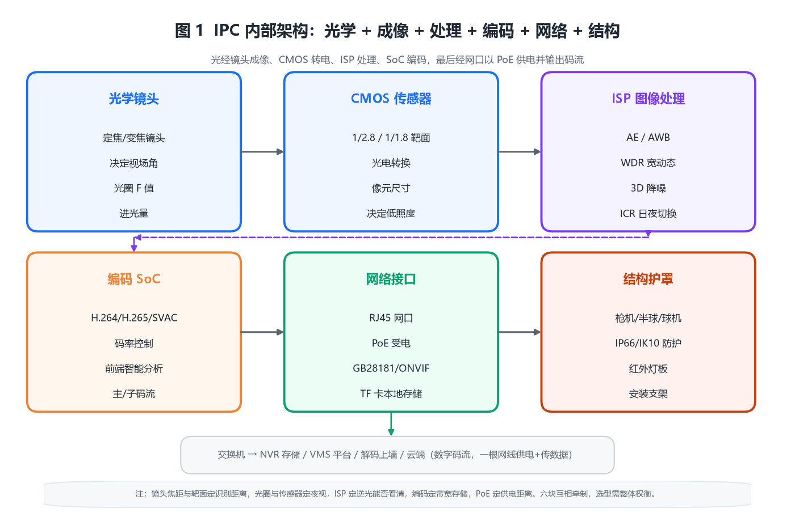
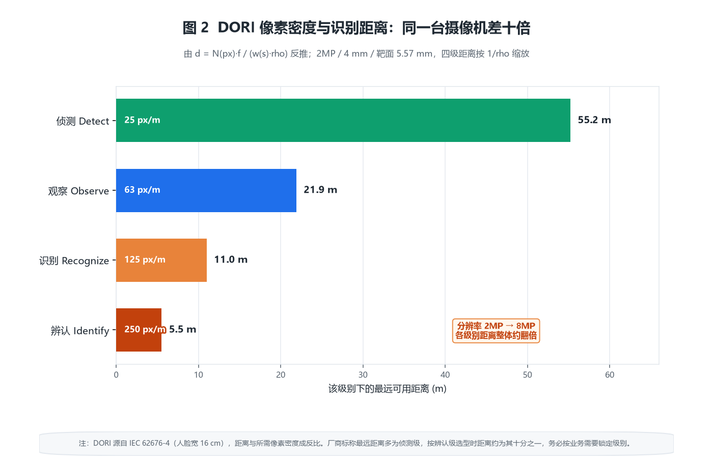
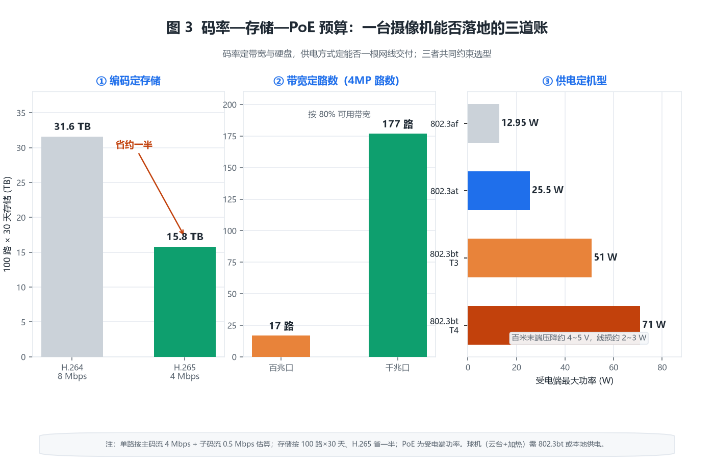
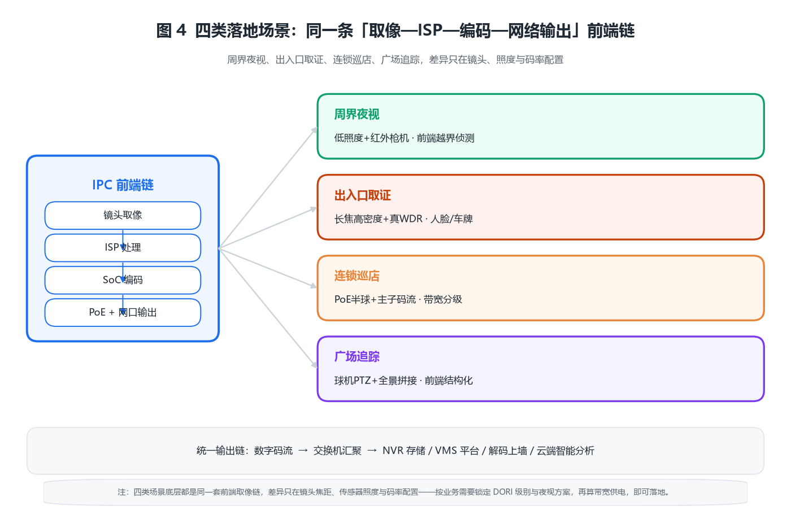

> 
> *概念图：网络摄像机（IPC）在前端完成「取像— ISP 处理—编码—网络输出」，把镜头捕获的光变成网络上可传输、可存储、可分析的码流——整个视频监控系统取像的第一环节。示意图。*

# 网络摄像机（IPC）产品综述

## · 面向工程端

---

## 〇 一句话定位

网络摄像机（IPC，IP Camera / Network Camera）是把**镜头、图像传感器、ISP 图像处理、编码 SoC、网络接口**集成在一台设备里，在前端就完成「采集光学图像 → 图像处理 → 压缩编码 → 打包成网络码流」的取像终端。它输出的是符合 GB/T 28181、ONVIF 等协议的**数字码流**，可直接进交换机、进 NVR、进平台。**它买的是「在指定距离上、指定光照下，把目标拍成可用证据」的能力**——镜头焦距、传感器尺寸、像素密度（DORI）、最低照度、编码码率与带宽，决定了你能看多远、看多清、夜里看不看得到、要占多少带宽和硬盘。

> 本系列已写的《视频监控系统（泛视频监控）技术分析》讲全景（感知/传输/存储/分析各层概览），《网络硬盘录像机（NVR）》讲后端存储，《视频解码器》讲码流上墙，《视频监控管理平台（VMS）》讲平台软件。**本篇只讲最前端这台摄像机本体**：怎么按识别距离选镜头与分辨率、怎么算码率与存储、怎么配 PoE 供电、夜视怎么看、编码器怎么设。四篇文章各管一段，本篇是「取像第一环」。

---

## 一、产品设计方案

### 1.1 内部系统组成

一台 IPC 在工程上由「光学、成像、处理、编码、网络、结构」六块构成：

- **光学镜头**：定焦/变焦镜头，决定视场角与进光量（光圈 F 值）；焦距与传感器尺寸共同决定「在多少米外能把人看清」（算例 1~3）。
- **图像传感器**：CMOS 为主（1/2.8"、1/1.8" 等），把光信号转成电信号；靶面越大、像素越粗，低照度越好（算例 8）。
- **ISP 图像处理**：ISP（Image Signal Processor）做自动曝光 AE、自动白平衡 AWB、宽动态 WDR、3D 降噪、背光补偿、强光抑制——决定「逆光/夜里能不能看清」（3.3 节）。
- **编码 SoC**：把 raw 图像压成 H.264 / H.265 / SVAC 码流，码率控制（CBR/VBR/ROI）与智能分析（越界/人脸/车牌）都在这里跑（算例 10、14）。
- **网络与接口**：RJ45 网口（常带 PoE 受电）、音频/报警 IO、TF 卡本地存储；协议栈支持 GB/T 28181、ONVIF、RTSP（4.2 节）。
- **结构与护罩**：枪机/半球/球机的外壳，IP66/IK10 防护等级，红外灯板与 ICR 日夜切换滤光片（算例 9）。

### 1.2 常见产品形态

| 形态 | 做法 | 适用 | 工程取舍 |
|------|------|------|----------|
| 枪机 / 筒机 | 枪形外壳、镜头外露、可换焦段 | 周界、道路、停车场 | 焦距可选、指向明确，需配防护罩 |
| 半球 / 海螺 | 半球罩、内置定焦/变焦 | 室内走廊、大堂、门店 | 美观隐蔽、防拆，焦距多固定 |
| 球机（PTZ） | 云台 + 光学变焦（如 33×） | 广场、园区巡逻、追踪 | 一台覆盖大范围、可变焦看细节，价高且需云台控制 |
| 全景 / 多目 | 多传感器拼接 180°/360° | 广场、车站、无死角监控 | 视场极大，单目标像素密度低 |
| 专项机型 | 防爆、防水、超低照度、黑光 | 化工、油站、夜间无补光 | 认证与成本高，按需选型 |

工程上先定「看清到什么程度、装在哪里、什么光照」：出入口要识别人脸选长焦高密度机型；大广场要无死角选球机或全景；夜间无补光的周界选大靶面低照度或红外机型。

### 1.3 成像与编码信号链路

```
镜头(光学成像) → CMOS 传感器(光电转换) → ISP(AE/AWB/WDR/降噪)
    → 编码 SoC(H.265/H.264 压缩 + 码率控制) → 打包(RTP/ONVIF/GB28181)
    → 网口(PoE 受电 + 码流输出) → 交换机 → NVR/平台/解码器
```

关键工程点：**焦距与传感器靶面决定识别距离（算例 1~3）、光圈与照度决定夜间可用性（算例 8）、编码码率决定带宽与存储（算例 4、5）、PoE 决定供电距离与预算（算例 6）**——这四个约束互相牵制，是选型与计算的全部核心。

### 1.4 系统架构图


*图 1：IPC 六块——光学镜头、CMOS 传感器、ISP 图像处理、编码 SoC、网络接口、结构护罩；光经镜头成像、传感器转电、ISP 处理、SoC 编码，最后经网口以 PoE 供电 + 码流输出。*

---

## 二、核心参数与选型

### 2.1 关键参数清单（工程基准）

| 参数 | 典型区间 | 选型含义 |
|------|----------|----------|
| 分辨率 | 2MP(1920×1080) / 4MP(2560×1440) / 8MP(3840×2160) | 决定像素密度上限与带宽/存储压力 |
| 传感器靶面 | 1/2.8" / 1/1.8" / 1" | 靶面越大低照度越好、成本越高 |
| 焦距 | 2.8 / 4 / 6 / 8 / 12 mm（定焦）；变焦 2.8~12 mm | 焦距越长视场越窄、识别距离越远 |
| 光圈 F 值 | F1.2 / F1.6 / F2.0 / F2.8 | F 值越小进光越多、景深越浅 |
| 最低照度 | 0.01~0.5 lx（F1.2，AGC 开） | 决定夜间是否需补光 |
| 宽动态 WDR | 120 dB（真宽动态）/ 数字宽动态 | 逆光场景能否同时看清亮暗 |
| 编码格式 | H.264 / H.265 / SVAC 2.0 | H.265 约省一半码率；公共安全 B/C 级须 SVAC |
| 主码率 | 2~8 Mbps（4MP@25fps，H.265） | 决定单路带宽与存储 |
| 帧率 | 25 / 30 fps（部分 50/60 fps） | 高帧率运动无拖影但码率高 |
| 供电 | PoE 802.3af(15.4 W) / at(30 W) / bt(60~90 W) | 决定能否一根网线搞定供电 |
| 防护等级 | IP66 / IP67 / IK10 | 室外防尘防水、防砸 |
| 协议 | GB/T 28181-2022 / ONVIF / RTSP | 能否接入平台与被 NVR 管理 |

### 2.2 十四个原创工程算例

下面每一条都是选镜头、算带宽、配供电、判夜视时要真算的账，标号贯穿正文，便于复核。参数按「工程基准/演示估算」给出，具体以设备实测与厂家标称为准。

**【算例 1】视场角与焦距（针孔成像模型）**

水平视场角由传感器宽度 $w_s$ 与焦距 $f$ 决定：
$$\mathrm{FOV}_h=2\arctan\frac{w_s}{2f}$$
取 1/2.8" 传感器宽 $w_s=5.6\ \mathrm{mm}$（对应 1920 像素宽、像元 2.9 µm），$f=4\ \mathrm{mm}$：
$$\mathrm{FOV}_h=2\arctan\frac{5.6}{2\times4}=2\arctan 0.70\approx70^{\circ}$$
$f=2.8\ \mathrm{mm}$ 时 $\mathrm{FOV}_h=2\arctan(5.6/5.6)=90^{\circ}$。
结论：**焦距越短视场越宽、看得越近；焦距越长视场越窄、看得越远**。选镜头先定「覆盖多宽」，再反推焦距。

**【算例 2】DORI 像素密度与识别距离（选型核心）**

IEC/EN 62676-4:2014 的 DORI 模型以人脸宽 16 cm 为基准，定义四级像素密度：侦测 25、观察 63、识别 125、辨认 250 px/m。由针孔模型，某级别目标像素密度 $\rho$ 对应的最远距离：
$$d=\frac{N_{px}\,f}{w_s\,\rho}$$
取 2MP（$N_{px}=1920$）、$w_s=5.57\ \mathrm{mm}$、$f=4\ \mathrm{mm}$：
- 侦测（$\rho=25$）：$d=1920\times4/(5.57\times25)\approx55.2\ \mathrm{m}$
- 观察（$\rho=63$）：$d=1920\times4/(5.57\times63)\approx21.9\ \mathrm{m}$
- 识别（$\rho=125$）：$d=1920\times4/(5.57\times125)\approx11.0\ \mathrm{m}$
- 辨认（$\rho=250$）：$d=1920\times4/(5.57\times250)\approx5.5\ \mathrm{m}$

结论：**同一台摄像机「侦测 55 米」和「辨认 5.5 米」差 10 倍**——厂商标称的最远距离通常是侦测距离，不是能认清人脸的距离。工程上要按「需要做到哪一级」反推镜头，而不是看宣传的最大距离。

**【算例 3】分辨率对有效距离的贡献（同镜头）**

保持 $f=4\ \mathrm{mm}$、$w_s=5.57\ \mathrm{mm}$ 不变，只提高水平像素数 $N_{px}$，辨认距离（$\rho=250$）：
$$d_{\mathrm{ident}}=\frac{N_{px}\,f}{w_s\times250}$$
- 2MP（1920 px）：$d\approx5.5\ \mathrm{m}$
- 4MP（2560 px）：$d=2560\times4/(5.57\times250)\approx7.4\ \mathrm{m}$
- 8MP（3840 px）：$d=3840\times4/(5.57\times250)\approx11.0\ \mathrm{m}$

结论：**像素数翻倍，辨认距离近似翻倍**（前提是靶面尺寸不变、像元更小、镜头分辨率跟得上）。但 8MP 的码率与存储也接近 2MP 的两倍——分辨率不是越高越好，够用即可。

> 
> *图 2：DORI 四级像素密度与识别距离——同一台 2MP/4mm 摄像机，侦测可达 55 m，辨认仅约 5.5 m，相差十倍；分辨率提高使各级别距离整体外移。*

**【算例 4】码率与存储容量**

H.265 在 4MP@25fps 下主码率取工程基准 4 Mbps。单路一天存储量：
$$C_{\mathrm{day}}=\frac{B\,T}{8}=\frac{4\times10^{6}\times86400}{8}\ \mathrm{Byte}\approx5.27\ \mathrm{GB}$$
30 天单路 $=5.27\times30\approx158\ \mathrm{GB}$；100 路 30 天 $=15.8\ \mathrm{TB}$。
同画质 H.264 约需 8 Mbps（H.265 省约一半），100 路 30 天 $=31.6\ \mathrm{TB}$。
结论：**编码格式直接决定硬盘采购量**；再叠加 RAID 与格式化损耗（有效系数约 0.9），实际需按算得的 1.1 倍配置。

**【算例 5】网络带宽预算（能带几路）**

单路按主码流 4 Mbps + 子码流 0.5 Mbps $=4.5\ \mathrm{Mbps}$。百兆接入交换机按 80% 可用带宽：
$$N_{\max}=\frac{100\times0.8}{4.5}\approx17.8\Rightarrow17$$
即百兆口约可接 17 路。
千兆口按 800 Mbps 可用：$800/4.5\approx177$ 路。
结论：**百兆口接不满 20 路 4MP**；接入层到核心层的上联带宽要按所有路数之和再留 20% 余量，否则上联口成为瓶颈（与 VMS 篇的扇出瓶颈相呼应）。

**【算例 6】PoE 供电预算与线损**

802.3af 受电端最大 12.95 W，802.3at 为 25.5 W，802.3bt Type 3/4 为 51/71 W。100 m Cat5e 用两对线供电，回路电阻工程估算约 8~9 Ω。以 at 供电 25.5 W、48 V 计：
$$I=\frac{P}{V}=\frac{25.5}{48}\approx0.53\ \mathrm{A}$$
$$\Delta V=I\,R=0.53\times8.5\approx4.5\ \mathrm{V}$$
$$P_{\mathrm{loss}}=I^{2}R=0.53^{2}\times8.5\approx2.4\ \mathrm{W}$$
结论：**百米末端压降约 4~5 V、线损约 2~3 W**；球机（云台+加热，常需 30~60 W）必须上 802.3bt 或本地 220 V 供电，at 带不动。

**【算例 7】运动模糊与快门速度**

目标横向速度 $v=5\ \mathrm{m/s}$（约 18 km/h 车辆），要求地面拖影 $\delta\le0.10\ \mathrm{m}$：
$$t_{\mathrm{exp}}\le\frac{\delta}{v}=\frac{0.10}{5}=0.02\ \mathrm{s}=\frac{1}{50}\ \mathrm{s}$$
夜间若要靠延长曝光提亮度到 $1/25\ \mathrm{s}$，拖影变成 $5/25=0.20\ \mathrm{m}$，翻倍。
结论：**拍运动目标快门不能低于 1/50 s；夜间识别车牌模糊的真因往往是快门太慢**，应靠补光而不是靠延长曝光。

**【算例 8】光圈、进光量与最低照度**

传感器照度随光圈 F 值 $N$ 按平方反比变化，$F1.2$ 相对 $F2.0$ 的进光量倍数：
$$\frac{E_{F1.2}}{E_{F2.0}}=\left(\frac{2.0}{1.2}\right)^{2}\approx2.78$$
标称最低照度 $0.01\ \mathrm{lx}@F1.2$ 换算到 $F2.0$ 约为 $0.01\times2.78=0.028\ \mathrm{lx}$。
结论：**F 值从 1.2 变到 2.0，进光量掉到约 1/2.8（约 1.5 档）**；比较不同机型最低照度时必须看它标注的 F 值，否则差 2~3 倍也看不出来。

**【算例 9】红外夜视与灯角匹配**

850 nm 红外灯有微弱红曝、人眼基本不可见；940 nm 完全隐蔽但发光效率约为 850 nm 的 60%，同功率下照射距离更短。红外灯半角须覆盖镜头视场角，否则画面边缘发暗：镜头水平视场 90° 时，红外灯发光角应 $\ge90^{\circ}$。
结论：**夜视距离受红外灯照射距离限制，可能远小于白天的 DORI 侦测距离**；选周界机型要单独核 IR 距离与灯角，不能拿白天参数当夜视参数。

**【算例 10】帧率与码率的非线性关系**

帧率由 25 fps 降到 15 fps，码率并非严格线性（帧间预测效率随间隔变大而下降），工程估算按 $B\propto r^{0.7}$：
$$\frac{B_{15}}{B_{25}}=\left(\frac{15}{25}\right)^{0.7}\approx0.68$$
4 Mbps 降到约 $4\times0.68=2.7\ \mathrm{Mbps}$，省约 32%。
结论：**降帧率是省带宽/存储的次优手段**（不如换 H.265），且会降低运动目标的时间分辨率，仅在带宽紧张时用。

**【算例 11】光圈与景深**

景深近似随 F 值 $N$ 增大、焦距 $f$ 减小而加深。工程经验：4 mm 广角镜头在 $F2.8$ 下景深大致从 1 m 延伸到无穷远；12 mm 长焦镜头在 $F2.0$ 下景深可能只有数米。
结论：**长焦大光圈机型对焦必须准**，否则车牌/人脸恰好落在焦外而发糊；固定安装的枪机建议装调时用对焦辅助工具确认。

**【算例 12】安装高度、俯角与地面覆盖**

装高 $h=3.5\ \mathrm{m}$、俯角 $\theta=30^{\circ}$、垂直视场角 $\mathrm{FOV}_v=55^{\circ}$（16:9 近似），地面覆盖近端与远端：
$$d_{\mathrm{near}}=\frac{h}{\tan(\theta+\mathrm{FOV}_v/2)}=\frac{3.5}{\tan 57.5^{\circ}}\approx2.2\ \mathrm{m}$$
$$d_{\mathrm{far}}=\frac{h}{\tan(\theta-\mathrm{FOV}_v/2)}=\frac{3.5}{\tan 2.5^{\circ}}\approx80\ \mathrm{m}$$
结论：**俯角决定覆盖带落在地面何处**；俯角过小（$<\mathrm{FOV}_v/2$）时视场上边缘朝天、脚下近处反而拍不到——工程口诀「俯角略大于垂直半视场角」。

**【算例 13】时钟同步精度（跨机追踪）**

摄像机晶振偏差按 $\pm20\ \mathrm{ppm}$ 估算，一天累计漂移：
$$\Delta t=86400\times20\times10^{-6}\approx1.73\ \mathrm{s/day}$$
若要求跨机时间戳误差 $\le0.1\ \mathrm{s}$，同步周期须满足：
$$T\le\frac{0.1}{20\times10^{-6}}=5000\ \mathrm{s}\approx83\ \mathrm{min}$$
结论：**NTP/GB/T 28181 校时周期应设为 1 小时以内**；否则多台摄像机对同一事件的时间对不上，跨机追踪与取证链条失效。

**【算例 14】编码延迟与 GOP（联动实时性）**

H.265 取 GOP=50、25 fps，I 帧间隔 $=50/25=2\ \mathrm{s}$；编码器前瞻缓冲 8~16 帧引入延迟：
$$t_{\mathrm{enc}}\approx\frac{8\sim16}{25}=0.32\sim0.64\ \mathrm{s}$$
GB 50395-2007 要求视频联动响应 $\le4\ \mathrm{s}$，编码延迟是其中一项。
结论：**智能联动/低时延场景应开低延迟模式**（关前瞻、缩 GOP），代价是码率上升 10%~20%——用带宽换实时性。

### 2.3 选型速查

先定「识别距离 → DORI 级别」反推焦距与分辨率（算例 2、3），再核「最低照度/IR → 夜视方案」（算例 8、9），最后算「码率 → 带宽/存储、PoE → 供电」（算例 4~6）。三步走完，一台摄像机的规格就定了。

> 
> *图 3：码率—存储—PoE 预算——码率决定带宽与硬盘，供电方式决定能否一根网线交付；三者共同约束一台摄像机能否落地。*

---

## 三、技术原理

### 3.1 针孔成像模型与视场角

IPC 成像可近似为针孔模型：距离 $d$ 处宽 $W$ 的场景，在传感器上成像宽 $w'=W\cdot f/d$；图像水平像素 $N_{px}$ uniform 分布在该像宽上，故目标像素密度：
$$\rho=\frac{N_{px}}{W}=\frac{N_{px}\,f}{w_s\,d}$$
这正是算例 2 的 DORI 距离公式来源。它揭示一个常被误解的事实：**焦距不出现在「视场里总像素数」里，只决定这些像素铺在多宽的场景上**（与门禁/人脸识别篇「视场宽度与焦距无关」的结论同源）。要看得更远更清，要么提高像素数，要么加长焦距收窄视场。

### 3.2 DORI 四级与「宣传距离」的陷阱

IEC/EN 62676-4:2014 的 DORI 用「人脸宽 16 cm、目标上需覆盖多少像素」定义侦测（25 px/m）、观察（63）、识别（125）、辨认（250）。2025 版 IEC 62676-4 已扩展为七级（Overview 20 px/m 到 Scrutinize 1500 px/m），但工程仍常用四级口径。厂家数据手册上的距离多为侦测值，若照此采购，到了现场「看得到人影、认不出是谁」就源于此——**必须按业务需要锁定 DORI 级别再选镜头**。

### 3.3 图像处理链路：ISP 决定「能不能看清」

- **自动曝光 AE / 宽动态 WDR**：逆光场景（如大门出入口）需真宽动态（120 dB 级），靠长短曝光两帧合成，把亮处压暗、暗处提亮；数字宽动态只是后期提亮暗部、效果有限。
- **降噪 3D DNR**：低照度下增益拉高带来噪点，时域+空域降噪压噪，但过强会涂抹细节、让运动目标拖影。
- **背光补偿 BLC / 强光抑制 HLC**：逆光人像、车灯抑制的专项模式。
- **日夜切换 ICR**：白天红外截止滤光片保证色彩，夜间移开让 850/940 nm 红外进光成像黑白画面。

### 3.4 编码与码率控制

H.264 与 H.265 同为混合编码框架（帧内/帧间预测 + 变换 + 熵编码），H.265 通过更灵活的编码单元（CU/PU/TU）与更强的帧间预测，在同等画质下约省 40%~50% 码率（算例 4）。码率控制三种模式：

| 模式 | 做法 | 适用 |
|------|------|------|
| CBR 恒定码率 | 码率锁定，画质随场景波动 | 带宽严格受限、需稳定占用 |
| VBR 可变码率 | 画质锁定，码率随场景波动 | 画质优先、带宽有余 |
| ROI 感兴趣区 | 对人脸/车牌区域分配更多码率 | 智能监控、重点目标清晰 |

公共安全联网若要求 GB 35114 B/C 级，编码须采用 SVAC 2.0（GB/T 25724-2017），因为只有 SVAC 码流内嵌了可供签名/加密的安全数据结构。

---

## 四、产品功能与差异化

### 4.1 核心功能清单

- **取像与编码**：多分辨率主/子码流同时输出，H.264/H.265/SVAC 可切。
- **智能分析（边缘化）**：越界侦测、区域入侵、人脸/车牌抓拍、目标计数——在前端完成，只上传结构化结果，省带宽（与 VMS 篇「平台做 AI」形成前端/后端分工）。
- **日夜与补光**：ICR 切换、红外/白光补光、宽动态、3D 降噪。
- **网络与协议**：GB/T 28181-2022、ONVIF Profile S/T、RTSP 点流，支持 PoE、TF 卡断点续传。
- **安全**：GB 35114 A/B/C 级（见 4.3）。
- **运维**：心跳上报、远程配置、固件升级、SD 卡状态、视频丢失/遮挡告警。

### 4.2 差异化：IPC vs 模拟摄像机（AHD/TVI/CVI）

| 维度 | 网络摄像机 IPC | 模拟高清（AHD/TVI/CVI） |
|------|---------------|------------------------|
| 传输 | 数字码流走网线，交换机集中 | 模拟信号走同轴，点到点回 DVR |
| 分辨率上限 | 2MP~8MP+，易扩展 | 受同轴带宽与传输距离限制 |
| 布线 | 一根网线同时传数据 + PoE 供电 | 视频线 + 电源线两根 |
| 智能 | 前端可跑智能分析 | 需回后端分析 |
| 扩展 | 即插即入网络，远程访问方便 | 扩容需新增 DVR 通道 |
| 适用 | 新建、智能化、联网项目 | 老系统改造、预算敏感、超长距离点 |

结论：**新建与联网项目首选 IPC；老同轴系统改造若不想重新布线，可用模拟高清过渡**。

### 4.3 安全分级：GB 35114 A/B/C

GB 35114-2017（2018-11-01 实施）按安全能力把前端设备分三级，由弱到强：

| 等级 | 双向身份认证 | 视频签名 | 视频加密 | 编码要求 |
|------|:---:|:---:|:---:|----------|
| A 级 | 有（SM2/SM3） | — | — | 不限 |
| B 级 | 有 | 有（SM2/SM3） | — | 须 SVAC 2.0 |
| C 级 | 有 | 有 | 有（SM4） | 须 SVAC 2.0 |

算法分工：**低频关键操作（身份认证、签名）用 SM2/SM3，高频大带宽的视频码流加密用 SM4**。B/C 级摄像机是「身份真实 + 视频防篡改（+ 加密）」的取证级设备，用于政法、要害部门；普通商业项目多用 A 级或不启用 35114。这是选型时容易被忽略的合规成本——C 级机型需内嵌国密芯片、配密钥管理系统，单价明显高于普通 IPC。

---

## 五、应用场景（痛点→方案→价值）

| 场景 | 痛点 | 方案 | 价值 |
|------|------|------|------|
| 园区/厂区周界 | 夜间越界发现晚 | 大靶面低照度 + 红外枪机 + 越界侦测 | 夜间可探、事件主动告警 |
| 出入口人脸/车牌 | 看得到人影认不出是谁 | 按 DORI 辨认级选长焦高密度 + 补光 | 可取证的人脸/车牌 |
| 门店/连锁 | 分散难集中管理、布线贵 | PoE IPC + 云端/总部 VMS 集中 | 一根网线交付、远程巡店 |
| 广场/车站 | 范围大、要追踪 | 球机 PTZ + 全景拼接 + 前端结构化 | 大范围无死角、重点目标追踪 |
| 政法/要害 | 视频证据要可信、防泄密 | GB 35114 B/C 级 SVAC 摄像机 | 身份真实、视频防篡改/加密 |

---

## 六、实际案例与设计方案

### 案例一：某物流园区周界夜视改造

**需求**：园区周长 800 m，原有模拟摄像机夜间全黑、误报多，需夜间看清越界人员并联动广播。
**方案设计**：沿周界每 60 m 布 1 台 4MP 红外枪机（共 14 台），$f=6\ \mathrm{mm}$、F1.6、0.01 lx 低照度，红外距离 80 m；接入 PoE 交换机，前端开越界侦测。
**配置核算**：单台 4 Mbps 主码流，14 路 $=56\ \mathrm{Mbps}$，百兆上联口占用 56%、留 44% 余量；单路 30 天约 158 GB，14 路 30 天约 2.2 TB，配 4 TB 硬盘含 RAID 余量；PoE 用 802.3at（25.5 W），百米末端压降约 4.5 V（算例 6），在受电范围内。
**交付价值**：夜间识别距离按需锁在观察级（约 30 m），越界告警推送到值班室，误报率因前端算法过滤下降。

### 案例二：某银行出入口人脸取证

**需求**：大门宽 6 m，需辨认进入人员人脸、留存 90 天，逆光严重。
**方案设计**：门檐下装 2 台 8MP 半球，$f=8\ \mathrm{mm}$、WDR 120 dB、F1.6、人脸抓拍。
**配置核算**：由算例 2、3，8MP/$f=8$ mm 在辨认级（250 px/m）距离 $d=3840\times8/(5.57\times250)\approx22\ \mathrm{m}$，覆盖 6 m 门宽绰绰有余；逆光靠真 WDR 合成（3.3 节）；8MP H.265 主码率按 6 Mbps，单路 90 天存储 $=6\times10^{6}\times86400\times90/8\approx5.8\times10^{12}\ \mathrm{B}\approx5.8\ \mathrm{TB}$，2 路约 11.6 TB，配 16 TB 硬盘（含余量）。
**交付价值**：逆光下人脸可用、留存满足合规，辨认距离留 3 倍以上余量。

### 案例三：某连锁门店远程巡店

**需求**：30 家门店、每店 4 台，总部集中巡店、带宽有限（每店 20 Mbps 上行）。
**方案设计**：每店 4MP PoE 半球（定焦 2.8 mm，观察级）+ 4 口 PoE 交换机，主码流 4 Mbps + 子码流 0.5 Mbps；总部 VMS 按需调主码流、常态看子码流。
**配置核算**：单店 4 路主码流峰值 $4\times4.5=18\ \mathrm{Mbps}<20\ \mathrm{Mbps}$（算例 5）；常态用子码流 $4\times0.5=2\ \mathrm{Mbps}$，带宽降到 1/9；子码流用于巡店、主码流仅在调阅时拉取。
**交付价值**：在有限带宽下实现「常态低成本巡店 + 必要时高清调阅」，PoE 一根网线交付省布线费。

> 
> *图 4：四类落地场景——周界夜视、出入口取证、连锁巡店、广场追踪，共用「取像→ISP→编码→网络输出」的同一条前端链路，差异只在镜头、照度与码率配置。*

---

## 七、市场背景与竞争格局

IPC 是视频监控的最大单品市场，产业链为「镜头/传感器（索尼、三星、豪威等）→ ISP/编码 SoC（海思、安霸、星宸等）→ 整机（海康、大华、安讯士、博世等）→ 系统集成」。竞争焦点已从「拼分辨率」转向：**低照度与大靶面、前端智能（AI 芯片下沉）、H.265/SVAC 编码效率、网络安全（GB 35114）、以及系统开放度（ONVIF/GB 28181 互通）**。国产整机在中低端占据主导，高端超低照度与司法取证机型仍有国际品牌份额。

---

## 八、商业模式与趋势

- **整机销售 + 选件**：主机、镜头、支架、补光灯、License（智能算法/解密授权）分开计价。
- **方案集成**：IPC + 交换机 + NVR + 平台打包，按项目交付。
- **服务化**：云巡店、视频云存储按路数/时长订阅。
- **趋势**：① 前端 AI 算力下沉（结构化在摄像机完成）；② 超低照度/黑光替代补光；③ H.266 与 AV1 探索；④ 从「看得见」到「看得懂」——摄像机成为物联网感知与数据分析的入口。

---

## 附录

### A. 核算清单（14 笔账速查）

| # | 算例 | 核心公式 | 工程结论 |
|---|------|----------|----------|
| 1 | 视场角 | $\mathrm{FOV}_h=2\arctan(w_s/2f)$ | 焦距短视场宽、看得近 |
| 2 | DORI 距离 | $d=N_{px}f/(w_s\rho)$ | 侦测与辨认差约 10 倍 |
| 3 | 分辨率贡献 | $d\propto N_{px}$ | 像素翻倍距离翻倍，带宽也翻倍 |
| 4 | 存储容量 | $C=BT/8$ | H.265 比 H.264 省一半硬盘 |
| 5 | 带宽预算 | $N=B_{\mathrm{up}}/B_{\mathrm{ch}}$ | 百兆口约带 17 路 4MP |
| 6 | PoE 线损 | $\Delta V=IR,\ P_{\mathrm{loss}}=I^{2}R$ | 百米压降 4~5 V、线损 2~3 W |
| 7 | 运动模糊 | $t\le\delta/v$ | 运动目标快门 ≥1/50 s |
| 8 | 光圈进光 | $E\propto1/N^2$ | F1.2→F2.0 掉约 2.8 倍 |
| 9 | 红外夜视 | 灯角 $\ge$ 镜头视场 | 夜视距离可能远小于白天 |
| 10 | 帧率码率 | $B\propto r^{0.7}$ | 降帧省带宽但损时间分辨率 |
| 11 | 景深 | 随 $N$ 增、$f$ 减而加深 | 长焦大光圈对焦要准 |
| 12 | 安装俯角 | $d=h/\tan\theta$ | 俯角略大于垂直半视场角 |
| 13 | 时钟同步 | $T\le\varepsilon/\text{drift}$ | 校时周期 ≤1 h |
| 14 | 编码延迟 | $t=n_{\mathrm{frame}}/r$ | 联动开低延迟，码率换实时 |

### B. 术语表

- **IPC**：网络摄像机（IP Camera）。
- **ISP**：图像信号处理器，做 AE/AWB/WDR/降噪。
- **DORI**：侦测/观察/识别/辨认四级像素密度模型（IEC 62676-4）。
- **PPD / px/m**：每米目标像素数，DORI 的度量单位。
- **WDR**：宽动态范围，逆光场景亮暗同现能力。
- **ICR**：红外截止滤光片，日夜切换。
- **PoE**：以太网供电（802.3af/at/bt）。
- **GOP**：图像组，两 I 帧间隔的帧数。
- **SVAC**：公共安全视频监控数字视音频编码（GB/T 25724-2017）。
- **ONVIF / GB/T 28181**：设备互联互通协议（国际/国标）。

### C. 标准与规范索引（工程可查）

| 标准 | 内容要点 |
|------|----------|
| IEC/EN 62676-4:2014 | DORI 四级像素密度（25/63/125/250 px/m，人脸宽 16 cm）；2025 版扩展为七级 |
| GB/T 28181-2022 | 公共安全视频监控联网系统传输/交换/控制技术要求（SIP 注册、点流、校时） |
| GB 35114-2017 | 联网信息安全技术要求（2018-11-01 实施），A/B/C 三级；B/C 级须 SVAC |
| GB/T 25724-2017 | 公共安全视频监控数字视音频编解码技术要求（SVAC 2.0） |
| GB 50395-2007 | 视频安防监控系统工程设计规范（联动响应 ≤4 s 等） |
| GB 50348-2018 | 安全防范工程技术标准 |
| GB/T 4208-2017 | 外壳防护等级（IP 代码，IP66/IP67） |
| GB 4943.1-2022 | 音视频/信息技术设备安全 |
| GB/T 9254.1-2021 | 信息技术设备电磁兼容（发射） |
| IEEE 802.3af/at/bt | PoE 供电标准（15.4/30/60~90 W） |
| IEEE 1588 / NTP | 网络时钟同步（跨机时间戳一致） |

*说明：本文参数多为「工程基准 / 演示估算」，用于说明选型与计算方法；具体产品指标以厂家 datasheet 与第三方检测报告为准。标准条款以正式文本为准。*
