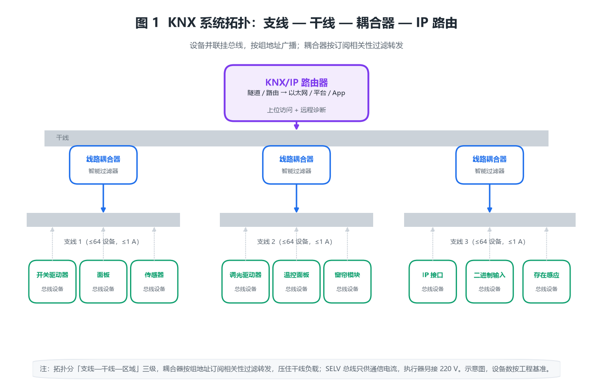
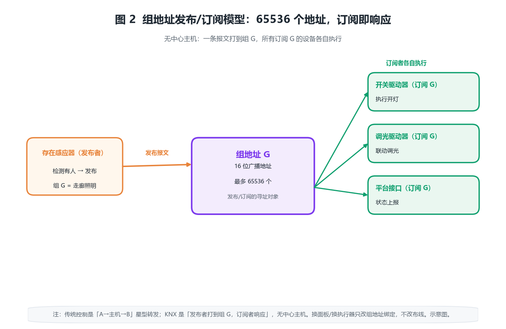
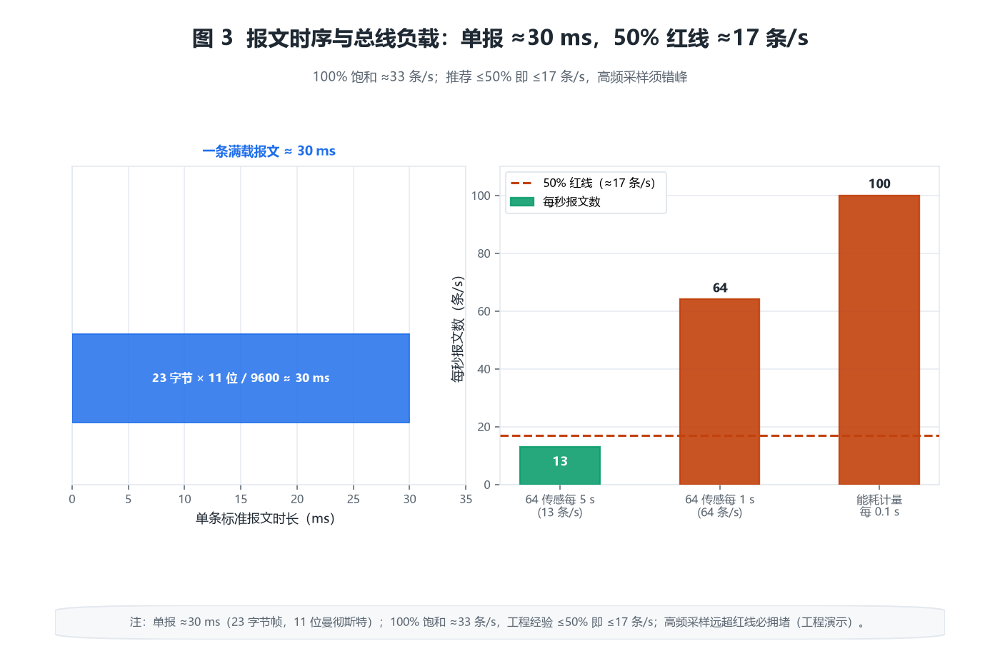
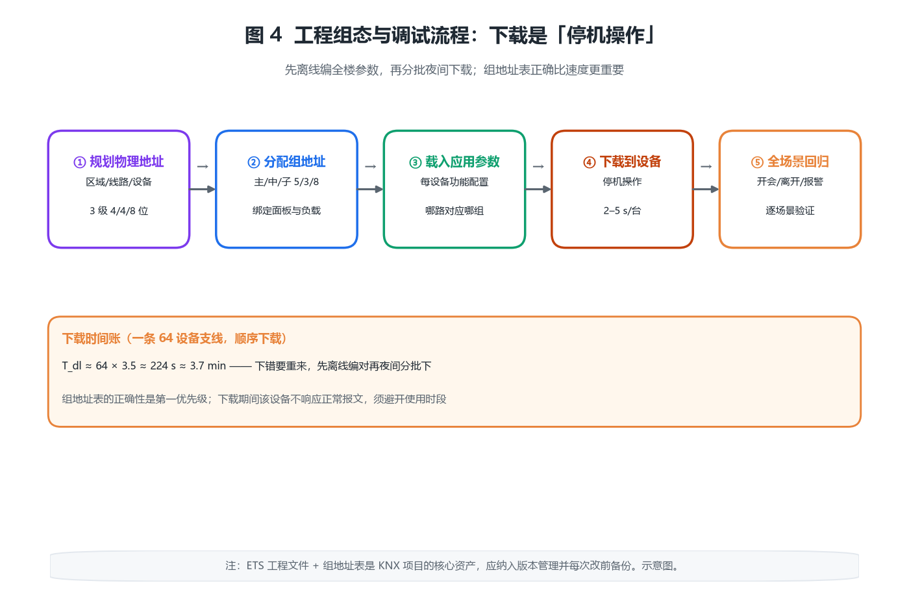

# KNX 智能楼宇控制器产品综述：用一根安全特低压总线，把灯、帘、空调、地暖连成可互操作的系统

## 〇、一句话定位

KNX 是 ISO/IEC 14543、EN 50090，以及国标 GB/T 20965-2013 定义的**开放式楼宇控制总线标准**。KNX 智能楼宇控制器的本质，不是「一个更强的中控主机」，而是**把整栋楼里灯光、窗帘、空调、地暖、插座、计量等原本各自为政的设备，挂到同一根双绞线安全特低压（SELV）总线上，用统一的报文语言互相通信**——设备之间不再依赖某台中心主机转发，而是「按组地址广播、谁订阅谁响应」的发布/订阅模型。

从工程角度看，KNX 与传统「强电开关 + 集中控制器」最大的不同是：**控制逻辑（组地址绑定）和物理布线解耦**。一个面板按键可以绑定任意一组负载，改功能不动机房配线，只改 ETS 工程文件里的组地址映射。所以 KNX 项目里「值钱的东西」是一张组地址表 + 一份 ETS 工程，而不是某个品牌的盒子。

> **反直觉点一：KNX 没有「主机」，却有真正的互操作性。** KNX 是去中心化的——任何设备发出的报文，总线上所有设备都能听到，订阅了对应组地址的就去执行。这带来一个传统私有总线做不到的事：施耐德、西门子、ABB、罗格朗、GVS 等任意两家合规厂商的设备，可以接在同一根总线上协同工作。互操作不是「能连上」，而是「报文语义一致」。

> **反直觉点二：30 V 的总线电，带不动一台灯，却带得动一整层楼的「决策」。** KNX 总线只传信号不传功率，执行器（开关驱动器、调光驱动器）本身接 220 V 强电，只从总线取几毫安到几十毫安的通信电流。所以「决策」在 SELV 安全电压里跑，「做功」在 220 V 里跑，二者物理隔离——这正是它比「用 220 V 继电器矩阵做逻辑」安全得多的原因。

> **反直觉点三：总线负载比「能挂多少设备」更早爆。** 一条支线理论能挂 64 个物理地址，但决定能不能用的往往是**总线负载率**（每秒报文数 × 单报时长）。64 个传感器若每个每秒狂发状态，总线立刻堵死；而 64 个只偶尔动作的开关，跑几年都没压力。选型时先算报文流，再数设备数。

> **反直觉点四：组地址设计比设备选型更考验功力。** KNX 的灵魂是 16 位组地址（最多 65536 个）。组地址规划烂，后期加一个联动要改全楼；规划好，新增功能只是「把新设备订阅到已有组」。很多项目翻车不是硬件问题，是组地址表从第一天就乱了。

十个锚定数字：总线速率 9600 bit/s（曼彻斯特编码）；总线电压 21~30 V DC（标称 29 V）；单支线总线电流上限 1 A；单支线最大设备数 64；单支线最大长度 1000 m（含 ≤4 个线路中继）；任意两设备最大间距 700 m；组地址空间 65536 个（3 级 5/3/8 位）；推荐总线负载 ≤50%；报文优先级 2 级；物理地址结构 区域(4 位)/线路(4 位)/设备(8 位)。

---

## 一、产品设计方案

### 1.1 系统形态：双绞线总线 + 支线/干线 + 耦合器 + IP 路由

KNX 的物理骨架是一根**双绞线（TP1 介质）**，所有设备并联挂上去，总线既传数据也供通信电（29 V DC，SELV）。设备按「支线（Line）—区域（Area）」两级分层，支线之间用**线路耦合器（Line Coupler）**相连，区域之间用**区域耦合器（Area Coupler）**，跨 IP 网络则用**KNX/IP 路由器（Router）**把总线延伸到局域网甚至广域。

图 1 画出了典型拓扑：一条支线挂最多 64 个设备，支线经线路耦合器汇到干线（Backbone），干线再经区域耦合器/路由器扩展到多栋楼。关键是**耦合器是「智能过滤器」**——它只在「对端网络有设备订阅该组地址」时才把报文转过去，从而在源头砍掉无关节文，压住干线负载。

部署形态上，KNX 控制器类产品大致分四类：

- **电源/线路耦合一体器**：给支线供 29 V 并做隔离耦合，是小系统的骨架。
- **IP 路由器 / 接口**：把 KNX 总线接到以太网，支撑上位机、楼宇管理平台、手机 App 的访问（隧道 / 路由两种模式）。
- **逻辑控制器 / 功能模块**：在 ETS 5 之后，部分设备支持内置「应用功能（Function）」或脚本，承担过去需要外部 PLC 做的逻辑运算（恒照度、时间表、逻辑「与/或」）。
- **房间控制器 / 触控面板**：既是操作界面也是总线设备，自带若干二进制/模拟 I/O，可就地控制一房间。

四类不是替代关系，而是一套系统里按层级共存：核心机房放电源与 IP 路由器，每层放线路耦合器，房间内放面板与执行器。

### 1.2 拓扑约束：线路、区域与设备容量

KNX 的寻址与拓扑有硬性天花板，这些是选型第一道闸：

- **物理地址**三层结构：`区域(0–15) / 线路(0–15) / 设备(1–255)`。即最多 15 区域 × 15 线路 × 64 设备 ≈ **14400 个设备**（每线路设备 0 号保留给耦合器类，可用 1–63 约 63 个；工程中按 64 取整）。
- **支线长度**：一条支线两端总长 ≤1000 m，且中间最多串 4 个线路中继（Line Repeater）扩展；任意两设备间距 ≤700 m；设备到最近耦合器/中继 ≤350 m。
- **总线电流**：一条支线由一台总线电源供电，**总线电流总和 ≤1 A**，且需留余量。

这些数字不是「建议」，而是「超过就通信失败」的物理边界。比如支线拉到 1200 m 或末端设备电流累加超 1 A，第一个症状一定是「远处设备偶尔掉线、重下载又好了」——最磨人的一类故障。

### 1.3 与相邻系统的边界（三处最容易拉扯）

1. **与楼宇自控（BAS）/DDC**：BAS 通常走 Modbus/BACnet，是「中心轮询 + 集中控制」；KNX 是「分布式广播 + 事件驱动」。二者通过 KNX/IP 网关或 BA 侧的 KNX 接口对接——KNX 管「房间级就地联动」，BAS 管「楼级能源与机电设备」。边界是联动层级，不是谁替代谁。
2. **与照明系统**：KNX 调光驱动器本身就是照明控制的一环，但大功率、DMX 舞台灯、复杂场景的集中渲染，往往仍走 DALI 或专用控制器，KNX 只发「场景号」。工程上「KNX 发场景，DALI 执行细节」是常见搭档。
3. **与安防/消防**：KNX **绝不能承载消防强切与排烟风机的硬线控制**。消防必须走独立硬线回路（GB 50116 火灾自动报警系统），KNX 至多做「火警后联动开窗、广播切换的状态提示」。强电隔离是底线：总线是 SELV，严禁与 220 V 共管共槽不隔离。

### 1.4 一个常被忽视的合规前提：SELV 与安全隔离

KNX 总线属于**安全特低电压（SELV，≤60 V DC）**，GB/T 20965 与 IEC 61140 都要求它与 220 V 强电保持基本绝缘或加强绝缘。执行器内部把 29 V 总线和 220 V 负载用继电器/光耦隔开，这是合规的核心。施工上，KNX 总线电缆（如 J-Y(St)Y 2×2×0.8 或专用 KNX 线缆）应独立穿管或与强电保持间距，避免强电磁耦合导致误码。这条在验收时容易被「先通了再说」糊弄过去，埋下长期误动作的雷。

### 1.5 KNX 的「灵魂」在工程文件，不在硬件

和会议中控一样，KNX 真正值钱的是**ETS 工程文件 + 组地址表**。一台开关驱动器本身只是「能被组地址遥控的继电器」，它「该控制哪盏灯、和哪个面板绑定」全部写在 ETS 项目里。项目文件一旦乱，表现为「按客厅开关，卧室灯亮了」——而现场看不出是软件问题。所以成熟做法：ETS 项目纳入版本管理，每次改组地址前导出备份，改完做一次全场景回归；核心项目还要求「先在离线项目里验证拓扑与参数，再连设备下载」。

---

## 二、核心参数与选型

### 2.0 选型速查表

| 维度 | 工程基准值 | 说明 |
|---|---|---|
| 总线介质 | TP1 双绞线（红黑一对 / 黄白一对） | 数据+供电同缆 |
| 总线电压 | 21–30 V DC（标称 29 V） | SELV |
| 总线电流上限 | 1 A / 支线 | 含所有设备通信电流 |
| 速率 | 9600 bit/s（曼彻斯特） | 半双工 |
| 单支线设备 | ≤64 | 物理地址 1–63 可用 |
| 支线长度 | ≤1000 m（≤4 中继） | 设备间距 ≤700 m |
| 组地址 | 65536 个（16 位） | 3 级 5/3/8 位 |
| 推荐总线负载 | ≤50% | 见算例 7 |
| 物理地址 | 区域/线路/设备 = 4/4/8 位 | 15×15×64 |
| 配置模式 | S-Mode / E-Mode / A-Mode | ETS 全功能为 S |

### 2.1 【原创算例 1】组地址空间账：65536 个地址够不够

KNX 组地址是 **16 位**，推荐用 3 级结构「主组/中组/子组」，位宽 5/3/8：

$$N_{\mathrm{grp}}=2^{5}\times 2^{3}\times 2^{8}=32\times 8\times 256=65536$$

即 32 个主组、每主组 8 个中组、每中组 256 个子组。一栋 30 层写字楼，若按「楼层=主组、功能=中组、回路=子组」规划：30 层 → 主组 30（占满 32 绰绰有余），功能（照明/窗帘/空调/场景）4 类中组，每类最多 256 回路。单功能单楼层 256 个地址，远超一般房间数（一层 ≤40 回路很常见）。**结论：地址空间不是瓶颈，瓶颈是规划纪律**——先把主组/中组的语义定死，子组再自由分配，后期加设备只是「订阅已有组」。

### 2.2 【原创算例 2】总线供电预算：1 A 是怎么被吃光的

一台总线电源标称 29 V、最大输出 1 A（约 29 W 供通信用）。支线上每个设备的通信电流不同：面板/传感器约 5–15 mA，二进制输入约 5 mA，**开关驱动器因要吸合内部继电器，可达 30–50 mA**，调光驱动器更高。若一个支线挂 40 个设备，其中 10 个开关驱动器 @40 mA、30 个面板 @10 mA：

$$I_{\mathrm{bus}}=\sum I_i=10\times 40+30\times 10=700\ \mathrm{mA}<1000\ \mathrm{mA}$$

余量 300 mA 看似宽裕，但若再加 8 个调光驱动器 @60 mA：

$$I_{\mathrm{bus}}=700+8\times 60=1180\ \mathrm{mA}>1000\ \mathrm{mA}$$

立刻超标 → 电压被拉低、远端设备频繁掉线。**结论：算总线电流时，执行器是「大头」，不要只数设备个数**。超标的解法是「一支线拆成两支线各配电源」，或选更大电流的总线电源（部分厂牌做到 1.2–1.5 A，但支线 1 A 是耦合器/电缆的安全上限，不可硬超）。

### 2.3 【原创算例 3】线路长度与压降：700 m 不是随便拉的

支线总长 ≤1000 m、设备间距 ≤700 m 是硬约束，但更隐蔽的是**压降**。KNX 电缆导体约 0.8 mm²，电阻率约 23 Ω/km（单芯），一对线往返电阻约 46 Ω/km。允许压降从 29 V 跌到 21 V（8 V 预算）。若末端一台开关驱动器 @40 mA 距电源 700 m：

$$R_{\mathrm{loop}}\approx 46\times 0.7\times 2=64.4\ \Omega,\quad \Delta U=I R=0.04\times 64.4\approx 2.6\ \mathrm{V}$$

2.6 V < 8 V，勉强可用。但若是 0.5 A 的大执行器在同样位置：

$$\Delta U=0.5\times 64.4=32.2\ \mathrm{V}\gg 8\ \mathrm{V}$$

直接拉不起来。**结论：大电流执行器必须就近取电/就近挂电源，或在该段独立设支线电源**；长支线末端只放低电流的传感器/面板。

### 2.4 【原创算例 4】KNX/IP 隧道与路由：上位机能带几个客户端

KNX/IP 路由器提供两种访问：**隧道（Tunneling）**——每个隧道占用一个虚拟设备地址，相当于「把一根 IP 线变成一台 KNX 设备」；**路由（Routing）**——路由器把整个 KNX 网络作为一个整体在 IP 多播上传送，一台路由器对应一个 KNX 侧网络。

一台入门级 IP 路由器常支持 **5 个隧道**。若楼宇管理平台、手机 App、两个调试电脑、一个能源网关同时在线：

$$N_{\mathrm{tunnel}}\ge n_{\mathrm{clients}}=5$$

刚好临界，再加一台运维笔记本就连不上了。**结论：隧道数是 IP 侧并发上限，按「在网客户端数 + 调试余量」选路由器档位**；纯「平台读数据」场景优先用路由模式（只占一个 KNX 地址），把宝贵的隧道留给需要写操作的客户端。

### 2.5 【原创算例 5】耦合器隔离：干线负载能砍掉多少

线路耦合器按「对端是否有设备订阅该组地址」过滤转发。假设一栋楼 10 条支线，每条支线内部灯光场景联动每秒产生 2 条报文，且这些组地址只在本支线内订阅：

$$L_{\mathrm{backbone}}=10\times 0=0\ \mathrm{telegram/s}$$

（这些组地址只在各自支线内被订阅，报文全部被耦合器拦下。）而跨支线的「消防状态汇总」组每秒 1 条 ×10 支线 = 10 条才上干线。若没有耦合器过滤（早期靠全广播），干线要吞下 10×2 + 10 = 30 条/s。**结论：耦合器不是「放大器」，是「过滤器」，它在源头把 60%+ 的本支线内部流量挡在干线之外**——这也是 KNX 能撑到 14400 设备的关键设计。

### 2.6 【原创算例 10】组对象与工程量账：ETS 里真正的工作量在「绑定」

每个 KNX 设备带若干「组对象」（Communication Object）：一面 4 键面板通常暴露 8~12 个组对象（每键可发开关/调光/场景/百叶），一台 4 路开关驱动器暴露 4~8 个（每路开关 + 状态反馈）。一条支线 40 面板 + 20 台 4 路驱动器的组对象总量：

$$N_{\mathrm{obj}}\approx 40\times 10+20\times 6=520$$

ETS 里每条绑定要在「对象↔组地址」两栏间连线，520 条目纯手点约 3~5 s/条 → 一条支线 0.5~0.7 h，8 层楼就是一整天。**压缩靠两条纪律**：一是组地址命名结构化（如「3F-照明-回路12-开关」），二是用 ETS 的「模板/复制」把同类房间做好一个再克隆——克隆后只改物理地址与个别绑定，工程量从 O(设备数) 降到 O(房间类型数)。

### 2.7 【原创算例 11】百叶行程与位置估算：执行器的「时间开环」账

窗帘/百叶执行器没有位置编码器，位置靠**时间累计开环估算**：行程 2.4 m、帘速 0.20 m/s → 全程 12 s；叶条翻转（slat）单独计时，工程基准 1.2~1.8 s / 90°。若叶条时间标称 1.5 s、实际 1.7 s，单次「翻转 45°」误差不大，但**多次短动作会累积**；停电重启后时间计数清零，位置全丢。所以 KNX 百叶工程有两条铁律：① 首次调试必须「全程校准」（先开到底再关到底，让执行器重置行程基准）；② 关键房间给窗帘加限位开关做位置校验。角度类动作宁多勿少——客户对「没关严」比对「多转 10°」敏感得多。

---

## 三、技术原理

### 3.1 报文结构（读懂一根总线的「语言」）

一条 KNX 标准报文（TP1）大致由：8 位起始 + 控制字段(8) + 源物理地址(16) + 目的组地址(16) + APDU（应用层数据，最长 15 字节）+ 校验(16) + 帧间隔构成，最长 23 字节。关键信息是：**目的地址是「组地址」而非「设备地址」**——所以一条「开灯」报文发出，所有订阅了该组地址的开关驱动器都会动作，无需主机逐个点名。

### 3.2 【原创算例 6】单报时长账：28 ms 是怎么来的

每个字节在 TP1 上按 11 位（1 起始 + 8 数据 + 1 奇偶 + 1 停止）串行发出，速率 9600 bit/s（曼彻斯特，1 符号=1 比特）：

$$T_{\mathrm{byte}}=\frac{11}{9600}\approx 1.15\ \mathrm{ms},\quad T_{\mathrm{frame}}\approx 23\times 1.15+3.5\approx 30\ \mathrm{ms}$$

即一条满载标准报文约 **28–30 ms**（含帧间 3.5 字符静默保护）。这是后面算总线负载的「基本粒子」。

### 3.3 【原创算例 7】总线负载率：50% 红线对应多少条/秒

总线负载 = 每秒占用时间 / 1 s。100% 饱和时每秒可发 `1000 ms / 30 ms ≈ 33` 条标准报文。KNX 工程经验**推荐单支线负载 ≤50%**：

$$L_{\mathrm{max,50\%}}=\frac{0.5\times 1000}{30}\approx 17\ \mathrm{telegram/s}$$

即一条支线每秒最多「健康地」承载约 17 条报文。若 64 个传感器每 5 秒上报一次状态：64/5 ≈ 13 条/s，仍在红线内；但若改每 1 秒上报一次，变成 64 条/s，远超 17，**总线必然拥堵、命令延迟飙升**。所以「高频采样」设备（如每 100 ms 的能耗计量）必须错峰、降频或走专用支线。

### 3.4 【原创算例 8】CSMA/CA 与反应时间：一次开关为什么「感觉不到延迟」

KNX 用 CSMA/CA（载波侦听多路访问/冲突避免）：设备想发报文前先听总线空闲，空闲才发；若冲突则按优先级随机退避。报文有 2 级优先级（系统/报警优先级更高，退避更短）。一次「按面板→灯亮」的端到端延迟：

$$t_{\mathrm{resp}}\approx t_{\mathrm{listen}}+T_{\mathrm{frame}}+t_{\mathrm{actuator}}\approx 5+30+20\approx 55\ \mathrm{ms}$$

约 50–100 ms，人几乎无感。但**高优先级报警报文**（如消防、入侵）会被优先抢占，确保关键事件在数百 ms 内全网可达。CSMA/CA 的好处是无需中心仲裁器（再次印证「无主机」），代价是负载高时退避增多、延迟抖动变大——这正是算例 7 要把负载压在 50% 的深层原因。

### 3.5 【原创算例 12】优先级抢占：报警报文为什么能「插队」

KNX TP 报文头带 2 级优先级（正常 / 系统）。CSMA/CA 冲突退避时，系统优先级（报警/控制类）的随机退避窗口更短。粗略估算负载 80% 时的一次接入等待：正常优先级平均要等 2~3 个报文时长（60~90 ms），系统优先级约 1 个（30 ms）。**数字看着都不大，差别在「尾部」**：报文密度高时，正常优先级的等待方差变大，偶发 200~300 ms；而报警走系统优先级，尾部仍可压在 100 ms 内。工程含义：入侵/急停/呼叫这类「不能等」的组，设备参数里要显式设为系统优先级——这是 ETS 里的一个勾选项，漏勾了平时看不出、忙时才掉链子（以上为工程估算）。

---

## 四、产品功能与差异化

### 4.1 组地址发布/订阅模型：KNX 真正的「灵魂」

传统控制是「A 设备 → 主机 → B 设备」的星型转发；KNX 是「发布者把报文打到组地址 G，所有订阅 G 的设备各自执行」（见图 2）。这意味着：

- **解耦**：换面板不改执行器，换执行器不改面板，只改组地址绑定。
- **一对多/多对一天然支持**：一个「全楼熄灯」组地址，可以被任意多开关驱动器订阅；一个「有人移动」组地址，可以被任意多传感器发布。
- **可组合**：逻辑「与/或」可以用「多个发布者写同一个组 + 接收者做阈值判断」实现，无需中心 PLC。

这也是 KNX 互操作性的根源——只要两家厂商都认同「组地址 G=走廊照明」，设备就能协同，与品牌无关。

### 4.2 【原创算例 9】工程组态与下载时间账（ETS）

一个 KNX 项目在 ETS 里要完成：规划物理地址、分配组地址、为每个设备载入应用参数（如开关驱动器的「哪路对应哪个组」）、最后把配置**下载到设备**。单设备下载耗时约 2–5 s（含参数帧与校验）。一条 64 设备的支线顺序下载：

$$T_{\mathrm{dl}}\approx 64\times 3.5\approx 224\ \mathrm{s}\approx 3.7\ \mathrm{min}$$

若用支持并行下载的工程工具或分段操作，可压缩；但**下载是「停机操作」**——下载过程中该设备不响应正常报文。所以工程上「先离线把全楼参数编好，再分批夜间下载」，是标准作业。这也解释了为什么组地址表的正确性比下载速度更重要：下错了，3.7 分钟白等且要重来。

### 4.3 互操作性：多厂商混用才是 KNX 的护城河

KNX 协会的认证要求设备通过**互操作测试**，保证报文语义一致。实际工程中常见「西门子面板 + ABB 开关驱动器 + 罗格朗温控面板 + 国产 IP 路由器」混搭。价值在于：甲方不被单一厂商锁定，备件可替换，旧楼改造时新设备能直接接老总线。**但互操作有边界**：高级功能（如某厂的「恒照度算法」）是厂商私有应用，跨品牌只能靠标准组地址交换「亮度值/开关量」这类基础数据，复杂算法仍绑定原厂。

### 4.4 配置模式 S/E/A：不同项目不同复杂度

- **S-Mode（系统模式）**：ETS 全功能，逐设备参数化，适合专业工程，互操作性最强。
- **E-Mode（简单模式）**：厂商提供「应用模块」，现场用拨码/软件选预设功能，免 ETS 深度编程，适合小商铺。
- **A-Mode（自动模式）**：即插即用，设备自协商，适合极简场景。

三者通过统一的底层总线共存，工程上「核心用 S、边缘用 E」是常见折中。

### 4.5 【原创算例 13】调光兼容性：切相调光器的「最小负载」卡死 LED

KNX 调光驱动器分两类输出：**1-10 V / DALI**（驱动器只发控制信号，功率回路由 LED 驱动电源承担）与**切相调光**（前沿晶闸管 / 后沿 MOSFET，直接串在回路里切波形）。切相的问题在**最小维持电流**：晶闸管需要约 10~30 mA 才能维持导通，对应 220 V 下 2~7 W 最小负载。把一只 3 W 的 LED 灯接在按白炽灯设计的前沿调光器上：维持电流不够 → 晶闸管每半周提前关断 → **闪烁、调光曲线断层、嗡鸣**。这不是「调光器坏了」，是负载低于维持电流的物理必然后果。工程解法按优先级：LED 灯一律配 1-10 V/DALI 或可调 LED 驱动；实在要用切相，选后沿（MOSFET）+ 厂商兼容清单内的灯具，并保留最小负载作兜底。

### 4.6 【原创算例 14】KNX RF 无线设备的电池寿命账：预算反推能用多久

KNX RF（868 MHz）常用于「布线困难」的改造场景：门窗磁、温控面板、手持遥控多为电池供电（CR2032 约 220 mAh）。发射峰值电流约 20~30 mA、单报文含前导约几十毫秒，再用休眠电流 µA 级打底。用预算反推：目标寿命 2 年 → 每日预算 $220/(2\times 365)\approx 0.30\ \mathrm{mAh}$，折合发射时间预算约 40 s/天；按单报 50 ms 算，可支撑每天约 800 条报文（≈每 100 s 一条）。再扣掉休眠漏电流（3 µA × 17520 h ≈ 53 mAh，吃掉约 24% 预算），实际可发条数还要打折。**工程含义：RF 传感器「每动一次发一条」没问题，但禁止高频周期上报**；招投标时把「电池寿命 ≥2 年 @ 每日 N 条」写进参数，比「电池型号」更能防低质方案（以上为工程估算，实测以厂商报告为准）。

---

## 五、应用场景

### 5.1 办公楼：一层的灯光、窗帘、空调、插座联动

典型办公层：每个工位区一组「有人/无人」存在感应 → 订阅「区域照明」组 → 联动窗帘（眩光时降下）与空调（无人时抬升设定温度）。KNX 的价值在这里是**「功能重组零布线」**：行政要把「会议室区」从「开放工区」里剥离做独立场景，只需在 ETS 改组地址，不用动任何一根线。

### 5.2 酒店客房：场景 + 节能 + 集中管理

客房面板一键「入住/离开/睡眠/清扫」场景，联动灯、帘、空调、门禁状态。离开场景自动关空调抬温、关灯关帘，单个客房年节电可观（与智能照明同理，恒照度/occupancy 贡献的是「设计期合规 + 运行期节能」）。KNX 在这里还承担「客房状态上报」——清扫/维修/勿扰通过组地址汇总到前台，省掉独立房态系统。

### 5.3 医院/养老：呼叫与照明联动

床头呼叫按钮发布「呼叫」组 → 护士站面板 + 走廊指示牌 + 病区照明（呼叫床位走廊灯闪）同时响应。这类「多对多即时广播」正是 KNX 发布/订阅的拿手好戏，且全程 SELV、不依赖中心服务器，单点故障不会拖垮全楼。

### 5.4 高层住宅：户内 KNX 与公共区 BA 的分层

住宅项目里常见「两网并存」：户内用 KNX（面板/调光/窗帘/地暖，房间控制器走 E-Mode 快速交付），公共区（大堂、车库、走道照明与风机）由 BA 走 BACnet/Modbus。两网通过 IP 网关交换少数状态组——比如「全户离家」状态发布后，BA 侧停公共区新风补偿、户内侧进入安防布防与节能场景。**分层的价值在责任边界**：户内组态业主随时可改，公共区归物业管控，互不抢回路、互不背锅。硬要把两套并成一张网，验收时「谁负责这盏灯」都说不清。

---

## 六、实际案例

### 6.1 案例一：写字楼 8 层办公区改造（需求→方案→核算→价值）

- **需求**：8 层、每层 40 回路照明 + 20 路窗帘 + 空调面板，要求「分区感应联动 + 定时全关 + 平台可读状态」。
- **方案**：每层 1 条支线（≤64 设备，本层 60 设备刚好），楼层配线耦合器汇到干线；组地址按「层=主组、功能=中组、回路=子组」。IP 路由器走路由模式接楼宇平台。
- **配置核算**：每层设备通信电流 ≈ 20 开关驱动器×40 mA + 20 面板×10 mA + 20 窗帘模块×30 mA = 800+200+600 = 1600 mA > 1 A → **拆成两条支线各配电源**（每条约 800 mA）。总线负载：40 回路×每 5 s 状态上报 ≈ 8 条/s/支线 < 17 红线。
- **交付价值**：改造后照明能耗下降约 18%（occupancy + 定时），平台实时读回路状态，运维从「逐层查开关」变成「看面板报警」。

### 6.2 案例二：精品酒店 120 间客房（场景节能）

- **需求**：每间客房「入住/离开/睡眠/清扫」四场景，空调随场景变设定温度，房态上报前台。
- **方案**：客房内放 1 台「房间控制器」（集面板+若干 I/O），订阅本房场景组；空调网关订阅「离开」组抬温 3 ℃。
- **配置核算**：每房设备通信电流 ≈ 房间控制器 40 mA + 空调网关 30 mA + 门磁输入 5 mA ≈ 75 mA，整层 20 房 ≈ 1.5 A → 仍按层分两条支线。离开场景每晚执行一次，估算单房年省空调电可观，整体回收期约 3–4 年。
- **交付价值**：房态自动上报，前台系统省掉独立房态硬件；客人「一键离开」体验提升。

### 6.3 案例三：养老院病区呼叫联动

- **需求**：床头/卫生间呼叫 → 护士站 + 走廊灯 + 病区指示牌同时响应，且不能因某个面板坏而失效。
- **方案**：呼叫按钮发布「病区呼叫」组，护士站面板、走廊指示牌、照明驱动器均订阅该组（多对多广播）。按钮用 E-Mode 免编程快速部署。
- **配置核算**：单病区设备少（≤30），一条支线富余；总线负载极低（事件驱动，无周期轮询）。关键是「无中心主机」——任一面板故障不影响其他按钮广播。
- **交付价值**：呼叫端到端延迟 < 200 ms（含报警优先级抢占），分布式架构单点故障不扩散。

---

## 七、市场背景与竞争格局

KNX 源于 1990 年代的 EIB（欧洲安装总线），2002 年合并 BatiBUS、EHS 形成 KNX，2006 年成为 ISO/IEC 14543 国际标准，在中国落地为 GB/T 20965-2013。它是目前**楼宇控制领域互操作性最强的开放标准**，在欧洲住宅/楼宇市场占有率领先。

竞争格局：

- **国际品牌**：西门子、ABB、施耐德、罗格朗、倍福等，主打全系认证产品与工程生态（ETS）。
- **国产品牌**：GVS（广州视声）、HDL（河东）、邦奇等，主打性价比与本地化服务，近年认证产品增多。
- **替代技术**：DALI（专注照明）、BACnet/LonWorks（偏楼级 BA）、Zigbee/Matter（偏消费级无线）、直接 220 V 智能开关（偏轻量改造）。KNX 的定位是「需要强互操作、长生命周期、专业工程」的中大型项目。

**认证与检测**：正品 KNX 设备带 KNX 协会认证标志，需通过互操作性与一致性测试；国内项目验收可引用 GB/T 20965-2013 作为检测依据。采购时要警惕「兼容 KNX」字样的非认证设备——这类设备往往只实现了报文收发、未过一致性测试，混入总线后就是最难排查的偶发误码源。

趋势：KNX 正与 IP 深度融合（KNXnet/IP 普及）、与无线（KNX RF）互补、并向「KNX IoT」演进，目标是让总线设备直接进 IP 世界、与 Matter 等消费生态对话。

---

## 八、商业模式与趋势

KNX 项目的利润结构：硬件（设备+线缆）约占 40–50%，**工程（设计组地址、ETS 编程、调试、运维）占 50–60%**——和会议中控一样，「卖盒子」毛利薄，「做工程」才是护城河。集成商的核心资产是组地址规划方法论与可复用的 ETS 项目模板。

趋势一：**从「布线节省」到「数据资产」**。KNX 天然产生「每个回路的开关/能耗事件流」，过去被浪费，现在可喂给能源管理平台做诊断（与能耗管理系统呼应）。
趋势二：**IP 化降低运维门槛**。KNX/IP 让远程诊断、OTA 式参数更新成为可能，疫情期间「远程改场景」需求大增。
趋势三：**与新能源/储能协同**。KNX 可承载「光伏余电→开热水/开充电桩」的需求响应逻辑，从「控制」走向「能源编排」。

---

## 附录

### A. 核算清单（14 个算例速查）

| 算例 | 公式核心 | 结论 |
|---|---|---|
| 1 组地址 | $2^{5}\times 2^{3}\times 2^{8}=65536$ | 空间非瓶颈，规划是 |
| 2 总线电流 | $\sum I_i$，上限 1 A | 执行器是大头 |
| 3 压降 | $\Delta U=I R$，8 V 预算 | 大电流就近取电 |
| 4 隧道数 | $N_{\mathrm{tunnel}}\ge n_{\mathrm{clients}}$ | 路由省隧道 |
| 5 耦合隔离 | 本支线流量被拦 | 干线省 60%+ |
| 6 单报时长 | $23\times 11/9600\approx 30\ \mathrm{ms}$ | 负载基本粒子 |
| 7 总线负载 | 50%→17 条/s | 高频采样要错峰 |
| 8 反应时间 | $5+30+20\approx 55\ \mathrm{ms}$ | 人无感 |
| 9 下载时间 | $64\times 3.5\approx 224\ \mathrm{s}$ | 停机操作、夜间做 |
| 10 组对象工程量 | $N_{\mathrm{obj}}\approx 520$ 条 | 模板克隆压缩工期 |
| 11 百叶位置 | 时间开环 + 全程校准 | 停电丢位置 |
| 12 优先级抢占 | 系统级尾部 <100 ms | 报警要显式勾选 |
| 13 调光最小负载 | 维持电流 2~7 W | LED 配 DALI |
| 14 RF 电池寿命 | $\approx 0.30\ \mathrm{mAh}$/天预算 | 禁高频周期上报 |

### B. 术语表

- **SELV**：安全特低电压（≤60 V DC），KNX 总线属此。
- **支线/干线（Line/Backbone）**：KNX 分层拓扑的两级。
- **线路耦合器**：支线间智能过滤器，按组地址相关性转发。
- **组地址**：16 位广播地址，KNX 发布/订阅的寻址对象。
- **ETS**：KNX 官方工程工具（Engineering Tool Software）。
- **KNXnet/IP**：KNX 与以太网互联协议，含隧道/路由模式。
- **S/E/A-Mode**：系统/简单/自动三种配置复杂度。

### C. 标准索引

- ISO/IEC 14543-3（KNX 通信协议）
- EN 50090 / EN 50491（KNX 欧洲标准）
- **GB/T 20965-2013**《控制网络 HBES 技术规范 住宅和楼宇控制系统》（中国国标）
- IEC 61140（SELV 防触电保护）
- GB 50116（火灾自动报警系统设计规范，消防强切硬线要求）

### D. 常见故障速查表

| 症状 | 高概率原因 | 处置 |
|---|---|---|
| 远端设备偶发掉线 | 支线电流超 1 A / 末端压降 <21 V | 算例 2/3：拆支线或就近补电源 |
| 按了没反应、偶尔才动 | 组地址没绑/绑错、被高负载挤占 | ETS 总线监视看报文是否发出、谁订阅 |
| 一开灯灯带闪、有嗡鸣 | 切相调光器最小负载不满足 | 算例 13：换 DALI 或加最小负载 |
| 百叶位置不对 | 时间开环漂移 / 停电丢位置 | 算例 11：全程校准、加限位开关 |
| 平台连不上总线 | 隧道数占满 | 算例 4：读数据改路由模式 |
| 报警响应偶发变慢 | 未设系统优先级 | 算例 12：ETS 参数显式勾选 |
| 一条支线整体失联 | 总线电源或耦合器故障 | 先测总线电压（21~30 V），再查耦合器 |
