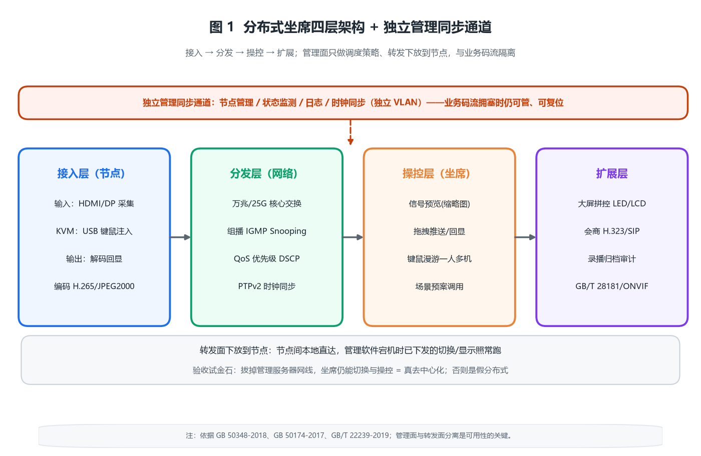
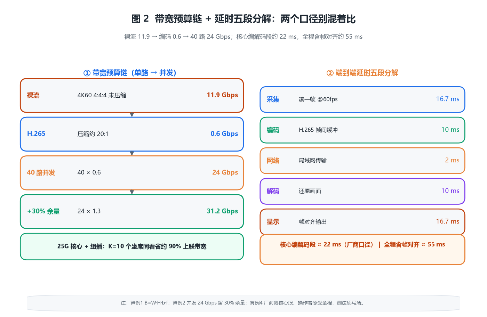
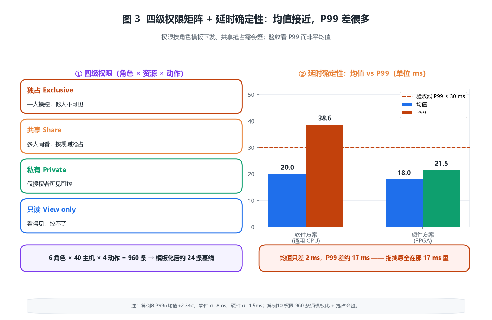
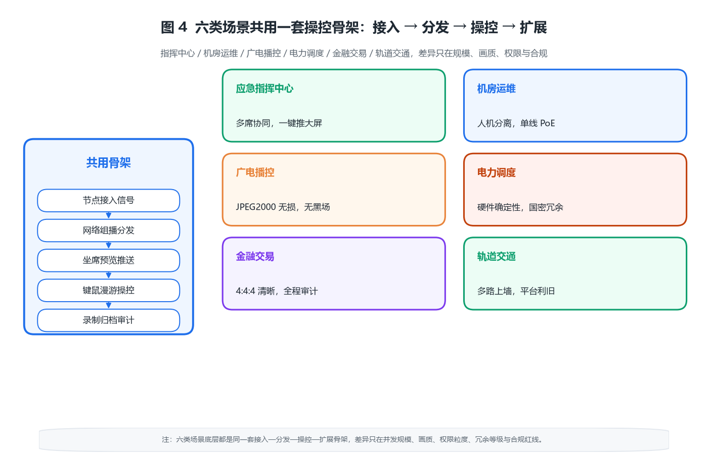

> 
> *概念图：远端机房的主机经编码节点打包上局域网，坐席端解码回显、一套键鼠漫游操控多台主机，并一键把画面推送到大屏——人在坐席、机在机房。示意图。*

# 分布式可视化坐席节点产品综述

## · 面向工程端

---

## 〇 一句话定位

分布式可视化坐席节点（工程上常称「分布式 KVM 节点」「坐席节点」「IP KVM 编解码器」）是**把远端主机的高清视频、音频与键鼠信号编码打包上标准以太网，在任意坐席端解码回显并反向注入键鼠操作，从而实现跨楼层、跨机房的一人多机、一机多屏、信号推送与坐席协作的节点设备**。它一端用 HDMI/DP 接主机的画面输出与 USB 接键鼠，另一端用 RJ45/光口接入交换机；配合管理平台，把过去「一台主机一套线拉到工位」的点对点 KVM，变成「主机全集中机房、坐席按需取用」的网络化调度。**它买的是「人在坐席、机在机房」的操控与协同能力**——并发稳定性、端到端延时、画质（4:4:4 色度）、分级权限、去中心化、协议开放度，决定了这套系统是真的让调度效率翻倍，还是只是在制造「卡顿、越权、被厂商锁死」的新麻烦。

> 本系列 display 类已写的《视频处理器》《LED 显示屏》管的是**把画面拼上大墙**——观众只看不摸；video 类的《网络摄像机 IPC》《视频存储服务器》管的是**前端取像与长期留存**——对象是摄像头。**本篇只讲桌面交互层**：把操作者「接」到主机上，让人看得清、控得动、推得出、管得住。一句话区分：**大屏拼控管「画面怎么上墙」，视频监控管「画面怎么存下来」，坐席节点管「人怎么操控那一堆主机」**。

> **反直觉点一：延时看的不是平均值，是确定性（抖动）。** 厂商规格书上写「端到端延时 17 ms」很漂亮，但工程现场折磨人的是「有时 15 ms、有时 30 ms」——鼠标移动忽快忽慢的「拖拽感」，来自抖动（jitter），不是平均值。基于通用 CPU 的软件方案受操作系统调度、内存管理影响，延时天然波动；基于 FPGA/专用硬件的方案处理路径固定，每次响应落在稳定区间。**验收必须测 P99（99 分位延时）与平均值、最大值，而不是只听「平均 17 ms」的宣传**（算例 8）。

> **反直觉点二：真正难的不是编码，是权限矩阵与「共享时谁抢占」。** H.265/JPEG2000 编码是成熟芯片的事，照 datasheet 接就行。真正让项目翻车的是权限：值班长、调度员、运维、访客各能看到/操控哪些主机？当两人同时要看同一路信号，「共享」模式下谁抢占、谁被踢？这些语义不写进会签的权限矩阵，上线后就是越权事故与扯皮（算例 10、3.5）。

> **反直觉点三：去中心化不等于「没有中心」。** 宣传语爱写「去中心化架构」，但工程上要追问的是：核心转发功能是否下放到节点？管理软件宕机时，信号切换与显示是否还能继续？中心节点主备切换时业务断不断？**真去中心化是「管理面可以挂，转发面照常跑」**——管理软件只做调度与策略下发，节点之间本地直达转发（3.4）。只把服务器做成单点、节点全靠中心转发的方案，一次宕机就是全场黑屏。

> **反直觉点四：不同厂商的延时数字没法直接比。** 有的写「<4 ms」，有的写「30 ms 级」，有的写「亚帧级」——不是谁吹牛，是**测量对象不同**：有的只测「单段网络传输」，有的测「键鼠事件到画面变化」的全程。验收时必须统一测法：在坐席端与源端各放时间基准，用「键鼠打点 + 画面变化录屏逐帧比对」，记录 10 次切源与 10 次鼠标移动的端到端耗时，同时记均值与最大值（算例 4、7）。

**锚定数字**（均有公开来源或稳定标准可查）：**GB 50348-2018**《安全防范工程技术标准》（系统权限、日志、自我诊断、视频信息保存期限）／ **GB 50174-2017**《数据中心设计规范》（机房侧供电与环境，C 级及以上）／ **GB 50343-2012**《建筑物电子信息系统防雷技术规范》／ **GB/T 28181-2022**《公共安全视频监控联网系统信息传输、交换、控制技术要求》（前端摄像机接入）／ **GB/T 22239-2019**《网络安全等级保护基本要求》（等保 2.0，三级）／ **GB/T 20988-2025**（信息系统灾难恢复规范，RTO/RPO 分级）／ **GB/T 9254.1**（信息技术设备电磁兼容）／ **SJ/T 11141**（LED 显示屏通用规范）／ **ONVIF Profile S/T/G**、**H.264/H.265**、**JPEG2000**、**SDVoE**、**SMPTE ST 2110/2059**（广电级）、**IEEE 1588 PTPv2**（时基同步）。编码格式与延时方面的行业口径（H.265+JPEG2000 双编码、视频 17~25 ms、KVM ≤60 ms、切换 ≤20 ms、一人多机 ≤17 台、4K60 4:4:4 单路 500~700 Mbps）来自厂商公开资料与行业报道，**均为厂商公布口径、未经独立复现，须按统一测法现场验收**。参数均为**工程基准 / 演示估算**，以设备实测与现行有效版本原文为准。

---

## 一、产品设计方案

### 1.1 系统组成：接入—分发—操控—扩展四层 + 一条独立管理同步通道

一套分布式坐席在工程上由四层构成，其中管理与同步通道必须单列——业务码流拥塞时，它要保证「还能管、还能同步」：

- **接入层（节点）**：输入节点（编码器，接主机 HDMI/DP 输出 + USB）与输出节点（解码器，接显示器/大屏），以及兼具编解码与键鼠注入的 KVM 节点。角色可切换，同一硬件既能当编码也能当解码。
- **分发层（网络）**：万兆/25G 核心 + 千兆接入交换机，承载组播（IGMP Snooping）、QoS（DSCP 优先级）、PTPv2 精确时钟；关键业务流优先级高于普通上墙流，端口预留约 30% 带宽余量。
- **操控层（坐席）**：坐席软件界面——信号预览（实时缩略图回显）、拖拽推送、键鼠漫游、场景预案调用、权限判定；配合实体坐席终端或多屏工作站。
- **扩展层**：大屏拼控（LED/LCD）、视频会议会商（H.323/SIP 双流、内置 MCU）、录播归档、与 GB/T 28181 视频平台及 ONVIF 摄像机的对接。
- **管理同步通道（单列）**：节点管理、状态监测、日志、时钟同步（PTP/NTP）走独立 VLAN 或带外通道，与业务码流隔离——避免业务拥塞时「连复位都做不到」。

### 1.2 三种部署形态

| 形态 | 做法 | 适用 | 工程取舍 |
|------|------|------|----------|
| 纯硬件 FPGA 节点 | 编解码走专用硬件逻辑，路径固定 | 电力调度、广电播控、金融交易 | 延时确定性最好、无黑场切换；单价高、功能迭代依赖厂商固件 |
| 嵌入式 ARM 节点 | 低功耗 ARM + 硬件编解码加速 | 指挥中心、机房运维（主流） | 性价比与确定性平衡；需评估高负载下码率波动（算例 8） |
| PC + 软件坐席 | 通用服务器/PC 跑编解码与坐席软件 | 预算敏感、小规模、非关键业务 | 最灵活、易扩展；延时受 OS 调度影响，抖动大（算例 8），不适合关键调度 |

工程上先分清这是**关键调度场景**还是**普通办公场景**：前者为「毫秒级确定性 + 无黑场切换」多花钱买硬件节点是值得的；后者用软件方案省预算也无妨——**用同一套指标去套所有场景，是选型最大的浪费**（第四章对比）。

### 1.3 一次「推送上屏」的六个动作

```
① 选源：坐席在预览界面看到各输入节点回显的实时缩略图，确认目标信号
② 预览：调取该信号的低码流子码流（不影响主码流），多人可同时看
③ 推送：把主码流经组播推送到目标输出节点（显示器/大屏），无黑场切换
④ 接管：键鼠漫游到该主机，USB HID 反向注入，获得操控权（受权限判定约束）
⑤ 回显：操控结果画面回传到坐席，形成「操作—看到」闭环（键鼠回路 RTT，算例 7）
⑥ 归档：关键操作与画面按策略录制留痕，等保三级日志留存 ≥180 d（算例 13）
```

### 1.4 系统架构图


*图 1：接入—分发—操控—扩展四层架构 + 独立管理同步通道。输入/输出/KVM 节点经万兆核心分发，管理软件只做调度与策略、转发下放到节点；大屏、会商、录播与 GB/T 28181 平台为扩展层。*

---

## 二、核心参数与选型

### 2.1 关键参数清单（工程基准）

下表为招标文件常见技术要求与工程基准（厂商公开口径已标注，未独立复现），具体以厂家 datasheet、实测与现行标准原文为准：

| 参数 | 典型区间 / 要求 | 选型含义 |
|------|----------------|----------|
| 编码格式 | H.264 / H.265（通用）、JPEG2000（无损）；行业推 H.265+JPEG2000 双编码 | H.265 省约 50% 带宽；JPEG2000 无损适合高精度场景（厂商口径） |
| 分辨率/帧率 | 4K@60Hz（3840×2160）或 2×1080P60 / 4×1080P30 | 4K60 4:4:4 单路按 500~700 Mbps 估（厂商口径，算例 1、2） |
| 色度采样 | 4:4:4（文字/细线必选）、4:2:2、4:2:0 | 4:2:0 带宽减半但文字边缘发虚，坐席看代码/CAD 必须 4:4:4（算例 6） |
| 视频端到端延时 | 厂商口径 17~25 ms（H.264/H.265+交换机平均）、<15 ms（JPEG2000 4K60）；图像输出 ≤80 ms、KVM ≤60 ms | 测法不同不可直接比；验收测 P99（算例 4、5、8） |
| 切换时延 | ≤20 ms 无黑场/无闪屏（厂商口径）；键鼠跨屏 ≤50 ms | 「无黑场」比数值更重要；按逐帧录屏验收 |
| 并发回显 | 支持约 200 路视频实时缩略图回显（厂商口径） | 决定预览体验与组播表项规模（算例 2、3） |
| 一人多机 | 一套键鼠最多控约 17 台 PC（厂商口径） | 超出需分组或加坐席，$\lceil N/17\rceil$（算例 9） |
| 权限模型 | 四级：独占 / 共享 / 私有 / 只读（Exclusive/Share/Private/View only） | 逐角色会签「共享谁抢占」，按模板批量下发（算例 10、3.5） |
| 冗余 | 双网口主备/负载均衡、光纤+网线热备、主备管理节点、冗余电源 | 主备切换业务不中断；对照 GB/T 20988-2025 RTO（算例 12） |
| 传输距离/供电 | 千兆网线 100 m（Cat5e/Cat6）、光纤更远；PoE 供电单线到位 | PoE 功率预算要算满配（算例 11） |
| 协议开放 | ONVIF Profile S/T/G、GB/T 28181、RTSP/RTMP、H.323/SIP、HTTP REST 北向、SNMP v3 | 开放度决定能否利旧与对接第三方（4.3、七章） |
| 安全 | 等保 2.0 三级（GB/T 22239）、SM2/SM3/SM4 国密、日志 ≥180 d | 涉密党政场景的准入红线（算例 13、14） |

### 2.2 十四个原创工程算例

下面每一条都是定带宽、算延时、配权限、做冗余、过等保时要真算的账，标号贯穿正文。参数按「工程基准 / 演示估算 / 厂商口径」给出，以设备实测为准。

**【算例 1】未压缩 4K 裸流带宽——为什么必须编码**

4K（3840×2160）、4:4:4 色度（每像素 24 bit = 3 字节）、60 fps，未压缩裸流：

$$B=W\,H\,b\,f=3840\times2160\times24\times60\approx11.9\ \mathrm{Gbps}$$

一路就逼近万兆满速——**不压缩，一台交换机连两路 4K 都扛不住**。H.265 压到约 $0.6\ \mathrm{Gbps}$，压缩比约 $20:1$；JPEG2000 无损约 $2\sim3:1$，仍是 4:4:4 全色。结论：**编码不是为了「能看」，是为了「能同时看很多路」**；选 H.265 还是 JPEG2000，本质是带宽与无损画质的取舍（算例 6）。

**【算例 2】并发带宽预算与端口余量**

单路 4K60 4:4:4 按 $0.6\ \mathrm{Gbps}$ 估，$N_{\mathrm{src}}=40$ 路并发：

$$B_{\mathrm{total}}=N_{\mathrm{src}}\,B_{\mathrm{ch}}=40\times0.6=24\ \mathrm{Gbps}$$

万兆（10 Gbps）核心不够，需 25G 核心或双 10G 链路聚合；再留 30% 突发余量：

$$B_{\mathrm{design}}=24\times1.3=31.2\ \mathrm{Gbps}$$

**这就是「为什么指挥中心的核心交换机不能按路数刚好配」**——码率会波动（VBR）、突发会叠加，端口打满就丢帧。若同路信号要送给多个坐席，用组播把带宽压下来（算例 3）。

> 
> *图 2：左——从 11.9 Gbps 裸流到 0.6 Gbps 编码、再到 40 路 24 Gbps 并发的带宽预算链；右——端到端延时五段分解，核心编解码链路与「含采集/显示帧对齐」的全程口径不同。*

**【算例 3】组播 vs 单播的带宽放大**

一路 4K 信号同时推给 $K=10$ 个坐席。单播要在网络里发 10 份：

$$B_{\mathrm{uni}}=K\,B=10\times0.6=6\ \mathrm{Gbps}$$

组播在网络层只发 1 份、由交换机复制：

$$B_{\mathrm{mc}}=B=0.6\ \mathrm{Gbps}\quad\Rightarrow\quad \mathrm{saving}=\frac{6-0.6}{6}=90\%$$

**前提是交换机正确配置 IGMP Snooping**——否则组播被当广播泛洪到所有端口，反而拖垮全网。工程上组播省带宽的收益极大，但「开了组播却没开 Snooping」是高频翻车点（3.3）。

**【算例 4】端到端延时的五段分解**

一次画面从主机到坐席屏幕：

$$t=t_{\mathrm{cap}}+t_{\mathrm{enc}}+t_{\mathrm{net}}+t_{\mathrm{dec}}+t_{\mathrm{disp}}$$

取工程基准：采集 $16.7\ \mathrm{ms}$（凑一帧 @60fps）、编码 $10\ \mathrm{ms}$、局域网 $2\ \mathrm{ms}$、解码 $10\ \mathrm{ms}$、显示 $16.7\ \mathrm{ms}$，核心「编码+网络+解码」段：

$$t_{\mathrm{core}}=10+2+10=22\ \mathrm{ms}$$

这个 $22\ \mathrm{ms}$ 正好落在厂商「17~25 ms」口径内——**说明厂商测的是核心编解码段，不含采集与显示帧对齐**。而操作者真正感受到的全程约 $55\ \mathrm{ms}$。两个数字都对，但**必须写清测法**（算例 8、反直觉点四）。

**【算例 5】帧缓冲量化延时——高帧率反而降延时**

编码器需凑齐一帧才开始编码，帧缓冲量化延时：

$$t_{\mathrm{buf}}=\frac{1}{f}$$

60 fps 时 $t_{\mathrm{buf}}=16.7\ \mathrm{ms}$，30 fps 时 $t_{\mathrm{buf}}=33.3\ \mathrm{ms}$——**帧率翻倍，帧缓冲延时减半**。这是反直觉的：直觉觉得「高帧率数据多、更慢」，实际上对延时敏感的场景（竞技、操控），60 fps 甚至 120 fps 反而比 30 fps 更低延时，代价是带宽翻倍（算例 1）。JPEG2000 用帧内编码、不靠帧间预测，编码器侧缓冲更小，这也是它能做到更低延时口径的原因之一。

**【算例 6】色度采样的带宽与画质取舍**

每像素字节数：4:4:4 = 3 B、4:2:2 = 2 B、4:2:0 = 1.5 B。故：

$$B_{4:2:0}=\frac{1.5}{3}\,B_{4:4:4}=0.5\,B_{4:4:4}$$

4:2:0 把带宽砍一半，但色度分辨率横纵各减半——**对监控视频（看人、看车）几乎无感，对坐席场景（看代码、CAD 细线、表格红字）却是灾难**：红色文字边缘发虚、细线断裂。结论：**坐席主用画面必须 4:4:4，监控回显可用 4:2:0**；招标若只写「支持 4K」不写色度采样，供应商可能拿 4:2:0 充数，验收要用标准测试图实测（算例 1）。

**【算例 7】键鼠回路 RTT——拖拽感的真正来源**

KVM 操控是双向回路：操作员移动鼠标 → 编码 → 网络 → 远端主机 → 主机渲染 → 回传 → 坐席显示：

$$t_{\mathrm{rtt}}=t_{\mathrm{fwd}}+t_{\mathrm{host}}+t_{\mathrm{back}}$$

取键鼠去程 $8\ \mathrm{ms}$、主机渲染一帧 $16.7\ \mathrm{ms}$、画面回程 $22\ \mathrm{ms}$：

$$t_{\mathrm{rtt}}\approx8+16.7+22=46.7\ \mathrm{ms}$$

落在厂商「KVM ≤60 ms、跨屏 ≤50 ms」口径内。**经验阈值：RTT 超过约 50 ms，操作者就会感到明显「拖拽感」**——移动鼠标后画面跟不上手。注意 RTT 几乎是单程视频延时的两倍（去+回），这也是为什么 KVM 比纯视频播放对延时更敏感（反直觉点一）。

**【算例 8】延时的确定性——P99 比平均值重要**

软件方案与硬件方案的均值可能只差几毫秒，但尾延迟差很多。用正态分布近似，P99 ≈ 均值 + 2.33σ：

$$t_{P99}\approx\mu+2.33\,\sigma$$

| 方案 | 均值 $\mu$ | 标准差 $\sigma$ | P99 估算 |
|------|-----------|----------------|----------|
| 通用 CPU 软件 | 20 ms | 8 ms | $20+2.33\times8\approx38.6$ ms |
| FPGA 硬件 | 18 ms | 1.5 ms | $18+2.33\times1.5\approx21.5$ ms |

**均值只差 2 ms，P99 差约 17 ms**——操作者感受到的「偶尔一顿」全在那 17 ms 里。所以验收指标要写「P99 ≤ 30 ms」，而不是「平均 17 ms」。现场测法：连续记录 100 次键鼠事件到画面变化的耗时，排序取第 99 个值（算例 4、7）。

> 
> *图 3：左——四级权限矩阵（角色 × 资源 × 动作）与抢占语义；右——软件与硬件方案的延时分布对比，均值接近但 P99 差距显著。*

**【算例 9】一人多机的漫游边界**

厂商口径「一套键鼠最多控约 17 台 PC」，$N=40$ 台主机需要的键鼠套数（等效坐席数）：

$$n_{\mathrm{seat}}=\left\lceil\frac{N}{17}\right\rceil=\left\lceil\frac{40}{17}\right\rceil=3$$

即至少 3 个坐席、每席分管 12~14 台。**别指望一个坐席漫游 40 台**——除按键鼠数上限，漫游层级太深还会让「我现在控的是哪台」变得混乱（OSD 提示与预览回显此时是救命的）。工程上按业务分组（监控值守 / 通信调度 / 数据研判）比按主机数硬凑更合理（第五章）。

**【算例 10】权限矩阵规模与模板化下发**

四级动作：独占（Exclusive）/ 共享（Share）/ 私有（Private）/ 只读（View only）。角色 $R=6$、主机 $S=40$、动作 $A=4$，全量授权项：

$$M=R\,S\,A=6\times40\times4=960\ \mathrm{items}$$

若逐条人工会签，按每人每天核 50 条算需约 19 个工作日——不现实。工程做法是**角色模板化**：先把 6 个角色的动作基线定成 6 套模板（约 24 条基线），再对例外（涉密主机、临时授权）单独会签。真正要会签的是**共享模式下的抢占规则**：两人同时要看同一路，谁抢占、谁被踢、被踢者是否收到提示（3.5、案例一）。

**【算例 11】PoE 供电功率预算**

24 个节点、单节点功耗 $P_{\mathrm{node}}=10\ \mathrm{W}$：

$$P=24\times10=240\ \mathrm{W}$$

802.3at（PoE+，每口 30 W、交换机总预算约 370 W）下 $240<370$，余量充足；若用 802.3af（每口 15.4 W），虽然单口够，但总预算吃紧、满配加其他设备易超限。**PoE 的最大价值是单根 Cat5e 同时传数据+供电，省掉每个节点单独敷电源线**——在机房改造、跨楼层布线里，这笔施工费比设备差价更可观。

**【算例 12】链路冗余切换与 RTO**

双网口主备切换时间按厂商口径 $50\sim200\ \mathrm{ms}$。对照 GB/T 20988-2025 的灾难恢复分级，RTO（恢复时间目标）从分钟级到小时级不等——而坐席场景要求的是**亚秒级无感切换**，比一般灾难恢复严苛得多。

$$\mathrm{DropFrames}\approx\frac{t_{\mathrm{switch}}}{1/f}=\frac{0.2}{1/60}\approx12\ \mathrm{frames}$$

200 ms 切换约丢 12 帧（肉眼可能察觉一次顿挫），故关键场景要压到 50 ms 以内（约 3 帧），或干脆做双活（两路同时收、无缝选路）。

**【算例 13】操作日志留存容量（等保三级 180 天）**

40 坐席 × 8 h/班 × 100 操作/h ≈ 32,000 条/天，每条日志按 500 B：

$$C_{\mathrm{day}}=32000\times500=16\ \mathrm{MB/day}$$

$$C_{180}=16\times180=2880\ \mathrm{MB}\approx2.9\ \mathrm{GB}$$

**文本日志本身不大，真正占容量的是操作过程录像**——重点区域视频按等保/行业要求常需留存 30~90 天，这部分要按码率另行核算（见《视频存储服务器》篇），别把「日志留存」和「录像留存」混为一谈。GB 50348-2018 与 GB/T 22239-2019 都要求日志可审计、防篡改。

**【算例 14】SM4 国密加密开销**

涉密场景要对音视频流与调度指令做 SM4 加密。硬件加速（专用芯片/指令集）下近线速、开销可忽略；软件实现按每核 $1\sim2\ \mathrm{Gbps}$ 估算，承载算例 2 的 $24\ \mathrm{Gbps}$ 并发：

$$n_{\mathrm{core}}=\frac{24}{1.5}\approx16\ \mathrm{cores}$$

**没有硬件加速，加密本身就要吃掉一个 16 核资源池**——这就是为什么党政涉密项目几乎都要求节点带国密硬件加速。SM2/SM3 用于身份认证与完整性签名，SM4 用于流加密，组合满足等保三级密码应用要求（案例一、4.4）。

---

## 三、技术原理

### 3.1 编解码管线：从主机画面到坐席屏幕

信号链：主机 HDMI/DP 输出 → 采集芯片 → 色度采样（4:4:4/4:2:0）→ 帧内/帧间压缩（H.265 的 I/P/B 帧、JPEG2000 的小波帧内）→ 打包成 RTP/私有流 → 组播上网络 → 解码节点接收 → 解码 → HDMI 输出到屏幕。H.265 靠帧间预测与熵编码拿到约 20:1 压缩比，代价是编码端要「看后面几帧」（引入缓冲延时，算例 5）；JPEG2000 每帧独立、无损，代价是带宽高。**「用哪种编码」直接决定了延时、带宽、画质三角的位置**（算例 1、6）。

### 3.2 键鼠注入与 USB 重定向

反向控制链：坐席键鼠事件 → 封装成 HID 报文 → 经网络送到目标输入节点 → 节点用 USB 设备控制器「伪装」成键鼠接到主机 USB 口 → 主机以为是本地键鼠在动。两种实现：**HID 透传**（把按键/坐标打包，兼容性好、带宽极低）与 **USB 重定向**（整段 USB 流量镜像，能传 U 盘等大容量设备，但吃掉 USB 带宽）。跨屏漫游时，坐席软件根据鼠标指针位置判断「当前控哪台主机」，把焦点切过去并弹出 OSD 提示——这就是「一人多机」的原理（算例 9）。

### 3.3 组播分发与 QoS

一路信号送多坐席靠 IP 组播：交换机开 **IGMP Snooping**，只把组播流发到「有成员订阅」的端口，避免泛洪（算例 3）。**DSCP 优先级**给 KVM 键鼠流与实时画面打高优先级标记，让拥塞时关键流先走。**PTPv2（IEEE 1588）**给所有节点统一亚微秒级时钟，是多屏同步、无黑场切换与精确延时测量的基础；广电级场景参照 **SMPTE ST 2059** 时基与 **ST 2110** 音视频分离承载。

### 3.4 去中心化转发与管理面分离

真去中心化的判据：节点之间**本地直达转发**，任一节点或管理软件异常不影响其他节点继续传信号；管理软件只负责策略下发、状态监测与日志记录，即便它宕机，已下发的转发关系照常跑（反直觉点三）。中心节点若存在，必须支持主备切换且切换中业务不中断（算例 12）。工程验收要故意拔掉管理服务器网线，看坐席是否还能切换与操控——**这是区分「真去中心化」和「假分布式」的试金石**。

### 3.5 分级权限与抢占语义

四级权限：**独占**（Exclusive，一人操控，他人不可见/不可控）、**共享**（Share，多人同看，操控权按规则抢占）、**私有**（Private，仅授权者可见）、**只读**（View only，看得见控不了）。权限判定在节点/平台本地执行，断网时按已下发策略继续。最易出事的是「共享抢占」：必须明确定义谁抢占、被踢者提示、抢占是否留日志，并做成会签矩阵（算例 10）。所有授权、抢占、视频调取、指令下发都要留痕，满足 GB/T 22239 等保三级与 GB 50348 的审计要求（算例 13）。

---

## 四、产品功能与差异化

### 4.1 三种形态功能矩阵

| 能力 | 纯硬件 FPGA | 嵌入式 ARM | PC + 软件 |
|------|------------|-----------|----------|
| 延时确定性 | 最优（路径固定） | 良好 | 较差（OS 抖动） |
| 4K60 4:4:4 无损 | 支持（JPEG2000） | 视型号 | 一般 |
| 功能迭代 | 依赖固件 | 中等 | 最灵活 |
| 单价 | 高 | 中 | 低 |
| 适用 | 电力/广电/金融 | 指挥中心/机房（主流） | 小规模/非关键 |

### 4.2 边界：和相邻系统的分工

- **vs 大屏拼控/视频处理器**：拼控把画面拼上墙、观众只看；坐席把人接到主机、要反向操控。两者可共存（坐席推送信号到拼控大屏），但目标不同。
- **vs 会议中控**（本系列 conference-control-system）：中控管的是会议室的灯光、音量、投影与信号源切换；坐席管的是「谁操控哪台主机」。前者是会场自动化，后者是桌面操控协作。
- **vs 传统 KVM 矩阵**：矩阵是点对点的硬件交叉开关，主机数增长要加矩阵卡槽、线缆爆炸；分布式坐席走标准以太网，扩容只加节点与交换机端口（算例 2）。

### 4.3 开放互通的价值与代价

私有协议时代，换供应商就要整体拆除、无法利旧，还难对接大屏处理器与 AI 分析平台，行业报道称改造项目因此产生约 15%~30% 的额外施工成本（厂商/行业口径）。**开放互通**（ONVIF Profile S/T/G、GB/T 28181、RTSP/RTMP、HTTP REST 北向、SNMP v3、SDVoE）的价值就在利旧与对接；代价是开放协议的功能可能不如私有协议极致（如特定抢占算法），要在「能对接」与「够精细」之间权衡。选型时把「支持某协议」当作起点追问：ONVIF 覆盖哪个 Profile、GB/T 28181 支持哪个版本、注册/目录/信令是否完整实现——**名字写进规格书不等于能用**（第二章）。

### 4.4 可靠性设计四件事

① **去中心化转发**：管理面、转发面分离，单点故障不影响全局（3.4）；② **双网口冗余**：主备或负载均衡，切换亚秒级（算例 12）；③ **主备管理节点**：管理服务器双机热备；④ **录制归档**：关键操作全程留痕，满足审计与复盘（算例 13）。涉密场景再加国密加密（算例 14）。

---

## 五、应用场景


*图 4：六类场景共用「接入—分发—操控—扩展」骨架，差异只在并发规模、画质要求、权限粒度、冗余等级与合规红线。*

### 5.1 应急指挥中心

痛点：监控值守、通信调度、数据研判多席位，信号无法上屏、跨部门协同慢。方案：分布式坐席 + 大屏推送 + H.323/SIP 会商，按岗位分级授权。价值：告警到指挥席呈现 ≤3 s（行业基线）、一键调监控发起会商，日志全留痕。**这是坐席节点最典型的主战场**（案例一）。

### 5.2 数据中心机房运维

痛点：主机在机房、人在办公区，过去每人一套 KVM 线拉过去，跨楼层根本够不着。方案：人机分离，主机全集中、坐席在任意楼层，单线 PoE 供电（算例 11），键鼠漫游运维多台服务器。价值：省线缆、省工位、远程协作、双网口冗余保障 7×24（案例二）。

### 5.3 广电播控

痛点：播控画面要求无损、零失真、切换无黑场，时基必须精确。方案：JPEG2000 无损 4K60 4:4:4（算例 1、6），PTPv2/SMPTE ST 2059 时基（3.3），ST 2110 音视频分离。价值：文字/边缘无压缩模糊，杜绝画面失真导致的业务误判（案例三）。

### 5.4 电力调度

痛点：调度指令毫秒级敏感，任何卡顿都可能误操作，且系统要信创合规。方案：纯硬件 FPGA 节点（确定性最优，算例 8）+ 国密 SM4 + 主备冗余。价值：延时稳定、无黑场、自主可控——**「确定性」在这里比「低均值」值钱得多**。

### 5.5 金融交易

痛点：交易终端画面细密（数字、K 线），操作要快且可审计。方案：4:4:4 无损/近无损 + 独占权限 + 全程录屏留痕。价值：数字清晰无压缩伪影、操作可追溯、满足合规审计（算例 6、13）。

### 5.6 轨道交通 / 智慧交通

痛点：线网指挥中心要多路信号上墙、多席协同、与 video 监控平台联动。方案：坐席 + 拼控 + GB/T 28181/ONVIF 接入摄像机（3.3、4.3）。价值：监控画面一键推送、跨席协作、与既有安防系统利旧对接。

---

## 六、实际案例（需求→方案→核算→价值）

### 案例一：省级应急指挥中心 60 坐席一人多机 + 分级权限 + 等保三级

**需求**：某省级应急指挥中心，60 个坐席分属监控值守、通信调度、数据研判、指挥决策四类岗位，需一人多机、信号一键推送大屏、多部门会商，且必须通过等保 2.0 三级测评，操作日志留存 ≥180 天。

**方案**：嵌入式 ARM KVM 节点（性价比与确定性平衡）+ 25G 核心交换 + 组播分发 + 四级权限 + 国密 SM4 + 主备管理节点。按岗位做 6 类角色模板，涉密主机单独会签独占权限。

**配置核算**：
- 并发带宽：60 坐席 × 平均 1.5 路 × 0.6 Gbps ≈ 54 Gbps，25G 核心配双链路聚合 + 组播（算例 2、3）；
- 一人多机：每席管控约 12 台主机，$12<17$ 上限，分 4 组（算例 9）；
- 权限矩阵：$6\times40\times4=960$ 条，模板化后约 24 条基线 + 例外会签（算例 10）；
- 日志留存：$32000\times500\times180\approx2.9\ \mathrm{GB}$ 文本 + 录像按 90 天另算（算例 13）；
- 加密：SM4 硬件加速，避免吃掉 16 核资源池（算例 14）。

**交付价值**：告警到指挥席 ≤3 s，跨部门一键会商，越权事件归零（权限会签 + 日志审计），等保三级一次通过。**关键决策是「用硬件国密加速换合规确定性」**——省下的加密 CPU 反而更贵。

### 案例二：两地三中心机房运维，人机分离 + 单线 PoE + 双网口冗余

**需求**：某地市数据中心，两地三中心共 72 台服务器分散在三个机房，运维人员在办公区集中值守，7×24 不能中断，改造预算敏感，机房已布线难以再敷电源线。

**方案**：嵌入式 ARM KVM 节点，主机侧接 HDMI+USB、网络侧单根 Cat5e PoE 供电（算例 11），双网口主备（算例 12），坐席软件按业务分组漫游。

**配置核算**：
- 供电：24 节点 × 10 W = 240 W < 802.3at 370 W 预算，免敷电源线（算例 11）；
- 冗余：双网口切换 50 ms ≈ 3 帧，肉眼几乎无感（算例 12）；
- 漫游：72 台分 5 组、每席 ≤17 台，$n=\lceil72/17\rceil=5$ 席（算例 9）；
- 延时：软件方案均值 20 ms 但 P99 约 38.6 ms——**运维场景可接受，故未选 FPGA**（算例 8）。

**交付价值**：省掉每节点一根电源线的施工费，跨机房统一运维，单点故障不中断。**这里的取舍是「运维场景容忍抖动，就不为确定性多花 FPGA 的钱」**——同样的技术，按场景分级选型。

### 案例三：广电 4K 播控，JPEG2000 无损 + PTP 时基 + 无黑场切换

**需求**：某省级广电播控中心，4K@60 4:4:4 信号，要求无损零失真、切换无黑场/无闪屏、多屏严格同步，用于直播信号调度。

**方案**：纯硬件 FPGA 节点 + JPEG2000 帧内无损编码 + IEEE 1588 PTPv2 / SMPTE ST 2059 时基 + ST 2110 音视频分离承载（3.1、3.3）。

**配置核算**：
- 带宽：JPEG2000 无损压缩比约 2~3:1，单路 4K60 4:4:4 约 $11.9/2.5\approx4.8\ \mathrm{Gbps}$（算例 1、6）——远高于 H.265，故只用于少数几路关键播控、不做大规模并发；
- 延时：帧内编码缓冲小，厂商口径端到端 <15 ms（算例 5）；
- 切换：硬件路径固定，无黑场切换 ≤20 ms（算例 8）；
- 同步：PTP 亚微秒级时基保证多屏严格对齐（3.3）。

**交付价值**：文字与边缘无压缩模糊，杜绝画面失真导致的播出事故，切换无黑场。**这个案例证明「无损」是有代价的——带宽翻数倍，只在关键少数路上用**，不是所有场景都该上 JPEG2000。

---

## 七、市场背景与竞争格局

分布式坐席是 AV over IP（音视频网络化）浪潮在「桌面操控」侧的落点：过去 KVM 矩阵、大屏拼控、视频会议各成体系，如今都往标准以太网融合。三类玩家同台：

- **专业 AV over IP / 分布式 KVM 厂商**：延时确定性、画质、切换体验最强，单价高，私有协议色彩浓（案例三）。
- **安防 / 指挥融合厂商**：把坐席塞进融合指挥平台，强在 GB/T 28181、ONVIF 接入与会商调度一体化，坐席本身多为集成（案例一）。
- **IT / 服务器厂商**：从 KVM over IP 起步，强在 IT 运维与国产化信创，成本优、确定性弱（案例二）。

**竞争焦点已从「能不能传 4K」转向四点**：①**延时确定性**（P99，算例 8）；②**协议开放度**（互联互通，4.3）；③**权限粒度与抢占语义**（算例 10）；④**国产化与国密**（算例 14）。行业正在推 H.265+JPEG2000 双编码、开放互通规范，试图打破私有协议壁垒——但标准落地程度与厂商执行差异仍需现场验证。**选型时要问的不是「支持什么」，而是「按什么测法验收、测出来是多少」**（反直觉点四）。

---

## 八、商业模式与趋势

**预算结构**（工程估算）：节点（编解码/KVM）约 45~55% / 交换机与网络 15~20% / 软件平台与授权 15~20% / 大屏及配套 10~15% / 运维 5~10%。节点数是成本大头，组播与分场景选 H.265/JPEG2000 是控成本的关键（算例 1、3、6）。

**SLA 要点**：延时按 P99 ≤30 ms 验收（不写平均，算例 8）；7×24 运行、备件率 ≥5%；主备切换亚秒级无感（算例 12）；日志留存 ≥180 d（算例 13）；关键场景季度实测权限矩阵与切换时延。

**趋势**：① **H.265 + JPEG2000 双编码**普及，通用场景省带宽、专业场景保无损；② **开放互通**（ONVIF / GB/T 28181 / SDVoE）弱化厂商锁定；③ **国产化与国密**成为党政准入标配；④ **AV over IT** 融合——坐席、拼控、会商、监控跑在同一张以太网上，坐席节点从「专用盒子」变成「网络里的一个服务」。

---

## 附录

### 附录 A：核算清单速查

| 核算项 | 公式 | 示例 |
|--------|------|------|
| 未压缩裸流 | $B=W H b f$ | 4K60 4:4:4 ≈ 11.9 Gbps |
| 并发带宽 | $B=N_{\mathrm{src}} B_{\mathrm{ch}}$ | 40 路 ≈ 24 Gbps（+30% 余量） |
| 组播节省 | $(B_{uni}-B_{mc})/B_{uni}$ | K=10 省 90% |
| 帧缓冲 | $t_{buf}=1/f$ | 60 fps 16.7 ms |
| 键鼠 RTT | $t_{\mathrm{fwd}}+t_{\mathrm{host}}+t_{\mathrm{back}}$ | ≈46.7 ms |
| P99 延时 | $\mu+2.33\sigma$ | 软件 38.6 / 硬件 21.5 ms |
| 一人多机 | $\lceil N/17\rceil$ | 40 台 → 3 席 |
| 权限矩阵 | $M=R S A$ | 960 条 → 模板化 |
| PoE 功率 | $P=N P_{node}$ | 24×10=240 W |
| 日志容量 | $C=L\times D$（L=日志量、D=天数） | 180 d ≈ 2.9 GB |
| 加密核数 | $n=B/R_{\mathrm{core}}$ | 24/1.5≈16 核 |

### 附录 B：术语表

- **KVM over IP**：把键盘（Keyboard）、视频（Video）、鼠标（Mouse）信号经 IP 网络传输与远程操控的技术。
- **节点（Node）**：分布式系统的边缘设备，输入节点接信号源、输出节点接显示、KVM 节点兼具键鼠注入。
- **一人多机 / 漫游**：一套键鼠操控多台主机，鼠标移到屏幕边缘即切换到相邻主机。
- **组播（Multicast）**：一份数据流经网络复制到多个订阅者，节省上联带宽（对比单播 Unicast）。
- **4:4:4 / 4:2:0**：色度采样格式，4:4:4 无色度损失适合文字细线，4:2:0 带宽减半适合视频。
- **PTPv2（IEEE 1588）**：精确时间协议，给网络设备统一亚微秒级时钟。
- **RTO**：恢复时间目标，灾难发生后系统恢复可接受状态的最大容忍时间（GB/T 20988-2025）。
- **抢占（Preempt）**：共享模式下，某用户夺取当前画面/操控权的行为，需明确规则与会签。
- **SM2/SM3/SM4**：国密算法，分别用于非对称加密/签名、哈希、对称流加密。

### 附录 C：标准索引

| 标准 | 名称 / 用途 |
|------|------------|
| GB 50348-2018 | 安全防范工程技术标准（权限、日志、自诊断、信息保存） |
| GB 50174-2017 | 数据中心设计规范（机房供电与环境，C 级及以上） |
| GB 50343-2012 | 建筑物电子信息系统防雷技术规范 |
| GB/T 28181-2022 | 公共安全视频监控联网系统传输/交换/控制技术要求 |
| GB/T 22239-2019 | 网络安全等级保护基本要求（等保 2.0 三级） |
| GB/T 20988-2025 | 信息系统灾难恢复规范（RTO/RPO 分级） |
| GB/T 9254.1 | 信息技术设备 电磁兼容 |
| SJ/T 11141 | LED 显示屏通用规范 |
| ONVIF Profile S/T/G | 网络视频设备接口（搜索、流媒体、对讲） |
| H.264 / H.265 / JPEG2000 | 视频编码（有损/无损） |
| SDVoE | AV over IP 软件定义视频联盟规范 |
| SMPTE ST 2110 / ST 2059 | 广电级 IP 音视频承载 / PTP 时基 |
| IEEE 1588 (PTPv2) | 精确时间同步协议 |

> 说明：本篇所有延时、带宽、并发、压缩比数字均为**工程基准 / 演示估算 / 厂商公开口径**，不同厂商、固件与测试条件下差异较大，落地前须以设备实测与统一测法验收为准。涉及强制性标准与合规要求的，以现行有效版本原文为准。
