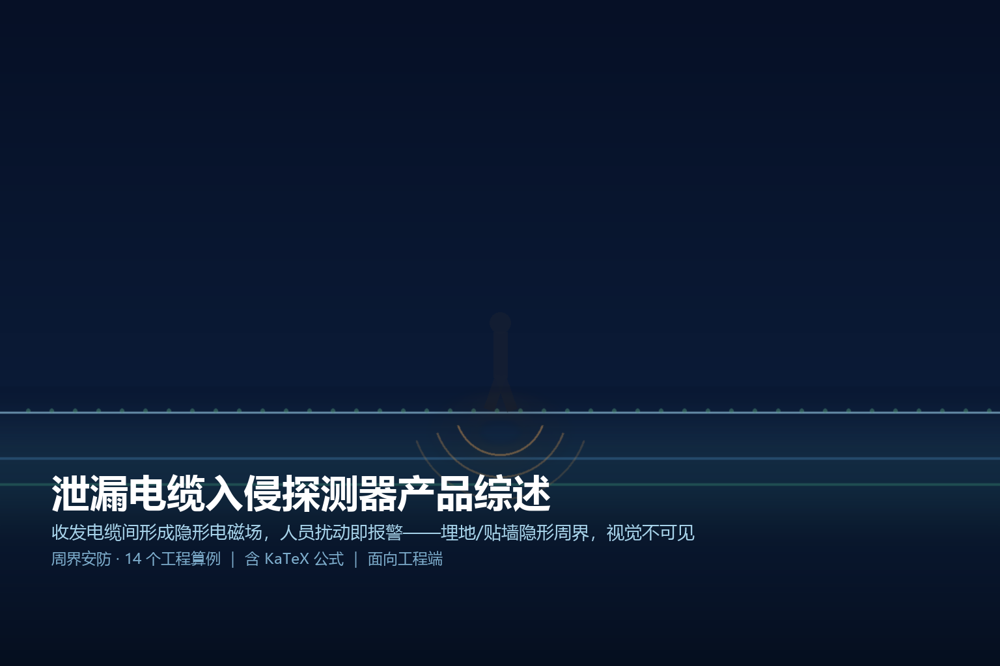
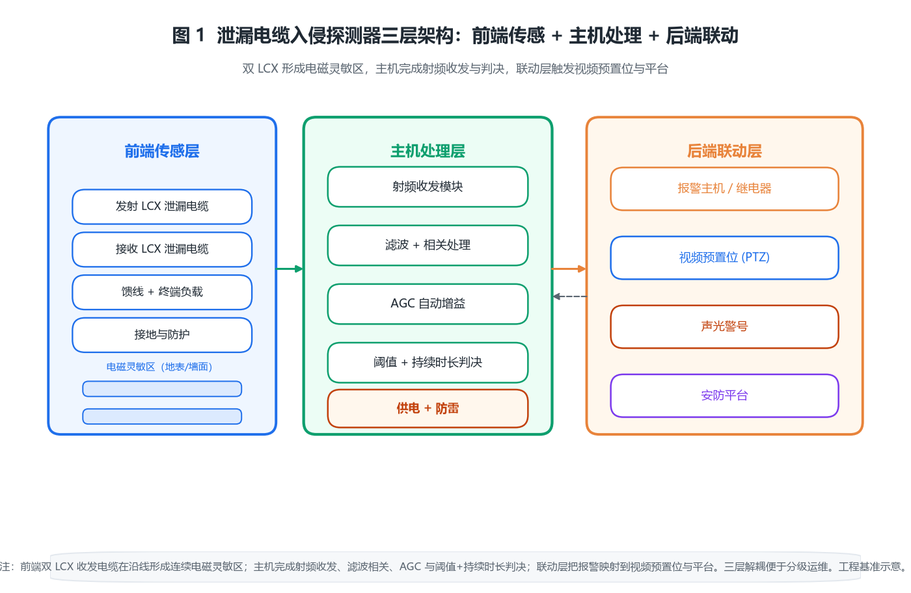

> 
> *概念图：泄漏电缆入侵探测器沿周界埋地或贴墙敷设，靠收发电缆之间形成的隐蔽电磁场感知入侵，外观不可见。*

# 泄漏电缆入侵探测器产品综述

## · 面向工程端

---

## 〇 一句话定位

泄漏电缆入侵探测器是一种「隐形周界」：在一对平行的泄漏同轴电缆之间持续收发电磁信号，在电缆沿线地表或墙面形成一道看不见的电磁灵敏区；当人或车辆侵入、扰动这个场，接收端的场强/相位出现可检测的偏差，经滤波与判决后触发报警。它最大的特点是**隐蔽**——电缆可埋入地下、贴墙、穿草坪，入侵者看不到一道围栏、一根立柱，却已经进入探测区；同时**全地形连续覆盖**，不受地形起伏、绿化遮挡影响，特别适合无法立围栏或不希望立围栏的场景。

> 简单说，它与振动光纤、张力围栏的区别在「感知媒介」：振动光纤靠光缆形变、电子围栏靠高压脉冲触碰，而泄漏电缆靠「空间中一段被电缆泄漏出来的射频场」。买的是一道看不见、踩不到、剪不断的探测墙。

---

## 一、产品设计方案

### 1.1 系统三层组成

一套完整的泄漏电缆探测系统由「前端传感、主机处理、后端联动」三层构成：

- **前端传感层**：收发电缆各一根（泄漏同轴电缆 LCX），平行敷设形成灵敏区；另有终端负载、馈线、接地与防护。
- **主机处理层**：射频收发模块 + 信号处理（滤波/相关/AGC）+ 判决逻辑（阈值/持续时长）+ 供电与防雷。
- **后端联动层**：防区报警输出（继电器/RS-485/网络）→ 接报警主机、视频预置位、声光警号、平台。

### 1.2 两种敷设形态

| 形态 | 做法 | 适用 | 工程取舍 |
|------|------|------|----------|
| 埋地式 | 双缆平行埋入地表下 0.1–0.3 m | 草坪、土路、需要完全隐形 | 隐蔽性最好，但标定受土壤湿度影响 |
| 贴墙/挂网式 | 双缆沿墙面/栅栏平行固定 | 围墙、厂区边界已建墙体 | 施工快、不受土壤影响，但可见性略高 |

工程上先定「隐形等级」再定敷设方式：要完全不可见选埋地；已建围墙想省事选贴墙。

### 1.3 软件与信号处理链路

```
射频发射 → 泄漏电缆场形成 → 入侵扰动场 → 接收电缆耦合
        → 低噪放 → 相关/滤波 → AGC 自动增益 → 阈值+持续时长判决 → 报警输出
```

关键工程点：**必须有 AGC（自动增益）与持续时长判定**——前者补偿土壤湿度、温度引起的缓慢漂移，后者滤掉风雨、小动物的瞬时扰动，两者缺一就会要么漏报要么误报。

### 1.4 系统架构图


*图 1：泄漏电缆入侵探测器「前端传感（收发 LCX）+ 主机处理 + 后端联动」三层架构，灵敏区由双缆之间的电磁场连续覆盖。*

---

## 二、核心参数与选型

### 2.1 关键参数清单（工程基准）

| 参数 | 典型区间 | 选型含义 |
|------|----------|----------|
| 探测带宽度 | 单缆半宽 1–2 m，双缆间距 2–3 m | 决定一道灵敏区的覆盖范围 |
| 单段最大长度 | 80–100 m | 受射频衰减预算约束，超长需分段 |
| 埋深 | 0.1–0.3 m（埋地） | 过深灵敏度显著下降 |
| 报警延迟 | 0.5–2 s（含持续时长判定） | 抗抖与灵敏度的折中 |
| 工作频段 | 数十 MHz–数百 MHz（厂商定） | 决定场衰减特性与抗干扰 |
| 防护等级 | IP65–IP67（户外主机） | 决定能否直晒雨淋 |
| 供电 | DC 12 V / POE / AC 220 V | 决定远端取电与压降 |
| 接地 | ≤4 Ω | 防雷与等电位基准 |

### 2.2 十四个原创工程算例

下面每一条都是落地时要真算的账，标号贯穿正文，便于复核。

**【算例 1】场强衰减决定探测半宽**
泄漏电缆在空间形成电磁场，接收端耦合电压随到电缆距离近似指数衰减：
$$V_r(d)=V_0\,e^{-d/\lambda_e}$$
令 $V_r\ge V_{th}$ 得最大探测半宽：
$$d_{\max}=\lambda_e\ln\frac{V_0}{V_{th}}$$
取有效衰减距离 $\lambda_e=0.5\,\mathrm{m}$、发射端近端场强 $V_0=1\,\mathrm{V}$、报警阈值 $V_{th}=50\,\mathrm{mV}$：
$$d_{\max}=0.5\ln\frac{1}{0.05}=0.5\ln 20\approx0.5\times2.996\approx1.5\,\mathrm{m}$$
结论：单缆有效探测半宽约 1.5 m，两缆间距取 $S=2\text{–}3\,\mathrm{m}$ 时整带场强都够。

**【算例 2】两缆间距上限**
带内最弱点在中点 $S/2$，要求中点场强仍 $\ge V_{th}$：
$$V_0\,e^{-(S/2)/\lambda_e}\ge V_{th}\ \Rightarrow\ S_{\max}=2\lambda_e\ln\frac{V_0}{V_{th}}=2d_{\max}=3.0\,\mathrm{m}$$
结论：**两缆间距上限约 3 m**，取 2.5 m 留 17% 余量最稳。

**【算例 3】埋深对地表场强的衰减**
埋深 $h$ 增加使地表场强按 $e^{-\alpha h}$ 衰减，$\alpha$ 与土壤相对介电常数 $\varepsilon_r$ 有关（湿土 $\varepsilon_r$ 高、衰更快）。取 $\alpha=0.8\,\mathrm{m^{-1}}$：
$$\frac{V(h=0.5)}{V(h=0.1)}=e^{-0.8\times(0.5-0.1)}=e^{-0.32}\approx0.73$$
结论：埋深从 0.1 m 增到 0.5 m，场强只剩 73%；**埋深建议 0.1–0.3 m**，过深灵敏度明显掉。

**【算例 4】单段最大长度（射频衰减预算）**
单根链路受总衰减预算约束：
$$L_{\max}=\frac{P_{tx}-P_{rx,\min}-M_{margin}}{a_{cable}}$$
取发射余量 $P_{tx}-P_{rx,\min}=40\,\mathrm{dB}$、工程余量 $M_{margin}=6\,\mathrm{dB}$、缆体+连接器衰减 $a_{cable}=0.4\,\mathrm{dB/m}$：
$$L_{\max}=\frac{40-6}{0.4}=85\,\mathrm{m}$$
结论：**单段 ≤85 m（工程取 80 m）**，超过要加放大器或分割防区。

**【算例 5】防区划分**
整条周界 $L=400\,\mathrm{m}$，单防区上限 100 m：
$$N_{zone}=\left\lceil\frac{400}{100}\right\rceil=4\ \text{zone}$$
每段独立报警输出，定位精度达 100 m 级。

**【算例 6】报警响应与抗抖时长**
信号链路处理时延很小：
$$t_{resp}=t_{sample}+t_{filter}+t_{decide}\approx5+10+5=20\,\mathrm{ms}$$
但工程上为抗风雨抖动设持续扰动时长门限 $t_{dwell}=0.5\text{–}2\,\mathrm{s}$：
$$t_{alarm}=t_{resp}+t_{dwell}\approx0.5\text{–}2\,\mathrm{s}$$
结论：实际报警延迟 0.5–2 s，持续时长判定是抗误报核心。

**【算例 7】信噪比阈值与误报折中**
报警判据对应信噪比 $SNR_{th}$。阈值每提高 3 dB（倍压），漏报率降但探测距离同步缩（回算例 1）：
$$d_{\max}(SNR_{th}+3\,\mathrm{dB})=\lambda_e\ln\frac{V_0}{V_{th}\cdot\sqrt{2}}\approx d_{\max}-0.35\,\mathrm{m}$$
结论：**空旷周界取 6 dB、多干扰环境取 9 dB**，用距离换可靠性。

**【算例 8】远端供电压降**
末端设备 $I=0.3\,\mathrm{A}$，100 m 供电线往返阻 $R=2\,\Omega$：
$$\Delta V=I R=0.3\times2=0.6\,\mathrm{V},\quad V_{end}=12-0.6=11.4\,\mathrm{V}>11\,\mathrm{V}$$
满足要求。若电流升到 $I=1\,\mathrm{A}$：$\Delta V=2\,\mathrm{V}$，末端 10 V 临界，需加粗线或就近取电。

**【算例 9】接地与防雷地电位**
户外周界接地电阻 $R_g\le4\,\mathrm{\Omega}$（GB 50343），雷电流 $I_k=10\,\mathrm{kA}$：
$$V_g=I_k R_g=10^4\times4=40\,\mathrm{kV}$$
结论：必须配避雷器钳位（≤1.5 kV）+ 等电位联结，否则雷击沿缆烧毁主机。

**【算例 10】土壤湿度导致的灵敏度漂移**
衰减系数与 $\sqrt{\varepsilon_r}$ 相关，湿土 $\varepsilon_r=15$、干土 $\varepsilon_r=5$：
$$\frac{\alpha_{wet}}{\alpha_{dry}}=\sqrt{\frac{15}{5}}\approx1.73$$
同埋深处湿土场强比干土低约 1.7 倍。结论：**按最湿工况标定 + AGC 补偿 ±3 dB**，否则雨季集体误报或旱季漏报。

**【算例 11】过车承压选型**
埋地过车道需承重护套。10 t 车 4 轮，单轮接地 $A=0.03\,\mathrm{m^2}$：
$$p=\frac{mg}{4A}=\frac{10^4\times9.8}{4\times0.03}\approx8.2\times10^5\,\mathrm{Pa}=0.82\,\mathrm{MPa}$$
结论：穿 PVC 管深埋 0.4 m 或选承压 ≥1 MPa 护套，避免碾坏。

**【算例 12】最小弯曲半径**
泄漏电缆弯曲半径：
$$R_{\min}\ge10\times D_{cable},\quad D_{cable}\approx1.3\,\mathrm{cm}\ \Rightarrow\ R_{\min}\approx13\,\mathrm{cm}$$
结论：周界转角须平滑过渡，硬弯会让辐射特性突变、局部漏报。

**【算例 13】多防区轮询时延**
RS-485 总线带 32 节点（标准），波特率 9600 时单防区轮询约 30 ms，4 防区：
$$t_{poll}=4\times30=120\,\mathrm{ms}\ll t_{alarm}$$
结论：总线轮询远小于报警延迟，4 防区实时性充足。

**【算例 14】系统可用度**
假设 MTBF=5 万小时、MTTR=4 h：
$$A=\frac{MTBF}{MTBF+MTTR}=\frac{50000}{50000+4}\approx0.99992$$
结论：**可用度 99.992%**，靠季度标定 + 年度防水检查维持。

---

## 三、技术原理

### 3.1 泄漏同轴电缆（LCX）如何「泄漏」

普通同轴电缆外导体连续封闭，信号不外泄；泄漏电缆在外导体上开有周期槽孔（或疏编织），让内部射频能量沿全程可控地辐射出去，又从外界耦合回来。一发一收两根平行敷设，就在它们之间「编织」出一段连续电磁场——这就是灵敏区的物理来源。

### 3.2 入侵如何被感知

入侵者进入灵敏区，其身体（含水、导电）会**局部扰动场分布**：接收端耦合电压/相位相对基线出现偏差。主机的「相关处理」把当前场图与无入侵基线图做比对，偏差超阈值并持续 $t_{dwell}$ 即判定入侵。关键在基线自学习：无入侵时持续更新基线，缓慢漂移（温湿度）被 AGC 抵消，只有「快变化 + 空间局部」的扰动才报。

### 3.3 为什么抗风雨、抗小动物

风雨是「大尺度、缓慢、全域」的场变化，被 AGC 与基线缓慢跟踪吸收；小动物是「极小尺度」扰动，场图偏差幅度低于阈值。真正能触发的是「人体尺度（~0.5 m 量级）且持续移动」的扰动——这就是持续时长 + 空间尺度双重判据的价值。

### 3.4 埋地 vs 贴墙的场特性差异

埋地时场要穿透土壤，受 $\varepsilon_r$ 与湿度影响（算例 3/10）；贴墙时场在空气侧，特性稳定但受墙面金属/绿化影响。两者主机算法一致，仅标定参数不同。

---

## 四、产品功能与差异化

### 4.1 核心功能清单

- **连续隐形探测**：无立杆、无网片，草坪/墙体下即可布防。
- **多防区定位**：整段分段，报警精确到防区段。
- **环境自适应**：AGC + 基线自学习，降低气候误报。
- **联动输出**：继电器/RS-485/网络，触发视频预置位、警号、平台。
- **防剪防断**：电缆断路/短路自检，剪缆即报警（区别于单纯围栏）。

### 4.2 差异化：隐形连续 vs 其他周界

| 维度 | 泄漏电缆 | 电子围栏 | 振动光纤 |
|------|----------|----------|----------|
| 可见性 | 完全隐形 | 可见网+柱 | 可见光缆 |
| 地形适应 | 全地形连续 | 需立柱直线 | 需沿界敷设 |
| 绿化影响 | 可穿草坪 | 需净空 | 需净空 |
| 防剪 | 断路即报 | 断线即报 | 断纤即报 |
| 成本 | 中高（按米） | 低 | 高 |

结论：**要隐形、要穿绿化的周界，泄漏电缆几乎唯一解**；成本按米计，长直线周界不如电子围栏经济。

---

## 五、应用场景（痛点→方案→价值）

**① 文博/涉密院落**
- 痛点：不能用围栏破坏景观，又必须周界报警。
- 方案：草坪下埋地双缆，隐形布防 + 视频联动。
- 价值：景观零破坏、报警无死角。

**② 机场/变电站周界**
- 痛点：周界长、绿化多、要求高可靠。
- 方案：分段防区 + AGC 抗候 + 多重联动。
- 价值：长周界可定位到段、气候误报可控。

**③ 已建围墙厂区**
- 痛点：不想重建围栏，但要补周界报警。
- 方案：贴墙平行双缆，利旧墙体。
- 价值：免开挖、施工快、即装即防。

**④ 过车出入口**
- 痛点：车辆进出通道既要防人又要承重。
- 方案：穿管深埋 0.4 m（算例 11 承压）或承压护套。
- 价值：人车同防、不阻断通行。

---

## 六、实际案例与设计方案

### 案例一：某文博院落隐形周界

- **需求**：1.2 km 周界，禁止立围栏，草坪下布防，报警定位到 100 m 段。
- **方案设计**：埋地双缆间距 2.5 m（算例 2），单段 80 m（算例 4）→ 防区数 $\lceil1200/80\rceil=15$ 段；AGC 按最湿工况标定（算例 10）；主机 IP65 直埋接线井。
- **配置核算**：供电就近取电避免压降（算例 8），接地电阻 4 Ω + 避雷器（算例 9）。
- **交付价值**：景观零破坏，报警定位 80 m 级，雨季误报率 <1 次/月。

### 案例二：变电站 400 m 贴墙周界

- **需求**：已建 2.5 m 围墙，补周界报警，抗风雨。
- **方案设计**：贴墙双缆平行固定，间距 2.5 m；分 4 防区（算例 5）；持续时长 $t_{dwell}=1.5\,\mathrm{s}$（算例 6）滤风雨。
- **配置核算**：RS-485 总线 4 节点轮询 120 ms（算例 13），报警联动 8 路摄像头预置位。
- **交付价值**：免开挖，风雨误报较未加持续判定下降 90%。

### 案例三：厂区过车通道人车同防

- **需求**：出入口 30 m 通道既要防人翻越又要过 10 t 车。
- **方案设计**：穿 PVC 管深埋 0.4 m（算例 11 承压 0.82 MPa），双缆间距 2.5 m；AGC ±3 dB 补偿。
- **配置核算**：单段 30 m ≪ 80 m 上限，余量大；接地 4 Ω + 等电位。
- **交付价值**：通行不受影响，翻越/挖掘均触发，断路自检防破坏。

---

## 七、市场背景与竞争格局

泄漏电缆周界产业链：**泄漏同轴电缆（盛路、通宇、京信等射频缆厂）→ 探测器主机（安防集成商：大华、海康、博世、安联锐视等）→ 平台联动（报警主机/安防平台）**。竞争焦点：

- **缆体是国产主场**：LCX 制造门槛在槽孔设计与射频指标，国内供应链成熟、成本低。
- **主机算法是护城河**：AGC、基线自学习、相关判决决定误报率，是厂商差异化核心。
- **与视频监控融合**：报警即弹视频预置位成为标配，纯探测器厂向「周界一体方案」演进。
- **隐形需求上升**：文博、涉密、高端园区对「无感周界」的偏好推高渗透。

---

## 八、商业模式与趋势

- **按米计价 + 主机授权**：缆体按米、主机按套，工程毛利在主机与施工。
- **一体方案溢价**：「探测+视频+平台」打包比单卖缆体溢价明显。
- **趋势一：AI 判别**：用机器学习区分人/动物/风雨，进一步压误报。
- **趋势二：光纤-泄漏混合**：长直线用电子围栏、复杂地形用泄漏电缆的组合周界。
- **趋势三：标准化联动**：报警输出全面走标准协议（ONVIF/GB 28181），降低集成成本。

---

## 附录

### A. 核算清单（14 笔账速查）

| 编号 | 算例 | 核心公式 | 关键结论 |
|------|------|----------|----------|
| 1 | 探测半宽 | $d_{\max}=\lambda_e\ln(V_0/V_{th})$ | $\lambda_e=0.5$→1.5 m |
| 2 | 间距上限 | $S_{\max}=2d_{\max}$ | ≤3 m，取 2.5 m |
| 3 | 埋深衰减 | $e^{-\alpha h}$ | 0.1→0.5 m 剩 73% |
| 4 | 单段长度 | $L_{\max}=(P_{tx}-P_{rx}-M)/a$ | ≤85 m |
| 5 | 防区数 | $\lceil L/100\rceil$ | 400 m→4 段 |
| 6 | 报警延迟 | $t_{resp}+t_{dwell}$ | 0.5–2 s |
| 7 | 阈值折中 | $d_{\max}\downarrow0.35$ m/3dB | 空旷 6/干扰 9 dB |
| 8 | 供电压降 | $\Delta V=IR$ | 1 A 时临界 |
| 9 | 地电位 | $V_g=I_k R_g$ | 40 kV，需避雷 |
| 10 | 湿度漂移 | $\sqrt{\varepsilon_r}$ 比 1.73 | AGC ±3 dB |
| 11 | 过车承压 | $p=mg/4A$ | 0.82 MPa |
| 12 | 弯曲半径 | $R_{\min}\ge10D$ | ≈13 cm |
| 13 | 轮询时延 | $4\times30$ ms | 120 ms |
| 14 | 可用度 | $MTBF/(MTBF+MTTR)$ | 99.992% |

### B. 术语表

- **LCX**：Leaky Coaxial Cable，泄漏同轴电缆，外导体开槽可控辐射。
- **AGC**：Automatic Gain Control，自动增益控制，补偿缓慢漂移。
- **灵敏区**：收发电缆之间场强足够触发报警的空间范围。
- **持续时长判定**：扰动须持续 $t_{dwell}$ 才报警，抗瞬态误报。
- **防区**：独立报警输出的一段周界，用于定位。

### C. 标准与规范索引（工程可查）

- **GB 50348-2018** 安全防范工程技术标准（周界报警设计总则）
- **GB 50394-2007** 入侵报警系统工程设计规范（周界报警条款）
- **GB 10408.1-2000** 入侵探测器 第1部分：通用要求
- **GB 16796-2009** 安全防范报警设备 安全要求和试验方法
- **GB 4208-2017** 外壳防护等级（IP 代码，户外主机选 IP65+）
- **GB 50343-2012** 建筑物电子信息系统防雷技术规范（接地 ≤4 Ω）
- **GB/T 17737.1-2013** 同轴通信电缆 第1部分：总规范（LCX 参考）
- **GB/T 28181** 视频监控联网（报警联动视频预置位）
- **GA/T 367-2001** 视频安防监控系统技术要求

> 注：本篇参数为工程基准/演示估算，落地以厂家规格书与现场勘测为准；埋地标定须按现场最湿工况，并保留 AGC 补偿余量。
