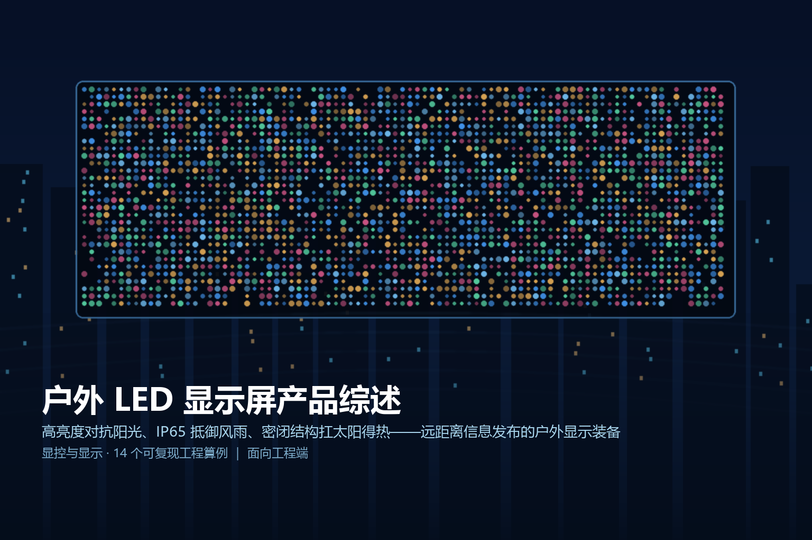
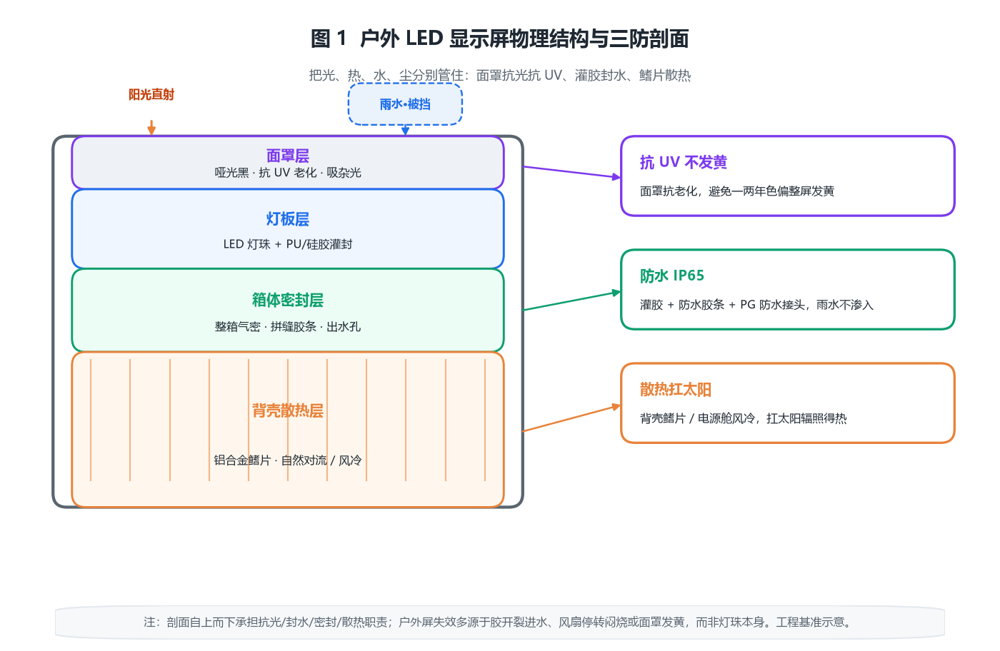
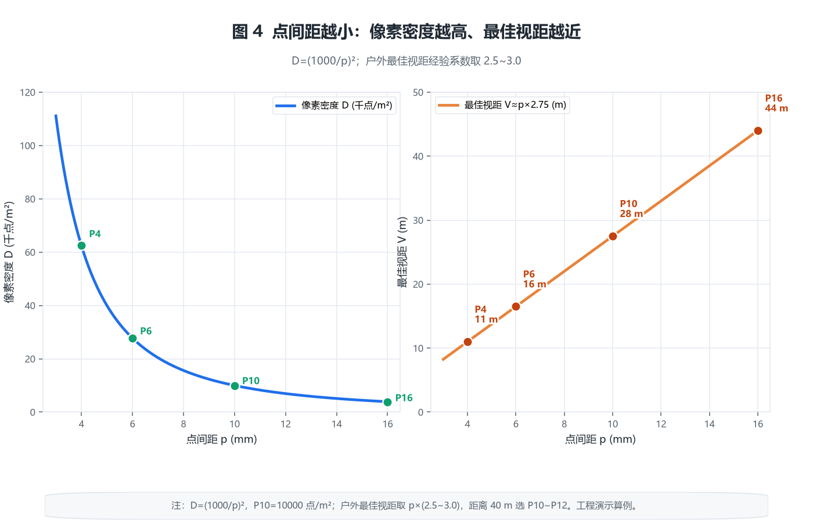
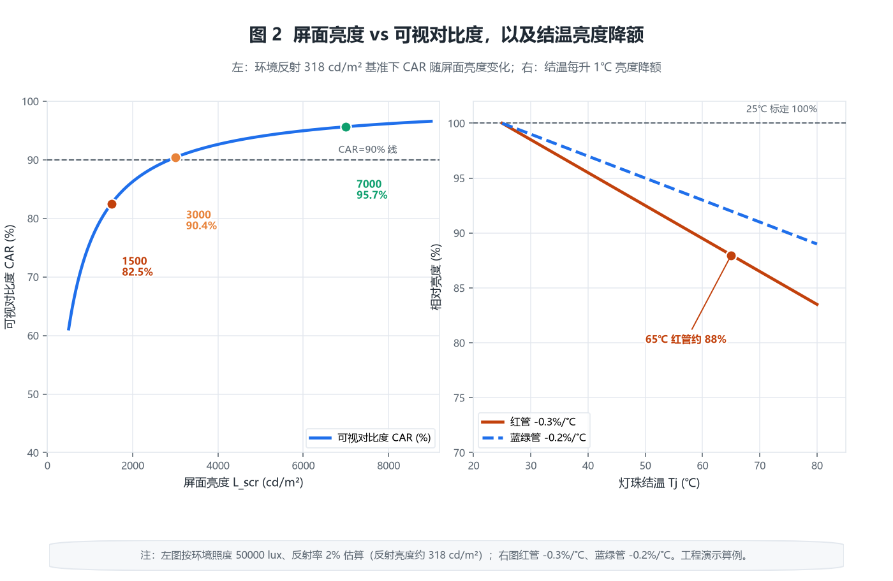
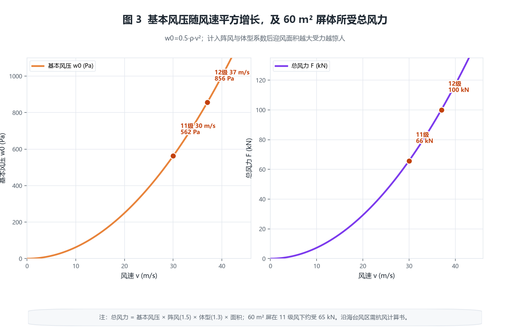

> 
> *概念图：户外 LED 显示屏广场信息发布应用示意*

# 户外 LED 显示屏产品综述

## · 面向工程端

---

## 〇 一句话定位

户外 LED 显示屏是工作在日晒、雨淋、风载与温度剧烈变化环境中的高亮度自发光大屏，靠高亮度对抗环境光、靠 IP65 级密封抵御风雨尘土、靠密闭结构与散热设计扛住太阳辐照得热，是广场、楼顶、交通枢纽与体育场馆做远距离信息发布与广告的核心显示装备。

> 简单说，室内屏比的是「多近都看不到颗粒」，户外屏比的是「太阳底下还看得清、暴雨台风刮不坏、连开一夏天不黑屏」。它的所有工程难点，几乎都来自三个室内屏不存在的敌人：强环境光、水与尘、还有头顶那颗太阳带来的得热与风。

---

## 一、产品设计方案

### 1.1 户外屏与室内屏的本质差异

室内小间距屏追求像素密度与近距细腻度，而户外屏的设计优先级完全不同。把两者放一起看，就能明白为什么不能把室内方案直接搬到楼顶：

| 维度 | 室内屏 | 户外屏 |
|------|--------|--------|
| 屏面亮度 | 500~1500 cd/m² | 5000~8000 cd/m²（直射阳光下需更高） |
| 环境照度 | 300~1000 lux | 晴天可达 10000~100000 lux |
| 防护等级 | IP20（无防护） | IP65/IP66（防雨防尘） |
| 散热条件 | 空调房、可装风扇 | 密闭、无风、受太阳直射 |
| 点间距 | P0.9~P3（小） | P3~P16（大） |
| 维护方式 | 多为后维护 | 以前维护（磁吸/快锁）为主 |
| 结构受力 | 自重为主 | 自重 + 巨大风荷载 |

> 一句话：户外屏是「被太阳晒、被雨淋、被风吹」的显示产品，工程上它更接近一台户外电气设备，而不是一块室内装修材料。

### 1.2 箱体、模组与面罩的物理结构

户外屏的基本单元仍是**模组**（Module），多块模组拼成**箱体**（Cabinet），多个箱体拼成整屏；但户外箱体的关注点不是轻薄，而是**密封、强度与散热**。

- **模组**：PCB + LED 灯珠 + 驱动 IC + 面罩。户外灯珠普遍采用 **SMD 表贴 2727 / 3535 / 1921** 等较大尺寸（比室内 1010/1515 大），原因是户外观看距离远、单灯要更亮、且要耐候。
- **箱体**：户外箱体多为压铸铝或钣金结构，IP65 的关键在于**整箱密封**：面罩与灯板之间灌胶、箱体拼缝用防水胶条、出线用防水接头（PG 头或航空插头）。
- **面罩**：户外面罩除防眩、提对比外，还要抗 UV 老化——劣质面罩一两年就发黄，整屏色偏。

*图 1：户外屏物理结构与三防剖面（面罩→灯珠胶封→箱体密封→背壳散热齿→防水接头→钢架与接地）*

### 1.3 防护与散热剖面

户外屏的可靠性几乎都押在「密封」与「散热」两件事上，剖面从上到下依次承担不同职责：

- **面罩层**：哑光黑、抗 UV，吸收杂散光、降低反射、保护灯珠。
- **灯板层**：灯珠灌胶（PU 或硅胶）封死，水进不到电路。
- **箱体层**：整箱气密，拼缝胶条 + 出水孔（防止冷凝水积存）。
- **散热层**：背壳带散热齿（鳍片），靠自然对流把热量导出；高亮屏在箱体电源舱强制风冷。
- **接口层**：所有进出线走防水接头，防止沿线缆渗水。

> 户外屏的致命故障大多不是灯珠坏了，而是**胶开裂进水、风扇停转闷烧、面罩发黄、箱体锈蚀**。密封与散热做不好，标称寿命再高也白搭。

---

## 二、核心参数与选型

### 2.1 亮度与阳光可读性

这是户外屏最硬的指标。人眼能否看清屏面，取决于**屏面亮度与环境反射亮度的对比**，而不是屏面亮度绝对值。

**【原创算例 1】可视对比度与屏面亮度临界。**
环境照度 $E$ 下，屏面（反射率 $\rho$）的反射亮度约为：

$$
L_{\mathrm{amb}}=\frac{E\cdot\rho}{\pi}
$$

晴天正午 $E=50000\ \mathrm{lux}$、面罩反射率 $\rho=2\%$ 时，$L_{\mathrm{amb}}=50000\times0.02/\pi\approx318\ \mathrm{cd/m^2}$。屏面自身亮度 $L_{\mathrm{scr}}$ 时，观察者看到的可视对比度（Contrast Against Reflected）：

$$
CAR=\frac{L_{\mathrm{scr}}}{L_{\mathrm{scr}}+L_{\mathrm{amb}}}
$$

- $L_{\mathrm{scr}}=7000$ 时，$CAR=7000/(7000+318)\approx95.7\%$；
- 降到 $3000$ 时，$CAR=3000/3318\approx90.4\%$；
- 再降到 $1500$（远低于户外标称）时，$CAR=1500/1818\approx82.5\%$，太阳直射下画面已开始发糊。

**结论**：户外屏标称 5000~8000 cd/m² 并非「越亮越好」，而是为了把环境反射压制到可视对比度 90% 以上；当亮度低于约 2000 cd/m²，直射阳光下可读性急剧恶化——这正是室内 1000 cd/m² 屏绝对不能拿去户外的根因。

> 标准锚点：高速公路 LED 可变信息标志亮度要求见 **GB/T 23828-2009**（晴天 ≥8000 cd/m²、夜间可调到约 300 cd/m² 量级）；民用户外广告屏一般取 5000~7000 cd/m² 标称。亮度单位用 cd/m²（尼特，nit），不是流明。

### 2.2 点间距、像素密度与最佳视距

户外观看距离远（常在 10~100 m），点间距比室内大得多，常见 P4、P6、P8、P10、P16。

**【原创算例 2】像素密度与最佳视距。**
像素密度 $D$（点/m²）与点间距 $p$（mm）的关系：

$$
D=\left(\frac{1000}{p}\right)^2
$$

P10 的 $D=(1000/10)^2=10000$ 点/m²；P6 为 27778 点/m²。户外最佳视距经验公式较室内更保守（颗粒感在远距仍可见），取：

$$
V\approx p\times (2.5\sim3.0)
$$

P10 最佳视距约 25~30 m，P6 约 15~18 m。工程上先定观看距离，再反推间距：距离 40 m 选 P10~P12 足够，距离 8 m 需压到 P4~P5。

*图 4：点间距越小像素密度越高、最佳视距越近（户外经验系数 2.5~3.0）*

### 2.3 温度降额与太阳得热

户外屏真正的散热难题不是自身发热，而是**自身发热叠加太阳辐照**。

**【原创算例 3】太阳得热与密闭箱体温升估算。**
屏体受两方面得热：自身光电转换损耗（光效约 10%~15%，其余变热）+ 太阳直射。设最大功耗 $P_{\max}=1000\ \mathrm{W/m^2}$，光效 12%，则自发热 $(1-0.12)\times1000=880\ \mathrm{W/m^2}$；垂直受晒面太阳辐照 $q_{\mathrm{sun}}\approx900\ \mathrm{W/m^2}$，合计得热：

$$
\Phi=q_{\mathrm{sun}}+P_{\max}(1-\eta_{\mathrm{opt}})\approx900+880=1780\ \mathrm{W/m^2}
$$

密闭箱体无风、靠背壳自然对流，等效热阻 $R\approx0.06\ \mathrm{m^2\cdot K/W}$（鳍片铝壳工程估算），稳态箱体温升：

$$
\Delta T=\Phi\cdot R\approx1780\times0.06\approx107\ \mathrm{K}
$$

即环境 35℃ 时箱内可达约 142℃——显然不现实，说明**纯自然散热撑不住满负荷**，高亮户外屏要么限功率运行、要么电源舱强制风冷、要么靠夜晚/阴天拉高亮度白天降额。

**【原创算例 4】灯珠结温亮度降额。**
LED 亮度随结温升高而下降，红管温度系数约 $-0.3\%/^\circ\mathrm{C}$、蓝绿管约 $-0.2\%/^\circ\mathrm{C}$。结温 $T_j$ 相对 25℃ 标定的亮度损失：

$$
\Delta B=(T_j-25)\cdot k_T
$$

若环境 40℃、箱体温升 20℃、灯珠结温较箱体温再高 5℃，则 $T_j\approx65^\circ\mathrm{C}$，红管降额 $(65-25)\times0.3\%=12\%$。意味着**标称 7000 cd/m² 在 65℃ 结温下实际只能出约 6160 cd/m²**——高温季节户外屏必须降电流保寿命，标称亮度只在 25℃ 实验室成立。

> 工程基准：灯珠寿命常用「温度每升 10℃，寿命减半」的阿伦尼乌斯经验（行业通行估算），故把结温压住，比多堆亮度更重要。

*图 2：左——屏面亮度 vs 可视对比度（环境反射 318 cd/m² 基准）；右——结温 vs 相对亮度降额（$k_T$ 红/蓝绿）*

### 2.4 功耗与配电

**【原创算例 5】整屏功耗与配电容量。**
户外屏峰值功耗常达 600~1200 W/m²。取 800 W/m²、屏体 10 m×6 m=60 m²：

$$
P_{\max}=800\times60=48000\ \mathrm{W}=48\ \mathrm{kW}
$$

平均功耗约为峰值 35%~50%，取 40% 得 $P_{\mathrm{avg}}=19.2\ \mathrm{kW}$。配电容量按峰值 ×1.2 余量、并计入空调/风扇：

$$
S\approx\frac{P_{\max}\times1.2}{\mathrm{PF}}\approx\frac{48\times1.2}{0.9}\approx64\ \mathrm{kVA}
$$

故该屏宜配 80 kVA 级配电柜（含空开、浪涌、分路）。

**【原创算例 6】配电线路压降与铜缆截面。**
配电柜距屏体 50 m，三相 380 V 带平均 19.2 kW（PF 0.9），相电流：

$$
I=\frac{P}{\sqrt{3}\,U\,\mathrm{PF}}=\frac{19200}{\sqrt{3}\times380\times0.9}\approx32.4\ \mathrm{A}
$$

铜电阻率 $\rho=0.0172\ \Omega\cdot\mathrm{mm^2/m}$，允许压降取 3%（约 11.4 V/相）。单程电阻上限 $R_{\max}=\Delta U/I=11.4/32.4\approx0.352\ \Omega$，所需截面：

$$
A=\frac{\rho L}{R_{\max}}=\frac{0.0172\times50}{0.352}\approx2.44\ \mathrm{mm^2}
$$

选 4 mm²（YJV）三相即可；若距离翻倍到 100 m 则需 6 mm² 以上，否则末端箱体电压跌落导致亮度不均、电源反复保护。

### 2.5 风荷载与抗风结构

大屏迎风面积是隐形的结构杀手，常被只看电参数的工程师忽略。

**【原创算例 7】基本风压与总风力。**
基本风压公式：

$$
w_0=\frac{1}{2}\rho v^2
$$

空气密度 $\rho=1.25\ \mathrm{kg/m^3}$，11 级风 $v=30\ \mathrm{m/s}$ 时 $w_0=0.5\times1.25\times900=562.5\ \mathrm{Pa}$。计入阵风系数 1.5 与体型系数约 1.3，作用风压约 $562.5\times1.5\times1.3\approx1097\ \mathrm{Pa}$。对 60 m² 屏体，总风力：

$$
F=1097\times60\approx65.8\ \mathrm{kN}
$$

约相当于 6.7 吨力。这还只是风压，未含屏体自重与地震。钢架、桁架与地脚螺栓必须按此受荷设计，楼顶悬挂屏还要核算原结构承重。

**【原创算例 8】抗风等级换算。**
同样公式倒推：要扛 12 级风（$v=37\ \mathrm{m/s}$），$w_0=0.5\times1.25\times1369=856\ \mathrm{Pa}$，加系数后 ≈1670 Pa，总风力约 100 kN。沿海台风区域（基本风压可达 0.8~1.0 kPa 以上）户外大屏必须有抗风计算书，不能按内陆经验套。

*图 3：基本风压随风速平方增长（左）；不同风速下 60 m² 屏体所受总风力（右）*

---

## 三、技术原理

### 3.1 高亮度从哪来：电流、占空与芯片

户外灯珠要亮，靠三件事：更大的芯片尺寸（3535 比 1010 可承受更高电流）、更高的驱动电流密度、以及合理的 PWM 占空。亮度近似正比于平均电流，但电流越高结温越高、光效越低、寿命越短——**亮度是拿寿命换的**，所以高温降额不是偷工，是保命。

### 3.2 灰度与刷新

**【原创算例 9】灰度等级与最低可见灰阶。**
16 bit 灰度有 $2^{16}=65536$ 级。标称全白 7000 cd/m² 时，单级亮度约 $7000/65535\approx0.107\ \mathrm{cd/m^2}$，低于暗环境分辨阈值，但高刷新（≥3840 Hz）能保证摄像头不拍出扫描线。阳光下真正决定「看清」的是整体亮度，而非灰度——这是与室内屏相反的设计重心。

### 3.3 防水防尘的失效模式

IP65 指「防尘（6）+ 防低压喷水（5）」。但实际失效常来自：
- 灌胶气泡/开裂 → 水汽沿灯脚渗入；
- 防水接头未拧紧或反复插拔磨损；
- 昼夜温差导致内部结露（需在箱体留呼吸阀或干燥剂）；
- 酸雨/盐雾腐蚀焊点与铝壳（沿海需 316 不锈钢件或喷塑加厚）。

### 3.4 散热路径

**【原创算例 10】强制风冷风量估算。**
若电源舱风冷带走主要热量，需风量：

$$
Q_{\mathrm{air}}=\frac{\Phi}{\rho_{\mathrm{air}}c_p\Delta T}
$$

取 $\Phi=19.2\ \mathrm{kW}\times0.88\approx16.9\ \mathrm{kW}$（平均工况），空气 $\rho c_p\approx1200\ \mathrm{J/(m^3\cdot K)}$，温升控 10 K，则 $Q_{\mathrm{air}}=16900/(1200\times10)\approx1.41\ \mathrm{m^3/s}\approx5070\ \mathrm{m^3/h}$。单台 200 mm 风机约 800~1000 m³/h，需 5~7 台并联且防尘网定期清理（堵了风量骤降）。

---

## 四、产品功能与差异化

- **亮度自动调节**：光敏探头测环境光，白天拉满、夜间降到 800~1500 cd/m² 防光污染扰民。
- **前维护**：磁吸或快锁模组，从正面单手拆换，无需后部通道——这是户外屏（尤其贴墙/镶嵌）的主流维护方式，区别于室内后维护。
- **宽温工作**：标称 $-20\sim+50^\circ\mathrm{C}$（工业级），电源与驱动 IC 选宽温料。
- **色彩一致性**：逐箱/逐点校正（亮度与色度），抵消灯珠离散与面罩色差。
- **远程集控**：通过网络统一开关屏、调亮度、播节目、看故障，便于多屏运维。

**【原创算例 11】像素失控率与 MTBF。**
灯珠失效率以 PPM（百万分之一）计，取 100 PPM。整屏 60 m²、P10（10000 点/m²）共 $6.0\times10^5$ 点，期望失效点：

$$
N_{\mathrm{fail}}=6.0\times10^5\times100\times10^{-6}=60
$$

即约 60 个失效点，失控率 $60/600000=0.01\%$——这就是为什么逐点校正与模块化更换如此重要。

---

## 五、应用场景（痛点→方案→价值）

- **交通枢纽信息屏（痛点：远距+强光看不清）→ 方案：P8~P16 高亮 + 自动调光 → 价值：百米外可读车次/航班。**
- **商业广场广告屏（痛点：风吹雨淋+夜间光污染）→ 方案：IP65 前维护 + 昼夜亮度策略 → 价值：全天运营合规。**
- **体育场馆计分屏（痛点：大尺寸+强风）→ 方案：钢结构抗风计算 + 高刷新 → 价值：赛事转播无扫描线。**
- **楼顶标识屏（痛点：高空维护难）→ 方案：前维护模组 + 远程集控 → 价值：免爬架检修。**

---

## 六、实际案例与设计方案

### 案例一：县城广场 P10 双面信息屏

**需求**：12 m×4 m 双面、日均运行 16 h、当地基本风压 0.45 kPa、预算有限。
**方案设计**：P10 户外表贴，单面 48 m²、双面 96 m²；最大功耗取 750 W/m² → 峰值 72 kW，配 100 kVA 柜；前维护磁吸模组；光敏自动调光（昼 6000 / 夜 1000 cd/m²）。
**配置核算**：【原创算例 12】风荷载。基本风压 0.45 kPa、体型系数 1.3、阵风 1.4 → 作用风压 $0.45\times1.3\times1.4\approx0.819\ \mathrm{kPa}$，单面受力 $819\times48\approx39.3\ \mathrm{kN}$，双面桁架按约 80 kN 设计地脚。配电距离 60 m，按【原创算例 6】选 6 mm² 进线。
**交付价值**：远距可读、暴雨可运行、夜间不扰民，三年运维仅更换 3 块模组。

### 案例二：沿海高速 P6 情报板

**需求**：抗盐雾、高亮、7×24 运行。
**方案设计**：P6、IP66、316 不锈钢紧固件 + 加厚喷塑；电源舱双备份风冷；亮度昼 8000 / 夜 300 cd/m²（按 GB/T 23828）。
**配置核算**：【原创算例 13】散热与降额。沿海夏温 38℃、太阳得热叠加，按【原创算例 3/4】结温易超 70℃，故标定亮度按 60℃ 降额后取 8000（即常温标定约 9000+），并限制正午满负荷时长。盐雾寿命按 GB/T 10125 中性盐雾 480 h 验证。
**交付价值**：在盐雾与高温双重严酷下五年无进水、无黄变。

### 案例三：体育场馆 P8 四周屏

**需求**：大尺寸环绕、转播无扫描线、可抗 10 级阵风。
**方案设计**：P8、刷新 ≥3840 Hz、钢结构按 12 级风（≈1.0 kPa）余量设计。
**配置核算**：【原创算例 14】防护与接地。接地电阻按 GB 50343 取 ≤4 Ω，屏体金属构架与配电柜共地；IP65 箱体拼缝全胶条 + PG 防水接头，每年汛期前做气密复检。
**交付价值**：赛事转播画面干净、台风季结构安全、接地电阻达标免雷击损坏。

---

## 七、市场背景与竞争格局

户外 LED 显示屏是 LED 显示里**最成熟、价格最透明**的细分：上游灯珠（三安、华灿等）、中游封装、下游屏厂高度内卷，P10 标准品单价已降至千元/m² 级。竞争焦点从「能不能亮」转向「亮得稳不稳、密封好不好、运维省不省」。高端场景（小间距户外、COB 户外、裸眼 3D）仍有溢价，而普通广告屏已是红海。渠道与服务（安装、结构、售后）比硬件参数更能拉开差距。

---

## 八、商业模式与趋势

- **设备销售 + 工程总包**：屏厂多兼做钢结构与安装，毛利率来自工程与运维。
- **广告分成**：业主出墙面、运营方出屏与内容，按曝光分成——对屏体可靠性要求高（黑屏即丢收入）。
- **趋势一：节能化**：共阴驱动、高效电源把峰值功耗从 1000+ W/m² 压到 600~700 W/m²，省电费也降热量。
- **趋势二：轻量化与集成**：压铸铝箱体向更轻、更薄、前维护一体化演进。
- **趋势三：合规化**：各地对户外屏亮度与光污染立法趋严，自动调光从「加分项」变「必选项」。

---

## 附录

### A. 核算清单（14 个原创算例索引）

1. 可视对比度与屏面亮度临界（CAR）
2. 像素密度与最佳视距（$D=(1000/p)^2$）
3. 太阳得热与密闭箱体温升（$\Phi=q_{\mathrm{sun}}+P(1-\eta)$）
4. 灯珠结温亮度降额（$\Delta B=(T_j-25)k_T$）
5. 整屏功耗与配电容量（$S\approx P_{\max}\times1.2/\mathrm{PF}$）
6. 配电线路压降与铜缆截面（$A=\rho L/\Delta U\cdot I$）
7. 基本风压与总风力（$w_0=0.5\rho v^2$）
8. 抗风等级换算（倒推风速）
9. 灰度等级与最低可见灰阶（65536 级）
10. 强制风冷风量（$Q=\Phi/(\rho c_p\Delta T)$）
11. 像素失控率与 MTBF（PPM×总点数）
12. 案例一风荷载核算（0.45 kPa 地区）
13. 案例二散热与降额（沿海高温）
14. 案例三防护与接地（IP66 + ≤4 Ω）

### B. 关键术语

- **cd/m²（尼特 nit）**：亮度单位，屏面发光强度面密度。
- **IP65**：防尘 6 级 + 防低压喷水 5 级。
- **结温 $T_j$**：LED 芯片 PN 结温度，决定亮度与寿命。
- **基本风压 $w_0$**：风速平方关系的风荷载基准。
- **前维护**：从屏正面拆换模组，无需后部检修通道。

### C. 标准索引（现行可查）

- SJ/T 11141-2017《LED 显示屏通用规范》
- SJ/T 11281-2017《发光二极管(LED)显示屏测试方法》
- GB/T 4208-2017《外壳防护等级（IP 代码）》（等同 IEC 60529）
- GB/T 23828-2009《高速公路 LED 可变信息标志》
- GB 50343-2012《建筑物电子信息系统防雷技术规范》
- GB 4943.1-2011《信息技术设备 安全 第 1 部分》
- GB/T 9254.1-2021《信息技术设备 无线电骚扰限值和测量方法》
- GB 7000.1-2015《灯具 第 1 部分：一般要求与试验》

> 注：文中参数为工程基准/演示估算，具体指标以厂商规格书与现场勘测为准；涉及结构、防雷、电气安全须由具备资质单位出图与施工。
