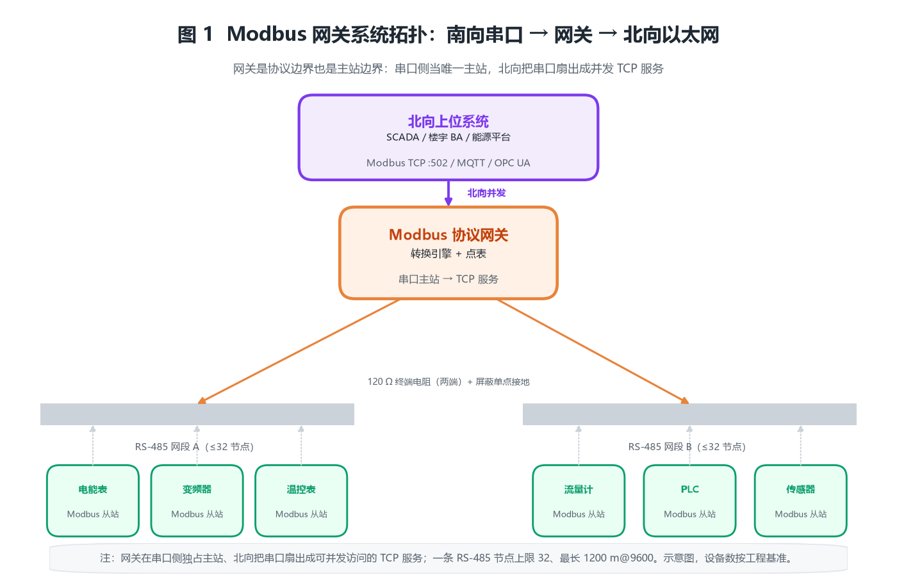
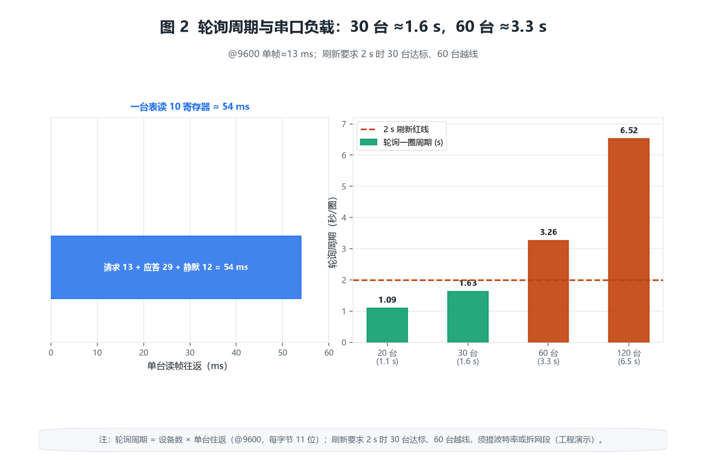
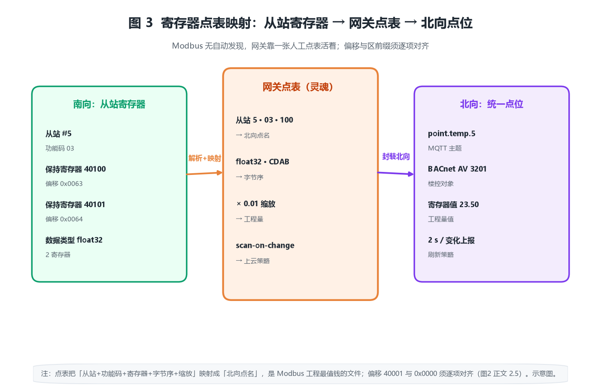

# Modbus 协议网关产品综述：把串口上的老设备，翻译成以太网能听懂的语言

## 〇、一句话定位

Modbus 协议网关的本质，不是「一个更强的控制器」，而是**一座架在南向串口（RS-485 / RS-232 / RS-422）与北向以太网（或 MQTT / OPC UA / BACnet）之间的协议翻译桥**——它把总线上一台台只懂 Modbus RTU/ASCII 的老设备（仪表、变频器、PLC、电表、传感器），转成 TCP 上「可被任意上位系统并发访问」的 Modbus TCP 点位，让 1979 年诞生的协议一路活到今天的云平台与楼宇管理系统里。

从工程角度看，Modbus 网关与传统「协议转换器」最大的不同是：**它不替总线「加速」，只替总线「换接口」**。串口侧的瓶颈——波特率、帧数、主从轮询——一个没少，网关只是把「串口上的问答」搬进了「TCP 上的问答」。所以选型时该算的是「串口还能挂多少设备、轮询一圈要多久」，而不是「网关 CPU 多快」。

> **反直觉点一：网关换不了串口的「主从独占总线」宿命。** 一条 RS-485 上 Modbus RTU 只能有一个主站（master）在说话。如果网关以主站身份去轮询，原来那台 PLC/SCADA 就必须让出总线——二者不能同抢一条串口。很多「上了网关，老系统读不到数」的故障，根因就是主站冲突，不是网关坏了。

> **反直觉点二：Modbus 没有「自动发现」，网关靠一张人工点表活着。** TCP/IP 世界里插上设备能扫到；Modbus 没有这个机制。网关读什么寄存器、按什么字节序拼、北向叫什么点名，全靠一张手工建的点表（寄存器映射）。点表错一位，网关照样每秒回报、不报错，只是你看到的全是错值或 0——最难排查的一类故障。

> **反直觉点三：一个 32-bit 浮点数跨两个 16-bit 寄存器，字节序有 4 种写法。** Modbus 只搬运 16 位寄存器，温度、功率这类浮点要跨寄存器拼。ABCD / CDAB / BADC / DCBA 配错任何一种，读到的都是与真值毫无关系的乱数，且页面「显示正常」。字节序错位是 Modbus 集成工程里出现频率最高的坑。

> **反直觉点四：串口节点数 32 是硬天花板，不是建议值。** RS-485 标准（EIA/TIA-485-A）规定一条总线最多挂 32 个 unit load，超出要加中继器或分网段；而 1200 m 的最大距离只在低波特率下成立，提波特率就得砍距离。这两根线和「设备数」一起，才是网关选型真正的三道闸。

十个锚定数字：标准波特率 9600 / 19200 / 38400 bit/s（RTU）；每字节 11 位（1 起始 + 8 数据 + 1 奇偶 + 1 停止）；从站地址 1–247；功能码 01/02/03/04/05/06/15/16（线圈/离散输入/保持/输入寄存器/单写/多写）；保持寄存器区 4x（40001 起）；Modbus TCP 默认端口 502；RS-485 节点上限 32（无中继）、最长 1200 m；帧间静默 3.5 个字符时间（t_{3.5}）；CRC-16/MODBUS 多项式 0x8005（初值 0xFFFF，低位先出）。

---

## 一、产品设计方案

### 1.1 系统形态：南向串口 + 转换引擎 + 北向网络

Modbus 网关的物理骨架是一条（或多条）**南向串口**（RS-485 为主，RS-232/RS-422 为辅），所有老设备并联挂上去；网关内部一个**协议转换引擎**把 RTU/ASCII 帧解析成寄存器读写，再封装成北向协议；北向通常是一路（或两路）**以太网**，对外提供 Modbus TCP 服务，或主动把点位推送到 MQTT / OPC UA / 云平台。

图 1 画出了典型拓扑：南向两路 RS-485 各挂一批电表/变频器/传感器，网关把它们的寄存器汇总成一张统一点表，北向以 Modbus TCP（端口 502）供 SCADA/楼宇平台/能源管理系统并发读取，同时可经 MQTT 桥接到云端。关键是**网关是「协议边界」也是「主站边界」**——它在串口侧当唯一主站，在北向把串口「伪装」成可被多客户端并发点的 TCP 服务。

部署形态上，Modbus 网关类产品大致分四类：

- **串口服务器（Serial Server）/ 单协议网关**：RS-485 ↔ Modbus TCP 一对一转换，是最常见的基础款。
- **多协议网关**：在网关内同时完成 Modbus ↔ BACnet/IP、Modbus ↔ MQTT、Modbus ↔ OPC UA 等跨协议映射，常用于把楼控/工业老设备喂给上位系统。
- **边缘网关 / IoT 网关**：在北向不止做协议转换，还跑边缘计算（计算、缓存、断网续传、变化上报），CPU 更强、带 Linux。
- **PLC 内置网关模块**：某些 PLC 自带「Modbus 主站 + TCP 服务」功能块，不算独立盒子，但承担同样的翻译角色。

四类不是替代关系：基础款做「串口到 TCP」，多协议款做「跨协议」，边缘款做「带脑子」，PLC 模块做「就近集成」。

### 1.2 拓扑约束：节点、距离、终端电阻与主从

Modbus RTU 的寻址与物理拓扑有硬性天花板，这是选型第一道闸：

- **节点数**：一条 RS-485 最多 32 个 unit load（标准收发器 1 UL/个）。若用 1/4 UL 或 1/8 UL 低负载收发器，可挂到 128 甚至 256 个;但「带载上限」仍由最弱环节决定，混用不同负载系数的设备时要按 total unit load 算。
- **距离**：9600 bit/s 下最长约 1200 m；提波特率距离缩短（约按 1/速率 线性下降，受信号畸变限制）。
- **终端电阻**：总线两端各并 120 Ω（匹配双绞线特性阻抗），消除信号反射；中间节点不接。不接终端电阻，长线高速下误码率飙升，症状是「偶尔读到错值、重读又好了」。
- **主从模型**：RTU 总线任一时刻只有一个主站发问，从站只在被点名时答。网关若抢占主站，原系统必须让位。

这些数字不是「建议」，而是「超过就通信失败」的物理边界。比如一条总线挂了 40 台电表（超过 32），第一个症状一定是「排在后面的表偶尔地址冲突、读数跳变」——最磨人的一类故障。

### 1.3 与相邻系统的边界（三处最容易拉扯）

1. **与 PLC（谁是 master）**：若现场 PLC 已是某条 RS-485 的主站，网关想读同一条总线就必须「搭车」——要么 PLC 把数据转发给网关，要么网关另开一路串口单独轮询从站。直接让网关当第二条主站会冲突。边界是「一条总线一个主」，网关要么接管、要么另起一条。
2. **与 SCADA / BAS（跨协议映射）**：SCADA 多走 Modbus TCP 或 OPC，楼宇 BA 多走 BACnet/IP。网关在中间把「4x 寄存器 40001」映射成「BACnet 模拟量对象」，是 Modbus↔BACnet 网关的核心价值。边界是协议层，不是设备层。
3. **与 KNX / 照明（协议不重叠）**：KNX 是独立总线（见前文），本身不产 Modbus；空调机组、电表若带 Modbus 接口，需经 Modbus 网关先汇成 TCP，再被 BA 或平台读取。很多「楼控读不到电表」的故障，缺的就是这一台网关。

### 1.4 一个常被忽视的合规前提：标准主体与接地

Modbus 本身由 modbus.org（施耐德牵头）维护，国内落地为**国家标准 GB/T 19582-2008《基于 Modbus 协议的工业自动化网络规范》**（共 3 部分：第 1 部分实现指南、第 2 部分串行链路、第 3 部分 TCP 上实现）。串口物理层遵循 **EIA/TIA-485-A**（对应国标 GB/T 11014）；楼宇侧上位系统常引用 GB 50314-2015（智能建筑设计标准）、GB 50174（数据中心）。

施工上 RS-485 必须**屏蔽双绞线 + 单点接地**，屏蔽层在主机端接保护地、严禁两端都接地（否则地环流烧毁接口）。这条在验收时极容易被「先通了再说」糊弄过去，埋下长线偶发误码的雷。

### 1.5 网关的「灵魂」在点表，不在硬件

和 KNX 一样，Modbus 网关真正值钱的是**那张寄存器映射点表**：哪个从站地址、哪个功能码、读哪段寄存器、按什么字节序拼、北向叫什么点名。一台网关盒子本身只是「能跑转换引擎的 Linux 小板」，它「该读谁、怎么拼、叫什么」全部写在工程文件里。点表一旦乱，表现为「平台上温度是 0、功率是负数」——而现场看不出是软件问题。所以成熟做法：点表纳入版本管理，每次改映射前导出备份，改完用一台真从站做全点回归。

---

## 二、核心参数与选型

### 2.0 选型速查表

| 维度 | 工程基准值 | 说明 |
|---|---|---|
| 南向接口 | RS-485（2 线）/ RS-232 / RS-422 | 多路串口常见 1–4 路 |
| 标准波特率 | 9600 / 19200 / 38400 bit/s | RTU 半双工 |
| 每字节位数 | 11 位（RTU，含起始/奇偶/停止） | ASCII 模式每字节 1 字符 |
| 从站地址 | 1–247 | 0 为广播地址 |
| 功能码 | 01/02/03/04/05/06/15/16 | 读写线圈/寄存器 |
| 保持寄存器 | 4x（40001 起） | 输入寄存器 3x |
| 北向协议 | Modbus TCP（端口 502） | 可选 BACnet/MQTT/OPC UA |
| RS-485 节点 | ≤32 UL（无中继） | 低负载收发器可扩 |
| RS-485 距离 | ≤1200 m（@9600） | 提波特率则缩短 |
| 默认响应超时 | 1000 ms（工程基准） | 须大于最长帧往返 |
| 帧间静默 | 3.5 字符时间 t_{3.5} | RTU 帧边界 |

### 2.1 【原创算例 1】单帧时长账：一条读保持寄存器报文有多久

一条 RTU 读报文（功能码 03，读 N 个保持寄存器）的字节构成：从站地址(1) + 功能码(1) + 起始地址(2) + 寄存器数(2) + CRC(2) = 8 字节请求；应答为 1+1+1+2N+2 字节。RTU 每字节 11 位（1 起始 + 8 数据 + 1 奇偶 + 1 停止），速率 9600 bit/s：

$$T_{\mathrm{byte}}=\frac{11}{9600}\approx 1.146\ \mathrm{ms},\quad T_{\mathrm{frame}}\approx 8\times 1.146+3.5\times 1.146\approx 13.2\ \mathrm{ms}$$

即一条 8 字节读请求约 **13 ms**（含帧间 3.5 字符静默保护 t_{3.5}）。这是后面算轮询周期的「基本粒子」——和 KNX 单报时长一样，它是所有延迟的原子单位。

### 2.2 【原创算例 2】轮询周期账：一圈扫完要多少秒

网关轮询一条总线上所有设备，总时间 ≈（请求帧 + 应答帧 + 帧间静默）× 设备数。若总线上 30 台电表，每台读 10 个保持寄存器（应答 1+1+1+20+2 = 25 字节）：

$$T_{\mathrm{poll}}\approx n\times (T_{\mathrm{req}}+T_{\mathrm{resp}}+t_{\mathrm{gap}})=30\times (13.2+25\times 1.146+2\times 3.99)\approx 30\times 54.3\approx 1629\ \mathrm{ms}$$

约 **1.6 s 扫一圈**（@9600，含约 4 ms 帧间隔）。这意味着平台上每台表的刷新率上限约 0.6 Hz——若现场要求「秒级实时」，1.6 s 刚好够；若挂到 60 台，周期直接翻倍到 3.3 s。**结论：轮询周期是「设备数 × 每设备字节数 × 单字节时间」的线性函数，想提实时率要么砍设备数、要么提波特率、要么把总线拆多路**。

### 2.3 【原创算例 3】波特率—节点—距离三角：提一维就砍一维

RS-485 的「能传多远」由信号上升沿畸变决定，近似随波特率反比缩短；而节点数受单位负载（UL）约束。三者的工程约束可写成：

$$L_{\max}\approx \frac{1200\ \mathrm{m}}{\min\bigl(1,\ \frac{B}{9600}\bigr)},\qquad N_{\max}=\frac{32}{\sum \mathrm{UL}_i}$$

其中 B 为波特率。若把波特率从 9600 提到 38400（×4），1200 m 距离缩到约 300 m；若总线上混了 2 台 1/4 UL 仪表 + 30 台 1 UL 设备，$\sum \mathrm{UL}=0.5+30=30.5<32$，勉强可挂。把 30 台全换成 1/4 UL 低负载型，则能挂到 128 台（但距离仍受 B 约束）。**结论：要「多设备 + 远距 + 高速」同时满足基本不可能，按现场优先级取舍；远距离优先降波特率，高密度优先换低负载收发器。**

### 2.4 【原创算例 4】Modbus TCP 并发连接数：北向能接几个客户端

Modbus TCP 监听 502 端口，每来一个客户端（SCADA、平台、调试软件）占用一个 TCP 会话。入门级网关常支持 **5–16 个并发 TCP 连接**。若楼宇平台、能源系统、手机 App、两台调试电脑同时在连：

$$N_{\mathrm{conn}}\ge n_{\mathrm{clients}}=5$$

刚好临界，第六个客户端连不上（被网关拒绝或排队）。**结论：北向并发数 = 在网客户端数 + 调试余量；若客户端多，选多连接款或让网关主动「推」到 MQTT 从而减少被动连接**。注意：北向并发再多，串口侧仍是单主轮询，平台看到的「并发」只是网关缓存的多份快照。

### 2.5 【原创算例 5】寄存器地址换算：40001 到底对应偏移几

Modbus 寄存器有两种编号语境，混用必错：**协议偏移（0-based）** 与 **PLC 地址（1-based，带区前缀）**。保持寄存器 4x 区，地址 40001 的协议偏移是 0x0000：

$$\mathrm{offset}=\mathrm{addr}-40001,\qquad \mathrm{addr}=40001+\mathrm{offset}$$

即 40001→0000、40010→0009、42500→0499。坑在两处：① 有的设备手册写「寄存器 0」实际指 40001，有的指 40000（无前缀区），差一个就得全改点表；② 功能码 03 的「起始地址」字段用的是协议偏移，而 HMI 上填的是 PLC 地址。**结论：建点表时先跟设备手册逐条对齐「偏移和区前缀」两种写法，宁可多问一次，别全表返工。**

### 2.6 【原创算例 6】字节序 / 字序：浮点跨寄存器的 4 种拼法

Modbus 只搬运 16 位寄存器。一个 32-bit float（如温度 23.5 ℃）占两个寄存器，字节发送顺序有四派，结果天差地别。设两个寄存器原始字节为 A B（reg1）、C D（reg2）：

| 字节序 | 拼接顺序 | 常见叫法 |
|---|---|---|
| ABCD | A B C D | 大端字+大端字节 |
| CDAB | C D A B | 字交换（Word Swap） |
| BADC | B A D C | 字节交换（Byte Swap） |
| DCBA | D C B A | 小端（Intel） |

若设备按 CDAB 发、网关按 ABCD 解，读到的字节被前后两寄存器对调，数值与真值完全无关（且页面「显示正常、不报错」）。**结论：字节序是 Modbus 集成第一高频坑，网关应支持四种组合可配；建点表前先用一台真设备读一个已知浮点，核对四种拼法找到正确项，再批量套用（以上为工程基准）。**

### 2.7 【原创算例 7】超时与重试：响应超时配太小，扫描直接崩

网关每条请求都有响应超时（默认 1000 ms）。若超时设得小于「最长帧往返 + 从站处理」，从站还没答就被判失败、触发重试，重试又占用总线，雪崩式拉低有效吞吐。设总线上有一台慢设备（处理 800 ms），超时 500 ms：

$$T_{\mathrm{eff}}\approx T_{\mathrm{poll}}+(n_{\mathrm{retry}}\times T_{\mathrm{timeout}})\approx 1.6+2\times 0.5=2.6\ \mathrm{s}$$

比正常 1.6 s 多出 1 s 全耗在无效重试上。**结论：响应超时须大于「该总线最长单帧往返 + 最慢从站处理时间」；对含慢设备的混合总线，宁可超时设 1500–2000 ms，也别为「快设备」把值压到 500 ms 以下。**

### 2.8 【原创算例 8】网关吞吐账：串口容量是真正的天花板

网关的「总轮询能力」受串口带宽约束，不是 CPU。一条 9600 bit/s 串口每秒净吞吐约：

$$C_{\mathrm{ser}}\approx \frac{9600}{11}\times \frac{1}{8}\approx 109\ \mathrm{B/s}$$

（不含静默与帧间隔，有效上限约 100 字节/s。）若每台表问答共约 33 字节（请求 8 + 应答 25），则单串口理论每秒最多服务：

$$R_{\max}\approx \frac{100}{33}\approx 3\ \mathrm{req/s}$$

与算例 2 的「30 台 × 1.6 s」一致（约 18.75 次/秒在多条/留余量）。**结论：单串口有效服务能力约 3 次/秒量级；要多挂设备只能提波特率（代价距离）或加串口（多路网关分摊）。**

### 2.9 【原创算例 9】协议转换延迟：RTU→TCP 加了多毫秒

网关把一条串口 RTU 帧转成 TCP 报文，要做：收完整 RTU 帧（含 t_{3.5} 静默）→ 解析 → 组 TCP MBAP 头 → 发以太网。纯处理延迟很小（CPU 级 <1 ms），主要开销是「等 RTU 帧收齐」：

$$t_{\mathrm{conv}}\approx t_{3.5}+t_{\mathrm{parse}}+t_{\mathrm{enc}}\approx 4+0.3+0.3\approx 4.6\ \mathrm{ms}$$

即单条转换约 5 ms。对平台而言，从「发 TCP 请求」到「收到 TCP 应答」≈ 串口往返（算例 2 的 54 ms）+ 转换 5 ms ≈ 60 ms/次。**结论：转换延迟本身可忽略，端到端延迟几乎全由串口侧轮询决定——再次印证「网关不加速总线」。**

### 2.10 【原创算例 10】CRC 校验账：坏的 CRC 让整帧作废

RTU 帧尾 2 字节 CRC-16/MODBUS，多项式 0x8005、初值 0xFFFF、低位先出（reflected）。网关每收到一帧先校验 CRC，不符直接丢弃、不上报（表现为该点偶尔丢值）。错误 CRC 的来源常是：① 中途有强电磁干扰翻转了 1 位；② 波特率/校验位（无校验/奇/偶）两端不一致导致解帧错位。一个比特翻转使 CRC 失配的概率近乎 100%：

$$\Pr(\mathrm{valid}\mid \mathrm{one\text{-}bit\ error})\approx 0$$

**结论：CRC 是「沉默的守门员」——它不纠错只拒收，电磁环境差的总线会表现为「该点间歇性读不到」，先查屏蔽接地再查波特率，不是网关问题（工程估算）。**

### 2.11 【原创算例 11】多网关级联：一条总线超载就拆网段

当单串口 32 节点或 1200 m 封顶，标准解法是「加网关、拆网段」。一台 40 台电表的车间，若全挤一条 9600 总线：节点 40>32 越限、轮询 2.2 s 偏慢。拆成两路串口各 20 台：

$$N_{\mathrm{seg}}=\left\lceil \frac{40}{20}\right\rceil=2,\quad T_{\mathrm{poll,seg}}\approx 20\times 54.3\approx 1.09\ \mathrm{s}$$

节点回到安全区、单段周期降到 1.1 s。**结论：网关的「路数」是扩展性指标，设备超 32 或距离超 1200 m 时，直接选多串口网关把负载分摊，比加中继器更可控。**

### 2.12 【原创算例 12】RTU 串行 vs TCP 并发：同一份数据两种访问模型

RTU 侧任一时刻只有一个主站占用总线（串行、互斥）；TCP 侧多个客户端可各自发请求，网关用内部缓存把「并发请求」序列化到串口。这意味着：

- RTU 模型下，原 PLC 与网关**不能**同时当主站；
- TCP 模型下，网关把串口「扇出」成多份快照，北向看似并发。

但串口的真实吞吐（算例 8）没变：10 个客户端各每秒读一次，网关仍需在串口上发 10 次轮询，串口负载随客户端数线性涨。**结论：北向并发是「假并发」，串口才是唯一真实瓶颈；客户端越多，越要把轮询结果缓存复用，而非每个请求都下探串口。**

### 2.13 【原创算例 13】端口冲突：同子网多个网关都监听 502

Modbus TCP 默认端口 502。若同一子网部署 3 台网关，都默认监听 502，IP 不同则不冲突（端口按 IP 区分）；但若有人把两台网关配成同一 IP（或做 1 对 N 映射），502 冲突导致后起的连不上。规划时：

规划原则：**每台网关 ⇒ 唯一 IP +（必要时）唯一端口（如 502/503/504）**。

**结论：多网关场景先把 IP 规划清楚，502 冲突本质是 IP/端口规划事故，不是协议限制；跨 VLAN 时还要在防火墙放行 502。**

### 2.14 【原创算例 14】变化上报 vs 全扫：断网缓存省的是带宽不是精度

边缘网关支持两种北向策略：**全扫（scan-all，定时全量上报）** 与 **变化上报（scan-on-change，仅值变才推）**。一台 200 点表、每点 4 字节，全扫每秒一次：

$$B_{\mathrm{all}}=200\times 4\times 8\times 1=6400\ \mathrm{bit/s}\approx 6.4\ \mathrm{kbps}$$

若 90% 点位基本不动，scan-on-change 实际流量可降到全扫的 1/10 以下。断网时网关按深度 D 缓存：

$$D_{\mathrm{cache}}\ge \frac{t_{\mathrm{out}}\times R_{\mathrm{chg}}}{S_{\mathrm{pt}}}$$

**结论：上云链路贵/不稳时，scan-on-change + 断网缓存是标配；缓存深度按「断网时长 × 变化率」反推，别拍脑袋（以上为工程估算，实测以厂商规格为准）。**

---

## 三、技术原理

### 3.1 帧结构：RTU 与 TCP 的两种「语言」

- **RTU 帧**（串口）：地址(1) + 功能码(1) + 数据(N) + CRC(2)，字节间紧凑、靠 t_{3.5} 静默区分帧边界；每字节 11 位。
- **TCP 帧**：在 RTU 数据前加 **MBAP 头（7 字节：事务号 2 + 协议号 2 恒 0 + 长度 2 + 单元号 1）**，去掉 CRC（TCP 本身有校验），数据段与 RTU 一致。

网关转换的核心，就是「拆 RTU 帧 → 提数据 → 包 MBAP 头」与反向，寄存器语义不变。

### 3.2 【原创算例 1 展开】单帧时长即基本粒子

回到算例 1：8 字节读请求 + 25 字节应答 + 2 段 t_{3.5} 静默 ≈ 54 ms。提升波特率到 38400，单字节时间从 1.146 ms 降到 0.286 ms，整帧缩到约 13 ms——但距离从 1200 m 缩到约 300 m（算例 3）。**这是「提速度必砍距离」在帧层面的微观印证。**

### 3.3 【原创算例 2 展开】轮询与更新率的关系

算例 2 算出 30 台表一圈 1.6 s。若平台要求「每台表 2 s 内刷新」，1.6 s 达标；要求「0.5 s 内」，则要么把设备数砍到 ≤10、要么提波特率到 38400（周期约 0.4 s 但距离受限）、要么拆两路串口各 15 台（每路 0.8 s）。**更新率需求是选型的总牵引力。**

### 3.4 【原创算例 12 展开】主从冲突与转发设计

若现场 PLC 已是主站，网关不能抢总线。两种工程解法：① **PLC 转发**：PLC 把从站数据读上来，再通过自己的 Modbus TCP 服务（或内存映射）交给网关；② **网关另起串口**：网关单独接一组从站，原 PLC 总线不动。选哪种看「谁离从站近、谁有空余串口」。

---

## 四、产品功能与差异化

### 4.1 协议转换矩阵：网关能做什么

| 南向 | 北向 | 典型场景 |
|---|---|---|
| Modbus RTU | Modbus TCP | 老设备进以太网（最常见） |
| Modbus RTU | BACnet/IP | 电表/空调机组接入楼控 |
| Modbus RTU | MQTT | 设备上云（IoT 平台） |
| Modbus RTU | OPC UA | 接入工业 MES/SCADA |
| Modbus ASCII | Modbus TCP | 旧 ASCII 仪表兼容 |

转换的「灵魂」是点表：把南向「从站 x + 功能码 + 寄存器」映射成北向「对象名/点位路径」。

### 4.2 点表与映射：建一次，处处可用

点表通常含列：从站地址、功能码、寄存器区、偏移、数据类型（uint16/int16/float32…）、字节序、缩放系数、北向点名。建好后，南向串口轮询、北向服务、缓存、变化上报全部复用同一张表。**这也是 Modbus 工程里「最值钱的一份文件」**——比网关盒子本身值钱。

### 4.3 字节序 / 字序自动识别

好网关支持四种字节序（算例 6）与缩放（如寄存器值 ×0.01 = 实际温度）可配，省去在北向上做换算。建点表前用一台真设备读已知量、四种拼法逐一核对，是标准作业。

### 4.4 透明传输 vs 协议转换

- **透明传输（Serial Tunnel）**：把串口字节原样封进 TCP，两端还是 RTU 语义，适合「远端调试原 PLC」；网关不当主站。
- **协议转换**：网关当主站、解析寄存器、提供 TCP 服务；北向看到的是「点位」不是「字节」。

两者边界在「网关是否当主站」——透明模式下原系统仍是主，协议转换模式下网关是主。

### 4.5 缓存、断网续传与变化上报

边缘网关的价值在「带脑子」：断网时按深度缓存最近值、恢复后补传；scan-on-change 省上云带宽（算例 14）；本地 edge 计算（如把 10 个表读数求和成「车间总功率」）减少平台压力。这些是「串口服务器」和「边缘网关」的本质价差。

---

## 五、应用场景

### 5.1 工厂车间：把分散的仪表/变频器汇进 MES

车间几十台电能表、变频器、温湿度表都带 RS-485 Modbus。一台多路网关把它们汇成 Modbus TCP，MES 一个 IP 全读到，免掉每台设备拉网线的工程。网关在这里的价值是「串口聚合 + 主站边界统一」。

### 5.2 楼宇：BA 读电表与空调机组

楼控系统（BAS，走 BACnet）要读每层电表（Modbus）和各空调机组（Modbus）。Modbus↔BACnet 网关把「4x 寄存器」映射成「BACnet 模拟量对象」，BA 一侧看到的是标准对象，不用关心底下是 Modbus。**分层的价值在责任边界**：电表归电气、BA 归楼控，网关是协议接缝。

### 5.3 能源 / 光伏：逆变器汇总上云

光伏电站几百台逆变器各自 RS-485，经多级网关级联（算例 11）汇总成少数 TCP 点上送能源管理平台 / 云平台（MQTT）。这里「节点 32 + 距离 1200 m」双封顶，必须用多网关分网段 + 边缘缓存（算例 14）解决。

### 5.4 水 / 环保：污水厂仪表联网

污水厂 pH、流量计、液位计多为 Modbus 从站，分布远、环境潮。网关配屏蔽接地（1.4）+ 合理波特率（3）+ 变化上报（14），把海量仪表稳定汇进监控站。电磁环境差时 CRC 拒收（10）会表现为偶发丢点，先查接地。

---

## 六、实际案例

### 6.1 案例一：车间 40 台电能表上云（需求→方案→核算→价值）

- **需求**：40 台智能电表（RS-485，9600），上送能源管理平台（MQTT），要求秒级刷新。
- **方案**：选 2 路 RS-485 网关，每路挂 20 台各成一个网段；网关当主站轮询，北向 MQTT 变化上报。
- **配置核算**：单段节点 20<32 安全；单段周期 20×54.3≈1.09 s（算例 2），满足秒级；字节序按厂商手册 CDAB 逐项核对（算例 6）；总吞吐 2 段 ×3 次/s ≈ 6 次/s，余量充足。
- **交付价值**：免逐表拉网线，平台统一读 40 台；scan-on-change 上云流量降至全扫 1/10。

### 6.2 案例二：楼宇 BA 读 60 台空调机组（Modbus→BACnet）

- **需求**：60 台空调机组带 Modbus，接入 BA（BACnet/IP），平台并发客户端 6 个。
- **方案**：4 路网关（每路 15 台）做 Modbus→BACnet 映射；网关北向 Modbus TCP 同时供 BA 与调试。
- **配置核算**：节点 15×4=60<32×4 安全；北向并发 6 个 ≤ 网关 16 连接（算例 4）；端口 502 按 4 个唯一 IP 规划（算例 13）；单段周期 15×54.3≈0.81 s。
- **交付价值**：BA 一侧看到标准 BACnet 对象，楼控策略直接引用；调试用第 6 个连接不冲突。

### 6.3 案例三：光伏 200 台逆变器级联汇总

- **需求**：200 台逆变器 RS-485，距离跨 3 个机房，上送云平台。
- **方案**：每机房 1 台 4 路网关（各挂约 17 台，≤32），3 台网关经厂区网络汇到边缘服务器；边缘做 scan-on-change + 断网缓存。
- **配置核算**：单网关节点 17<32；距离按机房内 <1200 m 用 9600；3 网关 IP/端口独立（13）；断网缓存深度按 30 min × 变化率反推（14）；字节序统一 CDAB 批量套用（6）。
- **交付价值**：海量逆变器稳定上云，断网期数据不丢；边缘聚合把平台侧连接数从 200 压到 3。

---

## 七、市场背景与竞争格局

Modbus 由 Modicon（现施耐德）于 1979 年提出，2004 年成立 Modbus-IDA 组织，现为施耐德牵头的开放协议；国内以 **GB/T 19582-2008** 落地。它最大的优势是「简单到人人能实现」——这正是它活了 40 年、遍及各行业老设备的原因。

竞争格局：

- **国际品牌**：施耐德（原厂生态）、MOXA、研华（Advantech）、HMS（Anybus）等，主打工业级可靠性与全协议栈。
- **国产品牌**：有人物联、智嵌、亿佰特、周立功等，主打性价比与本地化服务，近年工业级产品增多。
- **替代 / 上位协议**：Profibus、EtherNet/IP（工业现场总线）；BACnet（楼控）；OPC UA、MQTT（IT/云）；IEC 60870-5-104（电力调度）。Modbus 的定位是「老设备与异构系统的通用翻译层」——它不取代这些协议，而是把老设备接到它们上面。

**选型提醒**：警惕「兼容 Modbus」字样的廉价转换器——这类设备往往只实现了基本读写、未过工业温度/EMC 测试，混入现场后就是最难排查的偶发误码源。工业现场优先选标温宽、过 EMC、带隔离的款。

趋势：Modbus 正与 **安全（TLS/加密 Modbus TCP）**、**OPC UA / MQTT 融合**、**TSN 时间敏感网络**演进，目标是在保住「简单」的同时补上「安全」与「云原生」两块短板。

---

## 八、商业模式与趋势

Modbus 网关的利润结构：硬件（小板 + 串口 PHY + 外壳）约占 30–40%，**工程（点表设计、协议栈适配、现场调试、运维）占 60–70%**——和 KNX、会议中控一样，「卖盒子」毛利薄，「做工程」才是护城河。集成商的核心资产是点表方法论与可复用的设备模板库。

趋势一：**从「协议翻译」到「边缘智能」**。网关不止转换，还做本地计算、缓存、断网续传，向上提供「干净的数据」而非「原始字节」。
趋势二：**安全补课**。裸 Modbus TCP 无认证无加密，正被 TLS、账号、ACL 补齐；等保 2.0 场景下「明文 502」是整改重点。
趋势三：**国产替代与软网关**。国产硬件成熟，且「跑在工控机/Linux 上的软网关（如基于 libmodbus）」兴起，把转换能力软件化、可弹性部署。

---

## 附录

### A. 核算清单（14 个算例速查）

| 算例 | 公式核心 | 结论 |
|---|---|---|
| 1 单帧时长 | $8\times 11/9600\approx 13\ \mathrm{ms}$ | 轮询基本粒子 |
| 2 轮询周期 | $n\times (T_{\mathrm{req}}+T_{\mathrm{resp}}+t_{\mathrm{gap}})$ | 30 台≈1.6 s |
| 3 波特-节点-距离 | $L_{\max}\approx 1200/\min(1,B/9600)$ | 提一维砍一维 |
| 4 TCP 并发 | $N_{\mathrm{conn}}\ge n_{\mathrm{clients}}$ | 客户端+调试余量 |
| 5 地址换算 | $\mathrm{offset}=\mathrm{addr}-40001$ | 偏移 / 区前缀对齐 |
| 6 字节序 | ABCD/CDAB/BADC/DCBA | 第一高频坑 |
| 7 超时重试 | $T_{\mathrm{eff}}\approx T_{\mathrm{poll}}+n_{\mathrm{retry}}T_{\mathrm{timeout}}$ | 超时>最长往返 |
| 8 串口吞吐 | $9600/11/8\approx 100\ \mathrm{B/s}$ | 约 3 次/s |
| 9 转换延迟 | $t_{3.5}+t_{\mathrm{parse}}+t_{\mathrm{enc}}\approx 5\ \mathrm{ms}$ | 可忽略 |
| 10 CRC 拒收 | 单比特错→帧作废 | 先查接地 |
| 11 级联拆分 | $\lceil 40/20\rceil=2$ 路 | 超 32 即拆段 |
| 12 RTU vs TCP | 北向假并发 | 串口真瓶颈 |
| 13 端口冲突 | 唯一 IP + 端口 | 502 规划事故 |
| 14 变化上报 | $B_{\mathrm{all}}=200\times 4\times 8$ | 断网缓存按率反推 |

### B. 术语表

- **Modbus RTU/ASCII/TCP**：三种传输模式，RTU 二进制紧凑、ASCII 可读、TCP 跑以太网。
- **从站地址 / 功能码**：RTU 帧寻址与操作类型（03=读保持寄存器）。
- **保持寄存器 4x**：40001 起的读写字区域；输入寄存器 3x 只读。
- **MBAP 头**：Modbus TCP 帧前 7 字节（事务号+协议号+长度+单元号）。
- **Unit Load（UL）**：RS-485 负载单位，总线上总 UL ≤32。
- **点表（寄存器映射）**：从站→寄存器→北向点名的工程文件，网关灵魂。
- **字节序 / 字序**：32-bit 值跨寄存器的 4 种拼法，配错得乱数。
- **scan-on-change**：仅值变才上报，省上云带宽。

### C. 标准索引

- **GB/T 19582-2008**《基于 Modbus 协议的工业自动化网络规范》（第 1/2/3 部分，国标主体）
- **EIA/TIA-485-A**（RS-485 串行电气标准，对应 GB/T 11014）
- **GB 50314-2015**《智能建筑设计标准》（楼控上位系统）
- **GB 50174-2017**《数据中心设计规范》
- **IEC 61158**（工业通信现场总线）
- Modbus 应用协议规范（modbus.org，施耐德维护）

### D. 常见故障速查表

| 症状 | 高概率原因 | 处置 |
|---|---|---|
| 排在后面的表读不到 / 跳变 | 节点超 32 / 地址冲突 | 算例 11：拆网段、查地址 |
| 偶尔读到错值、重读正常 | 终端电阻未接 / 屏蔽接地差 | 1.4：两端 120 Ω、单点接地 |
| 平台温度=0 / 功率为负 | 字节序配错 | 算例 6：四种拼法核对 |
| 该点间歇性丢值 | CRC 拒收（干扰/波特率不一致） | 算例 10：查屏蔽、对齐波特率校验位 |
| 原 PLC 读不到数了 | 网关抢了主站 | 1.3/3.4：PLC 转发或网关另起串口 |
| 网关连不上 / 客户端满 | TCP 并发满 / IP 端口冲突 | 算例 4/13：提连接数、规划 IP |
| 上云流量爆 | 全扫无变化上报 | 算例 14：scan-on-change |
| 刷新太慢 | 设备多/波特率低 | 算例 2/3：提波特或拆路 |
