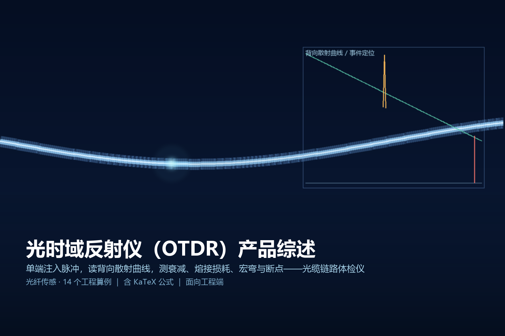
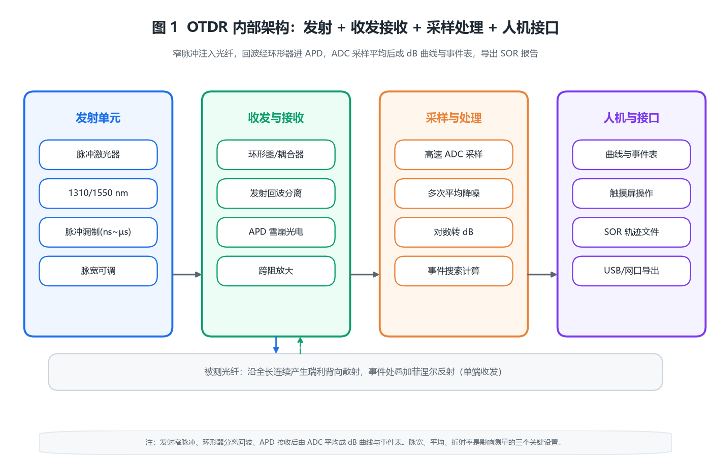
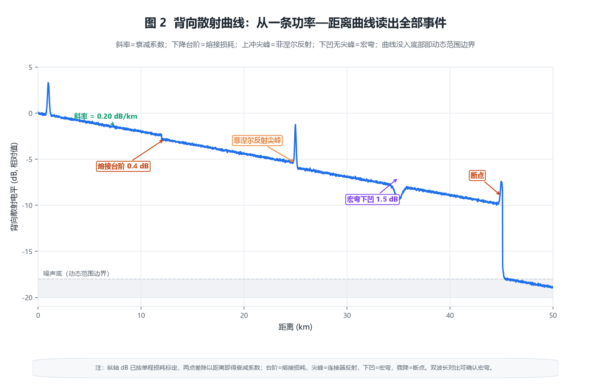
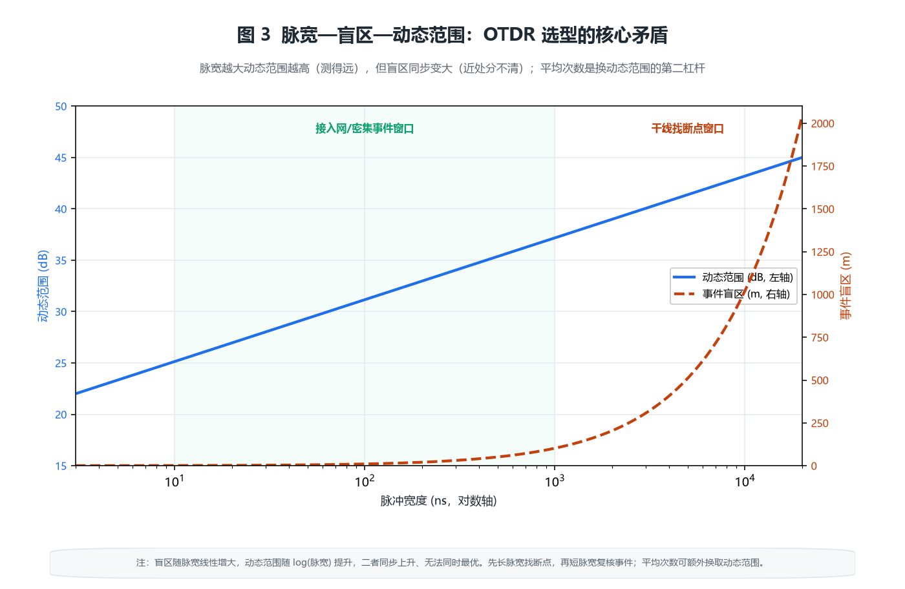
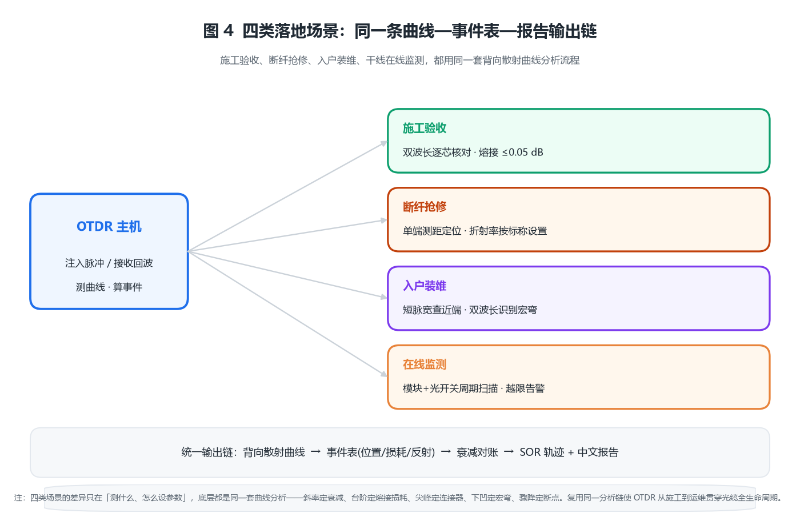

> 
> *概念图：OTDR 向光纤注入窄光脉冲，接收沿线返回的瑞利背向散射与菲涅尔反射回波，绘出一条「功率—距离」曲线，从中读出衰减系数、熔接/连接器事件损耗与断点位置——光缆链路的体检仪。示意图。*

# 光时域反射仪（OTDR）产品综述

## · 面向工程端

---

## 〇 一句话定位

光时域反射仪（OTDR，Optical Time Domain Reflectometer）是光缆链路的「X 光机」：它从光纤一端注入窄光脉冲，接收沿光纤全长连续返回的**瑞利背向散射**与在接头/断点处的**菲涅尔反射**，绘出一条功率随距离下降的曲线；再从这条曲线的斜率、台阶与尖峰里，一次性读出光纤衰减系数、熔接点损耗、连接器位置、宏弯与断点距离。**它买的是「单端、非破坏地看清整条光纤链路上每一处事件」的能力**——动态范围、盲区与距离精度，决定了你能测多长、分多细、定位多准。

> 简单说，本系列已写的 BOTDA（分布式应变）与 FBG 解调仪（读光栅波长）测的是「光纤感知到的物理量」；而 OTDR 测的是「光纤链路本身健康不健康」——它是施工验收、故障抢修、割接割缆时离不开的仪表。三者同属光纤大类，但各管一段，本文只讲这台仪表怎么选、怎么配参数、怎么读曲线、怎么验收。

---

## 一、产品设计方案

### 1.1 内部系统组成

一台 OTDR 在工程上由「发射、接收、采样处理、人机」四块构成：

- **发射单元**：脉冲激光器（1310/1550 nm 单模，或 850/1300 nm 多模） + 脉冲调制器，把连续光切成宽度可调（ns~µs 级）的窄脉冲。脉宽是动态范围与盲区权衡的总开关（算例 3）。
- **收发隔离与接收单元**：环形器或耦合器把发射光与返回光分开（或用马赫-曾德尔干涉型耦合），返回光极弱（比发射光低 60~90 dB），须用 APD 雪崩光电二极管放大，再经跨阻放大与可变增益。
- **采样与处理单元**：高速 ADC 按固定间隔采样回波包络，做**多次平均**把淹没在噪声里的背向散射信号捞出来（算例 9、10）；MCU/FPGA 做曲线平滑、事件搜索与损耗计算。
- **人机与接口**：触摸屏、事件表、曲线存储，USB/网口导出测试报告（OTDR 轨迹文件通用格式 SOR）。

### 1.2 三种产品形态

| 形态 | 做法 | 适用 | 工程取舍 |
|------|------|------|----------|
| 手持/现场型 | 电池供电、加固外壳、一键测试 | 抢修、巡检、入户装维 | 轻便但动态范围与屏幕较小 |
| 台式/实验室型 | 交流供电、大屏、高动态范围 | 中继段验收、研发计量 | 动态范围大、功能全但不便携 |
| 模块/插件式 | OTDR 卡插进平台或在线监测机架 | 光缆在线监测、集中网管 | 无人值守、远程告警，单价高 |

工程上先定「测什么链路、要测多长」：入户/园区短链路（<5 km）手持机足够；干线中继段（几十 km）需台式高动态范围机型；要长期盯住某条重要光缆则上在线监测模块。

### 1.3 测量信号链路

```
脉冲激光(窄脉冲) → 环形器/耦合器 → 注入光纤 → 沿线瑞利背向散射(连续) + 事件处菲涅尔反射(尖峰)
        → 返回光经环形器进 APD → 跨阻放大 → ADC 高速采样
        → 多次平均降噪 → 对数变换成 dB → 事件搜索与损耗计算 → 曲线 + 事件表 + 报告
```

关键工程点：**APD 的噪声底决定动态范围、脉宽决定盲区、采样率决定距离分辨率、折射率设置决定定位精度**（算例 2、3、4、11）——这四个参数互相牵制，是选型与设表的全部核心。

### 1.4 系统架构图


*图 1：OTDR 四块——发射（脉冲激光+调制）、收发隔离与接收（环形器+APD）、采样处理（ADC+平均+事件分析）、人机接口（曲线/事件表/报告）。回波沿原路返回，与发射光经环形器分离。*

---

## 二、核心参数与选型

### 2.1 关键参数清单（工程基准）

| 参数 | 典型区间 | 选型含义 |
|------|----------|----------|
| 测试波长 | 1310/1550 nm（单模）；850/1300 nm（多模） | 双波长可同时定位弯曲（1550 对弯更敏感） |
| 动态范围 | 32–45 dB（单模）；24–35 dB（多模） | 决定可测光纤长度与最大链损耗 |
| 事件盲区 | 0.5–5 m（短脉宽） | 决定两事件最近可分辨距离 |
| 衰减盲区 | 10–100 m（随脉宽） | 决定反射峰后多久能重新测准损耗 |
| 脉宽 | 3 ns – 20 µs（可调） | 与动态范围、盲区直接绑定 |
| 距离精度 | ±(0.5 m + 采样分辨率 + 1e-5×距离) | 决定断点定位准不准 |
| 采样分辨率 | 0.25–16 m | ADC 采样率决定，越小点越细 |
| 折射率设置 | 1.4600–1.4800（G.652≈1.4682@1550） | 设错直接按比例放大定位误差 |
| 平均时间 | 5 s – 5 min（或平均次数） | 换取动态范围，代价是测试时长 |
| 接口/格式 | USB/网口、SOR 轨迹文件、Bellcore GR-196 | 报告互通与平台对接 |

### 2.2 十四个原创工程算例

下面每一条都是现场测链路、读曲线、判合格时要真算的账，标号贯穿正文，便于复核。

**【算例 1】时域反射定位（测距公式）**
OTDR 测的是光脉冲往返飞行时间 $t$，事件距离由群折射率 $n_g$ 折算：
$$z=\frac{c\,t}{2\,n_g}$$
取 G.652 在 1550 nm 处 $n_g\approx1.4682$，回波时延 $t=10\ \mathrm{\mu s}$：
$$z=\frac{3\times10^{8}\times10\times10^{-6}}{2\times1.4682}\approx1021\ \mathrm{m}$$
反过来，20 km 处断点的回波时延：
$$t=\frac{2\,n_g\,z}{c}=\frac{2\times1.4682\times20000}{3\times10^{8}}\approx196\ \mathrm{\mu s}$$
结论：**OTDR 本质是飞行时间测距**，时间轴到距离轴的换算全靠 $n_g$，折射率设错会同比放大误差（算例 11）。

**【算例 2】采样分辨率与距离分辨**
ADC 采样间隔 $\Delta t$ 对应的距离采样点间距：
$$\Delta z=\frac{c\,\Delta t}{2\,n_g}$$
取采样率 100 MS/s（$\Delta t=10\ \mathrm{ns}$）：
$$\Delta z=\frac{3\times10^{8}\times10\times10^{-9}}{2\times1.4682}\approx1.02\ \mathrm{m}$$
结论：**采样率越高距离点越细**；但要注意 $\Delta z$ 只是采样间距，真正能不能分开两个事件还受脉宽（盲区）限制（算例 3）。

**【算例 3】脉宽与事件盲区（核心权衡）**
事件盲区近似等于脉宽在空间上的长度之半：
$$D_{\mathrm{event}}\approx\frac{c\,w}{2\,n_g}$$
脉宽 $w=10\ \mathrm{ns}$ 时 $D_{\mathrm{event}}\approx1.0\ \mathrm{m}$；$w=1\ \mathrm{\mu s}$ 时：
$$D_{\mathrm{event}}\approx\frac{3\times10^{8}\times10^{-6}}{2\times1.4682}\approx102\ \mathrm{m}$$
而动态范围随脉宽增大近似按 $10\log_{10}w$ 提升——脉宽放大 100 倍，动态范围约 +20 dB。
结论：**短脉宽盲区小、能分辨密集事件，但动态范围小（测不远）；长脉宽反之**。现场套路是先用长脉宽看全程找大致断点，再换短脉宽贴近看事件细节。

**【算例 4】动态范围与最大可测距离**
把动态范围 $D_{dyn}$ 减去事件与老化余量 $M$，除以光纤衰减系数 $\alpha$，得单程可测距离：
$$L_{\max}\approx\frac{D_{dyn}-M}{\alpha}$$
取 1550 nm 动态范围 40 dB、$\alpha=0.22\ \mathrm{dB/km}$、余量 5 dB：
$$L_{\max}\approx\frac{40-5}{0.22}\approx159\ \mathrm{km}$$
取 1310 nm 动态范围 32 dB、$\alpha=0.35\ \mathrm{dB/km}$、余量 5 dB：
$$L_{\max}\approx\frac{32-5}{0.35}\approx77\ \mathrm{km}$$
结论：**1550 nm 衰减低、测得更远；1310 nm 对弯曲敏感、更适合找弯**。厂商标称的「最大测量距离」通常已留足余量，工程上按上述公式反推更可信。

**【算例 5】衰减系数测量（曲线斜率）**
OTDR 曲线纵轴已按**单程损耗**标定，故两点间斜率直接就是衰减系数：
$$\alpha=\frac{|P_2-P_1|}{|z_2-z_1|}$$
取曲线上 $z_1=10\ \mathrm{km}$ 处 $P_1=-40\ \mathrm{dB}$、$z_2=70\ \mathrm{km}$ 处 $P_2=-52\ \mathrm{dB}$：
$$\alpha=\frac{52-40}{70-10}=\frac{12}{60}=0.20\ \mathrm{dB/km}$$
结论：**斜率 0.20 dB/km 对应合格 G.652 光纤**（GB 50312-2016 要求 1550 nm ≤0.22 dB/km、1310 nm ≤0.36 dB/km）。注意光走了个来回，仪器内部已把双程回波的 dB 差折半显示，操作者直接读斜率即可，不要再除以 2。

**【算例 6】熔接损耗测量（四点法）**
事件处曲线出现下降台阶，台阶高度即熔接损耗。用事件两侧各取两点拟合直线，外推到事件位置 $z_e$ 处取差值：
$$L_{splice}=|P_{\mathrm{before}}(z_e)-P_{\mathrm{after}}(z_e)|$$
若熔接点前线段外推到 $z_e=20\ \mathrm{km}$ 为 $-44.1\ \mathrm{dB}$，后线段外推为 $-44.5\ \mathrm{dB}$：
$$L_{splice}=|-44.1-(-44.5)|=0.4\ \mathrm{dB}$$
结论：**0.4 dB 远超单模熔接验收限值（实操 ≤0.05 dB、规范常取 ≤0.08 dB），判该熔接点不合格需重熔**。台阶够高时直接读两电平差，台阶被噪声淹没时才用拟合法。

**【算例 7】菲涅尔反射与回波损耗**
活动连接器端面因折射率突变产生菲涅尔反射峰，其功率反射率：
$$R=\left(\frac{n_1-n_2}{n_1+n_2}\right)^2$$
玻璃—空气界面取 $n_1=1.468$、$n_2=1.0$：
$$R=\left(\frac{0.468}{2.468}\right)^2\approx0.036=3.6\%,\quad RL=-10\log_{10}R\approx14.5\ \mathrm{dB}$$
结论：**裸端面反射约 3.6%、回波损耗仅 14.5 dB**，会在曲线上冲出一个大尖峰并制造盲区；UPC 研磨可做到 RL≥50 dB、APC≥60 dB，反射峰几乎消失。测带连接器的链路常在 OTDR 端口串一段衰减器或引导纤，先把近端强反射峰「挪出」盲区。

**【算例 8】宏弯损耗识别**
弯曲损耗在曲线上表现为**局部下凹但没有上冲反射峰**（区别于接头的干净台阶）。G.652 静态弯曲半径应 ≥30 mm，低于此值宏弯损耗急增。若某处曲线突然比直线低（且此处**无反射峰**）：
$$\Delta P_{\mathrm{bend}}=1.5\ \mathrm{dB}$$
结论：**1.5 dB 下凹且无尖峰 → 判定为宏弯而非熔接不良**，处理方法是把光纤盘大半径、消除受压/折弯，而不是重熔。1550 nm 对宏弯远比 1310 nm 敏感，故双波长对比（1550 有、1310 无）是识别宏弯的判据。

**【算例 9】平均次数与动态范围提升**
多次平均使随机噪声按 $\sqrt{N}$ 降低（电压域），折算到动态范围改善：
$$\Delta D\approx10\log_{10}\!\left(\frac{N_2}{N_1}\right)\ (\mathrm{dB})$$
平均次数由 $2^{10}=1024$ 增到 $2^{16}=65536$（64 倍）：
$$\Delta D\approx10\log_{10}64\approx18\ \mathrm{dB}$$
结论：**把平均次数翻 6 番，理论上多捞回约 18 dB 动态范围**（实测因相干串扰略低，约 12–15 dB）——这是不换仪表就能测更远的唯一软件手段，代价是测试时间成比例变长。

**【算例 10】测量时间预算**
单次脉冲重复周期由测试距离范围决定：
$$T_{\mathrm{rep}}\approx\frac{2\,n_g\,z_{\max}}{c}$$
测 80 km 范围：$T_{\mathrm{rep}}\approx\frac{2\times1.4682\times80000}{3\times10^{8}}\approx783\ \mathrm{\mu s}$。取平均 $N=2^{15}=32768$ 次：
$$T_{\mathrm{total}}=N\cdot T_{\mathrm{rep}}=32768\times783\ \mathrm{\mu s}\approx25.7\ \mathrm{s}$$
结论：**远距离 + 高平均 = 分钟级测试**。抢修时想快就减平均次数（动态范围缩水），验收时想准就加平均（多等一会儿），本质是在算例 9 与算例 10 之间取平衡。

**【算例 11】折射率设置误差的定位偏差**
因 $z\propto1/n_g$，折射率设错会造成距离按比例偏差：
$$\frac{\Delta z}{z}\approx\frac{n_{\mathrm{set}}-n_{\mathrm{true}}}{n_{\mathrm{set}}}$$
实际光纤 $n_{\mathrm{true}}=1.4682$，仪表误设为 $n_{\mathrm{set}}=1.4600$：
$$\frac{\Delta z}{z}\approx\frac{1.4600-1.4682}{1.4600}\approx-0.56\%$$
20 km 处断点定位偏差：
$$\Delta z\approx20000\times0.56\%\approx112\ \mathrm{m}$$
结论：**折射率必须按光纤厂家标称值设置**（G.652 常取 1.4675–1.4685@1550），否则断点定位偏差随距离线性放大——112 m 的误差足以让抢修挖错位置。

**【算例 12】链路总损耗预算与对账**
一条链路的全程损耗等于光纤衰减加各事件损耗：
$$L_{\mathrm{total}}=\alpha\,L+\sum L_{\mathrm{splice}}+\sum L_{\mathrm{conn}}$$
40 km、$\alpha=0.22$、12 个熔接（各 0.05 dB）、2 个连接器（各 0.3 dB）：
$$L_{\mathrm{total}}=0.22\times40+12\times0.05+2\times0.3=8.8+0.6+0.6=10.0\ \mathrm{dB}$$
若发射功率 0 dBm、接收灵敏度 $-18$ dBm，则允许链路损耗 18 dB，余量：
$$M=18-10.0=8.0\ \mathrm{dB}$$
结论：**OTDR 曲线给出的总损耗要与收发光功率预算对账**，余量为负说明链路即使「看得见」也「跑不通」，必须整改。

**【算例 13】事件搜索阈值设定**
OTDR 自动找事件靠「损耗超过阈值 或 反射超过阈值」双判据。设损耗阈值 $\theta_L=0.05$ dB、反射阈值 $\theta_R=-35$ dB：损耗小于 0.05 dB 的优质熔接点被忽略（不列入事件表），反射强于 $-35$ dB 的连接器被记录。
结论：**阈值设太高会漏报小接头、设太低会把噪声起伏误报成事件**；验收时阈值应贴合规范限值（单模熔接 0.05–0.08 dB），既不漏判也不虚报。

**【算例 14】单端「增益」幻象与双端测试**
同一熔接点从两端测可能得到不同的损耗值，甚至出现负损耗（假增益），根源是两侧光纤的背向散射系数 $\xi$ 不同。双端测试取平均可消除：
$$L_{\mathrm{true}}\approx\frac{L_{A\to B}+L_{B\to A}}{2}$$
若 A 端测 $-0.1$ dB（假增益）、B 端测 $+0.5$ dB：
$$L_{\mathrm{true}}\approx\frac{-0.1+0.5}{2}=0.2\ \mathrm{dB}$$
结论：**重要交接/验收点的接头损耗要双向测、取平均**；只测一端可能被假增益误导，把超标接头误判为合格。GB 50312-2016 对 OM3/OM4 高速链路也明确要求双向 OTDR 测试。

---


*图 2：背向散射曲线纵轴为 dB、横轴为距离。斜率=衰减系数（算例 5）；下降台阶=熔接损耗（算例 6）；上冲尖峰=菲涅尔反射（算例 7）；局部下凹无尖峰=宏弯（算例 8）；曲线落入噪声底处即动态范围边界（算例 4/9）。*

---

## 三、技术原理

### 3.1 瑞利背向散射为什么能测衰减

激光脉冲在光纤中传播时，玻璃密度的微观不均匀使一小部分光向各个方向散射，其中沿原路返回的那部分叫**瑞利背向散射**。它随距离连续产生、幅度正比于该点的光功率，而光功率按光纤衰减系数呈指数下降——所以背向散射回波的包络在 dB 坐标上是一条直线，**这条直线的斜率就是衰减系数**（算例 5）。这是 OTDR 不依赖远端、单端即可测全程衰减的物理根基。

### 3.2 菲涅尔反射与事件类型

当光遇到折射率突变面（活动连接器端面、光纤断端、机械接头），会产生远强于背向散射的**菲涅尔反射**，在曲线上冲出一个尖峰（算例 7）。据此可把事件分三类：

- **非反射事件**：熔接点、宏弯——曲线上表现为单纯下降台阶，无尖峰。
- **反射事件**：活动连接器、机械接头——尖峰，常伴一个下降台阶。
- **终点**：光纤断端——大反射峰后曲线骤降至噪声底；若端面斜切/浸油无反射，则曲线平滑落入噪声。

读曲线的口诀：**看斜率定衰减、看台阶定损耗、看尖峰定连接器、看下凹定弯、看骤降定断点**。

### 3.3 距离定位与折射率

OTDR 把时间轴换算成距离轴时用的就是算例 1 的公式，其中群折射率 $n_g$ 是最容易被忽视的误差源（算例 11）。此外还有两类定位陷阱：一是**盲区内事件测不到**（算例 3），近端连接器后面必须接引导纤；二是**增益幻象**（算例 14），关键接头要双向测。

### 3.4 动态范围、盲区、脉宽的三角权衡

这三者构成 OTDR 选型的核心矛盾：脉宽加大 → 动态范围增大（能测更长）→ 但盲区变大（近处分不清）；平均增多 → 动态范围增大 → 但测试变慢（算例 9、10）。**没有一台仪表能同时做到「测超长 + 盲区极小 + 秒级出结果」**，工程做法是按链路长度与事件密度分场景设表：


*图 3：脉宽—事件盲区—动态范围的三角权衡。短脉宽（ns 级）盲区小但动态范围低，适合接入网/室内密集事件；长脉宽（µs 级）动态范围高但盲区大，适合干线找断点。平均次数是在时间轴上换取动态范围的第二杠杆。*

---

## 四、产品功能与差异化

### 4.1 核心功能清单

- **衰减系数测量**：斜率法自动/手动测全程或分段 dB/km。
- **事件定位与损耗**：熔接、连接器、弯曲、断点的位置与损耗列表（事件表）。
- **双波长对比**：1310/1550 nm 同测，识别宏弯与光纤类型异常。
- **故障定位**：单端测出断纤距离，指导抢修开挖点。
- **报告输出**：SOR 轨迹文件 + PDF 报告，对接验收与运维平台。
- **在线监测（模块式）**：无人值守周期测试、越限告警、远程调阅。

### 4.2 差异化：OTDR vs 光功率计（插损法）

| 维度 | OTDR（后向散射法） | 光功率计 + 稳定光源（插损法） |
|------|------------------|---------------------------|
| 测量端 | **单端**即可 | 必须两端配合 |
| 信息量 | 曲线 + 事件位置 + 每段损耗 | 只有链路总损耗一个数 |
| 断点定位 | 能（测距） | 不能 |
| 绝对损耗精度 | 受背向散射系数离散影响，±0.1 dB 级 | 更高，是验收仲裁法 |
| 近端盲区 | 有（需引导纤） | 无 |
| 典型用途 | 施工排查、故障定位、找弯找断点 | 验收总损耗仲裁、精度复核 |

结论：**两者互补而非替代**——OTDR 用一张曲线看清「哪里有问题」，光功率计用两端法给出「整条链路到底损耗多少」的仲裁值。规范验收常要求两者都测：先用 OTDR 定位与排查，再用插入损耗法定总损耗（GB 50312-2016 8.0.4）。

---

## 五、应用场景（痛点→方案→价值）

**① 光缆施工验收**
- 痛点：熔接点几十上百个，人工无法逐个确认质量。
- 方案：双波长 OTDR 全程测试，事件表逐个核对熔接损耗（算例 6、13），总损耗对账（算例 12）。
- 价值：不合格接头当场发现当场重熔，避免带病交付。

**② 断纤故障抢修**
- 痛点：直埋光缆断了，不知道断在哪，盲目开挖代价高。
- 方案：单端测出断点距离（算例 1），结合路由资料换算实际桩号。
- 价值：把「几公里范围找断点」压缩到「几十米内精确定位」，抢修时间大幅缩短。

**③ 入户装维 / FTTH 排障**
- 痛点：用户投诉网速慢，需判断是弯折、冷接点还是断纤。
- 方案：手持 OTDR 短脉宽测近端（算例 3），双波长识别宏弯（算例 8）。
- 价值：上门一次定位问题，减少二次上门。

**④ 干线光缆在线监测**
- 痛点：重要干线被施工破坏，事后才知道、已中断。
- 方案：OTDR 模块 + 光开关接入 Online 监测平台，周期扫描、越限告警。
- 价值：从「故障后抢修」转为「劣化即预警」，缩短业务中断时长。

---

## 六、实际案例与设计方案

### 案例一：某城域网中继段割接验收

- **需求**：一段 42 km 的 48 芯干线光缆割接后验收，需逐芯确认熔接与总损耗。
- **方案设计**：台式 OTDR 双波长（1310/1550），动态范围 40 dB（算例 4，1550 可测 159 km 余量充足），脉宽先 10 µs 看全程、再 100 ns 复核近端事件（算例 3）。
- **配置核算**：全程衰减 $\alpha=0.22\times42\approx9.2$ dB，48 芯各约 20 个熔接点，损耗阈值设 0.05 dB（算例 13），总损耗对账留 8 dB 余量（算例 12）。
- **交付价值**：发现 3 个 0.4 dB 超标熔接点（算例 6）当场重熔，一次验收通过，避免割接后夜间退服。

### 案例二：某直埋光缆挖断抢修

- **需求**：施工挖断一条直埋光缆，业务全断，需尽快定位断点。
- **方案设计**：现场手持 OTDR，1550 nm、长脉宽 5 µs（算例 3 求动态范围），从一端测波形。
- **配置核算**：回波时延换算 $z=ct/(2n_g)$（算例 1），测得断点 18.6 km；折射率按厂家标称 1.4682 设置（算例 11，避免百米级偏差）。
- **交付价值**：把断点锁定到 18.6 km 桩号附近几十米内，抢修队直奔现场，比全程徒步排查节省数小时。

### 案例三：某园区链路「损耗超标」排查

- **需求**：一条链路 1310 nm 损耗正常、1550 nm 损耗明显偏高，疑似施工问题。
- **方案设计**：双波长 OTDR 对比（算例 8），1550 曲线在 2 km 处出现 1.5 dB 下凹但 1310 几乎无异常。
- **配置核算**：判定为宏弯（1550 对弯敏感），现场检查发现光缆在机柜内被扎带勒出小半径弯，松开后复测恢复正常。
- **交付价值**：不用熔接、不用换纤，仅靠曲线特征就定位到「扎带勒弯」，几分钟排除故障。


*图 4：OTDR 四类落地场景拓扑——施工验收（逐芯核对）、断纤抢修（单端测距）、入户装维（短脉宽查近端）、在线监测（光开关+模块周期扫描），共用「曲线—事件表—报告」的输出链路。*

---

## 七、市场背景与竞争格局

OTDR 产业链：**光电芯片与器件（DFB 激光器、APD、脉冲调制器）→ 整机制造（是德/安立/横河/EXFO/Fluke Networks 等高端，国产中电科、中兴、华为、绿测、横河等中低端）→ 行业应用（运营商干线、综合布线、电力/石化专网）**。竞争焦点：

- **动态范围与盲区**是硬指标：高端机做到 45 dB 动态范围 + 亚米级盲区，核心在 APD 噪声与脉冲调制精度。
- **智能化分析**成标配：自动事件识别、AI 判读弯曲/接头缺陷、一键生成中文报告，降低对操作者经验的依赖。
- **小型化与模块化**：手持机集成 VFL/红光笔、光功率计、以太网测试于一体；在线监测模块向集中网管演进。
- **国产替代加速**：核心光芯片国产化推进，中低端整机价格持续下探，运营商集采国产份额上升。

---

## 八、商业模式与趋势

- **整机销售 + 选件**：主机按动态范围档位定价，双波长、在线监测模块、软件授权作为选件。
- **租赁与服务于一体**：高端机单价高，第三方检测/运维服务按次或按年收费，中小客户更愿租。
- **趋势一：一键化**：从「专家调参读曲线」转向「一键测试 + 自动判读报告」，降低使用门槛。
- **趋势二：在线化**：固定 OTDR + 光开关接入网管，7×24 监测重要光缆，劣化预警前置。
- **趋势三：多融合**：OTDR 与光功率计、VFL、光纤端面检测、OLT 测试集于一机，装维一机多用。

---

## 附录

### A. 核算清单（14 笔账速查）

| 编号 | 算例 | 核心公式 | 关键结论 |
|------|------|----------|----------|
| 1 | 时域测距 | $z=c\,t/(2n_g)$ | 10 µs→约 1021 m；20 km→约 196 µs |
| 2 | 采样分辨 | $\Delta z=c\,\Delta t/(2n_g)$ | 100 MS/s→约 1.02 m |
| 3 | 脉宽盲区 | $D_{\mathrm{event}}\approx c\,w/(2n_g)$ | 10 ns→1 m；1 µs→102 m |
| 4 | 测距上限 | $L_{\max}=(D_{dyn}-M)/\alpha$ | 40 dB@1550→约 159 km |
| 5 | 衰减系数 | $\alpha=\Delta P/\Delta z$ | 12 dB/60 km→0.20 dB/km |
| 6 | 熔接损耗 | $L=\|P_{before}-P_{after}\|$ | 0.4 dB 超标，需重熔 |
| 7 | 菲涅尔反射 | $R=((n_1-n_2)/(n_1+n_2))^2$ | 裸端面 3.6%，RL≈14.5 dB |
| 8 | 宏弯识别 | 下凹无反射峰 | 1.5 dB 下凹→宏弯非接头 |
| 9 | 平均增益 | $\Delta D\approx10\log_{10}(N_2/N_1)$ | 64 倍平均→约 +18 dB |
| 10 | 测量时长 | $T=N\cdot2n_g z_{\max}/c$ | 80 km×32768 次→约 25.7 s |
| 11 | 折射率误差 | $\Delta z/z\approx(n_{set}-n_{true})/n_{set}$ | 设错→20 km 偏 112 m |
| 12 | 总损耗对账 | $L=\alpha L+\Sigma L_{s}+\Sigma L_{c}$ | 40 km→10 dB，留 8 dB 余量 |
| 13 | 事件阈值 | $\theta_L$ / $\theta_R$ | 0.05 dB / −35 dB |
| 14 | 双端测试 | $L=(L_{A\to B}+L_{B\to A})/2$ | 双向取平均消假增益 |

### B. 术语表

- **OTDR**：光时域反射仪，靠背向散射与反射回波单端测光纤链路。
- **瑞利背向散射**：玻璃微观密度不均导致的后向散射，连续产生、包络随衰减下降。
- **菲涅尔反射**：折射率突变面（连接器/断端）产生的强反射峰。
- **动态范围**：初始背向散射电平到噪声底的 dB 差，决定可测长度。
- **事件盲区**：反射峰之后能分辨下一个事件的最短距离，随脉宽增大。
- **衰减盲区**：反射峰之后能重新测准损耗的最短距离，通常大于事件盲区。
- **群折射率 $n_g$**：时间轴换算距离轴的关键参数，G.652@1550 约 1.4682。
- **SOR 文件**：OTDR 轨迹通用交换格式（Bellcore GR-196 / Telcordia）。

### C. 标准与规范索引（工程可查）

- **GB/T 15972.40-2017** 光纤试验方法规范 第 40 部分：传输特性的测量（衰减、OTDR 测试方法、测试条件与数据处理）
- **GB/T 15972.31-2021** 光纤试验方法规范（单模光纤衰减系数 1310 nm ≤0.36 dB/km）
- **YD/T 1272-2018** 光缆线路测试方法（中继段 OTDR 测试流程、参数设置、事件判定与验收）
- **GB 50312-2016** 综合布线系统工程验收规范 8.0.4（光纤链路逐条测试、双向 OTDR、OTDR 故障定位；附录 C 衰减限值）
- **GB 50311-2016** 综合布线系统工程设计规范
- **ITU-T G.652 / G.657** 单模光纤 / 弯曲损耗不敏感单模光纤特性（折射率、衰减、弯曲半径基准）
- **IEC 60793-1-40 / 1-44** 光纤衰减与长度测量方法
- **IEC 61746-1** OTDR 校准规范（距离与损耗标定）

> 注：本篇参数为工程基准/演示估算，落地以厂家规格书、光纤厂家标称折射率与现场标定为准；熔接/连接器验收限值以适用规范与设计文件为准，链路设计应留 ≥3 dB 老化与维护余量。不同厂商 OTDR 的事件算法与盲区定义略有差异，比对时须统一脉宽、平均与折射率设置。
