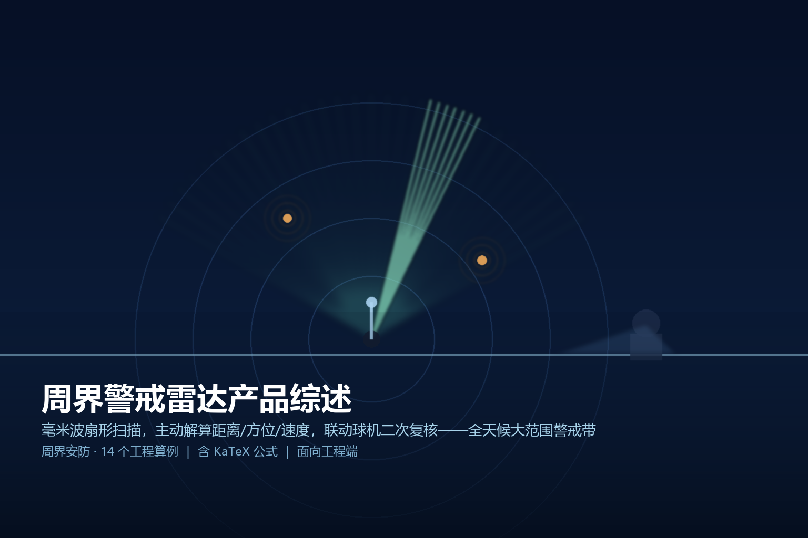
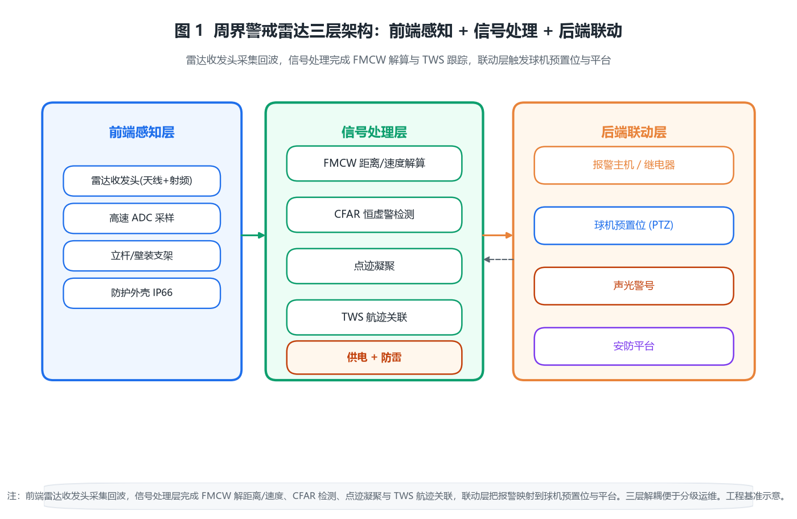

> 
> *概念图：周界警戒雷达以毫米波扇形扫描，主动解算目标距离、方位与速度，并联动球机二次复核——一道看不见、不挑天气的主动警戒带。*

# 周界警戒雷达产品综述

## · 面向工程端

---

## 〇 一句话定位

周界警戒雷达是一种「主动电子哨兵」：以毫米波（常用 24 GHz 或 77 GHz）连续发射调频连续波（FMCW），扫描一道扇形区域，接收目标回波后解算出**距离、方位与径向速度**，再联动球机做二次视频复核。它最大的特点是**主动、全天候、大范围**——不依赖光照与天气，一部雷达即可覆盖数万平方米的扇形警戒带，对人员、车辆形成连续感知，特别适合长周界、开阔场区与无法密集布线的场景。

> 简单说，它与红外对射、电子围栏、振动光纤、泄漏电缆的区别在「探测媒介」：前者靠物理遮挡或实体振动，泄漏电缆靠地埋电磁场，而警戒雷达靠电磁波回波——买的是一段「无线电意义上看得见你、但你看不见它」的主动警戒带。

---

## 一、产品设计方案

### 1.1 系统三层组成

一套完整的周界警戒雷达由「前端感知、信号处理、后端联动」三层构成：

- **前端感知层**：雷达收发头（天线 + 射频前端 + 高速 ADC）+ 立杆/壁装支架 + 防护外壳。
- **信号处理层**：FMCW 解距离/速度、CFAR 检测、点迹凝聚、TWS 航迹关联 + 供电与防雷。
- **后端联动层**：报警输出（继电器/网络/RS-485）→ 球机预置位、声光警号、安防平台。

### 1.2 两种产品形态

| 形态 | 做法 | 适用 | 工程取舍 |
|------|------|------|----------|
| 机械扫描型 | 电机带动窄波束旋转/扇形摆扫 | 中小范围、成本敏感 | 有转动部件、寿命与噪声受限 |
| 相控阵电扫型 | 多通道相位加权形成电子波束 | 高刷新、多目标、免维护 | 通道一致性要求高、成本更高 |

工程上先定「刷新率与多目标需求」再定形态：单扇区、低密度选机械扫描；要 1 s 内刷新、百批跟踪选相控阵。

### 1.3 软件与信号处理链路

```
发射 FMCW 调频连续波 → 空间传播 → 目标反射 → 接收混频
        → 差频 FFT(距离) → 慢时间 Doppler FFT(速度) → CFAR 检测
        → 点迹凝聚 → 航迹关联(TWS) → 报警输出
```

关键工程点：**必须有 CFAR（恒虚警）与 TWS（边扫边跟）**——前者抑制雨雪、飞鸟、地杂波的虚警，后者把离散点迹连成航迹、区分真实入侵与瞬时干扰，两者缺一就会要么漏报要么误报。

### 1.4 系统架构图


*图 1：周界警戒雷达「前端感知（雷达收发头）+ 信号处理（FMCW 解算 + CFAR + TWS）+ 后端联动」三层架构，报警联动球机预置位与平台。*

---

## 二、核心参数与选型

### 2.1 关键参数清单（工程基准）

| 参数 | 典型区间 | 选型含义 |
|------|----------|----------|
| 工作频段 | 24 GHz / 77 GHz（ISM） | 频段决定波长、天线尺寸与法规 |
| 作用距离（人） | 100–300 m | 受 RCS 与系统灵敏度约束 |
| 探测扇区 | 方位 60°–180°、俯仰 5°–20° | 决定单部覆盖面积 |
| 距离分辨率 | 0.3–1 m | 由扫频带宽决定 |
| 径向速度分辨率 | 0.01–0.1 m/s | 由相干累积时间决定 |
| 扫描周期 | 1–3 s | 刷新率与跟踪连续性折中 |
| 跟踪容量 | 数十到数百批 | 多目标场景的硬上限 |
| 防护等级 | IP66–IP67 | 决定能否直晒雨淋 |
| 供电 | DC 12–24 V / PoE+ / 太阳能离网 | 决定远端取电方式 |

### 2.2 十四个原创工程算例

下面每一条都是落地时要真算的账，标号贯穿正文，便于复核。

**【算例 1】雷达作用距离方程**
单站雷达接收功率（雷达方程）为：
$$P_r=\frac{P_t\,G^2\,\lambda^2\,\sigma}{(4\pi)^3\,R^4\,L}$$
取工程基准：$P_t=20\,\mathrm{dBm}$（0.1 W）、收发同增益 $G=20\,\mathrm{dBi}$、24 GHz 波长 $\lambda=12.5\,\mathrm{mm}$、$\sigma=1\,\mathrm{m^2}$（人体 RCS）、系统损耗 $L=6\,\mathrm{dB}$。接收机最小可辨功率（等效噪声带宽 10 kHz、噪声系数 8 dB、信噪比门限 12 dB）：
$$P_{\min}=-174+10\log_{10}(10^4)+8+12=-114\,\mathrm{dBm}\approx3.98\times10^{-15}\,\mathrm{W}$$
令 $P_r=P_{\min}$ 反解最大作用距离：
$$R_{\max}=\sqrt[4]{\frac{P_t\,G^2\,\lambda^2\,\sigma}{(4\pi)^3\,L\,P_{\min}}}\approx\sqrt[4]{4.97\times10^9}\approx265\,\mathrm{m}$$
结论：**对人员最大作用距离约 260 m**，对车辆（RCS 更大）更远。

**【算例 2】FMCW 差频测距**
调频斜率 $S=B/T_s$，距离与差频（拍频）关系：
$$f_b=\frac{2 R S}{c}=\frac{2 R B}{c\,T_s},\quad R=\frac{c\,f_b}{2 S}$$
取扫频带宽 $B=250\,\mathrm{MHz}$、扫频周期 $T_s=5\,\mathrm{ms}$，则 $S=5\times10^{10}\,\mathrm{Hz/s}$。对 $R=100\,\mathrm{m}$：
$$f_b=\frac{2\times100\times5\times10^{10}}{3\times10^8}=3.33\times10^4\,\mathrm{Hz}=33.3\,\mathrm{kHz}$$
结论：距离正比于拍频，测频即测距，100 m 对应约 33 kHz 拍频。

**【算例 3】距离分辨率**
距离分辨率由扫频带宽决定：
$$\Delta R=\frac{c}{2 B}=\frac{3\times10^8}{2\times250\times10^6}=0.6\,\mathrm{m}$$
结论：**B=250 MHz 时距离分辨率 0.6 m**，足以区分相邻人员与车辆。

**【算例 4】多普勒测速**
径向速度与多普勒频率：
$$f_d=\frac{2 v}{\lambda},\quad v=\frac{f_d\,\lambda}{2}$$
$\lambda=12.5\,\mathrm{mm}$，行人 $v=2\,\mathrm{m/s}$：
$$f_d=\frac{2\times2}{0.0125}=320\,\mathrm{Hz}$$
结论：**2 m/s 步行对应 320 Hz 多普勒**，结合相干处理可区分人/车与风雨。

**【算例 5】扇区覆盖面积**
单部雷达覆盖一个方位扇区，半径取 200 m、方位角 $120^\circ$：
$$A=\frac{\theta_{az}}{360^\circ}\,\pi R^2=\frac{120}{360}\times\pi\times200^2\approx4.19\times10^4\,\mathrm{m^2}$$
结论：**一部 120° 雷达约覆盖 4.2 万 m²（4.2 公顷）**，是长周界性价比关键。

**【算例 6】波束宽度与方位分辨**
天线波束宽度近似 $\theta\approx\lambda/D$，天线口径 $D=0.2\,\mathrm{m}$：
$$\theta\approx\frac{0.0125}{0.2}=0.0625\,\mathrm{rad}\approx3.6^\circ$$
200 m 处方位分辨：
$$\Delta R_{az}=R\,\theta=200\times0.0625=12.5\,\mathrm{m}$$
结论：单波束方位分辨约 12 m@200 m，报警定位到扇区/方位带即可。

**【算例 7】扫描周期与波束驻留**
扇区 $120^\circ$ 在扫描周期 $T_{\text{scan}}=2\,\mathrm{s}$ 内扫完，角速度：
$$\omega=\frac{\theta_{az}}{T_{\text{scan}}}=\frac{2.094}{2}=1.047\,\mathrm{rad/s}$$
目标在 $3.6^\circ$（0.0625 rad）波束内的驻留时间：
$$t_{\text{dwell}}=\frac{\theta}{\omega}=\frac{0.0625}{1.047}\approx0.06\,\mathrm{s}$$
可得拍频采样数 $N_{\text{chirp}}=t_{\text{dwell}}/T_s=0.06/0.005\approx12$。结论：**每扫一次约 12 个 chirp，足够检测**。

**【算例 8】多目标跟踪容量**
TWS（边扫边跟）对每批航迹做卡尔曼预测-更新。设计容量 $N_{\text{track}}=200$ 批、点迹处理率 1000 点/s：
$$N_{\text{point}}=N_{\text{track}}\times\frac{1}{T_{\text{scan}}}=200\times0.5=100\,\text{点/s}\ll1000$$
结论：200 批跟踪仅占用 10% 点迹算力，多目标场景从容。

**【算例 9】CFAR 虚警与阈值**
恒虚警处理在 $N=16$ 个参考单元上估计杂波功率，阈值因子 $\alpha$ 满足：
$$P_{fa}\approx(1+\alpha)^{-N}\approx(1+\alpha)^{-16}$$
要设计虚警率 $P_{fa}=10^{-6}$，解得 $\alpha\approx1.6$。结论：**参考窗 16 单元、阈值因子 1.6，可将虚警压到 10⁻⁶ 量级**，再配合航迹确认过滤飞鸟。

**【算例 10】重叠覆盖布站**
相邻两部 $120^\circ$ 雷达沿周界排布，消除扇区接合盲区需重叠 $d_{\text{overlap}}\ge20\,\mathrm{m}$。中心间距：
$$s\approx2 R\sin60^\circ-d_{\text{overlap}}=2\times200\times0.866-20\approx326\,\mathrm{m}$$
结论：**杆距取 300–320 m**，相邻扇区重叠 ≥20 m，不留探测死角。

**【算例 11】远端供电压降**
雷达功耗 $P=12\,\mathrm{W}$、24 V 供电，电流 $I=0.5\,\mathrm{A}$；100 m 供电线往返阻 $R=2\,\Omega$：
$$\Delta V=I R=0.5\times2=1.0\,\mathrm{V},\quad V_{\text{end}}=24-1=23\,\mathrm{V}>21\,\mathrm{V}$$
满足要求；若电流升到 2 A，$\Delta V=4\,\mathrm{V}$，末端 20 V 临界，需加粗线或就近取电。

**【算例 12】球机联动时延预算**
探测到目标→给出方位→球机预置位→二次复核的时延链：
$$t_{\text{link}}=t_{\det}+t_{\text{comm}}+t_{\text{slew}}$$
取 $t_{\det}=1\text{–}3\,\mathrm{s}$（扫描周期）、$t_{\text{comm}}<0.5\,\mathrm{s}$、$t_{\text{slew}}=0.5\text{–}2\,\mathrm{s}$（60°/s 球机转 60° 约 1 s）。合计 2–5 s；目标以 2 m/s 行进仅移动 4–10 m，仍在扇区内。结论：**5 s 内完成视频复核，目标不会跑出视野**。

**【算例 13】功耗与离网供电**
整机 12 W，若现场无市电，太阳能离网：日均耗电 $12\times24=288\,\mathrm{Wh}$，按 3 天备电、12 V 系统：
$$C_{\text{bat}}=\frac{288\times3}{12\times0.8}=\frac{864}{9.6}=90\,\mathrm{Ah}$$
配 100 Wp 板 + 100 Ah 电池即可（阴雨天靠储备）。结论：**离网站 100 Wp + 100 Ah 12 V 够用**。

**【算例 14】系统可用度**
假设 MTBF=5 万小时、MTTR=4 h：
$$A=\frac{MTBF}{MTBF+MTTR}=\frac{50000}{50000+4}\approx0.99992$$
结论：**可用度 99.992%**，靠季度标定 + 年度防水检查维持。

---

## 三、技术原理

### 3.1 FMCW 如何「测距又测速」

雷达连续发射频率随时间线性调制的波（chirp），目标回波因延迟产生一个固定频差（拍频），拍频正比于距离（算例 2）；同时目标相对径向运动产生多普勒频移（算例 4）。对回波做二维 FFT（快时间解距离、慢时间解速度），就能在一个像素里同时拿到「距离 + 速度」两个维度。

### 3.2 目标如何被识别

回波经过距离/速度二维 CFAR 检测，超过自适应阈值的点被保留为「点迹」；点迹凝聚后送入 TWS：对新点迹尝试与已有航迹关联，关联上则更新航迹、连续若干帧未更新则闭锁。真正能触发报警的是「形成稳定航迹且进入警戒带」的目标——这把飞鸟（点迹不连续）、风雨（被 CFAR 吸收）与真实入侵区分开。

### 3.3 为什么抗天气、不挑光照

雷达用的是射频回波，与可见光/红外无关，昼夜、雨雾、雾霾均不影响回波存在（只是衰减）；CFAR 把缓慢变化的地杂波与气象杂波压到门限以下，只对「快变化 + 有径向速度」的目标响应。这正是它相对红外对射（雨雾衰减）、视频监控（无光失效）的核心优势。

### 3.4 机械扫描与相控阵的探测差异

机械扫描靠电机摆波束，波束驻留受限于转速（算例 7）；相控阵用相位加权瞬间成形电子波束、可并行多波束，刷新率与多目标容量显著更高（算例 8）。两者 FMCW 解算原理一致，仅波束形成方式不同。

---

## 四、产品功能与差异化

### 4.1 核心功能清单

- **主动全天候探测**：不依赖光照天气，昼夜雨雾可用。
- **三维态势**：同时输出距离、方位、速度，定位到扇区方位带。
- **多目标 TWS**：百批级航迹，区分人/车/群。
- **超低虚警**：CFAR + 航迹确认，过滤飞鸟风雨。
- **视频联动**：报警即时驱动球机预置位二次复核。
- **大范围覆盖**：单部 4 万 m²，长周界少布点。

### 4.2 差异化：主动电磁波 vs 其他周界

| 维度 | 警戒雷达 | 红外对射 | 电子围栏 | 振动/泄漏电缆 |
|------|----------|----------|----------|---------------|
| 探测媒介 | 射频回波 | 红外光束 | 高压脉冲 | 振动/电磁场 |
| 天气依赖 | 几乎无 | 雨雾衰减 | 无 | 无 |
| 光照依赖 | 无 | 无 | 无 | 无 |
| 覆盖范围 | 扇区 4 万 m² | 单线 | 沿界 | 沿界 |
| 定位粒度 | 方位带 | 防区 | 防区 | 防区 |
| 联动复核 | 强（给方位） | 弱 | 弱 | 弱 |
| 成本 | 中高（按部） | 低 | 低 | 中 |

结论：**要长周界、要全天候、要联动视频复核，雷达几乎是最高性价比的主动方案**；短直线周界或纯威慑场景，电子围栏/红外更经济。

---

## 五、应用场景（痛点→方案→价值）

**① 机场/核电站长周界**
- 痛点：周界数公里、要求高可靠、不能漏。
- 方案：多部雷达沿界 300 m 杆距排布（算例 10）+ TWS 百批跟踪。
- 价值：少布点、全天气、报警联动视频复核。

**② 油库/化工园区**
- 痛点：易燃易爆、不允许高压围栏。
- 方案：雷达 + 球机联动，无电火花风险。
- 价值：主动探测 + 视频确认，既安全又低虚警。

**③ 边防/军事管制区**
- 痛点：地形复杂、人员稀少、需大范围。
- 方案：相控阵电扫 + 离网供电（算例 13）。
- 价值：免维护、长续航、全天候警戒。

**④ 厂区/园区开阔场区**
- 痛点：既有围墙但周界长、监控有死角。
- 方案：雷达补盲区 + 接入既有安防平台。
- 价值：利旧平台、消除监控死角。

---

## 六、实际案例与设计方案

### 案例一：某核电站 2.4 km 周界

- **需求**：2.4 km 周界，全天候、报警定位到方位带、联动视频。
- **方案设计**：沿界布 8 部 120° 雷达，杆距 300 m（算例 10，重叠 ≥20 m）；单部覆盖 4.2 万 m²（算例 5）；TWS 200 批（算例 8）；CFAR 虚警 10⁻⁶（算例 9）。
- **配置核算**：就近取电避免压降（算例 11），IP67 直杆安装，接地电阻 4 Ω + 避雷器。
- **交付价值**：全天气零漏报（季度演练），报警联动球机 5 s 内复核（算例 12），虚警率 <1 次/周。

### 案例二：化工园区无电火花周界

- **需求**：1.2 km 防爆周界，禁止高压围栏。
- **方案设计**：机械扫描雷达 4 部（杆距 300 m）+ 防爆球机预置位；报警时延 2–5 s 复核（算例 12）。
- **配置核算**：雷达本安供电 24 V、功耗 12 W，无高压部件；CFAR + 航迹过滤飞鸟。
- **交付价值**：无电火花风险，风雨虚警较纯视频下降 90% 以上。

### 案例三：边防离网管制区

- **需求**：无市电、需长期无人值守警戒。
- **方案设计**：相控阵电扫雷达 + 太阳能离网（100 Wp + 100 Ah，算例 13）；可用度 99.992%（算例 14）。
- **配置核算**：三级备电按 3 天设计，防护 IP67，季度远程标定。
- **交付价值**：免维护、长续航、全天候覆盖数万 m²。

---

## 七、市场背景与竞争格局

周界警戒雷达产业链：**射频前端/天线（毫米波芯片：英飞凌、TI、NXP 等）→ 雷达整机（安防集成商：大华、海康、博世、Flir、Selex 等）→ 平台联动（安防平台/边防系统）**。竞争焦点：

- **射频与天线是门槛**：24/77 GHz 天线与射频一致性决定探测距离与旁瓣，是核心硬件能力。
- **信号处理是护城河**：CFAR、TWS、杂波抑制算法直接决定虚警率与多目标能力。
- **与视频融合成标配**：报警即弹视频预置位、雷达给方位球机自动转，纯雷达厂向「周界一体方案」演进。
- **国产化加速**：毫米波芯片国产供应链成熟，整机成本持续下探，渗透率上升。

---

## 八、商业模式与趋势

- **按部计价 + 平台授权**：雷达按部、平台按套，工程毛利在软件与集成。
- **一体方案溢价**：「雷达+视频+平台」打包比单卖雷达溢价明显。
- **趋势一：AI 判别**：用机器学习区分人/车/动物/风雨，进一步压虚警。
- **趋势二：4D 成像雷达**：多输入多输出（MIMO）提升角分辨，从「点位」到「轮廓」。
- **趋势三：标准化联动**：报警输出全面走标准协议（ONVIF/GB 28181），降低集成成本。

---

## 附录

### A. 核算清单（14 笔账速查）

| 编号 | 算例 | 核心公式 | 关键结论 |
|------|------|----------|----------|
| 1 | 作用距离 | $R_{\max}=\sqrt[4]{P_t G^2\lambda^2\sigma/((4\pi)^3 L P_{\min})}$ | ≈265 m（人） |
| 2 | 差频测距 | $f_b=2RS/c,\ R=cf_b/(2S)$ | 100 m→33 kHz |
| 3 | 距离分辨率 | $\Delta R=c/(2B)$ | 0.6 m |
| 4 | 多普勒测速 | $f_d=2v/\lambda$ | 2 m/s→320 Hz |
| 5 | 扇区面积 | $A=\theta_{az}\pi R^2/360^\circ$ | 4.2 万 m² |
| 6 | 方位分辨 | $\theta\approx\lambda/D,\ \Delta R_{az}=R\theta$ | 12.5 m@200 m |
| 7 | 波束驻留 | $t_{\text{dwell}}=\theta/\omega$ | ≈0.06 s/12 chirp |
| 8 | 多目标容量 | $N_{\text{point}}=N_{\text{track}}/T_{\text{scan}}$ | 200 批/10% |
| 9 | CFAR 虚警 | $P_{fa}\approx(1+\alpha)^{-N}$ | 16 窗/α1.6→10⁻⁶ |
| 10 | 重叠布站 | $s\approx2R\sin60^\circ-d_o$ | 杆距 300–320 m |
| 11 | 供电压降 | $\Delta V=IR$ | 2 A 时临界 |
| 12 | 联动时延 | $t_{\text{link}}=t_{\det}+t_{\text{comm}}+t_{\text{slew}}$ | 2–5 s |
| 13 | 离网供电 | $C_{\text{bat}}=P T d/(V\eta)$ | 100 Wp+100 Ah |
| 14 | 可用度 | $A=MTBF/(MTBF+MTTR)$ | 99.992% |

### B. 术语表

- **FMCW**：调频连续波，用频率调制测距测速的雷达体制。
- **RCS**：雷达散射截面，目标反射本领的等效面积（人体约 1 m²）。
- **CFAR**：恒虚警率，自适应阈值抑制杂波虚警。
- **TWS**：边扫边跟，在扫描中同时建立与维持多批航迹。
- **拍频**：发射与回波 chirp 的频差，正比于距离。
- **扇区**：雷达波束扫过的方位角范围（如 120°）。

### C. 标准与规范索引（工程可查）

- **GB 50348-2018** 安全防范工程技术标准（周界报警设计总则）
- **GB 50394-2007** 入侵报警系统工程设计规范（周界报警条款）
- **GB 10408.1-2000** 入侵探测器 第1部分：通用要求
- **GB 16796-2009** 安全防范报警设备 安全要求和试验方法
- **GB 4208-2017** 外壳防护等级（IP 代码，户外选 IP66+）
- **GB 50343-2012** 建筑物电子信息系统防雷技术规范（接地 ≤4 Ω）
- **GB/T 28181** 视频监控联网（雷达报警联动视频预置位）
- **GA/T 367-2001** 视频安防监控系统技术要求
- **GB/T 14479-2010** 信号分离器/雷达相关射频参考（毫米波器件）

> 注：本篇参数为工程基准/演示估算，落地以厂家规格书与现场勘测为准；实际作用距离随目标 RCS、地形与气象变化，设计应留 ≥30% 余量。
