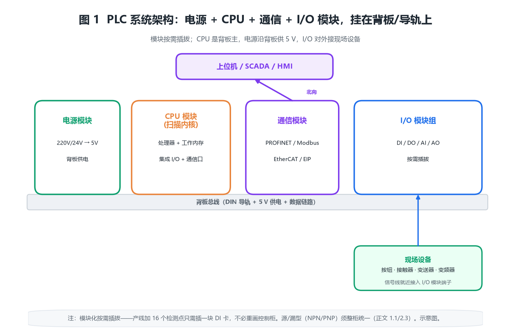

# PLC 可编程逻辑控制器产品综述：用循环扫描的可编程内核，把继电器逻辑换成可随时改写的生产线大脑

## 〇、一句话定位

PLC（Programmable Logic Controller，可编程逻辑控制器）的本质，不是「一台更强的工业电脑」，而是**一台为恶劣的工业现场专门设计的、按固定节拍循环扫描执行的可编程数字运算电子系统**——它用存放在存储器里的程序，替代并超越了传统继电器硬接线逻辑，去完成逻辑运算、顺序控制、定时、计数与算术运算，再通过数字量/模拟量 I/O 去驱动现场的电机、阀门、指示灯与传感器。

从工程角度看，PLC 与「单片机 / IPC（工业电脑）」最大的不同是：**它的可靠性来自「确定的扫描周期」而不是「最强的算力」**。一个 PLC 的 CPU 主频可能只有几十 MHz，但它承诺的是「每 X 毫秒把输出刷新一次」，这个确定性才是产线、泵站、安全回路敢把命交给它的原因。所以选 PLC 时该算的是「扫描周期够不够快、I/O 点够不够、背板电源够不够」，而不是「CPU 多快」。

> **反直觉点一：梯形图不是电路图，而是「被顺序扫描执行的程序」。** 继电器逻辑里电流真的会「从左母线流到右母线」；PLC 梯形图只是借用了继电器符号的旧瓶装新酒——程序从上到下、从左到右逐行扫描，同一时刻所谓「导通」只是内存里一个位被置 1。所以梯形图里的「并行支路」在扫描意义上仍是串行的，靠的是扫描周期足够快让人感觉「同时」。

> **反直觉点二：输出响应取决于扫描周期，而不是输出模块的硬件速度。** 你在输入端碰一下按钮，PLC 最快也要等「下一次扫描的输入采样」才读进来、「再下一次扫描的输出刷新」才推出去。最坏情况下一次外部事件要经过「输入滤波 + 两个扫描周期 + 输出驱动」才在端子上体现，延迟可达数毫秒到数十毫秒——这恰恰是高速定位、飞剪同步必须上中断或硬同步模块的原因。

> **反直觉点三：I/O 点数的「余量」不是浪费，是工程纪律。** 大量现场「加一台设备就改不动」的困境，根因是当初按「刚好够用」选了点数。成熟做法是点数乘 1.1~1.2 留余量、背板电源留 20% 以上余量、程序内存留 30% 冗余——这些看不见的余量，决定了三年后你能不能在不换机架的前提下塞进一个新工位。

> **反直觉点四：模块标称的 16 位分辨率，常常被参考源和接线精度「吃掉」。** 选 AI 模块时盯着位数没用，真正决定你能读出多少有效位是「传感器精度 + 信号调理 + 接地 + 参考电压」。12 位模块配 0.5 级变送器，量化误差早被淹没；盲目上 16 位只会增加成本与噪声敏感度。

十个锚定数字：编程语言遵循 **IEC 61131-3**（LD/FBD/SFC/ST/IL 五种）；分布式扩展遵循 **IEC 61499**；等同国标 **GB/T 15969**；典型扫描周期 **0.1~10 ms/千条指令**；数字量模块密度 **8/16/32 点**；模拟量分辨率 **12/13/16 位**；背板/现场常见供电 **24 V DC（SELV）**；外壳防护 **IP20（机柜内）/ IP65（现场）**；工作温度 **-20~60 ℃**；PROFINET RT 刷新 **1~4 ms**、IRT **<1 ms**。

---

## 一、产品设计方案

### 1.1 系统形态：电源 + CPU + 通信 + I/O 模块，挂在背板/导轨上

一台 PLC 的物理骨架是「一截 DIN 导轨 + 一块背板总线」：左侧是**电源模块**（把 24 V / 220 V 转成背板 5 V 与现场 24 V），紧接着是**CPU 模块**（含处理器、工作存储器、集成 I/O 与通信口），右侧按需插拔**数字量/模拟量 I/O 模块**与**通信模块**（PROFINET、Modbus、EtherCAT 等）。所有这些模块通过背后的背板总线交换数据，彼此靠导轨与总线连接器机械锁定。

图 1 画出了这种「背板级联」架构：CPU 是总线主，电源沿背板给各模块供 5 V，I/O 模块对外连接现场设备（按钮、接触器、阀门、变送器），通信模块把 CPU 接进上位机与远程 I/O 站。关键是**模块化的「按需插拔」**——产线要加 16 个检测点，就插一块 16 点 DI 卡，不必重画控制柜。

部署形态上，PLC 大致分四类：

- **一体式（紧凑型）**：电源 + CPU + 少量 I/O 集成在一个小盒子，点数少（20~40 点），用于单机设备、小型改造。
- **模块式（机架型）**：CPU 与各类模块在背板上自由组合，点数可到上千，用于产线、泵站、大型设备。
- **分布式 PLC + 远程 I/O**：CPU 在中央，I/O 通过 PROFINET / Modbus TCP 拉到现场（见 1.2 与图 4），用于跨厂房、长距离。
- **软 PLC（IPC + 运行时）**：在标准工业电脑上跑 PLC 运行时，承接 IT/OT 融合，适用于需要复杂算法、数据库、视觉的场合。

四类不是替代关系：紧凑型做「单机控制」，机架型做「集中控制」，分布式做「跨空间控制」，软 PLC 做「算力密集型控制」。

### 1.2 拓扑约束：集中式 vs 分布式，距离与刷新是两条闸

PLC 的 I/O 接线方式决定了一台 PLC 能「罩住」多大的物理范围：

- **集中式**：所有 I/O 模块都在本地背板上，信号线直接拉到现场。优点是时延最小、诊断最直观；缺点是控制柜到现场的信号线又长又贵，且模拟量长线易受干扰。
- **分布式（远程 I/O）**：I/O 模块下放到现场（阀岛、电机旁、厂房另一端），通过实时工业以太网把「I/O 映像」回传 CPU（图 4）。优点是把长线弱信号换成短线与强实时网；缺点是引入通信刷新延迟，且对网络确定性有要求。

两条闸：① **距离**——集中式模拟量线超过几十米就难保精度，分布式把网线拉到几百米也没事；② **刷新**——分布式 I/O 的响应多了「网络往返」这一环，PROFINET RT 刷新 1~4 ms，远快于普通扫描，但选型时仍要把它算进最坏响应里。

### 1.3 与相邻系统的边界（三处最容易拉扯）

1. **与继电器/接触器逻辑（谁替代谁）**：PLC 是继电器硬接线的「可编程替代」，但大功率主回路接触器、热继电器保护仍保留在 PLC 输出之外——PLC 管「逻辑」，强电通断仍靠接触器。边界是「逻辑与控制分离」。
2. **与 DCS（谁管段谁管厂）**：DCS 面向连续过程（化工、电力），强调冗余与过程控制；PLC 面向离散/顺序（产线、包装），强调确定性与节拍。边界在「连续过程 vs 顺序逻辑」，二者在混合场景常共存。
3. **与 IPC/单片机（确定性的代价）**：IPC 算力强但通常跑通用 OS，实时性靠补丁；单片机便宜但开发门槛高、生态弱。PLC 用「固定扫描 + 实时内核」换确定性，代价是算力上限低。边界在「要不要确定性」。

### 1.4 一个常被忽视的合规前提：标准主体与电气安全

PLC 的国际根基是 **IEC 61131 系列**（第 1 部分通用信息、第 2 部分设备要求与试验、第 3 部分编程语言、第 4 部分用户导则、第 5 部分通信），其中**IEC 61131-3**定义了 LD/FBD/SFC/ST/IL 五种语言，是今天「不同品牌 PLC 程序能互相读懂思路」的根因；分布式形态由 **IEC 61499** 规范。国内把 IEC 61131 等同转化为 **GB/T 15969 系列**（如 GB/T 15969.2-2008 对应设备要求）。低压电气安全遵循 **GB 14048.1**（低压开关设备通用规则），24 V 控制回路属 **SELV（安全特低压）** 范畴（GB/T 3805）；工业环境抗扰度参照 **GB/T 17626 系列（EMC）**；上位集成常引用 **GB 50314-2015（智能建筑设计标准）**。

施工上，PLC 机柜必须 **24 V 与 220 V 分开走线、强弱电分层、屏蔽线单端接地**，否则长线偶发误触发会把「逻辑没问题」的锅甩给程序。

### 1.5 PLC 的「灵魂」在程序与 I/O 映射，不在盒子

和网关、KNX 一样，PLC 真正值钱的是**那套程序与 I/O 地址映射**：哪个物理点接了急停、哪个模拟量通道对应几号水箱液位、哪段程序是哪个工位的动作逻辑。一台 PLC 硬件只是「能跑扫描内核的板子」，它「该读谁、该动谁、先后次序」全写在工程文件里。程序一旦乱，表现为「某个气缸不动作、查 I/O 灯却亮着」——极易误判成硬件故障。所以成熟做法：程序与符号表纳入版本管理，每次改逻辑前导出备份，改完做全点强制测试。

---

## 二、核心参数与选型

### 2.0 选型速查表

| 维度 | 工程基准值 | 说明 |
|---|---|---|
| 编程语言 | IEC 61131-3（LD/FBD/SFC/ST/IL） | 品牌语法有别，思路通用 |
| 扫描周期 | 0.1~10 ms / 千条指令 | 越小响应越快 |
| 数字量密度 | 8 / 16 / 32 点每模块 | 源/漏型（NPN/PNP）要分清 |
| 模拟量分辨率 | 12 / 13 / 16 位 | 位数 ≠ 有效精度 |
| 现场供电 | 24 V DC（SELV） | 也有 220 V AC 型 |
| 背板供电 | 5 V（模块逻辑） | 受电源模块容量限制 |
| 防护等级 | IP20（机柜）/ IP65（现场） | 分布式 I/O 可现场装 |
| 工作温度 | -20~60 ℃ | 工业宽温 |
| 实时以太网 | PROFINET / EtherCAT / EIP | RT 刷新 1~4 ms |
| 高速计数 | 普通扫描受限，HSC 100 kHz~1 MHz | 编码器测速必用 HSC |
| 热备切换 | 10~100 ms（冗余型） | 停机敏感场景要算 |

### 2.1 【原创算例 1】扫描周期与 I/O 响应延迟账：输出为什么「慢半拍」

PLC 一次扫描由「输入采样 → 程序执行 → 输出刷新 → 自诊断/通信」组成。扫描周期近似为：

$$T_{\mathrm{scan}}=N_{\mathrm{inst}}\times t_{\mathrm{inst}}+T_{\mathrm{IO}}+T_{\mathrm{comm}}$$

外部事件的最坏输出响应，要等「下一次输入采样把信号读进映像」、再「下一次输出刷新把结果推出去」，再叠加输入滤波延迟 $t_f$：

$$T_{\mathrm{resp}}\le 2\,T_{\mathrm{scan}}+t_f$$

算例：某 CPU 约 0.1 µs/指令，主程序 5 千条指令 → $N_{\mathrm{inst}}t_{\mathrm{inst}}=0.5\ \mathrm{ms}$，I/O 与通信约 0.4 ms，则 $T_{\mathrm{scan}}\approx 0.9\ \mathrm{ms}$；若数字量输入滤波设 3 ms，最坏响应约 $2\times0.9+3=4.8\ \mathrm{ms}$。若工艺要求事件到动作 ≤10 ms，则 $T_{\mathrm{scan}}\le(10-3)/2=3.5\ \mathrm{ms}$ 即可满足——**这就是「看扫描周期而非主频」的实际含义**。

### 2.2 【原创算例 2】I/O 点数规划账：余量不是浪费

实际点数确定后，规划数要乘余量系数（10%~20%）应对后期扩展：

$$N_{\mathrm{plan}}=N_{\mathrm{need}}\times(1+\eta),\quad \eta=0.10\sim0.20$$

算例：现场清点 DI 86 点、DO 54 点、AI 12 点、AO 4 点。按 $\eta=0.15$ 规划：DI $86\times1.15\approx99\to$ 取 16 点模块 **7 块（112 点）**；DO $54\times1.15\approx62\to$ 取 **4 块（64 点）**；AI $12\times1.15\approx14\to$ 取 8 通道模块 **2 块（16 点）**；AO $4\times1.15\approx5\to$ 取 **1 块（8 点）**。三年后加一个 14 点检测工位，DI 还能塞进去、DO 已临界——这正是当初留余量的回报。

### 2.3 【原创算例 3】数字量模块密度账：模块块数怎么定

单类 I/O 需要的模块块数：

$$n_{\mathrm{mod}}=\left\lceil\frac{N_{\mathrm{plan}}}{c}\right\rceil$$

$c$ 为单模块点数（8/16/32）。承接算例 2：DI 112 点用 16 点模块 → $\lceil112/16\rceil=7$ 块；DO 64 点 → 4 块；AI 16 点用 8 通道模块 → 2 块；AO 8 点 → 1 块。注意源/漏型（NPN/PNP）必须整柜统一，混用会导致「公共端接法冲突」——很多「点灯不亮」的故障根因在此。

### 2.4 【原创算例 4】模拟量分辨率账：1 个 LSB 到底多重

$n$ 位 ADC 的最小量化单位（满量程等分）：

$$\mathrm{LSB}=\frac{Span}{2^n}$$

12 位：$\mathrm{LSB}=1/4096\approx0.0244\%\ \mathrm{FS}$；16 位：$\approx0.0015\%\ \mathrm{FS}$。算例：0~10 V 量程 12 位 → 每步 $10/4096\approx2.44\ \mathrm{mV}$；0~20 mA 量程 16 位 → 每步 $20/65536\approx0.305\ \mathrm{\mu A}$。量化误差约 $\pm\mathrm{LSB}/2$。**位数高不代表读得准，只是把刻度划得更细**——见算例 6。

### 2.5 【原创算例 5】模拟量工程量换算账：4~20 mA 怎么变成 50 ℃

标准两线制 4~20 mA 与工程量线性映射（最常用公式，务必记牢）：

$$Y=\frac{X-X_{\min}}{X_{\max}-X_{\min}}\,(Y_{\max}-Y_{\min})+Y_{\min}$$

反解工程量：

$$X=X_{\min}+\frac{Y-Y_{\min}}{Y_{\max}-Y_{\min}}\,(X_{\max}-X_{\min})$$

算例：温度变送器 4~20 mA 对应 0~100 ℃。当读到 12 mA 时，$Y=(12-4)/(20-4)\times(100-0)+0=50$ ℃。若 PLC 内部先转成 0~27648（13 位 AD 典型满量程值），则 $Y=(X-5530)/(27648-5530)\times100$ 落到同一工程量——**两层换算顺序不要写反**。

### 2.6 【原创算例 6】精度叠加账：位数被参考源吃掉

模拟量通道的总误差，是量化误差与变送器/参考源误差的方和根（工程上按独立误差合成）：

$$\Delta_{\mathrm{total}}\approx\sqrt{\left(\frac{Span}{2^{n+1}}\right)^2+e_{\mathrm{ref}}^2}$$

（此处 $Span/2^{n+1}$ 为量化半步误差，已折算成工程量）。算例：0~100 ℃、12 位（量化半步 $\approx0.0122$ ℃）、配 0.5 级变送器（$e_{\mathrm{ref}}=0.5$ ℃）→ $\Delta_{\mathrm{total}}\approx\sqrt{0.0122^2+0.5^2}\approx0.50$ ℃，量化误差完全被淹没。想让量化成为主导，需 16 位以上且变送器优于 0.1 级。**结论：先把变送器与接地搞好，再谈位数**。

### 2.7 【原创算例 7】模拟量滤波账：平均法抑制得了什么、抑制不了什么

一阶滞后滤波：

$$Y_k=\alpha\,X_k+(1-\alpha)\,Y_{k-1},\quad \alpha=1-e^{-T_s/\tau}$$

$N$ 点移动平均等效一个时间常数约 $N\,T_s/2$ 的惯性环节。算例：采样周期 100 ms，做 8 点平均 → 等效滤波时间约 $8\times0.1/2=0.4\ \mathrm{s}$。**关键局限**：50 Hz 工频干扰周期 20 ms，8 点平均（窗口 800 ms）并不能整周期抵消它，反而会把它「平均」成缓慢漂移；真正抑工频要靠同步采样或硬件陷波。这条常被「加个平均就好了」的直觉误导。

### 2.8 【原创算例 8】通信刷新负载账：实时网会不会被压垮

PROFINET RT 刷新周期 $T_{\mathrm{cyc}}$（典型 1~4 ms），总线负载：

$$\rho=\frac{N_{\mathrm{sta}}\times L_{\mathrm{frame}}\times 8}{T_{\mathrm{cyc}}\times R_{\mathrm{phy}}}$$

算例：64 个远程 I/O 站、每站 40 字节、刷新 4 ms、物理速率 100 Mbps → $\rho=64\times40\times8/(0.004\times10^8)=5.12\%$。负载远低于 30~40% 的工程红线，安全。若把刷新压到 1 ms，负载升到约 20%——**刷新越快负载越重，要在响应与负载间取平衡**。

### 2.9 【原创算例 9】程序/内存容量账：工作内存留三成冗余

程序字数与内存需求：

$$M_{\mathrm{code}}=N_{\mathrm{net}}\times k_{\mathrm{net}}+M_{\mathrm{data}}$$

$N_{\mathrm{net}}$ 为梯形图网络（rung）数，$k_{\mathrm{net}}$ 为平均每网络编译后字长（约 15~25 字/网络），$M_{\mathrm{data}}$ 为数据块。算例：300 个网络 × 平均 20 字 + 数据块 5 K 字 ≈ 11 K 字。若 CPU 工作内存仅 16 K 字，余量仅 31%——按「留 30% 冗余」原则刚好临界，建议选 ≥20 K 字版本，给后期加逻辑留空间。

### 2.10 【原创算例 10】背板/电源容量账：容量不是看铭牌，看「谁供谁」

PLC 供电分两路预算：① **背板 5 V**：CPU 电源模块沿背板给各 I/O 模块的逻辑电路供电，有上限 $I_{\mathrm{backmax}}$；② **现场 24 V**：给外部传感器、继电器线圈、电磁阀供电，由独立 24 V 电源承担。

背板侧：

$$I_{5\mathrm{V}\_\mathrm{load}}=\sum I_{\mathrm{mod},\ 5\mathrm{V}}\le I_{\mathrm{backmax}}$$

算例：CPU 背板供 5 V 上限 2.0 A；8 块 DI(16 点，每块 5 V 80 mA) + 6 块 DO(每块 120 mA) + 2 块 AI(每块 150 mA) = $0.64+0.72+0.30=1.66\ \mathrm{A}$，加 CPU 自身 0.2 A ≈ 1.86 A，逼近 2.0 A 上限 → **必须外接 PS 或减模块**，否则最远模块供电不足、偶发复位。现场 24 V 侧：DO 驱动 24 个中间继电器线圈 @24 V/0.5 A → 需 24 V 电源 ≥ $24\times0.5=12\ \mathrm{A}$（见算例 11 浪涌）。

### 2.11 【原创算例 11】感性负载与浪涌降额账：点源够不够「咬住」接触器

接触器、电磁阀线圈是强感性负载，吸合瞬间涌流可达稳态的 3~10 倍，点源容量须覆盖：

$$I_{\mathrm{src}}\ge I_{\mathrm{load}}\times K_{\mathrm{inrush}},\quad K_{\mathrm{inrush}}=3\sim10$$

算例：一只 24 V 直流接触器线圈稳态 0.5 A、吸合涌流约 6 倍 → 单点需 ≥3 A 瞬供。若 PLC 的 DO 输出点额定 2 A、带 4 只同型号接触器同时吸合，瞬流 $4\times0.5\times6=12\ \mathrm{A}$ 远超点能力 → 必须加**中间继电器**或**浪涌吸收**（续流二极管/RC），否则触点粘连、寿命骤降。

### 2.12 【原创算例 12】高速计数账：普通扫描数不了编码器

编码器测速频率，普通「在扫描里读计数器」会被扫描周期卡死上限：

$$f_{\max}\le\frac{1}{2\,T_{\mathrm{scan}}}$$

专用高速计数（HSC）通道则可到 100 kHz~1 MHz。算例：2000 PPR 编码器随电机 3000 rpm（50 r/s）→ 脉冲频率 $2000\times50=100\ \mathrm{kHz}$。若 PLC 扫描 1 ms，普通法上限仅 500 Hz，差 200 倍 → **必须用 HSC 模块**，且编码器供电、屏蔽、Z 相零位都要按高速信号处理。

### 2.13 【原创算例 13】PID 采样周期账：采太快反而要命

PID 采样周期 $T_s$ 与过程时间常数 $\tau$ 的关系，工程上取：

$$T_s\approx(0.1\sim0.2)\,\tau$$

算例：恒压供水压力回路 $\tau\approx2\ \mathrm{s}$ → $T_s$ 取 0.2~0.4 s；若错取 50 ms（跟着扫描走），微分项会把传感器噪声放大成执行机构抖动。温度回路 $\tau\approx60\ \mathrm{s}$ → $T_s$ 取 5~10 s 即可。**采样周期应与过程快慢匹配，而非无脑等于扫描周期**。

### 2.14 【原创算例 14】热备切换账：停机敏感场景值多少钱

冗余 PLC（主备双 CPU）的切换时间 $T_{\mathrm{switch}}$ 决定了「主 CPU 宕机时输出冻结多久」。切换靠主备实时同步 I/O 映像，典型 10~100 ms。

算例：某泵站「年停机损失折算 500 元/秒」，要求切换丢失 ≤500 ms，则选 $T_{\mathrm{switch}}\le50\ \mathrm{ms}$ 的 H 系统（双机热备）。切换期间输出保持最后状态（不跳变），切换完成后备机无缝接管。若用普通单 PLC，宕机就是「整站停到人工复位」——**冗余的溢价，买的是这几百毫秒的无感**。

---

## 三、技术原理

### 3.1 循环扫描机制：确定性从哪来

PLC 的核心不是「多任务」，而是「单线程循环 + 固定节拍」。每个扫描周期依次做：① 刷新输入映像区（把端子状态读进内存）；② 按程序顺序执行用户逻辑（读写内存中的映像而非直接端子）；③ 刷新输出映像区到端子；④ 自诊断与通信处理。正是「先整批采样、再整批输出」这个约定，让外部看 PLC 像一台「每 $T_{\mathrm{scan}}$ 同步一次」的同步机——确定性由此而来，也带来了算例 1 的半拍延迟。

### 3.2 五种编程语言与编译

IEC 61131-3 把「怎么写逻辑」标准化：**LD（梯形图）**借继电器符号最易上手；**FBD（功能块图）**适合信号处理与算法；**SFC（顺序功能图）**天然表达「步-转移」的产线顺序；**ST（结构化文本）**像 Pascal，适合复杂运算；**IL（指令表）**接近汇编，已渐被弃用。无论哪种，最终都编译进同一套扫描内核执行——这是「不同品牌能互相读懂」的根。

### 3.3 输入滤波与去抖：硬件与软件两道关

数字量输入有硬件滤波（RC，可设 0.1~12 ms）抑制触点抖动与干扰；模拟量有软件滤波（算例 7）。二者配合，把「按钮抖三下」变成「一次有效沿」。但滤波时间越长，输入响应越慢——它正是算例 1 里 $t_f$ 的来源，是「抗扰度 vs 响应速度」的直接交换。

### 3.4 中断 vs 扫描：什么时候要打破节拍

常规逻辑走扫描即可；但对于「必须在事件发生的微秒级内响应」的场景（如编码器零位、急停硬线、高速捕捉），要用**硬件中断 / 事件任务 / 运动同步模块**，绕过扫描周期直接在中断里动作。PLC 的强项不是「最快」，而是「确定」——中断把确定性的边界从「毫秒级扫描」推到「微秒级事件」，代价是程序设计更复杂。

### 3.5 确定性的代价：为什么 PLC 不做「抢占式多任务」

PLC 的扫描内核刻意不做抢占式多任务——它宁愿让程序按固定节拍跑，也不让高优先级任务随时打断主循环，原因是「可预测」比「快」更重要：当一台设备要在 5 ms 内做出反应、且每次都一样，抢占带来的抖动是不可接受的。这也是为什么复杂算法（视觉、数据库、报表）通常外挂 IPC，而不是硬塞进 PLC——分工是「PLC 管确定性动作，IPC 管算力密集型任务」。代价同样明显：一个写坏的死循环、或一次超大的循环，就会触发看门狗复位、让整机停摆，所以「程序分块、禁用长循环、善用中断」是 PLC 编程的三条基本规矩。

另外，PLC 的三大性能指标要分开看：**扫描周期**（跑完一遍程序的时间）、**指令执行时间**（单条指令的 µs 级开销）、**I/O 刷新时间**（映像到端子的延迟）。厂商宣传常只报「0.02 µs/指令」，但真实响应取决于三者叠加，这也是算例 1 坚持用「总周期」而非「主频」来算响应的原因。

---

## 四、产品功能与差异化

### 4.1 编程语言矩阵：按人按场景选

| 语言 | 最适合 | 不适合 |
|---|---|---|
| LD 梯形图 | 电气工程师、继电器改造 | 复杂数学、字符串 |
| FBD 功能块 | 信号处理、算法封装 | 纯顺序流程 |
| SFC 顺序图 | 产线步序、配方 | 连续调节 |
| ST 结构化文本 | 复杂运算、数据处理 | 直观接线展示 |

### 4.2 通信矩阵：把 PLC 接进更大的系统

现代 PLC 几乎必带实时以太网：PROFINET（西门子系）、EtherCAT（倍福系，快）、Ethernet/IP（罗克韦尔系）、Modbus TCP（通用）。选型时看「上位机/变频器/仪表用什么」，再决定通信模块——**通信兼容性往往比 CPU 性能更决定项目成败**。

### 4.3 分布式 I/O：把 I/O 拉到现场

通过 PROFINET/Modbus TCP 把 I/O 站下放到阀岛、电机旁（图 4），把「长弱信号线」换成「短信号线 + 实时网」，是大型项目降本提质的标配。代价是引入网络刷新延迟（算例 8），要把它算进响应预算。拓扑上分线形、星形与环网：线形最省线但一处断链后面全掉；星形靠交换机最稳但要更多端口；环网用冗余协议（MRP/PRP）在断一处时自动改道，代价是切换几十毫秒——**选拓扑其实是在「省线、可维护、抗断」三者间取平衡**，不是越简单越好。

### 4.4 功能安全（fail-safe / SIL）

安全型 PLC（F-PLC）在标准 PLC 之外跑独立安全程序，达成 SIL 2/3，用于急停、安全门、光幕——安全回路与标准回路物理与逻辑双重隔离，故障导向安全（fail-safe）。普通 PLC 不能替代安全继电器/安全 PLC 做人员防护。

### 4.5 热备冗余：停机敏感场景的保险

双 CPU 实时同步（算例 14），主宕备接管、输出不跳变。适用于泵站、能源、连续生产等「停一次亏很多」的场景。单 PLC 项目则靠规范施工与备件来降低风险。

---

## 五、应用场景

### 5.1 产线顺序控制（痛点→方案→价值）

**痛点**：继电器柜改一次逻辑要重接线两周，且故障难查。  
**方案**：PLC + SFC 把工序写成「步-转移」，HMI 上改参数即可换型。  
**价值**：换型时间从两周降到半天，故障靠在线监视定位到具体网络。

### 5.2 楼宇/水处理（痛点→方案→价值）

**痛点**：多台水泵、阀门、液位分散在厂房各处，集中式接线成本高。  
**方案**：PLC + 分布式 I/O（图 4）把 I/O 下放到现场，PID（算例 13）做恒压/恒液位。  
**价值**：信号线量减半、抗干扰增强，运维只需查网络诊断。

### 5.3 电机/泵站（痛点→方案→价值）

**痛点**：接触器浪涌烧毁触点、双电源切换抖动。  
**方案**：PLC 做顺序联锁 + 浪涌吸收（算例 11）+ 热备（算例 14）。  
**价值**：触点寿命延长数倍，关键站无感切换。

### 5.4 设备改造（痛点→方案→价值）

**痛点**：老设备继电器老化、备件停产。  
**方案**：紧凑型 PLC 原位替换继电器逻辑，保留接触器主回路。  
**价值**：以最小改动复活老设备，程序可版本管理、可复刻。

---

## 六、实际案例与设计方案

### 案例一：小型恒压供水（PID + 变频器）

- **需求**：三台水泵恒压供水，压力波动 ≤±0.02 MPa，无人值守。
- **方案设计**：紧凑型 PLC 作控制核心；压力变送器 4~20 mA 进 AI（工程量换算见算例 5），PID 采样 $T_s=0.3\ \mathrm{s}$（算例 13，压力 $\tau\approx2\ \mathrm{s}$）；DO 控变频器启停与工频/变频切换；加软启与延时投入避免水锤。
- **配置核算**：AI 1 路、DI 8（水位/手自动/故障）、DO 6（三泵启停+报警），选 14 点紧凑型余量充足；24 V 电源按三只中间继电器 + 变送器核算 ≥2 A。
- **交付价值**：压力稳定、泵组轮值延长寿命、故障自诊断，运维从「听异响」变成「看报警」。

### 案例二：产线 32 工位顺序控制（分布式 I/O）

- **需求**：一条 32 工位装配线，节拍 2 s，需频繁换型。
- **方案设计**：机架型 PLC + PROFINET 远程 I/O 站（每 8 工位一站，共 4 站，见图 4）；SFC 描述工序流；HSC（算例 12）读编码器做同步定位。
- **配置核算**：DI 256、DO 192、AI 16，本地+远程合计；网络刷新取 4 ms（算例 8 负载 5% 安全）；背板 5 V 由多电源分担（算例 10），不超单电源上限。
- **交付价值**：换型只改 SFC 参数，停机从两周降到半天；工位故障在线定位到具体站。

### 案例三：市政泵站热备冗余（停机敏感）

- **需求**：排涝泵站年停机损失 500 元/秒，不容单机宕机。
- **方案设计**：双 CPU 热备（算例 14，切换 ≤50 ms），分布式 I/O 拉到各泵坑；联锁 + 浪涌吸收（算例 11）保护接触器；远程监控。
- **配置核算**：主备同步映像带宽按 I/O 规模核算；24 V/220 V 分开走线、屏蔽单端接地（1.4 合规）；切换测试纳入季度保养。
- **交付价值**：单 CPU 故障零感知接管，年可用率从「看运气」升到 99.99%+。

---

## 七、市场背景与竞争格局

PLC 自 1969 年（Modicon 084）诞生，已是被 IEC 61131-3 统一编程语言的成熟产业。海外头部为**西门子（Simatic）、罗克韦尔（AB）、施耐德（Modicon/Telemecanique）、三菱、欧姆龙**，分别把持欧系、美系、日系生态；国产阵营以**汇川、信捷、台达、和利时、中控**为代表，在中小型与细分行业快速替代。趋势上：① **国产替代**加速，性价比与本地化服务是抓手；② **IT/OT 融合**，软 PLC、OPC UA、MQTT 把产线接进云端；③ **分布式化**，IEC 61499 让控制逻辑跨设备分布；④ **功能安全**成为中高端入场券；⑤ **边缘智能**，PLC 内置 AI 推理从愿景走向试点。

从行业分布看，PLC 的最大用量在离散制造（汽车、3C、包装、机床）与流程工业的辅机环节，市政（水处理、泵站、隧道）则是中小型 PLC 的主战场；国产替代在包装、锂电、光伏、物流等新兴产线推进最快，而在冶金、石化等对可靠性与生态依赖极深的场景仍以头部欧美品牌为主。一个常被忽略的事实是：**PLC 的竞争早已不是单机性能，而是「编程软件 + 通信生态 + 服务响应」的三位一体**——工程师愿不愿意在你的平台上写程序，比 CPU 快 10% 更能决定中标。

---

## 八、商业模式与趋势

PLC 项目的收入通常是「**硬件 30%~40% + 工程（设计/编程/调试）60%~70%**」——卖盒子只是入口，真正利润在把工艺写成可靠程序的能力。趋势判断：中小项目会继续国产化、价格下行；大型与关键场景（安全、冗余、IT/OT）仍由欧美头部与国产头部瓜分。对实施方而言，**「会写 IEC 61131-3 标准程序 + 懂工艺核算」的复合能力**，比「会调某个品牌」更保值——标准语言让经验可迁移，而算例 1~14 这种「把配置算清楚」的功底，正是工程报价与交付质量的护城河。

---

## 附录

### 附录 A：14 个原创算例速查表

| 序号 | 主题 | 核心公式 | 一句话结论 |
|---|---|---|---|
| 1 | 扫描/响应延迟 | $T_{\mathrm{resp}}\le2T_{\mathrm{scan}}+t_f$ | 看扫描周期而非主频 |
| 2 | I/O 余量 | $N_{\mathrm{plan}}=N_{\mathrm{need}}(1+\eta)$ | 余量 10%~20% 是纪律 |
| 3 | 模块块数 | $n=\lceil N/c\rceil$ | 源/漏型整柜统一 |
| 4 | 分辨率 | $\mathrm{LSB}=Span/2^n$ | 划得更细 ≠ 读得准 |
| 5 | 工程量换算 | $Y=\frac{X-X_{\min}}{X_{\max}-X_{\min}}(Y_{\max}-Y_{\min})+Y_{\min}$ | 4~20 mA 必背 |
| 6 | 精度叠加 | $\Delta\approx\sqrt{(Span/2^{n+1})^2+e_{\mathrm{ref}}^2}$ | 先搞变送器再谈位数 |
| 7 | 滤波局限 | $\alpha=1-e^{-T_s/\tau}$ | 平均法抑不了工频 |
| 8 | 通信负载 | $\rho=N L\times8/(T_{\mathrm{cyc}}R)$ | 刷新越快负载越重 |
| 9 | 内存余量 | $M=N_{\mathrm{net}}k_{\mathrm{net}}+M_{\mathrm{data}}$ | 留 30% 冗余 |
| 10 | 背板电源 | $\sum I_{5\mathrm{V}}\le I_{\mathrm{backmax}}$ | 容量看谁供谁 |
| 11 | 感性浪涌 | $I_{\mathrm{src}}\ge I_{\mathrm{load}}K_{\mathrm{inrush}}$ | 加中间继电器/吸收 |
| 12 | 高速计数 | $f_{\max}\le1/(2T_{\mathrm{scan}})$ | 编码器必用 HSC |
| 13 | PID 采样 | $T_s\approx(0.1\sim0.2)\tau$ | 匹配过程快慢 |
| 14 | 热备切换 | $T_{\mathrm{switch}}\le$ 允许丢失 | 买的是无感几百毫秒 |

### 附录 B：术语表

- **扫描周期**：PLC 循环执行一遍用户程序的时间，确定性之源。
- **I/O 映像区**：内存中对应物理输入/输出端子的副本，程序读写它而非直接端子。
- **SELV**：安全特低压（通常 ≤50 V AC / ≤120 V DC 且隔离），24 V 控制回路即属此类。
- **HSC**：高速计数器，独立于扫描的硬件计数通道。
- **SFC**：顺序功能图，用「步-转移」描述顺序控制。
- **F-PLC**：功能安全 PLC，达成 SIL 等级的安全控制。

### 附录 C：标准索引

- IEC 61131-1~5（可编程控制器，GB/T 15969 等同转化）
- IEC 61131-3（编程语言，LD/FBD/SFC/ST/IL）
- IEC 61499（分布式控制系统）
- GB 14048.1（低压开关设备和控制设备 第 1 部分）
- GB/T 3805（特低电压限值，SELV）
- GB/T 17626 系列（电磁兼容 试验和测量技术）
- GB 50314-2015（智能建筑设计标准）
- GB/T 19582（基于 Modbus 的工业网络规范，通信互操作参考）

### 附录 D：故障速查表

| 现象 | 常见根因 | 排查方向 |
|---|---|---|
| 输出慢半拍 | 扫描周期大/滤波长 | 查 $T_{\mathrm{scan}}$ 与 $t_f$（算例 1） |
| 点数不够扩 | 当初按刚好选 | 预留 $\eta$（算例 2） |
| AI 读数漂 | 平均抑不了工频 | 同步采样/硬件陷波（算例 7） |
| 模块偶发复位 | 背板 5 V 不足 | 核 $\sum I_{5\mathrm{V}}$（算例 10） |
| 触点粘连 | 感性浪涌无吸收 | 加继电器/吸收（算例 11） |
| 编码计数丢 | 用了普通计数 | 换 HSC（算例 12） |
| 泵压力抖 | PID 采样太快 | 调 $T_s$（算例 13） |
| 宕机全停 | 无冗余 | 上热备（算例 14） |
