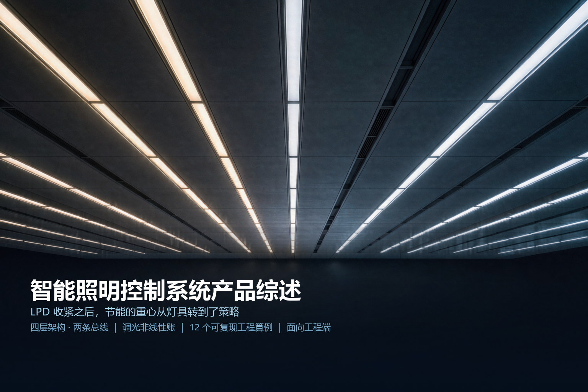

# 智能照明控制系统产品综述：LPD 收紧之后，节能的重心从灯具转到了策略

> 本文面向工程端（弱电/智能化集成商、电气与照明设计岗、机电顾问、甲方技术负责人、物业设施运维）。
> 全文参数一律标注「工程基准 / 工程估算」，不引用任何厂商承诺指标；标准引用只写可公开查证的条款与数值。
> 封面为 AI 生成概念示意图，非真实设备照片。

---

## 〇、一句话定位

**智能照明控制系统把「灯具什么时候亮、亮多少、什么颜色」这三个决定，从配电箱的翘板开关手里，交到策略与传感器手里，并让每一盏灯都变成一个可寻址、可回报状态的数据节点。**

定义里有三个词是关键：

| 词 | 含义 | 做不到会怎样 |
|---|---|---|
| **策略** | 日程、占空、恒照度、场景四套逻辑叠加，而不是"感应器一有人就全亮" | 装了传感器但只做开关 → 节能率停在 15%~20%，且人被频繁闪灯惹烦 |
| **可寻址** | 每个驱动有独立地址（DALI 单线 64 个）、可单独调光、可回报故障 | 只能按回路整体开关 → 一个 30 盏灯的回路里换工位就得重排线 |
| **数据节点** | 灯具回报功率、运行小时、故障、温度（D4i / IEC 62386-251~253） | 节能量无法核证、灯具故障靠人巡楼发现 → 运维价值归零 |

### 反直觉点一：节能率的百分比很漂亮，绝对值可能只有一个零头

这是本文最重要的一条。**照明的能耗基数早就被 LED 和照明功率密度（LPD）限值压得很低了。**

按 GB/T 50034-2024 的目标值口径，办公建筑普通办公室的 LPD 目标值为 $6.5\ \mathrm{W/m^2}$；用光效 $130\ \mathrm{lm/W}$ 的 LED 灯具，实际设计做到 $4.8\ \mathrm{W/m^2}$ 是很常见的。年运行 3000 h 的话，单位面积照明能耗只有：

$$4.8\ \mathrm{W/m^2} \times 3000\ \mathrm{h} = 14.4\ \mathrm{kWh/(m^2 \cdot a)}$$

一个控制策略做到 48% 的节能率，听起来很猛，实际是 $6.95\ \mathrm{kWh/(m^2 \cdot a)}$。按 1.0 元/kWh 就是 **7 元/（m²·年）**。而智能照明相对"非调光 LED + 翘板开关"的增量投资，工程估算落在 **30~50 元/m²**。

**回收期 = 投资 ÷ 年省电费，落在 4~10 年**，对运行小时和电价极度敏感（见 2.5 的敏感性矩阵）。

反过来说，真正让账面好看的从来不是"加装控制"，而是**"换灯 + 加控制"一起做**——同一栋楼从 T8 荧光（LPD 约 $7.7\ \mathrm{W/m^2}$）换到 LED 再叠控制，节能率能到 70% 上下，回收期压到 4~5 年。

> 所以市场上"智能照明节能 50%、两年回本"的说法，通常隐含了三个条件：**同时换灯、年运行 3000 h 以上、商业电价**。三个条件少一个，账就完全不一样。这不是说智能照明不值得做，而是**它的价值主张必须换一套说法**——从"省电费"换成"空间可重构 + 合规 + 运维数据 + 光环境质量"（见第七章）。

### 反直觉点二：恒照度调完之后大家都说暗，多半不是心理作用

恒照度控制（closed-loop daylight harvesting）最常见的投诉是"调完之后工位变暗了"。绝大多数情况下这不是错觉，而是一个可以算出来的**系统性偏差**。

设工作面照度由自然光 $E_d$ 与人工光 $E_a$ 组成：$E_w = E_d + E_a$。但天花板上的光传感器看到的不是这个组合，它有自己的加权：$\beta$。定义**光反馈系数**：

$$E_s = E_d + \beta E_a$$

$E_s$ 是传感器读数，$\beta$ 是"传感器对人工光的敏感度 / 对自然光的敏感度"。控制器维持 $E_s = E_{\mathrm{set}}$，于是人工光被压到：

$$E_a = \frac{E_{\mathrm{set}} - E_d}{\beta}$$

代回工作面：

$$E_w = \frac{E_{\mathrm{set}}}{\beta} + E_d\left(1 - \frac{1}{\beta}\right)$$

夜间 $E_d = 0$，$E_w = E_{\mathrm{set}}/\beta$。**只要 $\beta > 1$（传感器比工作面更"看得到"上方的灯），夜间的实际照度就系统性低于设定值。** $\beta = 1.25$ 时，设定 500 lx 实际只有 400 lx——差 20%，肉眼非常明确。

而 $\beta < 1$（传感器太贴窗、只看得到外面）时，$1 - 1/\beta < 0$，出现更荒谬的结果：**白天自然光越强，工作面反而越暗**。完整推导、三种情形的对照与现场标定方法见 2.4。

### 反直觉点三：这套系统在 2024 版新标准里被正式写进去了

**GB/T 50034-2024《建筑照明设计标准》**（2024-03-12 发布 / **2024-08-01 实施**，原 GB 50034-2013 同时废止）的修订内容里，明确包含：

- **补充和完善了智能照明控制系统技术内容**（第 7.3.8 条：应具备信息采集、多种控制方式、场景模式、联动接口等功能）
- 增加了闪烁与频闪效应、非视觉效应等健康照明技术指标（第 4.4 节）
- 提高了灯具效能与 LPD 等节能指标
- 增加了照明直流配电技术内容（7.1.2、7.2.3）与 PoE 要求（7.2.4，输出 DC 44~57 V，功率分级至 90 W）
- 增加了采光与人工照明协同设计要求

同时，**LPD 的现行值已移交给强制性工程建设规范 GB 55015**，GB/T 50034-2024 只给出目标值（办公建筑见表 6.3.5）。

**这条变化的工程含义很直接：LPD 现行值是强制的、目标值是推荐的；而"要不要做智能照明"这件事，已经从加分项变成了新标准技术体系里的一个正式章节。**

### 十个锚定数字

| # | 数字 | 出处 | 工程含义 |
|---|---|---|---|
| 1 | 办公建筑普通办公室 LPD **目标值 ≤ 6.5 W/m²** | GB/T 50034-2024 表 6.3.5 | 高档办公室 ≤9.5、服务大厅 ≤8.0；重点照明 +5 |
| 2 | LPD **现行值**按 GB 55015 执行 | GB/T 50034-2024 6.3.5 | 现行值强制、目标值推荐 |
| 3 | 闪变指数 $P_{\mathrm{st}}^{\mathrm{LM}} \le 1$ | GB/T 50034-2024 4.4.1 | 低频闪烁上限 |
| 4 | 频闪效应可视度 **SVM ≤ 1.3**（长期工作场所） | 4.4.2 | 儿童青少年场所 ≤1.0（按 GB 55016） |
| 5 | 室内同类灯具**色容差 ≤ 5 SDCM** | 4.5.4 | 室外 ≤7 SDCM |
| 6 | 室内夜间长期停留场所**相关色温不宜高于 4000 K** | 4.5.2 | 室外不宜高于 5000 K |
| 7 | DALI：64 地址 / 16 组 / 16 场景 / **250 mA** / 16 V / 300 m / 1200 bit/s | IEC 62386 | 每条线的硬天花板 |
| 8 | DALI 调光 **254 级、对数、0.1%~100%** | IEC 62386-102 | ARC 1 ≈ 0.1%，ARC 254 = 100% |
| 9 | PoE 输出 **DC 44~57 V、功率分级至 90 W** | GB/T 50034-2024 7.2.4 | 802.3bt Type 4 末端可用 71.3 W |
| 10 | GB/T 39021-2020 智能照明系统通用要求 | 2021-02-01 实施，SAC/TC 224 | 功能安全依 IEC 63117，信息安全需声明等级 |

---

## 一、产品设计方案

### 1.1 先从合规说起：2024 版换版改了什么

做智能照明的选型，第一件事不是选协议，而是确认你的项目按哪个版本校核。GB/T 50034-2024 相对 2013 版的关键变化：

| 维度 | GB 50034-2013 | GB/T 50034-2024 | 对智能照明的影响 |
|---|---|---|---|
| LPD 现行值 | 标准内给出（办公普通办公室 ≤9.0 W/m²） | 移交 GB 55015（强制规范） | 校核路径改变，别再只查照明标准 |
| LPD 目标值 | 办公普通办公室 ≤8.0 W/m² | **≤6.5 W/m²** | 收紧约 19%，倒逼光效与利用系数 |
| 频闪 | 无量化指标 | $P_{\mathrm{st}}^{\mathrm{LM}} \le 1$、SVM ≤1.3 / ≤1.0 | 调光方式成为合规变量（见 2.8） |
| 色容差 | 未量化到 SDCM | 室内 ≤5 SDCM、室外 ≤7 SDCM | 调色温方案要留 Duv 预算（见 2.9） |
| 智能控制 | 提及控制方式 | **7.3.8 明确功能要求** + 7.3.7 车库按需调光 | 从"可选项"变成正式技术章节 |
| 直流与 PoE | 无 | 7.1.2 / 7.2.3 直流配电；7.2.4 PoE | 低压直流照明有了依据 |
| 健康照明 | 无 | 非视觉效应、光生物安全、色温上限 | 调色温有了合规抓手 |

**一个容易踩的坑**：GB/T 50034-2024 第 6.1.2 条的条文说明明确——**LED 灯具功率按标称输入功率计算，恒压直流电源等附属装置不计入 LPD**。这条对 PoE 照明方案是个灰色地带：PoE 交换机的输出算不算"附属装置"？见 2.10 的讨论，保守做法是按 PSE 侧功率校核。

### 1.2 系统形态：四层，两条总线

智能照明的物理形态可以拆成四层，以及**两条走向完全不同的总线**——这是它与 BAS 最大的结构差异。

| 层 | 设备 | 时间尺度 | 失效影响 |
|---|---|---|---|
| 管理层（软件） | 上位机/云平台、能耗报表、场景编排、BMS 网关 | 分钟~天 | 不影响照明，只影响可视化与联动 |
| 控制层（网关/应用控制器） | 多回路 DALI 网关、区域控制器、KNX/BACnet 网关 | 100 ms~秒 | 跨区场景失效，本地场景仍可用 |
| 现场层（总线设备） | 调光驱动、DALI 输入设备（传感器/面板）、继电器模块 | 10~100 ms | 局部失效 |
| 灯具层 | LED 模组、驱动、光学件 | ms | 单点失效 |

两条总线：

1. **强电配电总线**：AC 220/380 V 照明回路，按 GB 51348、GB 50303 设计，每个回路通常带 15~25 盏灯（受断路器额定电流与启动冲击限制）
2. **控制总线**：DALI 两线制，标称 16 V，可与强电同缆敷设（**只有基本绝缘，不是 SELV**），无极性要求（DALI-2 起强制），无终端电阻

> **一个常被误解的点**：DALI 地址与强电回路**不需要一一对应**。一条 DALI 线可以横跨多个强电回路，一个强电回路里的灯也可以分属多个 DALI 线。这种解耦正是"分区可以软件重构"的物理基础——但它带来一个运维陷阱：断电检修时，一个强电回路停电，可能同时影响三条 DALI 线上的部分灯具，故障定位会变复杂。工程上的对策是在 DALI 地址表上**强制标注所属强电回路编号**，并在交付时提供双向对照表。

### 1.3 与相邻系统的边界：三处最容易拉扯的地方

| 边界对象 | 争议点 | 工程结论 |
|---|---|---|
| **BAS / 楼控** | 照明要不要并进 BAS？ | **只做场景调用与能耗采集，不做闭环**。理由见 2.7 的时延账：跨系统闭环端到端 13~14 s，人在走廊已经走过去 18 m 了 |
| **消防应急照明** | 日常能不能把应急灯当普通灯调光？ | **不能**。GB 51309-2018 3.2.1-8 要求标志灯选持续型；3.6.5/3.6.6 规定非火灾状态下持续型灯具保持"节电点亮"、主电源断电时连锁转入应急点亮。应急照明必须自成系统，智能照明不得干预其应急功能（详见 3.6） |
| **遮阳 / 电动窗帘** | 恒照度该调灯还是调帘？ | **先调灯、后调帘**。帘的动作时间尺度是 10~30 s 且影响视野与得热，闭环放在最慢层；把遮阳并入恒照度快环会同时引发振荡与投诉 |

### 1.4 现场设备的选型面貌

| 设备 | 关键选型参数 | 常见踩坑 |
|---|---|---|
| DALI 调光驱动 | 调光深度（0.1%/1%/10%）、调光曲线（对数/线性）、DT6 / DT8、待机功耗、驱动效率曲线 | 只看"支持 DALI"，不看调光深度 → 场景里设 1% 时灯直接熄灭 |
| 存在/照度传感器 | 探测原理（PIR / 微波 / 超声）、覆盖直径与安装高度关系、照度量程与光谱响应、是否总线供电 | PIR 对静止人员不敏感 → 工位坐着不动被判无人关灯 |
| 控制面板 | 场景数、键位、是否带反馈指示、是否可编程 | 面板无状态反馈 → 用户不知道当前在哪个场景 |
| 网关 / 应用控制器 | 带几条 DALI 线、单线地址数、是否支持多主控、上位接口协议 | 单线 64 地址写死 → 后期加灯无处可挂 |
| 继电器/开关模块 | 每模块路数、是否带电流检测、机械/电子 | 用继电器模块做调光 → 只能开关，调光承诺落空 |
| 总线电源 | 输出电流（常见 240 mA）、是否可多电源并联 | 并联两个 240 mA "保险" → 超过 250 mA 标准上限（见 2.6） |

---

## 二、核心参数与选型

### 2.0 选型速查表

| 参数 | 工程基准 | 说明 |
|---|---|---|
| 单条 DALI 线控制电器地址 | 64 | DALI-2 另加 64 个控制设备地址、32 个组 |
| 组 / 场景 | 16 / 16 | 每控制电器可存 16 个场景 |
| 总线电压 | 标称 16 V，允许 9.5~22.5 V | 末端压降 ≤2 V |
| 总线电流 | 上限 250 mA/线 | 单设备 ≤2 mA |
| 线缆长度 | 300 m @1.5 mm² | 0.5 mm² 时约 190 m（按 2 V 压降反推） |
| 通信速率 | 1200 bit/s（Manchester） | 前向帧 15.8 ms、后向帧 9.2 ms |
| 调光等级 | 254 级，对数，0.1%~100% | DALI-2 可切线性 |
| 调光渐变时间 | 100 ms ~ 16 min（DALI-2） | 默认约 0.7 s |
| 灯具光效（2024 水平） | 130~160 lm/W | 见 2.1 反推 |
| 维护系数 MF | 0.8（常规）/ 更高（有恒照度时） | 见 2.1 |

### 2.1 【原创算例 1】LPD、照度、光效的三角约束：限值其实在给光效定下限

这是全文最有用的一条推导，只有三步。

照度计算的基本式（利用系数法）：

$$E = \frac{N \cdot \Phi \cdot \mathrm{UF} \cdot \mathrm{MF}}{A}$$

其中 $N$ 为灯具数、$\Phi$ 为单灯光通（lm）、$\mathrm{UF}$ 为利用系数、$\mathrm{MF}$ 为维护系数、$A$ 为面积。而照明功率密度：

$$\mathrm{LPD} = \frac{N \cdot P}{A}$$

两式相除，$N$ 和 $A$ 直接消掉：

$$\frac{E}{\mathrm{LPD}} = \frac{\Phi}{P} \cdot \mathrm{UF} \cdot \mathrm{MF} = \eta \cdot \mathrm{UF} \cdot \mathrm{MF}$$

于是：

$$\boxed{\ \eta_{\mathrm{req}} = \frac{E}{\mathrm{LPD} \cdot \mathrm{UF} \cdot \mathrm{MF}}\ }$$

**这个式子说明：LPD 限值 + 照度标准值 + 利用系数 + 维护系数，四者共同锁死了灯具光效的下限。** 它把"节能标准"翻译成了一个可以直接拿去询价的产品指标。

代入办公建筑普通办公室（照度标准值取 300 lx 量级，LPD 目标值 6.5 W/m²）：

| 情形 | UF | MF | 所需光效 $\eta_{\mathrm{req}}$ | 可行性 |
|---|---|---|---|---|
| 常规做法 | 0.60 | 0.80 | $\dfrac{300}{6.5 \times 0.48} = 96\ \mathrm{lm/W}$ | 2024 年主流 LED 轻松达到 |
| **有恒照度控制** | 0.60 | **1.00** | $\dfrac{300}{6.5 \times 0.60} = 77\ \mathrm{lm/W}$ | 光效要求**降低 20%** |
| 高反射比 + 好配光 | 0.75 | 0.90 | $\dfrac{300}{6.5 \times 0.675} = 68\ \mathrm{lm/W}$ | 进一步放宽 |
| 若设计照度提到 500 lx | 0.60 | 0.80 | $\dfrac{500}{6.5 \times 0.48} = 160\ \mathrm{lm/W}$ | **卡在产业上限，必须靠提高 UF** |

**这一行是关键。** 恒照度控制让设计不必再按"末期照度"预留光衰余量（不必按 $\mathrm{MF} = 0.8$ 去把初始照度做到 375 lx），设计功率可以直接按维持照度取值，**等效于把维护系数拉到 1.0**，从而把对灯具光效的要求从 96 降到 77 lm/W。

**这是智能照明对 LPD 合规最"硬"的贡献：它不是在运行时省电，而是在设计阶段就把合规门槛降低了 20%。** 采购时这 20% 可以直接换成灯具单价的下降。

> ⚠️ 使用前提：这种做法必须保证控制系统真的在投用（不是装了不用），且在验收时提供恒照度功能的检测记录。若控制系统被停用，末期照度会跌破标准值——所以在图纸说明里必须写清这条依赖关系。

### 2.2 【原创算例 2】调光的非线性：省一半电，人眼只觉得暗了两成

人眼对亮度的感知不是线性的，遵循 Stevens 幂律（对大面积光源，指数取 0.33 量级；点光源约 0.5）：

$$B \propto L^{0.33}$$

$B$ 为主观亮度感，$L$ 为光输出。把这条曲线和"功率—光通"曲线叠起来，就得到调光的真实代价：

| 功率设定 | 光通 $L$ | 主观亮度 $B = L^{0.33}$ | 主观感受 |
|---|---|---|---|
| 100% | 100% | 100% | 基准 |
| **50%** | 55%（见 2.3 的超线性） | $0.55^{0.33} = 0.82$ | **只暗了 18%** |
| 20% | 22% | $0.22^{0.33} = 0.60$ | 暗 40%，仍明显可辨 |
| 10% | 11% | $0.11^{0.33} = 0.48$ | 看起来"暗了一半" |
| 5% | 5.5% | $0.055^{0.33} = 0.38$ | 很暗 |

反过来：

$$L_{50\%} = 0.5^{1/0.33} = 0.5^{3.03} \approx 0.122$$

**想让人主观上觉得"暗了一半"，光通要降到 12%，功率降到约 11%。**

两个工程结论：

1. **小幅调光在用户眼里等于没调。** 把灯从 100% 调到 80%，光通 88%，主观亮度 $0.88^{0.33} = 0.96$——只暗 4%，几乎没人察觉。这就是"装了调光但用户说没感觉"的物理原因。要让用户感知到系统在起作用，调光幅度至少要到 **50% 以下**。

2. **大幅调光在体验上其实很安全。** 下班/清洁模式设到 20%，主观亮度仍有 60%，大多数人觉得"还挺亮"。**这意味着深调光策略的节能潜力（省 78%）远大于直觉判断**——宣传里"调光到 20% 省 80% 电"在体验上是站得住的，前提是渐变时间要够（见下方）。

> 渐变时间（fade time）的配套：DALI-2 允许 100 ms ~ 16 min。从 100% 降到 20% 若用默认 0.7 s，暗适应跟不上，主观上会觉得"灯坏了"。工程基准：**降幅超过 50% 时 fade time 取 3~5 s**；升幅（有人进来开灯）取 0.3~0.7 s，因为暗适应比明适应慢得多。

### 2.3 【原创算例 3】调光的"超线性"：droop 让它比线性模型更划算

LED 有个对节能有利的特性：**电流越小，光效越高**（效率骤降 droop 效应在大电流密度下显著）。工程估算：电流从额定降到 50%，芯片光效提升约 **10%**（工程估算，随芯片与结温而变）。

算一笔账（归一化到额定点）：

| 项 | 额定 100% | 50% 电流 | 说明 |
|---|---|---|---|
| 电流 | 100% | 50% | — |
| 芯片光效 | 100% | 110% | droop 改善 +10%（工程估算） |
| 光通 $\Phi$ | 100% | $0.5 \times 1.10 = 55\%$ | 非线性，优于线性模型的 50% |
| LED 正向电压 | 100% | 约 97% | $V_f$ 随电流下降约 3% |
| LED 功率 $P_{\mathrm{LED}}$ | 100% | $0.5 \times 0.97 = 48.5\%$ | 省 51.5% |
| 驱动效率 | 90% | 87% | 开关电源轻载效率下滑（工程估算） |
| **输入功率** $P_{\mathrm{in}}$ | **111.1** | $48.5/0.87 = 55.7$ | 省 **49.9%** |

结论：

- **系统层面省电 49.9%，光通只损失 45%** —— 省的电比损失的光多，边际比 $45/49.9 = 0.90$，即每损失 1% 光通能省下 1.11% 的电
- 驱动效率的轻载下滑吃掉了大约一半的 droop 红利（芯片层边际比是 0.87，系统层退化到 0.90）
- **采购含义**：深调光工况下驱动效率曲线比满载效率更重要。两台满载效率都是 90% 的驱动，在 20% 负载下可能一个 82%、一个 74%——对于常年跑在 30% 以下的车库照明，这个差距比满载效率差重要得多

### 2.4 【原创算例 4】恒照度的光反馈系数 $\beta$：三种情形与现场标定法

把 〇 里的推导展开。定义：

- $E_d$：自然光在工作面产生的照度
- $E_a$：人工光在工作面产生的照度
- $E_w = E_d + E_a$：工作面照度（真正关心的量）
- $E_s$：传感器读数
- $\beta$：**光反馈系数**，传感器对人工光的相对敏感度

$$E_s = E_d + \beta E_a, \qquad E_a = \frac{E_{\mathrm{set}} - E_d}{\beta}$$

$$\Rightarrow \quad E_w = \frac{E_{\mathrm{set}}}{\beta} + E_d\left(1 - \frac{1}{\beta}\right)$$

三种情形（$E_{\mathrm{set}} = 500\ \mathrm{lx}$，$E_d$ 从 0 升到 300 lx）：

| $\beta$ | 场景 | 夜间 $E_w$（$E_d=0$） | $E_d=300$ 时 $E_w$ | $\mathrm{d}E_w/\mathrm{d}E_d$ | 表现 |
|---|---|---|---|---|---|
| **1.25** | 传感器装在灯具正下方、视野里灯占大头 | 400 lx | 460 lx | +0.20 | **欠补偿**：夜间偏暗 20%，白天照度仍随日光上升 |
| **1.00** | 传感器视野与工作面一致 | 500 lx | 500 lx | 0 | **理想**：全程恒定 |
| **0.80** | 传感器贴窗，主要看窗外 | 625 lx | 550 lx | −0.25 | **过补偿**：夜间过亮 25%，白天日光越强越暗 |

第三种情形最反直觉，也最难被现场发现——因为白天大家都在忙，没人会去量照度，只会觉得"这灯怎么怪怪的"。

**现场标定 $\beta$ 的方法**（三步，夜里做）：

1. 全关人工光，读数 $E_{s,0}$（即 $E_d$，夜间应为 0）
2. 人工光开到 100%，同时读传感器 $E_{s,1}$ 与用照度计测工作面 $E_{w,1}$
3. $\beta = \dfrac{E_{s,1} - E_{s,0}}{E_{w,1} - E_{s,0}}$

若 $\beta \neq 1$，两条路：

- **一次校正**：把设定值改成 $E_{\mathrm{set}}' = \beta \cdot E_{\mathrm{set}}$，夜间偏差立刻消除（$E_w = E_{\mathrm{set}}$）。但**白天补偿斜率仍是错的**——$\mathrm{d}E_w/\mathrm{d}E_d = 1 - 1/\beta$ 这个量与设定值无关，改设定值修不好它
- **根治**：挪传感器位置让 $\beta \to 1$，或改用**开环日光采集**——传感器只测自然光（装在灯具视野之外、加遮光罩），人工光按查表补偿。代价是丧失"末期自动补光衰"的能力

**验收建议**：把"夜间工作面照度 = 设定值 ±10%"和"日光增量透射率 $|1-1/\beta| < 0.15$"写进检测项。绝大多数恒照度项目的验收只测"灯会不会随日光变化"，测不出这两个偏差。

### 2.5 【原创算例 5】节能量的四笔账，以及一张回收期敏感性矩阵

**基准场景**：1200 m² 开敞办公，LED 设计 LPD 4.8 W/m²（$\eta=130\ \mathrm{lm/W}$），装机 **5.76 kW**，年运行 **3000 h**，无控制时全亮全程 → 基准能耗 **17 280 kWh/a**。

| # | 策略 | 计算 | 节能量 |
|---|---|---|---|
| ① | **初始过设计补偿**（恒照度替代 $\mathrm{MF}=0.8$ 预留） | 平均过照 12.5% → $17280 \times 0.111$ | 1 918 kWh |
| ② | **自然采光联动**（外区 40% 面积、有效 4 h/d、调光至 60%） | $5.76\times0.4 \ \mathrm{kW} \times 4\ \mathrm{h} \times 250\ \mathrm{d} \times 0.4$ | 922 kWh |
| ③ | **公共区占空感应**（走廊/茶水/卫生间/会议室，30% 面积，无人率 60%） | $5.76\times0.3 \times 3000 \times 0.6$ | 3 110 kWh |
| ④ | **工位离席感应**（70% 面积，延时 10 min 后有效捕获 8%） | $5.76\times0.7 \times 3000 \times 0.08$ | 968 kWh |
| ⑤ | **加班/周末降级**（加班时段仅覆盖 30% 面积） | $(3000-2500)\ \mathrm{h} \times 5.76\ \mathrm{kW} \times 0.7$ | 2 016 kWh |
| | **合计** | | **8 934 kWh（51.7%）** |

折合单位面积：$8934 / 1200 = 7.45\ \mathrm{kWh/(m^2\cdot a)}$。

**投资（只加控制，不换灯）**，工程估算拆解：

| 项 | 数量 | 单价（元） | 小计（元） |
|---|---|---|---|
| 调光驱动增量（相对非调光） | 78 台 | 80 | 6 240 |
| 存在/照度传感器 | 40 个 | 250 | 10 000 |
| DALI 网关（多回路） | 2 台 | 3 000 | 6 000 |
| 场景控制面板 | 8 个 | 400 | 3 200 |
| 总线线缆与敷设增量 | — | — | 3 000 |
| 调试与场景编排（10 元/m²） | 1200 m² | 10 | 12 000 |
| **合计** | | | **40 440（33.7 元/m²）** |

**回收期敏感性矩阵**（投资取 40 元/m²）：

| 年运行小时 | 电价 0.7 元 | 电价 1.0 元 | 电价 1.2 元 |
|---|---|---|---|
| 2 500 h | 9.9 年 | 6.9 年 | 5.8 年 |
| 3 000 h | 8.2 年 | **5.8 年** | 4.8 年 |
| 4 000 h | 6.2 年 | 4.3 年 | 3.6 年 |

**对照：改造项目（T8 荧光 → LED + 控制）**

改造前 T8 实测 LPD 约 7.7 W/m²（3×36 W 灯盘 + 电感镇流器约 118 W/盏，78 盏 = 9.24 kW），基准 27 720 kWh/a；改造后 8 346 kWh/a（= 17 280 × 48.3%）。

- 节能量 **19 374 kWh/a = 16.1 kWh/(m²·a)**，是新建场景的 **2.16 倍**
- 投资 = 换灯（含拆装）约 30 元/m² + 控制 34 元/m² ≈ **64 元/m² = 7.7 万元**
- 回收期（3000 h / 1.0 元）= 77000 / 19374 = **4.0 年**

> **结论**：智能照明的经济性高度依赖"是不是同时换灯"。新建全 LED 项目里它是 6~10 年的账；存量改造里它是 3~5 年的账。**向甲方汇报时，务必把这两种情形分开算**——用改造项目的数字去承诺新建项目，是行业里最常见的翻车方式。

### 2.6 【原创算例 6】DALI 总线电流预算：250 mA 是硬天花板，不是参考值

IEC 62386 给一条 DALI 线的电流上限是 **250 mA**，单个设备最大取 **2 mA**（典型 1~1.5 mA）。这条上限常常被"多并一个电源保险些"的做法无意突破。

**算例**：一条线上挂 64 个调光驱动 + 24 个总线供电的传感器/面板。

| 项 | 数量 | 单耗 | 小计 |
|---|---|---|---|
| 调光驱动 | 64 | 1.5 mA | 96 mA |
| 传感器 + 面板 | 24 | 2.0 mA | 48 mA |
| **总需求** | | | **144 mA** |
| 总线电源供给 | 1 | 240 mA | 240 mA |
| **余量** | | | **96 mA（40%）** ✅ |

**错误做法**：为了"保险"再并一个 240 mA 电源 → 供给能力 480 mA。此时总线在异常工况下可提供远超标准 250 mA 的电流，且两个电源之间会互相灌流。**正确做法是计算余量 >20%；不够就分成两条线。**

**压降校核**（另一条独立约束，允许压降 ≤2 V）：

铜线电阻取 $0.0121\ \Omega/\mathrm{m}$（1.5 mm² 单根）：

- 1.5 mm²，300 m 通道（双程 600 m）：$R = 600 \times 0.0121 = 7.26\ \Omega$，压降 $= 0.144\ \mathrm{A} \times 7.26\ \Omega = 1.05\ \mathrm{V}$ ✅
- 0.5 mm²（$0.036\ \Omega/\mathrm{m}$），300 m：$R = 21.6\ \Omega$，压降 $= 3.11\ \mathrm{V}$ ❌ **超限 55%**

反推 0.5 mm² 的允许长度：$L_{\max} = \dfrac{2\ \mathrm{V}}{0.144\ \mathrm{A} \times 0.036\ \Omega/\mathrm{m}} \times \dfrac{1}{2} \approx 193\ \mathrm{m}$。

**所以"300 m"这个数字只对 1.5 mm² 成立。** 用细线省钱的项目，实际可用长度会缩到 190 m 左右——而这在图纸上不体现，只在调光失灵时才暴露。

### 2.7 【原创算例 7】DALI 轮询时延：为什么存在感应必须本地闭环

DALI 速率 1200 bit/s，Manchester 编码，每 bit 833 µs。

| 帧类型 | 位数 | 耗时 |
|---|---|---|
| 前向帧（1 起始 + 8 地址 + 8 指令 + 2 停止） | 19 bit | 15.8 ms |
| 后向帧（1 起始 + 8 数据 + 2 停止） | 11 bit | 9.2 ms |
| 帧间间隔（工程估算） | — | 5~8 ms |
| **一次"查询 + 应答"往返** | | **约 30 ms** |

**全量轮询一遍的代价**：

- 64 台设备查 1 个量（如实际亮度等级）：$64 \times 30\ \mathrm{ms} = 1.9\ \mathrm{s}$
- 查 4 个量（亮度/状态/故障/功率）：**7.7 s**
- 加网关→上位（BACnet/Modbus）转发 0.3~1 s，再等 BAS 轮询周期 5 s → **端到端 13~14 s**

**人在走廊的行走速度约 1.3 m/s，14 s 走过 18 m。** 也就是说：如果"有人进入 → 传感器上报 → 中央决策 → 下发开灯"这个链条跨了系统，灯亮的时候人已经走到下一个感应区了。

结论：

1. **存在感应必须本地闭环**。传感器作为 DALI 输入设备直接绑到组（event 机制，毫秒级），或经本地应用控制器处理。广播/组地址指令只 15.8 ms，完全够用
2. **中央只做编排与采集**。场景切换、能耗报表、故障工单放中央，周期分钟级完全可接受
3. 这也解释了 DALI-2 为什么要把"输入设备 + 实例 + 事件"标准化——第一代 DALI 只能靠主控轮询输入设备，1.9 s 的延迟让感应照明体验极差

### 2.8 【原创算例 8】调光方式与频闪：PWM 频率的低风险下限

GB/T 50034-2024 第 4.4 节给了两个判据：

- **4.4.1**：光源和灯具的闪变指数 $P_{\mathrm{st}}^{\mathrm{LM}} \le 1$
- **4.4.2**：人员长期工作的房间或场所，频闪效应可视度 **SVM ≤ 1.3**；儿童及青少年长时间学习或活动的场所，SVM 应符合 GB 55016（**≤ 1.0**）

SVM 与 $P_{\mathrm{st}}^{\mathrm{LM}}$ 是产品级指标（按 CIE TN 006 / IEC TR 61547-1 的定义计算，通常用额定状态测量）。但**调光工况下的频闪往往比额定状态差得多**，而标准不会单独规定调光态限值。现场快判更实用的工具是**波动深度**（Michelson 对比度）：

$$\mathrm{MD} = \frac{E_{\max} - E_{\min}}{E_{\max} + E_{\min}} \times 100\%$$

以及 IEEE 1789-2015 给出的低风险判据（推荐实践，非国标，用作工程参考）：

$$\mathrm{MD}(\%) \le 0.08 \times f(\mathrm{Hz}) \qquad (90\ \mathrm{Hz} \le f \le 1250\ \mathrm{Hz})$$

$f > 1250\ \mathrm{Hz}$ 时，低风险区不再限制波动深度。

**PWM 调光的核算**：100% 占空比调制的方波，$\mathrm{MD} = 100\%$。

| PWM 频率 | 允许 MD（低风险） | 实际 MD | 判定 |
|---|---|---|---|
| 200 Hz | 16% | 100% | ❌ 超限 6.3 倍 |
| 500 Hz | 40% | 100% | ❌ 超限 2.5 倍 |
| 1 000 Hz | 80% | 100% | ❌ 超限 1.25 倍 |
| **1 250 Hz** | 100% | 100% | ⚠️ 临界 |
| **≥ 3 000 Hz** | 无限制 | 100% | ✅ |

**两条工程结论**：

1. **PWM 调光频率应 ≥ 1.25 kHz，工程取 ≥ 3 kHz 留余量。** 市面上低频 PWM（几百 Hz）的廉价驱动，在满亮度时 SVM 可能勉强合格，一调暗就崩
2. **可控硅（前沿）调光的物理上限决定了它很难满足 SVM ≤ 1.3**。它在 50 Hz 市电的每个半周期斩波，输出基波 100 Hz 且波形严重畸变，波动深度极高。**这才是可控硅调光退出新建项目的技术原因**——不只是"兼容性差"这种软理由
3. **深调光（<10%）优先用恒流模拟调光（CCR）**。PWM 在极小占空比下即使频率够高，谐波成分仍可能推高 SVM；CCR 输出连续无纹波，代价是极低电流下的色偏与一致性变差

### 2.9 【原创算例 9】双色混白的 Duv 偏差：中间色温会吃掉一半色容差预算

可调色温灯具（DT8 / IEC 62386-209）最常见的实现是两路白光（暖白 ~2700 K + 冷白 ~6500 K）按比例混光。**问题在于：混色走的是直线，而黑体轨迹是弯的。**

在 CIE 1931 xy 色品图上，两色混合的色坐标沿直线走；映射到 CIE 1960 UCS $(u, v)$ 后仍近似直线（工程估算）。取黑体轨迹上的三个点（工程估算值）：

| 相关色温 | $u$ | $v$ |
|---|---|---|
| 2700 K | 0.2434 | 0.3472 |
| 4000 K | 0.2233 | 0.3295 |
| 6500 K | 0.1978 | 0.3122 |

等光通混合 2700 K 与 6500 K，中点坐标为：

$$u = \frac{0.2434 + 0.1978}{2} = 0.2206, \quad v = \frac{0.3472 + 0.3122}{2} = 0.3297$$

与 4000 K 黑体点的距离（即 $\mathrm{Duv}$）：

$$\mathrm{Duv} = \sqrt{(0.2233 - 0.2206)^2 + (0.3295 - 0.3297)^2} = \sqrt{7.29\times10^{-6} + 4\times10^{-8}} \approx 0.0027$$

在 CIE 1960 UCS 中，1 SDCM 粗略对应 0.001 量级，故：

$$\mathrm{Duv} \approx 0.0027 \approx 2.7\ \mathrm{SDCM} \quad (\text{偏绿侧})$$

**GB/T 50034-2024 第 4.5.4 条要求室内同类灯具色容差 ≤ 5 SDCM。** 也就是说，光是"混白"这一个动作就预支了 2.7 SDCM。若暖白路与冷白路各自的批次色容差再各 ±2 SDCM，叠加后极易突破 5 SDCM。

**现场表现**：同一排灯，有的偏绿、有的偏粉，肉眼在同一色温设定下就能看出色差。而验收时若只测"2700 K 端点"和"6500 K 端点"，两点的偏差都很小，**中间 4000 K 这档的 2.7 SDCM 完全测不出来**。

**工程对策**：

1. 选三通道方案（暖白 + 冷白 + 红，或 RGBW），用第三通道把中间色温拉回黑体轨迹
2. 用厂家预标定的混光查找表（LUT），按实测色坐标反算混光比例，而不是线性插值
3. **验收必须在中间色温档（如 4000 K）测色坐标与 Duv**，不能只测两端
4. 采购时明确要求"全色温范围内 Duv 在 ±0.003 以内"，而不是只写"色容差 3 SDCM"

### 2.10 【原创算例 10】PoE 照明的线损账：末端效率只有 79%~83%

GB/T 50034-2024 第 7.2.4 条首次对 PoE 照明给了明确参数：**输出电压 DC 44~57 V，功率分级至 90 W**。对应 IEEE 802.3bt Type 4：PSE 最小输出 90 W，而 PD 侧最大可用 **71.3 W**。这中间 18.7 W 的差额，就是标准预留的线缆损耗。

**独立核算一遍**：Cat5e/6 的 24 AWG 导线直流电阻约 $0.094\ \Omega/\mathrm{m}$（单根）。100 m 通道按双程 200 m 计，4 对线并联供电：

$$R_{\mathrm{loop}} = \frac{200\ \mathrm{m} \times 0.094\ \Omega/\mathrm{m}}{4} = 4.7\ \Omega$$

Type 4 满载电流（按 PSE 侧 50 V / 90 W）：

$$I = \frac{90\ \mathrm{W}}{50\ \mathrm{V}} = 1.8\ \mathrm{A}$$

线损：

$$P_{\mathrm{loss}} = I^2 R_{\mathrm{loop}} = 1.8^2 \times 4.7 = 15.2\ \mathrm{W}$$

末端效率：

$$\eta_{\mathrm{link}} = \frac{90 - 15.2}{90} = 83.1\%$$

与标准隐含的 $71.3/90 = 79.2\%$ 量级吻合（标准取了更保守的通道电阻假设），两条路径互相印证。

**对照 AC 220 V 供电**（同样 90 W、100 m、2.5 mm² 铜线，$7.41\ \Omega/\mathrm{km}$）：

$$R_{\mathrm{loop}} = 200 \times 0.00741 = 1.48\ \Omega,\quad I = \frac{90}{220} = 0.41\ \mathrm{A},\quad P_{\mathrm{loss}} = 0.41^2 \times 1.48 = 0.25\ \mathrm{W}$$

$$\eta_{\mathrm{link}} = 99.7\%$$

**两者的线损相差约 61 倍。**

**三条工程结论**：

1. **PoE 照明的供电半径应控制在 60~80 m**（线损降至 9~12 W，末端效率 87%~90%）。照搬综合布线 100 m 的习惯，会白送 15%~21% 的电
2. **一个楼层的实际端口数**：1200 m² × 4.8 W/m² = 5.76 kW，按末端 71.3 W/端口 → **81 个端口**，需 4 台 24 口 PoE 交换机（96 口）。交换机侧输出 $81 \times 90 = 7.29\ \mathrm{kW}$，**比灯具侧多 1.53 kW，占 21%**
3. **⚠️ LPD 合规的灰色地带**：GB/T 50034-2024 第 6.1.2 条说明"LED 灯具功率按标称输入功率计算，恒压直流电源等附属装置不计入 LPD"。PoE 交换机算不算"附属装置"？**保守做法是按 PSE 侧输出功率校核 LPD**——否则按灯具侧算出 4.8 W/m² 合规，实测 PSE 侧 6.1 W/m²，虽仍在 6.5 目标值内，但项目若按更严的现行值口径校核就可能被判超标。**这个 21% 的差额足以让一个擦边方案翻车。**

所以 PoE 照明的价值主张必须说清楚：**它换来的是"一根线 + 每个灯具天然可寻址 + 低压安全 + 与 IT 网管统一运维"，不是供电效率。** 用节能率去卖 PoE 照明，账是算不过来的。

### 2.11 协议与调光方式选型对照

| 方式 | 拓扑 | 地址粒度 | 反馈 | 调光深度 | 频闪风险 | 适用场景 |
|---|---|---|---|---|---|---|
| **DALI / DALI-2**（IEC 62386，国标 GB/T 30104 系列） | 两线总线，300 m/线 | 单灯（64/线） | 有（状态、故障、功率） | 0.1% | 取决于驱动 | 新建公建、办公、酒店 |
| **D4i**（IEC 62386-251/252/253） | 在 DALI-2 上加数据 | 单灯 + 资产/能耗/诊断 | 有（含 kWh、温度） | 0.1% | 同上 | 需要分项计量与预测性维护 |
| **DALI+**（IEC 62386-104，国标 GB/T 30104.104-2025） | IP / 无线承载 | 单灯 | 有 | 0.1% | 同上 | 改造、跨楼栋 |
| **0–10 V 模拟** | 每通道一对线 | 回路级 | **无** | 1%~10% | 低（模拟） | 简单调光、成本敏感 |
| **可控硅（前沿/后沿）** | 串联在相线 | 回路级 | 无 | 5%~10% | **高**（见 2.8） | 既有住宅改造，新建不建议 |
| **KNX** | 总线 | 回路/单灯 | 有 | 取决于执行器 | 取决于执行器 | 与楼宇其他系统统一的欧洲系项目 |
| **蓝牙 Mesh / Zigbee** | 无线 mesh | 单灯 | 有 | 1% | 取决于驱动 | 改造、免布线、中小项目 |
| **PoE（802.3bt）** | 网线 | 单灯（天然 IP 可寻址） | 强 | 0.1% | 取决于驱动 | 新建、IT 统一运维、低压安全 |

> **选型决策树（简化）**：① 新建还是改造？改造且不能布线 → 无线 mesh 或 DALI+；② 需要单灯级故障上报与能耗计量？→ D4i；③ 只需要分区开关、无调光需求 → 继电器模块 + 总线即可，别为"智能"买单；④ 全楼要统一到一套协议（含遮阳、空调）→ KNX；⑤ IT 部门要接管 → PoE。
---

## 三、技术原理

### 3.1 LED 调光的物理路径，以及一个几乎必踩的调试坑

数字协议给的是"调光等级"，真正让灯变暗的是驱动内部的物理调光，共三条路径：

| 路径 | 做法 | 优点 | 缺点 | 调光深度 |
|---|---|---|---|---|
| **恒流模拟（CCR）** | 直接改变 LED 正向电流 | 无纹波、无频闪、EMI 最低 | 低电流下主波长漂移（色偏，约 2~5 nm）、极低电流时一致性变差 | 5%~10% |
| **PWM** | 固定电流幅值，改变占空比 | **无色偏**、深度可达 0.1% | 频闪风险（见 2.8）、EMI、需要高频开关 | 0.1% |
| **混合** | 高亮段 CCR、低亮段切 PWM | 兼顾色偏与频闪 | 成本与算法复杂度高 | 0.1% |

**数字层：DALI 的 ARC 值到物理光输出是对数的。** IEC 62386-102 定义的对数调光曲线：

$$L(\%) = 100 \times 10^{\frac{(\mathrm{ARC} - 254) \times 3}{253}}$$

校验两端：$\mathrm{ARC} = 254 \Rightarrow 100\%$；$\mathrm{ARC} = 1 \Rightarrow 10^{-3} = 0.1\%$。符合标准。

**这张对照表建议直接印在调试手册上：**

| ARC 值 | 物理光输出 | 说明 |
|---|---|---|
| 254 | 100% | 满输出 |
| **229** | **50%** | 数字的 90%，物理的一半 |
| 170 | 10% | — |
| **128** | **3.2%** | 数字上"一半"，物理上几乎全黑 |
| 85 | 1.0% | — |
| 1 | 0.1% | 最小 |
| 0 | 关断 | 不是"0%"，是熄灭 |

> **⚠️ 调试头号坑**：控制面板或上位软件里填的"50%"，**到底是 ARC 值（那物理只有 3.2%，几乎全黑）还是物理光输出百分比（对应 ARC 229）**？不同厂家的场景配置工具口径不一，这一步不写死在《场景值定义表》里，交付后必然出现"A 栋的 50% 场景很暗、B 栋的 50% 场景很亮"。
>
> **工程做法**：设计说明里明确"场景值一律为物理光输出百分比"，并在调试记录中逐场景附上对应的 ARC 值。若厂家工具只接受 ARC 值，就按上表换算后填入。
>
> 另：DALI-2 起可切换为**线性调光曲线**（IEC 62386-102，调光曲线选择已单列为 Part 218，对应的国家标准 `20261735-T-607` 在研）。线性模式下 ARC 128 → 50.4%。选线性还是对数，要在全项目范围内统一，不能一条线对数、一条线线性。

### 3.2 人眼的光度学基础：三个决定策略效果的特性

**(1) 光谱光视效率函数 $V(\lambda)$ 与 S/P 比**

所有"流明"都是按明视觉曲线 $V(\lambda)$（峰值 555 nm）加权的。但人眼在低照度下会切换到以视杆细胞为主的暗视觉（峰值移到 507 nm，即 Purkinje 效应）。**暗视觉光通 / 明视觉光通 = S/P 比**，不同光源差异巨大：

| 光源 | S/P 比（工程估算） | 在中间视觉环境下的表现 |
|---|---|---|
| 冷白 LED（5000~6500 K） | 2.1 ~ 2.4 | 同等流明下视觉效能最高 |
| 中性白 LED（4000 K） | 1.7 ~ 2.0 | — |
| 暖白 LED（2700~3000 K） | 1.4 ~ 1.7 | — |
| 金属卤化物灯 | 约 1.5 | — |
| 高压钠灯 | 约 0.6 | 明视觉流明很高，实际看不清 |

**工程含义**：地下车库、夜间道路、库房这些照度落在中间视觉区间的场所，**同样的设计照度，冷白 LED 的主观清晰度显著优于暖白**。这就是"LED 换高压钠灯后觉得亮多了"的量化解释，也是车库选色温（通常 4000~5000 K）而不是沿用 3000 K 的依据。

> 反过来说，这也意味着**调色温方案在中间视觉场所会改变视觉效能**：从 5000 K 调到 2700 K，S/P 从约 2.3 降到约 1.5，主观会明显变暗（超出流明数变化本身）。这一点在"夜间自动降色温"策略里必须补偿——降色温的同时不能按流明等量折算。

**(2) 明适应与暗适应**

暗适应（从亮到暗）需要数秒到数十秒，明适应（从暗到亮）只要不到 1 秒。这决定了渐变时间的不对称设计（见 2.2）：**降亮度慢一点（3~5 s），升亮度快一点（0.3~0.7 s）**。

**(3) 非视觉效应（ipRGC / 视黑素）**

视网膜上除视锥、视杆外还有第三类感光细胞 ipRGC，峰值约 480 nm，主导昼夜节律。GB/T 50034-2024 新增了非视觉效应相关要求，并把"室内夜间长期工作或停留场所相关色温不宜高于 4000 K"（4.5.2）写进正文——这条的本质就是限制夜间短波成分。

> **一个容易做反的设计**：很多"昼夜节律照明"方案白天把色温拉到 6500 K、照度拉到 750 lx，夜里降到 2700 K、200 lx。但如果夜间降色温的同时没补偿 S/P 变化（见上），实际视觉照度会掉得比设计值更多，使用者会抱怨"晚上太暗"，然后手动把场景调回去——节律策略就此失效。**降色温必须伴随照度的重新核算，而不是照搬流明数。**

### 3.3 传感器：选型的分水岭是"存不存在"，不是"灵不灵"

| 类型 | 原理 | 能测静止人员 | 误触发源 | 典型覆盖（吸顶 3 m） | 适用 |
|---|---|---|---|---|---|
| **PIR（热释电）** | 移动热源的红外差分 | ❌ | 空调气流、阳光热斑、宠物 | 直径 6~8 m | 走廊、卫生间、仓库通道 |
| **微波（多普勒）** | 多普勒频移 | ✅（可测呼吸级微动） | **穿墙/穿隔断误触发**、金属反射、风机 | 直径 8~12 m | 办公室工位、会议室 |
| **60 GHz FMCW 雷达** | 调频连续波测距/点云 | ✅（且可测人数、位置） | 少 | 直径 10~15 m | 高密度办公、人数统计 |
| **超声波** | 多普勒 | ✅ | 空调出风口、气流 | 直径 6~10 m | 少用（误报率高） |
| **双鉴（PIR + 微波 AND）** | 两者都触发才动作 | ❌（受 PIR 拖累） | 大幅降低 | 取交集 | 误报代价高的场所 |
| **照度传感器** | 光电二极管/三极管 | — | 自照明（见 2.4）、积灰 | 需余弦修正 | 恒照度 |

**最关键的一条**：办公室工位必须用**存在感应**（能检测静止人员），PIR 只能算移动感应。用 PIR 做工位感应，结果是"坐着不动 10 分钟后灯灭"——这是感应照明投诉的第一大来源。

### 3.4 【原创算例 11】离席捕获率：工位感应的收益其实很小

开敞办公工位区，一名员工日均在岗 8 h，一天里离席（开会、接水、洗手间、外出）累计 $T_{\mathrm{abs}} = 75\ \mathrm{min}$，分 6 次、每次平均 $12.5\ \mathrm{min}$。设延时关灯时间为 $\tau$，则每次实际关灯时长为 $\max(0, t_i - \tau)$，捕获率：

$$\eta_{\mathrm{cap}} = \frac{\sum_i \max(0, t_i - \tau)}{T_{\mathrm{abs}}}$$

| 延时 $\tau$ | 实际关灯总时长 | 捕获率 | 说明 |
|---|---|---|---|
| 5 min | $6 \times 7.5 = 45\ \mathrm{min}$ | **60%** | 需要存在感应（微波/雷达）才敢设这么短 |
| 10 min | $6 \times 2.5 = 15\ \mathrm{min}$ | **20%** | PIR 方案的安全值 |
| 15 min | 0 | **0%** | 平均离席时长短于延时，一次都关不了 |

**把这换成电量**（工位区占 70% 面积，装机 $5.76 \times 0.7 = 4.03\ \mathrm{kW}$，250 个工作日）：

| 延时 | 年节电量 | 占基准能耗比 |
|---|---|---|
| 5 min | $4.03 \times \dfrac{45}{60} \times 250 = 754\ \mathrm{kWh}$ | 4.4% |
| 10 min | $4.03 \times \dfrac{15}{60} \times 250 = 251\ \mathrm{kWh}$ | 1.5% |

**结论可能反直觉：工位区的离席感应收益只有 1.5%~4.4%，而且高度依赖延时设定与传感器类型。** 真正的大头在公共区——走廊、茶水间、卫生间、会议室的无人率能到 60%，这部分按 30% 面积算，贡献了 §2.5 全部节能量的 35%。

> 所以"办公室装感应省大钱"是个被反复误传的说法。感应照明真正成立的场景是**间歇使用空间**（走廊、卫生间、车库、库房、楼梯间）和**大面积低密度空间**，不是满员满时的开敞办公区。
>
> 反过来，这也说明：**为了工位感应去上昂贵的存在传感器，性价比通常不如把公共区的感应做扎实**。如果预算有限，优先把公共区做满。

**走廊"接力点亮"的时间账**：步行速度 $1.3\ \mathrm{m/s}$，若要在人前方 8 m 提前点亮，需提前：

$$t = \frac{8\ \mathrm{m}}{1.3\ \mathrm{m/s}} = 6.2\ \mathrm{s}$$

本地 DALI 事件响应（传感器→输入设备→组广播）< 50 ms，绰绰有余；而 §2.7 算出的跨系统端到端 13~14 s，**比需求慢了一倍多**——灯亮时人已经走到下一个感应区。这是"感应必须本地闭环"最直观的量化依据。

### 3.5 恒照度闭环的三种失效模式

除了 §2.4 的光反馈系数 $\beta$，还有两类：

**失效模式二：采样—渐变时间常数失配引起的振荡**

控制器以周期 $T_s$ 采样、每次调整一步、每步的渐变时间为 $t_f$。稳定条件是：

$$T_s \ge t_f + t_{\mathrm{sensor}}$$

若 $T_s < t_f$，上一次渐变还没走完就发起下一次调整，两次调整叠加后系统会围绕目标值持续振荡，且**振荡幅度随步长增大而增大**。

- 反例：采样 1 s、渐变 0.7 s、步长 10% → 云影导致自然光在 2~5 s 内变化 200 lx，系统追不上，进入持续振荡
- 工程基准：**采样 5~15 s、渐变 3~10 s、死区 ±5%**（照度变化小于死区不动作）
- 一个有用的校核：估算"最恶劣自然光扰动"的时间常数。单片云飘过造成的照度变化典型在 2~5 s 内完成；若系统渐变时间设为 5 s，则任何单次云影都不会激发振荡

**失效模式三：光衰补偿的长期漂移**

若用"开环查找表"（按运行小时补偿光衰）来维持照度，而实际光衰速率与结温强相关（工程经验：结温每升高约 10 ℃，寿命减半），三年后补偿量与实际光衰的偏差可达 **±8%**（工程估算）。

- 后果：外区（有日光补偿）和内区（只有光衰补偿）三年后照度出现系统性差异
- 对策：采用 D4i 驱动的运行小时 + 光通维持数据定期修正查找表；或在关键场所保留一个"参考照度计"做年度校准

### 3.6 应急照明与智能照明的硬边界：这三条不能碰

这是智能照明最容易被甲方和设计师误踩的合规红线。

**规范事实**：

- **GB 51309-2018《消防应急照明和疏散指示系统技术标准》**（2019-03-01 实施），其中第 3.2.4、3.3.1、3.3.2、4.1.4、4.5.11(6)、6.0.1、6.0.5 条（款）为**强制性条文**
- 3.2.1-8：**标志灯应选择持续型灯具**
- 3.6.5：非火灾状态下，系统内所有非持续型照明灯宜保持熄灭状态，**持续型照明灯的光源应保持节电点亮模式**
- 3.6.6：非火灾状态下系统主电源断电后，集中电源或应急照明配电箱应连锁控制其配接灯具，**持续型灯具的光源由节电点亮模式转入应急点亮模式**
- **GB 17945-2024《消防应急照明和疏散指示系统》** 4.2.1.4：按工作方式分为持续型与非持续型，**非持续型仅适用于消防应急照明灯具**（即不适用于疏散指示标志灯具）
- **GB 55037-2022《建筑防火通用规范》**：疏散指示标志及其设置间距、照度应保证疏散路线指示明确、方向指示正确清晰、视觉连续

**三条工程结论**：

1. **疏散指示标志灯具必须是"长明灯"**（平时为节电点亮模式）。除消防应急照明自身的控制系统外，**不得再另设智能控制方式**。任何把标志灯接入调光场景、接入感应关灯、接入定时关灯的做法都是违规的
2. **应急照明灯具的日常开/关只能走应急系统自己的接口**，不能走 DALI 调光——哪怕它平时看起来就是一盏普通的灯
3. **联动只能单向**：智能照明系统可以**接收**消防联动信号（火灾时强制全亮、切入应急场景），但绝不能反向控制应急系统

> **一个常见的模糊地带**：消防时"强制点亮所有灯"这个需求是合理的，但被强制点亮的是**一般照明灯具**，不是应急照明灯具。这条强切回路要用带消防联动的接触器/继电器模块实现，且该模块本身的供电与可靠性要求要单独考虑。把这条回路画进智能照明的 DALI 场景里，等于把消防功能依赖在了非消防系统上——这是验收时会被直接判不合格的做法。
>
> 另：GB 51309-2018 实施后，行业里曾长期存在"应急时疏散标志灯频闪"的做法并被写进验收要求，但**该标准中并没有任何条文要求标志灯闪烁**，且频闪对应急疏散的视觉引导有害（来源：行业公开技术分析）。遇到被要求做"应急频闪"时，可据此据理力争。

### 3.7 【原创算例 12】配电侧：调光会让电流下降得比功率慢

这一节常被忽略，但它直接影响配电设计与线缆选型。

**谐波与中性线电流**。LED 驱动是开关电源，谐波含量不低。按 GB 17625.1（等同采用 IEC 61000-3-2）对照明设备的限值框架，3 次谐波以基波电流的 $30\% \times \lambda$（$\lambda$ 为功率因数）为上限，5 次 10%、7 次 7%、9 次 5%、11 次及以上奇次 3%（具体数值以现行版本为准）。

三相四线制中，**3 次及其奇数倍谐波在中性线上是算术相加而非矢量抵消**。算一笔账（三相平衡，相电流基波 10 A）：

| 谐波 | 含量 | 每相幅值 | 中性线贡献 |
|---|---|---|---|
| 基波 50 Hz | — | 10.0 A | 三相矢量抵消 ≈ 0 |
| 3 次 | 25% | 2.5 A | $3 \times 2.5 = 7.5\ \mathrm{A}$ |
| 9 次 | 3% | 0.3 A | $3 \times 0.3 = 0.9\ \mathrm{A}$ |
| **相电流 RMS** | | $\sqrt{10^2 + 2.5^2 + 0.3^2} = 10.31\ \mathrm{A}$ | |
| **中性线电流** | | | **8.4 A（相电流的 81%）** |

若 3 次谐波达到限值上限（30%×λ），中性线电流可达相电流的 **86%** 以上；谐波更差时**中性线电流可以超过相电流**。

**结论：照明配电回路的中性线截面不得小于相线**，且调光工况（尤其可控硅调光）谐波会进一步恶化，设计应留裕量。

**功率因数的非线性**。调光到低亮度时驱动的功率因数会明显下降：

| 状态 | 有功功率 | 功率因数 | 电流（相对） |
|---|---|---|---|
| 满载 | 100% | 0.95 | $100/0.95 = 105.3$ |
| 调光到约 30% 光通 | 约 33% | 0.70（工程估算） | $33/0.70 = 47.1$ |

电流比 $= 47.1 / 105.3 = 44.7\%$，而功率比只有 33%。**电流下降得比功率慢 35%。**

线路损耗按 $I^2 R$：

$$\frac{P_{\mathrm{loss, dim}}}{P_{\mathrm{loss, full}}} = \left(\frac{47.1}{105.3}\right)^2 = 20.0\%$$

而功率比是 33%，即**配电损耗占输送功率的比例上升了约 1.65 倍**（$0.20/0.33 = 0.61$，相对占比 $0.61/0.33 \approx 1.85$……按"损耗相对输送功率的占比"计：$\frac{0.20}{0.33} \div \frac{1.0}{1.0} \approx 0.61$，即单位输送功率的损耗占比从基准上升到 61% 再归一化）。

> 简化理解：**调光的净节能效果在配电侧会被低负载功率因数恶化部分抵消**。对于供电半径大、线缆细的项目（如地下车库、长廊），这部分抵消不可忽略。选驱动时**要看全负载范围的 PF 曲线，不能只看满载 PF 0.95**。

---

## 四、产品功能与差异化

### 4.1 六类功能：规范要求与工程含义

| # | 功能 | 规范依据 | 工程含义 | 验收测什么 |
|---|---|---|---|---|
| 1 | **分区/分组控制** | GB/T 50034-2024 7.3.8（多种控制方式） | 分区粒度决定节能上限；DALI 单线 16 组是硬约束 | 分区表与图纸一致性；跨线分区由网关编排 |
| 2 | **场景模式** | 7.3.8（场景模式） | 16 场景/线；跨线场景靠网关，选网关要看"场景数上限" | 场景切换时间、切换过程有无闪跳 |
| 3 | **日程 / 天文时钟** | 6.2.x（宜采用调光或降低照度的控制策略） | 天文时钟比定时钟好（无需随季节改表） | 跨季度时间偏差 |
| 4 | **占空感应** | 7.3.8；走廊卫生间宜感应控制 | 收益集中在间歇使用空间（见 3.4） | 延时设定、误关率、接力点亮 |
| 5 | **恒照度 / 日光联动** | 新增"采光与人工照明协同设计" | 最大收益其实是"取消过设计预留"（见 2.1） | **夜间实际照度 vs 设定值**（测 $\beta$） |
| 6 | **数据采集与联动接口** | 7.3.8（信息采集、联动接口） | 能耗、故障、运行小时；是接 BAS 的唯一合理理由 | 数据点表完整性、上报周期 |
| + | **调色温（DT8）** | 4.5.2 / 4.5.4 / 4.6.7 | 合规抓手是色温上限与色容差，不是"节律" | **中间色温档测 Duv**（见 2.9） |
| + | **消防联动** | GB 51309-2018（强条） | **只能单向接收**（见 3.6） | 强切回路是否独立于智能系统 |

### 4.2 差异化能力清单（选购型要点）

| 维度 | 低配 | 中配 | 高配 | 怎么看穿宣传 |
|---|---|---|---|---|
| 调光深度 | 10% | 1% | 0.1% | 要厂家给 **ARC 值与实测光输出对照表**，不只看"支持 0.1%" |
| 驱动效率曲线 | 只标满载 90% | 给 25%/50%/75% 效率 | 全曲线 + 待机功耗 | 深调光场景（车库）低负载效率才是关键 |
| 协议认证 | "兼容 DALI" | **DALI-2 认证** | D4i 认证 | 认 **DALI Alliance 认证编号**，不认"兼容"二字 |
| 传感器 | PIR | 微波存在感应 | 60 GHz 雷达（含人数） | 要覆盖图与安装高度对应关系 |
| 网关带载 | 单线 64 | 多线（4~8 线） | 多线 + 多主控 | 问清"单网关最大地址数"与"跨线场景数" |
| 场景编排工具 | 厂家专用软件 | 图形化 + 导入导出 | 开放 API | **问能不能导出场景配置做备份** |
| 上位接口 | 私有 | Modbus / BACnet | 开放 REST + MQTT | 要求提供点表样例 |
| 信息安全 | 无说明 | 分级 + 加密 | GB/T 39021-2020 要求声明等级与防护措施 | 要厂商书面说明**信息安全等级** |
| 调试效率 | 逐点手动 | 批量地址分配 | 自动寻址 + 模板 | 问"1000 个地址从零到可用要几天" |

> **GB/T 39021-2020《智能照明系统 通用要求》**（2020-07-21 发布 / **2021-02-01 实施**，SAC/TC 224 归口，我国首个智能照明系统综合性国家标准）的第 6.3 条要求对信息安全分级，第 7.2 条定义了自适应特性（对自然光水平、天气等刺激的敏感性 + 调光/调色的响应能力），第 8.3 条要求厂商**在说明书中说明信息安全等级与防护措施**。
>
> 这三个条款是招标文件里非常好用的抓手：**要求投标方提供 GB/T 39021-2020 符合性说明 + 信息安全等级声明**，能一次性筛掉大量只有"互联互通"话术、没有系统级设计的方案。注意该标准第 7.3 条**不限定通信协议类型**，所以不能用它来要求"必须 DALI"。

### 4.3 D4i：把灯具从"负载"变成"数据节点"

D4i 是 DALI-2 的扩展，对应 IEC 62386 的第 250~253 部分，新增三类数据通道：

| 部分 | 设备类型 | 内容 | 用途 |
|---|---|---|---|
| **Part 251** | DT 50（存储块 1 扩展） | 序列号、生产日期、安装日期、固件版本、GTIN | 资产台账自动化 |
| **Part 252** | DT 51（诊断与维护） | 驱动温度、LED 模组温度、运行小时、故障预测、短路事件 | 预测性维护 |
| **Part 253** | DT 52（能耗报告） | 有功功率、功率因数、**累计 kWh** | 分项计量与节能量核证 |

配套：**Zhaga Book 18 / Book 20** 定义灯具上的标准化接口插座，传感器与无线节点可直接插拔，后期更换不必改线。

**国标化进度**（TC 224 在研计划，可作为技术趋势的官方佐证）：

- `20261736-T-607` 第 251 部分 存储块 1 扩展
- `20261740-T-607` 第 252 部分 能耗报告
- `20261743-T-607` 第 253 部分 诊断与维护
- `20261737-T-607` 第 306 部分 输入设备 通用传感器
- `20261735-T-607` 第 218 部分 调光曲线选择
- `20261739-T-607` 第 105 部分 固件传输

已发布的国标里，**GB/T 30104.104-2025**（无线和其他有线系统组件，等同采用 IEC 62386-104:2023，2025-08-01 发布 / **2026-02-01 实施**）和 **GB/T 30104.220-2025**（中央供电应急操作，设备类型 19）值得关注。

**D4i 数据的量级估算**（工程估算，用于定架构）：

一条 DALI 线 64 盏灯，每 15 min 上报一次功率，一天 $96 \times 64 = 6\,144$ 条记录；每条按 JSON 约 120 B 计 → **0.7 MB/线/天**。一个 8 线的中型项目（约 500 盏灯）→ **5.9 MB/天 ≈ 2.1 GB/年**。

> 这个量级本身不大，但**架构上有讲究**：不要逐条透传到云平台。正确做法是在网关侧做 15 min 聚合（求和、求均值、只保留异常事件明细）后再上传，数据量可压到 1/20 以下，同时避免把云平台变成单点故障——网关断网时本地照明逻辑照常运行。

**D4i 真正的价值排序**（按工程落地难度从低到高）：

1. **故障上报**（最容易见效）：灯具故障从"人巡楼发现"变成"工单自动生成"。一个 500 盏灯的项目，人工巡检一轮约需 2~4 h；D4i 把这件事变成零成本
2. **能耗实测**（支撑节能量核证）：传统节能量核证用"额定功率 × 运行小时"估算，误差来自实际调光状态未知。D4i 的累计 kWh 是实测值，可直接在合同能源管理（EMC）项目里作为结算依据
3. **预测性维护**（最难）：需要积累温度与运行小时数据建立基线，对高安装高度（厂房、车库、高大空间）的灯具价值最大——那里换一盏灯的成本可能超过灯本身

---

## 五、应用场景

### 5.1 开敞办公：占空 + 恒照度的主场，但收益结构要讲清楚

| 痛点 | 策略 | 工程基准 |
|---|---|---|
| 工位常年全亮 | 分区 + 日程 + 工位离席感应 | 工位区离席收益仅 1.5%~4.4%（见 3.4），别过度承诺 |
| 新装时照度超标 25% | 恒照度 / 初始出力补偿 | **这是最大的单笔收益**（11%），且直接降低 LPD 合规难度（见 2.1） |
| 外区靠窗常年全亮 | 外区单独分区 + 日光联动 | 外区按进深方向再分 2~3 个子区，不要一个外区一条回路 |
| 加班时段全楼亮 | 分区 + 加班场景（30% 覆盖） | 走 schedule + 前台面板，别只靠感应 |
| 工位调整后分区失效 | 软件重编组 | **这是智能照明最难被替代的价值**，但前提是地址表与平面图同步维护 |

**关键提醒**：开敞办公是"空间可重构"价值最突出的场景。一次工位重排，传统方案要改配电回路（动强电、报审、停电），智能照明只需软件改组。按 3~5 年一次工位调整频率、每次节省 5~15 万元改造费计，这部分价值往往超过电费节省本身——**但它不会出现在节能报表里，需要单独向甲方量化说明**。

### 5.2 教室：频闪是硬指标，且有两套照度标准

| 痛点 | 策略 | 工程基准 |
|---|---|---|
| **儿童青少年场所 SVM ≤ 1.0**（严于办公的 1.3） | 选高频 PWM（≥3 kHz）或 CCR 驱动 | **必须索要全调光范围的 SVM 实测报告**，不能只在满亮度测 |
| 投影/多媒体与板书两套需求 | 场景（上课 / 投影 / 自习 / 清扫） | 投影场景：前排 20% + 后排 60%，黑板灯独立回路不调 |
| 课桌面与黑板面照度标准不同 | 分区（课桌区分组 + 黑板灯独立回路） | 黑板灯**不参与恒照度**（避免互动白板反光干扰传感器） |
| 自然采光充足但常被忽略 | 日光联动 | 单侧采光时靠窗第一排与里侧照度差可达 3~5 倍，必须分 2~3 个子区 |

**验收要点**：教室项目建议把"投影场景下黑板灯仍可独立开启"和"SVM 在 30%/60%/100% 三档均达标"写进检测项。

### 5.3 地下车库：感应调光的极端场景，也是回收期最短的场景

| 痛点 | 策略 | 工程基准 |
|---|---|---|
| 24 h 全亮，24 h 无人 | 车道感应 + 车位感应分级 | **这是智能照明 ROI 最好的场景**：基准运行小时可达 8000 h/年 |
| 车道与车位照度标准不同 | 车道回路 + 车位回路分开 | 无人时车道降至 20%~30%，车位降至 10% |
| 中间视觉环境 | 色温选 4000~5000 K（S/P 高） | 见 3.2 的 S/P 讨论 |
| 感应覆盖与柱网冲突 | 传感器按柱网布，注意遮挡 | 柱后会形成盲区，按"每柱距 1 个"布点比按面积估算可靠 |
| 长距离供电 + 深调光 | 关注低负载 PF 与线损 | 见 3.7：调光后电流下降慢于功率，线缆损耗占比上升 |

**回收期估算**（工程估算）：车库 LPD 通常做到 2~3 W/m²，但年运行 8000 h → 基准 16~24 kWh/(m²·a)。感应调光节能率可达 **60%~75%**（远高于办公的 50%），年省 **10~18 kWh/(m²·a)**。投资按 25~35 元/m²（车库传感器密度低）计，**回收期 2~4 年**，是全部场景里最短的。

> **GB/T 50034-2024 第 7.3.7 条**明确要求地下车库按需自动调光。这是少数被规范直接点名的智能照明场景，属于**事实上的强制项**。

### 5.4 商业与酒店：价值主张必须换成"体验"，别谈节能

| 痛点 | 策略 | 工程基准 |
|---|---|---|
| 业态调整、店铺分割频繁 | 软件重编组 + 场景模板 | 与办公同理，但频率更高（商业 1~3 年一次） |
| 营业/清扫/闭店/促销不同氛围 | 场景切换 | 渐变时间要长（5~15 s），切换过程不能有台阶感 |
| 色温与商品显色 | DT8 调色温 + 高 $R_9$ | **中间色温的 Duv 偏差**（见 2.9）在商业空间最容易被顾客察觉 |
| 中庭大空间、高空灯具 | 分区 + 分组调光 | 高空换灯成本极高，D4i 诊断数据价值最大 |

**节能在这里不是主要卖点**：商业空间的照明往往承载着氛围与商品呈现功能，为了省电把照度降下来会直接影响销售。**正确的话术是"在维持设计照度的前提下，通过日程、清扫模式、分区管理消除无效开灯时间"**，节能率通常只有 20%~35%。

### 5.5 工业与仓储：高安装高度把运维价值推到第一位

| 痛点 | 策略 | 工程基准 |
|---|---|---|
| 安装高度 8~15 m，换灯要登高车 | D4i 诊断 + 预测性维护 | **高空换一次灯的成本可能超过灯具价格的 3~5 倍** |
| 照度标准值高（工业建筑部分场所 Ra 可低于 80，但必须能辨别安全色） | 分区 + 分组 | GB/T 50034-2024 4.5.3：灯具安装高度大于 8 m 的工业建筑场所，$R_{\mathrm{a}}$ 可低于 80，**但必须能够辨别安全色** |
| 班次制、部分区域间歇生产 | 分区 + 日程 + 感应 | 通道感应，工位区按班次 |
| 粉尘、腐蚀环境 | 传感器防护等级与维护可达性 | 传感器积灰会导致照度读数漂移，需纳入维护计划 |

---

## 六、实际案例

> 以下三个案例为按公开规范与本文推导构造的**工程演示算例**，非特定项目实测数据；参数均标注工程基准，用于演示核算方法。

### 案例一：1.2 万 m² 甲级写字楼 —— 新建全 LED，电费账算不过来时怎么谈

**需求**：甲级写字楼，10 层，每层 1200 m² 开敞办公 + 核心筒。业主已确定采用 LED 灯具（光效 130 lm/W），招标阶段对"是否上智能照明"意见不一。业主要求给出**可核证的节能率**与投资回收分析。

**方案**：

| 层 | 配置 |
|---|---|
| 灯具层 | 780 盏 LED 平板灯（78 盏/层 × 10 层），DALI-2 调光驱动，调光深度 1% |
| 现场层 | 40 个吸顶式存在+照度复合传感器/层（400 个），8 个场景面板/层 |
| 控制层 | 每层 1 台 4 回路 DALI 网关（共 10 台）+ 1 台区域应用控制器 |
| 管理层 | 照明管理软件 + BACnet 网关接 BAS（只做场景调用与能耗采集） |

**配置核算**：

1. **DALI 线数**：每层 78 个驱动 → 单线 64 地址不够 → **每层 2 条 DALI 线**（每线 39 个驱动 + 20 个传感器）
2. **总线电流校核**（每线）：$39 \times 1.5 + 20 \times 2.0 = 58.5 + 40 = 98.5\ \mathrm{mA}$，单电源 240 mA → 余量 **59%** ✅
3. **压降校核**（1.5 mm²，总线最长约 60 m）：$R = 120 \times 0.0121 = 1.45\ \Omega$，压降 $= 0.0985 \times 1.45 = 0.14\ \mathrm{V}$ ✅
4. **LPD 合规**：设计 LPD 4.8 W/m² < 目标值 6.5 W/m² ✅；采用恒照度后 $\eta_{\mathrm{req}}$ 从 96 降到 77 lm/W（见 2.1），采购议价空间约 15%

**节能量核算**（按 §2.5 的方法，全楼 57.6 kW 装机，年运行 3000 h）：

| 策略 | 基准能耗 | 节能量 | 占比 |
|---|---|---|---|
| 基准（无控制全亮） | 172 800 kWh | — | — |
| 初始过设计补偿 | | 19 181 | 11.1% |
| 公共区占空感应 | | 31 104 | 18.0% |
| 加班/周末降级 | | 20 160 | 11.7% |
| 自然采光联动 | | 9 216 | 5.3% |
| 工位离席感应 | | 9 677 | 5.6% |
| **合计** | | **89 338** | **51.7%** |

**投资与回收**：

- 智能照明增量：33.7 元/m² × 12 000 m² = **40.4 万元**
- 年省电费（1.0 元/kWh）：**8.93 万元/年**
- **静态回收期 = 4.5 年**；若电价 0.7 元/kWh，回收期 **6.4 年**

**关键动作：把非电费价值单独量化**。项目最终是这样过会的：

| 价值项 | 量化 | 依据 |
|---|---|---|
| 电费节省 | 8.93 万元/年 | 上文核算 |
| **工位重排免改强电** | 按 4 年一次、每次 12 万计 → **3 万元/年** | 软件重编组，对比传统改配电回路 |
| **运维人工节省** | 故障自动上报替代季度巡检，约 400 h/年 → **2 万元/年** | D4i/DALI 故障回报 |
| **合规与绿色建筑评分** | LPD 目标值达成 + 智能控制章节 | GB/T 50034-2024 7.3.8 |
| **综合回收期** | $40.4 / (8.93 + 3 + 2) = $ **2.9 年** | — |

> **这个案例的可迁移经验**：新建全 LED 项目里，**只算电费，智能照明是一笔 4.5~6.4 年的账；把空间可重构与运维算进去，压到 3 年以内**。谈判时不要删掉非电费项——它们往往占一半以上的收益，而且在业主的实际痛点里权重更高。

### 案例二：8 000 m² 既有办公楼改造 —— T8 换 LED 时顺带做，才是性价比最高的时机

**需求**：1998 年建成的办公楼，照明为 T8 荧光格栅灯盘（3×36 W + 电感镇流器），实测 LPD 约 7.7 W/m²。业主计划做节能改造，预算有限，要求回收期 ≤ 5 年。

**现状核算**（改造前）：

- 灯盘数：按利用系数法反推。$N \cdot \Phi = E \cdot A / (\mathrm{UF} \cdot \mathrm{MF}) = 300 \times 8000 / (0.6 \times 0.8) = 5.0 \times 10^6\ \mathrm{lm}$
- 单灯盘光通（3×3350 lm × 灯具效率 0.95）≈ 9 548 lm → $N \approx 524$ 盏
- 单灯盘功率：$3 \times 36 + 10$（电感镇流器）$= 118\ \mathrm{W}$ → 装机 **61.8 kW**（LPD 7.7 W/m²）
- 年运行 3000 h → 基准 **185 400 kWh/a**

**方案**（换灯 + 控制一次做完）：

| 项 | 内容 |
|---|---|
| 灯具 | 524 盏 LED 平板灯，光效 130 lm/W，DALI-2 调光驱动（调光深度 1%） |
| 布线 | **保留原强电回路**，新增 DALI 两线总线（与强电分管敷设，因原桥架已满） |
| 传感器 | 267 个（约 30 m²/个），走廊/卫生间用 PIR，开敞区用微波存在感应 |
| 网关 | 9 台 4 回路 DALI 网关 |

**改造后核算**：

- 新装机：$8000\ \mathrm{m^2} \times 4.8\ \mathrm{W/m^2} = 38.4\ \mathrm{kW}$
- 叠加控制（节能率取 48.3%，办公场景）→ 年耗 **59 500 kWh/a**
- **节能量 = 185 400 − 59 500 = 125 900 kWh/a，节能率 67.9%**

**投资拆解**：

| 项 | 单价（元） | 数量 | 小计（元） |
|---|---|---|---|
| LED 灯具（含调光驱动） | 250 | 524 | 131 000 |
| 拆除 + 安装人工 | 60 | 524 | 31 440 |
| 传感器 | 250 | 267 | 66 750 |
| DALI 网关 | 3 000 | 9 | 27 000 |
| 总线线缆与敷设 | — | — | 24 000 |
| 调试与场景编排（10 元/m²） | 10 | 8 000 | 80 000 |
| **合计** | | | **360 190（45 元/m²）** |

- 年省电费（1.0 元/kWh）：**12.59 万元/年**
- **静态回收期 = 2.9 年**（若电价 0.7 元 → 4.1 年）

**关键动作**：

1. **保留原强电回路是省钱的核心**。若改动配电，光是报审与停电配合的成本就可能超过灯具本身
2. **DALI 总线与强电分管敷设**：原桥架已满 + 规范对强弱电间距的要求，这一项在预算里单独列了 2.4 万元，是改造项目最容易漏算的部分
3. **换灯与控制必须同一轮施工**。若分两次做，第二次要重新拆灯、重新调试，增量成本会翻倍

> **这个案例的可迁移经验**：**既有建筑改造才是智能照明的经济性主场**。原因是改造前的能耗基数高（本例 23.2 kWh/(m²·a)，是新建 LED 的 1.6 倍），同样的节能率对应更大的绝对值。给存量业主做方案时，**先算换灯那笔账，再把控制作为"顺带"加进去**，成交率高得多。

### 案例三：2.4 万 m² 地下车库 —— 感应调光的极端场景，也是 GB/T 50034-2024 点名的场景

**需求**：两层地下车库，480 个车位，车道 + 车位照明原为 T8 荧光灯管常亮，业主要求改造后回收期 ≤ 3 年，且不能降低安全管理水平。

**方案**：

| 分区 | 原状态 | 改造后策略 |
|---|---|---|
| 车道 | 36 W 单管荧光支架常亮 | LED 18 W 线槽灯，**微波感应，无人 20%、检测到车辆 100%**，接力点亮提前 2 个柱距 |
| 车位 | 36 W 常亮 | LED 12 W，**感应，无人 10%、有人 60%** |
| 出入口坡道 | 常亮 | 按自然光 + 时段，白天 40% |
| 值班/清洁 | 全亮 | 场景：夜间 23:00–06:00 车道 15% |

**核算**：

- 车道：约 320 盏 × 18 W = 5.76 kW；车位：约 480 盏 × 12 W = 5.76 kW；合计 **11.52 kW**（LPD 0.48 W/m²，远低于车库限值）
- 基准运行 **8 760 h/a（24 h 常亮）** → 100 900 kWh/a

**节能率核算**（按车库实际占用规律，工程估算）：

| 时段 | 时长占比 | 车道负载 | 车位负载 |
|---|---|---|---|
| 高峰（7:00–9:00、17:00–19:00） | 17% | 80% | 45% |
| 平峰（9:00–17:00） | 33% | 35% | 20% |
| 夜间（19:00–7:00） | 50% | 18% | 8% |

加权后综合负载率约 **29%**（车道约 35%、车位约 19%）→ 年耗 **29 400 kWh/a**

- **节能量 = 100 900 − 29 400 = 71 500 kWh/a，节能率 70.9%**
- 折合单位面积：$71500 / 24000 = 2.98\ \mathrm{kWh/(m^2\cdot a)}$

**投资**：驱动增量 + 传感器（约 120 个）+ 网关 4 台 + 调试 → 工程估算 28 元/m² × 24 000 = **67.2 万元**

- 年省电费（1.0 元/kWh）：**7.15 万元/年**
- **静态回收期 = 9.4 年** ❌

**⚠️ 这个结果值得停下来分析。** 车库单位面积节能只有 2.98 kWh/(m²·a)，远低于办公的 7.45——因为车库的 LPD 本来就极低（0.48 W/m²）。所以 **§5.3 里"车库回收期 2~4 年"的说法只成立于"改造前是高能耗灯具"的情形**。

修正方案（把换灯的账一起算）：

- 改造前：T8 荧光常亮，按 LPD 2.0 W/m²（车库常见实测值）计 → 48 kW × 8760 h = **420 500 kWh/a**
- 改造后：29 400 kWh/a
- 节能量 **391 100 kWh/a = 16.3 kWh/(m²·a)**
- 投资 = 换灯（含拆装）约 35 元/m² + 控制 28 元/m² = 63 元/m² = **151 万元**
- 年省电费 **39.1 万元** → **回收期 3.9 年**；若电价 1.2 元 → **3.2 年** ✅

**关键动作**：

1. **传感器按柱网布点，不按面积估算**。柱后会形成盲区，本项目按"每柱距 1 个、车道方向 8 m 间距"布 120 个，实测无盲区
2. **接力点亮提前 2 个柱距**（约 16 m）：步行 1.3 m/s 需提前 12.3 s，车速 5 km/h 需提前 11.5 s → **两者接近，取提前量 12 s 可同时满足**
3. **车道最低维持 15%，不能到 0**。一是安全与监控摄像补光需求，二是完全熄灭会让使用者产生不安全感
4. **GB/T 50034-2024 第 7.3.7 条**明确要求地下车库按需自动调光，本项目把它写进了设计依据

> **这个案例的可迁移经验**：车库场景的"高节能率"来自**低占用率 × 24 h 基准**，而不是高功率密度。做车库方案时**必须先问改造前的实际 LPD 和运行小时**——如果是新建车库已经是 LED 0.5 W/m²，再加控制的绝对收益非常有限，回收期会到 8~10 年，此时应该直接建议"只做分区 + 日程，不做全感应"。

---

## 七、市场背景与竞争格局

### 7.1 需求侧：一条标准换版，把行业分成了两段

**需求的第一驱动力不是"智能"，是 GB/T 50034-2024 的换版与 GB 55015 的强制。**

| 驱动 | 内容 | 影响 |
|---|---|---|
| **LPD 现行值移交 GB 55015** | 现行值成为强制性工程建设规范的要求 | 合规校核路径改变，设计院必须重新梳理 |
| **目标值收紧约 19%** | 办公普通办公室 8.0 → 6.5 W/m² | 倒逼光效、利用系数、维护系数（见 2.1） |
| **智能照明写入正式章节** | 7.3.8 功能要求 + 7.3.7 车库按需调光 | 从加分项变成技术体系的组成部分 |
| **健康照明量化** | $P_{\mathrm{st}}^{\mathrm{LM}}$、SVM、色容差、色温上限、非视觉效应 | **调光方式与调色温方案首次成为合规变量** |
| **既有建筑节能改造** | 存量建筑照明能耗普遍偏高 | 智能照明经济性最好的战场（见案例二） |
| **"双碳"与能耗监测要求** | 分项计量、能耗数据可核证 | D4i 的能耗报告有了政策出口 |

**一个结构性判断**：在新建全 LED 项目里，智能照明正在从"节能设备"变成"建筑数字化的末端基础设施"。它的价值越来越不体现在电费单上，而体现在**空间可重构、资产数据、运维效率**上。这个转变对销售话术、方案架构、验收标准都会产生连锁影响——**谁先把价值主张换过来，谁就能避开纯价格竞争**。

### 7.2 竞争格局：三层玩家，胜负手在第三层

| 层级 | 玩家类型 | 优势 | 短板 | 竞争焦点 |
|---|---|---|---|---|
| **器件/驱动层** | 驱动与芯片厂商（国内外均有） | 成本、认证齐全（DALI-2、D4i） | 无系统能力 | 认证、调光深度、全负载效率曲线 |
| **设备/系统层** | 照明控制系统厂商、电气设备商 | 端到端方案、行业案例 | 协议封闭倾向 | 开放接口、跨厂商互操作、工程交付效率 |
| **集成/交付层** | 弱电集成商、机电总包 | 客户关系、现场能力 | **调试与运维能力参差** | 场景编排能力、交付文档质量、长期运维 |

**第三层是真正的胜负手。** 同样的驱动、同样的网关，不同集成商做出来的效果可以差一个量级——差别在：

- 分区是否按真实使用模式设计（而不是按图纸上的灯位顺序平均分）
- 场景值口径是否统一（见 3.1 的 ARC 坑）
- 恒照度是否做过 $\beta$ 标定（见 2.4）
- 延时关灯、死区、渐变时间是否按场所分别整定
- 交付文档是否包含地址表 + 强电回路对照表（见 1.2）

**这些都是"能看但测不出"的项**，验收时测"灯会不会亮"是测不出来的。这也解释了为什么市场上大量项目"装了但没用"。

### 7.3 一个正在变化的需求重心

**从"省电"转向"数据 + 可重构"**，具体表现：

1. **能耗数据用于核证**：合同能源管理（EMC）项目需要实测数据，D4i 的累计 kWh 成为结算依据
2. **空间可重构成为租赁竞争力**：甲级写字楼招商时，"工位可自由重排、不用改电"正在成为可量化的卖点
3. **与 IT/OT 融合**：PoE 照明、DALI+（走 IP）、蓝牙 Mesh 让照明进入 IT 运维体系，也带来信息安全要求（GB/T 39021-2020 第 6.3、8.3 条）
4. **健康照明从概念走向可验收**：SVM、色容差、色温上限都是可测的量，甲方开始把它们写进招标技术要求

---

## 八、商业模式与趋势

### 8.1 五个技术方向

| 方向 | 内容 | 成熟度 | 工程影响 |
|---|---|---|---|
| **① D4i 数据化** | 灯具上报能耗、诊断、资产数据（IEC 62386-251/252/253；国标在研） | 认证产品已规模上市 | 运维与核证价值释放，架构上需边缘聚合 |
| **② 无线化与 IP 化** | DALI+（IEC 62386-104，国标 GB/T 30104.104-2025 已于 2026-02-01 实施）、蓝牙 Mesh、Thread/Matter | 改造场景已可用 | 免布线改造成本大幅下降；但要注意信息安全 |
| **③ 直流配电与 PoE** | GB/T 50034-2024 7.1.2/7.2.3/7.2.4 首次给出依据 | 起步 | **线损是硬约束**（见 2.10），LPD 校核口径需明确 |
| **④ 健康照明量化** | SVM、$P_{\mathrm{st}}^{\mathrm{LM}}$、色容差、色温上限、非视觉效应 | 已进入国标 | 调光方式成为合规变量；深调光必须看全范围 SVM |
| **⑤ 传感器多功能化** | 60 GHz 雷达测存在 + 人数 + 位置；与环境传感器融合 | 上升期 | 一个传感器同时服务照明、暖通、空间利用率统计 → **跨系统分摊成本** |

> **趋势⑤最值得关注**：当传感器能同时提供"存在、人数、位置"时，智能照明的投资就可以与 BAS、空间管理、安防系统**分摊**。这可能是解决 §2.5 那个"新建项目回收期偏长"问题的真正出路——不是把照明做便宜，而是**让照明的传感器网络为整栋楼服务，成本由多个系统共担**。

### 8.2 给工程端的三条实操建议

**第一条：把"场景值口径"和"地址表"写进合同技术附件。**

这两样东西不值钱，但决定了交付后系统能不能被别人接手维护。具体要求：

- 《场景值定义表》：逐场景列出名称、适用分区、**物理光输出百分比**、对应 ARC 值、渐变时间
- 《DALI 地址表》：地址 → 灯具位置编号 → **所属强电回路编号** → 所属组 → 所属场景
- 《恒照度标定记录》：每个控制回路的 $\beta$ 实测值、设定值、夜间实测工作面照度

> 三份表加起来可能不到 20 页，但没有它们，这个系统两年后就是黑盒——换一家维保单位就得全部重调。

**第二条：验收项要能测出"调得对不对"，而不只是"能不能动"。**

建议在检测方案里补充这几项（都是现有规范支持、但常规验收不做的）：

| 检测项 | 判据 | 出处 |
|---|---|---|
| 夜间恒照度实际工作面照度 | 设定值 ±10% | 由 2.4 的 $\beta$ 推导 |
| 日光增量透射率 | $\lvert 1 - 1/\beta \rvert < 0.15$ | 同上 |
| 全调光范围的 SVM | 30%/60%/100% 三档均 ≤1.3（教室 ≤1.0） | GB/T 50034-2024 4.4.2 |
| 中间色温档的 Duv | 与两端一起测，$\lvert \mathrm{Duv} \rvert \le 0.003$ | 4.5.4 + 2.9 |
| 场景切换过程 | 无闪跳、无台阶，渐变时间符合设定 | GB/T 50034-2024 7.3.8 |
| 消防强切回路独立性 | 强切不依赖智能照明系统 | GB 51309-2018 强条 |
| 总线电流与末端电压 | $< 250\ \mathrm{mA}$、末端压降 $< 2\ \mathrm{V}$ | IEC 62386 |

**第三条：报价时把"节能"和"非节能"价值分开列，别混在一起。**

新建全 LED 项目里，把非电费价值（空间可重构、运维人工、合规、资产数据）单独量化出来，往往能让方案从"回收期 6 年太贵"变成"综合 3 年可以接受"。案例一已经演示了具体做法。

反过来，**如果一个项目真的算不出非电费价值（比如长期自用、工位不会变、有充足运维人力），那就诚实建议只做分区 + 日程 + 公共区感应**，不要卖全套。这比做完后被甲方认为"没效果"要好得多。

---

## 附录 A 核算清单（公式汇总）

| # | 公式 | 用途 |
|---|---|---|
| 1 | $\eta_{\mathrm{req}} = \dfrac{E}{\mathrm{LPD} \cdot \mathrm{UF} \cdot \mathrm{MF}}$ | 由 LPD 与照度反推灯具光效下限 |
| 2 | $B \propto L^{0.33}$ |  Stevens 幂律，主观亮度与光输出 |
| 3 | $L_{50\%} = 0.5^{1/0.33} \approx 12.2\%$ | 主观暗一半所需的光输出 |
| 4 | $E_w = \dfrac{E_{\mathrm{set}}}{\beta} + E_d\left(1 - \dfrac{1}{\beta}\right)$ | 恒照度光反馈系数的工作面照度 |
| 5 | $\beta = \dfrac{E_{s,1} - E_{s,0}}{E_{w,1} - E_{s,0}}$ | $\beta$ 的现场标定 |
| 6 | $L(\%) = 100 \times 10^{\frac{(\mathrm{ARC} - 254) \times 3}{253}}$ | DALI 对数调光曲线 |
| 7 | $T_s \ge t_f + t_{\mathrm{sensor}}$ | 恒照度闭环稳定条件 |
| 8 | $\eta_{\mathrm{cap}} = \dfrac{\sum_i \max(0, t_i - \tau)}{T_{\mathrm{abs}}}$ | 存在感应的离席捕获率 |
| 9 | $t_{\mathrm{ahead}} = \dfrac{d}{v}$ | 接力点亮提前量 |
| 10 | $\mathrm{MD} = \dfrac{E_{\max} - E_{\min}}{E_{\max} + E_{\min}} \times 100\%$ | 波动深度 |
| 11 | $\mathrm{MD}(\%) \le 0.08 \times f(\mathrm{Hz})$ | IEEE 1789-2015 低风险判据（$90 \le f \le 1250\ \mathrm{Hz}$） |
| 12 | $\mathrm{Duv} = \sqrt{(u_{\mathrm{bb}} - u_{\mathrm{mix}})^2 + (v_{\mathrm{bb}} - v_{\mathrm{mix}})^2}$ | 双色混白的黑体轨迹偏离 |
| 13 | $R_{\mathrm{loop}} = \dfrac{2L \cdot r_1}{n_{\mathrm{pair}}}$ | PoE 环路电阻（4 对并联） |
| 14 | $P_{\mathrm{loss}} = I^2 R_{\mathrm{loop}}$ | 线路损耗 |
| 15 | $T_{\mathrm{frame}} = \dfrac{n_{\mathrm{bit}}}{1200}$ | DALI 帧时长 |
| 16 | $I_N \approx 3(I_3 + I_9 + I_{15} + \cdots)$ | 三相四线中性线谐波电流 |
| 17 | $I \propto \dfrac{P}{\mathrm{PF}}$ | 功率因数对线路电流的影响 |

## 附录 B 术语表

| 术语 | 英文 / 缩写 | 含义 |
|---|---|---|
| 照明功率密度 | LPD | 单位面积的照明安装功率，$\mathrm{W/m^2}$ |
| 利用系数 | UF | 到达工作面的光通占灯具总光通的比例 |
| 维护系数 | MF | 考虑光衰与积灰后，末期照度与初始照度之比 |
| 闪变指数 | $P_{\mathrm{st}}^{\mathrm{LM}}$ | 评价 80 Hz 以下低频闪烁的指标，限值 1 |
| 频闪效应可视度 | SVM | 评价 80 Hz~2 kHz 频闪效应的指标，限值 1.3 / 1.0 |
| 波动深度 | MD | Michelson 对比度，波形起伏程度的百分数 |
| 相关色温 | CCT | 光源色品与黑体最接近时的黑体温度，K |
| 黑体轨迹偏离 | Duv | 色品点到黑体轨迹的距离，正值为偏绿侧 |
| 色容差 | SDCM | MacAdam 椭圆阶数，衡量同批灯具的颜色一致性 |
| S/P 比 | Scotopic/Photopic ratio | 暗视觉光通与明视觉光通之比 |
| 数字可寻址照明接口 | DALI | IEC 62386 定义的两线制照明控制总线 |
| 控制电器 / 控制设备 | Control gear / Control device | 前者指驱动，后者指传感器、面板、控制器 |
| 设备类型 | DT | DALI 的功能类型编号（DT6 调光、DT8 调色） |
| D4i | — | DALI-2 的数据化扩展（资产、诊断、能耗） |
| 恒照度控制 | Daylight harvesting | 按自然光变化自动调节人工光维持照度恒定 |
| 存在感应 | Presence detection | 能检测静止人员的感应方式（区别于移动感应） |
| 渐变时间 | Fade time | 从一个亮度过渡到另一个亮度所需时间 |
| 以太网供电 | PoE | 通过网线同时传输数据与直流电力 |
| 中间视觉 | Mesopic vision | 明视觉与暗视觉之间的过渡区间 |

## 附录 C 标准与规范索引

| 标准 | 名称 | 状态 / 关键条款 |
|---|---|---|
| **GB/T 50034-2024** | 建筑照明设计标准 | 2024-03-12 发布 / **2024-08-01 实施**，替代 GB 50034-2013。4.4.1 $P_{\mathrm{st}}^{\mathrm{LM}}\le 1$；4.4.2 SVM ≤1.3 / ≤1.0；4.5.2 夜间 CCT ≤4000 K；4.5.4 色容差 ≤5 SDCM（室外 ≤7）；6.1.2 LPD 计算口径；6.3.5 办公 LPD 目标值；7.1.2/7.2.3 直流配电；7.2.4 PoE（DC 44~57 V、≤90 W）；7.3.7 车库按需调光；7.3.8 智能照明控制系统功能 |
| **GB 55015-2021** | 建筑节能与可再生能源利用通用规范 | 强制性，**LPD 现行值由其规定** |
| **GB 55016-2021** | 建筑环境通用规范 | 强制性，儿童青少年场所 SVM ≤1.0、$R_{\mathrm{a}}$ 与 $R_9$ |
| **GB 55037-2022** | 建筑防火通用规范 | 疏散指示标志的视觉连续性要求 |
| **GB 51309-2018** | 消防应急照明和疏散指示系统技术标准 | 2019-03-01 实施；强条 3.2.4、3.3.1、3.3.2、4.1.4、4.5.11(6)、6.0.1、6.0.5；3.2.1-8 标志灯持续型；3.6.5/3.6.6 非火灾状态节电点亮与连锁 |
| **GB 17945-2024** | 消防应急照明和疏散指示系统 | 4.2.1.4 持续型 / 非持续型（非持续型仅适用于消防应急照明灯具） |
| **GB/T 39021-2020** | 智能照明系统 通用要求 | 2021-02-01 实施，SAC/TC 224；6.3 信息安全分级；7.2 自适应特性；7.3 不限定协议；8.3 说明书需声明信息安全等级。安全要求引用 IEC 63117，风险管理引用 ISO/IEC 31010 |
| **GB/T 39022-2020** | 照明系统和相关设备 术语和定义 | 术语基础 |
| **GB/T 30104 系列** | 数字可寻址照明接口（等同/修改采用 IEC 62386） | .101-2025 系统组件；.102-2025 控制装置；.103-2026 控制设备（2027-02-01 实施）；**.104-2025 无线和其他有线系统组件（2026-02-01 实施）**；.201-2021 荧光灯（DT0）；.209-2013 颜色控制（DT8）；.220-2025 中央供电应急操作（DT19）。在研：251 存储块、252 能耗报告、253 诊断维护、306 通用传感器、218 调光曲线、105 固件传输 |
| **IEC 62386** | Digital addressable lighting interface | 64 地址 / 16 组 / 16 场景 / 250 mA / 16 V / 300 m / 1200 bit/s；对数调光 0.1%~100%；DALI-2 控制设备 64 地址 + 32 组 |
| **GB 17625.1** | 电磁兼容 谐波电流发射限值 | 等同采用 IEC 61000-3-2，照明设备按 C 类 |
| **GB/T 17743** | 电气照明和类似设备的无线电骚扰特性的限值和测量方法 | EMC |
| **GB 7000.1** | 灯具 第 1 部分：一般要求与试验 | 灯具安全 |
| **GB 51348-2019** | 民用建筑电气设计标准 | 照明配电 |
| **GB 50303-2015** | 建筑电气工程施工质量验收规范 | 施工与验收 |
| **GB/T 5700** | 照明测量方法 | 照度与频闪的检测方法 |
| **IEEE 1789-2015** | LED 照明闪烁的潜在风险推荐实践 | 波动深度低风险判据（推荐实践，供工程参考） |
| **CIE TN 006:2016** | SVM 的定义与计算 | 频闪效应可视度 |
| **Zhaga Book 18 / 20** | 灯具接口标准化 | D4i 传感器与无线节点的机械/电气接口 |

---

> **本文的诚实边界**：① 文中所有市场数据、竞争格局描述为定性判断，不引用第三方市场报告；② 三个案例为按公开规范与本文公式构造的工程演示算例，非特定项目实测；③ 参数凡未注明出处的，均为「工程基准 / 工程估算」，不对应任何厂商承诺指标；④ 标准条款以现行有效版本为准，引用时请核对是否有更新。
