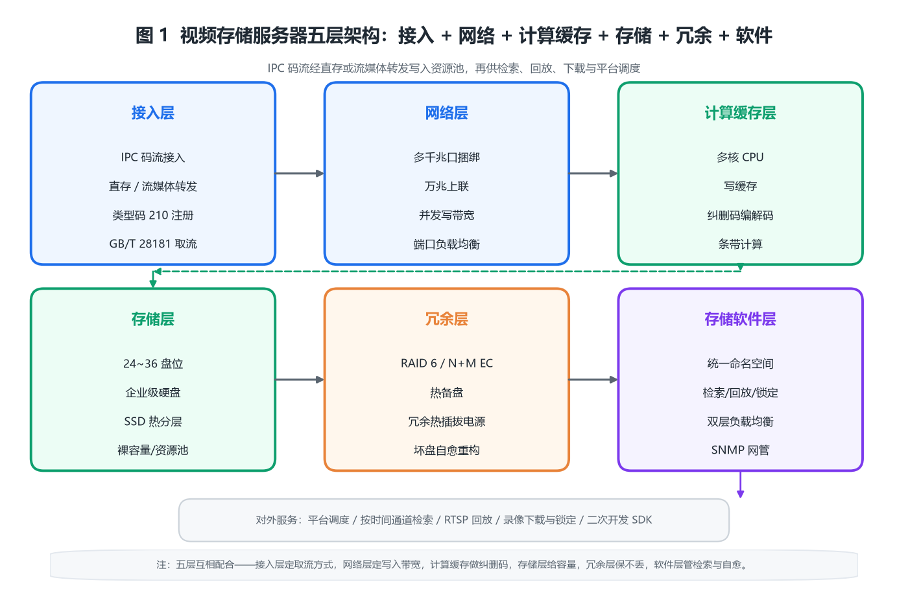
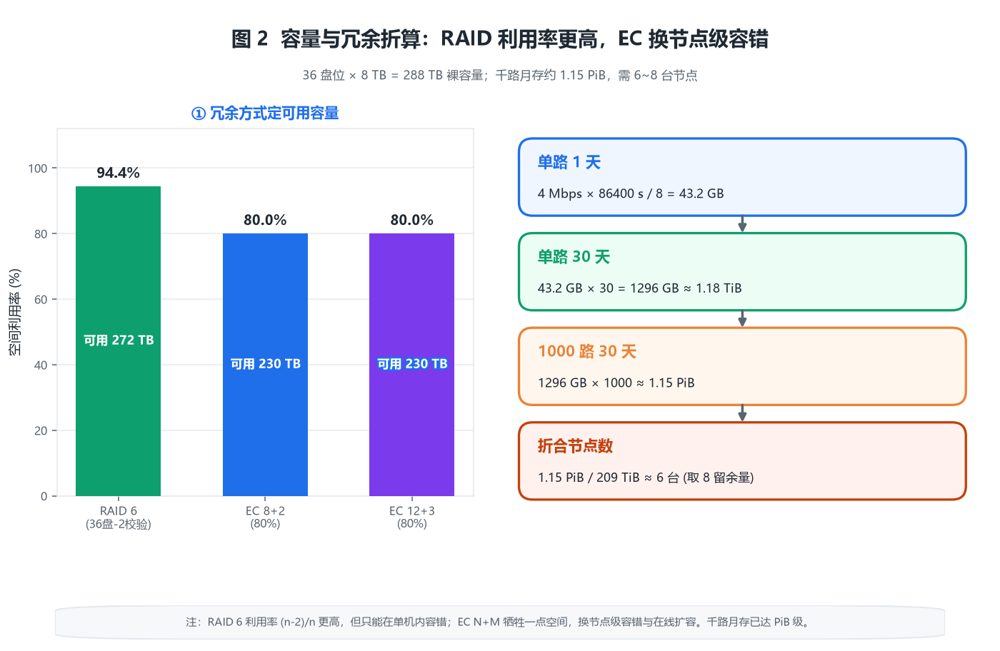
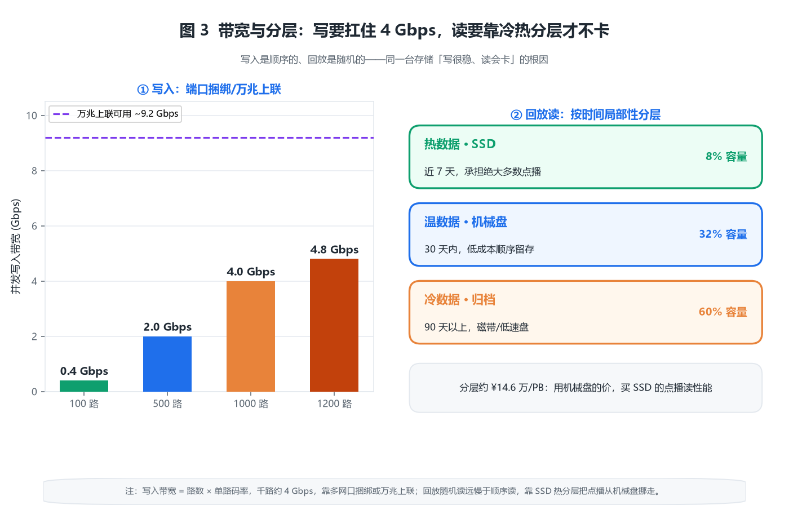
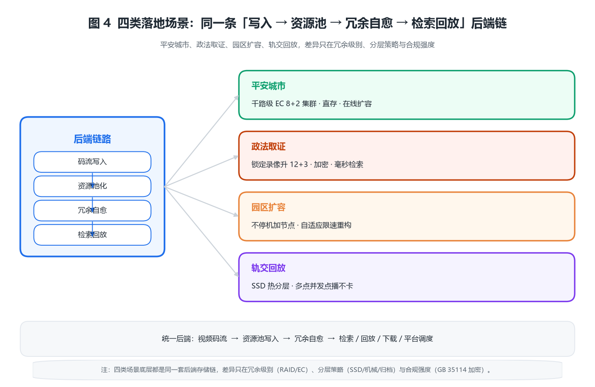

> 
> *概念图：视频存储服务器以标准机架式机箱承载磁盘阵列与资源池，把成百上千路码流「存得下、写得进、读得出、坏了不丢、扩得动」——它在后端撑起大规模并发写入与长期留存，是视频监控系统从「能录」走向「敢存、能查」的关键一环。示意图。*

# 视频存储服务器产品综述

## · 面向工程端

---

## 〇 一句话定位

视频存储服务器（Video Storage Server，工程上也叫集中存储 / IP SAN / 视频云存储）是**以标准机架式服务器 + 磁盘阵列（或分布式资源池）为形态，专门承载大规模、高并发、长时间连续视频码流写入与检索回放的后端存储设备**。它一端通过千兆/万兆网络接入成百上千路 IPC 码流，另一端以 RAID 或 N+M 纠删码、热备盘、在线扩容、故障自愈等机制，保证录像「写得进、存得久、找得到、坏了不丢」。**它买的是「在指定路数与留存天数下，用可运维的冗余把每路录像安全存住」的能力**——裸容量、可用容量、并发写入带宽、冗余级别、扩展方式，决定了能接多少路、留多少天、坏几块盘还不丢数据、扩容要不要停机。

> 本系列已写的《网络硬盘录像机（NVR）》讲中小规模的接入—存储—回放一体机，《视频监控管理平台（VMS）》讲信令/转发/级联/权限的平台软件，《网络摄像机（IPC）》讲最前端取像。**本篇只讲后端这台集中存储服务器本体**：怎么算容量与冗余、怎么核并发写入带宽、RAID 与纠删码怎么选、直存与流媒体转发有何区别、坏了盘怎么自愈、扩容要不要停业务。NVR 是「中心节点」，本篇是「存得下、靠得住的后端底座」——规模、冗余与可运维性，是它与嵌入式 NVR 的三条分水岭。

---

## 一、产品设计方案

### 1.1 内部系统组成

一台视频存储服务器在工程上由「计算、存储、网络、冗余、软件」五块构成：

- **计算与缓存**：多核 CPU + 大容量内存（16 GB 起，做写缓存、条带计算、纠删码编解码），决定并发写入与纠删码计算能力（算例 6、13）。
- **存储层**：标准机架式机箱（4U 常见），24~36 盘位，装企业级 SATA/SAS 硬盘（单盘 8~16 TB）；热数据可用 SSD 做分层。裸容量 = 盘位 × 单盘容量（算例 1、2）。
- **网络层**：多个千兆 RJ45 网口（≥2 个，支持端口捆绑/链路聚合），高端配万兆光口；决定并发写入带宽上限（算例 3）。
- **冗余层**：冗余热插拔电源、热备盘、RAID 控制器或分布式纠删码（EC），决定坏盘/坏节点能否不停机自愈（算例 6、7）。
- **存储软件**：资源池化、统一命名空间、录像直存/检索/回放/下载/锁定、SNMP 网管、GB/T 28181 接入、负载均衡、数据自愈——把一堆盘变成「一个可管理的存储资源池」（4.1、4.3）。

### 1.2 三种产品形态

| 形态 | 做法 | 适用 | 工程取舍 |
|------|------|------|----------|
| 机架式集中存储 | 单台 4U/36 盘位 + RAID 5/6/10 + 双电源 | 园区、厂区、中小型项目（百路级） | 部署简单、单节点故障域集中；扩容受本机盘位上限约束 |
| 分布式云存储集群 | 多节点 + N+M 纠删码 + 统一命名空间 | 平安城市、雪亮工程（千路~万路） | 无单点、在线扩容、节点级容错；节点数少时利用率偏低 |
| 软件定义/超融合存储 | 通用服务器 + 存储软件，流式/对象/文件/块多协议 | 已建机房利旧、混合业务 | 弹性好、可分层；对网络与运维能力要求高 |

工程上先定「接多少路、留多少天、允许坏几块盘/几个节点」：百路级单机 RAID6 足够；千路级必须上集群 + 纠删码，因为单节点容量和带宽都会撞天花板（案例一、二）。

### 1.3 数据写入的两条路径

存储服务器接码流有两条路径，直接决定带宽与节点压力：

```
① 流媒体转发模式：IPC → 流媒体服务器(转发) → 存储服务器(写入)
   （转发服务器承担复制，存储节点只管写；多一份转发带宽，但接入灵活）

② 视频直存模式：IPC →(GB/T 28181 SIP 指令)→ 存储服务器(本机直接取流写入)
   （省掉转发服务器，链路短、故障点少；需存储节点支持直存与码流调度）
```

GA/T 2019-2023 明确了两种录像模式（流媒体转发、直存），并要求存储设备作为注册类型码 210 的媒体存储服务器接入平台。两种路径都能「存下来」，但直存把转发压力从网络里彻底拿掉，是千路级项目的首选（3.2）。

### 1.4 系统架构图


*图 1：视频存储服务器五层——计算缓存 / 存储层（盘阵列+资源池）/ 网络层（多网口捆绑）/ 冗余层（RAID 或 N+M 纠删码+双电源）/ 存储软件；IPC 码流经直存或流媒体转发写入资源池，再供检索、回放、下载与平台调度。*

---

## 二、核心参数与选型

### 2.1 关键参数清单（工程基准）

| 参数 | 典型区间 | 选型含义 |
|------|----------|----------|
| 盘位/单盘容量 | 24/36 盘位 × 8/12/16 TB | 决定裸容量；单盘越大，重建越慢 |
| 硬盘类型 | 企业级 SATA / SAS / SSD | 企业级盘 AFR 低、适合 7×24；SSD 做热数据分层 |
| 冗余方式 | RAID 5/6/10；N+M 纠删码（4+1/8+2/12+3） | 决定可用容量与容错能力（算例 1、7） |
| 网络接口 | ≥2×千兆 RJ45（可捆绑）；万兆光口 | 决定并发写入带宽上限（算例 3） |
| 接入路数 | 单节点数百路；集群千路~万路 | 与写入带宽、容量 jointly 约束 |
| 心跳/故障检测 | 心跳间隔 ≤60 s（GA/T 2019-2023） | 决定故障切换与业务恢复时间（算例 8） |
| 带宽精度 | 带宽负误差 <5%（GA/T 2019-2023 5.4） | 验收指标，并发写测试需持续 2 h（算例 9） |
| 协议 | GB/T 28181-2022 / ONVIF / RTSP / SNMP / iSCSI / NFS | 能否接入平台、被调度、被网管 |
| 安全 | GB 35114-2017 加密存储、防篡改 | 政法/要害场景的合规成本 |
| 电源/环境 | 冗余热插拔电源；0~40 ℃（GA/T 2019） | 决定可用性等级（GB 50174 A/B/C） |

### 2.2 十四个原创工程算例

下面每一条都是算容量、配冗余、核带宽、定扩容时要真算的账，标号贯穿正文。参数按「工程基准 / 演示估算」给出，具体以设备实测与厂家检测报告为准。

**【算例 1】裸容量到可用容量：RAID 与纠删码的折算**

可用容量不等于裸容量。设 $n$ 块盘、每块 $C_d$，RAID 6 用 2 块做校验，纠删码按 $N+M$（$M$ 块校验）配置，空间利用率：

$$\eta_{\mathrm{RAID6}}=\frac{n-2}{n},\qquad \eta_{\mathrm{EC}}=\frac{N}{N+M}$$

取 36 盘位 × 8 TB = 288 TB 裸容量：RAID 6 可用 $34\times8=272\ \mathrm{TB}$（利用率 94.4%）；EC 8+2 为 $8/10=80\%$，可用 230.4 TB；EC 12+3 同为 80%。部分厂商标称「利用率 95% 以上」，是靠更大的 $N:M$ 配比 + 去掉热备开销才达到的，选型时要问清配比口径。
结论：**RAID 6 单看利用率更高，纠删码牺牲一点空间换来节点级容错与在线扩容**（3.1 节详述这个反直觉点）。

**【算例 2】单路存储量与整系统容量**

按 H.265 单路主码率 $B=4\ \mathrm{Mbps}$、每天 $T=86400\ \mathrm{s}$：
$$C_{\mathrm{day}}=\frac{B\,T}{8}=\frac{4\times10^{6}\times86400}{8}\approx4.32\times10^{10}\ \mathrm{B}\approx43.2\ \mathrm{GB}$$
30 天单路 $=43.2\times30\approx1296\ \mathrm{GB}\approx1.18\ \mathrm{TiB}$。1000 路 30 天：
$$C_{\Sigma}=1296\ \mathrm{GB}\times1000=1.296\times10^{6}\ \mathrm{GB}\approx1.15\ \mathrm{PiB}$$
结论：**千路月存已是 PiB 级**，单台 36 盘位（EC 8+2 可用 230 TB ≈ 209 TiB）只能存约 180 路·月，千路须 $1.15/0.209\approx6$ 台节点组成资源池。

**【算例 3】并发写入带宽：能不能写得进**

1000 路 × 4 Mbps 的并发写入带宽：
$$B_{\Sigma}=1000\times4\ \mathrm{Mbps}=4000\ \mathrm{Mbps}=4\ \mathrm{Gbps}=500\ \mathrm{MB/s}$$
6 个千兆口捆绑理论 6 Gbps，扣 TCP/IP 与协议开销（约 5%~8%）可用约 5.5 Gbps，余量约 37%；一个万兆口 10 Gbps，余量更足。分摊到 6 台节点，每台约 $500/6\approx83\ \mathrm{MB/s}$，机械盘阵列可轻松承担。
结论：**千路级的写入带宽瓶颈在「上联口与交换机」，不在单节点磁盘**；端口捆绑与万兆上联是硬指标。

**【算例 4】顺序写的 IOPS 账：视频存储的瓶颈不是 IOPS**

通用存储常看 IOPS，但视频是**大块顺序写**。按 1 MB 块计，500 MB/s 写入 $=500\ \mathrm{IOPS}$；分摊到 6 台每台约 83 IOPS。一块 7200 rpm 企业级盘随机 4K 约 75~100 IOPS、顺序吞吐 150~200 MB/s，36 盘节点即便按随机能力算也有约 2700 IOPS。
结论：**视频存储真正的约束是「带宽 × 留存天数 × 冗余开销」三者的乘积（容量与吞吐），不是 IOPS**；这是它区别于数据库/虚拟化存储的根本点。

> 
> *图 2：容量与冗余折算——36 盘位 × 8 TB 裸容量 288 TB，RAID 6 利用率 94.4%、EC 8+2 为 80%；同时给出千路月存 1.15 PiB 需约 6 台节点的核算链。*

**【算例 5】回放与检索的随机读：为什么热数据要上 SSD**

512 路同时点播 × 4 Mbps $=2048\ \mathrm{Mbps}=256\ \mathrm{MB/s}$。若按机械盘顺序读 150 MB/s 估算，2 块盘理论够；但 512 路是 512 个独立随机流，7200 rpm 盘 4K 随机读实际只有约 2 MB/s，等效需要上百块盘。工程解法是**冷热分层**：最近 7 天热数据放 SSD（承担绝大多数点播），30 天以上温数据放机械盘，冷数据归档（3.4 节）。
结论：**写入是顺序的、回放是随机的**——这是同一台存储「写很稳、读会卡」的根因，SSD 分层不是为了存得多，是为了读得快。

**【算例 6】纠删码重建时间：坏盘之后的自愈窗口**

EC 8+2 模式下坏 1 块 8 TB 盘，重构需从同条带其余节点读回等量数据。按单盘有效读 100 MB/s：
$$t_{\mathrm{rebuild}}=\frac{8\times10^{12}\ \mathrm{B}}{100\times10^{6}\ \mathrm{B/s}}=8\times10^{4}\ \mathrm{s}\approx22.2\ \mathrm{h}$$
若多节点同时重构或业务繁忙，会抢占带宽。GA/T 2019-2023 要求支持重构速度分级与「业务不中断的自愈」，工程上做成**闲时高速、忙时低速的自适应重构**。
结论：**盘越大重建越久**；8 TB 盘单次重建以「小时」计，12/16 TB 可达一到两天——重建窗口内处于降级态，是选盘容量时的隐性成本。

**【算例 7】N+M 容错与双盘故障概率**

单机 RAID 6 只能容忍本机 2 块盘故障，节点整机失效则数据不可写。分布式 EC 8+2 能容忍任意 2 个「盘或节点」故障。按单盘年故障率 AFR = 2%、平均修复 MTTR = 24 h，36 盘中某盘在修复窗口内故障的概率：
$$p=\mathrm{AFR}\times\frac{\mathrm{MTTR}}{8760}=0.02\times\frac{24}{8760}\approx5.5\times10^{-5}$$
任意两盘同时在窗口内故障（$C_{36}^{2}=630$ 对）：
$$P_{2}\approx630\times p^{2}\approx1.9\times10^{-6}\ /\mathrm{yr}$$
结论：**双盘同时失效约「几十年一遇」**，但集群规模一大、盘数上千，绝对概率就不再可忽略——这正是大项目要 N+M 节点级冗余、而不只靠单机 RAID 的原因。

**【算例 8】心跳间隔与故障发现窗口**

GA/T 2019-2023 要求心跳间隔 ≤60 s。按连续 3 个周期无心跳判故障，最坏发现时间 $3\times60=180\ \mathrm{s}$；地方规范要求掉电来电恢复 ≤5 min。直存模式下节点故障后前端需重新调度码流到健康节点，这段窗口靠前端本地缓存与平台重注册兜底。
结论：**心跳不是越小越好**（心跳本身占带宽、受网络抖动误判），60 s 是可靠性与开销的折中；验收要测「故障注入到业务恢复」的端到端时间，而非只看心跳配置值。

**【算例 9】带宽负误差与并发写验收**

GA/T 2019-2023 第 5.4 条要求带宽负误差 <5%，并发写测试需持续 2 h。若标称 1000 路 × 4 Mbps = 4 Gbps，实测写入带宽不得低于 $4\times0.95=3.8\ \mathrm{Gbps}$；2 h 累计写入量应 $\ge3.8\times10^{9}\times7200/8\approx3.42\ \mathrm{TB}$。
结论：**验收要「长时间满负载写入」而非短时峰值**——短 burst 靠缓存能达标，缓存写满后掉速才是真问题；这正是标准强制 2 小时测试的原因。

> 
> *图 3：带宽与分层——1000 路并发写入 4 Gbps 需端口捆绑或万兆上联；回放侧因随机读退化，靠「SSD 热 / 机械温 / 归档冷」分层把点播从机械盘挪到 SSD。*

**【算例 10】冷热分层的成本账**

以 1 PB（十进制 $=10^{6}$ GB）留存数据、工程估算单价 SSD ¥1/GB、企业级 HDD ¥0.15/GB、磁带归档 ¥0.03/GB 计：

| 方案 | 构成 | 成本 |
|------|------|------|
| 全 SSD | 100% × ¥1 | 约 ¥100 万 |
| 全 HDD | 100% × ¥0.15 | 约 ¥15 万 |
| 冷热分层 | 热 8% SSD + 温 32% HDD + 冷 60% 磁带 | 约 ¥8 万 + ¥4.8 万 + ¥1.8 万 ≈ ¥14.6 万 |

结论：**分层方案成本接近全 HDD，却能让热数据的点播性能接近全闪存**——省的不是钱，是「用机械盘的价买 SSD 的读」；代价是数据生命周期管理复杂度和冷热搬迁的运维成本。

**【算例 11】在线扩容的数据迁移量**

6 节点 EC 8+2 资源池（可用约 1382 TB）扩到 8 节点，容量增 $2/6\approx33\%$。扩容后要做条带重分布，需搬迁的数据量量级为原数据量 × 搬迁比例（约 $1296\times6/8\approx972\ \mathrm{TB}$）。即使留 100 MB/s 专用重构带宽：
$$t_{\mathrm{migrate}}=\frac{972\times10^{12}}{100\times10^{6}}\approx9.7\times10^{6}\ \mathrm{s}\approx112\ \mathrm{d}$$
结论：**大容量集群的扩容与重建是以「天到周」为单位的运维窗口**，必须支持在线、可限速、业务不中断——「能不能不停机扩容」比「理论容量多大」更影响真实可用性。

**【算例 12】视频片段对象化与元数据规模**

按 1 分钟一个片段对象，单段 $4\ \mathrm{Mbps}\times60/8\approx30\ \mathrm{MB}$。1000 路一天产生：
$$1000\times24\times60=1.44\times10^{6}\ \mathrm{obj/day}$$
90 天约 1.3 亿个对象。若每个对象元数据 512 B，索引总量约 $1.3\times10^{8}\times512\approx66\ \mathrm{GB}$，需常驻 SSD。改成 5 分钟片段，对象数与索引降为 1/5，但检索粒度从 1 分钟退化到 5 分钟。
结论：**片段大小是「检索精度 vs 元数据成本」的权衡**；公安项目常要求片段对象化与毫秒级定位（案例二），元数据服务器就成了新的瓶颈点。

**【算例 13】加密存储的写路径开销**

GB 35114 C 级要求 SM4 加密存储。按 SM4 软件实现约 800 Mbps/核（工程基准），4 Gbps 写入需 $4000/800=5$ 核常驻做加密；双节点约 10 核。用密码卡（单卡 2~4 Gbps）卸载则 1~2 张卡够。
结论：**加密不是「开个开关」**——它吃掉 CPU 核数、增加写延迟，是合规项目里必须预留的算力与预算，落点在存储写路径而非仅在传输链路。

**【算例 14】检索的毫秒级定位**

1.3 亿对象按「通道号 + 时间戳」做复合主键索引。以 B+ 树每层扇出约 200、3 层索引覆盖，单次定位约 3~4 次 SSD 随机读；SSD 按 10 万 IOPS 计，索引命中本身在毫秒级；端到端检索延迟主要花在网络往返与解码，而非索引查找。
结论：**「毫秒级定位」靠的是 SSD 常驻索引 + 对象化命名，不是靠堆磁盘**；元数据放机械盘会让检索从毫秒退化到秒级。

### 2.3 选型速查

先定「路数 × 码率 → 并发写入带宽」定网络与上联（算例 3），再定「留存天数 × 路数 × 冗余开销 → 可用容量」反推裸容量与节点数（算例 1、2），最后定「容错级别 → RAID 还是 N+M 纠删码、要不要 SSD 分层」（算例 5、7、10）。三步走完，一台/一组存储的规模就定了。

---

## 三、技术原理

### 3.1 RAID 与纠删码：利用率背后的容错哲学

RAID 6 在**单台机箱内**用 2 块校验盘容忍 2 盘故障，利用率高（94.4%）、实现简单；但它对整个节点失效无能为力——节点电源、主板、整机宕机，上面的数据就不可写。纠删码（EC，N+M）把数据切成 N 个数据块、算 M 个校验块，分散到**不同节点**，能容忍任意 M 个盘或节点同时故障。代价是利用率降到 $N/(N+M)$（8+2 为 80%）和更高的编码计算开销。

这就是算例 1 的反直觉点：**RAID 6 利用率更高，但大项目仍选 EC**——因为它把故障域从「一块盘」提升到「一个节点」，且扩容时可在线加节点、组内自动再平衡。GA/T 2019-2023 与多地招标参数都明确要求 N+M 纠删码、节点级容错、在线扩容与故障自愈，本质就是用一点空间换「坏了不停机、扩了不搬家」。

### 3.2 直存与流媒体转发：省掉的是哪一段带宽

流媒体转发模式下，码流经转发服务器复制后写入存储，转发服务器是额外带宽与故障点；直存模式下存储服务器以 SIP 类型码 210 注册到平台，收到录像指令后**本机直接从 IPC 取流写入**，不需要独立转发服务器。GA/T 2019-2023 规定两种模式都要支持，并把心跳间隔限定在 60 s 内。千路级项目选直存，能把转发层的带宽与服务器成本整段拿掉；但要求存储节点有足够的取流并发与码流调度能力（算例 3、8）。

### 3.3 资源池与统一命名空间

多台节点通过分布式软件虚拟成**一个统一命名空间**，对外只暴露一个业务 IP，容量线性扩容、节点自动发现、接入任务按带宽与容量做双层负载均衡（节点级 + 硬盘级）。上层平台看到的是「一个无限大的盘」，不必关心录像落在哪个节点哪块盘——这是集群存储相对单机 RAID 的核心抽象。

### 3.4 冷热分层与数据生命周期

视频数据有明显的「时间局部性」：近几天的录像被反复调阅，几个月前的几乎无人问津。分层存储据此把热数据放 SSD、温数据放机械盘、冷数据归档磁带，用一套策略自动搬迁（算例 10、14）。GA/T 2019-2023 还要求对「锁定录像」提升容错级别（如 4+1 升 8+2），即重要证据片段用更高的冗余保护——这是「数据价值随时间分化」在冗余策略上的体现。

---

## 四、产品功能与差异化

### 4.1 核心功能清单

- **录像写入**：流媒体转发 / 直存双模式，视音频、图片、智能流直接写入；并发写带宽满足指标（算例 3、9）。
- **冗余与自愈**：RAID 或 N+M 纠删码、热备盘、坏盘/坏节点自动重构、重构速度可调、降级态可读（算例 6、7）。
- **检索与回放**：按时间/通道检索、RTSP 远端回放、暂停/快进/定位、录像锁定防删、对象化片段与毫秒级定位（算例 12、14）。
- **资源池化**：统一命名空间、在线扩容、节点与硬盘双层负载均衡、故障自动切换。
- **开放对接**：GB/T 28181-2022 注册与调度、ONVIF/RTSP 取流、SNMP 网管、SDK 二次开发、GA/T 1400 视图协议。
- **安全合规**：GB 35114-2017 加密存储、防篡改、回收站、等保三级（算例 13）。

### 4.2 差异化：集中存储服务器 vs 嵌入式 NVR

| 维度 | 视频存储服务器（集中存储） | 嵌入式 NVR |
|------|---------------------------|-----------|
| 形态 | 标准机架式 / 多节点集群 | 1U/2U 一体机，盘位固定 |
| 容量 | PiB 级、在线线性扩容 | TB~数十 TB，受本机盘位限 |
| 冗余 | RAID 6 / N+M 纠删码、节点级容错、自愈 | RAID 1/5/6，单机内容错 |
| 并发写入 | 千路~万路，多网口捆绑/万兆上联 | 数十~数百路，单/双千兆口 |
| 可运维性 | 资源池、统一命名空间、负载均衡、在线重构 | 本地配置为主，扩容需停机换盘 |
| 适用 | 平安城市、雪亮工程、大型园区 | 中小项目、门店、单体建筑 |

结论：**NVR 胜在开箱即用、成本低的中小场景；集中存储服务器赢在规模、冗余与可运维性**——当路数上千、留存上百天、不能停机扩容时，必须从 NVR 升级到集中存储。

### 4.3 合规锚点：GA/T 2019-2023 与 GB 35114

**GA/T 2019-2023《公安视频监控视频存储技术要求》**（2023-02-23 发布 / 2023-08-01 实施）是本篇最核心的专项标准，关键条款：注册类型码 210（媒体存储服务器）；流媒体转发与直存两种录像模式；心跳间隔 ≤60 s；带宽负误差 <5%（5.4）；并发写测试持续 2 h（6.5.1）；N+M 纠删码与资源池管理；锁定录像可提升容错级别；工作环境 0~40 ℃；电磁兼容满足 GB/T 9254.1-2021 A 类。它把「存得下」升级为「存得合规、验得出来」。

**GB 35114-2017** 对存储数据的签名与加密（SM2/SM3/SM4）是中高频算力开销的来源（算例 13）；**GB 50395-2007 5.0.7** 则明确「视频存储容量和记录/回放带宽与检索能力应满足管理要求」——注意它没规定「必须存 30 天」，留存天数是按管理要求定的工程/法规参数，不是通用法定值。

---

## 五、应用场景（痛点→方案→价值）

| 场景 | 痛点 | 方案 | 价值 |
|------|------|------|------|
| 平安城市 / 雪亮工程 | 万路级、留存 90 天、不能丢 | 多节点 EC 8+2 资源池 + 直存 + 在线扩容 | 无单点、坏了自愈、扩容不停机 |
| 大型园区 / 厂区 | 路数增长快、单机撞容量墙 | 机架式集中存储 + 线性扩容 | 按需加节点、避免重复投资 |
| 政法 / 要害部门 | 录像要可信、防篡改、长期留存 | GB 35114 加密存储 + 锁定录像提升冗余 | 证据链完整、合规可查 |
| 轨交 / 机场 | 回放并发高、调阅频繁 | SSD 热分层 + 对象化检索 | 毫秒级定位、多点并发不卡 |
| 老旧系统改造 | 已有平台、要利旧扩容 | 软件定义存储 + 多协议接入 | 复用服务器、平滑迁移 |

---

## 六、实际案例与设计方案

### 案例一：某地级市平安城市集中存储（千路级）

**需求**：接入 1200 路 4MP IPC（H.265 4 Mbps），留存 30 天，允许任意 2 个存储节点故障不丢数据，平台按 GB/T 28181 统一调度。
**方案设计**：采用 8 节点分布式云存储集群、每节点 36 盘位 × 8 TB、EC 8+2 纠删码、统一命名空间、直存模式接入。
**配置核算**：并发写入 $1200\times4=4.8\ \mathrm{Gbps}=600\ \mathrm{MB/s}$（算例 3），单万兆上联余量充足；30 天容量 $1200\times1.18\ \mathrm{TiB}\approx1.42\ \mathrm{PiB}$；单节点 EC 8+2 可用约 209 TiB，需 $1.42/0.209\approx7$ 台，取 8 台留余量（算例 1、2）；心跳 60 s、带宽负误差 <5% 按 GA/T 2019 验收（算例 8、9）。
**交付价值**：任意 2 节点故障业务不中断、坏盘自动重构，扩容加节点不迁业务；相比同等容量的多台 NVR，机房节点数减少、运维集中。

### 案例二：某公安分局视频云存储取证（锁定录像+毫秒检索）

**需求**：重点区域录像锁定留存 180 天，要求按时间/通道秒级检索、片段对象化、加密存储、防误删。
**方案设计**：EC 8+2 起步、锁定片段自动升 12+3；SSD 常驻元数据索引 + 热数据分层；GB 35114 加密 + 回收站；按 1 分钟对象化切片。
**配置核算**：锁定片段冗余从 8+2 升 12+3，利用率由 80% 降至 80%（同为 $N/(N+M)$，但 12+3 容忍 3 块故障、容错更强）——这里牺牲的是可容忍故障数之外的重构弹性，换取更高安全等级；1 分钟切片使 180 天对象数达数亿级，元数据约数百 GB 常驻 SSD（算例 12、14）；SM4 加密按 4 Gbps 算需约 5 核/节点（算例 13）。
**交付价值**：证据录像防删防篡改、检索毫秒级定位、关键录像容错升级，满足取证合规。

### 案例三：某大型制造园区存储扩容改造（不停机）

**需求**：原有 4 节点 RAID 6 存储接近容量上限，需在不停业务前提下扩容 50%，且预算有限。
**方案设计**：新增 2 节点纳入统一资源池，改用 N+M 纠删码重分布，自适应限速重构，闲时高速、忙时低速。
**配置核算**：扩容数据搬迁量按数百 TB 计，专用带宽下迁移窗口以天计（算例 11）——因此安排在夜间低峰启动、白天自动降速，全程业务不中断；重构期处于降级态但可读性保持（算例 6、7）。
**交付价值**：零停机完成扩容，避免了「换更大单机 → 停机迁移 → 业务中断」的传统代价，验证了「可运维性」的真实价值。

> 
> *图 4：四类落地场景——平安城市、政法取证、园区扩容、轨交回放，共用「码流写入→资源池→冗余自愈→检索回放」的同一条后端链路，差异只在冗余级别、分层策略与合规强度。*

---

## 七、市场背景与竞争格局

视频存储是视频监控后端最大的存量市场，产业链为「硬盘（希捷/西数/东芝企业级）→ RAID 控制器/服务器平台 → 存储软件（资源池/纠删码/检索）→ 整机与方案（海康/大华/宇视/华为/新华三等）→ 系统集成」。竞争焦点已从「拼裸容量」转向：**纠删码效率与自愈速度、直存与集群调度能力、冷热分层与检索性能、GB 35114 合规、以及在线扩容与统一命名空间**。国产厂商在公安/雪亮工程中占据主导，招标参数普遍要求 CMA 检测报告与 GA/T 2019-2023 符合性；通用存储厂商则在软件定义与超融合侧竞争。

---

## 八、商业模式与趋势

- **硬件 + 软件授权**：整机按节点/盘位计价，存储软件、磁盘虚拟化、扩容授权单独计费。
- **方案集成**：存储 + 平台 + 交换 + 解码打包，按项目交付；按路数 × 留存天数测算容量。
- **服务化**：视频云存储按路数/时长订阅，政法/园区客户按月付费、免自建机房。
- **趋势**：① 纠删码替代单机 RAID 成为大项目标配；② 直存 + 对象化 + 冷热分层成为性能三件套；③ GB 35114 加密存储从选配变合规必配；④ 存算一体与 AI 解析下沉，存储节点兼做智能分析。

---

## 附录

### A. 核算清单（14 笔账速查）

| # | 算例 | 核心公式 | 工程结论 |
|---|------|----------|----------|
| 1 | 容量折算 | $\eta_{\mathrm{RAID6}}=(n-2)/n$，$\eta_{\mathrm{EC}}=N/(N+M)$ | RAID6 利用率高，EC 换节点级容错 |
| 2 | 存储量 | $C=BT/8$ | 千路月存约 1.15 PiB，需 6~8 节点 |
| 3 | 写入带宽 | $B_{\Sigma}=N_{\mathrm{ch}}B_{\mathrm{ch}}$ | 千路 4 Gbps，瓶颈在上联口 |
| 4 | 顺序写 IOPS | $IOPS=B_{\Sigma}/S_{\mathrm{blk}}$ | 视频存储瓶颈是带宽容量，非 IOPS |
| 5 | 随机读分层 | 随机读 << 顺序读 | 回放靠 SSD 热分层才不卡 |
| 6 | 重构时间 | $t=C_{d}/v_{\mathrm{read}}$ | 8 TB 盘重建约 22 h，需自适应限速 |
| 7 | 双盘故障率 | $P_2\approx C_n^2 p^2$ | 集群盘数上千时容错不能只靠单机 RAID |
| 8 | 故障发现 | $t\le3t_{\mathrm{hb}}$ | 心跳 60 s，端到端恢复约分钟级 |
| 9 | 带宽验收 | $B_{\mathrm{meas}}\ge0.95B_{\mathrm{nom}}$ | 2 h 满负载写入才算数 |
| 10 | 分层成本 | $C=\sum f_i p_i$ | 分层用 HDD 价买 SSD 读 |
| 11 | 扩容迁移 | $t=V_{\mathrm{mig}}/v_{\mathrm{ded}}$ | 扩容以天到周计，必须在线可限速 |
| 12 | 对象化 | $N_{\mathrm{obj}}=N_{\mathrm{ch}}t_{\mathrm{day}}/t_{\mathrm{seg}}$ | 片段大小是检索精度换元数据成本 |
| 13 | 加密开销 | $c_{\mathrm{core}}=B/800\ \mathrm{Mbps}$ | 4 Gbps 加密约 5 核，需密码卡卸载 |
| 14 | 检索定位 | 索引 SSD 常驻 | 毫秒级靠 SSD 索引 + 对象命名 |

### B. 术语表

- **集中存储 / IP SAN / 视频云存储**：以网络接入、集中管理的后端视频存储（本篇同义）。
- **RAID 6**：带双重奇偶校验的磁盘阵列，容忍 2 盘故障。
- **纠删码 EC（N+M）**：把数据切成 N 数据块 + M 校验块分散存储，容忍 M 个盘/节点故障。
- **资源池 / 统一命名空间**：多节点虚拟成单一逻辑存储，对外一个入口。
- **直存**：存储服务器按 SIP 指令直接从 IPC 取流写入，不经独立转发服务器。
- **热/温/冷分层**：按数据年龄把录像放 SSD / 机械盘 / 归档介质。
- **对象化片段**：把录像切成带唯一命名的小对象，便于精确检索。
- **AFR / MTTR**：年故障率 / 平均修复时间，用于容错概率估算。
- **GA/T 2019-2023**：公安视频监控视频存储技术要求（本篇核心标准）。

### C. 标准与规范索引（工程可查）

| 标准 | 内容要点 |
|------|----------|
| GA/T 2019-2023 | 公安视频监控视频存储技术要求（2023-08-01 实施）：类型码 210、直存/转发双模式、心跳 ≤60 s、带宽负误差 <5%、并发写 2 h、N+M 纠删码、0~40 ℃ |
| GB 50395-2007 | 视频安防监控系统工程设计规范：5.0.7 存储容量/记录回放带宽/检索能力满足管理要求；6.0.7 宜选数字录像设备、宜具备防篡改 |
| 地方《公共安全视频监控系统建设技术规范》 | 7.3.2 集中存储设备（机架式、冗余热插拔电源、≥2 千兆口捆绑、RAID 0/1/5/10、SNMP、线性扩容、N+M 备份、故障自动切换）；7.3.3 云存储系统（集群、无单点、动态扩容） |
| GB/T 28181-2022 | 公共安全视频监控联网系统传输/交换/控制技术要求（SIP 注册、点流、校时） |
| GB 35114-2017 | 联网信息安全技术要求，A/B/C 三级；存储签名/加密用 SM2/SM3/SM4 |
| GB 50348-2018 | 安全防范工程技术标准 |
| GB 50174-2017 | 数据中心设计规范：A 级容错（2N，可用性 99.99%）、B 级冗余（N+1）、C 级基本 |
| GB/T 9254.1-2021 | 信息技术设备电磁兼容（发射，A 类限值） |
| GA/T 1400 | 公安视频图像信息应用系统（视图协议与对象化接入） |

*说明：本文参数多为「工程基准 / 演示估算」，用于说明容量、带宽与冗余的计算方法；具体产品指标以厂家 datasheet 与 CMA/公安部检测报告为准。标准条款以正式文本为准。*
