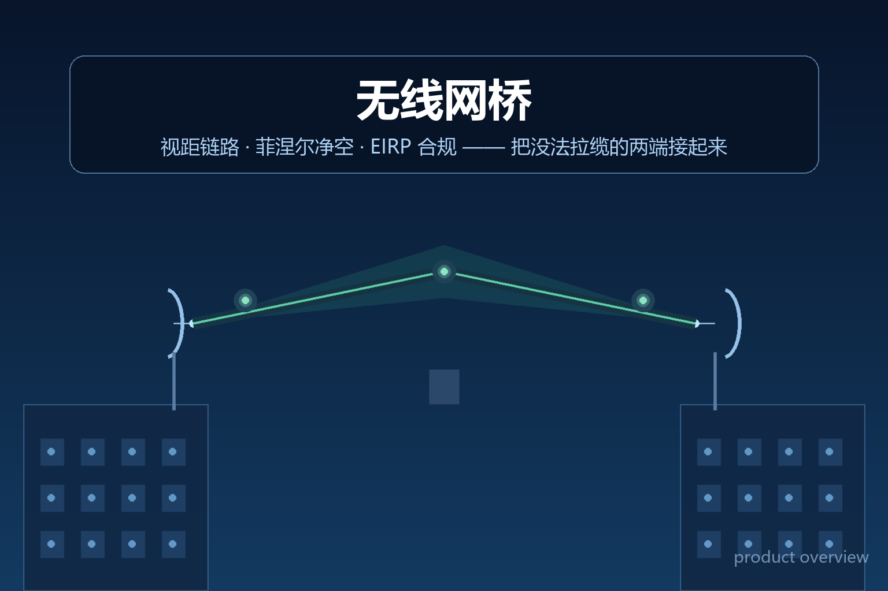
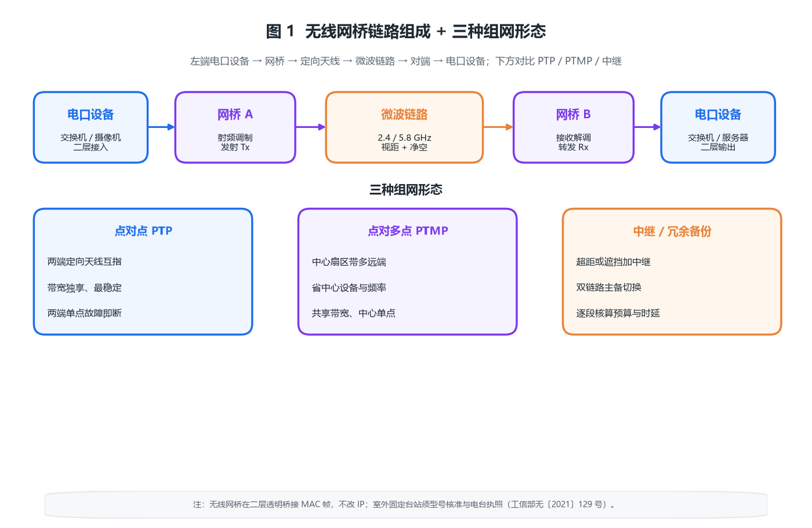
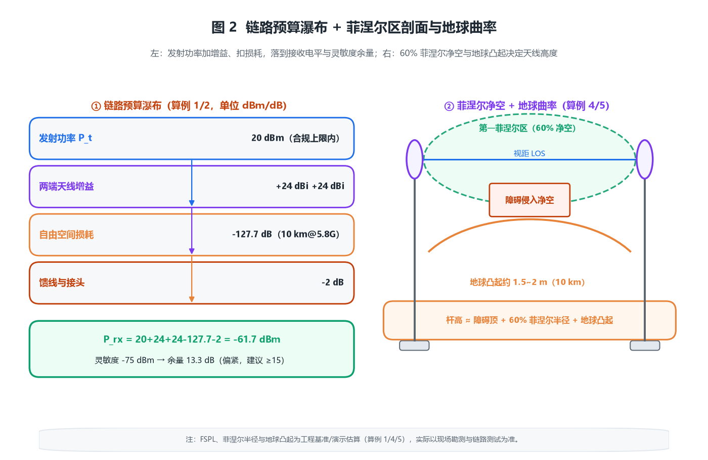
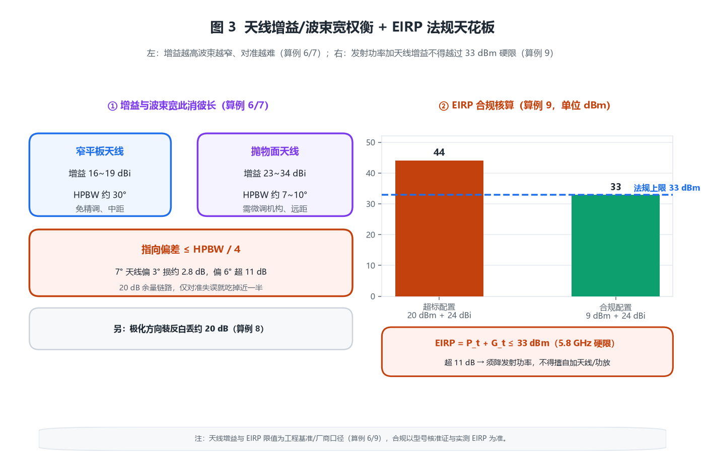
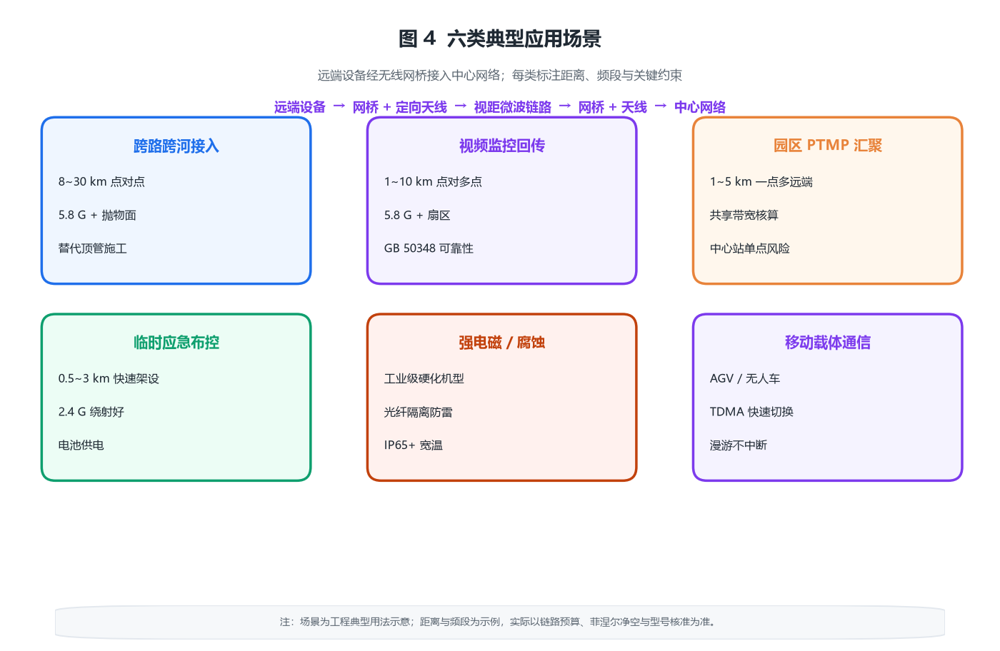

> 
> *概念图：两端楼顶的定向天线以一条微波链路跨河互联，波束主瓣之间标注自由空间损耗、第一菲涅尔区净空与地球曲率凸起，链路上标注发射功率与接收电平的逐项核算。示意图。*

# 无线网桥产品综述

## · 面向工程端

---

## 〇 一句话定位

无线网桥（工程上常称「无线网桥」「无线桥接」「点对点网桥」「微波网桥」「WLAN 网桥」「wireless bridge」「室外无线 CPE」）是**用一条点对点或点对多点的微波链路替代光缆，把两个本来要靠线缆连接的网络用无线电「接」起来的设备：它一端接交换机、摄像机、PLC 或服务器，通过射频单元把数据调制到 2.4 GHz 或 5.8 GHz 的载波上，经定向天线在空气中传数公里乃至数十公里，另一端再解调回网线输出**。它不路由、不交换（多数机型的桥接模式下），只是在 OSI 第二层做透明的 MAC 帧搬运——**它买的不是「一对能隔空联网的盒子」，而是「在视距算得清、菲涅尔净空留得够、EIRP 合规、频段不打架的前提下，链路常年可用、丢包可控」的确定性**。自由空间损耗决定信号剩多少、菲涅尔净空决定看得见是否通得了、天线增益与波束宽度决定对准难度、法规决定这频段能不能这么用。

> 本篇与 network 分类的《工业以太网交换机》《光纤收发器》明确分工：交换机管「网怎么组、断链怎么自愈」，收发器管「有缆时铜缆怎么变光纤」，本篇管「没法拉缆的地方怎么把两端接起来」。同系列《网络摄像机（IPC）》取像、《视频存储服务器》存储，都不碰无线回传这一层。一句话区分：**交换机管「网怎么组」，收发器管「有缆怎么接」，网桥管「没缆怎么接」**。

> **反直觉点一：标称「传输 50 km」不等于现场能跑 50 km，它是理想视距下的理论上限。** 自由空间损耗按距离平方增长，距离每翻一倍损耗增加约 6 dB；50 km 链路在 5.8 GHz 的 FSPL 超过 147 dB，要靠 30 dBi 级抛物面天线与极高增益预算才勉强成立，还得天气、地形、净空全部理想。**招标写「传输距离 ≥50 km」而不写频段、天线增益、EIRP 与菲涅尔净空要求，等于什么都没约束**（算例 1、2、3）。

> **反直觉点二：「肉眼看得见对端」不等于链路能通。** 无线电要的是第一菲涅尔区 60% 的净空：5.8 GHz、10 km 链路中点菲涅尔半径约 11.4 m，60% 净空意味着中点要有 6.8 m 的无遮挡「能量管道」；再叠加 10 km 约 1.5~2 m 的地球曲率凸起，树梢、楼顶女儿墙、临时脚手架都可能把链路压到误码甚至中断。**通视（LOS）只是必要条件，净空（clearance）才是充分条件**（算例 4、5、7）。

> **反直觉点三：天线不是越大越好，增益与波束宽度此消彼长。** 65° 半功率角的平板天线增益约 9.9 dBi，7° 的抛物面天线增益约 29 dBi——增益高近 20 dB，代价是波束窄了近 9 倍。规范要求指向偏差不超过波束宽度的四分之一：7° 天线偏 3° 就损失约 2.8 dB，偏 6° 损失超过 11 dB，一条 20 dB 余量的链路光靠对准失误就能吃掉一半。**窄波束换来的增益，安装精度不够就全部还回去**（算例 6、7、8）。

> **反直觉点四：「免执照随便用」是误读，无线网桥恰恰是法规罐头最紧的一类设备。** 工作在这些频段的发射设备必须取得型号核准证；室外固定台站（含 5.8 GHz 点对点、点对多点中心站）须领取电台执照并交频率占用费。**工信部无〔2021〕129 号文自 2022-01-01 施行、2023-10-15 起型号核准按新附件执行**，旧证书有效期至 2025-12-31，且 5.8 GHz 的 EIRP 硬限是 2 W（33 dBm）——发射功率 20 dBm 加 24 dBi 天线就达 44 dBm，超标 11 dB。**「买了就能用」在室外固定链路场景不成立**（算例 9、第 3.6 节）。

**锚定数字**（均有公开标准或稳定来源可查）：**工信部无〔2021〕129 号《关于加强和规范 2400 MHz、5100 MHz 和 5800 MHz 频段无线电管理有关事宜的通知》**（2021-09-08 发布，2022-01-01 施行，2023-10-15 起型号核准按新要求，旧证书有效期至 2025-12-31；5250-5350 MHz 须 TPC ≥6 dB 且强制 DFS 不可关闭）／ **《关于使用 5.8 GHz 频段频率事宜的通知》**（5725-5850 MHz，发射功率 ≤500 mW 与 ≤27 dBm、EIRP ≤2 W 与 ≤33 dBm、载频容限 20 ppm、带外 EIRP ≤-80 dBm/Hz，室外固定台站须执照、频率占用费 40 元/MHz/基站）／ **GB 15629.11 系列**（无线局域网 MAC/PHY 国标，修改采用 ISO/IEC 8802-11；其中 GB 15629.1101-2006 为 5.8 GHz 高速物理层扩展）／ **YD/T 1093**（2.4 GHz 无线局域网设备测试）／ **YD/T 1883**（5 GHz 无线局域网设备测试）／ **IEEE 802.11a/n/ac/ax**（OFDM、MIMO、信道绑定、OFDMA 物理层演进）／ **GB/T 9254.1-2021**、**GB 4943.1**（电磁兼容与设备安全）／ **GB/T 4208**（IP 防护等级）／ **GB 50348-2018**、**GB 50395-2007**（安全防范工程，视频回传场景）／ 工程参数（FSPL、菲涅尔余量、EIRP 核算、天线增益）为**工程基准 / 演示估算，厂商口径均未独立复现，须以现场勘测与链路测试验收**。

---

## 一、产品设计方案

### 1.1 系统组成：两端 + 两器件 + 一链路

一套无线网桥在工程上由三部分构成，核心是「两端透明桥接、中间链路算得清」：

- **两个桥接端（网桥本体）**：一端把网线进来的 MAC 帧调制到载波发出（Tx），另一端解调回网线输出（Rx）；成对使用，一端设为主站（root/AP）、另一端设为从站（station/bridge），点对多点时一个主站带多个从站。按形态分**一体天线型**（2.4/5.8 GHz 内置平板天线，即挂即用）、**外接天线型**（SMA/N 型接口接定向天线，距离可调）、**工业导轨型**（宽温、冗余电源、IP40）、**基站汇聚型**（扇区天线带多个远端）。
- **两只定向天线与馈线**：点对点用抛物面（23~34 dBi，波束 7°~10°）或窄平板天线（16~19 dBi），点对多点中心端用扇区天线（15~18 dBi，水平 65°~120°）；馈线（同轴电缆或波导）与接头带来 0.5~2 dB 损耗，越短越好（算例 2、6）。
- **一条视距微波链路**：2.4 GHz（2400-2483.5 MHz，波长长、绕射好但拥挤）或 5.8 GHz（5725-5850 MHz，信道干净、带宽大但对视距与对准要求高），核心约束是菲涅尔区净空与地球曲率（算例 4、5）。

### 1.2 三种典型组网形态

| 形态 | 做法 | 适用 | 工程取舍 |
|------|------|------|----------|
| 点对点 PTP | 两端各一台 + 定向天线互指 | 跨路、跨河、两栋楼之间 | 带宽独享、最稳；两端单点故障即断链，需备份链路（算例 1、2） |
| 点对多点 PTMP | 中心扇区天线带多个远端 | 园区多监控点回中心、多分公司互联 | 省中心设备与频率；共享带宽、中心站单点、远端点数受容量约束（算例 12） |
| 中继级联 / 冗余备份 | 超距或遮挡处加中继，或双链路主备 | 超 20 km、遮挡绕行、重要链路 | 中继逐段核算预算、误码与时延累积；主备用可实现秒级切换（算例 3、13） |

工程上先算「这段链路预算够不够、净空够不够」，再定「用 2.4 G 还是 5.8 G、用什么天线」，最后才选形态。**不是先看机身标多少公里，而是先把实际距离、频率、天线增益、馈线损耗、菲涅尔净空与法规 EIRP 逐项对账**（算例 1~9）。

### 1.3 一帧数据「过桥」的六个动作

```
① 电口接入：摄像机/交换机经 RJ45 进网桥电口，二层桥接不改写 MAC/IP
② 调制上变频：射频单元把比特流调制到 2.4/5.8 GHz 载波（OFDM + QAM，算例 10）
③ 功放与馈线：经功率放大器推到天线，馈线/接头扣 0.5~2 dB（算例 2、9）
④ 天线辐射：定向天线把能量聚成窄波束主瓣，对准对端（算例 6、7、8）
⑤ 空间传播：自由空间损耗按距离平方衰减，菲涅尔区须 60% 净空（算例 1、4、5）
⑥ 接收解调：对端天线接收、LNA 放大、解调回 MAC 帧从电口送出（算例 2、13）
```

### 1.4 系统架构图


*图 1：无线网桥链路架构——左端电口设备经网桥与定向天线发出微波，链路上标注自由空间损耗、菲涅尔净空与地球曲率；右下角对比点对点、点对多点与中继冗余三种形态。*

---

## 二、核心参数与选型

### 2.1 关键参数清单（工程基准）

下表为招标文件常见技术要求与工程基准（厂商口径已标注，未独立复现），具体以厂家 datasheet、现行法规原文与现场链路测试为准：

| 参数 | 典型区间 / 要求 | 选型含义 |
|------|----------------|----------|
| 执行法规 | 工信部无〔2021〕129 号 + 5.8 GHz 频率通知；型号核准证必备 | 室外固定台站须执照，先确认频段与功率合规（算例 9） |
| 工作频段 | 2.4 GHz（2400-2483.5 MHz）；5.8 GHz（5725-5850 MHz） | 5.8 G 干净带宽大、视距要求高；2.4 G 绕射好但拥挤（算例 1、10） |
| 发射功率 | 5.8 G ≤500 mW/27 dBm（EIRP ≤2 W/33 dBm，厂商口径） | 与天线增益之和受 EIRP 硬限，不能光加天线（算例 9） |
| 接收灵敏度 | 6 Mbps 约 -93 dBm；54 Mbps 约 -74 dBm（厂商口径） | 速率越低灵敏度越高，远距要降速换距离（算例 10） |
| 天线增益 | 平板 16~19 dBi；抛物面 23~34 dBi；扇区 15~18 dBi | 增益换波束宽度，对准精度要跟上（算例 6、7） |
| 波束宽度 HPBW | 抛物面 7°~10°；窄平板 ~30°；扇区 65°~120° | 指向偏差须 ≤HPBW/4（算例 7） |
| 自由空间损耗 | 5.8 GHz：1 km≈107.7 dB、10 km≈127.7 dB | 距离每翻倍 +6 dB（算例 1） |
| 菲涅尔净空 | 第一菲涅尔区 ≥60% 无遮挡 | 通视不等于可通（算例 4、5） |
| 系统余量 | 工程建议 ≥15 dB（含衰落、天气、老化） | 余量决定可用度级别（算例 3） |
| 传输距离 | 一体天线 1~3 km；平板 5~15 km；抛物面 20~50 km（厂商口径） | 距离是预算与净空算出来的（算例 1~5） |
| 吞吐速率 | 802.11ac 80 MHz 理论 866 Mbps 单流；实得约一半 | 半双工共享信道，标称≠实得（算例 11、12） |
| 时延 / 丢包 | 端到端 <150 ms（视频）；丢包 <1% | 重传会放大时延、压低吞吐（算例 13） |
| 供电与防护 | 12/24 VDC、PoE 受电；IP65~IP67；防雷接地 | 室外型必配防雷与接地（第 3.6 节） |
| 协议 | 二层透明桥接；标准 802.11 或 TDMA 私有协议 | 多节点确定性选 TDMA（第 3.5 节） |

### 2.2 十四个原创工程算例

下面每一条都是定距离、算预算、选天线、做验收时要真算的账，标号贯穿正文。参数按「工程基准 / 演示估算 / 厂商口径」给出，以现场实测为准。

**【算例 1】自由空间损耗——距离每翻一倍，信号掉 6 dB**

微波在自由空间扩散的损耗（FSPL，工程基准公式）：

$$L_{fs}=20\lg d_{\mathrm{km}}+20\lg f_{\mathrm{GHz}}+92.45$$

5.8 GHz、10 km：$L_{fs}=20\lg 10+20\lg 5.8+92.45=20+15.26+92.45\approx127.7\ \mathrm{dB}$。
2.4 GHz、10 km：$20+20\lg 2.4+92.45=20+7.60+92.45\approx120.1\ \mathrm{dB}$。

**结论：5.8 GHz 比 2.4 GHz 每 10 km 多损约 7.6 dB，这是「5.8 G 距离短」的物理根源**；但距离每翻倍 $20\lg 2\approx6$ dB，与频率无关。用 50 km 代入：$20\lg 50+15.26+92.45\approx141.7$ dB，比 10 km 又多 14 dB——**这就是「标称 50 km」在现实中极难达成的原因**（算例 2、3）。

> 
> *图 2：左——链路预算瀑布图（发射功率加增益、扣损耗，落到接收电平与灵敏度余量）；右——菲涅尔区剖面与地球曲率凸起对净空的影响。*

**【算例 2】链路预算——接收电平与灵敏度余量**

接收电平（RSSI）把收发的加项与减项逐项对账：

$$P_{rx}=P_t+G_t+G_r-L_{fs}-L_c$$

取 5.8 GHz 典型值（厂商口径 / 工程估算）：发射 $P_t=20\ \mathrm{dBm}$，两端天线各 $G_t=G_r=24\ \mathrm{dBi}$，馈线与接头 $L_c=2\ \mathrm{dB}$，10 km 的 $L_{fs}=127.7$ dB：

$$P_{rx}=20+24+24-127.7-2=-61.7\ \mathrm{dBm}$$

若接收机在目标速率下灵敏度为 -75 dBm，则余量 $= -61.7-(-75)=13.3$ dB。

**结论：13.3 dB 余量对 10 km 链路偏紧（工程建议 ≥15 dB，算例 3），要么换高增益天线、要么降速提灵敏度**。**注意 EIRP 合规**：$P_t+G_t=44$ dBm 已超 5.8 GHz 的 33 dBm 硬限，实际须降 $P_t$ 到 ≤9 dBm 或走 licensed 流程——预算算得通不等于法规允许这么发（算例 9）。

**【算例 3】衰落余量与可用度——6 dB 换一倍距离，15 dB 换一个等级**

链路可用度由衰落余量（fade margin）支撑。经验关系：余量每增加 6 dB，同等可用度下距离约可翻倍；反之距离翻倍要补 6 dB 余量。工程常用目标：

- 99.9% 可用度 → 年中断约 $8760\times0.001\approx8.8$ 小时
- 99.99% → 年中断约 $8760\times0.0001\approx0.88$ 小时（约 53 分钟）

若算例 2 的 13.3 dB 余量要提到 15 dB，须补 1.7 dB；换成 99.99% 通常要再补 10 dB 以上——**这就是「能通」与「可靠」之间的成本台阶**：加天线口径、降速、或上双链路主备（算例 12、13）。

**【算例 4】第一菲涅尔区——看得见还要「让得开」**

第一菲涅尔区半径（工程基准，$d_1,d_2$ 为遮挡点到两端距离、$D$ 为总距离，单位 km；$f$ 单位 GHz）：

$$r_1=17.32\sqrt{\frac{d_1d_2}{fD}}$$

5.8 GHz、10 km 链路中点（$d_1=d_2=5$，$D=10$）：

$$r_1=17.32\sqrt{\frac{5\times5}{5.8\times10}}=17.32\sqrt{0.431}\approx11.4\ \mathrm{m}$$

工程要求 60% 净空：$0.6\times11.4\approx6.8$ m。

**结论：中点必须有约 6.8 m 半径的无遮挡圆柱区，树梢、屋面设备、临时堆料进入这个区就会引入绕射损耗**。2.4 GHz 同条件 $r_1\approx17.7$ m、60%≈10.6 m，净空要求反而更大——**「2.4 G 绕射好」不等于净空要求低**（算例 5、7）。

> 
> *图 3：左——天线增益与波束宽度此消彼长（65° 平板 vs 7° 抛物面）；右——EIRP 法规天花板示意（发射功率+天线增益不得越过 33 dBm）。*

**【算例 5】地球曲率与天线杆高——10 km 中点隆起约 1.5~2 m**

长链路还要为地球曲率留出余量。中点凸起近似（$D$ 单位 km，$R$ 为地球半径约 6371 km，$k$ 为等效半径系数约 4/3）：

$$h\approx\frac{D^2}{8kR}$$

$D=10$ km：$h\approx\dfrac{100}{8\times1.33\times6371}\ \mathrm{km}\approx0.00147\ \mathrm{km}\approx1.5$ m（取不同 $k$ 值约 1.5~2 m）。

天线离地高度须同时满足：障碍顶 + 60% 菲涅尔净空 + 地球凸起。若中点有 3 m 高障碍物：$H_{\mathrm{pole}}\approx3+6.8+1.5\approx11.3$ m。

**结论：10 km 链路两端天线常要架到十几米杆塔，不是「架高一点」而是净空算出来的高度**（算例 4）。

**【算例 6】天线增益与波束宽度——增益越高，波束越窄**

定向天线的增益与半功率波束宽度（HPBW）近似关系：

$$G\approx10\lg\frac{41253}{\theta_H\theta_V}$$

65°×65° 平板天线：$G\approx10\lg(41253/4225)=10\lg 9.77\approx9.9$ dBi。
7°×7° 抛物面天线：$G\approx10\lg(41253/49)=10\lg 842\approx29.3$ dBi。

**结论：抛物面比平板增益高约 19.4 dB（≈距离翻倍 3 次），代价是波束从 65° 缩到 7°（窄约 9 倍）**。选型本质是在「传得远」与「容易对准」之间权衡：短距用平板免精调，长距用抛物面但必须配方位/俯仰微调机构（算例 7）。

**【算例 7】指向偏差损耗——7° 天线偏 6°，余量被吃光**

窄波束天线的对准惩罚可用经验式估算（$\theta$ 为 HPBW，$\alpha$ 为指向偏差，单位度）：

$$L_{\mathrm{mis}}\approx12\left(\frac{\alpha}{\theta}\right)^2$$

$\theta=7°$、$\alpha=3°$：$L_{\mathrm{mis}}\approx12\times(3/7)^2\approx2.2$ dB（厂测量级约 2.8 dB）。
$\alpha=6°$：$L_{\mathrm{mis}}\approx12\times(6/7)^2\approx8.8$ dB（实测可超 11 dB）。

工程要求指向偏差 ≤HPBW/4：$7°/4\approx1.75°$。

**结论：一条 20 dB 余量的链路，仅 6° 对准失误就能吃掉近一半**。塔架风吹摆动、热胀冷缩会改变指向，紧固后必须复核（算例 6、8）。

**【算例 8】极化失配——横竖装反，白丢 20 dB**

线极化天线要求两端极化方向一致。理想正交极化隔离度很高，实际工程中垂直/水平装反的损失约 20 dB（双极化系统可用极化分集规避）。

**结论：算例 2 的 13.3 dB 余量若再叠加 20 dB 极化失配，链路直接不通**。「天线横竖装反」是现场最低级却最常见的失误，安装 checklist 必须单列一项。

**【算例 9】EIRP 法规硬限——20 dBm + 24 dBi = 超标 11 dB**

5.8 GHz 频段等效全向辐射功率上限为 2 W（33 dBm），发射功率上限 500 mW（27 dBm）。取发射 $P_t=20$ dBm、天线 $G_t=24$ dBi：

$$\mathrm{EIRP}=P_t+G_t=20+24=44\ \mathrm{dBm}$$

超出 33 dBm 上限 $44-33=11$ dB。

合规做法：把发射功率降到 $P_t\le33-24=9$ dBm，或换低增益天线，且**射频单元与天线须一体化或同步匹配设计，不得擅自换天线或加功放**（129 号文第三条）。

**结论：链路预算算得通，不代表法规允许这么发**。EIRP 是预算的隐含天花板，选型时先把合规功率锁定再算预算（第 3.6 节）。

**【算例 10】速率-灵敏度阶梯——远距要主动降速**

802.11 系列的灵敏度随速率上升而变差（厂商口径 / 工程基准）：6 Mbps 约 -93 dBm、54 Mbps 约 -74 dBm，相差 19 dB。按每 6 dB 约一倍距离：

$$\frac{d_{6\mathrm{Mbps}}}{d_{54\mathrm{Mbps}}}\approx2^{19/6}\approx2^{3.17}\approx9$$

**结论：把速率从 54 Mbps 降到 6 Mbps，理论覆盖距离可扩大约 9 倍**。远距链路「固件锁速」是常用手段——宁可低速率稳定，不要高速率断续。代价是吞吐骤降，视频回传要按码率反推所需速率档（算例 11）。

**【算例 11】半双工吞吐——标称 866 Mbps 实得约一半**

802.11ac、80 MHz、256-QAM 单流理论 PHY 速率约 866 Mbps。但无线是半双工共享信道，加上 MAC 开销、确认帧、重传与 TCP 开销，实际 TCP 吞吐通常约为 PHY 的 40%~55%：

$$B_{\mathrm{tcp}}\approx866\times0.5\approx433\ \mathrm{Mbps}$$

若回传 16 路 4 Mbps 的 1080p 视频：$16\times4=64$ Mbps，占实得吞吐约 15%，余量充足。

**结论：拿标称速率直接除业务码率会高估约一倍容量**，预算要按实得吞吐算（算例 12）。

**【算例 12】PTMP 共享容量——8 个远端抢一条扇区带宽**

点对多点中心站带宽由所有远端共享。8 个远端各需 20 Mbps：$8\times20=160$ Mbps。若扇区实得吞吐 200 Mbps，占用 80%，已接近拥塞；升到 12 个远端就超了。

**结论：PTMP 的「点数」不是只看信号覆盖，而是被共享容量卡住**。规划要留 30% 以上余量应对并发峰值，或分多个扇区/频段分摊（算例 11）。

**【算例 13】重传与时延——丢包 1%，TCP 吞吐掉约 10%**

无线误码触发重传，既拉高时延又压低吞吐。经验关系：丢包率 1% 时 TCP 吞吐约降 10%，端到端时延从几十毫秒升到上百毫秒。视频监控要求端到端 <150 ms，就要把丢包压到 0.5% 以下。

**结论：余量不足导致的误码，损失的不只是「偶尔花屏」，而是整条链路吞吐与时延的双重劣化**。这解释了为什么工程余量宁可留够（算例 3）。

**【算例 14】信道规划与频率复用——5.8 G 也要错开信道**

5.8 GHz（5725-5850 MHz，125 MHz 带宽）按 20 MHz 信道可排约 6 个互不重叠信道。多个点对点链路在同一区域时，相邻链路若用同频或邻频会互相抬高噪声底。

工程做法：相邻链路错开 ≥1 个信道间隔、中心频点间隔 ≥20 MHz；密集部署按蜂窝复用距离复用同一信道，复用距离由干扰余量反推。

**结论：无线网桥「看不见的敌人」是同频干扰，不是距离**。开局频谱勘测与信道规划表是交付物的必备项（第 3.6 节）。

---

## 三、技术原理

### 3.1 OSI 二层透明桥接：转发 MAC 帧，不改 IP

无线网桥在桥接模式下工作在数据链路层：收到电口进来的 MAC 帧，原封不动地调制到无线链路送出去，对端解调后从电口转发。**整个过程不解析 IP、不改 MAC 地址**，两端设备处于同一二层广播域，如同用一根网线直连。这与路由器（三层、改 MAC、按 IP 转发）有本质区别。工程含义：上层业务无感、无需改 IP 规划；但广播风暴也会经桥接链路扩散，需在两端做 VLAN 隔离与广播抑制。

### 3.2 OFDM / MIMO 与 802.11 物理层演进

从 802.11a（OFDM，54 Mbps）到 802.11n（MIMO + 40 MHz，数百 Mbps）、802.11ac（80/160 MHz + 256-QAM，Gbps 级）、802.11ax（OFDMA + MU-MIMO，提升密集场景效率），物理层演进围绕「同等功率下多传比特」。OFDM 把高速数据流拆到多个正交子载波，抗多径衰落；MIMO 用多天线并行传多路空间流。**对工程端的含义**：高调制阶数（如 256-QAM）需要极高信噪比，只在短距、净空极好时可用，远距必须降阶换鲁棒性（算例 10）。

### 3.3 定向天线与波束：增益、波束宽、对准的三角权衡

天线不产生能量，只把辐射能量集中到主瓣。增益（dBi）与波束宽度（HPBW）近似成反比（算例 6）。点对点追求距离用窄波束抛物面，代价是必须精确对准并做防风紧固；点对多点追求覆盖用宽波束扇区，代价是增益低、距离短。副瓣电平与前后比决定抗干扰能力，密集部署看副瓣比看增益更重要。

### 3.4 视距、菲涅尔区与地球曲率：为什么「看得见」还不够

无线电的第一菲涅尔区是以收发两点为焦点的一个椭球体区域，能量主要在其中传播。工程要求 60% 半径内无遮挡（算例 4），否则绕射损耗叠加。长链路还要叠加地球曲率凸起（算例 5），把天线抬到「障碍顶 + 净空 + 凸起」的高度。**「通视」只检验直线，净空检验的是一个随频率变化的立体管道**——这是无线网桥勘测与光缆施工最大的思维差异。

### 3.5 TDMA 私有协议 vs CSMA/CA：多节点的确定性

标准 Wi-Fi 用 CSMA/CA（载波侦听冲突避免），节点多时争用信道、时延不确定。工业级无线网桥常用 TDMA 私有协议：由中心站统一分配时隙，各远端按时隙发射，无争用、时延确定、丢包可控。**代价是私有协议跨厂商不兼容**，同一链路两端必须同品牌同系列。多监控点回传、AGV 移动载体通信等确定性场景优先 TDMA。

### 3.6 频段法规与型号核准：工程合规红线

无线网桥是法规约束最硬的品类之一：

- **型号核准**：工作在 2400/5100/5800 MHz 的发射设备（微功率短距离除外）必须取得无线电发射设备型号核准证；129 号文自 2023-10-15 起按新附件技术要求核准，旧证书有效期至 2025-12-31。
- **台站执照**：室外固定台站（5.8 GHz 点对点/点对多点中心站等）须报省级无线电管理机构批准并领取执照，按 40 元/MHz/基站交频率占用费。
- **功率与天线**：5.8 GHz EIRP ≤2 W（33 dBm）、发射功率 ≤500 mW（27 dBm）；射频单元与天线须一体化或同步匹配设计，不得擅自换天线或加功放（算例 9）。
- **DFS / TPC**：5250-5350 MHz 设备须支持发射功率控制（TPC ≥6 dB）与动态频率选择（DFS），且不得提供关闭 DFS 的选项。
- **干扰责任**：这些频段不得独占，设备要承受 ISM 应用与其他业务的干扰；产生有害干扰须立即停用整改。

**招标与验收要把「型号核准证编号」「台站执照」「EIRP 核算表」列为必交文件**，否则再好的链路也是违规在用。

---

## 四、产品功能与差异化

| 类型 | 天线 | 典型距离 | 优势 | 局限 |
|------|------|----------|------|------|
| 一体天线型 | 内置平板 13~19 dBi | 1~5 km | 即挂即用、免天线选配、成本低 | 距离有限、不可换天线 |
| 外接天线型 | SMA/N 接口外接 | 5~30 km | 天线可按需配、距离灵活 | 需现场勘测对准、馈线损耗 |
| 工业导轨型 | 外接、宽温冗余电源 | 5~20 km | -40~85 ℃、IP40、抗振 | 成本较高、需机柜 |
| 基站汇聚型 | 扇区 15~18 dBi | 覆盖 1~10 km 多远端 | 一点带多点、集中管理 | 共享带宽、中心单点 |

五个差异化落点：**① 协议**（标准 802.11 通用 vs TDMA 确定性）／**② 频段**（2.4 G 绕射 vs 5.8 G 干净）／**③ 天线系统**（一体免调 vs 外接远距离）／**④ 环境硬化**（商用 vs 工业宽温防雷）／**⑤ 运维**（本地配置 vs 集中网管与频谱扫描）。选型先定场景（点对点长距 / 点对多点汇聚 / 移动载体），再定这五项。

---

## 五、应用场景


*图 4：六类典型场景共用骨架——远端设备经无线网桥接入中心网络，标注各场景的距离、频段与关键约束。*

- **跨路跨河接入**：道路、河流、铁路两侧不便开挖敷缆，点对点网桥一次性架通，替代顶管/micro-tunnel 的高成本施工（算例 1、5）。
- **视频监控回传**：摄像机分散在园区、矿区、码头，无线回传省去逐点布线，是安防工程最常见的用法，须符合 GB 50348-2018 / GB 50395-2007 的传输可靠性要求（算例 11、13）。
- **园区 PTMP 汇聚**：一个中心带多个分公司/车间，扇区天线覆盖，省中心设备与频率（算例 12）。
- **临时应急布控**：展会、工地、抢险现场快速架设，一体天线型 + 电池供电，小时级开通（案例三）。
- **强电磁 / 腐蚀环境**：变电站、化工厂采用工业级硬化机型与光纤隔离，避免地电位差与雷击（第 3.6 节）。
- **移动载体通信**：AGV、无人车、港口机械的移动回传，靠 TDMA 与快速切换保证漫游不中断（第 3.5 节）。

---

## 六、实际案例与设计方案

### 案例一：跨河 8 km 点对点视频回传

**需求**：河道两岸监控点，8 km 跨河，需回传 8 路 4 Mbps 视频（合计 32 Mbps），对岸无市政电源与通信管道。

**方案**：5.8 GHz 点对点，两端 24 dBi 平板天线（窄波束免精调），杆高按菲涅尔净空计算，太阳能供电。

**配置核算**：
- FSPL：$20\lg 8+20\lg 5.8+92.45\approx18.1+15.26+92.45\approx125.8$ dB（算例 1）
- 链路预算：$P_{rx}=P_t+G_t+G_r-L_{fs}-L_c$，取合规 $P_t=12$ dBm、双 24 dBi、$L_c=2$：$12+24+24-125.8-2\approx-67.8$ dBm，灵敏度 -75 dBm → 余量约 7.2 dB
- 菲涅尔：8 km 中点 $r_1=17.32\sqrt{4\times4/(5.8\times8)}\approx10.2$ m，60%≈6.1 m；地球凸起约 1 m；杆高≈障碍 2 m+6.1+1≈9.1 m
- 吞吐：32 Mbps 业务量对实得数百 Mbps 余量充足（算例 11）

**交付价值**：余量 7.2 dB 偏紧，工程上换 28 dBi 抛物面（注意 EIRP 合规须降功率）或缩短距离到 6 km 把余量提到 12 dB。**这个案例的价值在于把「8 km 能不能通」变成一张可以对账的预算表**，而不是靠试。

### 案例二：园区 PTMP 一中心带 8 远端

**需求**：园区 8 个车间各回传 4 路视频，每点 20 Mbps，中心机房统一汇聚。

**方案**：5.8 GHz 扇区天线中心站（17 dBi，90°）+ 8 个远端定向 CPE，TDMA 协议保证确定性。

**配置核算**：
- 容量：$8\times20=160$ Mbps，扇区实得约 200 Mbps，占用 80%——接近拥塞，须留 30% 余量则最多带 7 点（算例 12）
- 距离：最远点 3 km，FSPL≈117 dB，余量充足（算例 1）
- 信道：中心与相邻园区链路错开信道 ≥20 MHz（算例 14）

**交付价值**：把 8 点拆成两个 120° 扇区各带 4 点，容量翻倍、干扰下降。**PTMP 的关键不是信号够不够，而是容量怎么分摊**。

### 案例三：临时应急布控 2.4 G vs 5.8 G 选型

**需求**：大型活动临时布控，10 个机位分散在 500 m 范围，2 小时内开通，无预敷缆。

**方案对比**：
- 5.8 GHz：信道干净、带宽大，但一体天线对视距敏感，楼顶栏杆可能挡链路
- 2.4 GHz：绕射与穿透略好、净空半径更大（算例 4），但 Wi-Fi/蓝牙干扰多

**决策**：500 m 短距、视距复杂 → 选 2.4 GHz 一体天线型 + 电池供电，10 点各占一个错开信道，TDMA 避免争用；用 5.8 G 做一条备用回传链路。**短距复杂环境优先绕射，长距开阔环境优先干净频段**。

**交付价值**：小时级开通、活动结束即撤，验证了「无线网桥的核心价值是替代临时布线」这一本质。

---

## 七、市场背景与竞争格局

无线网桥市场分两条线：**安防视频回传**（重成本、重覆盖，5.8 G 一体天线型为主，价格战激烈）与**工业/企业组网**（重确定性、重硬化，TDMA 私有协议与工业级机型为主，毛利高）。前者 standard Wi-Fi 芯片方案门槛低、玩家众多；后者靠协议、天线设计与工程服务能力形成壁垒。国内厂商在中低端占据主导，高端远距离与毫米波环节仍有国际品牌。

法规是最大的变量：129 号文收紧了 2.4/5.1/5.8 G 的发射与干扰规避要求，杂散发射限值加严、旧证书 2025 年底到期，**不合规的低价机型正在被清退**。招标方越来越把型号核准证、台站执照、EIRP 核算列为硬门槛——这对规范厂商是利好，对「买了就能用」的粗放部署是终结。

---

## 八、商业模式与趋势

- **5.8 G 频段拥挤**：随着 Wi-Fi 与各类回传设备激增，5.8 G 噪声底抬升，频谱勘测与信道规划从「可选」变「必做」（算例 14）。
- **60 GHz / 毫米波**：短距 Gbps 级、波束极窄、可用带宽大，逐步进入园区骨干回传，但受雨衰与视距限制。
- **Wi-Fi 6 / 7 演进**：OFDMA、MU-MIMO、MLO 多链路提升密集场景效率，802.11be 把多频段聚合引入回传。
- **软件定义与网管下沉**：集中网管、自动频谱扫描、链路自愈与远程对准，降低工程门槛。
- **国产化与合规红利**：芯片与整机国产替代加速，合规能力（型号核准、执照代办、EIRP 核算工具）成为差异化服务。

---

## 附录 A 核算清单速查

| 序号 | 核算项 | 公式 / 判据 | 算例 |
|------|--------|-------------|------|
| 1 | 自由空间损耗 | $L_{fs}=20\lg d+20\lg f+92.45$ | 1 |
| 2 | 接收电平 | $P_{rx}=P_t+G_t+G_r-L_{fs}-L_c$ | 2 |
| 3 | 衰落余量 | ≥15 dB；6 dB≈距离翻倍 | 3 |
| 4 | 菲涅尔净空 | $r_1=17.32\sqrt{d_1d_2/(fD)}$，60% 无遮挡 | 4 |
| 5 | 地球曲率 | $h\approx D^2/(8kR)$；杆高=障碍+净空+凸起 | 5 |
| 6 | 天线增益 | $G\approx10\lg(41253/(\theta_H\theta_V))$ | 6 |
| 7 | 指向偏差 | ≤HPBW/4；$L_{\mathrm{mis}}\approx12(\alpha/\theta)^2$ | 7 |
| 8 | 极化匹配 | 两端极化方向一致，失配约 20 dB | 8 |
| 9 | EIRP 合规 | 5.8 G ≤33 dBm；$P_t+G_t\le33$ | 9 |
| 10 | 速率-灵敏度 | 6 M -93 dBm vs 54 M -74 dBm | 10 |
| 11 | 实得吞吐 | PHY×0.4~0.55 | 11 |
| 12 | PTMP 容量 | 各远端码率之和 ≤扇区实得×70% | 12 |
| 13 | 丢包与时延 | 丢包 1%→TCP -10%；视频 <150 ms | 13 |
| 14 | 信道规划 | 邻链路错开 ≥20 MHz | 14 |

## 附录 B 术语表

| 术语 | 含义 |
|------|------|
| FSPL | 自由空间路径损耗，微波扩散造成的衰减 |
| 菲涅尔区 | 以收发为焦点的椭球能量管道，须 60% 净空 |
| HPBW | 半功率波束宽度，主瓣功率下降 3 dB 的夹角 |
| EIRP | 等效全向辐射功率 = 发射功率 + 天线增益 |
| RSSI | 接收信号强度指示，即接收电平 |
| 衰落余量 | 接收电平高于灵敏度的富余量，决定可用度 |
| PTP / PTMP | 点对点 / 点对多点 |
| TDMA / CSMA | 时分多址（确定性）/ 载波侦听冲突避免（争用） |
| DFS / TPC | 动态频率选择 / 发射功率控制 |
| 型号核准 | 无线电发射设备入网前的强制合规认证 |

## 附录 C 标准索引

| 标准 / 文件 | 要点 |
|-------------|------|
| 工信部无〔2021〕129 号 | 2.4/5.1/5.8 G 发射设备技术要求与干扰规避，2022-01-01 施行 |
| 5.8 GHz 频率通知 | 5725-5850 MHz，EIRP ≤2 W/33 dBm，执照与频率占用费 |
| GB 15629.11 系列 | 无线局域网 MAC/PHY 国家标准（修改采用 ISO/IEC 8802-11） |
| YD/T 1093 | 2.4 GHz 无线局域网设备测试方法 |
| YD/T 1883 | 5 GHz 无线局域网设备测试方法 |
| IEEE 802.11a/n/ac/ax | OFDM、MIMO、信道绑定、OFDMA 物理层演进 |
| GB/T 9254.1-2021 | 信息技术设备电磁兼容 发射要求 |
| GB 4943.1 | 音视频/信息技术设备安全 |
| GB/T 4208 | 外壳防护等级（IP 代码） |
| GB 50348-2018 | 安全防范工程技术标准 |
| GB 50395-2007 | 视频安防监控系统工程设计规范 |
